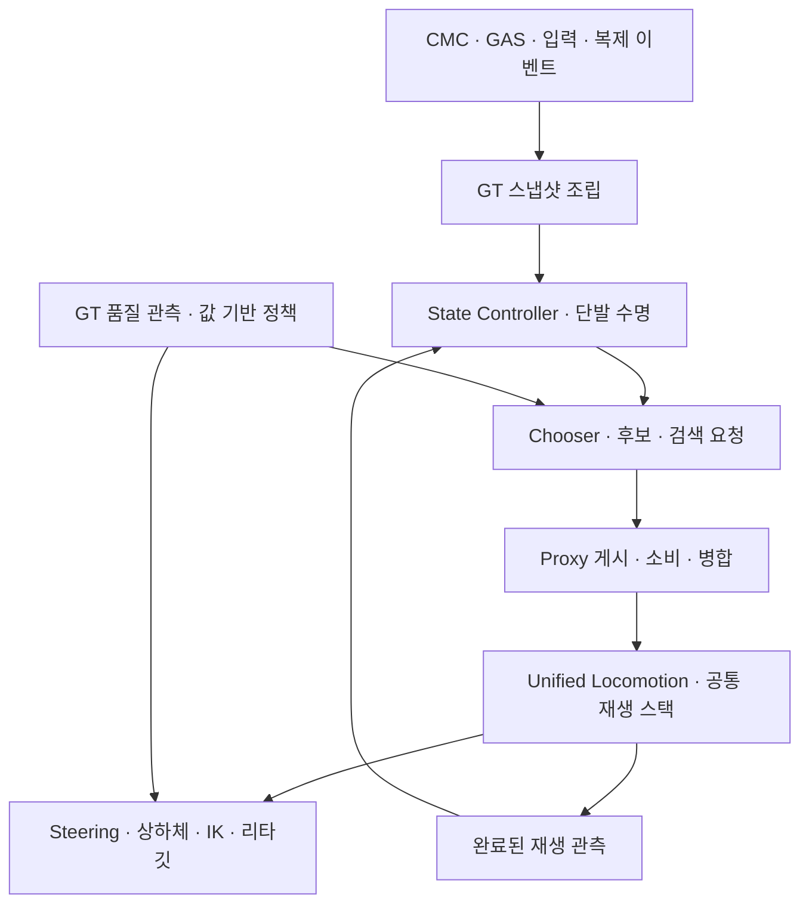

# 애니메이션 파이프라인 리팩토링 — 2026-10-13

후속 [R20 Strafe 대각 보정 복구](../../Review/Audits/Project_J_Strafe_Diagonal_Warp_Repair_2026-10-15.md): sample selector의 소유권은 아직 Update되지 않은 Input.Player의 lazy 연결에 의존하면 안 된다. 엔진이 graph 진입 전에 설치한 현재 helper Player를 compiled allocation/sample index로 확인하고, 정확한 authored pose index/asset 검사를 유지한다.

## 목적과 기준선

통합 재생과 Strafe/Land 개선을 보존하면서 판단·재생·엔진 연결·품질 예산의 경계를 정리했다. 동작 수치, PSS/PSD, CMC/GAS 및 네트워크 프로토콜을 동시에 바꾸지 않는다.

기준선은 HEAD `65da14e8`에 아직 커밋하지 않은 숙인 상체 yaw 및 착지 후 MM 재선택의 관성 보간 수명 보완까지 포함한다. 기존 변경을 보존했다. 원본은 `Saved/Validation/AnimationRefactor_20261013/BeforeSource`와 `BeforeSourceHashes.json`, 에셋 해시는 `AssetHashes.json`에 있다. CPU 실행별 소스 manifest와 실행 조건을 별도 보존한다. 이전 DLL 파일 자체의 복구 snapshot은 만들지 않았다.

## 데이터와 실행 계약

물리 착지, 표시 소유권, 검색 자격, 완료 관측은 다른 계약이다. 표시 복귀로 물리 착지나 복제 이벤트를 취소하지 않는다. 첫 복귀의 후보 자격 알림도 기존 GT 순서와 revision 검사를 유지한다.

| 경계 | 구현 | 보존한 계약 |
| --- | --- | --- |
| 데이터 | `Project_JAnimationSnapshot.h` | USTRUCT/필드/패키지 이름·reflected UObject 참조 |
| UE 진입부 | `Project_JCharacterAnimInstance.cpp` | Initialize·NativeUpdate·ThreadSafeUpdate·PostEvaluate 순서 |
| 조립 | `.Snapshot.cpp` | 역할별 물리·입력·원격·탈것·IK 수집 |
| 표시 수명·선택 | `.Presentation.cpp`, `.PresentationUpdate.cpp` | State Controller·Chooser·발 단계·입력 반응·Land release |
| 후보·게시 | `.Search.cpp`, `Project_JMotionMatchingBoundaryPolicy.h` | 새 요청·단발 복귀·Idle·정규화·Turn continuation |
| 재생·복귀 | Unified node, `Project_JPlaybackReturnPolicy.h` | 실제 플레이어 시계·live/inertial 선택·복귀 수명 |
| 엔진 연결 | `Project_JMotionMatchingEngineAdapter.*` | UE 5.8 reflected 필드·설정 복원·검색 실행/완료 |
| 품질 | `.Budget.cpp`, `Project_JAnimationQualityPolicy.*` | 로컬/판정 보호·원본 IK/MM·시각 30/15Hz 정책 |

본체는 약 4,042→578줄이다. 기능 제거 수나 CPU 개선율이 아니다. 기존 AnimInstance와 값 기반 runtime이 상태를 소유하며 새 UObject·tick·작업 큐를 추가하지 않았다. 동일한 Chooser 캐시 초기화 6곳을 `ResetStateControllerChooserCache()`로 모았다. revision 증가·hold 해제·몽타주/탈것 경계는 원래 호출 위치에 남겼다.

`SourceEquivalence.json`은 기존 메서드 65개가 모두 남아 있으며, helper를 펼친 NativeUpdate의 처리 순서와 snapshot 정의가 동일함을 확인한다. 본문을 다시 구성한 메서드는 값 기반 품질 정책을 호출하는 `BuildOptimizationPolicy` 하나다. 이 소스 비교를 실제 실행·네트워크 검증의 대체로 사용하지 않는다.

## 네트워크·병렬 처리

- RPC·복구 property·이벤트 순서·Landing revision·서버 시각의 형식을 유지했다.
- 로컬 입력과 SimulatedProxy의 이동/의미 이벤트 해석은 기존 수집 경로에서 구분한다.
- GT 게시→최신 스냅샷 소비→traversal→검색 완료→관측의 순서를 유지한다. linked layer의 중첩과 미소비 history 요청 병합도 유지한다.
- Proxy의 `AddReferencedObjects`와 queued/consumed snapshot 참조 추적을 유지한다. 데이터 헤더 이동을 GC 소유권 변경으로 해석하지 않는다.
- 새 정책은 UObject·Actor·Component·World를 조회하지 않는다. 엔진 graph와 메시 변경은 기존 Proxy/노드/GT가 수행한다.
- NPC `UE::Tasks`/`ParallelFor` 및 Mass 큐에 애니메이션을 다시 제출하지 않는다. 기존 engine animation update/evaluation을 사용한다.

검색 boundary 정책은 GT가 관측한 pointer equality와 완료 결과 freshness를 값으로 받는다. 정책 자체는 검색을 완료 처리하지 않는다. 실제 graph update에서 검색이 실행됐을 때만 기존 Proxy가 revision을 소비한다. 비활성 노드·중첩 layer의 설정 복원도 유지한다.

## 복귀·품질·엔진 연결

복귀 정책은 기존 live 허용 조건과 전방 Land 관성 수명 유지 조건을 분리한다. 수명은 기존 ReturnBlendTime에서 시작하며 실제 재선택 때 원래 요청 시간으로 갱신한다. 후보 고정·검색 지연이 아니다. reset/cancel/advance 시점과 단발 종료 **0.35초·100cm·3도·85%**를 유지했다.

품질 정책은 GT 관측값으로 원본 IK/MM과 시각 평가 간격을 결정한다. 보호·wake·downgrade·평가 분산·보간·복구는 기존 Coordinator, ABA 등록은 기존 subsystem/mesh가 담당한다. 동일 메시의 제어 소유권을 추가하지 않는다.

엔진 어댑터는 native struct 필드를 cache해 복귀 scope 및 매 프레임 presentation의 반복 이름 조회를 줄인다. 이 미세 변경만으로 전체 CPU 개선을 주장하지 않는다. scope는 진입 당시 reset·inertial·blend·throttle 값을 중첩 상태에서도 복원한다. UE 버전 변경 때 필드와 검색 완료 계약을 재검증해야 한다.

## 호환·설정·진단

`p.ProjectJ.LiveOneShotReturn` 등록을 구 Handoff 파일에서 `Project_JMotionMatchingCVars.cpp`로 옮겼다. Unified/구 Handoff는 같은 accessor를 사용한다. 호환 파일 삭제가 공용 제어 스위치를 함께 제거하는 의존성을 풀었다.

구 Handoff reflected 타입, native fallback MM 및 State Controller getter는 참조·직렬화 계약이 있어 유지한다. 프로필 편집 Category만 `Experimental One Shot`→`Authored One Shot`으로 정리했다. serialized 필드 이름과 기본값을 유지해 에셋 저장 이행이 필요하지 않다. Trace와 CSV 회귀 자료도 유지한다. 새 runtime CVar·clip 이름 필터·키별 금지 규칙을 추가하지 않았다.

## 검증

검증 루트: `Saved/Validation/AnimationRefactor_20261013/`.

| 확인 | 결과 |
| --- | --- |
| 초기 빌드 | 독립 snapshot enum include 및 테스트의 간접 include 의존성을 발견하고 직접 include로 수정. 최초 실패 로그 보존 |
| 최종 Editor/Game | 직접 UBT `VerifiedEditorBuild.log` 12.56초 / `FinalGameBuild.log` 36.99초 성공 |
| 정책·실제 움직임 | `Regression` 72개 중 71개 동작 통과, 미세 입력 보고서 저장만 실패. 전투 5개에는 native fixture의 MissingPalm 호환 경고 각 4개를 보존 |
| 기록 착지·실제 RHI | `Rendered` 12 성공·1 실패. 착지 11회·후속 관성 재선택 6회, 이전 기록과 3,816행 동일. PNG 149개, Frame 825·4410 확인 |
| 보고서/원격 계약 후속 | 미세 입력 보고서 저장 재확인 성공. 원격 검사는 이전 시각 예산 구현과 충돌하던 ‘Coordinator는 절대 tick하지 않음’ 기대를 수정. `ContractsChecked` 4 성공·오류/경고 0 |
| 실제 소켓·지연/손실 | 서버+실제 클라이언트 2개+NPC 200개, 50ms/3%, parallel net 설정으로 성공. exit 0/0/0·timeout 0. 엔진 ToolsetRegistry의 Python 시작 오류는 별도 보존 |
| 고유 동작 검사 | `Regression`·`Rendered`·`ContractsChecked` 합집합 82개에서 성공 확인. 최초 두 실패의 보고서는 보존하며 한 실행에서 모두 통과했다고 표현하지 않음 |
| 200명 CPU 전후 | 이전 2회·이후 2회·이후 재확인 3회, 각 실행 8조건 완료. 아래 수치와 한계 참조 |
| 에셋·설정 보존 | Master·전방 PSS/PSD·플레이어 프로필 해시 동일. Content/Config 변경 없음 |

CPU fixture는 실제 BP·장비·follower·병렬 완료를 포함하는 NullRHI World tick 측정이며 렌더 FPS·GPU·200개 접속 시험이 아니다. 소켓 fixture는 별도 서버·클라이언트 2개와 native NPC 200개다. 자동화·정지 캡처와 사용자 체감을 구분한다.

원격 검사 수정의 근거는 `BeforeSource/Project_JAnimationUpdateCoordinatorComponent.cpp`도 이미 `bCanEverTick=true`, `TG_PrePhysics`였다는 점이다. 클라이언트 시각 평가용 tick과 이벤트 기반 urgent 요구를 구분한다. BeginPlay의 dedicated-server 시각 tick 비활성화는 유지했다. 검사에 맞추기 위해 제품 tick을 없애거나 네트워크 기대를 완화하지 않았다.

### 200명 CPU 비교와 미확정 성능

실행은 `Saved/Validation/AuthoredAnimation_20261005/AnimationRefactorBefore_20261013`, `AnimationRefactorAfter_20261013`, `AnimationRefactorAfterCheck_20261013`이다. 200명·follower 1,800개, 각 조건 120 tick 준비+120 tick 측정, ABA 예산 2ms를 사용했다. 이전/첫 이후는 2회, 재확인은 같은 이후 바이너리로 3회 반복했다. 서로 다른 실행의 표본을 합쳐 개선율을 만들지 않는다. 표의 p95는 반복별 p95의 평균이며 pooled p95가 아니다.

| 조건 | ABA | 평균 이전→첫 이후→재확인, ms | p95 이전→첫 이후→재확인, ms |
| --- | --- | --- | --- |
| Near | off | 18.379→20.833→18.977 | 19.304→25.683→20.073 |
| Near | on | 12.054→13.454→12.345 | 13.321→16.578→12.841 |
| Far | off | 15.230→15.099→15.211 | 16.293→16.261→16.155 |
| Far | on | 10.870→11.173→11.254 | 12.142→12.336→13.454 |
| Hidden | off | 11.298→11.104→11.232 | 12.406→12.239→12.397 |
| Hidden | on | 6.237→6.168→6.237 | 6.540→6.392→6.541 |
| AttackBurst | off | 20.609→21.456→21.536 | 22.671→23.047→24.004 |
| AttackBurst | on | 19.671→21.418→21.302 | 21.892→23.732→24.246 |

첫 이후 근거리의 증가가 커 재확인했다. 재확인의 평균은 이전 대비 Near off 약 +3.3%, on +2.4%, AttackBurst on +8.3%다. 근거리 첫 이후의 최댓값 38.324ms, 재확인의 동시 공격 ABA on 최댓값 30.206ms도 보존한다. 시간 증가를 평균·원거리 결과로 숨기지 않는다. 이후 측정에서 관찰한 시스템 idle 표본으로 과거 측정 중의 백그라운드 부하를 확정할 수 없다.

시각 그래프 업데이트 관찰값은 Near off 23,800, on 11,900, AttackBurst off/on 23,800으로 유지됐다. Far는 평가 분산·ABA에 따라 일부 차이가 있고 Hidden은 모두 0이다. 이는 관찰값이며 실제 engine evaluation 횟수나 검색 횟수가 아니다.

이번 구조 변경으로 전체 성능 향상 또는 성능 회귀 부재를 입증하지 않았다. 동시 공격의 증가 원인을 코드 배치·컴파일 최적화·스케줄링/측정 조건 중 하나로 단정하지 않는다. 더 긴 반복·전후 timer 분해·실제 RHI/플랫폼 예산이 성능 후속 범위다. 원자료는 `CPUComparisonFinal.json`과 각 실행 `cpu.json`이다. 기존 동작 유지와 구조 정리의 성공을 200명 60FPS 달성으로 확대하지 않는다.

추가 worker 분리·전투 품질 감소·원격 클립 매 프레임 복제·CMC/GAS 변경·무조건적인 zero-copy·profile 필드 이름 변경은 비용과 이행 근거가 필요하다. 이번 리팩토링에 섞지 않았다. [착지 후속](../Planning/Strafe_Land_Return_2026-10-13.md), [200명 예산](../Planning/Crowd_Visual_Presentation_Budget_2026-10-12.md), [통합 재생](../Planning/Unified_Locomotion_Implementation_2026-10-12.md)의 당시 수치와 새 결과를 합산하지 않는다.
