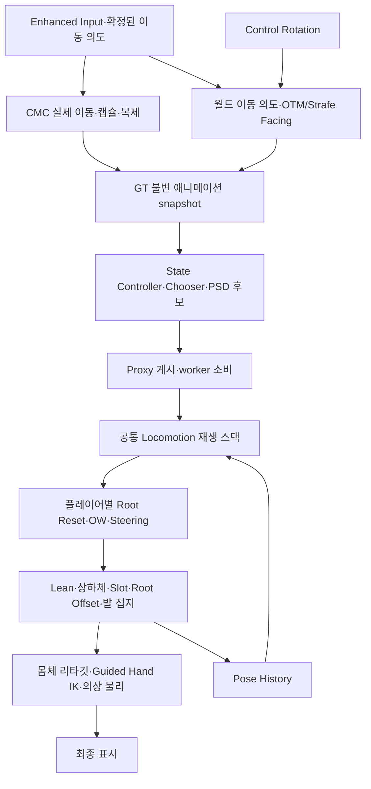

# GASP 5.8 기반 locomotion 전환 책임 정리

상태: **구현 반영 및 자동화·스크립트 PIE 검증 기록. Strafe 8방향 Pivot은 미해결.** 2026-10-20 사용자는 실제 Strafe 플레이에서 여전히 4방향만 동작한다고 보고했다. 아래 선택 테스트·스크립트 PIE 성공을 사용자 실행의 8방향 해결로 일반화한 완료 판정을 철회한다. 원인 재현·수정은 아직 수행하지 않았다. native Pose Match/Mover 전체 이관, 성능·군중 부하·대규모 서비스 검증은 이번 범위에 포함하지 않았다.

기준은 `main`의 `57575b1a1b0469bec1ebdca340cebf0db1a3b865`, UE **5.8.3 / CL 58210709**다. 시작 시 작업 트리는 깨끗했고, 앞선 MMO 아키텍처의 내부 잔여 A는 0이었다. 외부 인증·운영 저장 등의 보류를 애니메이션 완료와 섞지 않는다. 조사 원자료·복구 기준은 이 PC의 `Saved/GASP58Migration_20261019/`에 있다.

## 조사 기준과 실제 설치본

- 원본 GASP: `C:/Users/I/Documents/Unreal Projects/GameAnimationSample`. 원본 Content·설정을 수정하지 않았다.
- GASP 실험본: `Saved/GASP58Migration_20261019/Experiments/GameAnimationSample`. Content 약 5.44GiB와 Config·descriptor만 복사했다. 사본 descriptor에서 설치 엔진의 ModelContextProtocol·AllToolsets·PythonScriptPlugin을 Editor에 활성화했다. 원본 descriptor는 수정하지 않았다. 캐시·Intermediate는 복사하지 않았다.
- Project_J 실험본: 같은 루트의 `Experiments/Project_J`. 캐릭터·애니메이션·소스·설정을 복사하고 약 57GiB의 Map_Resource와 월드 외부 Actor는 제외했다. 실행 폴더와 Content가 분리돼 있다.
- 실제 GASP `DefaultLevel`의 `GM_Sandbox`는 **`SandboxCharacter_Mover`**를 생성한다. 실제 메시의 ABP는 `SandboxCharacter_Mover_ABP`, 입력의 기본 RotationMode는 **OrientToMovement**였다. CMC ABP는 별도 경로다.
- 기존 [5.7.4 CMC 분석](../Planning/GASP_ProjectJ_Naturalness_2026-10-06/02_GASP.md)은 역사 자료다. 그 기본 MM/실험적 State Machine 설명을 5.8 Mover의 기본 경로로 옮기지 않는다.

[Epic의 5.8 발표](https://www.unrealengine.com/tech-blog/download-the-latest-game-animation-sample-project-now-updated-for-ue-5-8)는 개선된 Pose Match Column, Chooser 내부 PSD, BlendSpace 경사 예제를 설명한다. 설치본에서도 `CHT_MoverCharacterAnimations_PoseMatch`의 Pose Match 열 38개와 내부 PSD 6개를 텍스트 exporter로 확인했다. 내부 그룹은 Idle Transitions, Locomotion Loops/Transitions/Spin Transitions/Stops/Traversal Transitions다. 공식 기능의 존재와 이 작업의 채택 범위는 별개다.

## 현재 경로와 결정권

| 책임 | 실제 소유자·소비자 | 이번 경계 |
| --- | --- | --- |
| 키 묶음과 입력 revision | `Project_JPlayerInputBindingComponent`, `Project_JLocomotionAnimStateComponentInput.cpp` | raw IA_Move와 확정된 semantic intent를 혼동하지 않는다. 이동 입력을 늦추지 않는다. |
| 실제 속도·가속·회전·접지 | CMC와 PlayerCharacter | 기존 가속·마찰·회전·prediction·권위 유지. Mover 전환 없음. |
| 궤적·현재 이동 문맥 | `Project_JMotionMatchingTrajectoryComponent`, locomotion component | 월드 의도·실제 속도·Facing을 분리해 기존 snapshot에 게시. |
| 논리 상태·단발 명령 | `Project_JStateControllerRuntime`, AnimInstance의 `.Presentation*` | 명령·선택 revision은 실제 교체/취소 사건에만 갱신. 물리 착지 입장 수명과 시각 clip 수명 분리. |
| 후보와 선택 | Chooser, `Project_JMotionMatchingAssetSet`, `.Search.cpp`, Proxy | 기존 방향·gait·행동 자격과 첫 복귀 검색 보존. |
| 포즈·재생 시계 | `FAnimNode_ProjectJLocomotion` | 단발과 MM이 같은 플레이어 스택·sample graph를 사용. 별도 출력 스택 추가 없음. |
| 작은 방향 변화 | 기존 Steering·OW·Root Offset | 실제 클립 진행을 유지하면서 보정. 새 캡슐 writer나 카메라 보간 추가 없음. |
| 큰 변화·취소·완료 | 입력 호환성 판정·기존 Turn 정책·authored early transition·실제 재생 완료 | 지원 범위를 넘는 입력은 기존 MM/Turn 복귀. 공격·회피·피격 우선권 보존. |
| 서버 판정 포즈·소켓·notify | 기존 GameplayPose·전투·SSR·ASC/Avatar 수명 | 거리만으로 끄지 않고 시각 품질 계층과 분리. |

GT에서 Actor/UObject 문맥을 조립하고 기존 Proxy가 worker용 값과 참조를 게시한다. 새 worker의 Actor 조회, 별도 task/tick/전역 manager, 매 프레임 포즈 복제는 추가하지 않는다. snapshot의 수명·GC·linked layer 중첩 계약은 [기존 파이프라인](Animation_Pipeline_Refactor_2026-10-13.md)을 따른다.

## 문제·실험·선택 근거

실물에서 확인한 사실과 설계 판단을 다음처럼 구분한다.

| 분류 | 확인한 내용 |
| --- | --- |
| 현재 사실 | Project_J에도 MM·Chooser·Pose History·Blend Stack·Steering·OW·Root Offset이 이미 있다. 이를 신규 도입 기능으로 세지 않는다. |
| 실행 사실 | GASP 기본 OTM에서 W+완만한 Control yaw 변화 중 같은 Run Start와 Sprint Landing이 유지됐고, 180도 변화에서 Turn으로 바뀌었다. |
| 원인 근거 | Project_J trace는 호환되는 Start를 `ContinuousCurveToCycle`로 해제했다. 별도로 물리 착지 상태가 끝나면 시각 Landing도 `LandingReleasedToMM`으로 해제했다. |
| 설계 변경 | 누적 곡선 증거는 Cycle 후보 라우팅에 사용하되, 그 자체로 현재 authored 단발을 취소하는 두 번째 소유자로 사용하지 않는다. 착지 입장 타이머도 클립 완료 권한을 갖지 않는다. |
| POC 결과 | 같은 입력의 Start가 약 0.37초에서 약 2.3초의 authored 진행으로 이어졌고, 작은 회전마다 selection revision을 다시 발급하지 않았다. Landing도 호환 이동 중 유지되며 입력 해제·급반전·공격 등 실제 사건에 반응했다. 이 시간은 관찰값이며 입력 지연/성능 계측값이 아니다. |

첫 GASP 입력 fixture의 positional Rotator 축 전달 오류, 환경 의존성을 뺀 Project_J 맵에서의 낙하, 템플릿 바닥 턱에 막힌 이동, 원본에 남아 있던 PIE_Client 설정의 서버 월드 관찰은 구분해 보존했다. 이들을 품질 개선이나 동일 조건 성공의 근거로 사용하지 않는다. 화면 캡처가 실행 시간을 교란한 기록에서 지연 수치를 산출하지 않는다.

### 구조 대안

| 안 | 해결 범위·장점 | 비용·위험과 판단 |
| --- | --- | --- |
| 최소 수정 | hold/각도/블렌드 수치 조정 | 물리 상태·곡선 판정·재생 수명의 중복 권한이 남는다. 이번 원인의 해법으로 선택하지 않았다. |
| **중간 재설계 — 원본 채택** | CMC와 공통 재생 기반에 GASP의 committed transition + live correction 경계를 적용. 중복 조기 해제 상태 제거, 실제 8방향 데이터 연결 | 기존 전투/네트워크/몸체 계약을 유지하면서 실제 재현을 해결할 수 있었다. 원본 기본 경로에 적용하고 새 빌드·집중 회귀·PIE로 확인했다. |
| GASP 중심 전체 기반 이관 | State Controller·Pose Match Chooser·내부 PSD·BlendSpace를 중심으로 선택/재생/보정 재구성 | Mover Pawn의 업데이트·floor·입력 구조, Pose History 문맥, 기존 Strafe·서버 포즈·몸체 계약을 적응시켜야 한다. CMC 대안도 별도다. 이번 POC와 같은 개선을 얻기 위해 전면 교체가 필요하다는 근거는 확보하지 못했다. 통합·품질 검증이 끝난 것처럼 활성화하지 않는다. |

전체 이관을 이름만 바꾸거나 현 구조 위의 추가 계층으로 제안하지 않았다. native Pose Match Column은 설치 엔진에서도 Experimental이며 history가 없으면 선택 실패 경로가 있다. 채택하려면 GT 명령 선택과 worker history의 시점·초기화/LOD 복귀·유효 entry 구간·대체 경로를 함께 검증해야 한다. 새 기술이라는 이유만으로 기존의 검증된 재생·전투 계약을 교체하지 않는다. [Mover](https://dev.epicgames.com/documentation/en-us/unreal-engine/mover-in-unreal-engine) 교체는 별도 승인 대상이며 이번에는 요청하지도 적용하지도 않았다.

### 확인한 노드 옵션과 함수 경계

| 설치본의 실제 항목 | 읽은 값·바인딩 | 적용 판단 |
| --- | --- | --- |
| GASP `AnimGraphNode_BlendStack_3` | Blend 0.2, QuadraticInOut, MaxActiveBlends 4, StoreBlendedPose, ResetOnBecomingRelevant, BlendSpace UpdateActiveOnly | 진입 시 선택한 재생과 갱신되는 보정의 분리 참고. Project_J 스택을 추가 중첩하지 않음. |
| GASP locomotion transition | `OnStateEntry_LocomotionTransition`에서 Chooser 선택·미래 Facing 저장, `OnUpdate_LocomotionTransition`에서 Facing RInterpTo 4 | 진입 선택을 작은 yaw 변화마다 재발급하는 구조가 아님. 입력 호환성·실제 종료는 Project_J 정책으로 적응. |
| GASP Root Offset | Graph, rotation Accumulate, translation Interpolate, translation half-life 0.2 / rotation 0.1, max translation 30; authored `OnUpdate_OffsetRootBone`와 직렬화 node callback `OffsetRootBone_OnUpdate` 구분 | UObject 문맥과 node update를 이름만 보고 동일 함수로 취급하지 않음. 기존 Project_J snapshot 소비 유지. |
| GASP Feet ControlRig | `Biped_FootPlacement_OnBecomeRelevant` | relevance 진입 초기화 책임 확인. 현재 FootPlacement/LegIK 교체는 미채택. |
| Project_J Graph OW | RootBoneTransform, Z, extracted root motion, min speed 10, interp 10, counter compensation 45, LODThreshold -1 | `ik_foot_root`, `ik_foot_l/r`, spine chain, enable_warping 계약 유지. manual root velocity로 덮지 않음. |
| Project_J Steering sample | procedural target 0.2, animated target 2, scale ratio 0.5–1.5, LODThreshold -1; exposed snapshot 입력, 별도 BP Update callback 없음 | 현재 sample asset/index의 유효성을 확인하는 R20 경계 유지. GT 정책은 `.Presentation/.Continuity`, worker는 node 입력 소비. |

위 값은 노드 직렬화·속성을 읽은 값이며 동적 exposed pin의 최종 runtime 값과 같다고 단정하지 않는다. source `AnimNode_ProjectJLocomotion.cpp`, `Project_JCharacterAnimInstanceProxy.cpp`, `.Snapshot.cpp`, `.Presentation*.cpp`가 명령 시계·첫 복귀 검색·게시 시점을 소유한다. 초기화는 기존 node Initialize와 Proxy 초기화, 재진입은 명령 revision·relevance, 원격은 기존 replicated locomotion 의미 입력을 사용한다. 추가로 켠 노드나 순서 변경은 없다. LOD 복귀의 기존 정책 회귀와 실제 모든 LOD 전환의 시각 검수는 구분한다.

## Start·Landing·Pivot의 구체적 정책

### 작은 회전과 큰 회전

W 유지 + 작은 마우스 회전은 camera-relative로 같은 입력이다. 기존 `FProject_JOneShotInputResponse`가 키 방향 변경과 실제 Facing/Path 오차를 판정한다. 유효한 로컬 Steering snapshot 안에서는 같은 클립·entry time·selection revision을 유지한다. 방향별 클립 이름의 변경 자체를 품질 기준으로 사용하지 않는다.

Start는 authored early-transition 창 또는 실제 재생 완료에서 Cycle로 돌아간다. 새 키 방향, 보정 범위를 넘는 실제 방향 오차, 입력 해제, 공중/전투/탑승/다른 pose owner는 기존 경계로 처리한다. 선택된 단발 아래에서 또 다른 MM Turn을 동시에 실행하지 않고, 관측한 회전 문맥을 복귀 검색에 전달한다.

Landing은 물리 접지·impact revision·강도와 시각 클립의 수명을 분리한다. 물리 입장 상태가 끝났다는 이유로 클립을 자르지 않는다. 실제 접지가 사라지거나 새 착지/입력 변화가 오면 기존 취소·교체 경로가 우선한다. Sprint 해제는 실제 gait 변화이므로 기존 즉시 복귀를 유지한다. 캡슐 이동을 잠그거나 접지 포즈를 무시하는 reset/timer는 추가하지 않는다.

Diamond/Hourglass는 Project_J의 Cycle 데이터에도 있는 실제 이동 형상 이름이다. GASP Mover의 이번 Start/Landing 선택 기록은 Relaxed Start/Land와 slope BlendSpace/Loop였다. `CHT_MoverCharacterAnimations_PoseMatch` 텍스트에는 Diamond/Hourglass 결과가 없었다. “마우스를 조금 돌리면 두 이름을 바꾸기”를 요구사항으로 만들지 않았다.

### 이전 8방향 실패와 통합 전 4방향 제한

**2026-10-20 사용자 실행:** 데이터 행 활성화와 제한 제거에도 실제 Strafe에서는 4방향만 동작한다. 아래는 구현·격리 검증 근거이며 현재 문제 해결 완료의 근거로 사용하지 않는다. 원인은 아직 확정하지 않았다.

통합 전 4방향은 앞↔뒤·좌↔우의 authored 반전 가족이며, Chooser에는 양발을 합한 활성 8행이 있었다. 실제 테이블 전체는 **8방향×양발 16행**이고 대각 8행이 비활성이었다. 통합 후 16행 모두 활성이다. Neutral 대각 원본 클립도 존재한다. 따라서 과거의 “대각 Pivot 에셋이 없다”는 설명은 현재 데이터에 적용할 수 없다.

Git `6c9834b1`의 시도, `f7b5068c`의 cardinal 입력 제한, 후속 semantic intent/취소·요청 수명 수정은 구분했다. 과거의 대각 시각 실패 전체를 현재 코드만으로 확정하지 않았다. 현재의 확실한 도달 불가는 `IsCardinalPivotIntent`/`DiagonalIntentUnsupported`와 비활성 행이었다. 실제 대각 루트 이동을 샘플링했고, 메시의 -90° 기준을 포함해 클립의 진행 방향을 해석했다.

| Pivot 대안 | 판정 |
| --- | --- |
| A. 8방향 명시 분류+coverage | 기존 8 sector와 실제 대각 클립을 활용했다. 새 방향 enum/미러 데이터/클립을 만들지 않는다. |
| B. 연속 trajectory·pose 검색 | 일반 MM의 강점이나 기존 전용 Pivot PSD를 그대로 활성화하는 것은 현재 제작 경로와 다른 책임 이관이다. 이번 기본 경로로 선택하지 않았다. |
| C. 기본 데이터+제한된 warping | 기존 Graph 모드 OW와 추출된 root motion을 유지한다. 없는 대각선을 cardinal clip의 큰 회전으로 대체하지 않는다. |

속도·실제 반전 각도·Run/Combat Strafe·로컬 owner·이전 안정된 이동 의도·공중/착지 배제·semantic revision 소비 조건은 유지한다. 카메라 회전만으로 새 키 명령을 만들지 않는다. 새 입력이 이전 Pivot을 취소할 때 실제 속도/각도 자격이 부족하면 Cycle MM으로 복귀하며, 무조건 두 번째 Pivot을 강제하지 않는다. ±179°·180°와 양발/연속 반전 회귀를 수행한다.

## ABP·노드·데이터 지도와 채택 범위

| 실제 그래프/계층 | 입력→출력·현재 책임 | 이번 판단·순서·품질 계층 |
| --- | --- | --- |
| `ABP_Humanoid_Master` | 공통 locomotion→Lean→CombatUpperBody→UpperBody/Default Slot→AO→Root Offset·FootPlacement/LegIK→Pose History→Strafe Lower/Upper Facing→보행/탑승 출력 | 공통 스택·cached pose·inertial return 유지. 또 다른 상태 머신/출력 스택 추가 없음. |
| Master sample graph | 플레이어별 Root Reset·Graph OW·Steering, authored/regular 보정 선택 | 현재 sample의 asset/index 소유권 보존. 알파 수치만으로 보정이 실행됐다고 판단하지 않는다. |
| `ABP_Greatsword_Layers.CombatUpperBody` | 입력 pose+무기 자세/BlendSpace→상체 합성 | 무기 책임 유지. 전신 locomotion/Facing writer로 옮기지 않는다. |
| `ABP_Greatsword_Woman_RunTIme` | source pose→런타임 retarget→몸체 Guided Hand IK→의상 RigidBody | 비율·손 접촉·물리 순서 유지. source 발 보정을 몸체 손 IK로 중복 구현하지 않는다. |
| `ABP_UEFN_Mannequin_PostProcess` | 입력 pose의 head/thigh/foot 보정 | 원본 PIE의 Quinn source·Greatsword 몸체·의상 모두 post-process 할당/활성 인스턴스 없음. 이 그래프는 이번 Pawn의 활성 후처리가 아니며 별도 FootPlacement도 아니다. |
| Greatsword 의상 파츠 | 별도 AnimInstance 없이 표시 몸체를 leader pose로 따름 | PIE의 Hel/Lower/Sho/Upper/Hand/Inner/Foot/Cloak 연결 확인. source와 몸체 역할을 합치지 않음. |
| Player/Unarmed/탑승 ABP | 테스트·다른 소비 수명의 자산 | 비참조라는 이유로 삭제/통합하지 않는다. 현재 보행 기본 경로와 활성 여부를 구분한다. |
| GASP Mover의 Feet/PreLayering/FullBody linked layer | 바닥·상태별 ControlRig/기본 IK, pre-layer root 보정, 추가 전신 보정 | 구조 비교에 사용. 탑승·상호작용·ragdoll 콘텐츠를 함께 이관하지 않는다. |

| 기능 후보 | 입력/공간·효과 | 채택·상호작용·LOD/실패 조건 |
| --- | --- | --- |
| Inertialization/Dead Blending | pose 변화·속도의 완화 | 기존 inertial return 유지. 같은 전환에 새 dead blend를 겹쳐 이중 완화를 만들지 않는다. |
| Steering/Root Offset | 현재 clip의 root 정보와 미래 Facing, component/world 경계 | 기존 profile 기반 범위 유지. capsule 회전과 시각 root를 구분. stale/불완전 trajectory·다른 owner에서 생략. |
| Orientation Warping | root-motion 방향과 이동 방향, component-space 뼈 | 기존 Graph 모드와 bone/curve 계약 유지. 단발 sample selector의 실제 실행 확인. |
| Stride/Slope Warping·slope BlendSpace | 속도·바닥 법선·authored stride/경사 pose | 설치본 기능은 확인. 현재 CMC·리타깃 발 접지와 별도 보정의 이득을 입증하지 않아 추가하지 않음. 기존 이동 범위의 지면 대응을 보존. |
| FootPlacement/LegIK | 접촉/골반·발 chain, component-space | 기존 공통 source 접지와 후처리 순서 유지. 멀리서 alpha0이라는 이유로 비용0으로 쓰지 않는다. |
| AO/Lean/상체 additive | 조준·가속과 로컬/메시 공간 | 무기·체형 레이어 유지. 전투 방향과 OTM을 하나로 강제하지 않는다. |
| Pose caching/linked layer/retarget | 공유 pose와 서로 다른 몸체·무기 수명 | 기존 소유권과 준비/해제 경계 유지. 거대 ABP 하나로 합치지 않는다. |
| Physics Control/전신 ragdoll/Mover·SmartObject | 별도 물리/이동·콘텐츠 책임 | locomotion 이번 범위에 도입하지 않음. 새 climb/vault/의자/탈것 콘텐츠 없음. |

Master의 Pose History는 source 접지 후, Strafe Lower/Upper Facing 앞에 있다. GASP의 마지막 collector와 동일한 순서라고 쓰지 않는다. 이번 변경에서 순서를 바꾸지 않았으며 후단 Facing까지 포함한 history가 더 나은지 별도 비교하지 않았다.

최상위 품질, 가까운 전투 대상, 중/원거리의 분기는 기존 source/visual 예산으로 유지한다. `ResolveSourceQuality`와 `ResolveVisualInterval`, Coordinator/ABA, retarget 정책을 사용한다. 서버 GameplayPose와 로컬/전투 보호를 먼저 적용한다. update/evaluate skip은 노드의 실제 LOD·relevance·컴포넌트 스케줄과 함께 판단하며, 화면 밖/alpha0만으로 비용 소멸을 가정하지 않는다. 품질 복귀·초기화 회귀는 변경과 연결된 기존 테스트를 재사용한다. 검색/DB 메모리·IK·리타깃·서버 pose 비용의 정량 측정과 군중 최적화는 후속이다.

## 변경·복구·제작

원본 새 빌드에서 기존 테스트의 익명 namespace `Flags`가 Unity translation unit 안에서 충돌했다. `MMOArchitectureTestFlags`, `PersistenceTestFlags`, `MeshLODAuthoringTestFlags`로 식별자만 바꿨다. target·PCH·Unity 옵션을 바꾸거나 캐시를 지워 회피하지 않았다.

POC는 새 애니메이션을 제작하지 않았다. Pivot Chooser의 기존 대각 8행 활성화가 데이터 변경이다. Start/Stop/Land의 clip·gait·양발·Light/Heavy·entry time, 기존 PSD/PSS 가중치와 정규화, retarget/장비 자산은 유지한다. 코드에서는 곡선 조기 해제의 상태·getter·후속 분기를 제거하고 실제 재생 회귀를 새 위상 계약으로 교체한다. 이전 3개 튜닝 필드는 기존 DA/BP 직렬화 호환을 위해 deprecated 읽기 값으로 남기며 runtime 소비자는 없다.

단계는 기준/복구점 확보→설치본 조사→격리 POC→직접 빌드·집중 회귀→원본 소스/Chooser 반영→새 원본 빌드·ABP/참조/PIE/복제 확인이다. 원본 파일을 바꾸기 전에 task Saved에 before copy와 목록을 남긴다. 복구는 변경 파일만 before copy 또는 기준 HEAD와 대조해 되돌리고 direct UBT로 다시 빌드한다. 다른 사용자 파일·저장 데이터·캐시 전체를 reset하거나 옛 DLL을 복원하지 않는다. GASP 실험본은 원본과 분리돼 있어 원본 복원이 필요하지 않다.

재현 맵은 `/Game/Developers/GASP58POC/L_BasicLocomotion`이다. 엔진 기본 바닥/조명, 멀리 떨어진 12도 큐브 경사로와 기존 게임 모드를 쓰는 개발용 자산이며 기본 게임 맵이나 배포 경로를 바꾸지 않는다. 실제 입력 replay는 task Saved의 `GASPScenario.py`/`ProjectScenario.py`에 보존한다. 입력 의도, 실제 velocity, control/actor 방향, 선택·entry·revision·Steering·MM 진행을 함께 기록한다.

### 재현 순서

1. 설치 엔진의 direct `UnrealBuildTool.exe Project_JEditor Win64 Development -Project=<Project_J.uproject> -WaitMutex -NoHotReloadFromIDE`로 빌드하고 정상 종료를 기다린다. 관련 Editor/UBT/dotnet/LiveCoding/MSBuild/ShaderCompileWorker가 있으면 새 빌드를 시작하지 않는다.
2. 개발 맵 `L_BasicLocomotion`을 Standalone 1인으로 연다. W 출발 중 천천히 카메라를 돌리고, Sprint→Jump→이동 Land 중 같은 입력을 유지한다. 같은 clip·selection revision의 진행과 180도 입력의 MM 복귀를 구분한다. 입력 해제·재입력, 무기 장착/해제·공격 뒤 복귀도 확인한다.
3. Combat Strafe에서 BL→FR, BR→FL, FL→BR, FR→BL을 각각 안정된 달리기 뒤 실행한다. 카메라만 돌려 새 입력 revision을 만드는 것과 실제 반전 입력을 혼동하지 않는다. 네 방향 가족의 실제 선택은 PIE, 양발/±180도 coverage는 `ProjectJ.StrafePivot` 자동화를 사용한다.
4. 맵의 x=10000 부근 기본 큐브 경사로는 12도, 길이2000cm다. x=8800의 평지에서 +X로 진입해 경사→낙하→착지→정지/재출발을 확인한다. 바닥과 겹친 위치에 Pawn을 직접 스폰하지 않는다.
5. 2인 PIE는 ListenServer, 2 players, one process로 실행한다. 두 PlayerStart는 (-600,0,150), (-600,400,150)이다. owner/server/simulated proxy의 이동·공중·전투 진입/해제·공격과 종료 후 잔존 상태를 확인하고 작업 전 PIE 설정으로 복구한다.

현재 입력에는 독립 Walk toggle/회피 action이 없다. 속도 기반 기존 gait와 Run/Sprint, 기존 공격/취소 경계를 검사했으며 없는 회피 기능을 시험했다고 쓰지 않는다. 새 Walk/회피 콘텐츠는 만들지 않았다. 고정 입력 재생 자동화는 실제 Blueprint·GAS·CMC·pose history·공통 플레이어를 평가하며, 실행 Hz가 성능/FPS 비교 행렬을 의미하지 않는다.

## 검증과 남은 확인

| 단계 | 현재 근거·상태 |
| --- | --- |
| 시작점/복구 | `Baseline.json`, main HEAD, 원본 Content metadata, 분리된 실험 파일 |
| MCP | 8003 GASP / 8000 Project_J. 각각 clone Saved identity 읽기와 실제 PIE Pawn·ABP 조회 성공. 원본 경로도 별도 identity 확인. |
| 도구/컴퓨터 사용 | tools/list→list_toolsets→describe_toolset 후 호출. Blueprint graph/node/pin·속성·Chooser exporter·PIE 실행. UI에서 실제 모드·뷰포트·캐릭터/무기 확인. graph DSL 빈 반환과 protected 속성 한계를 기록. |
| POC 직접 빌드 | 최초 440 action 빌드, 정리 후 93 action 빌드 모두 종료0. 실행 중 빌드를 중단하거나 에디터와 겹쳐 새 빌드를 시작하지 않음. |
| Pivot POC | 기존 데이터 활성화 native 시험1개, Pivot 회귀3개 통과. 확장 선택 회귀는8방향×양발×5 yaw=80개 조합. |
| 위상/입력 POC | authored phase lifetime·작은 곡선·입력 호환성·기존 곡선 라우팅을 포함한7개 계약 회귀 통과. |
| 원본 자동화 | 새 원본 바이너리에서41개(38 Success+3 경고 동반), 실패0·미실행0. 실제 ABP 고정 입력80장면과8방향×양발×5yaw 선택80조합 포함. 성능/FPS 비교가 아니다. |
| 원본 빌드·ABP·참조 | direct UBT 성공(기존 Unity 식별자 충돌 정리 후11 actions). ABP4개 컴파일, 직접 hard/soft 참조6자산66개 항목에서 누락0. |
| 원본 PIE | 기본 OTM/Strafe 입력640표본, 대각 네 반전 가족520표본, 경사·FallOff·착지·재출발188표본 완료. 기존 표시 몸체·무기·손 접촉과 의상 상태를 화면에서 확인. |
| 원본 2인 복제 | ListenServer+Client, 한 프로세스의 실제 두 PIE 월드.148표본×4 Pawn 표현에서 Authority(local/remote), AutonomousProxy, SimulatedProxy 확인. 이동·공중·전투/공격·해제 후 상태 정리 및 정지 후 위치 수렴 확인. 장애/지연/CCU 검증이 아니다. |
| 사용자 설정·보존 | 정상 종료 후 기존 PIE_Client/1인/one process/separate server false의4값만 복원. GASP Content3898개와 Config7개 보존, Project_J 기존 Content14409개 중 Pivot만 변경하고 전용 개발 맵 추가. |
| 성능·군중/FPS/장애 네트워크 행렬·전체 Cook | 미실행. 이번 완료 범위 밖. |

### 최종 증거·한계

[검증 요약과 파일별 SHA256·변경 목록](GASP58_Locomotion_Validation_2026-10-19.json)에 새 원본 결과와 대표 raw receipt의 지문을 모았다. 원자료는 `Saved/GASP58Migration_20261019/`이며 Git 공유 대상이 아니다. 로그 전체에 오류가 없다고 쓰지 않는다. 엔진 자체 automation 초기화 오류 출력과 입력 fixture의 API/관찰 오류는 원래 기록에 남아 있고, 최종 결과와 구분했다.

원본41개 중3개는 경고 동반이다. `AuthoredCurvePlayback`의 기존 GameplayCue 전체 경로 탐색·초기 PoseSearch 비동기 인덱스 경고, `TwoHandIKTransitionAndCurve`의 임시 Character fixture에 소켓이 없는 sheathe 실패 경고, `GatewayRealHTTP`의 의도한 로컬 HTTP 제한 검사 경고다. 테스트 assertion 실패는0이다. 초기 곡선 재생의 첫 복귀 검사6개 실패는 기대값을 완화하지 않고 이전 평가의 게시 snapshot 대신 실제 활성 MM 노드를 읽도록 고쳤다. 재검증에서 두 사례 모두 실제 `ForwardCycle/Run_Loop_F`를 선택했고 새 원본80장면에서도 통과했다.

| 실제 원본 화면 | 의미·한계 |
| --- | --- |
| [Landing](Evidence/GASP58_2026-10-19/Landing.png) | W+완만한 회전 중 같은 Sprint Landing 진행. 정지 화면만으로 foot sliding 수치를 주장하지 않는다. |
| [대각 Pivot](Evidence/GASP58_2026-10-19/DiagonalPivot.png) | BR→FL 실재생과 무기·몸체. 나머지 세 가족도 선택/재생 기록과 캡처 보존. |
| [경사](Evidence/GASP58_2026-10-19/Slope.png) |12도 경사 이동, 이후 FallOff·Heavy Landing·재출발 관측. 새 slope solver를 추가하지 않음. |
| [2인 공격](Evidence/GASP58_2026-10-19/TwoPlayer.png) | 실제 두 Pawn의 공격 표현. 완료 시 두 player id 모두 combat/air/montage 잔존 없음. |

기본 replay에서 첫 Start는1.03초부터3초대까지 같은 selection revision4를 유지했고, Sprint Landing은7.03~8.97초 동안 revision8을 유지했다. 180도 입력에는 MM으로 복귀했다. 대각 네 가족은 실제 입력으로 각각 선택됐으며 새로운 입력이 자격을 충족하지 않으면 Cycle 복귀를 유지했다. 정량적인 foot sliding·입력 지연·검색/메모리 비용은 계측하지 않았다. 급격한 pose 폭발·사라짐·종료 후 단발 잔존은 대표 실행과 화면에서 관측되지 않았지만, 모든 체형·의상·클립·LOD의 시각 품질 전수 승인으로 확대하지 않는다.

설치본 source/graph 조사, 추가 후보 비교, 실제 적용과 명시적 제외는 위 표의 범위다. 군중 성능·지연/손실/FPS 행렬·전체 Cook/Shipping·native PoseMatch 도입 안정성은 미실행이다. 이 작업을 위한 추가 설치·방화벽/보안 변경·외부 배포·commit/push/PR은 없었다. 필수 정책 질문이나 연결/권한 차단은 남아 있지 않다.

GASP 방식의 MMORPG 적합성은 분리해 판정한다. committed clip+연속 보정 원리는 **반응성 정책을 적응해 활용**한다. Chooser/Pose Match/내부 PSD는 설치본의 강점이지만 이번에는 **기존 선택 계층을 유지하며 별도 이관 후보**로 남긴다. ControlRig·전신 물리·Mover·상호작용은 **필요한 계층/후속 콘텐츠에만 검토**한다. 대규모 인원 비용을 감당한다는 판정은 하지 않았다.

사용자가 직접 볼 항목은 출발 첫발의 무게감, W 유지 완만한 회전의 몸/다리 연결, 착지 지지발과 다음 달리기, 전투 후진·대각 반전의 가독성, 무기 장착/해제·공격 취소 뒤 복귀다. 객관적 재생·복제 검증과 사용자의 최종 주관적 선호 승인은 구분한다.
