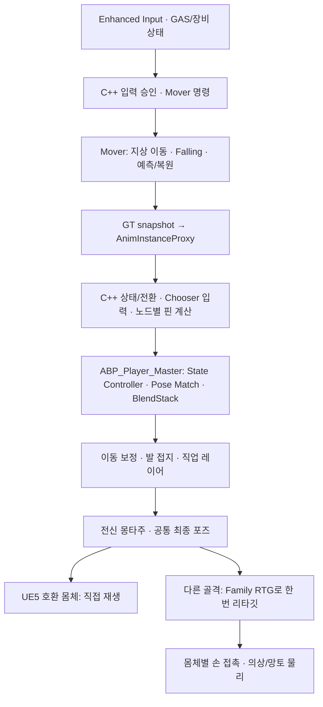

# 플레이어 로코모션 아키텍처

Project J의 이동 애니메이션은 **Mover 이동 시뮬레이션, C++ 상태·선택 계산, 데이터 기반 포즈 재생, 몸체별 표현**으로 구성한다. 공통 마스터 `ABP_Player_Master`를 플레이어·대검·현재 테스트 NPC가 공유한다. 직업마다 이동 그래프를 복사하지 않고 전투 레이어와 제작 프로필을 확장한다.

이 문서는 2026-10-21 현재 구현의 시작점이다. 시점별 원인·실패·복구·실행 결과는 [전환·검증 기록](Player_Locomotion_Migration_2026-10-19.md), 실제 제작 절차는 [이동 콘텐츠 확장](../Authoring/DataDrivenLocomotionExtensionGuide.md), 골격과 추가 뼈는 [스켈레톤 제작 기준](../Authoring/HumanoidSkeletonRetargetingStandards.md)을 따른다.

## 입력에서 표시 포즈까지



도식은 주된 책임 흐름이다. 실제 슬롯·레이어·보정 순서는 생산 그래프의 연결을 기준으로 한다. 전신 스킬 뒤에서 로코모션 발 보정이 하체를 다시 덮지 않아야 한다. Pose History, mounted 선택과 각 노드의 콜백 시점은 그래프에 남는다.

## 책임과 실행 시점

| 담당 | 소유하는 값과 동작 |
| --- | --- |
| PlayerState·GAS·장비 | 지속 상태, 능력·장비 권위, 공격·입력 차단과 공개 상태 복제 |
| Mover 및 native 이동 코드 | 승인된 이동 의도·속도 제한, 지상/공중 시뮬레이션, 충돌·착지와 예측 상태 |
| `UProject_JPlayerAnimInstance`·proxy | GT에서 수집한 값의 worker 전달, 상태·전환·선택 조건, 재생 요청과 노드별 계산 |
| `ABP_Player_Master` | 포즈 노드 연결, StateEntry/OnUpdate/BecomeRelevant 호출 시점, 슬롯·레이어·Pose History |
| Chooser·PSD·BlendSpace·프로필 | 후보·검색 기준·전환 출력·튜닝과 제작 데이터 |
| 표시 몸체 프로필·ABP | 골격별 리타깃, 손 접촉 역할·소켓, 해당 몸체의 물리·추가 뼈 |

프레임 계산과 핀 입력은 native 상속 프로퍼티·함수를 사용한다. 마스터 BP 소유 상태 변수는 0개다. BP 중계 함수를 제거하면서 Property Access·노드 바인딩·Chooser 함수 경로도 함께 이주했다. 같은 계산 함수라도 player별 재생 시각·커브·NodeRef가 다르면 결과를 전역 캐시로 합치지 않는다. 계산을 C++로 옮겼다는 이유로 노드 평가 시점을 변경하지 않는다.

AnimGraph 노드는 엔진의 포즈 평가·스레드·디버깅·제작 경계를 사용한다. 이 연결을 유지하는 것은 BP에 동일 상태 계산을 중복 보관하는 것과 다르다. 서버 권위와 클라이언트 표현, GT 수집과 worker 계산도 별도 책임으로 유지한다.

## 이동과 점프 계약

- **OTM / Strafe:** 두 모드를 유지한다. Strafe Sprint는 전방·좌전방·우전방만 승인하며 측후방 요청은 Run 정책과 일치시킨다.
- **지상:** SmoothWalking 이동 모드와 native 이동 계산을 연결한다. BP 이동 모드는 엔진 override를 잇는 어댑터다. 퇴역한 CMC 전용 입력·TIP·독립 MM 경로를 복원하지 않는다.
- **공중:** 현재 입력·facing·승인 gait에 따라 점프 모션을 재선택한다. 같은 물리 점프의 foot과 실제 playhead 연속성을 보존하고, 새 후보가 재생 시각을 되감지 않도록 한다.
- **관성:** 공중 제어율은 가속도에 적용한다. 입력 해제나 gait 변경만으로 수평 속도를 없애지 않으며, 역방향 입력은 물리적으로 궤도를 바꾼다.
- **착지·큰 방향 전환:** Falling 회전과 착지 전환은 이동 상태·실제 재생 문맥을 사용한다. 카메라 각도 하나로 특정 클립을 강제하지 않는다.
- **네트워크:** 이동의 Independent/Interpolated 정책과 표현용 점프·착지 이벤트를 구분한다. ABP의 클립 선택은 이동·전투 결과의 권위가 아니다.

## 공용 모션과 몸체 확장

공통 Skeleton은 `/Game/Characters/Mannequins/Meshes/SK_Mannequin`, 생산 source mesh는 `SKM_Manny_Simple`이다. 외부 UEFN 라이브러리 448개 시퀀스와 BlendSpace 10개를 Manny용으로 변환해 Chooser·PSD·가산 base·Branch In 연결까지 이주했다. 원본은 재제작 자료로 보존한다. 변환본에 원본 FBX를 직접 재임포트하거나 Skeleton만 바꾸어 덮지 않는다.

같은 Skeleton을 사용하는 `SKM_Quinn_Simple`도 모션을 직접 공유한다. 실제 6클립·두 시점·두 메시의 포즈 평가 24표본을 확인했다. 체형이 다르면 관절 위치와 발·손 접촉은 달라질 수 있다. 현재 Manny 발 Rig의 초기 길이·접지·무기 접촉을 Quinn 플레이에서도 검수하기 전까지 외형 품질까지 검증 완료로 표시하지 않는다.

현재 대검 몸체는 UE5 규격과 다른 Bip01 골격이다. `RTG_Greatsword_Manny`와 `IK_GreatSword_Woman`이 실제 부모 관계에 맞춰 팔·다리·손가락을 대응시킨다. 팔은 UpperArm–Forearm–Hand, 다리는 Thigh–Calf–Foot이며 망토·얼굴·장식 뼈를 사지 체인에 섞지 않는다. 네 limb solver의 시작점·Goal·실제 도달과 팔 방향·무릎 굽힘을 회귀로 검사한다. 몸체의 손 보정은 Body/HandGrip 프로필이 소유한다.

UE5 호환 몸체에 추가 망토 뼈만 있다는 이유로 실시간 리타깃을 추가하지 않는다. 공유 포즈를 쓰는 일반 파츠는 LeaderPose, 독립 추가 뼈 평가가 필요한 파츠는 native CopyPose와 authored Post Process를 사용한다. 호환 Skeleton 등록만으로 기준 포즈·축·관절 길이 차이가 해결되지는 않는다.

## 현재 제작 진입점

| 항목 | 생산 경로 |
| --- | --- |
| 공통 마스터 | `/Game/Animation_Logic/ABPs/ABP_Player_Master` |
| 지상 / 공중 Chooser | `/Game/Animation_Logic/Chooser/CHT_ProjectJ_Ground`, `CHT_ProjectJ_Air` |
| 검색 Schema / Idle Branch | `/Game/Animation_Logic/PoseSearch/PSS_ProjectJ_Manny_*`, `PSD_Player_IdleBranches` |
| 공용 모션 | `/Game/Characters/Mannequins/Animations/Locomotion`, `ProjectJump` |
| 발 보정 | `/Game/Animation_Logic/Rigs/CR_ProjectJ_Manny_FootPlacement` |
| 원본→공용 모션 재제작 | `/Game/Animation_Logic/RTG_Player_UEFN_to_Manny` |
| 골격·몸체 연결 | `/Game/DataAssetSets/Presentation/Retarget/DA_RetargetFamily_Mannequin_Bip01`, `DA_RetargetBody_Greatsword` |

현재 생산 mirror metadata는 `MDT_Player_Manny`지만 검색·재생에 mirrored 후보를 활성화한 것은 아니다. 원본 비교 자산과 제작용 비활성 자산은 생산 후보와 구분하며, 직접 참조가 없다는 이유만으로 제거하지 않는다.

## 검증과 남은 범위

2026-10-21 IK 수정 기준 direct UBT 빌드와 집중 native 회귀 **61개**가 통과했다. 변환본 448개의 **2,240 authored-frame 표본**, 대표 주기의 원본 대비 무릎 굽힘, 실제 OTM/Strafe 지상·Sprint 급회전·공중/착지·전신 몽타주도 확인했다. 자동화는 연결·소유권·수치 계약의 근거이며 전체 클립의 주관적 외형 승인이나 현재 구조의 200명 성능 측정을 대신하지 않는다.

```powershell
./Scripts/Validation/Run-PlayerLocomotionRegression.ps1 -RunName <새로운_실행명>
```

에디터·UBT·dotnet 등 관련 프로세스가 실행 중이면 빌드를 겹치지 않는다. 압축 포즈의 helper 추종은 `Scripts/Validation/Validate-MannyRetargetedKinematics.py`, 실제 입력·몽타주는 같은 폴더의 `Validate-PlayerLocomotion*.py`를 사용한다. 상세 조건과 마지막 결과는 전환·검증 기록을 확인한다. 이전 CMC/MM 성능 보고의 수치를 새 구조의 FPS 개선율로 전용하지 않는다.

## 이전 구조와의 대응

| 이전 기록의 표현 | 현재 의미 |
| --- | --- |
| `ABP_Humanoid_Master`, 구형 `ABP_Player`, 초기 `ABP_ProjectJ_GASP58` | 생산 `ABP_Player_Master`로 정착. 옛 제작 절차를 현재 마스터에 다시 적용하지 않음 |
| `Project Unified Locomotion`, CMC 전용 TIP·곡선/MM 후보군 | 이전 구현·비교 자료. 현재 Mover/상태 선택/재생 경로로 대체 |
| `MotionMatchingAssetSet`, 별도 구형 상태 컨트롤러 | 퇴역한 코드·데이터 계약. 현재 native 상태/Chooser와 포즈 그래프 기준으로 제작 |
| UEFN 호환 직접 재생 | 실험 후 해제. 현재 생산 재생은 Manny 변환본 |

날짜별 보고서는 당시 실패·측정·소스 경로를 보존한다. 현재 파일이 없으면 과거 경로를 현행 API로 해석하지 않는다.

## 외부 기반과 프로젝트 구현

Epic Games의 **Game Animation Sample 5.8**에서 포즈 그래프·상태 선택·이동 보정 구조와 모션 라이브러리를 검토·도입했다. Project J는 이를 프로젝트의 Mover 입력 승인, GAS·장비/전투, 점프 재선택·재생 연속성, native 상태·핀 계산, 골격/몸체 프로필과 회귀·제작 경로에 맞게 통합했다. 샘플 모션이나 엔진 노드를 자체 제작한 것으로 표현하지 않는다. 기술 출처·원본 비교와 과거 명칭은 [전환 기록](Player_Locomotion_Migration_2026-10-19.md)에 남긴다.
