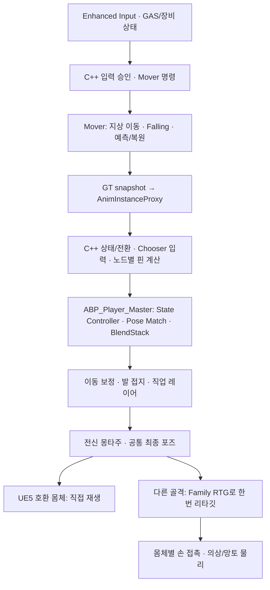

# 플레이어 로코모션 아키텍처

Project J의 이동 애니메이션은 **Mover 이동 시뮬레이션, C++ 상태·선택 계산, 데이터 기반 포즈 재생, 몸체별 표현**으로 구성한다. 공통 마스터 `ABP_Player_Master`를 플레이어·대검·현재 테스트 NPC가 공유한다. 직업마다 이동 그래프를 복사하지 않고 전투 레이어와 제작 프로필을 확장한다.

캐릭터 제작 부모는 `BP_Player_Master`이며 기존 `BP_GreatSword`가 이를 상속한다. 기존 테스트 BP의 로컬 상태·능력 기본값과 중복 프로필 지정을 제거하고, 대검 의상 8개의 연결은 native modular component 등록 수명으로 옮겼다. 직업/몸체 프로필·입력·리타기터·공통 ABP의 포즈 순서는 유지한다. [캐릭터/ABP 마스터 계약](../../Architecture/Runtime/Player_Character_Master.md)의 상속·제작·저장 기준을 따른다.

이 문서는 2026-10-22 현재 구현의 시작점이다. 시점별 원인·실패·복구·실행 결과는 [전환·검증 기록](Player_Locomotion_Migration_2026-10-19.md)과 [Mover 수정·200명 재검증](../../Performance/Reports/ProjectJ_Mover_200_2026-10-22.md), 실제 제작 절차는 [이동 콘텐츠 확장](../Authoring/DataDrivenLocomotionExtensionGuide.md), 골격과 추가 뼈는 [스켈레톤 제작 기준](../Authoring/HumanoidSkeletonRetargetingStandards.md)을 따른다.

## 입력에서 표시 포즈까지

PC 기본 걷기는 왼쪽 Ctrl 단독 탭의 해제로 토글한다. 기존 `IA_Walk`를 `IMC_Default`에 연결하고 native modifier-tap trigger와 입력 컴포넌트가 한 번만 소비한다. Shift 질주·OTM/Strafe·공중 재선택은 유지한다. 왼쪽 Alt 커서 전환과 OS/스킬 조합키 취소는 [현재 입력 기준](../../UI/README.md)을 따른다.



도식은 주된 책임 흐름이다. 실제 슬롯·레이어·보정 순서는 생산 그래프의 연결을 기준으로 한다. 전신 스킬 뒤에서 로코모션 발 보정이 하체를 다시 덮지 않아야 한다. Pose History, mounted 선택과 각 노드의 콜백 시점은 그래프에 남는다.

## 책임과 실행 시점

| 담당 | 소유하는 값과 동작 |
| --- | --- |
| PlayerState·GAS·장비 | 지속 상태, 능력·장비 권위, 공격·입력 차단과 공개 상태 복제 |
| Mover 및 native 이동 코드 | 승인된 이동 의도·속도 제한, 지상/공중 시뮬레이션, 충돌·착지와 예측 상태 |
| `UProject_JPlayerAnimInstance`·proxy | GT에서 수집한 값의 worker 전달, 상태·전환·선택 조건, 재생 요청과 노드별 계산 |
| `ABP_Player_Master` | 포즈 노드 연결, StateEntry/OnUpdate/BecomeRelevant 호출 시점, 슬롯·레이어·Pose History |
| Chooser·PSD·BlendSpace·프로필 | 후보·검색 기준·전환 출력·튜닝과 제작 데이터 |
| 표시 몸체 프로필·ABP | 골격별 리타깃, 손 접촉 역할·소켓, 해당 몸체의 물리·추가 뼈 |
| source 정책·ABA·visual coordinator | primary source의 GT 품질 게시, 단일 메시 tick 소유권, 로컬/탑승자·게임플레이 포즈·몽타주 수명 보호 |

프레임 계산과 핀 입력은 native 상속 프로퍼티·함수를 사용한다. 마스터 BP 소유 상태 변수는 0개다. BP 중계 함수를 제거하면서 Property Access·노드 바인딩·Chooser 함수 경로도 함께 이주했다. 같은 계산 함수라도 player별 재생 시각·커브·NodeRef가 다르면 결과를 전역 캐시로 합치지 않는다. 계산을 C++로 옮겼다는 이유로 노드 평가 시점을 변경하지 않는다.

Strafe 회전 오프셋 Chooser도 `FProject_JPlayerRotationOffsetQuery`와 native enum을 소비한다. 매 입력의 BP 구조체 생성·문자열 필드 탐색을 제거했으며 실제 table context/열 binding까지 이주했다. AnimInstance 초기화·해제 시 source 유효성을 무효화하고 새 owner의 정상 GT 게시 이후에만 worker 계산을 허용한다. 원본 함수군·writer/consumer·유지한 실행 시점은 [실행 흐름 비교와 보강](Player_Animation_Flow_Review_2026-10-21.md)을 따른다.

AnimGraph 노드는 엔진의 포즈 평가·스레드·디버깅·제작 경계를 사용한다. 이 연결을 유지하는 것은 BP에 동일 상태 계산을 중복 보관하는 것과 다르다. 서버 권위와 클라이언트 표현, GT 수집과 worker 계산도 별도 책임으로 유지한다.

## 이동과 점프 계약

기본 지상 튜닝은 **Walk 165 / Run 500 / Sprint 750cm/s**다. Mover `GroundMovementSettings`는 시뮬레이션·예측의 gait 목표, `DA_Player_Profile`의 속도는 gameplay 승인 상한이다. 직렬화 호환을 위해 프로필의 `WalkSpeed` 필드 이름을 유지하지만 이는 일반 Run 상한이며 Ctrl Walk 속도가 아니다. 두 역할이 서로 제한하지 않도록 함께 튜닝한다. 가속·감속·회전 보간·공중 관성 정책은 유지한다.

프로필의 `bScaleGroundPlayRateWithSpeed=false`는 지상 BlendStack의 동적 재생률을 1.0으로 유지한다. 명시적인 에셋 `RateScale`이나 몽타주·공중 타이밍을 일괄 변경하는 기능이 아니다. 지상은 실제 `PlayerSpeed2D`를 입력받는 Stride Warping으로 보폭을 맞춘다. 원래 1.0이던 보폭 상한을 1.5로 확장하고 보간·FK 다리 길이 제한·허벅지 보정은 유지한다. 원본 재생률의 Neutral 전방 루프 평균 root 속도는 Manny 변환본 기준 Run 약 516.53 / Sprint 약 723.14cm/s이며 500/750의 평균 보폭 비율은 약 0.968/1.037이다. 전이·순간 속도·체형별 접지는 별도 검수 대상이다.

시퀀스의 `MoveData_Speed`는 게임의 목표 속도 설정이 아니다. 원본 기준 커브를 보존하므로 Neutral 전방 루프는 Run 약 500/Sprint 약 700이며 Manny 변환 후 실제 root 속도와도 구분한다. 지상 동적 배속을 끈 현재 경로는 이 커브로 재생률을 계산하지 않는다. graph-driven Stride Warping은 `PlayerSpeed2D`와 해당 평가의 실제 root-motion delta 속도 비율을 사용한다. 따라서 게임 목표를 500/750으로 조정했다고 모든 속도 커브를 그 값으로 덮어쓰지 않는다. `Enable_Warping`, 재생률 제한 커브와 기존 비지상 계산 경로는 유지하고, 향후 동적 배속 정책을 켤 때는 이 소비 계약도 함께 검토한다. 라이브러리 전체 커브·재생률과 실제 속도의 재확인은 [속도 메타데이터 점검](../Authoring/Player_Animation_Library.md#속도-커브메타데이터-재확인--2026-10-22)을 따른다.

현재는 검증된 속도·재생 템포·보폭 보정과 원본 커브를 유지한다. 미래 확장만을 이유로 커브 재생성이나 구조 변경을 선행하지 않는다. 실제로 이동 속도·새 모션·동적 배속 요구가 생기면 기존 설정과 데이터 경계를 사용하고, 변경 범위에 맞춰 보폭·전환·착지와 접지를 다시 검증한다.

Pivot의 속도 상한은 GT에서 게시한 실제 Mover gait 튜닝에 기존 overspeed 여유를 보존해 계산한다(Sprint +115cm/s, Run은 Run +225와 Sprint +15 중 큰 값). Run 전환/착지에 남은 Sprint 관성도 수용한다. 고정 700 때문에 750 Sprint에서 Pivot이 배제되지 않는다. 속도와 재생률 정책은 기존 immutable proxy snapshot으로 전달하며 worker에서 pawn/프로필을 조회하지 않는다. 각 노드의 실행 시점과 Chooser/PSD·애니메이션 원본은 유지한다.

- **OTM / Strafe:** 두 모드를 유지한다. Strafe Sprint는 전방·좌전방·우전방만 승인하며 측후방 요청은 Run 정책과 일치시킨다.
- **지상:** SmoothWalking 이동 모드와 native 이동 계산을 연결한다. BP 이동 모드는 엔진 override를 잇는 어댑터다. 퇴역한 CMC 전용 입력·TIP·독립 MM 경로를 복원하지 않는다.
- **공중:** 현재 입력·facing·승인 gait에 따라 점프 모션을 재선택한다. 같은 물리 점프의 foot과 실제 playhead 연속성을 보존하고, 새 후보가 재생 시각을 되감지 않도록 한다.
- **관성:** 공중 제어율은 가속도에 적용한다. 입력 해제나 gait 변경만으로 수평 속도를 없애지 않으며, 역방향 입력은 물리적으로 궤도를 바꾼다.
- **착지·큰 방향 전환:** Falling 회전과 착지 전환은 이동 상태·실제 재생 문맥을 사용한다. 카메라 각도 하나로 특정 클립을 강제하지 않는다.
- **네트워크:** 이동의 Independent/Interpolated 정책과 표현용 점프·착지 이벤트를 구분한다. ABP의 클립 선택은 이동·전투 결과의 권위가 아니다.

## 정지 모션과 발 접지

2026-10-22부터 `Stand Stops`는 포즈 검색 전에 native `PlayerGaitRecent`로 Run/Sprint 후보를 분리한다. 기존 속도 200 이상 조건만으로는 Run 500에서도 Sprint Stop이 검색됐다. Sprint 입력 해제와 정지가 같은 프레임에 일어나면 현재 gait가 먼저 Run으로 바뀌므로, 기존 최근 gait의 유지 계약을 사용한다. 낮은 속도의 Walk Stop, 좌우 발·방향 후보, Pose Match, 재생 시작 시각과 blend 출력은 유지한다. 이 필터는 정지 직전 안정된 gait에 대한 기준이며, Run으로 낮춘 직후 남은 모든 overspeed 조건의 외형을 보증하지 않는다.

발 IK·발 잠금·경사 보정은 Stop/Idle 전환에서 계속 평가한다. 특정 클립 이름이나 상태 진입으로 IK를 끄거나 강제로 초기화하지 않는다. 접촉 커브가 낮은 발은 기존 Control Rig의 잠금 해제와 blend-out을 따르며, 접촉한 발은 경사면 접지를 유지한다. 현재 제작 경로는 `ConfigureStandingStopGaitFilter`이며, 후보/타이밍을 바꾸지 않고 Enum 필터만 추가한다. 에디터 변경 완료 알림까지 전달해 `Modify`로 중단된 종속 검색 인덱스의 재구성을 허용한다.

정지 후보 경계는 `StandingStopFamily`, 실제 평지/12도 경사의 OTM·Strafe Run/Sprint 정지와 Idle 복귀·접촉 기반 발 잠금 해제는 [정지 PIE 검사](../../../Scripts/Validation/Validate-PlayerLocomotionStopping.py)로 확인한다. source solver의 정상 잠금 해제는 최종 대검 신발의 접지 외형까지 승인했다는 뜻이 아니다. 발바닥 형상·몸체 리타깃·각 클립의 시각 품질은 별도 검수한다.

## 지상 루프의 회전과 동기화

Walk/Run slopes BlendSpace는 정규화 재생 시각으로 샘플을 맞춘다. `bShouldMatchSyncPhases=true`는 Pose Search의 샘플링 계약을 유지하고, `bAllowMarkerBasedSync=false`로 런타임과 검색 모두 같은 정규화 시간 경로를 사용한다. 원본 시퀀스의 발 접촉 마커·커브·Foley는 유지한다. 새 지상 루프에 같은 정책을 적용할 때는 editor native `ConfigureNormalizedLocomotionSync`로 내부 마커 캐시까지 재계산한 뒤 저장한다. AimOffset·Lean·비활성 샘플 BlendSpace에 일괄 적용하지 않는다.

원본 5.8.3의 Run은 marker=true/phase=false, Walk는 marker=false/phase=true다. 현재 수정은 원본 Walk의 정규화 시간 정책을 Run에도 적용한 것이다. 원본 Run 설정과 완전히 동일하다고 설명하지 않는다.

UE 5.8에서 Run의 마커 기반 위상 맞춤을 켜면 leader sample의 이전 시각이 재설정되어 루트 모션 델타가 0이 되는 경로를 확인했다. 이때 물리 이동과 카메라는 회전해도 Steering/OffsetRootBone에 회전 보정이 공급되지 않아 표시 몸이 이전 방향에 남았다. Sprint→Run 조기 종료 노티파이와 별개의 원인이며, 회전 강제 reset이나 Root Offset 해제로 가리지 않는다. `GroundLoopRootMotion`은 Walk/Run의 여섯 경사 샘플을 실제 엔진 틱으로 재생해 루프 경계까지 루트 델타를 검사한다. [완만 회전 PIE 검사](../../../Scripts/Validation/Validate-PlayerLocomotionLoopTurning.py)는 물리 yaw와 표시 root를 함께 비교한다.

## 후진 중 시선 급회전

Strafe에서 카메라와 이동 방향이 함께 바뀌어도 최근 이동 방향은 Backward로 유지될 수 있다. `Run B Loco Transitions`의 기존 고속 Pivot/Box 행은 다른 방향에서 Backward로 들어오는 조건이고, 기존 Reface 출발 행은 저속·비 Pivot 조건이다. 이 둘만 있으면 후진 중 큰 회전이 감지돼도 전환 후보가 없어 Loop로 돌아간다.

`ConfigureBackwardFacingTransitions`는 기존 후진 Reface 좌우 90/180도 행에서 별도의 회전 후보 4개를 제작한다. 최근 방향 Backward와 native `EvaluateIsPivoting` 조건을 함께 요구하고, 기존 미래 시선각 필터·Pose Match·embedded PSD·시퀀스 검색 제외 구간을 재사용한다. 블렌드 시간·프로필·태그는 기존 이동 중 Pivot 행의 출력 설정을 제작 시 복사하며 저속 출발 행의 짧은 블렌드를 그대로 가져오지 않는다. 진입 시각은 Pose Match가 출력하며, `Pivot` 태그가 기존 전환 중단 규칙을 사용한다. 저속 출발·다른 방향 진입·W/OTM 선택 경로는 유지한다. 키 입력이나 클립 이름에 따른 런타임 예외, 강제 회전·IK 해제는 추가하지 않는다. 제작 함수는 PIE 중 실행을 거부하고 재실행으로 행을 중복 생성하지 않는다. 행 개수가 바뀌면 Pose Match 열의 엔진 `Initialize` 경로로 전체 column→database 매핑을 갱신하고, 변경한 embedded PSD에도 Modify/PostEditChange를 전달해 인덱스를 재구성한다. 필터 통과만으로 인덱스 연결이나 실제 재생 성공을 판단하지 않는다.

## 접지 이후의 착지 검색 구간

물리적으로 접지한 뒤 진입하는 landing 행은 전체 클립의 낙하 준비 구간을 다시 선택하면 안 된다. 2026-10-22 Shift 유지 Sprint 점프에서 실제 접지 직후 Neutral Sprint 착지가 0초부터 재생되는 것을 확인했다. 별도 Fall Loop가 선택된 기록과는 구분한다. 원본 착지 시퀀스에는 약 0.5초/1초의 공중 접근 구간도 있으며, 일부 Run Light에만 검색 제외 노티파이가 있어 전체 클립 검색의 비용만으로 안전한 시작점을 보장하지 못했다.

`ConfigureGroundedLandingSearch`는 Ground Chooser에서 `PlayerMovementModeRecent`가 InAir인 착지 전용 행을 확인하고, native Land 이벤트와 `PoseSearchBlockTransition` 시작 중 이른 시각보다 원본 한 프레임 앞부터 검색하도록 `SamplingRange`를 제한한다. 32행의 후보·출력·커브·노티파이·재생률·블렌드 설정은 유지한다. 동일 시퀀스를 공중에서 재생하는 다른 경로에는 영향을 주지 않으며, 이름별 런타임 예외나 강제 IK 해제는 추가하지 않는다. 제작 데이터가 불완전하면 변경 전에 실패하고, 재실행은 동일 결과를 유지한다. 새 착지 은행을 연결할 때도 이 제작 검사를 수행한다.

착지의 `StartTime`은 시퀀스에 새 Notify State를 넣어 고정한 값이 아니다. Ground Chooser의 착지 행 `SamplingRange`가 진입 후보 구간을 제한하고, 마지막 Pose Match 열이 현재 포즈에 맞는 검색 결과 시각을 출력 구조의 `StartTime`에 쓴다. native `SelectNativeStateAnimation`이 이를 `PlayerBlendStackInputs.StartTime`으로 전달한다. Output Struct 열의 기본 StartTime 0만 보고 항상 0초부터 재생한다고 해석하지 않는다. 기존 `PoseSearchBlockTransition`은 진입을 막는 구간이고, 사용자 `Transition To Loop` 노티파이는 재생 중 Loop 복귀 요청이며 시작 시각과 역할이 다르다.

`GroundedLandingPhase`는 실제 재구성된 embedded PSD에서 각 landing 행의 선택 가능한 포즈가 접지 부근에 있고 후보가 사라지지 않았는지 검사한다. [공중·착지 PIE 검사](../../../Scripts/Validation/Validate-PlayerLocomotionAirLanding.py)의 `PLAYER_AIR_SPRINT_THROUGH_LANDING=True`는 Shift 유지 직선/90·180도 전환을 양 회전 모드에서 검사한다. 실제 접지 이후 공중 상태 재진입·Mover의 재낙하, 착지 클립의 낙하 준비 구간 재생, 직선 Sprint 750의 속도 손실도 검사한다. 전체 클립의 시각 품질이나 모든 높이/지형의 물리 검증과는 구분한다.

## 공용 모션과 몸체 확장

공통 Skeleton은 `/Game/Characters/Mannequins/Meshes/SK_Mannequin`, 생산 source mesh는 `SKM_Manny_Simple`이다. 최초 변환본에 Neutral 127개와 프로젝트 Run BlendSpace를 추가해 시퀀스 575개·BlendSpace 11개를 관리한다. Run/Sprint·점프/착지는 Neutral, Idle/Walk 기본 동작은 Relaxed로 선택한다. Chooser·PSD·가산 base는 Manny용을 사용하고, 신규 원본의 Branch In은 가져오지 않고 생산 PSD가 후보를 명시적으로 소유한다. 원본 뱅크는 Content 밖의 압축 보관본으로 보존하고, 실제 필요한 최소 retarget kit만 제작 자원으로 남긴다. 추가 수입과 중복 판별은 [라이브러리 제작 기준](../Authoring/Player_Animation_Library.md)을 따른다. 변환본에 원본 FBX를 직접 재임포트하거나 Skeleton만 바꾸어 덮지 않는다.

같은 Skeleton을 사용하는 `SKM_Quinn_Simple`도 모션을 직접 공유한다. 실제 6클립·두 시점·두 메시의 포즈 평가 24표본을 확인했다. 체형이 다르면 관절 위치와 발·손 접촉은 달라질 수 있다. 현재 Manny 발 Rig의 초기 길이·접지·무기 접촉을 Quinn 플레이에서도 검수하기 전까지 외형 품질까지 검증 완료로 표시하지 않는다.

현재 대검 몸체는 UE5 규격과 다른 Bip01 골격이다. `RTG_Greatsword_Manny`와 `IK_GreatSword_Woman`이 실제 부모 관계에 맞춰 팔·다리·손가락을 대응시킨다. 팔은 UpperArm–Forearm–Hand, 다리는 Thigh–Calf–Foot이며 망토·얼굴·장식 뼈를 사지 체인에 섞지 않는다. 네 limb solver의 시작점·Goal·실제 도달과 팔 방향·무릎 굽힘을 회귀로 검사한다. 몸체의 손 보정은 Body/HandGrip 프로필이 소유한다.

UE5 호환 몸체에 추가 망토 뼈만 있다는 이유로 실시간 리타깃을 추가하지 않는다. 공유 포즈를 쓰는 일반 파츠는 LeaderPose, 독립 추가 뼈 평가가 필요한 파츠는 native CopyPose와 authored Post Process를 사용한다. 호환 Skeleton 등록만으로 기준 포즈·축·관절 길이 차이가 해결되지는 않는다.

## 현재 제작 진입점

| 항목 | 생산 경로 |
| --- | --- |
| 공통 마스터 | `/Game/Animation_Logic/ABPs/ABP_Player_Master` |
| 지상 / 공중 Chooser | `/Game/Animation_Logic/Chooser/CHT_ProjectJ_Ground`, `CHT_ProjectJ_Air` |
| 검색 Schema / Idle Branch | `/Game/Animation_Logic/PoseSearch/PSS_ProjectJ_Manny_*`, `PSD_Player_IdleBranches` |
| 공용 모션 | `/Game/Characters/Mannequins/Animations/Locomotion`, `ProjectJump` |
| 발 보정 | `/Game/Animation_Logic/Rigs/CR_ProjectJ_Manny_FootPlacement` |
| 원본→공용 모션 재제작 | `/Game/Animation_Logic/RTG_Player_UEFN_to_Manny` |
| Manny→현재 대검 몸체 표현 | `/Game/Animation_Logic/ABPs/GreatSword/RTG_Greatsword_Manny` |
| 골격·몸체 연결 | `/Game/DataAssetSets/Presentation/Retarget/DA_RetargetFamily_Mannequin_Bip01`, `DA_RetargetBody_Greatsword` |

현재 생산 mirror metadata는 `MDT_Player_Manny`지만 검색·재생에 mirrored 후보를 활성화한 것은 아니다. 원본 비교 자산과 제작용 비활성 자산은 생산 후보와 구분하며, 직접 참조가 없다는 이유만으로 제거하지 않는다.

## 완료된 이관 코드와 런타임 관측 정리

2026-10-22 현재 캐릭터/애니메이션 BP·ABP 39개의 실제 그래프·함수 참조·프로퍼티 경로·연결 핀과 에디터 모듈 참조를 확인했다. 완료된 초기 이관 API `PrepareFoundation`, `RestoreFoundationTrajectory`, `RebindFoundationChoosers`, `ConfigureStandingLocomotion`, `InstallNativeLocomotionLogic`, `PreparePlayerMaster`와 그 전용 내부 helper를 퇴역했다. 옛 원본 그래프/폴더에 의존하던 초기 설치 경로이며 현재 제작 스크립트·테스트·에셋 호출은 없었다. native 설치 파일 1개도 제거했다. 새 모션 수입·소스 복원·중복 판별·Foley 변환·Manny 재제작·현재 그래프/핀/발 Rig 점검 도구와 회귀 검사는 유지한다. 에디터 이관 함수 삭제를 런타임 FPS 개선으로 해석하지 않는다.

런타임에서는 최초 로컬 제어 여부 중복 대입과 전달만 하던 `SourceActorTransform` 멤버를 제거했다. transient `PlayerCharacterProperties`에서 소비처가 없던 `CurrentMaxDeceleration`, `JustLanded`, `SteeringTime`, `GroundLocation` 4필드와 writer를 제거했다. 실제 착지 판단은 기존 이동 모드 경계·속도·Mover 착지 이벤트가 소유하며 변경하지 않았다. `CurrentMaxAcceleration`은 native 계산에서 소비되고, 가속 관측은 기존 검사에서 사용하므로 이번 정리에서 유지한다. Ragdoll 필드도 현재 마스터 그래프의 바인딩이 있어 보존하며, 기능 완성을 의미하지 않는다.

진단용 BlendStack 노드 순회는 매 outer graph 업데이트에서 수행하지 않는다. 프록시는 완료된 traversal의 revision/frame만 기록하고, 컨트롤러·무기 진단·네트워크 검증이 `GetPlaybackSnapshot`을 요청할 때 `GetProxyOnGameThread`의 병렬 작업 완료 경계에서 읽는다. 같은 revision의 추가 조회는 캐시를 재사용하고, 한 프레임의 여러 traversal도 revision으로 구분한다. `CaptureFrame`은 요청 시각이 아니라 실제 마지막 traversal 시각이다. 예산에 의해 갱신을 건너뛰거나 메시가 정지돼도 새 프레임으로 꾸미지 않는다. `ResultLastChangedFrame`과 변경 여부는 마지막 관측 대비 결과이며 관측하지 않은 이력을 재구성하지 않는다. owner 재초기화 시 관측 캐시·revision·frame을 비운다. 이동·검색·BlendStack·발 보정 계산의 실행 시점은 유지한다.

[진단 관측 PIE 검사](../../../Scripts/Validation/Validate-PlayerPlaybackObservation.py)는 기존 컨트롤러 진단 명령을 사용해 같은 traversal의 반복 조회, 테스트용 메시 일시 정지 중의 실제 관측 나이, 재개 후 갱신을 확인한다. 일시 정지는 테스트 인스턴스에만 적용하고 원래 상태를 복원한다. production의 상태/클립별 IK 해제나 강제 reset은 추가하지 않는다. native 회귀에는 stale 관측과 owner 재초기화 검사도 포함한다.

## 검증과 남은 범위

2026-10-22 완료 후 정리 기준 direct Editor UBT, native **87개**(실패·경고·미실행 0)와 import/복원 Python **19개**가 통과했다. BP/ABP 39개를 다시 컴파일하고 파일 해시 동일을 확인했다. 실제 지상·후진/전방 회전·공중/착지·루프 회전·전신 몽타주와 진단 관측 수명을 재검증했다. 당시 Linker 경고가 있던 옛 독립 샘플 BP는 이후 사용자의 용도 폐기 확인과 참조 재검사를 거쳐 퇴역했다. 남은 BP/ABP 38개와 현재 마스터 구조를 유지한다. 구체적 수치·후속 검증·남은 범위는 [라이브러리 정리 기록](../Authoring/Player_Animation_Library.md)을 따른다. 아래 수치는 각 이전 수정 시점의 결과다.

후속 최종 점검은 native 회귀 67개와 엔진 문자열 검사 3개, **70개 모두 성공, 경고·실패·미실행 0개**다. 원본의 실제 질의 반환값 910개와 native 계산, 회전 Chooser 36조합도 확인했다. 한국어 초기화 검사 조건과 첫 연결의 Iris 모듈 로드 경계를 보강했고, 새 네트워크 PIE의 해당 경고 0개와 한국어 설정 복원을 확인했다. 아래 수치는 각 이전 수정 시점의 결과이며 최신 상세와 PIE 조건은 [흐름 검토](Player_Animation_Flow_Review_2026-10-21.md)를 따른다.

2026-10-21 IK 수정 기준 direct UBT 빌드와 집중 native 회귀 **61개**가 통과했다. 변환본 448개의 **2,240 authored-frame 표본**, 대표 주기의 원본 대비 무릎 굽힘, 실제 OTM/Strafe 지상·Sprint 급회전·공중/착지·전신 몽타주도 확인했다. 자동화는 연결·소유권·수치 계약의 근거이며 전체 클립의 주관적 외형 승인이나 현재 구조의 200명 성능 측정을 대신하지 않는다.

원본 보관·퇴역 이후 별도 native 회귀 62개가 경고·실패 없이 통과했다. 생산 모션/그래프/리그 해시와 원본 없는 로드를 확인했고, 실제 입력 재실행 여부는 [보관·검증 결과](../../Maintenance/Animation_Source_Archive_2026-10-21.md)에서 구분한다.

Run 루프 회전 수정 후에는 `GroundLoopRootMotion`을 포함한 native 회귀 **63개**가 통과했다. 새 PIE에서 전방 입력을 유지하며 120도를 5초 동안 돌리는 Walk·Run·Sprint·Sprint→Run·Strafe Run 5종, 1,378표본을 기록했다. 실제 루프가 평가되는 구간의 표시 root/물리 yaw 최대 차이는 각각 1.732/1.871/1.667/2.944/1.660도였다. 급회전 전환 클립으로 루프 결함을 놓치지 않도록 실제 재생 에셋·가중치도 검사한다. 이 검사는 입력 액션과 카메라 방향을 구동한 PIE 검사이며, 수정 후 사용자가 실제 W·마우스로 재확인한 결과와 구분한다.

```powershell
./Scripts/Validation/Run-PlayerLocomotionRegression.ps1 -RunName <새로운_실행명>
```

에디터·UBT·dotnet 등 관련 프로세스가 실행 중이면 빌드를 겹치지 않는다. 압축 포즈의 helper 추종은 `Scripts/Validation/Validate-MannyRetargetedKinematics.py`, 실제 입력·몽타주는 같은 폴더의 `Validate-PlayerLocomotion*.py`를 사용한다. 상세 조건과 마지막 결과는 전환·검증 기록을 확인한다. 이전 CMC/MM 성능 보고의 수치를 새 구조의 FPS 개선율로 전용하지 않는다.

## 이전 구조와의 대응

| 이전 기록의 표현 | 현재 의미 |
| --- | --- |
| `ABP_Humanoid_Master`, 구형 `ABP_Player`, 초기 `ABP_ProjectJ_GASP58` | 생산 `ABP_Player_Master`로 정착. 옛 제작 절차를 현재 마스터에 다시 적용하지 않음 |
| `Project Unified Locomotion`, CMC 전용 TIP·곡선/MM 후보군 | 이전 구현·비교 자료. 현재 Mover/상태 선택/재생 경로로 대체 |
| `MotionMatchingAssetSet`, 별도 구형 상태 컨트롤러 | 퇴역한 코드·데이터 계약. 현재 native 상태/Chooser와 포즈 그래프 기준으로 제작 |
| UEFN 호환 직접 재생 | 실험 후 해제. 현재 생산 재생은 Manny 변환본 |

날짜별 보고서는 당시 실패·측정·소스 경로를 보존한다. 현재 파일이 없으면 과거 경로를 현행 API로 해석하지 않는다.

## 외부 기반과 프로젝트 구현

Epic Games의 **Game Animation Sample 5.8**에서 포즈 그래프·상태 선택·이동 보정 구조와 모션 라이브러리를 검토·도입했다. Project J는 이를 프로젝트의 Mover 입력 승인, GAS·장비/전투, 점프 재선택·재생 연속성, native 상태·핀 계산, 골격/몸체 프로필과 회귀·제작 경로에 맞게 통합했다. 샘플 모션이나 엔진 노드를 자체 제작한 것으로 표현하지 않는다. 기술 출처·원본 비교와 과거 명칭은 [전환 기록](Player_Locomotion_Migration_2026-10-19.md)에 남긴다.
