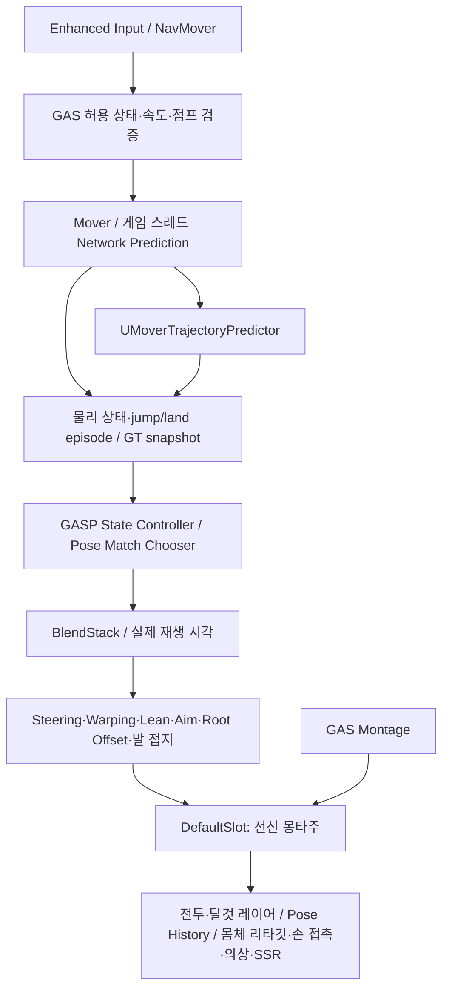

# 플레이어 로코모션 전환·검증 기록


현재 원본 보관 위치와 원본 뱅크 없는 회귀·추가 수입 기준은 [원본 퇴역 결과](../../Maintenance/Animation_Source_Archive_2026-10-21.md)와 [라이브러리 제작](../Authoring/Player_Animation_Library.md)을 따른다. 아래 각 단계의 원본 보존 상태·검증 수는 해당 시점의 기록이다.

현재 구조를 처음 읽을 때는 [플레이어 로코모션 아키텍처](Player_Locomotion_Architecture.md)를 우선한다. 이 문서는 외부 샘플 비교·단계별 이관·실패·복구·검증의 시점별 기록이다. 과거 이름과 당시 수치를 현재 실행 계약이나 새 성능 측정으로 해석하지 않는다. 2026-10-21에 문서 제목과 경로를 정리했으며 이전 경로는 안내 문서로 유지한다.

**2026-10-21 현재 제작 이름은 `ABP_Player_Master` / `UProject_JPlayerAnimInstance`다.** 아래 이전 작업의 GASP 이름은 이력이다. 현행 Manny 변환본과 제작·회귀 경로는 문서 마지막의 2026-10-21 항목과 [스켈레톤 제작 기준](../Authoring/HumanoidSkeletonRetargetingStandards.md)을 따른다.

2026-10-20 사용자 요청으로 CMC와 기존 지상 컨트롤러를 유지하던 방침을 변경했다. **본 프로젝트 `Anim_Upgrade` 반영 및 집중 검증 완료**이다. 이전 CMC 작업과 해당 컨트롤러 전용 검증 코드는 [보존 자료](../Archive/PreMover_20261019/)에 있다. 이전 통과 수를 새 구조의 검증과 합산하지 않는다.

## 물리·애니메이션 소유권



- `AProject_JBaseCharacter → AProject_JMoverPawn → APawn`이다. 플레이어·NPC에 CMC가 없고 임시 null `GetCharacterMovement()` API도 제거했다. 캡슐·Mover·NavMover·단일 pose source가 물리와 포즈를 소유한다.
- 공통 관측자는 `Project_J::Movement::ReadPhysicalFrame`을 사용한다. 별도 탈것 `ACharacter`의 CMC는 독립된 비행/탑승 계약으로 유지한다. Mover 탑승자는 Attached 모드로 따라가며 종료 시 자신의 모드를 복원한다.
- GASP 실제 기본값은 Mover·OTM이다. 지상은 원본 State Controller, 내부 PSD가 있는 Pose Match Chooser, BlendSpace 경사와 BlendStack·보정 그래프를 사용한다. 네이티브 State Controller 경로로 고정하며, 제거된 `LocomotionSetup` 변수를 런타임에서 읽지 않는다. 원본의 선택적 Motion Matching/ragdoll 제작 그래프가 남아 있는 것을 gameplay 기능 구현으로 계산하지 않는다.
- 실사용 ABP: `/Game/Animation_Logic/ABPs/ABP_ProjectJ_GASP58`. 공중 Chooser: `/Game/Animation_Logic/Chooser/CHT_ProjectJ_Air`. BP_Player·GreatSword·NPC 테스트 BP를 같은 기반에 연결한다. 기본 인터페이스 passthrough와 실제 장비/탈것 레이어를 보존한다.
- 원본 GameAnimationSample은 수정하지 않았다. 5.7 CMC 분석을 5.8 구현 근거로 사용하지 않는다.

## 실행 계약

Mover 경계에서 기록된 입력의 작업 복사본을 검증한다. GAS가 승인한 Sprint/Strafe·속도·점프만 반영하고, 임의 movement mode 제안과 비정상 이동 벡터를 제거한다. 잘못된 authored 속도도 입력 생성 전에 차단한다. OTM은 이동 방향, Strafe는 control yaw가 facing 의도다. 움직이는 바닥의 실제 델타는 Mover 이벤트로 누적한다.

점프 요청 ID와 실제 점프·낙하·착지 episode를 rollback sync state에 보존하고 프레임 확정 뒤 한 번 소비한다. 착지 속도는 바닥 투영 전 물리 결과다. simulated proxy는 별도 gameplay 점프/착지 이벤트를 만들지 않는다. 기존 CMC TIP Actor yaw RPC와 별도 원격 TIP 상태 writer는 제거했다.

**Project_J의 공중 방향 재선택을 유지한다.** OTM/Strafe·8방향 입력을 값 타입 Chooser 문맥으로 전달하며 gait/접촉 발/episode를 묶는다. 실제 BlendStack 시각을 이어받고, 동일 클립·완료 직전·너무 짧은 후보·재진입·낙하 루프를 구분한다. enum 내부 이름을 ordinal로 추정하지 않는다. GASP의 Strafe 방향 family와 8방향 입력/공중 쿼리는 다르며 예전 8방향 Pivot 해결 판정으로 바꾸지 않는다.

앉기·벽타기·슬라이드 gameplay는 추가하지 않았다. standing만 게시하고 Chooser에서 crouch 전용 행과 자세 변경용 Any fallback을 제거했다. 정지 때 Crouch→Stand가 선택되던 원인은 데이터 계약으로 해결했으며 runtime 특정 클립 예외를 추가하지 않았다.

GAS montage는 한 번 재생하고 실제 instance를 엔진의 Mover root-motion layered move에 연결한다. 정지·교체·섹션/재생률 변경·종료에서 같은 instance의 권한만 해제한다. simulated proxy는 복제된 물리를 소비한다. 현재 backend는 게임 스레드 Network Prediction이며 async 지원으로 보고하지 않는다.

## 보존·정리

UEFN과 Quinn의 기준 포즈가 같다고 가정하지 않았다. 몸체/의상 리타깃, 장비·손 접촉·SSR을 유지하고 필요한 7개 socket을 새 source mesh의 mesh-only socket으로 이관했다. 원본 Quinn·공유 skeleton·무기 제작 자산을 보존한다.

새 standing 로코모션 870개 패키지를 검사하고 793개 패키지의 샘플 Foley notify 7,253개를 Project_J native notify로 변환했다. 시간·GUID·좌우·음량·피치와 metadata를 검증했다. source mesh만 접촉을 제출하며 jump/land는 물리 이벤트가 소유한다. 샘플 오디오 컴포넌트나 두 번째 발소리 흐름을 설치하지 않았다.

기존 선택적 Mass의 CMC 정지 방식은 Mover를 중지하지 못한다. Mover NPC는 demotion에서 제외하고 권위 Actor/NavMover로 계속 이동한다. 값 기반 Mass processor·비교 자료는 보존한다. Mover↔Mass 소유권 이관이나 부하 개선을 구현/검증한 것으로 보고하지 않는다.

CMC/옛 지상 컨트롤러 전용 9개 suite와 혼합 파일의 6개 case를 위 보존 자료로 옮겼다. 관련 없는 테스트는 유지하고 재사용 fixture는 Mover 경계로 이관했다. 옛 성능·soak·네트워크 부하 harness는 실행하지 않았다. 컴파일을 campaign 성공으로 보고하지 않는다.

## 검증과 한계

원자료: `Saved/GASP58Upgrade_20261020`. direct UBT `Build_RemoveCMCShim2` 성공. `NoCMCShimContracts`의 공격·NPC·탑승·handover·명령 승인/점프 ID·observer·Foley 관련 9개 성공. synthetic 상태 게시를 실제 바닥/충돌/점프 검증으로 계산하지 않는다.

최종 경로 `GameplayMover_FinalFoundation`: 417회 관측, CMC 없음, OTM·Strafe, 점프/착지 각 2회, 공중 재선택 4회와 실제 플레이어 시각 유지. 전 관측 Standing, Crouch→Stand 선택 0. Foley Status 제출/재생 41/41, unmapped 0.

앞선 실제 2인 PIE는 authority/autonomous/simulated의 이동·점프·Strafe와 기본 LMB를 확인했다. 정지 후 대응 오차 약 .0031cm/.0016cm이며 이동 중 보간 차이가 있었다. 로컬 Q/R/T는 별도 실제 재생과 Flying→Walking 복귀를 확인했다. 이동 바닥과 기본 NPC 이동도 실행했다. 이를 모든 스킬·지연/손실·전체 접촉 품질로 일반화하지 않는다.

발/손 접촉 전체 프레임 교정, 복잡한 navmesh/장애물, montage의 모든 비선형 섹션/재생률/네트워크 조합, 임의 resimulation 시점의 GAS 태그 일관성은 한계다. 성능·FPS·군중 부하 캠페인은 수행하지 않았다. 아래 결과는 본 프로젝트 반영 후 실행한 검증이다.


## 본 프로젝트 최종 반영·검증

`Anim_Upgrade`에 소스·필요 엔진 플러그인·실사용 ABP/Chooser·BP_Player/GreatSword/NPC 연결과 실제 의존 에셋 1,341개를 반영했다. 새 namespace 1,790개 전체를 복사하지 않고 hard/soft 참조를 추적했다. 복제 전 self 참조와 미사용 지역 변수로 생긴 실험 ABP/샘플 CMC 의존성을 정리했다. 실사용 에셋의 Developer 경로 참조는 0이며, 별도의 작은 검증 맵/GM만 Developer 폴더에 있다. 기존 수정 파일의 사전 백업과 파일별 복사 해시는 `ProductionBeforeIntegration`, `ProductionIntegration.json`에 있다. Git 커밋/푸시는 수행하지 않았다.

- `Build_ProductionMover`: direct UBT 성공(144 actions, 90.14초). 빌드 시간은 성능 개선 수치가 아니다.
- `ProductionMoverContracts`: 실제 13개 성공. 기존 9개 계약에 SSR 이력 보간/공격 구간 전환, retarget body 계약, 단일 NPC의 실제 Recast 장애물 경로 이동을 포함한다. SSR 자동화의 기본 fixture는 engine ACharacter이므로 실제 장비 접촉 전체 검증으로 확대하지 않는다.
- `ProductionMover_Network`: 32초의 실제 Enhanced Input 주입, 630회 관측, authority/local·authority/remote·autonomous·simulated 네 역할 모두 CMC 없음과 최종 ABP 사용. 클라이언트 점프 2회·호스트 1회, OTM/Strafe 및 실제 LMB1/LMB2/Q1/Q2/R/T와 해당 원격 재생을 확인했다. 모든 역할에서 공격 종료 후 Walking으로 복귀했다. 마지막 대응 위치 차이는 .003212cm/.001769cm다. 이동 중 보간 차이는 별도로 존재한다.
- 두 listener 월드의 Foley 제출/재생은 31/31, 30/30, unmapped 0이었다. 이것은 실제 sound 재생 호출 증거이며 하드웨어 청취/주관적 음질 판정은 아니다.
- 원래 Play 설정(1 player, PIE_Client, 한 프로세스)을 복원했다. 원본 GASP와 관련 없는 맵/제작 자산은 변경하지 않았다.

단 한 번의 로컬 2인 실행을 지연/손실·전 스킬 조합·장시간 서비스 검증으로 바꾸지 않는다. 임의 rollback 시점의 GAS 정책 동기화, async backend, Mover↔Mass demotion, 세밀한 손발 접촉/몬타주 전 구간 교정은 위 한계로 유지한다. 원본 샘플의 미구현 crouch/traversal/ragdoll 제작 자원도 일부 Chooser/그래프 의존성으로 남아 있으나 gameplay 진입점은 추가하지 않았다.

최종 정리에서 CMC↔Mass 이관을 전제로 한 Recast 2개 case와 해당 전용 분기도 보존 자료로 옮겼다. 실제 Actor/NavMover Recast·추적·재빌드 검증은 유지한다. Mover를 거부하도록 바뀐 경로에 예전 demotion 성공 테스트를 남기거나 성공으로 처리하지 않는다.


### 새 source에 대한 몸체 리타깃 연결

최종 authored 데이터 대조에서 기존 Family가 Manny `SK_Mannequin`을 선언하여 실제 UEFN source와 일치하지 않는 것을 확인했다. 기존 proxy는 정확한 source/target 쌍에서만 Body override를 적용하므로 화면 출력만으로는 프로필 연결을 입증할 수 없었다.

원본 Rig/`RTG_Greatsword_UE5`/Manny Family는 보존하고, `IK_Greatsword_UEFN58`, `RTG_Greatsword_UEFN58`, `DA_RetargetFamily_UEFN_Bip01`을 분리했다. 엔진 Controller API로 source rig/preview를 실제 UEFN mesh에 연결했다. target mesh/rig/retarget 설정·기존 손 보정·몸체 역할은 유지했다. 몸체 DA의 Family와 실제 `ABP_Greatsword_Woman_RunTIme`의 authored 기본 Retargeter도 함께 이관했다. skeleton 호환을 강제로 켜거나 source 불일치를 허용하지 않았다.

격리본의 `UEFNRetargetBoundContracts` 4개가 성공했다. 새 authored 회귀는 실제 GreatSword Blueprint source mesh와 Family/rig preview/target/손 보정을 함께 검증한다. 기존 `Retarget.ProductionRuntime`은 실제 retarget processor 초기화·소비 자원, override 변경·해제·재초기화·잘못된 source 거부를 검증하며 기존 3개 secondary-physics 노드를 보존한다. 처음 Family만 바꾼 실패 기록은 보존했고 테스트를 완화하지 않았다.

본 프로젝트에는 `ProductionRetargetIntegration.json`의 10개 파일로 반영했다. 새 자원 3개와 몸체 DA/ABP, 관련 authoring helper·명시적 IKRig 모듈 의존성·회귀 테스트다. 추가 기존 파일의 사전 백업은 `ProductionBeforeRetargetFix`에 있다. 본 프로젝트의 최종 retarget 검증 결과는 아래에 덧붙인다.


본 프로젝트 `Build_ProductionRetarget` 성공 후 `ProductionUEFNRetargetContracts` 4개도 모두 성공했다. 실제 processor 자원 소비/평가·override 수명 검증을 포함한다. `ProductionMover_RetargetVisual`은 새 Family/Retargeter와 실제 몸체/의상 연결에서 421회 관측, 점프/착지 2회, 공중 재선택 4회, Foley 41/41을 확인했다. 화면에서도 움직이는 몸체·의상과 전투 자세를 확인했으며 이를 손발 전 프레임 교정 완료로 보고하지 않는다. 원래 Play 설정은 다시 복원했다.

기존 13개, nav 정리 후 2개(1개 중복), retarget 4개(1개 중복)의 관련 고유 회귀는 17개다. 전체 자동화 suite·Cook·패키징·지연/손실·성능/부하 통과를 의미하지 않는다.

최종 `Build_GameMover`의 `Project_J Win64 Development`도 성공했다(114 actions, 69.52초). 이는 에디터 전용 모듈 없이 runtime 코드가 컴파일·링크된 결과이며 Cook/패키징 성공을 의미하지 않는다.

### 사용자 플레이 피드백 후 이동 품질 수정 (2026-10-20)

시작/정지 모션 누락·이동 점프·미세 끊김 제보를 받아 기본 `Lvl_ThirdPerson`에서 실제 입력과 프레임별 물리/재생을 대조했다. 앞선 이관 검증은 실제 플레이 품질을 충분히 확인하지 못했다. 위 Game 빌드·17개 회귀는 앞선 이관 시점의 근거이며, 이 수정의 검증은 아래 결과다.

- 플레이어가 `Velocity` 목표를 만들고 승인 경계에서도 방향 입력을 속도로 바꾼 것이 원인이었다. 엔진의 이 경로는 입력 해제 때 즉시 정지하고, 첫 Falling 프레임에는 공중 제어 배율이 곱해진 목표 속도로 수평 관성을 교체했다. 플레이어는 이제 `DirectionalIntent`를 유지하고, 승인된 gait의 속도 제한은 Mover solver의 `MaxSpeed`에 적용한다. 이동 바닥 좌표 변환도 입력 타입을 보존한다. 목적지에서 멈춰야 하는 기존 NPC의 velocity 기반 경로 요청은 유지한다.
- 원본 GASP의 `DefaultNetworkPrediction.ini`는 `Independent` 틱/`Interpolated` 원격 표현을 사용한다. 이관본에는 이 설정이 빠져 엔진 기본 Fixed 틱과 smoothing 비활성 상태였다. 필요한 두 설정을 프로젝트 Config에 명시했다. 임의 프레임 보간기·timer·클립별 예외는 추가하지 않았다.
- `QualityBaseline`/`QualityFixed`는 같은 기본 맵, 약 120Hz 프레임, 같은 Enhanced Input 스케줄의 전후 기록이다. 이동 점프 첫 수평 속도는 200→498.4 cm/s다. 입력 해제 시 500→0 즉시 전환 대신 392→229→101→12→0의 감속 구간과 실제 `Run_Stop` 선택이 생겼다. 일정 속도 구간에서 반복 위치는 48/96→0/92 프레임이다. 이것은 해당 조건의 틱 간격 결함 검증이며 FPS/성능 향상 수치가 아니다. 시작 클립은 수정 전에도 선택되는 경우가 있었으므로 시작 에셋이 없었다고 판단하지 않는다.
- `Build_LocomotionQuality` Editor direct UBT 성공. `QualityContracts`의 입력 승인·실제 producer 방향 입력·엔진 소비자의 감속/공중 관성, 점프 ID, NativeNavMovement, MovingTargetPursuit 관련 4개가 성공했다. 이번 수정 후 Game/Cook/패키징은 다시 실행하지 않았다.
- 기본 맵의 실제 2인 `QualityNetwork`는 32초/566회 관측으로 네 역할의 OTM/Strafe·이동 점프·LMB/Q/R/T와 원격 재생 및 Walking 복귀를 확인했다. 최종 소유 클라이언트/서버 위치 차이는 약 .0062cm다. 간헐적인 `Independent Interpolation starved` 경고 13개도 관측했으므로 모든 원격 프레임의 부드러움이나 지연/손실 조건 통과로 일반화하지 않는다.
- `QualityVisual`의 시작·이동 점프·정지 구간에서 실제 몸체/의상/무기를 화면으로 확인했다. 이동 점프와 정지 시 Strafe가 활성이다. 장비 레이어는 clavicle 분기만 덮으며 하체의 새 로코모션 입력을 유지한다. 이번 수정에서 ABP/Chooser/클립 데이터는 변경하지 않았다.

기본 맵에는 PlayerStart가 없어 저장된 Client PIE 설정으로 직접 실행하면 Pawn 생성이 실패했다. 로코모션 검증에는 저장하지 않는 임시 PlayerStart 두 개를 사용하고 제거했다. 맵 파일은 변경/저장하지 않았다. 원래 Play 설정(1 player, PIE_Client, 한 프로세스, 별도 서버 비활성)을 복원하고 에디터를 정상 종료했다. 손발 전 구간 교정과 원격 보간 품질의 남은 경계는 유지한다. 커밋/푸시는 수행하지 않았다.


### 원본 지상 모드·입력·ABP 전체 대조 (2026-10-20)

사용자 요청 기준은 **GASP 5.8 이관 → Project_J 권한·전투·탑승 연결**이다. 점프 중 방향 재선택을 보존하고, UEFN/Unreal skeleton의 팔·기준 포즈 추가 보정은 사용자 요청으로 후속 작업에 남긴다. 앞선 기본 Walking/단순 control-yaw 이관과 이번 원본 지상 모드 이관을 같은 결과로 취급하지 않는다.

- 원본 `BP_MovementMode_Walking → USmoothWalkingMode → USimpleWalkingMode → UWalkingMode`를 확인했다. 실제 Blueprint·GenerateWalkMove·스프링·경사 상대 속도·급회전 방향 보정을 `/Game/GASP58Ground`로 의존성 재매핑해 이관했다. 기본 Walking을 활성 지상 solver로 쓰지 않는다. native player/NPC도 OnRegister에서 같은 authored 모드를 설치한다.
- 기본 Walk/Run/Sprint는 **165/375/585 cm/s**, 가속은 **500/800/300**, 정지 감속 **1000**, gait 전환 감속 **300**, turn strength **8→4**, facing smoothing **0.4→0.8초**다. 90~135도 급회전 시 facing time을 줄이는 원본 BP 계산과 control rotation rate를 함께 보존한다. Project_J profile의 Run/Sprint 허용 상한은 375/585로 맞췄다.
- 캐릭터 입력의 orientation retention·based delta·gait·방향 hysteresis·180도 부호 보정·회전 오프셋 Curve Chooser를 옮겼다. 원본 기본 StrafeStyle=1, AnalogInputStyle=1이며 style 0/1/2 방향 범위도 소비한다. 아날로그 크기는 증가 100/감소 2의 원본 보간 뒤 0.7 gait 경계를 사용한다. 실제 이동 의도는 정규화한 방향이다. CapsLock은 걷기 전환이다.
- OTM은 이동 중 이동 방향을 향하며 공중에서는 launch orientation을 유지한다. Strafe는 이동/공중에서 control facing을 사용하고 지상 idle은 직전 방향을 유지한다. 움직이는 바닥 회전은 두 모드의 유지 방향에 적용한다. root motion montage 중에는 원본처럼 actor facing을 사용한다. 전투 질주 승인도 이전 positive-Y 전용 조건 대신 같은 StrafeStyle 방향 규칙을 사용한다.
- native `FProject_JMoverInputs`가 walk·방향 family·rotation offset·control rotation rate·jump ID를 전송한다. GAS 승인 후 Mover의 공개 UserDefinedStruct collection API로 원본 `S_MoverCustomInputs` 뷰를 만든다. 예측 기록은 수정하지 않고, 승인된 뷰는 엔진의 simulated-proxy input container에도 실려 원격 trajectory 소비에 사용된다. 별도 권한/상태 writer를 만들지 않는다.
- 원본 `Update_CVarDrivenVariables` 함수의 실제 GT 호출과 필요한 DataDriven CVars 등록을 함께 이관했다. 함수/노드가 존재하는 것과 FootPlacement/OffsetRoot가 활성인 것은 별도로 검증한다. worker에서 UObject 예측기를 다시 생성하지 않는다.
- 실제 점프는 Project_J의 공중 재선택·episode·BlendStack playhead 유지 경로를 사용한다. 걸어서 떨어지는 일반 fall-off는 원본 GASP `SetBlendStackAnimFromChooser`와 전환/반복 선택을 사용한다. gameplay crouch·climb·slide는 추가하지 않는다.

원본 ABP의 **제작 그래프 68개와 인터페이스 그래프 8개**, 상태 갱신 매크로·이벤트 진입점을 읽었다. namespace·member GUID·pin GUID·에디터 위치를 제외하고 연산/핀 연결을 대조했으며, 제작 그래프 60개는 원본 연산과 연결을 유지한다. 나머지는 아래의 native 공급 경계·공중 예외·프로젝트 레이어/진단 연결이다. 원자료는 로컬 `GroundParity/AuthoredFunctionAudit.json`, 최종 ABP export에 있다. 생성된 수백 개의 EvaluateGraphExposedInputs 함수를 제작 함수 수에 중복 합산하지 않는다.

| 제작 그래프/함수 | 역할과 이관 계약 |
| --- | --- |
| `AnimGraph` | State Controller·Pose Match·BlendStack과 보정 포즈를 연결한다. 공통 DefaultSlot·전투·탑승 레이어와 점프 완료 판정만 프로젝트 연결이다. |
| `InitializeMoverPredictor`, `Update_PropertiesFromCharacter` | 샘플 Pawn 의존 공급부다. 활성 데이터/예측기 생성은 native GT snapshot으로 교체했다. BP에 두 번째 writer를 연결하지 않는다. |
| `Update_CVarDrivenVariables` | 원본 CVar→노드 스위치 갱신. NativeUpdateAnimation에서 원래 함수를 GT에 호출한다. |
| `Update_Logic` | trajectory·essential values·state·lean·aim 갱신 순서를 유지한다. |
| `Update_Trajectory` | 원본 샘플링 0.033초/15개 과거, 0.1초/15개 미래. predictor 실행만 GT로 옮기고 원본 후처리를 유지한다. |
| `Update_EssentialValues`, `Update_States` | 속도·가속·root/actor·경사·상태와 직전 상태를 갱신한다. 원본 연산·조건을 유지한다. |
| `IsMoving`, `IsStarting`, `IsPivoting`, `ShouldTurnInPlace`, `ShouldSpinTransition` | 현재/예측 이동·출발·역방향 전환·제자리 회전·spin 진입 조건. 원본 조건과 임계값을 유지한다. |
| `EnableSteering`, `Get_DesiredFacing` | 현재 player·움직임·태그와 예측 facing/클립 커브에 따른 steering 활성 및 목표 회전을 유지한다. |
| `Update_MotionMatching`, `Update_MotionMatching_PostSelection` | 선택적 MM 구성의 검색 DB·결과·태그·블렌드 처리를 유지한다. 현재 gameplay 기본값은 State Controller 구성 1이다. |
| `Get_MMBlendTime`, `Get_MMInterruptMode`, `Get_MMNotifyRecencyTimeOut` | MM 블렌드·검색 중단·notify 최근성 파라미터를 반환한다. 선택적 구성의 제작 계약으로 유지한다. |
| `SetBlendStackAnimFromChooser`, `IsAnimationAlmostComplete` | 원본 Chooser 결과·pose history·start time·loop·blend profile·force blend 및 실제 player 잔여 시간을 처리한다. |
| `OnStateEntry_IdleTransition`, `OnStateEntry_IdleLoop`, `OnStateEntry_IdleBreak` | idle 전환·반복·break 상태를 원본 Chooser/player에 요청한다. |
| `OnStateEntry_LocomotionTransition`, `OnUpdate_LocomotionTransition`, `OnStateEntry_LocomotionLoop` | 이동 전환/반복 선택과 전환 중 facing 보간. 원본을 유지한다. |
| `OnStateEntry_InAirTransition`, `OnStateEntry_InAirLoop` | 실제 점프만 Project_J episode/player를 사용한다. 일반 fall-off는 원래 SetBlendStackAnimFromChooser 호출을 사용한다. |
| `Get_TrajectoryTurnAngle`, `Get_TotalFacingDelta` | 예측 속도 방향과 누적 facing 차이를 계산한다. 원본을 유지한다. |
| `Get_OffsetRootRotationMode`, `Get_OffsetRootTranslationMode`, `Get_OffsetRootTranslationHalfLife`, `Get_OffsetRootTranslationRadius`, `OnUpdate_OffsetRootBone` | 이동·slot·root 상태에 따른 회전/이동 누적·release·반감기·반경·현재 offset 갱신을 유지한다. |
| `Get_OrientationWarpingWarpingSpace`, `Get_StrafeWarpDirection`, `Get_StrideWarpAlpha`, `Get_StrafeWarpAlpha` | 워핑 좌표계·Strafe 방향·stride/strafe 가중치의 원본 계산을 유지한다. |
| `Get_DynamicPlayRate`, `Get_BlendSpaceInputs` | 속도/클립 커브에 따른 재생률과 경사 BlendSpace 입력을 유지한다. |
| `Update_AdditiveLean`, `AdditiveLeans` | 가속/회전 기반 lean 입력과 additive 포즈를 유지한다. |
| `Update_AimOffset`, `AimOffset` | aim의 스프링/가중치와 additive 조합을 유지한다. 현재 OTM/Strafe 외 Aim gameplay를 추가한 것은 아니다. |
| `Procedural_PreLayering`, `Procedural_FullBody` | 레이어 이전 보정과 full-body 보정의 원본 순서·노드를 유지한다. |
| `Procedural_Feet`, `Biped_FootPlacement_OnBecomeRelevant`, `AllowFootPinning`, `AllowSlopeWarping` | 발 배치/접지·활성화 초기화·pinning·경사 허용 조건을 유지한다. 기본 FootPlacementMode는 원본과 같은 1이다. |
| `Get_ProceduralTargetTime` | 절차 보정의 예측 목표 시각을 반환한다. |
| `JustLanded_Light`, `JustLanded_Heavy`, `Get_LandVelocity` | 착지 분류와 속도 조회. 원본 상태 조건을 유지하고 물리 episode/착지 속도는 프로젝트 snapshot이 공급한다. |
| `JustTeleported`, `JustTraversed` | 불연속 이동/트래버설 직후 보정 조건. 원본 함수는 남기되 traversal gameplay는 연결하지 않는다. |
| `BlueprintThreadSafeUpdateAnimation` | 원본 worker 갱신을 유지하고 유효성 입력을 HasLocomotionSource로 바꾼다. |
| `Get_PoseHistoryReference` | 현재 Pose History node reference를 조회한다. |
| `Update_InteractionConstraints` | 샘플 상호작용 제약 갱신을 보존한다. 상호작용 IK gameplay를 켠 것으로 판정하지 않는다. |
| `OnStateEntry_SlideTransition`, `OnStateEntry_SlideLoop`, `Get_SlideSlopeRotation`, `Get_SlideSlopeOffset` | 원본 slide 제작 함수. Walking의 ToSlide 전환과 crouch 입력은 연결하지 않아 현재 gameplay에서 진입하지 않는다. |
| `OnStateEntry_DebugFlyingLoop` | 샘플 flying 제작 상태의 원본 진입 함수. 새 비행 gameplay를 구현한 것은 아니다. |
| `DebugDraws` | 샘플 디버그 표시 공급부는 비활성이다. 프로젝트 진단/검증을 사용한다. |

인터페이스 8개는 `Get_PoseHistory`, `Get_InteractionTransform`, `Set_InteractionTransform`, `Set_NotifyTransition_ReTransition`, `Set_NotifyTransition_ToLoop`, `Get_Gait`, `Get_Trajectory`, `Update_MMIConstraints`다. 각각 포즈 이력·상호작용 transform 조회/설정·전환 notify latch·gait/trajectory 조회·MMI 제약을 담당한다. 원본 계약을 유지하고, 현재 구성에서 제외한 상호작용 gameplay를 새로 연결하지 않는다. `UpdateStateValues` 매크로는 상태/직전 상태 변경의 원본 도우미다. EventGraph의 post-evaluate foot reset은 유지한다.

첫 복사 시 생성된 미사용 패키지는 외부 참조·Git 상태·생성 시각을 확인하고 백업 후 정리했다. 기존 Traversal 제작용 Chooser 둘이 참조하는 `/Game/Blueprints/Data/E_MovementMode`는 연결 보존을 위해 유지했다. 이는 벽타기 구현이나 runtime 경로 추가를 뜻하지 않는다. 샘플 원본과 기존 제작/테스트 에셋은 삭제하지 않았다.

#### 이번 이관의 검증과 남은 경계

- 원본 `ReferenceMotion` 40초/2,371회와 동일 입력의 `ProjectWarmMotion` 40초/2,071회를 비교했다. 출발·Stop·키보드/카메라 180도 반전·Strafe 후진/측면·Walk/Run/Sprint·Reface/Spin을 실제 상태/클립/물리로 관측했다. Run 375, Sprint 585 cm/s이며 원본과 같은 Start/Stop/Turn/Spin/Reface 클립 종류가 선택된다. 접촉 발·포즈 이력·실행 틱이 달라 개별 좌우 발 클립/프레임의 완전 동일성을 주장하지 않는다.
- 원본/프로젝트의 180도 키보드 반전 0.5초 시점 예시는 yaw -161.1/-160.9도, 속도 158.0/157.4 cm/s다. Warm 측정의 최대 관측 dt는 0.030초, 원본은 0.028초다. 앞선 최초 인덱스 구축 구간에는 0.23초 공백이 있어 원인/결과를 분리하고 캐시 구축 후 재측정했다. 이는 일반적인 성능/무히치 보증이 아니다.
- 최종 관측에서 FootPlacement와 OffsetRoot는 둘 다 활성이다. 누락돼 있던 원본 CVar 함수 호출을 실제로 복구했다. 캐릭터 사진/재생과 source/표현 mesh 연결도 확인했다. 팔·손·발 전 구간의 skeleton 품질 승인은 별도다.
- `ProjectAirFinal`은 이동/제자리 점프 4회와 재선택 5회를, `ProjectStrafeAirFinal`은 Strafe 이동 점프 2회와 추가 재선택을 확인했다. 시작 이동 점프의 XY 속도는 약 357~368 cm/s이며 제자리 점프만 하는 상태가 아니다. 최종 재선택 누적은 6회다. Strafe 측면 질주의 GAS/물리 승인도 확인했다.
- `ProjectFallOffFinal`은 점프 없이 지면을 잃고 1,000cm 아래 바닥에 착지했다. Project jump predicate는 계속 false이고 점프 횟수 6은 증가하지 않았다. 원본 네임스페이스의 `M_Relaxed_Jump_Loop_Fall`·착지 선택과 Walking 복귀를 확인했으며 Project jump entry 횟수도 늘지 않았다.
- 최종 `GroundNetwork`는 2인 listen server/4개 역할, 32초/585회 관측이다. 모두 CMC 없이 새 Walking class와 같은 ABP를 사용하고 발 배치/OffsetRoot가 활성이다. OTM/Strafe·점프·질주와 Equip/LMB1/LMB2/Q1/Q2/R/T 몽타주 및 Walking 복귀를 확인했다. 마지막 소유 클라이언트/서버 위치 차이는 약 0.0036cm다. **Independent Interpolation starved 경고 66개는 남아 있다.** 이 실행을 모든 프레임의 원격 보간 품질이나 지연/손실 통과로 일반화하지 않는다.
- direct UBT Editor/Game 빌드 성공. `CommandAdmission`, `SprintMovePrediction`, `JumpIdentityAfterPredictionRejection`, `NativeNavMovement`, `MovingTargetPursuit` 집중 회귀 5개 모두 성공했다. 입력 walk/방향/offset/turn-rate/jump-ID 직렬화, 승인된 UDS 뷰와 예측 원본의 분리, 실제 SmoothWalking 상속도 검사한다. 이후 변경한 질주 방향 규칙은 위 실플레이에서 확인했다. 마지막 제작 함수 연결만 변경한 `Build_GroundParity_AuthoringFinal` Editor 빌드도 성공했다.
- BP_Player/GreatSword/NPC의 Walking class·빈 ToSlide 전환·CommonLegacy/ StanceSettings를 확인했다. 실제 hard/soft 소비 closure에 missing/developer/첫 복사본 참조가 없다. 테스트용 바닥·PlayerStart 4개는 제거했고 기본 맵은 저장하지 않았다. 원래 PIE 설정(1 player, PIE_Client, 한 프로세스, 별도 서버 비활성)을 복원하고 에디터를 정상 종료했다. 커밋/푸시는 하지 않았다.

이번 완료는 원본 지상 구조/함수/기본값 이관과 프로젝트 연결 및 위 조건의 검증이다. Cook/패키징·패킷 지연/손실·대규모 부하/성능과 skeleton 팔 보정은 이번 결과에 포함하지 않는다.

### 로코모션 계산의 C++ 전환 (2026-10-20)

사용자 후속 요청으로 이관된 BP/ABP의 활성 로코모션 계산을 C++로 옮겼다. 앞 절의 원본 BP 유지 상태와 구분한다. 포즈 그래프를 직접 C++ 애니메이션 노드로 재작성하거나 모든 제작 에셋을 코드 상수로 바꾼 작업은 아니다.

- `Project_JGroundMovementLibrary`가 gait 속도·가속·감속·turn strength·facing smoothing·회전 오프셋·경사 상대 속도·급회전 각속도 제한을 계산한다. 기존 BP `GenerateWalkMove`는 native 호출 하나이며 실제 스프링/충돌/이동은 엔진 `USmoothWalkingMode` 구현을 계속 사용한다. 설치 엔진의 SmoothWalking 생성자는 DLL에 export되지 않아 BP 타입 adapter를 유지하며, 엔진 소스를 복제하거나 기본 Walking으로 대체하지 않는다.
- 아바타별 기존 튜닝을 `FProject_JGroundMovementSettings`로 옮기고 BP의 이전 변수 16개를 제거했다. BP_Player/GreatSword/NPC 모두 기존 값이 보존됐다. `GroundMovementSettings`는 움직임의 튜닝, LocomotionProfile의 Run/Sprint 값과 GAS 정책은 허용 상한이라는 역할을 유지한다. 걷기 승인에도 같은 native WalkSpeed를 사용한다.
- ground solver는 승인된 `FProject_JMoverInputs`를 직접 읽는다. `GroundInputType`과 매 tick의 `S_MoverCustomInputs` 투영·반영 필드 순회를 제거했다. 원본 UDS/enum/곡선 에셋은 제작·비교 자료 및 회전 Chooser의 별도 소비 역할을 확인해 보존한다.
- BP의 착지 후 0.2초 latent delay를 `FProject_JMoverLifecycle.LandingBrakingTimeMs`로 교체했다. 착지 episode의 변경과 시뮬레이션 시간으로 갱신하고, 복제·clone·reconcile·보간 및 rollback 기록에 함께 보존한다. 게임 시간 timer나 별도 전역 상태를 두지 않는다.
- `UProject_JGASP58AnimInstance::NativeThreadSafeUpdateAnimation`이 trajectory 후처리 → essential values → 상태/최근 상태 시간 → aim spring → lean을 한 번 실행한다. 이전 BP worker override·CVar 함수·post-evaluate 이벤트 계산을 제거했다. CVar는 native GT 갱신, foot reset 해제는 native post-evaluate가 소유한다. 부모의 전투 snapshot 공급과 post-evaluate 처리는 유지한다.
- 출발·이동·급회전·turn/spin·착지 분류·teleport 조건, 동적 play rate, steering target·워핑 가중치/좌표계, root offset 모드/반감기·바닥 회전 delta 적용과 foot reset 진입을 native 함수로 전환했다. 기존 ABP 함수는 포즈 그래프·노드 콜백과의 서명을 보존하는 얇은 adapter다.
- 지상/일반 추락의 Chooser 실행·Pose History context·선택 실패 처리·이전 BlendStack 입력 보관·notify latch·start/blend time·blend curve/profile/tags·loop 판정과 force blend도 native가 처리한다. 실제 점프는 기존 native 공중 재선택을 유지한다. 공중 제작 도구도 native 진입 함수로 연결하여 이후 재제작이 BP 조건 분기를 복원하지 않도록 했다.
- 기존 Chooser의 property path와 ABP 노드 입력 형식을 보존하기 위해 애니메이션 UDS/enum 및 결과 저장 필드는 유지한다. native가 같은 필드에 게시하며, 반영 필드 schema는 초기화 GT에서 캐시하고 worker는 캐시만 읽는다. worker에서 UObject 로드·Pawn 재조회·반영 함수 `ProcessEvent`를 실행하지 않는다. 타입 자체를 전부 native USTRUCT/enum으로 바꾼 결과로 해석하지 않는다.
- State Controller의 상태/전환 연결, BlendStack·Pose Match·Warping·Foot Placement 등 포즈 노드, Chooser 행/애니메이션/곡선과 notify 인터페이스는 제작 영역이다. 비활성 MM/slide/debug-flying/MMI 샘플 그래프도 참조용으로 유지하며 해당 선택적 gameplay까지 전부 C++로 구현했다고 주장하지 않는다. skeleton 추가 보정 보류는 유지한다.

검증은 로컬 `Saved/GASP58Upgrade_20261020/NativeLogic`에 기록한다. 전환 전에 원본 BP와 native의 동일 상태/궤적 256개 조합을 비교한 3,840개 결과가 일치했다(`Parity_PreMigration.json`). 이 대조는 선택 조건/일부 워핑 조회 15개 함수의 범위이며 전체 프레임·물리·포즈 동등성으로 확대하지 않는다. 실제 180도 전환에서 발견한 각도 부호 차이는 원본 `NormalizedDeltaRotator` 규약으로 고쳤고, 정확한 180도와 근접 각도의 회귀를 추가했다.

최종 direct UBT 에디터/Game 빌드와 집중 회귀 7개가 통과했다. `NativeDecisionBoundaries`와 `LandingBrakingRollback`에 기존 입력 승인·질주 예측·점프 ID·NPC 이동/추적 5개를 함께 실행했다. 초회 실플레이 40초/2,259표본에서 OTM/Strafe, Start/Stop/Turn180/Spin/Reface, Run 375/Sprint 약 585 cm/s 및 발 배치/Root Offset 활성은 확인했다. 해당 실행에는 MCP 화면 캡처가 포함되어 최대 dt 0.063초를 성능 비교나 무히치 보증으로 사용하지 않는다.

- 최종 `NativeForegroundMotion`은 40초/2,377표본이며 관측 dt 최대 약 0.0098초다. 정확한 180도 부호 수정 이후 OTM/Strafe·출발/정지·키보드/카메라 반전·보행/질주를 다시 실행했다. 키보드 반전 0.5초의 yaw/속도는 **−161.14도 / 158.00cm/s**, 카메라 반전은 **−161.87도 / 164.46cm/s**로 앞선 원본 GASP 관측과 대응한다. Sprint 구간은 약 584.71cm/s이며 발 배치·Root Offset은 전 구간 활성이다. 직전 `NativeWarmFinal`은 에디터 백그라운드 제한으로 입력 시점이 성기게 기록돼 동등성 근거에서 제외하고 전경에서 다시 측정했다. 프레임 조건이 다른 이전 실행과의 성능 향상 판정은 하지 않는다.
- 초회 `NativeAir`는 이동/제자리 점프 4회·재선택 5회·유효 애니메이션 실패 0표본이다. 최종 `NativeStrafeAir`는 10초/1,155표본, Strafe 이동 점프 2회·재선택 1회·실패 0표본을 확인했다. 공중 수평 속도는 약 373cm/s까지 유지된다. `NativeFallOff`는 556표본에서 1,000cm 아래 바닥에 착지했고 Project jump predicate는 계속 false, 점프 횟수 2는 증가하지 않았다. 일반 추락은 native Chooser가 원본 In Air Loop/착지를 선택했다.
- 최종 `NativeNetwork`는 2인 listen server/4역할, 32초/606표본이다. 모두 CMC 없이 같은 새 모드/ABP를 사용하고 발 배치·Root Offset이 활성이다. OTM/Strafe·점프·질주와 Equip/LMB1/LMB2/Q1/Q2/R/T 몽타주를 실행했으며 마지막에 모두 Walking·montage 없음으로 복귀했다. 소유 클라이언트/대응 서버 위치 차이는 약 **0.0065cm**다. **Independent Interpolation starved 경고 19개는 남아 있다.** 앞선 66개와 실행 조건이 달라 개선율로 계산하지 않으며 패킷 지연/손실·원격 전 프레임 품질 통과로 확대하지 않는다.
- 최종 hard/soft 에셋 소비 closure에 missing/developer/첫 복사본 참조가 없다. 이전 BP 입력 UDS는 활성 ground closure에서 빠졌다. 검증용 액터만 폐기하고 기본 맵은 저장하지 않았다. 원래 PIE 설정(1 player/PIE_Client/한 프로세스/별도 서버 비활성)을 복원하고 에디터를 정상 종료했다. 추가 skeleton 품질 보정, Cook/패키징·대규모 부하·성능 승인과 커밋/push는 이번 결과에 포함하지 않는다.


### 로코모션 BP/ABP 정리와 공중 재선택 수정 (2026-10-20)

사용자 요청으로 현재 로코모션의 캐릭터 BP 3종, 주 ABP, 전투·탑승·리타깃 레이어, 양쪽 UEFN 후처리와 notify 연결을 검토했다. 활성 자산의 hard/soft 참조와 기존 테스트·제작 호출자를 대조했으며, 저장소의 모든 Blueprint를 삭제·전환한 결과로 해석하지 않는다. 앞 절에서 참조용으로 남겼던 샘플 분기 중 게임용 ABP 내부의 미사용 경로를 이번에 정리했다.

- `ABP_ProjectJ_GASP58`에서 대체 MM 플레이어/선택기, Slide Transition/Loop·Debug Flying 상태와 연결된 전환, slide 전처리 및 MMI FullBodyIK 처리를 제거했다. State Controller/BlendStack·Pose Match, 전투 슬롯, 발 배치·Root Offset·Lean·Aim과 탑승 연결은 유지한다. 제외한 두 procedural layer의 서명은 passthrough로 남긴다.
- 교체된 초기화·프레임 갱신·MM·slide·MMI 함수 **20개**, 이전 상태 갱신 매크로와 저장 변수 **25개**를 제거했다. native 초기화에 중복되던 공중 바인딩 준비, 쓰기만 하던 이전 속도, 미사용 MM tag/설정 조회와 유효성 게시에 덮어써지던 CVar writer도 정리했다. native lifecycle이 프레임 계산의 원천이다. 재설치 도구는 제거된 프레임 adapter를 재생성하지 않는다.
- 캐릭터 BP 3종, 기본/Dragon 탑승, 리타깃 몸체, 양쪽 UEFN 후처리에서 연결되지 않은 기본 이벤트·소유자 조회 노드 **19개**를 제거하고 컴파일·저장했다. 대검 construction의 모듈 메시 연결은 에디터 미리보기 책임이 있어 유지한다.
- 일반 BP 참조 조회만으로 query/callback adapter를 제거하는 추가 시도는 상태 진입 연결의 컴파일 오류로 걸러졌고 저장하지 않았다. 정상 저장본으로 복귀했다. 상태 콜백·Chooser 호출·property binding·외부 notify 인터페이스를 보존하며, 이름이나 직접 호출 0만으로 공개 query adapter를 삭제하지 않는다. `Get_PoseHistory`/`Get_PoseHistoryReference`도 인터페이스와 제작 조회의 연결 계약을 유지한다. MMI 인터페이스는 서명만 보존하며 제외된 gameplay 본문은 없다.

이 단계의 공중 방향 선택은 실제 재생 시각을 유지하는 기존 Project_J 계약 위에서 수정했다. 당시 OTM은 승인된 현재 입력 방향을 먼저 읽고 입력이 없을 때 물리 속도를 사용했다. 아래 후속 공중 회전 작업이 현재 OTM 방향 기준이다. Strafe는 실제 공중 이동을 요청된 카메라 facing 기준으로 해석해 캡슐 회전 완료를 기다리지 않는다. 재선택에는 출발 때 저장한 gait/rotation mode 대신 최신 승인 값을 반영하며 같은 물리 점프의 foot을 보존한다. 기존 진행률·hysteresis·blend 진행 대기·cooldown과 새 클립의 남은 길이 가드를 유지하고, 새 플레이어 시작 시각은 실제 현재 playhead 이상으로 보존한다. 일반 추락과 공중 루프의 기존 경계는 유지한다.

Strafe Sprint는 **앞·앞왼·앞우**만 승인한다. 능력의 입력 승인과 Mover producer가 같은 `SupportsStrafeSprint` 함수를 사용하여 이전 StrafeStyle별 측면 허용 차이를 제거했다. 옆·뒤로 바뀌면 최신 승인 Run과 방향에 맞는 점프를 선택하고, forward 계열은 authored Sprint jump를 유지한다. 카메라 회전으로 잠시 옆/뒤 공중 진행이 생겼을 때도 없는 측후방 Sprint 클립을 강제로 재생하지 않고 Run family를 사용한다. 속도 권위는 Mover/GAS가 계속 소유한다.

검토 후 유지한 자산은 다음과 같다. `ABP_Humanoid_Master`/`ABP_Player`에는 기존 그래프·노드 제작 및 회귀 테스트의 명시적 소비자가 있어 보존했다. 현재 Player/GreatSword/NPC의 진입점은 새 ABP이며 이 두 자산을 동시에 실행하지 않는다. Dragon rider profile, 전투 레이어·리타깃·의상 물리, 공유 skeleton/postprocess, Chooser 행/UDS/enum·곡선과 source notify/anim modifier 제작 자원도 각각의 계약을 유지한다. 실제 재생한 **42개 시퀀스**의 Foley notify **292개**는 모두 `Project_JAnimNotify_FoleyEvent` native 인스턴스였고 원본 BP Foley emitter는 없었다. 실제 소비가 남은 `BP_NotifyState_EarlyTransition`은 asset timeline에서 전환 latch를 게시하는 역할이므로 유지한다.

로컬 근거는 `Saved/GASP58Upgrade_20261020/LocomotionCleanup`에 모았다.

- direct UBT Editor/Game 최종 빌드가 성공했다. 새 `AirLiveDirectionAndSprint`와 기존 native 경계·landing rollback·입력 승인·질주 예측·점프 ID·NPC 이동/추적을 합친 **집중 회귀 8개**가 모두 Success다.
- `AirAfter`는 OTM/Strafe의 이른/늦은 키보드·카메라 변경 **8사례, 3,796표본, 실제 클립 재선택 10회**를 확인했다. 유효 애니메이션 실패와 재생 시간 되감기는 0이었다. 이 Run 점프 검증은 최종 Sprint 승인 통합 전의 동일 공중 선택 코드 근거를 재사용한다.
- 최종 `SprintAirAfter`는 Strafe **8방향/점프 8회, 3,815표본**이다. 앞쪽 세 방향은 승인 `1/1`과 Sprint family, 나머지 다섯 방향은 승인 `1/0`과 방향별 Run family를 확인했다. 클립 재선택 **12회**, 실패·되감기 **0**이며 발 배치/Root Offset이 계속 활성이다. 앞선 좁은 발판 이탈·모드 준비 실패 실행은 제외하고 넓은 임시 평면과 새 PIE에서 재검증했다.
- `GroundAfter`는 **40초/2,378표본**, OTM/Strafe, Start/Stop·Turn180/Spin/Reface 계열, Walk/Run/Sprint와 최대 약 **585 cm/s**를 확인했다. 관측 dt 최대는 약 0.0095초지만 성능 인증으로 확대하지 않는다. 초기 모드가 Strafe였으므로 이전 원본 GASP 실행의 특정 시점 수치와 직접 동등성 비교하지 않는다.
- `NetworkAfter`는 **2인 listen server/4역할, 32초/614표본**이다. 전 역할에서 새 ABP/Walking 모드·발 배치·Root Offset, CMC 없음과 점프·질주·Equip/LMB1/LMB2/Q1/Q2/R/T 재생을 확인했다. 마지막에는 모두 Walking·montage 없음으로 복귀했고 소유 클라이언트/대응 서버 위치 차이는 약 **0.0052 cm**였다. **Independent Interpolation starved 경고 21개는 남아 있다.** 서로 다른 실행의 19/66개와 개선율 비교하지 않으며 패킷 지연·손실이나 모든 원격 프레임의 품질 통과로 해석하지 않는다.
- 최종 closure에 missing/developer/첫 복사본 참조가 없다. 원래 PIE 설정을 복원하고 검증용 평면·시작점만 폐기했으며 기본 맵을 저장하지 않았다. 에디터를 정상 종료했다. skeleton 팔 품질 보정, Cook/패키지·대규모 부하/성능 인증과 커밋/push는 이번 작업에 포함하지 않는다.


### 공중 회전·착지 연결과 네트워크 보간 후속 수정 (2026-10-20)

W 이동 점프 직후 S 입력 또는 카메라 180도 전환, 착지 직전/직후 큰 회전과 공중 감속을 실제 PIE에서 재현했다. 원본 GASP의 `SandboxCharacter_Mover.Get_OrientationIntent`, `BP_MovementMode_Falling.GenerateMove`, ABP의 facing/착지/Spin/Root Offset 계약과 설치 엔진 Falling/NetworkPrediction 소스를 대조했다. 이번 작업은 C++와 NetworkPrediction 설정을 변경했으며 Chooser/포즈 그래프 에셋을 추가 교체하지 않았다.

- 기존 OTM은 공중에서 발사 facing을 유지했다. 반대 입력으로 속도가 뒤집혀도 몸은 착지 후에야 돌아, 첫 착지 프레임에는 forward 착지와 역방향 이동이 겹쳤다. 사용자 요청에 따라 OTM도 공중 입력으로 orientation intent를 갱신한다. 입력 해제 시 마지막 facing과 물리 관성을 유지한다. 원본 GASP의 OTM 공중 facing 고정과 의도적으로 다른 프로젝트 동작이다.
- 빠져 있던 GASP Falling 회전 계산인 `OrientationIntent + RotationOffset`과 초당 300도 제한을 native 모드에 복원했다. 원본 BP의 world delta 대신 기록된 Mover step을 사용하여 예측/재시뮬레이션에도 같은 결과를 낸다. 지상 SmoothWalking의 facing spring·180도 tie·Turn/Spin/Pivot과 Pose Match/Steering/Root Offset 경로는 계속 사용한다.
- 공중 clip 방향은 실제 수평 속도를 기준으로 OTM은 현재 몸 facing, Strafe는 요청 카메라 facing에 대해 계산한다. OTM의 몸이 공중에서 돌아간 뒤 backward clip만 남는 것을 막는다. 물리 점프 episode·foot·최신 승인 gait, 실제 playhead 보존과 재선택 가드는 유지한다. Strafe Sprint의 앞쪽 세 방향 승인도 유지한다.
- 기본 Falling은 AirControl 0.4를 입력에 곱한 뒤 목표 속도까지 0.4배로 만들고, 수평 감속 200을 적용했다. 수정 모드는 엔진이 계산한 제약/벽 필터 방향을 사용하되 제어 비율을 가속도에 적용한다. 기본 수평 감속은 0이며, 입력 해제·공중 gait 변경만으로 관성을 잃지 않는다. 명시적인 역방향 입력은 속도를 줄이고 궤도를 바꾼다. Nav의 target-velocity 계약, 중력·수직 terminal speed·충돌/착지 solver는 엔진 구현을 유지한다.
- 기존 `Independent Interpolation starved/fell behind`는 수신 프레임을 보간 시계가 따라잡는 엔진 경로였다. Independent tick은 긴 프레임의 시뮬레이션을 최대 100ms로 제한하면서 보간에는 전체 frame delta를 더한다. 이번 재현에서도 입장 시 버퍼 부족이 연속 발생했다. 설정을 **Fixed 60Hz + 로컬 fixed smoothing + 원격 Interpolated**로 바꿔 시뮬레이션 step과 렌더 보간의 계약을 맞췄다. 로그를 숨기거나 수신 버퍼만 늘리지 않았다.
- 카메라 boom도 기본 캡슐 부모일 때 Mover source mesh에 KeepWorldTransform으로 연결하여 같은 시각 보간을 소비한다. 제작된 별도 부모·카메라 anchor·시점 제어와 possession별 활성 정책은 유지한다. 캡슐은 고정 틱, 메시와 카메라는 렌더 프레임에서 움직인다.

로컬 재현 근거는 `Saved/GASP58Upgrade_20261020/AirLandingNetwork`에 있다.

- `Before/After`: 같은 12사례/60초를 각각 7,151/7,051표본으로 비교했다. OTM의 이른 역방향 키보드/카메라 전환은 착지 yaw가 이전 약 0도에서 약 180도로 연결됐다. 늦은 전환은 GASP Turn/Pivot 선택으로 이어졌다. 입력 해제 공중 구간은 이전 200cm/s² 감속에서 **375cm/s 유지**로 바뀌었다. 재선택 시각 역행·유효 선택 실패는 0이었다.
- `Boundary`: 착지 순간과 착지 후의 90/180도 회전 8사례, 4,750표본. OTM/Strafe에서 Turn90/Turn180/Spin과 착지/루프 연결을 확인했고 선택 실패·시각 역행은 0이었다. 발 접지와 Root Offset이 계속 활성이다. 포즈의 모든 프레임이 원본과 동일하다는 의미는 아니다.
- `SprintAir`: Strafe 8방향/점프 8회, 3,840표본. 앞/앞왼/앞우만 Sprint 승인·클립을 유지하고 나머지 다섯 방향은 Run으로 전환했다. 실패·시각 역행은 0이었다.
- `NetworkBefore/NetworkAfter/NetworkStress`: 2인 listen server/4역할, 각 32초. 이번 수정 전 로그에는 starvation 17회·fell behind 1회가 있었고 수정 후 두 실행에서는 둘 다 0이었다. 최종 소유 클라이언트/대응 서버 차이는 일반 약 0.0020cm, 스트레스 약 0.0065cm였으며 모두 Walking·montage 없음으로 복귀했다. 일반 실행에서는 Equip/LMB1/LMB2/Q1/Q2/R/T 7종 몽타주도 확인했다.
- 스트레스는 엔진 packet emulation **PktLag 60±20ms, PktLoss 2%**와 GT의 250ms 정지 2회다. 관측 sample의 최대 wall 간격은 약 309ms다. 같은 프로세스 PIE이므로 실제 분리 서버/클라이언트의 독립 프레임 정지나 광역망·대규모 부하 검증과 구분한다.
- **별도 잔여 경계:** 고정 틱 PIE 재입장 직후 local frame 3~7에서 `RollbackFrame EQUAL PendingFrame` 경고 5회가 발생했다. 설치 엔진 `NetworkPredictionWorldManager.cpp`의 초기 프레임 매핑/왕복 입력 전 경로이며, 위 스트레스 입력 주입 전에 끝났다. starvation과 다른 경고로, 이번에 억제하거나 엔진의 초기 보정 코드를 수정하지 않았다. 모든 NetworkPrediction 경고가 0이라는 의미는 아니다.
- direct UBT 최종 Editor/Game 빌드 성공. 공중 방향·native 경계·착지 rollback·입력 승인·질주 예측·점프 ID·NPC 이동/추적 **8개 테스트 모두 Success**다. 4개는 기존 transient nav 재구축·native 기본 속도 튜닝 등의 warning을 동반했다. Cook/패키징·skeleton 팔 품질·대규모 성능 인증은 수행하지 않았다.

- `CameraFinal`: 최종 카메라 변경 뒤 7초/794표본을 재검증했다. 실제 boom 부모가 source mesh이며, 직선 정상 이동 179프레임 중 캡슐은 89번 같은 위치를 유지했지만 메시/카메라/boom의 같은 위치 반복은 모두 0이었다. 시점 90도 전환도 포함했다.
- 원래 PIE 설정(1인/PIE_Client/한 프로세스/별도 서버 없음)을 복원하고 임시 floor/PlayerStart만 폐기했다. 기본 맵을 저장하지 않고 에디터를 정상 종료했다. 커밋/push는 수행하지 않았다.


### Chooser·PSD 참조 정리와 보존 구분 (2026-10-20)

안전한 정리 요청에 따라 로코모션 관련 standalone Chooser/PSD 160개를 Asset Registry hard/soft/management 참조, Source/Config/Scripts 경로, 현재 아바타 CDO와 기존 제작·테스트 소비자에 대조했다. 의존 관계 도달과 실제 실행은 구분하며, Pose Match Chooser 내부 PSD는 독립 패키지 목록에 포함하지 않는다.

- `DA_Player_Profile.MotionMatchingSearchPolicy.StateControllerAnimationChooserTable`의 이전 `CHT_Player_StateControllerAnimations` 연결을 해제하고 이전 one-shot enable만 false로 변경했다. 현재 Player/GreatSword의 ABP는 `ABP_ProjectJ_GASP58`이며, native GASP 갱신은 이전 선택기를 실행하지 않는다. 나머지 정책 export를 비교하여 공중 재선택 enable·foot/playhead 관련 진행률·blend/cooldown과 이동 튜닝이 그대로임을 확인했다.
- 이전 Chooser 20개가 현재 캐릭터 의존 경로에서 빠졌다. 파일은 보존했다. `ProjectJ.Animation.Naturalness.AirLoopOutput` 등 기존 테스트가 별도 프로필을 만들고 이 Chooser를 명시적으로 사용한다. profile 필드/API나 이전 제작 ABP를 일괄 삭제하지 않는다.
- `/Game/GASP58MoverRuntime/BP_MovementMode_Walking`과 `CHT_RotationOffsetCurve`만 제거했다. 현재 사용처는 `/Game/GASP58Ground`다. 두 파일은 첫 이관 복사본이며 이전 퇴역 백업과 SHA-256이 일치하고 hard/soft/management·코드/설정 소비자가 없었다. 깨진 이전 UDS에 의존하는 중간 산출물로, 샘플 원본이나 현재 모드를 삭제한 것이 아니다. Unreal 삭제 API 반환만 믿지 않고 에디터 종료 뒤 파일 부재와 새 Asset Registry 실행을 확인했다. 제거한 원본 합계는 432,246바이트이며 Saved 백업은 별도로 남아 있다. 이를 디스크 확보 용량으로 해석하지 않는다.
- 변경 전 원본과 정책, 조사·적용·재검사 근거는 로컬 `Saved/GASP58Upgrade_20261020/AssetTriage`에 모았다. `Before/Content`에 프로필·임시 복사본 원본을 보관했다. 기존 사용자 변경·GASP 원본 프로젝트·다른 에셋의 경로는 수정하지 않았다.

현재 159개 패키지는 Content Browser의 다음 **로컬 컬렉션**으로 구분했다. 컬렉션은 에셋을 이동하거나 Cook root를 추가하지 않는다. 현재 워크스페이스의 Saved/Collections에 저장되며 Git 공유 에셋이 아니다. 공유 컬렉션을 만들기 위해 리비전 컨트롤 설정을 변경하지 않았다.

| 컬렉션 | 개수 | 의미 |
| --- | ---: | --- |
| `PJ_Locomotion_01_Active` | 3 | 확인된 지상 Pose Match·프로젝트 공중·회전 오프셋 Chooser 진입점. 지상 Chooser 내부 PSD도 보존한다. |
| `PJ_Locomotion_02_ConnectedReview` | 19 | 의존 관계에 남은 PSD. 실제 실행 목록이나 삭제 승인 목록이 아니다. |
| `PJ_Locomotion_03_ReferenceReview` | 100 | 현재 실행 경로 밖의 자원 중 다른 에셋·코드·제작/테스트 참조가 있는 항목. |
| `PJ_Locomotion_04_UnreferencedReview` | 37 | 조사한 참조가 없는 후보. 동적 사용·제작 목적이 미확정이므로 보존한다. |

ConnectedReview의 18개 이전 PSD는 기존 MM AssetSet·프로필 API·검증·테스트 계약이 남아 있어 함께 삭제하지 않았다. 나머지 `PSD_SM_CMC_Idles`는 GASP 애니메이션의 BranchIn notify 참조를 통해 연결된다. 이름에 CMC가 있다는 이유로 제외하지 않는다. GASP의 선택적 Motion Matching·Traversal 제작 자원과 기존 무참조 PSD도 단순 참조 수만으로 폐기하지 않았다. Cook/AssetManager 규칙을 임의로 바꾸거나 기존 제작 자원을 런타임 root로 추가하지 않는다.


정리 후 검증은 다음과 같다.

- GASP 방향·native 경계·착지 rollback·입력 승인·질주 예측·점프 ID·NPC 이동/추적, 보존한 기존 `AirLoopOutput`과 실제 생산 프로필 조회를 포함한 집중 회귀 **10개 모두 Success**다. 6개는 경고 없이, 4개는 기존 transient nav·속도 튜닝 관련 warning을 동반했다.
- OTM/Strafe의 착지 순간·직후 90/180도 전환 **40초/4,755표본**, Strafe Sprint 8방향 점프 **32초/3,840표본**을 새 PIE에서 확인했다. 선택 실패·재생 시각 역행 0, 발 배치/Root Offset 활성, 앞쪽 세 방향만 Sprint 승인이라는 계약이 유지됐다.
- 2인 listen server/4역할 **32초/557표본**에서 이동·점프·Sprint와 7종 전투/장착 몽타주를 확인했다. 최종 전 역할은 Walking·montage 없음이고 소유 클라이언트/대응 서버 위치 차이는 약 0.0027cm다. 기존 보간 설정은 변경하지 않았고 이번 정리를 새로운 지연/손실·대규모 성능 인증으로 확대하지 않는다.
- 현재 Player/GreatSword/NPC 의존 경로에 missing/developer/임시 첫 복사본 참조가 없다. 새 프로세스의 Registry에서도 제거한 두 패키지가 사라졌다. 원래 PIE 설정을 복원하고 임시 검증 Actor만 폐기했으며 기본 맵은 저장하지 않았다. 에디터를 정상 종료했다.
- 이번 변경은 프로필 참조·enable 플래그, 확인된 중간 에셋의 퇴역과 로컬 분류다. C++ 실행 코드 변경이 없어 별도 C++ 빌드를 반복하지 않았다. 미확정 후보의 삭제, Cook/AssetManager 정책 변경, 커밋/push는 수행하지 않았다.


## 전신 몽타주 수정과 GASP 제작·회귀 정착 (2026-10-20)

이 절이 현재 정리·제작 기준이다. 위의 159개 분류·미확정 37개·구형 테스트 보존 기록은 이번 후속 작업 전의 조사 이력이다. 사용자가 GASP 정착과 테스트 이주를 승인해, 이전 테스트 자체를 보존하기 위한 에셋 연결도 해제했다.

### 전신 스킬 포즈와 복귀

기존 `DefaultSlot`은 GASP AdditiveLeans/AimOffset/Root Offset/Procedural_Feet 앞에 있었다. 스킬의 FK 다리가 적용된 뒤 locomotion IK 목표로 LegIK가 다시 다리를 바꿨다. LMB1·Q1·Q2·R·T의 완전 가중치 구간에서 최종 다리 로컬 회전이 authored sequence와 평균 약 51–68도 달랐다.

현재 순서는 `GASP + CombatUpperBody → masked UpperBody → AdditiveLeans/AimOffset/Root Offset/Procedural_Feet/Procedural_FullBody → DefaultSlot → ProjectJ_FinalGroundPose → Mounted 선택 → Pose History → Output`이다. 발도/납도 `Equip`은 실제 `UpperBody` 슬롯을 사용하므로 기존 spine 마스크를 유지한다. 공격 6종은 `DefaultSlot`의 전신 포즈를 쓴다. 전역 IK 끄기, 특정 스킬·본 예외, 타이머 reset은 추가하지 않았다.

전신 Slot의 `Always Update Source Pose`도 켰다. 이전 값에서는 스킬 완전 가중치 동안 바탕 stack time이 실제로 고정됐다. GASP 상태·재생 시계는 계속 갱신하고, 최종 포즈 평가에서 스킬이 다리를 포함해 덮어쓴다. 따라서 자연 종료·취소·blend-out은 갱신된 locomotion으로 복귀한다. `RepairFullBodyMontageOrder`가 연결과 이 설정을 함께 보장하며 재적용해도 중복 Slot을 만들지 않는다.

### 제작 기준

- 새 아바타는 현재 `ABP_ProjectJ_GASP58`와 기존 Combat/Mount/Retarget 계약을 재사용한다. 구형 Master ABP를 복제하거나 UnifiedLocomotion/Facing 노드를 설치하지 않는다. 직업·무기·몸체·스킬의 고유 데이터와 튜닝은 각 기존 profile/definition에 둔다.
- 지상 선택은 `GroundAnimationChooser`의 실제 nested Chooser·내장 PSD·schema/mirror/entry 범위를 편집한다. Start/Stop/Turn/Spin/Loop의 현재 연결을 보존한다. 구형 독립 PSD를 생성하던 `ProjectJApplyGeneralTurning/LocomotionContinuity/StrafeDirectionSchema` 테스트 제작 코드는 제거했다.
- 점프는 `CHT_ProjectJ_Air`와 native `FProject_JGASP58AirQuery`의 RotationMode/State/Gait/Foot/Direction 입력, PlayerSettings/Project output을 사용한다. `DuplicateProjectAirChooser(Template, DestinationPackage)`는 타입 계약을 검사하고 nested ownership·결과·출력 메타데이터를 복제한다. 구형 AnimInstance 필드명 변환·OTM/Strafe 외부 Chooser 의존은 없다.
- `InstallProjectAir`는 현재 템플릿의 명시적 air state enum 값을 사용한다. 삭제된 imported source ABP에서 값을 다시 추출하지 않는다. native 일반 추락 경로와 현재 점프의 episode/foot/재선택 cooldown·최대 진행률·절대 playhead 보존 정책은 그대로다.
- 원본 GASP를 다시 가져오는 migration helper와 현재 제작 경로를 구분한다. 현재 게임의 재생 계약을 구형 에셋·graph installer로 복구하지 않는다. 공유 base AnimInstance/proxy·profile 타입 중 native GASP, 전투·탑승·retarget 또는 독립 계약 테스트가 소비하는 부분은 유지한다. 파일 수를 줄이기 위해 이 공통 기반을 제거하지 않았다.

### 안전한 퇴역 결과

프로필과 BP의 구형 MM AssetSet 참조를 해제했다. `DA_Player_Profile`의 실제 점프 정책, combat/weapon/retarget/mount 데이터는 유지했다. 생산 GASP 아바타의 설정 검증은 구형 MM 세트를 필수로 요구하지 않는다.

| 퇴역 대상 | 패키지 수 |
| --- | ---: |
| 구형 `ABP_Humanoid_Master`, `ABP_Player` | 2 |
| 구형 property-based Chooser 트리 | 20 |
| 구형 독립 PSD | 53 |
| 구형 PSS / normalization set | 6 / 6 |
| 구형 OTM / Strafe MM AssetSet | 2 |
| 합계 | 89 |

기존 미확정 37개 중 구형 PSD 34개는 이번 그룹에서 퇴역했다. 나머지 3개인 원본 Traversal CMC/Mover Chooser와 Relaxed MM Chooser는 원본 GASP 제작·비교 자료로 확인해 보존했다. 현재 game dependency와 별도이며 runtime/Cook root를 새로 만들지 않았다. `PSD_SM_CMC_Idles`의 실제 BranchIn notify 연결과 현재 지상 Chooser 내장 PSD도 보존했다. 애니메이션 원본 클립·몽타주·skeleton·retarget 자료는 삭제하지 않았다.

hard/soft/management/searchable 참조가 퇴역 그룹 밖에 없음을 확인하고, 에디터 종료 후 각 원본과 해시가 같은 백업을 대조해 정확한 파일만 제거했다. 회복용 원본과 참조 근거는 로컬 `Saved/GASP58Upgrade_20261020/GASP58Finalization/Retired/Content`, `RetirementPlan.json`에 있다. Saved는 Git 공유 백업이 아니므로 배포 또는 저장소 외 이동 전에 필요하면 따로 보존한다. 새 Registry에서 89개 부재와 Player/GreatSword/NPC 참조 폐쇄를 확인했다. 기존 로컬 컬렉션의 사라진 참조도 정리했으며 현재 개수는 Active 3 / ConnectedReview 1 / ReferenceReview 79 / UnreferencedReview 3이다.

### 현재 회귀 실행

에디터와 빌드 프로세스가 종료된 상태에서 아래 실행기를 사용한다. 실행기는 빌드를 중단하거나 자동으로 다른 빌드를 시작하지 않는다. 먼저 변경 위험에 맞는 direct UBT Editor/Game 빌드를 완료한다.

```powershell
./Scripts/Validation/Run-PlayerLocomotionRegression.ps1 -RunName MyGASP58Check
```

`ProjectJ.GASP58`는 생산 graph/slot/콜백 소유권, 내장 후보 인덱스, 192가지 air query 조합, 방향·Sprint 경계, 제작 멱등성과 proxy 선택 소유권을 검사한다. 실행기는 landing rollback·입력 승인·질주 예측·jump ID·NPC 이동/추적·실제 profile 조회를 함께 검사한다. 구형 custom node 연결·전용 PSD 목록을 검사하던 회귀 10개 파일과 옛 Facing installer/atomic fixture는 제거했다. 같은 계약의 새 검사를 추가했으며 단순 이름 변경이나 무조건 성공하는 stub으로 대체하지 않았다. 현재 Source에 없는 `ProjectJ.Animation.AuthoredCPU`를 호출하던 구형 측정 실행기도 퇴역했다. `Measure-RenderedCrowd.ps1`의 생산 에셋 provenance는 GASP ABP로 갱신했으며 해당 성능 시험을 이번 작업에서 다시 실행한 것은 아니다.

실제 포즈·입력·복제는 별도 PIE fixture로 검사한다. 각 검사는 새 PIE 세션에서 실행하거나, 이전 입력과 source montage뿐 아니라 Combat Intro/Outro 전환도 종료된 뒤 시작한다. 특히 SprintAir의 Strafe 준비는 전투 전환이 가능한 상태여야 한다. 넓고 평평한 바닥(약 1km 폭 권장), 낭떠러지/다른 Actor가 없는 시작점, 기본 GreatSword 아바타를 사용한다. 기본 레벨에 임시 바닥·PlayerStart를 만들면 테스트 종료 후 폐기하고 레벨을 저장하지 않는다. Python 콘솔에서 한 번에 하나씩 `import runpy; runpy.run_path('C:/.../Project_J/Scripts/Validation/<script>.py', run_name='__main__')`로 실행하고 completion JSON을 확인한다.

| 스크립트 | 조건 / 검사 |
| --- | --- |
| `Validate-PlayerLocomotionGround.py` | 단일 PIE, 약 40초. OTM/Strafe·키보드/카메라 180도·Walk/Sprint, 실제 가중치가 있는 Start/Stop clip과 최종 정지 검사. |
| `Validate-PlayerLocomotionSprintTurn.py` | 단일 PIE, 약 48초. OTM/Strafe 각각 질주 중 170·179·181·190도 카메라 급회전, 실제 선택·회전 후 속도·facing 오차 검사. |
| `Validate-PlayerLocomotionMontagePose.py` | 단일 PIE, 약 28초. LMB1/2·Q1/2·R·T의 thigh/calf/foot 양쪽 로컬 회전을 실제 sequence pose와 대조. 완전 블렌딩 이후 오차 0.2도 미만·바탕 시계 갱신·취소 후 Slot 해제 검사. |
| `Validate-PlayerLocomotionAirLanding.py` | 단일 PIE, 약 40초. OTM/Strafe·착지 전후 90/180도 입력 전환, physical Falling→Walking, 선택 실패·재생 역행·보정 전역 비활성화 검사. |
| `Validate-PlayerLocomotionSprintAir.py` | 단일 PIE, 약 35초. Strafe 8방향 공중 변경과 실제 재선택, 물리 점프/착지·재생 진행 검사. 앞쪽 3방향 Sprint 제한은 native 회귀에서도 함께 검사. |
| `Validate-PlayerLocomotionNetwork.py` | 동일 프로세스 2인 Listen Server PIE, 약 32초. 4역할 이동·점프·질주·실제 GAS 입력의 공격/스킬 복제와 종료·복귀 검사. |
| `Validate-PlayerLocomotionViewRotation.py` | 동일 프로세스 2인 Listen Server PIE, 약 20초. 실제 카메라 입력으로 ±180도 경계를 반복 통과하고 nonlocal authority·controller 없는 simulated pawn의 독립 시선, AO 상태와 선택 유효성을 검사. |

출력은 `Saved/Validation/GASP58`의 실행 시각별 JSON이다. 콜백 제출 성공은 테스트 완료가 아니다. `completed=true`와 `checks`를 확인하고, 실패 시 `error`를 읽는다. Editor Play/CPU 설정을 테스트 목적으로 바꿨다면 원래 값으로 복원한다. 네트워크 fixture는 대규모 부하·새 지연/손실 성능 인증을 대체하지 않는다. 기존 CPU/200명 성능 보고는 과거 조건의 자료이며 이번 기능 회귀와 합산하지 않는다.


### 이번 작업의 검증 결과와 한계

- 최종 direct UBT `Project_JEditor`와 Game target `Project_J` 성공. 마지막 source-clock 변경은 Editor 제작 코드와 저장된 Slot 설정이며 Game C++ 변경은 아니다.
- 새 `Run-PlayerLocomotionRegression.ps1 -RunName Finalization_20261020`로 집중 회귀 15개 모두 Success(11개 무경고, 4개 기존 transient nav·native test fixture 튜닝 warning 동반). 192가지 실제 typed air Chooser 질의와 생산 graph/내장 index/콜백·설정 검사를 포함한다.
- 실제 전신 몽타주 6종의 완전 블렌딩 이후 thigh/calf/foot 양쪽 회전 최대 오차는 약 0.055도다. 바탕 재생 시계 진행과 취소 후 Slot 해제도 통과했다. 이 수치는 source mesh의 authored sequence 대비 결과이며 모든 몸체의 최종 리타깃 외형 승인으로 확대하지 않는다.
- 지상 40초/2,378표본에서 Start/Stop·OTM/Strafe·키보드/카메라 180도·Walk/Sprint와 입력 해제 후 정지를 확인했다. 착지 8개 경우는 40초/4,753표본, Sprint 공중 8방향은 32초/3,837표본이며 선택 실패·재생 역행 0, 발 배치/Root Offset 활성이다. 공중 검증은 Slot 시계 옵션 변경 직전의 동일한 비몽타주 경로 근거를 재사용했다.
- 최종 2인 Listen Server PIE 32초/562표본·4역할·7종 몽타주. 각 역할에서 실제 GAS 입력에 따른 몽타주 재생과 Walking·몽타주 없음으로의 종료를 확인했다. 새 지연/손실·대규모 네트워크 부하 인증은 하지 않았다.
- 새 Registry에서 89개 퇴역 패키지 부재, 생산 아바타 3종의 의존 패키지 1,277개에 퇴역 참조가 없음을 확인했다. 새 air 제작 복제의 16개 방향 조회 결과·출력 동등성, 삭제한 imported source 없이 air 재설치, 임시 제작 에셋 파일 미저장도 확인했다.
- Python 문법 검사와 `git diff --check` 통과. 전체 Cook·패키징·200명 성능 시험은 이번 범위에서 실행하지 않았다. 이전 CPU/성능 자료와 이번 기능 회귀를 합산하지 않는다. 실제 사용 중인 shared base/proxy/profile 타입과 원본 GASP 제작 자원의 보존 이유는 위 절을 따른다.
- 증거는 로컬 `Saved/GASP58Upgrade_20261020/GASP58Finalization/FinalVerification.json`, `Saved/Validation/GASP58`에 있다. Play/CPU 설정을 원상 복구하고 임시 검증 월드만 폐기했으며 기본 맵을 저장하지 않았다. 2026-10-20 16:15:24 KST 에디터 정상 종료, 직후 에디터·빌드 관련 프로세스 0개 확인. 커밋/push는 이번 요청에 포함되지 않아 수행하지 않았다.


## 2026-10-20 네이티브 잔여 경로 퇴역과 질주 급회전

생산 경로는 `Mover → immutable snapshot → GASP State Controller/Pose Match → BlendStack → 보정 → 전신 Slot → 탑승/retarget`이다. C++ 공통 AnimInstance는 전투·탑승·품질·평가 후 발 접지 정보만 제공한다. 예전 지상 상태 머신을 병행 실행하거나 숨겨진 MM fallback을 유지하지 않는다.

### 회전 누락과 원본 대조

- 원본 `GameAnimationSample`에서 확인한 `IsPivoting`, `SetBlendStackAnimFromChooser`, DesiredFacing/Steering, DynamicPlayRate와 이동 입력·gait 규칙을 대조했다. 기존 Steering·trajectory·play-rate·root offset·발 보정은 현재 이관 경로를 계속 사용한다. 앉기·slide·traversal·벽타기는 추가하지 않았다.
- 실제 누락은 삭제된 Blueprint `LocomotionSetup`을 네이티브 판정이 계속 읽던 부분이다. 누락 값 0으로 구형 MM의 `75도 && !circling` 조건이 적용됐다. 현재는 GASP State Controller의 gait·속도별 조건을 사용한다. Sprint는 200–700 cm/s, 60도 조건이며 Run/Walk도 각 원본 조건을 보존한다. 빠른 카메라 회전이나 circling을 임의 타이머·각도 clamp·속도 변경으로 우회하지 않는다.
- notify 요청 초기화는 기존 선택 함수에도 있었으며, 확인 중 추가한 중복 reset은 제거했다. 선택 시 소비·해제 계약은 한 곳에 유지한다.
- GASP `BP_NotifyState_EarlyTransition`은 기존 세 payload 필드를 유지하고 C++ 요청 함수만 호출한다. 원본 Run 6개 클립이 직렬화한 native notify도 삭제하지 않고 같은 GASP 요청으로 연결했다. blend-out 여부와 GaitNotEqual 조건을 보존한다. 클립 타이밍이나 GUID는 수정하지 않았다.

### 제거한 경로와 유지한 계약

- 구형 MM AssetSet·trajectory component·검색/재검색·PSD companion 주입, native fallback graph, 외부 one-shot handoff, 별도 상·하체 Strafe facing, moving/general/backward turn 정책 및 관련 CVar·trace를 제거했다. GuidedHandIK와 현재 GASP Pose Search/BlendStack 의존성은 실제 사용하므로 유지한다.
- 공통 AnimInstance/proxy의 오래된 Chooser mirror·getter·상태와 worker 검색 상태를 제거했다. proxy는 최종 GT publication을 traversal 경계에서 한 번 소비하고 nested layer는 같은 snapshot을 사용한다. 현재 air chooser의 pending/current 참조는 GC에 보존한다. 재초기화 시 snapshot·재생 관측·발 위상 이력을 초기화한다.
- gameplay state component에서 구형 지상 phase/turn/one-shot 계산 및 쓰기만 하던 착지 방향 metadata를 제거했다. Enhanced Input semantic chord, Sprint 허용, 점프·추락·착지 episode, remote 확인 순번, 타임아웃, Foley, ASC 태그 lease의 교체·종료 처리는 유지한다. 물리 착지 수명은 시각 Land 재생 완료와 구분한다.
- 사용처 없는 플레이어 전용 custom CMC/saved-move 어댑터를 제거했다. 탈것의 실제 CMC와 공유 movement query는 별도 소비 계약이 있으므로 유지한다.
- 레거시 전용 테스트와 fixture를 퇴역시키고, 혼합 파일의 전투·장비·탑승·리타게팅·입력 검사는 유지했다. pending air chooser GC, snapshot publication/reinitialize, 현재 reflected schema, Sprint 회전 경계 및 현재 Mover에서의 remote jump/태그·타이머 수명을 검사한다.

### 현재 제작·진단 경로

- `DA_Player_Profile.AirPolicy`가 기존 공중 재선택 정책을 소유한다. 활성화, cooldown 0.08, blend 0.15, 최소 blend 진행률 0.70, 최대 clip 진행률 0.85, OTM 진입 각도 45도와 remote jump urgent 0.10초를 그대로 이관했다. `CHT_ProjectJ_Air`는 현재 typed query/output만 사용한다.
- 이동 속도는 기존 Walk/Sprint 프로필 값, 물리 회전·마찰·가속은 현재 Mover 설정, 거리별 시각 품질은 `AnimationBudget`에서 관리한다. 더 이상 효과가 없는 MM chooser/throttle 설정과 flat/nested 중복 튜닝 필드는 제거했다. Near/Mid/Far 2500/6000/12000 값은 동일하다. 실제 cadence는 ABA/coordinator가 소유한다.
- `DumpGASP58Playback`은 현재 Mover pawn의 source mesh와 실제 스택 클립·시간·weight·상태를 조회한다. MMO/weapon/network 진단도 이 관측값을 사용하며 MM search cost나 선택 revision으로 포장하지 않는다. mouse-turn trace의 카메라/몸체 관측 기능은 현재 GASP 경로로 유지한다.
- 새 집중 실행은 `Scripts/Validation/Run-PlayerLocomotionRegression.ps1 -RunName <고유명>`이다. 실제 PIE용 ground/air/sprint/montage/network fixture와 `Validate-PlayerLocomotionSprintTurn.py`를 사용한다. 질주 급회전 fixture는 OTM/Strafe 각각 170·179·181·190도를 0.18초에 입력하고 선택 누락·비정상 이동·회전 후 재가속/정렬을 검사한다. 이 수치는 사람의 자연스러움 판정을 대신하지 않는다.

### 안전 근거와 검증

프로젝트 Blueprint·AnimBlueprint·Chooser 183개를 실제 export해 reflected 연결을 확인했다. retired node/API의 제작·테스트 소비도 함께 조사했으며, 삭제 전 현재 Source와 변경 에셋을 `Saved/GASP58Upgrade_20261020/NativeRetirement/Before`에 백업했다. 숨겨진 air enum 값은 현재 typed chooser의 직렬화 ordinal을 보존하기 위해 유지한다. 원본 GASP 제작·비교 자료, 원본 애니메이션·skeleton, 전투·탑승·손 접촉·retarget 자산은 이번 source 퇴역의 삭제 대상이 아니다.

이번 요청에서 소스 파일 83개를 퇴역하고, 기존 Source 기준 약 1.98만 줄을 줄였다. 전체 기존 사용자 변경과 합산한 Git diff 수치는 사용하지 않았다.

- 최종 direct UBT `Project_JEditor Win64 Development`: 통과(37.06초).
- 최종 direct UBT `Project_J Win64 Development`: 통과(46.04초).
- `Saved/Validation/GASP58/NativeRetirement_Release_20261020`: 집중 회귀 19개 통과. 원격 점프 검사는 실제 시작된 Mover에서 실행한다. 처음 드러난 구형 테스트의 시작 전 state 주입 실패 기록도 보존했다.
- 현재 Blueprint 177개를 실제 컴파일해 모두 `BS_UP_TO_DATE` 확인. 같은 프로세스에서 새 AirPolicy 값이 기존 값과 오차 1e-6 이내임을 확인했다.
- 질주 급회전: 7,627 frame / OTM·Strafe × 170·179·181·190도 8조건 통과. 회전 후 4.5–4.9초 구간의 최소 속도는 약 581.86–585.12 cm/s, 최대 actor/control yaw 오차는 0.704도 미만, 선택 누락 0. 기존/변경 후 clip·상태 관측은 `NativeRetirement/SprintTurnComparison.json`에 있다. foot phase와 frame pacing이 달라지는 두 실행을 같은 pose로 간주하거나 자연스러움의 정량 향상률을 만들지 않는다.

| 실제 PIE 검증 | 결과 |
| --- | --- |
| Ground | 2,379 frame, OTM/Strafe·Walk/Sprint·시작/정지·큰 방향 전환 통과 |
| AirLanding | 4,755 frame / 8조건, 재선택 발생·착지 복귀·재생시각 되감기 0 |
| SprintAir | 3,838 frame / 8조건, Sprint 전방 3방향 규칙과 공중 재선택 통과 |
| MontagePose | 전신 몽타주 6종, 평가한 source 하체와 원본 몽타주의 회전 오차 최대 0.057도 미만, 취소 복귀와 base clock 진행 통과 |
| Network PIE | 570 sample / authority·autonomous·simulated 4역할 / 몽타주 7종, 종료 후 소유권 해제 통과 |

실제 입력과 본 평가는 `Saved/GASP58Upgrade_20261020/NativeRetirement/FinalPIEResults.json`에서 해당 원본 JSON으로 연결된다. 에디터는 임시 floor/start만 폐기하고, PIE 설정·background throttle을 복원한 뒤 17:32:42 KST에 정상 종료했다. 내용 패키지의 미저장 변경은 없었다.

독립 소켓 회귀의 기존 semantic-event 단계는 물리 착지를 생성하지 않는다. 특정 `Land` 상태명을 요구하지 않고, 착지 lease와 신선한 GASP body 평가를 확인한다. 실제 착지 clip/물리 handoff는 위 AirLanding이 담당한다. 구형 회귀기가 매 프레임 NP pending state를 덮어쓰던 경로는 real network에서 제거하고, 실제 접지 안정 후 기대 이벤트를 잡고 AOI 위치 변경은 Mover teleport effect로 처리한다. standalone static 진단의 명시적 frame 주입은 해당 별도 진단에만 남긴다. 이 fixture 실패를 플레이 중 자연스러움의 판정으로 포장하지 않는다.


독립 서버 검증에서는 초기 asset/물리 준비 후 도착한 predicted FallOff RPC가 이미 접지한 서버에서 새로운 공중 이벤트로 처리되는 문제도 드러났다. `ServerDispatchEvent`는 FallOff 요청을 현재 authoritative Mover의 공중 상태로 검증한다. 실제 공중 이벤트는 유지하고 착지 이후의 요청만 거부한다. `ProjectJ.GASP58.RejectStaleFallOffEvent`가 접지→공중→재접지 순서의 실제 Mover publication과 서버 RPC를 검사한다.

AOI 카운터 probe 100개는 이동·GAS·애니메이션을 소비하지 않으므로 `APawn + SceneRoot + 복제 카운터`로 줄였다. 이전 NPC 기본값과 같은 8,000 cm cull·10/2 Hz 설정을 유지한다. 생산 플레이어는 계속 실제 GASP/Mover BP를 사용한다. 이 결과를 100개 이동 NPC 성능 검증으로 주장하거나 이전 런타임 부하 수치와 동등 비교하지 않는다. 원본 NPC 시스템이나 네트워크 전역 보간 설정은 이 검증기 수정을 위해 변경하지 않았다.


네트워크 정책 대조에서 추가로 확인한 중복 writer도 제거했다. 원격의 오래된 물리 프레임을 보고 `UpdateRemoteAirState`/`UpdateRemoteJumpStartState`가 별도 착지를 만들거나 이미 수신한 착지 lease를 취소하던 경로다. 현재 GASP 시각 착지는 Mover가 소유하고, 원격 gameplay/Foley 착지 lease는 순서가 있는 authoritative landing event만 시작한다. 물리 프레임은 원격 점프 종료·공중 관측만 갱신한다. 별도 pending timer나 강제 상태 reset을 추가하지 않았다.

`RemoteLandingEventBeforeInterpolatedGround`는 이벤트→오래된 공중 프레임→접지와, 접지→이벤트 두 순서 모두 착지 epoch가 한 번만 생기는지 검사한다. 수신 시점에 따라 착지 수명이 두 번 시작되던 레거시 동작은 더 이상 GASP 경로를 보조하지 않는다.


### 최종 Network Prediction 정책 대조

같은 socket fixture에서 Fixed는 기능 5단계를 통과했으나 `Invalid interpolation frames`가 Client1/2에 229/281회 기록됐다. 로그를 숨기거나 buffer 크기를 임의 확대하지 않고, 원본 GASP 5.8의 Independent/Interpolated 정책을 실행 인자로 대조했다. 첫 대조에서 드러난 원격 착지 중복 writer를 제거한 뒤 `GASP58_IndependentSoleOwner_20261020`은 5단계·정상 종료와 클라이언트 `SystemFault` 0을 확인했다.

이를 근거로 `DefaultNetworkPrediction.ini`를 Independent/Interpolated로 맞췄다. 원본의 100ms buffer / 250ms max buffer를 사용한다. 앞선 Fixed 도입 기록은 당시 결과로 보존하며 이 단락이 현재 정책이다. 장시간 hitch·지연/손실·전체 군중 환경의 무경고를 일반화하지 않는다. GASP 제어 CVar는 값이 아니라 등록 포인터를 캐시해 actor별 매 프레임 이름 탐색을 없앴으며, 늦은 등록과 live tuning 값 읽기는 유지한다.

현재 설정의 집중 회귀 `NativeRetirement_FinalPolicy_20261020`는 21개 모두 Success다. 이 중 navigation 검사 2개는 transient world의 nav rebuild/CrowdManager 경고를 동반했고 실패는 0개다. 현재 BP/ABP 177개의 실제 컴파일도 모두 `BS_UP_TO_DATE`다.

### 최종 Independent 정책의 실제 입력·포즈 검증

실행 인자 override 없이 에디터가 읽은 `Settings` 구조체를 `ActiveFinalPolicy.json`으로 확인했다. Independent/Interpolated와 100/250ms buffer가 실제 로드됐다. 아래가 최종 정책 결과이며, 앞선 Fixed 결과는 `FinalFixedPIEResults.json`으로 보존한다. `FinalPIEResults.json`은 다음 원본 JSON과 검사 결과를 가리킨다.

| 검사 | 최종 결과 |
| --- | --- |
| SprintTurn | 5,712 frame, OTM/Strafe × 170·179·181·190도 8조건 통과. 회전 후 구간 최소 속도 581.86–585.12 cm/s, 최대 actor/control yaw 오차 0.189도 미만, 선택 누락 0. |
| Ground | 2,399 frame, 두 모드의 Start/Stop·Walk/Sprint·큰 방향 전환 통과. |
| AirLanding | 4,796 frame, 8조건 통과. 공중 재선택 발생, 선택 누락·playhead 역행 0. |
| SprintAir | 3,839 frame, Strafe 공중 8방향 통과. 재선택 8회, 선택 누락·playhead 역행 0. |
| MontagePose | 몽타주 6종 통과. source 하체의 authored pose 대비 최대 회전 오차 0.058도 미만, base clock 진행·취소 후 해제 통과. |
| Network PIE | 573 sample, 두 플레이어의 4역할·몽타주 7종과 종료 후 Walking 복귀 통과. |

연속 실행의 첫 SprintAir는 직전 검사의 전투 해제 전환이 끝나기 전에 준비하여 Strafe 진입 전제에서 실패했다. 이 실패와 배치 receipt는 보존했다. 새 PIE에서 같은 생산 fixture로 SprintAir와 MontagePose를 각각 실행해 위 결과를 얻었다. 검증을 위해 gameplay 전환 guard를 해제하거나 상태를 강제로 설정하지 않았다. 이후 검사는 source montage와 Combat Intro/Outro 완료까지 확인한다.

별도 서버/두 클라이언트 socket 실행은 `SystemFault`와 Independent buffer 경고 모두 0이었다. **동일 프로세스 Network PIE에서는 `Independent Interpolation starved` 16회와 `fell behind` 1회가 남았다.** `SystemFault`/`Invalid interpolation frames`는 0이다. 엔진 `NetworkPredictionWorldManager.cpp`의 경고 조건은 수신 timestamp와 보간 시각의 차이가 0 이하이거나 max buffer를 초과하는 경우다. 현재 결과로 특정 애니메이션 노드나 송수신 공백의 단일 원인을 단정하지 않는다. 경고를 숨기거나 buffer를 임의로 확대하지 않았으며, 이 결과를 원격 모든 프레임의 자연스러움 승인으로 확대하지 않는다.

2026-10-20 18:19:34 KST에 에디터가 정상 종료했다. 미저장 content package는 0개였고, 임시 floor/start의 external actor 2개만 폐기했다. Play 설정·background throttle을 복원했으며 원본 GASP 프로젝트는 수정하지 않았다. 최종 소스·설정 기준 Editor/Game direct UBT 성공 기록과 패치 검사는 아래 마감 기록을 따른다.

### 마감 기록

- 최종 direct `UnrealBuildTool.exe`: `Project_JEditor Win64 Development` 성공(13.23초), `Project_J Win64 Development` 성공(18.24초). `NativeRetirement/Build_Editor_Final.log`, `Build_Game_Final.log`에 보존했다. 실행 중인 엔진/빌드 프로세스가 없는 상태에서 차례로 실행했고 중단하지 않았다.
- 작업 전 Source 백업 대비 파일 83개 삭제, 기존 59개 수정, 네트워크 소유권 회귀 파일 1개 추가. 새 파일까지 포함한 순감소 19,746줄이다. 기존 파일만의 순감소 19,839줄과 구분하며 `FinalSourceScope.json`에 기록했다. 이 수치를 기존 사용자 변경 전체의 diff와 혼동하지 않는다.
- Python 문법 검사와 `git diff --check` 통과. 최종 include 중복 제거는 실행 동작을 바꾸지 않으며 앞서 통과한 native 21개와 실제 PIE 결과를 재사용한다.
- 전투·탑승·리타깃·Foley·공중 재선택 정책과 실제 GASP 제작 자원은 소비 계약 때문에 유지했다. 전체 Cook/Shipping·패킷 지연/손실·대규모 이동 군중 성능은 이번 기능 회귀로 인증하지 않는다.
- 커밋/push는 수행하지 않았다. 현재 사용자 브랜치의 기존 변경을 유지했다.

후속 [Mover·애니메이션 소스 재점검](../../Review/Audits/Project_J_Mover_Animation_Source_Reaudit_2026-10-20.md)에서 시뮬레이션의 Sprint 방향 승인·비정상 숫자·Controller 상실과 테스트 state copy, 실제 초기화·종료 경고와 프로젝트 플러그인의 보간 시계를 보완했다. 현재 집중 실행기는 최소 30개이며 그 이전 단계의 22개 결과는 당시 근거로 유지한다.

## GASP 이동 BP·ABP와 실험 노드의 추가 대조 — 2026-10-20

후속 요청에 따라 원본 GASP 5.8의 Mover Pawn, ABP, Walking/Falling mode, HelpfulFunctions, tick ordering component, EarlyTransition notify, Biped Control Rig와 관련 제작 modifier를 다시 읽었다. 필요한 27개 에셋을 읽기 전용으로 export했고 원본 패키지는 저장하지 않았다. 함수 이름·노드 수만으로 완료를 판단하지 않고 활성 입력, 계산 순서, 설정·핀 연결과 소비자를 대조했다. 원자료는 로컬 `SmoothnessReview/Reference`, `Project`에 있다.

### 현재 실행 경로와 중복 처리

| 원본 책임 | 현재 구현과 유지 이유 |
| --- | --- |
| Mover 입력, gait·속도·방향 분류·회전 offset, floor, post-finalize | Project J Mover 입력·이동 코드가 소유한다. OTM/Strafe, Strafe 전방 3방향 Sprint와 물리 jump ID를 유지한다. 원본 BP의 입력·회전 writer를 추가로 실행하지 않는다. |
| SmoothWalking gait 가속·감속, facing spring 설정·경사 속도·180도 보정 | `Project_JGroundMovementLibrary`에서 계산한다. 기존 BP 함수는 C++ 호출 하나다. 설치 엔진의 SmoothWalking 생성자가 DLL에 export되지 않는 제약 때문에 이 어댑터를 유지한다. 엔진 solver·rollback spring 상태를 복제한 별도 구현은 만들지 않는다. |
| ABP trajectory → essential → states → aim → lean 순서와 전환·Chooser 판단 | `Project_JGASP58AnimInstance`가 계산·실행한다. pose callback의 BP는 native 호출 경계이며 매 프레임 중복 갱신 이벤트는 없다. |
| Mover Experimental State Machine / Pose Match | 원본의 Mover 기본 선택도 이 경로다. CMC용 별도 Motion Matching 갱신·Pivot 조건·post-selection writer를 병렬로 되살리지 않는다. Project J 공중 query와 재선택/playhead 계약은 유지한다. |
| Steering·Orientation/Stride Warping·Offset Root·Dead Blending·Inertialization·Biped feet | 실제 master의 연결된 포즈 체인과 원본 설정을 유지한다. 엔진 native 포즈 노드를 다시 C++로 복제하지 않는다. |
| Biped Control Rig | 원본과 현재의 그래프 연산·설정은 자원 경로와 자동 생성 GUID/hash를 정규화하면 동일하다. `RigSemanticComparison.json`의 차이는 0이다. RigVM 제작 그래프를 새 C++ 수학 구현으로 교체했다고 주장하지 않는다. |
| PreCMC/PostABP tick component | 원본의 실행 순서 연결이다. 현재 native Mover prerequisite·snapshot publication·post-evaluate 수명과 중복 설치하지 않는다. |
| HelpfulFunctions·AnimModifier | HelpfulFunctions 12개는 디버그·클래스/CVar 선택 도우미다. Speed/FootSpeed·CopyBones 등의 modifier는 엔진 native 제작 도구이며 커브 결과가 clip에 이미 bake되어 있다. 미사용 제작 도구를 runtime 기능처럼 추가하지 않는다. |

Slide·crouch·traversal·ragdoll·flying debug 등 기존 제외 기능은 켜지 않았다. 원본 제작·비교 자원은 유지한다. 전신 스킬 Slot은 계속 절차 보정 이후이며 전투·탑승·리타깃과 현재 점프의 상태 소유권을 바꾸지 않았다.

### 이번에 수정한 차이와 경고 원인

- 원본 `Get_PropertiesForAnimation`은 Mover가 소비한 입력의 `ControlRotation`을 전달한다. 기존 native publication은 `Pawn.GetBaseAimRotation()`을 사용해 controller 없는 원격 pawn에서 몸체 yaw로 축소될 수 있었다. 실제 Mover 입력이 있으면 그 시선을 게시하고, 입력이 없는 경우에만 기존 Pawn 조회를 사용한다. native 회귀는 3가지 pitch/yaw와 ±180도 경계를 검사하며 수정 전에는 6개 assertion이 실패했다.
- Aim/Lean 함수의 지역 변수였던 `AimTarget`, `LateralAccelecrationAmount`를 클래스 필드로 쓰려던 무효 reflection 호출 2개를 제거했다. 실제 지역 계산과 smoothing state는 유지한다. `In Out Angular Velocity`는 실제 class property이므로 제거하지 않았다.
- 보존된 원본 Foley bank의 Slide/Ragdoll/Punch/Kick key가 태그 사전에 없어 invalid key로 로드되던 경고를 수정했다. 사전 등록만 보완하며 해당 gameplay 기능을 활성화하지 않는다. bank 로드와 태그 유효성을 생산 graph 회귀에 포함했다.
- GameplayCue 검색 경로는 기존 fallback과 동일한 `/Game`을 명시하여 미설정 fallback 경고를 없앴다. 새로운 Cue 경로나 검색 제한은 만들지 않았다.
- transient NPC 회귀는 실제 Recast nav data의 초기 rebuild를 world 초기화 전에 요청하도록 고쳤다. 이 fixture는 표준 `UPathFollowingComponent`를 사용하므로 해당 인스턴스에만 불필요한 CrowdManager 생성을 하지 않는다. 실제 경로 생성·이동·추적 검사는 유지하며 production nav 설정이나 Crowd 회피 동작을 변경하지 않는다.
- master graph 회귀는 Steering 2, Orientation/Stride Warping 각 1, Offset Root 1, Dead Blending 2, Inertialization 1, Control Rig 1의 실제 pose 입출력 연결을 검사한다. 노드의 존재만으로 실행 사용을 판정하지 않는다.

### 추가 검증

- direct UBT Editor: `Build_Editor_StandardNav.log` 성공(5.81초). Game: `Build_Game_Closure.log` 성공(10.50초). 기존 엔진·빌드 프로세스가 없는 상태에서 순서대로 실행하고 정상 종료까지 기다렸다.
- `FullLocomotionReview_StandardNav_20261020`: 현재 집중 회귀 **22개 Success, succeededWithWarnings/failed/notRun 모두 0**. 이는 Automation report의 판정이며 에디터 시작 전체 로그의 모든 진단 줄이 0이라는 뜻은 아니다.
- 실제 입력의 새 시선 검증은 native의 입력 publication 검사와 별도다. Listen Server의 nonlocal authority pawn에는 controller가 있고 client simulated pawn만 controller가 없다. 처음의 검증기는 둘 다 controller 없음을 요구해 실패했으며 이 전제만 실제 topology에 맞게 고쳤다. 기존 544 sample을 재분석해 동작 조건 통과를 확인한 뒤 새 세션으로 다시 실행했다.

검증기 개발 중 editor Python에서 client GAS 함수를 직접 호출한 초기 시도는 prediction 재귀 ensure와 에디터 정체를 일으켰다. 해당 에디터 한 개를 식별해 복구 종료했으며 당시 content 변경은 없었다. 이후 fixture는 실제 Enhanced Input 틱만 사용한다. 실패 로그·crash 자료는 보존했고 이 실패를 숨기기 위해 gameplay guard나 네트워크 버퍼를 변경하지 않았다. 전체 Cook/Shipping·대규모 군중·지연/손실과 주관적 자연스러움 승인은 별도 검증이다.

새 2인 PIE에서는 ViewRotation 550 sample, Network 579 sample·4역할·몽타주 7종이 통과했다. 두 실제 검사 구간의 `SystemFault`·invalid interpolation·Independent buffer 경고는 0이었다. 검사 등록을 PIE 전에 하고, 입력 실행 중 콘솔/Slate 관측으로 월드를 정체시키지 않았다. 원자료와 검사 결과는 `SmoothnessReview/LiveSequence.json`에서 연결된다.

**당시 에디터 시작부터 종료까지 모든 경고·오류가 0인 상태는 아니었다.** 이 에디터의 첫 두 네트워크 세션 진입 직후에는 `Independent Interpolation fell behind`가 각 1회(490/334ms) 기록됐으며 실제 검사 시작 전이었다. 초기 Pose Search index 준비 중 검색 생략, 미설정 캐릭터 제작 registry, 늦은 PlayerState 이전의 prototype 장비, Iris 모듈 초기화와 PIE 종료 중 Recast/Crowd·이미 해제된 replication object RPC 경고도 있었다. 엔진 시작 Smoke Test의 `LogAutomationTest: Condition failed`와 UnifiedError 시험 로그도 있다. 이는 `SmoothnessReview/LiveFinal.log`의 당시 근거이며, 원인 수정과 문화권별 엔진 재현을 포함한 최신 결과는 위 후속 소스 재점검 문서를 따른다. 캐릭터 카탈로그를 임의 생성하거나 엔진 Smoke Test·경고 출력을 끄지 않았다.

현재 코드와 새 시선 publication을 포함한 단일 PIE도 다시 실행했다. `SmoothnessReview/FinalSinglePIE.json`에 각 실행 JSON과 검사 결과를 연결했다.

| 최종 단일 PIE | 결과 |
| --- | --- |
| SprintTurn | 5,756 frame, OTM/Strafe × 170·179·181·190도 통과. 회전 후 구간 최대 actor/control yaw 오차 0.184도 미만, 선택 누락 0. |
| Ground | 2,398 frame, Start/Stop·Walk/Sprint·큰 방향 전환 통과. |
| AirLanding | 4,797 frame / 8조건, 실제 공중 재선택·착지 복귀 통과. 선택 누락·playhead 역행 0. |
| SprintAir | 3,840 frame / 8조건, 재선택 8회, 선택 누락·playhead 역행 0. |
| MontagePose | 몽타주 6종의 source 하체 포즈와 authored pose 최대 회전 오차 0.057도 미만. base clock·취소 후 Slot 해제 통과. |

19:23:45 KST에 에디터를 정상 종료했다. 미저장 content package는 0개였고 임시 floor/start의 external actor 2개만 폐기했다. Play 설정과 background throttle을 복원했으며 종료 후 관련 엔진·빌드 프로세스 0개를 확인했다. 정상 종료 시 Epic HTTP 요청 정리 경고도 기록됐으며 이관 코드의 실패로 분류하지 않는다. Python 문법과 `git diff --check` 통과. 원본 GASP 패키지 수정과 커밋/push는 수행하지 않았다.


## 로코모션 클립·노티파이 원본 비교와 구버전 정리 (2026-10-20)

### 비교 결과와 현행 제작 기준

원본 GASP 5.8 프로젝트를 별도 읽기 전용 세션으로 열어, 현재 master ABP·Ground/Air Chooser·회전 커브 Chooser의 하드/소프트 의존 경로 836개 패키지 안에 있는 AnimSequence 448개를 비교했다. 이 폐쇄 집합은 BranchIn과 제작 의존성도 포함하며, 448개 모두가 실제로 선택·재생됐다는 뜻은 아니다.

- 427개는 `/Game/GASP58Native/Characters/UEFN_Mannequin/Animations/`의 5.8 이관본이고, 21개는 프로젝트 공중 Chooser가 사용하는 기존 경로의 점프/추락 클립이다. **448개 모두 원본 DataGuid·프레임 수·길이·루트 모션·가산/기준 포즈·재생 설정이 일치했다.** 현재 클립을 추가로 일괄 가져오거나 덮어쓸 근거는 없었다. DataGuid 비교는 모션 데이터 식별자 비교이며, 모든 본의 포즈를 새로 육안 승인했다는 뜻은 아니다.
- 커브는 이름 목록만 검사하지 않고 RawCurveData/LegacyCurveData 전체 직렬화 결과를 해시로 비교했다. 점프 2개의 `Enable_StrafeWarping` 대소문자 표현은 FName 규칙으로 정규화했으며 키·값·탄젠트 등 나머지는 동일했다. 커브를 다시 bake하거나 이름을 강제 변경하지 않았다.
- 정리 후 노티파이 3,751개의 전체 event metadata가 원본과 일치했다. 인스턴스 경로/클래스와 native Foley의 의도적인 dedicated-server 실행 차단만 비교에서 정규화했다. GUID·시간·길이·가중치·필터·트랙·링크·팔로어 등은 유지했다. 기존 native Foley payload 변환 검증은 재사용하며 이번에 볼륨·피치·좌우·태그를 재작성하지 않았다.
- GASP EarlyTransition·PoseSearch Block/Exclude/BranchIn/ContinuingCostBias는 실제 소비자가 있으므로 보존했다. 런타임 발소리는 native Foley를 사용하고 물리 Jump/Land 이벤트의 소유권도 유지한다. 제외된 crouch 등의 원본 제작 자산에 남은 BP Foley를 현재 재생 중인 중복 producer로 취급하지 않는다.

새 지상 콘텐츠는 현행 GASP58Native 클립과 Ground Chooser/내장 PSD를 기준으로 만든다. 공중 콘텐츠는 `CHT_ProjectJ_Air`의 실제 행과 native 공중 재선택 계약을 따른다. 기존 경로의 Jump 21개는 이미 5.8 원본과 일치하므로 경로 통일만을 위한 중복 복사·redirector를 만들지 않았다. OTM/Strafe·전방 세 방향 Strafe Sprint·현재 공중 재선택/재생 시계와 전신 몽타주 보정 순서는 유지한다.

### 실제 정리와 보존

- 점프 20개에 남아 있던 `Project_JLocomotionAnimNotify`는 인스턴스 없는 이름 이벤트였다. C++ 수신자 검색과 프로젝트의 AnimBlueprint 12개 export에서 수신자가 없음을 확인하고 제거했다. 그 외 각 클립의 event 직렬화 내용은 저장 전후 동일함을 확인했다. 새로운 점프 콜백이나 대체 상태 writer는 추가하지 않았다.
- 현행 경로에 원본 검증된 5.8 대체본이 있는 구버전 클립 **270개**를 퇴역했다. 삭제 전 전체 대상의 하드/소프트/관리/searchable 참조와 로드 확인 referencer가 없고, 현행 의존 경로 밖이며, Source/Config/제작/테스트에서 별도 소비하지 않음을 확인했다. 각각 대체본 경로와 삭제 전 SHA-256·백업을 남겼다. 이 중 43개는 모션·설정·커브가 동일했고, 227개는 구버전 커브/일부 모션 개정 차이가 있었다. 270개를 바이너리 동일 파일이라고 판단해 지운 것이 아니라, 향후 제작 기준도 현재 5.8 대체본으로 정착시킨 결과다.
- 대체본/실제 용도가 충분히 확인되지 않은 나머지 원본·탑승·리타깃·전투·샘플/제작 자원은 미참조만으로 삭제하지 않았다. 모든 구경로 애니메이션을 제거한 것은 아니다. 삭제 후 현행 836개 의존 패키지와 448개 클립 집합은 그대로이며 누락된 퇴역 패키지는 270개다.
- `ProjectJ.Foley.LocomotionAssetContacts`는 이전 Neutral 루프 대신 현행 Relaxed Walk/Run/Sprint를 검사하도록 이관했다. 새 `ProjectJ.GASP58.AirAnimationNotifies`는 실제 Air Chooser의 활성/중첩/참조 행을 따라 native Foley·서버 실행 차단·폐기 점프 콜백 부재를 검사한다. 공식 GASP 회귀 실행기에 두 검사를 포함했다. 제작 목차의 이전 MM 가이드는 이력으로 표시하고 현행 경로로 연결했다.

### 검증과 원자료

- direct UBT Editor Development: `AnimationParity/BuildEditor.log`, 성공 **12.65초**. 런타임 C++ 로직 변경은 없으며 Game/Cook/Shipping 빌드는 이번에 반복하지 않았다.
- `Saved/Validation/GASP58/AnimationParity_20261020/Automation/index.json`: **32 Success, warnings/failed/notRun 모두 0**. 에디터 전체 시작 로그의 모든 진단이 0이라는 뜻은 아니다.
- 읽기 전용 재실행 도구: `Scripts/Audit/Audit-GASPAnimationContracts.py`. 프로젝트 기준 경로에서 실행하며 원본 세션은 명시한 counterpart 목록만 검사한다. 기존 결과를 덮어쓰거나 에셋을 저장하지 않는다.
- 로컬 원자료는 `Saved/GASP58Upgrade_20261020/AnimationParity/`의 `Project.json`, `Reference.json`, `ProjectAfter.json`, `ReferenceCurveCase.json`, `ComparisonFinal.json`, `NotifyMetadataComparison.json`, `NamedNotifyConsumers.json`, `CleanupApplied.json`, `CleanupVerification.json`, `Before/Content/`에 보관했다. 원본 프로젝트 에셋은 수정/저장하지 않았다.

- 새 단일 PIE `AnimationParity/SinglePIE.json`: SprintTurn **5,759 frame**, OTM/Strafe × 170·179·181·190도 통과, 회전 후 최대 actor/control yaw 오차 0.188도 미만. Ground **2,399 frame**, 두 회전 모드와 Start/Stop 실제 선택 통과. SprintAir **3,838 frame·8조건**, 공중 재선택 8회와 착지 복귀 통과. 선택 누락·공중 playhead 역행 0. 전신 몽타주 그래프 계약은 위 32개 회귀로 검사했으며 기존 하체 포즈 검증 근거는 재사용했다. 주관적 자연스러움 전체 승인이나 새 네트워크/군중 성능 검증으로 해석하지 않는다.
- 종료 전 content dirty 0개, 임시 floor/start의 external actor 2개만 폐기했다. Play 설정과 background throttle을 복원하고 에디터를 정상 종료했다. 이번 실행 중 보간/SystemFault 진단은 없었다. 이미 원인이 확인된 엔진 한국어 Smoke Test 비교 실패와 MCP 라이선스 안내는 원자료에 남아 있으며 출력 억제로 숨기지 않았다.

## Manny 공통 포즈 기준 이관 — 2026-10-20

사용자 요청에 따라 공통 master와 생산 Pawn source를 UE5 Manny `SK_Mannequin`/`SKM_Manny_Simple`로 이관했다. UEFN 호환 재생을 먼저 검증하며, 대량 시퀀스 리타깃은 하지 않는다. 현재 Bip01 GreatSword 몸체는 비표준 골격이므로 runtime retarget를 유지한다. 향후 실제 UE5 호환 몸체는 공통 source/master를 직접 사용한다.

### 변경과 유지한 계약

- `ABP_ProjectJ_GASP58`, `BP_Player`, `BP_GreatSword`, `BP_NPC_Test`의 공통 source를 Manny로 연결했다. GreatSword 전투 레이어는 원래 Manny 기준이며 유지했다. 발·무기·양손 소켓 7개의 기존 로컬 설정을 Manny에 확인/연결했다. 기존 Manny 전투 몽타주의 Slot 그룹을 권위로 유지하고 GASP에만 있는 Slot을 추가했다.
- `CHT_ProjectJ_Ground`와 6개 `PSS_ProjectJ_Manny_*`를 프로젝트 경로에 만들었다. 내장 PoseSearch DB의 역할 Skeleton과 현재 포즈가 모두 Manny다. 원본 6개 Schema에 MirrorDataTable이 없으므로 빈 mirror 자산을 추가하지 않았다. BlendProfile은 뼈 이름으로 Manny에 복사하고 실제 master/Chooser 참조를 재연결했다. 네이티브 로직 재설치가 이미 지정된 Ground Chooser를 원본 샘플로 덮어쓰지 않게 했다.
- `CR_ProjectJ_Manny_FootPlacement`는 기존 발 Rig의 그래프를 유지하면서 canonical Skeleton의 뼈 계층으로 재구성했다. UE 5.8 `ImportBonesFromSkeletalMesh`는 mesh bone index를 Skeleton 인덱스 매핑에 사용하여 Manny Simple의 일부 뼈를 제외했다. 별도 엔진 수정 없이 Skeleton 수입 API를 사용했다. 결과는 161개 Skeleton 뼈이며, 실제 Simple 메시 89개 뼈의 누락/부모 불일치가 0이다. master 재컴파일에서 계층 경고가 사라졌다. UEFN 원본 Rig는 보존했다.
- Manny는 현재 라이브러리의 두 UEFN Skeleton을 Compatible Skeletons로 명시한다. 기존 Manny bone retarget mode와 `Use Retarget Modes From Compatible Skeleton=false`는 유지했다. 모드 일괄 변경으로 기존 UE5 전투 포즈까지 바꾸지 않았다. 이번 작업 전후 UEFN AnimSequence 448개 파일 SHA-256이 모두 동일하다. 호환 목록은 팔의 외형 품질까지 보장하지 않으며 기준 포즈/축/twist의 육안 검수가 남는다.
- `IK_ProjectJ_Manny`, `RTG_Greatsword_Manny`를 만들고 실제 `DA_RetargetFamily_Mannequin_Bip01`·GreatSword Body·몸체 ABP를 연결했다. Manny→Bip01 프로세서 초기화와 profile 전환/해제/재초기화 회귀가 통과했다. 기존 손 보정·몸체 물리와 그 파라미터는 유지했다.
- OTM/Strafe, 전방 세 방향 Strafe Sprint, native Mover·네트워크 계약, 현재 공중 재선택/playhead와 전신 몽타주 순서를 유지했다. 애니메이션·커브·노티파이 내용을 다시 작성하지 않았다.

### 추가 뼈와 포즈 소유권

`UProject_JModularMeshComponent::AttachAndCopyPose`와 native `UProject_JCopyPoseAnimInstance`를 추가했다. 원본 이후 평가하도록 tick prerequisite를 만들고, 재등록/해제/LeaderPose 전환 시 정리한다. 공유 뼈의 root·부모 계층과 명시적인 Skeleton 호환을 확인한다. 원본과 공유하지 않는 말단 가지 뼈는 허용한다. 공유 뼈 사이에 다른 부모를 삽입한 구조는 거부한다.

장비의 `PoseMode` 기본값은 기존 `LeaderPose`다. `CopyPose`는 독립 망토 뼈가 필요한 파츠에 명시적으로 선택하며 socket 부착과 혼합하지 않는다. native graph가 기본 포즈/커브/속성을 복사하고 **메시의 authored Post Process ABP가 추가 뼈 dynamics를 소유**한다. 망토 물리·충돌을 자동 생성하거나 모든 추가 뼈를 자동으로 애니메이션하지 않는다. 독립 파츠는 기존 시각 coordinator의 budget 수명 주기를 사용하고 독립 Chaos cloth의 기존 예외를 유지한다. 일반 LeaderPose 파츠는 독립 평가하지 않는다.

실제 UE5 호환 몸체 자체에 망토 뼈가 있으면 공통 master로 몸체를 평가하고 해당 메시의 Post Process에서 추가 뼈를 처리한다. 직접 몸체 BP에는 기존 비표준 VisualFollower를 남기지 않고 source mesh를 표시한다. 상세 제작 기준은 [인간형 스켈레톤·추가 뼈 가이드](../Authoring/HumanoidSkeletonRetargetingStandards.md)를 따른다.

### 검증 기록

- direct UBT Editor Development 성공: `Saved/MannyMigration_20261020/BuildEditor4.log`, 7.68초. Game Development 성공: `BuildGame.log`, 34.39초. 동시 실행/강제 중단 없이 정상 완료했다.
- `Saved/Validation/GASP58/MannyFoundation1/Automation/index.json`: **35 Success, warnings/failed/notRun 0**. 새 Manny source/검색 Schema/원본 시퀀스 호환과 실제 native CopyPose 추가 뼈 포즈·재등록·LeaderPose 전환을 포함한다. 공식 실행기의 최소 검사 수를 35로 갱신했다.
- `Saved/MannyMigration_20261020/PresentationTests/Automation/index.json`: **13개 성공, 실패 0**. 생산 runtime retarget·Family 검증·LOD 보존·장비/소켓 소유권 포함. 이 중 5개는 기존 fixture 경고가 있다. 에셋 없이 native class를 사용하는 장비 soak의 MissingPalm 800건, 의도적 missing-contact 1건, 기존 SecondaryPhysicsEquivalence fixture의 actor 외부 이동으로 인한 Mover 경고 780건이다. 실제 Manny Family/ProductionRuntime의 경고는 0이며 이 fixture 진단을 숨기거나 production 이동을 바꾸지 않았다.
- 적용 중의 검사/실패/수정 근거도 `Saved/MannyMigration_20261020/`에 보존했다. `Applied2.json`은 저장 완료·시퀀스 변경 0, `RigSkeletonImported.json`은 실제 메시 뼈 누락/부모 불일치 0이다. 작업 전 선택한 변경 대상은 `Before/Content/`에 백업했다. 원본 GASP 프로젝트는 수정하지 않았다.

실제 입력 PIE와 최종 종료 기록은 아래에 덧붙인다. 전체 Cook/Shipping·대규모 군중 성능·새 캐릭터의 망토 물리는 이번 회귀가 인증하지 않는다. 팔 굽음·어깨·손가락·무기 접촉의 최종 외형 평가는 사용자의 실제 확인을 기다린다.

| Manny 기준 실제 입력 PIE | 결과 |
| --- | --- |
| SprintTurn | 5,759 frame, OTM/Strafe × 170·179·181·190도 8조건 통과. 선택 누락 0. |
| Ground | 2,399 frame, 두 모드의 Start/Stop·Walk/Sprint 선택 통과. |
| SprintAir | 3,838 frame·8조건 통과. 공중 재선택 8회, 선택 누락·playhead 역행 0. |
| AirLanding | 4,785 frame·8조건 통과. OTM/Strafe의 입력·시선 변경과 큰 방향 전환 착지 검사, 선택 누락·playhead 역행 0. |
| MontagePose | 6종 모두 통과. 실제 source 하체와 authored pose 최대 회전 오차 0.055도 미만. base clock 진행·취소/종료 후 Slot 해제 통과. |

`SinglePIE.json`과 `LandingMontagePIE.json`에서 각 원자료 경로를 확인할 수 있다. `FinalConnections.json`은 실제 PIE의 Manny 89-bone source, master와 프로젝트 Ground Chooser 연결을 기록한다. 직접 몸체용 `BP_Player`는 표시된 Manny source와 master 하나만 가진다(숨김 false, 별도 SkeletalMesh follower 0). `FinalSequenceHashes.json`에서 원본 448개 클립의 최종 파일 변경 0을 다시 확인했다.

종료 전 content dirty는 0개였다. 2026-10-20 **23:20:58 KST**에 에디터가 정상 종료했다. 임시 floor/start 2개만 폐기하고 Play 설정·background throttle을 복원했으며, `FinalProcesses.json`의 관련 엔진/빌드 프로세스는 0개다. 이번 실제 PIE 로그에는 새 Blueprint 계층/컴파일·script 오류와 보간/SystemFault 진단이 없다. 엔진 한국어 시작 Smoke Test 비교 실패·MCP 라이선스 안내·정상 종료 중 Epic HTTP 정리 진단은 원자료에 보존했다. 전체 에디터 로그가 무경고라는 뜻은 아니다.

`git diff --check`와 새 Python fixture 문법 검사를 통과했다. 현재 브랜치의 기존 변경을 보존했으며 커밋/push는 수행하지 않았다. 원본 GASP 제작/비교용 Chooser·Schema·Rig와 이전 리타깃 자료는 근거 없이 삭제하지 않았다.

## Manny 라이브러리 변환과 Player 명명 정착 (2026-10-21)

UEFN Idle을 Manny에서 호환 직접 재생할 때 상완 벌어짐이 좁아지는 것을 확인했다. AnimationScaled는 source 자세와 비슷한 위치를 만들면서 Manny 바인드 축 밖의 local translation을 발생시켰다. 공식 GASP `RTG_UEFN_to_UE5_Mannequin`의 단일 Idle 비교본이 source에 가까운 상완 방향을 유지하는 것을 확인한 뒤, 사용자 요청으로 전체 참조 라이브러리를 변환했다.

### 실제 변경과 보존

- AnimSequence **448개**(가져온 라이브러리 427 + 기존 Project_J 점프 21)와 BlendSpace **10개**를 공식 IK batch API로 Manny용으로 생성했다. `Characters/Mannequins/Animations/Locomotion`과 `Animations/ProjectJump`에 나눠 동명 점프 충돌을 피했다. target 메시와 Skeleton은 `SKM_Manny_Simple` / `SK_Mannequin`이다. 변환 에셋 파일 합계는 546,754,725 bytes(약 521.4 MiB)이며 전체 프로젝트 증가량 측정과 구분한다.
- 생산 `CHT_ProjectJ_Ground`의 내장 PSD, `CHT_ProjectJ_Air`, 마스터의 포즈 노드·기본값, BlendSpace 샘플과 additive base를 변환본으로 연결했다. 원본 Idle Branch In PSD는 `PSD_Player_IdleBranches`로 복제하고 Manny Schema·변환본 후보를 연결했다. 변환본 notify의 Branch In도 새 DB로 이주했다. 원본 PSD는 제작·비교 자료로 보존한다.
- 마스터는 **`/Game/Animation_Logic/ABPs/ABP_Player_Master`**, native 부모는 **`UProject_JPlayerAnimInstance`**다. AirQuery/Frame/Policy와 editor authoring library도 Player 이름으로 변경하고 직렬화 class/struct redirect를 유지한다. 마스터 rename은 엔진 AssetTools를 사용했다. native 기본 경로·테스트·검증 도구·현행 제작 문서를 함께 갱신했다.
- 이동 에셋 16개는 `Animation_Logic/PlayerMovement`로 옮겼다. 이전 위치에 남은 실제 커브·enum·struct 10개는 새 제작값과 참조를 확인하고 백업 후 퇴역했다. 엔진 보고에서 참조 업데이트가 완료된 옛 walking mode·rotation Chooser의 작은 redirector 2개는 이전 작업공간/직렬화 경로 호환을 위해 보존했다. 이들은 실제 Player 이동 구현이 아니다.
- Manny의 이관용 BlendProfile **9개**는 `Player_*`로 변경했다. 기존 Manny 전투 마스크와 `FastFeet` 등 독립 프로필은 보존했다. 호환 재생 실험의 팔 8개는 기존 Manny 정책(clavicle/upperarm/lowerarm=Skeleton, hand=AnimationScaled)으로 복구했으며 다른 뼈 정책을 일괄 변경하지 않았다.
- **OTM/Strafe·앞쪽 3방향 Strafe Sprint, 공중 방향 재선택·재생 시각 유지·수평 관성·착지 정책은 유지**한다. crouch/traversal 등 제작 참조 때문에 포함된 모션 변환은 해당 gameplay 기능 활성화를 뜻하지 않는다. 현재 Bip01 몸체의 Manny runtime retarget와 UE5 몸체 직접 평가/추가 뼈 CopyPose 계약도 유지했다.
- 원본 시퀀스 448개와 원본 BlendSpace 10개는 최종 SHA-256 대조에서 **파일 변경 0개**다. 삭제하지 않았다. 기존 미저장 source `PSD_SM_CMC_Idles`는 사용자 별도 승인에 따라 disk 원본과 unsaved text export를 모두 백업한 뒤 저장했다. 원본 애니메이션 파일 보존과 이 PSD 저장을 구분한다.

### 최종 검증

원자료는 `Saved/MannyConversion_20261021/FinalAudit.json`, `Verify.json`, `LiveSequence.json`, `CloseFinal.json`에서 연결된다.

| 검증 | 결과 |
| --- | --- |
| direct UBT Editor / Game Development | 모두 성공 (`BuildEditorFinal.log`, `BuildGameFinal.log`) |
| 새 프로세스 최종 native 회귀 | **36 성공, 경고 동반 0, 실패/미실행 0** (`Saved/Validation/PlayerLocomotion/MannyConversionFinal_20261021/Automation/index.json`) |
| 전체 458개 변환 계약 | Manny Skeleton, 길이·rate·root motion/lock·additive type/base/frame, notify metadata, float curve 이름/4시점 값, BlendSpace sample metadata 대조 통과 |
| 실제 소비 참조 | 변환본·마스터·생산 Chooser·Branch DB의 원본 animation 직접 dependency 0, 새 native 부모 확인 |
| Ground PIE | 2,378 frame, OTM/Strafe·Start/Stop 실제 선택, Manny 경로 재생 |
| SprintTurn PIE | 2,879 frame, OTM/Strafe × 170/179/181/190도 8조건, 정착 facing 오차 최대 0.195도 미만 |
| AirLanding / SprintAir PIE | 2,399 / 1,920 frame, 각 8조건, 실제 공중 재선택 2 / 8회, 선택 누락·playhead 역행 0 |
| 전신 몽타주 하체 PIE | 6종 통과, 완전 가중 구간 lower-body 회전 오차 최대 0.055도 미만 |
| 작업환경 | Python 문법·`git diff --check` 통과, 임시 floor/start 2개 제거, Play/background throttle/FPS 복원, content/map dirty 0 |

회귀 실행은 `Scripts/Validation/Run-PlayerLocomotionRegression.ps1`, 실제 PIE는 `Validate-PlayerLocomotion*.py`다. 과거 `GASP58` 회귀 로그의 경로는 이력으로 보존하며 현재 이름으로 허위 재기록하지 않는다.

### 실패 이력과 남은 경계

이름 변경 중 8개 이전 패키지가 새 위치로 옮겨진 private import/editor data를 참조해 저장에 실패했다. 새 저장본과 이전 메모리 상태의 모든 최상위 제작값(커브 키·GUID·멤버·기본값 참조)이 같음을 대조하고 이전 패키지만 재로드했다. 이 세션은 주 창 파괴 후 AnimationEditor 접근 위반으로 종료됐다. 심볼 없는 엔진 stack이므로 정확한 엔진 함수 원인을 확정하지 않았다. 이후 새 세션에서 실제 에셋과 PIE를 검증했고 **2026-10-21 02:18:07 KST 정상 종료**를 확인했다. 외부 crash report는 전송하지 않았다.

별도 headless 이관 pass는 AssetTools redirector 보고 UI를 호출하며 Slate 초기화 assert로 실패했다. 이관 데이터는 이미 저장됐으며 새 프로세스에서 검증했다. editor helper에 commandlet/Slate 가드를 추가하고 UI 정리는 실제 에디터에서 수행했다. 실패 로그는 `Rebind.log`와 이전 editor crash 자료로 보존한다.

최종 native 36개 회귀는 무경고지만 전체 editor 로그 무경고를 의미하지 않는다. 첫 PIE의 AsyncBuildIndex 준비 중 Pose Search 검색 생략 경고와 작업 스크립트 작성 중 API 진단은 `EditorFinal.log`에 남아 있다. 실제 선택 누락은 없었고 최종 새 프로세스에서 검색 인덱스 검사를 통과했다. 이번에는 새 네트워크/지연/군중 성능·Cook/Shipping을 실행하지 않았다. 전체 448개 모션의 주관적 외형 승인이나 모든 몸체의 팔·손가락/망토 물리 검수를 자동 통과로 주장하지 않는다. 변환 재제작과 UE5 직접 사용의 경계는 스켈레톤 제작 가이드를 따른다.

## Manny 다리 포즈와 발 Rig 실행 경로 수정 (2026-10-21)

대검 캐릭터가 이동 중 다리를 들 때 무릎이 펴지는 재현을 확인했다. 이전의 선택·메타데이터·Slot 회귀는 변환된 다리의 실제 기하와 Rig 초기화 기본값을 검사하지 않아 이 결함을 검출하지 못했다. Skeleton의 다리 Translation Retargeting을 일괄 변경하거나 발 IK를 끄지 않고 입력과 실행 경로를 수정했다.

### 원인과 실제 변경

- 변환된 Manny 모션에서 FK 발은 이동하지만 `ik_foot_l/r` 보조 뼈가 기준 포즈에 남았다. 프로젝트 변환기 `RTG_Player_UEFN_to_Manny`의 마지막 Pin Bones 연산으로 최종 대상 FK 손발을 IK 보조 뼈에 복사한다.
- 루트는 `GloballyScaled`로 이동하는데 다리의 Blend to Source=1이 UEFN 절대 발 좌표를 복사해, 클립 후반으로 갈수록 몸통과 발 목표의 거리가 벌어졌다. 다리만 Blend to Source=0으로 두어 Manny FK 공간의 발 목표를 사용한다. Full Body IK와 원본 Speed Planting 활성 상태는 유지한다. 속도 커브 미설정 Speed Planting은 엔진에서 건너뛰며 이번 결함 원인이 아니었다.
- 마스터 그래프에 Manny 발 Rig가 표시돼도 실제 생성된 인스턴스는 `CR_Biped_FootPlacement`였다. UE 5.8 `SetControlRigClass`가 이전 `DefaultControlRigAssetReference`를 보존하고 초기화가 override를 비우는 것이 원인이었다. `ConfigureCompatibleFoundation`에서 현재 참조와 초기화 기본 참조를 함께 Manny로 이관했다. Manny 포즈를 UEFN 관절 길이로 풀던 실행 경로를 제거했다.
- 448개 변환본은 기존 경로와 UObject를 유지하며 뼈 트랙만 갱신했다. editor 전용 `UpdateRetargetedAnimationData`는 Skeleton·타임라인·트랙 집합과 유한 키를 검사하고 notify·sync marker·커브·가산/루트 모션 설정을 유지한다. 원본 448개 시퀀스와 BlendSpace 10개는 변경하지 않았다. OTM/Strafe·전방 3방향 Sprint와 기존 공중 재선택·playhead·수평 관성 정책도 유지했다.

### 실패 복구와 정리

첫 재변환에서 엔진 batch overwrite가 사용 중인 기존 애니메이션의 native GC 참조를 해제하지 못해 ForceDelete/rename에 실패했고, Crouch 폴더에 숫자 접미사 복사본 94개를 남겼다. 기존 변환본 448개를 작업 전 ZIP으로 복구하고, 영향을 받은 Ground Chooser·Player Branch PSD·보존 원본 Branch PSD 세 패키지를 별도로 백업한 뒤 참조를 복구했다. 복사본 4개의 Branch In 노티파이가 PSD PreSave에서 자동 재등록되는 것도 해제했다. 이후 임시 경로의 변환 결과에서 뼈 트랙만 기존 에셋으로 복사했다. 같은 강제 덮어쓰기 경로는 재사용하지 않았다.

복사본 94개와 이번 진단용 14개는 외부 hard/soft 참조 없음과 개별 경로를 확인하고 백업 후 제거했다. 이전 제작·비교용 에셋과 UEFN 원본은 이 정리에 포함하지 않았다. 최종 새 프로세스의 레지스트리에서 이 108개 임시 패키지 잔여 0을 확인했다. 복구·진단 백업은 사용자 외형 검토가 끝날 때까지 `Saved/MannyLeg_20261021`에 보존한다.

실패한 교체 세션의 종료는 **02:47:47 KST**에 AnimationBlueprintEditor 접근 위반으로 충돌했다. 심볼 없는 stack으로 정확한 엔진 함수 원인을 확정하거나 엔진 종료 버그 전체를 수정했다고 주장하지 않는다. 이후 삭제 없는 갱신·새 세션과 에셋 편집기 선행 닫기를 사용했고, **03:07:20 / 03:13:55 KST 정상 종료**를 확인했다. 외부 crash report는 전송하지 않았다.

### 후속 검증

원자료는 `Saved/MannyLeg_20261021/FinalAudit.json`, `Contracts.json`, `LiveSequence.json`, `LiveLegPoses.json`, `InspectRuntimeRig.json`, `CloseFinal.json`과 `Saved/Validation/PlayerLocomotion/MannyLegFix_20261021/Automation/index.json`이다. 실패한 overwrite·비교·빌드 로그도 같은 실행 폴더에 남긴다.

| 검증 | 결과 |
| --- | --- |
| direct UBT Editor Development | 트랙 갱신 API 및 Rig 기본값 이관·native 검사 빌드 성공 |
| 새 프로세스 native 회귀 | 36 성공, 경고 동반/실패/미실행 0 |
| 변환 계약 | 458개 metadata/곡선/notify/BlendSpace 검증 통과, 원본 파일 변경 0 |
| 압축 포즈 기하 | 448개 × 5 authored frame 표본, FK 손발–IK 보조 뼈 최대 차이 약 0.0202cm; 4개 대표 주기 × 61시점 무릎 차이 최대 0.926도 미만 |
| 실제 Rig | 그래프와 compiled CDO의 현재/기본 참조 및 대검·NPC 실행 인스턴스 모두 Manny 발 Rig |
| 지상 / SprintTurn PIE | 2,379 / 2,879 frame, OTM/Strafe·출발/정지·8종 급회전 통과 |
| AirLanding / SprintAir PIE | 2,399 / 1,920 frame, 각각 8조건; 실제 재선택 2 / 8회, 선택 누락·playhead 역행 0 |
| 전신 몽타주 하체 | 6종 통과, 완전 가중 구간 회전 오차 최대 0.055도 미만 |
| 실제 다리 추적 | 이동 중·지상·몽타주 제외 3,732표본; Manny 최소 무릎 굽힘 L/R 11.05/12.54도, 대검 몸체 4.62/6.07도. 발을 든 채 3도 미만으로 펴지는 표본 0 |
| 종료·환경 | 임시 floor/start 2개 제거, Play/background throttle/FPS 복원, content/map dirty 0, GUI 정상 종료 |

영구 `Validate-MannyRetargetedKinematics.py`는 authored frame의 IK 추종과 원본 대비 무릎 굽힘을 검사한다. 분수 프레임에서는 FK 회전과 IK local translation의 독립 보간이 다른 궤적을 만들 수 있어 별도 수치로 기록한다. 이 오차를 숨기기 위해 모션이나 뼈 모드를 변경하지 않았다. 지상 PIE는 실제 source mesh 아래 생성된 Rig 클래스를, `MannyFoundation` native 회귀는 그래프와 compiled CDO 기본값을 검사한다. 새 멀티플레이/지연·군중 성능·Cook/Shipping과 모든 모션의 주관적 외형 승인은 이번 검증 범위가 아니다.


## UEFN→Manny 소비 경로 후속 점검 (2026-10-21)

마스터·대검 레이어/몸체·Ground/Air Chooser·검색 DB/Schema·몸체 Retargeter·플레이어/NPC BP에서 시작해 애니메이션 관련 의존과 실제 native 소비 계약을 대조했다. 원본의 이름이나 단순 dependency만으로 미사용·잘못된 재생을 판정하지 않았다. 저장된 원본/제작 자원, 호환·프리뷰 참조와 production 재생 후보를 구분했다.

### 수정한 연결과 유지 이유

- Ground Chooser의 `BlendProfile` FName 출력 393곳을 기존 Manny의 `Player_*` 프로필로 이관했다. 원본 이름 `FastFeet_FastRoot` 380곳과 `FastFeet_InstantRoot` 12곳은 해당 Manny 이름을 찾지 못해 null 프로필로 재생됐고, `FastFeet` 1곳은 다른 가중치의 기존 Manny 프로필을 찾았다. 이름 이외의 직렬화 데이터가 동일함을 확인했다. 기존 Manny 전투 프로필을 덮어쓰거나 런타임 이름 fallback을 추가하지 않았다. editor helper와 최초 foundation 이관도 같은 이름 계약을 따른다. 재실행 변경 0, dirty 0이다.
- 마스터의 authored BlendStack 1개와 compiled CDO 1개에 남은 UEFN MirrorDataTable 참조를 `MDT_Player_Manny`로 교체했다. 원본 테이블을 복제하고 엔진 Sync로 Manny 대응을 만들었다. 실제 다리·손·IK 보조 뼈 양방향 매핑과 그래프/CDO를 검사한다. 현재 미러 재생은 꺼져 있으므로 이 항목은 잘못된 메타데이터·향후 반전 재생 위험의 수정이며, 기존 외형 증상의 원인이었다고 단정하지 않는다. Schema의 mirror table=None과 unmirrored 후보 정책은 유지했다.
- production `PSD_Player_IdleBranches`의 개발용 `M_Neutral_Stand_Idle_Loop_MannyCheck` 후보 1개를 제거했다. 오래된 변환 비교 포즈가 실제 선택될 수 있는 연결이었다. 현재 생산 후보는 canonical Manny 6개다. 비교 에셋 자체와 해당 notify가 참조하는 원본 제작용 PSD는 그대로 보존하므로 production에 재등록하는 writer를 남기지 않았다. 최종 production 의존 폐쇄에서 Developers 경로 0이다.
- native 제작 도구의 미지정 Ground Chooser 기본값을 원본 UEFN Chooser에서 현행 프로젝트 Chooser로 바꿨다. 명시적으로 설정한 기존 Chooser는 유지한다. 골격과 무관한 `AO_Blend_Curve`, 공유 GASP 구조체·enum·인터페이스, 원본 Skeleton 호환/제작 참조는 삭제하지 않았다.

OTM/Strafe, 전방 3방향 Strafe Sprint, 기존 점프 방향 재선택·재생 시간·수평 관성과 448개 변환 클립의 뼈 트랙은 이번 점검에서 변경하지 않았다. 원본 448개·BlendSpace 10개, 기존 Manny/UEFN Skeleton, 원본 mirror와 비교 클립의 파일 보존을 검사했다. 신규 미러 테이블 외 대량 복사본이나 클립별 예외를 추가하지 않았다.

### 회귀 경로와 실제 검증

새 `MannyPlaybackBindings`는 authored/compiled 미러와 양방향 매핑, 마스터·대검 레이어·몸체의 compiled `FBoneReference`를 검사한다. `MannySearchSpace`는 Branch PSD까지 실제 후보를 확인하며, Ground PIE는 실제 `Player_FastFeet_FastRoot` 출력/조회와 Manny Rig 생성을 확인한다. 첫 확대 회귀에서 발견된 CMC `ACharacter` 기반 시각 소유권 픽스처 3개는 현행 MoverPawn으로 이관했다. secondary physics의 synthetic transform은 이동·텔레포트 뒤 Mover pending/finalize 경계로 발행해 out-of-band 경고를 없앴다. 양손 접촉 픽스처도 존재하는 Manny 부착 뼈를 사용한다. production의 경고를 억제하지 않았다.

`Run-PlayerLocomotionRegression.ps1`도 동일한 몸체·접촉·소유권 검사까지 확장했다. 기록은 `Saved/UEFNMannyAudit_20261021`와 `Saved/Validation/PlayerLocomotion/UEFNMannyAuditFinal_20261021/Automation/index.json`이다.

| 검증 | 결과 |
| --- | --- |
| direct UBT Editor Development | 최종 빌드 성공 |
| 확대 native 회귀 | 57 성공, 경고 동반/실패/미실행 0 |
| 변환 계약·보존 | 458개 root motion/additive/notify/curve/BlendSpace 계약 통과, 원본 파일 변경 0, 이번 점검 중 canonical 변환본 파일 변경 0 |
| 전체 압축 포즈 | 448개 × 31시점 × 양 무릎 비교; 원본이 8도 이상 굽는데 대상만 2도 미만이 되는 클립 0, 최대 원본 대비 차이 3.087도 미만 |
| Ground / SprintTurn PIE | 2,398 / 2,879 frame; 실제 출발·정지·Manny 프로필과 Rig, OTM/Strafe × 170/179/181/190도 통과 |
| AirLanding / SprintAir PIE | 2,399 / 1,920 frame, 각각 8조건; 실제 공중 재선택 2 / 8회, 선택 누락·playhead 역행 0 |
| 전신 몽타주 하체 | 6종 통과, 완전 가중 구간 회전 오차 최대 0.053도 미만 |
| 최종 연결 | metadata/sync marker 오류 0, production closure의 개발용 비교 경로 0, 미러 테이블은 Manny 1개 |
| 환경과 종료 | 임시 floor/start 2개 제거, Play/throttle/FPS 복원, content/map dirty 0, 03:49:09 KST GUI 정상 종료 |

### 외형 검수와 로그 경계

실제 이동·지상·몽타주 제외 3,738표본에서 대검 왼 무릎이 1.916도, component-space 발 높이가 23.14cm인 짧은 표본 1개가 있었다. 같은 전환 구간에서 Manny도 한때 거의 0도까지 펴졌다. 해당 `M_Relaxed_Run_Pivot_F_B_Lfoot`의 1.8~2.3초를 1/120초 간격으로 별도 대조하니 원본 자체가 최소 2.975도, 변환 FK는 3.701도로 거의 펴지는 모션이었다. 따라서 이전의 광범위한 FK/IK 변환 실패가 재발했다고 판정하거나, 무릎 clamp·특정 클립 예외로 모션을 바꾸지 않았다. 다만 실제 발 풀이와 몸체 비율이 추가한 짧은 완전 신전은 외형 검수 대상으로 남긴다. `InspectPivot.json`과 `LivePoseReview.json`에 같은 시점의 근거와 한계를 기록했다. 전체 포즈의 주관적 자연스러움이나 모든 새 몸체를 승인한 결과는 아니다.

57개 테스트가 무경고라는 결과는 전체 에디터 로그 무경고를 의미하지 않는다. 초기화 단계의 엔진 `UE::UnifiedErrorTest` 출력과 `LogAutomationTest: Condition failed` 진단, MCP 라이선스 안내와 종료 HTTP 취소 경고는 남아 있다. 일반 Condition failed의 정확한 호출 위치는 이번 UEFN 소비 경로 점검에서 확정하지 않았으며, 이를 숨기거나 전체 엔진 오류를 해결했다고 주장하지 않는다. 새로운 멀티플레이 지연/패킷 손실, 군중 성능, Cook/Shipping과 모든 몸체·망토의 시각 검수는 실행하지 않았다.


## UEFN 전환 잔여 정리 (2026-10-21)

Manny 재생으로 정착한 뒤 불필요해진 경로를 백업·퇴역했다. UEFN이라는 이름이나 직접 참조 0만으로 삭제하지 않고, 교체된 역할과 현재 native/Blueprint/Config/soft·management·searchable 참조, 제작·테스트 소비자를 확인했다. 원본 라이브러리 전체를 삭제하거나 Skeleton을 재할당한 작업은 아니다.

### 실제 삭제와 연결 해제

다음 **8개 패키지**를 정확한 파일 목록으로 제거했다. 삭제 시 엔진·빌드 프로세스가 없었고, 작업 전 원본 ZIP의 해시와 준비 후 파일 해시를 각각 대조했다. 사용 중 UObject의 ForceDelete나 ReloadPackages는 호출하지 않았다.

| 퇴역 그룹 | 패키지 |
| --- | --- |
| 이전 UEFN→Bip01 실시간 몸체 세트 | `DA_RetargetFamily_UEFN_Bip01`, `RTG_Greatsword_UEFN58`, `IK_Greatsword_UEFN58` |
| 이전 Quinn→Bip01 세트 | `RTG_Greatsword_UE5`, `IK_SKM_Quinn_Simple` |
| 초기 팔 호환/변환 비교본 | `Developers/GASP58Upgrade/IdleComparison/M_Neutral_Stand_Idle_Loop_MannyCheck` |
| PlayerMovement로 이관 완료한 미참조 리디렉터 | `GASP58Ground/CHT_RotationOffsetCurve`, `GASP58Ground/BP_MovementMode_Walking` |

현재 대검은 `DA_RetargetBody_Greatsword` → `DA_RetargetFamily_Mannequin_Bip01` → `RTG_Greatsword_Manny`를 사용한다. 퇴역한 전용 IKRig는 그 옛 변환기만 소비했으며, 유지한 오프라인 UEFN→Manny 변환기는 원본 `IK_UEFN_Mannequin`을 사용한다. 기존 GASP 원본 리그와 혼동해 삭제하지 않았다.

Manny의 UEFN 호환 등록 2개와 옛 프로젝트 UEFN Skeleton의 역방향 Manny 등록 1개를 해제했다. UE 5.8의 editor compatibility 검사는 반대쪽 등록도 수용하므로 한쪽만 제거해서는 직접 호환 재생을 막지 못한다. foundation 제작 도구도 이전 Skeleton을 자동으로 호환 등록하지 않는다. UE5 몸체의 검증된 명시적 호환 정책과 추가 망토 뼈 처리 방식은 유지한다.

초기 `MannyCheck`의 Branch In notify를 먼저 분리하고 원본 PSD를 저장해 삭제 뒤 재등록할 writer를 없앴다. 이후 원본 `PSD_SM_CMC_Idles`에 남은 이전 변환의 Manny 후보 14행을 제거했다. 현재 6개 canonical 클립의 notify는 생산 `PSD_Player_IdleBranches`를 가리키므로 원본 PSD의 행은 과거 자동 등록 잔여였다. 원본 UEFN 후보 6행은 GUID·범위·설정을 포함한 export 텍스트가 그대로임을 대조했다. 새 프로세스에서도 6행만 남고 비교본·Manny 행이 재생성되지 않았다. 애니메이션 자체와 현재 생산 PSD는 삭제·수정하지 않았다.

### 코드와 제작 경계

- 추가 뼈 CopyPose 회귀의 UEFN 호환 직접 재생을 canonical Manny 모션으로 바꾸고, 메시와 모션의 Skeleton이 같음을 검사한다. Foley 접촉 회귀도 Manny 메시를 사용한다. 원본 대조 전용 회귀는 각 UEFN 원본을 해당 원본 Skeleton으로 읽는다.
- 완료된 일회성 API `RestoreMannyArmRetargetModes`, `RenameMannyLocomotionProfiles`, `FixPlayerLocomotionRedirectors`와 전용 include를 제거했다. 이전 호환 실험 복구·옛 접두사 이름 변경·이미 사라진 리디렉터만 처리하던 API다. Source/Scripts 호출 및 editor 모듈의 에셋 역참조를 확인했으며, 모듈을 참조한 유일한 에셋은 별도 LOD DataAsset으로 Blueprint 함수 호출자가 아니었다. 과거 Saved 실행 스크립트는 현재 제작 도구가 아니므로 이 API를 재호출하는 이전 이관 절차의 재실행은 지원하지 않는다.
- 계속 사용하는 `UpdateRetargetedAnimationData`, 명시적 참조/프로필 이관, 미러 갱신과 DB 후보 정리 API는 유지한다. UEFN 원본 448개와 BlendSpace 10개, 실제 재변환기·원본 메시/리그, 공유 curve/UDS/enum/notify, GASP 원본 제작·비교 자원, 개발 테스트 맵/GM은 각각 현재 재제작·진단·확장 역할이 있어 보존한다. 관련 없는 BP·전투·탈것·의상이나 빌드 캐시는 정리 범위에 넣지 않았다.

### 검증·복구와 한계

| 검증 | 결과 |
| --- | --- |
| direct UBT Editor Development | 최종 성공 |
| 새 프로세스 현행 회귀 | 57 성공, 경고 동반/실패/미실행 0 |
| 새 Asset Registry | 퇴역 8개 패키지와 잔여 역참조 0 |
| 생산 애니메이션 관련 의존 656패키지 | 누락 0, UEFN 메시·Skeleton·시퀀스·BlendSpace·몽타주·IK 포즈 자산 의존 0 |
| 원본·변환 계약 | 458개 계약 통과, 원본 애니메이션·BlendSpace 파일 변경 0, canonical 변환 애니메이션 파일 변경 0 |
| 압축 포즈 | 448시퀀스·2,240 authored frame 표본과 대표 주기 검사 통과 |
| 원본 Branch PSD | 원본 6행 보존, 잔여 Manny 14행·초기 비교본 0, cold load 재등록 0 |
| 작업 환경 | dirty content 0, headless 프로세스 정상 종료, GUI 에디터 미실행 |

원자료는 `Saved/UEFNCleanup_20261021/{RetirementPlan,Removal,FinalizeDetachment,CleanAuthoringLinks,VerifyCold}.json`, `Contracts.json`, 빌드/실패 진단 로그와 `Saved/Validation/PlayerLocomotion/UEFNCleanupFinal_20261021/Automation/index.json`이다. 첫 확대 회귀는 역방향 호환 등록 1개가 남아 이를 검출했고, 양방향 해제 후 최종 57개가 통과했다. 백업 ZIP 경로 표기와 PSD 자동 후보 제거 여부를 확인하는 중 발생한 스크립트 실패도 보존한다. 최종 완료 근거와 이전 실패 결과를 혼합하지 않는다.

복구 자료는 `Saved/UEFNCleanup_20261021/BeforeCleanup.zip`(8개 퇴역 원본과 Manny Skeleton/원본 PSD), `BeforeReverseAndStaleRows.zip`(역방향 호환과 잔여 행 변경 전), `BeforeOneShotHelpers.zip`(일회성 API 제거 전)이다. 경로·원본 해시는 RetirementPlan에 있다. Saved는 로컬 ignore 대상이므로 Git 공유 백업은 아니다. 제거한 파일의 논리 크기는 2,342,903바이트이며, 백업·빌드 산출물이 남아 있어 이를 실제 확보 디스크 용량으로 보고하지 않는다.

OTM/Strafe·전방 3방향 Sprint·기존 공중 재선택/playhead/관성과 현재 모션은 변경하지 않았다. 직전 실제 PIE 5종의 근거는 재사용했으며 이번에는 새 GUI PIE·네트워크/군중 성능·Cook/Shipping·모든 몸체의 시각 승인을 실행하지 않았다. 남긴 원본 라이브러리를 미사용 런타임 코드와 동일하게 판단해 일괄 삭제하지 않는다.


## Native 상태·핀 계약 이관 (2026-10-21)

`ABP_Player_Master`의 BP 소유 상태 92개를 `UProject_JPlayerAnimInstance`의 상속 프로퍼티로 옮겼다. 현재 `NewVariables`는 0개다. 이름으로 BP 필드를 찾거나 UDS의 인덱스·GUID 접미사를 해석하던 runtime bridge와 캐시를 제거했다. 애니메이션 상태·상태 이력·시간·궤적·Aim/Lean·BlendStack 입력은 native 타입으로 직접 읽고 쓴다. 86개 실행 값은 `VisibleInstanceOnly/Transient/BlueprintReadOnly`, 착지 임계값·발 Plant/Interpolation 네 설정·Teleport 임계값 6개는 편집 가능한 튜닝으로 구분했다.

`Project_JPlayerLocomotionTypes.h`는 입력, 캐릭터 애니메이션 속성, Ragdoll 보존 데이터, BlendStack 입력과 지상 Chooser 출력의 native struct 계약을 정의한다. 기존 Gait enum을 재사용하고 나머지 상태 enum의 **실제 숫자 순서**를 보존했다. 이전 `NewEnumerator` 접미사의 숫자를 enum 값으로 오인하지 않았다. 지상 출력의 BlendProfile은 이름을 Manny 프로필로 해석하고, 기존 공중 출력의 프로필 객체 포인터 계약은 그대로 유지한다.

| 연결/계산 | 현재 소유권 |
| --- | --- |
| 실제 이동·네트워크·입력 | 기존 native Mover 계약 유지 |
| GT의 물리 입력/궤적 스냅샷 발행 | native 속성에 직접 발행 |
| worker의 상태 이력·Aim·Lean | 기존 실행 순서의 native 갱신 |
| 지상 상태 전환 21개 | `EvaluateNativeTransition`의 19개 규칙; 각 전환의 원래 source-state elapsed getter를 입력으로 유지 |
| BlendStack 클립별 Steering/warping/play rate | native 함수에 해당 player의 `FAnimNodeReference`를 전달; 클립·시간·커브를 평가 시점에 조회 |
| 상태 진입·OnUpdate·BecomeRelevant | 기존 노드 콜백 어댑터 유지, 실제 변경은 native 함수가 소유 |
| 포즈 조립·IK·Warping·스택 | 엔진 C++ 애니메이션 노드와 ABP의 포즈 구성 유지 |
| 콘텐츠 선택/튜닝 | Chooser·PSD·BlendSpace와 native 튜닝 프로퍼티 |

마스터 및 직접 참조 Chooser 3개(생산 `CHT_ProjectJ_Ground`와 보존된 원본 비교 표 2개)의 field path·enum/struct 타입·출력 row를 함께 갱신했다. 1,459개 핀과 346개 바인딩, 기본/fallback/비활성 행을 포함한 struct 값 1,130개를 이관했다. 노드 재구성 시 작성된 기본값과 자동 생성 기본값을 구분해 보존했다. 원래 `true`인 빈 Conduit 두 개도 유지했다. 실패한 중간 검사의 에셋은 저장하지 않았다. 콜드 로드에서 92개 기본값을 대조했고, 특히 발 튜닝의 default/stop 설정과 프로필을 유지했다.

외부 샘플 BPI의 `Get_Gait` 반환 ABI만 원래 enum을 유지한다. 내부 native Gait의 순번을 경계에서 변환하며, 게임 판단은 이 BP enum이나 이름 조회를 사용하지 않는다. 원본 제작/비교 자원이 이 인터페이스를 공유하므로 임의로 전역 서명을 바꾸거나 원본 enum을 삭제하지 않았다.

상태 선택/notify로 그 update 안에 바뀔 수 있는 값이나 BlendStack player별 시간을 전역 frame cache로 합치지 않았다. 단순 상태 읽기는 직접 프로퍼티를 사용하고, 반복 궤적 조회의 불필요한 배열 복사와 UDS 출력 할당을 제거했다. ABP는 이 연결·포즈 구성과 최소 콜백 어댑터를 담당한다. 그래프 노드 수는 601→490이며 이 수에는 보조/주석 노드도 포함한다. 이를 C++ 비율이나 FPS 개선율로 해석하지 않는다. CPU/FPS 전후 성능 측정은 별도다.

회귀 관찰 스크립트도 `Player*` native 필드 이름으로 전환했다. 누락 프로퍼티를 오류 문자열로 돌려주어 불리언 검사에 통과시키던 동작을 제거했고, 실제로 존재하지 않던 `IsStarting/IsStopping` 프로퍼티 관찰을 퇴역했다. 경계 검증 자체는 native decision 테스트와 실제 선택된 start/stop 클립으로 확인한다. 원격 Mover view publication 테스트도 GUID 검색 없이 native struct를 직접 검사한다.

검증 자료는 `Saved/NativeLocomotion_20261021`과 `Saved/Validation/PlayerLocomotion/NativeContractFinal_20261021/Automation/index.json`에 있다. native 회귀 59개는 성공, 경고 동반·실패·미실행 0이다. 작업 전 코드 `RuntimeBefore.zip`, 에셋 7개 `AssetsBefore.zip`, 기본값·핀 계약 및 중간 실패 로그를 로컬 복구 자료로 보존했다. 일회성 `MigrateNativeLocomotionContract` 도구는 실행 후 `OneShotContractMigration.zip`에 보관하고 소스/API에서 퇴역한다. 현행 계약 진단과 native 핀 제작 API는 유지한다. Saved는 로컬 ignore 자료이며 Git 공유 백업은 아니다.


최종 실제 PIE와 종료 결과는 다음과 같다.

| 검증 | 결과 |
| --- | --- |
| 일회성 API 퇴역 후 direct UBT | 성공 (`BuildFinal.log`) |
| native 전체 회귀 | 59 성공, 경고 동반·실패·미실행 0 |
| 최종 소스의 마스터/Chooser/native/제작 집중 회귀 | 7 성공, 경고 동반·실패·미실행 0 (`NativeAuthoringFinal_20261021`) |
| 실제 대검 지상 | 2,398 frame, OTM/Strafe·Walk/Run/Sprint·start/stop 통과 |
| Sprint 회전 | 2,879 frame, OTM/Strafe × 170/179/181/190도 8조건 통과 |
| 공중·착지 | 2,399 frame, 8조건; 재선택 증가 2, 잘못된 선택·playhead 되감기 0 |
| Sprint 공중 | 1,920 frame, 8조건; 재선택 증가 8, 잘못된 선택·playhead 되감기 0 |
| 전신 몽타주 | 6개·281표본, 하체 포함 비교; 최대 회전 오차 약 0.054도 |
| live 포즈 관찰 | Manny/실제 대검 5,862표본, 유한값 유지; 이동 지상·몽타주 제외 3,739표본 |
| 최종 저장/정리 | BP 변수 0, 기본값 92개 대조; dirty content/map 0, 임시 액터 2개 제거·PIE/FPS/throttle 설정 복원 |
| 종료 | GUI 에디터 정상 `LogExit: Exiting`; 종료 후 headless 집중 회귀도 종료 |

`LiveSequence.json`, `LiveLegPoses.json`, `FinalInspection.json`, `CloseFinal.json`에 실제 사용 클래스와 결과를 기록했다. 실제 source는 Manny Simple/SK_Mannequin/ABP_Player_Master, 표시 몸체는 GreatSword_Woman이다. 이 검증은 새 리타깃/모션 수정을 하지 않았으며, 앞서 기록한 authored pivot의 거의 펴지는 무릎 자세는 여전히 별도 외형 검수 경계다. 잔여 BP 산술/enum 비교 13개는 현재 물리 상태 생산자가 없는 Ragdoll 샘플 분기에만 있다. 이를 현재 활성 로코모션 계산이나 새로 구현한 물리 Ragdoll 기능으로 보고하지 않는다.

59개 회귀가 무경고라는 결과는 전체 엔진 초기화 로그가 깨끗하다는 뜻이 아니다. 앞 절에서 구분한 초기화 `Condition failed`와 MCP 안내/종료 취소 로그는 이번 작업 범위 밖 기존 진단으로 남긴다. PIE 구간에서 새 Chooser/BP binding 오류·Accessed None·ensure/crash는 관찰되지 않았다. 새 멀티플레이 지연/패킷 손실 부하, 군중 CPU/FPS 비교, Cook/Shipping과 모든 의상/추가 뼈의 주관적 검수는 실행하지 않았다.


## BP/ABP 중복 구조와 native 직접 연결 재점검 (2026-10-21)

생산 마스터·플레이어/대검/NPC BP·Walking mode 어댑터·실제 대검 전투/표시 레이어·탑승 레이어와 공유 인터페이스 11개를 확인했다. 마스터의 hard/soft referencer 6개(캐릭터 BP 3개, Chooser 3개)까지 확인했다. 이 결과를 프로젝트 전체 BP가 모두 불필요한 계산 없이 정리됐다는 의미로 확대하지 않는다.

마스터의 순수 BP 중계 함수 28개는 동일 평가 위치에서 inherited native 함수를 직접 호출하도록 바꿨다. Property Access/노드 바인딩과 생산 지상 Chooser·보존 비교 Chooser 2개의 함수 경로도 함께 변경했다. 각 BlendStack player의 NodeRef·시간·커브 조회는 그대로다. 동일한 `EvaluateWarpAlpha`를 호출하더라도 stride/orientation 소비자의 서로 다른 player 참조를 합치지 않았다. 내부 `Get_PoseHistoryReference`는 native 선택이 태그된 수집기를 직접 조회하고 외부 BPI의 `Get_PoseHistory`가 별도로 남으므로 제거했다. 입력을 그대로 돌려주던 내부 `Procedural_PreLayering` 경로도 연결을 직결한 뒤 제거했다.

실제 대검 표시 ABP에서 `RightGripLocation/Rotation → MakeTransform`으로 다시 만들던 오른손 목표값은 worker가 같은 시점에 발행한 `RightWristTarget`을 self의 상속 프로퍼티로 직접 읽도록 연결했다. 왼손과 두 손 IK·표시 몸체의 실시간 리타깃·서로 다른 물리 에셋을 쓰는 몸체/망토/장식 RigidBody는 유지한다. 실제 전투 레이어에서는 연결되지 않은 UpdateAnimation/PawnOwner 노드 2개만 제거했다.

| 대상 | 전 | 후 |
| --- | --- | --- |
| 마스터 그래프/노드 | 105 / 490 | 75 / 398 |
| 마스터 BP 소유 변수 | 0 | 0; native 기본값 92개 동일 |
| 대검 표시 ABP 노드 | 18 | 16 |
| 실제 대검 전투 레이어 노드 | 10 | 8 |

이 수에는 주석·엔트리·결과 노드도 포함한다. 노드 감소를 FPS 개선율이나 C++ 구현 비율로 환산하지 않는다.

유지한 구조의 역할은 다음과 같다.

- StateEntry/OnUpdate/BecomeRelevant 어댑터는 엔진 노드의 원래 호출 시점을 보존한다. 상태 선택과 값 계산은 native 소유다. `IsFunctionUsed`가 false여도 StateEntryFunction의 숨은 바인딩이 있을 수 있어 이 검색 결과만으로 삭제하지 않는다.
- 전신 몽타주 이후 보정이 다시 하체를 덮지 않도록 `Procedural_FullBody` 경계와 기존 순서를 유지한다. 전투/탑승 인터페이스 기본 포즈 경로는 서로 다른 확장 지점이다.
- 대검 Construction의 모듈 8개 부착/LeaderPose 설정은 서로 다른 컴포넌트의 제작 연결이다. 매 프레임 상태 계산의 중복 writer로 취급하지 않는다. 공통 Player/NPC BP의 이벤트 그래프에는 계산이 없다.
- Walking mode의 GenerateGroundMove 어댑터는 native 이동 모드의 override 경계다. 공유 BPI 반환 ABI와 현재 비워 둔 `Update_MMIConstraints` 인터페이스 엔트리는 원본 제작/호출 계약으로 남긴다.
- Ragdoll의 BP 산술/enum 비교 13개는 현재 Ground/Air 생산 경로와 다른 비활성 샘플 분기다. 실제 기능을 도입하지 않은 채 native 구현을 덧붙이거나 임의 삭제하지 않는다.

반복되는 궤적/클립 조회를 추가로 frame cache로 합치지는 않았다. 상태 선택 중 변경, callback 순서와 player별 수명을 먼저 보장해야 하며, 다음 성능 작업은 실측에서 병목이 확인될 때 이 계약을 기준으로 진행한다. 이번 정리는 새 runtime 상태나 fallback을 추가하지 않았다.

작업 자료는 `Saved/BlueprintReview_20261021`의 `Audit.json`, `Scope.json`, `BeforeApply.zip`, `ApplyResult.json`과 `Saved/Validation/PlayerLocomotion/BPReview_20261021/Automation/index.json`에 있다. 실패한 중간 에셋 변경은 저장하지 않았고 알려진 관련 6개만 저장했다. 전체 native 집중 회귀 60개는 성공했으며 경고 동반·실패·미실행 0이다. 빌드는 direct UBT로 성공했다. 제한 환경에서 시작한 UBA 접근 거부 반복 빌드 1개만 사용자의 명시적 예외 승인으로 중단했으며, 재실행에서 드러난 테스트 상수의 unity 전역 이름 충돌 3곳을 고유 이름으로 수정했다.


최종 연결 확인에서는 Chooser 3개의 binding chain 452개와 inherited native 기본값 101개(이전 이관 92개 포함)의 일치를 확인했다.

보존 비교 Chooser를 로드하면서 추가로 나온 PoseSearch 경고를 추적했다. 실제 생산 후보는 Run/Walk slopes BlendSpace 2개이며, Run의 `bShouldMatchSyncPhases`가 false였다. Walk와 그 UEFN 원본은 이미 true였다. UE 5.8의 `PoseSearchDatabaseAssetListItem`/`PoseSearchDerivedData`가 요구하는 marker 위상 정합성을 위해 **Manny Run 한 개**를 true로 수정하고, 기존 GroundCandidateIntegrity 회귀에 활성 BlendSpace 후보의 위상 동기화 조건을 추가했다. Walk의 의미 없는 재저장은 백업 바이트로 되돌렸고 UEFN 원본들은 수정하지 않았다. 나머지 Aim/Lean/Ragdoll BlendSpace에 일괄 적용하지 않았다. `BeforeBlendspaceSync.zip`, `BlendspaceSyncFix.json`에 전후 값을 남겼다. 보존 원본 Run은 false인 비교 자료이므로 그 표를 로드하면 같은 원본 진단이 생길 수 있다. 생산 경로와 원본 비교 자료를 구분한다.

최종 설정 검증은 `Saved/BlueprintReviewSync_20261021`과 `Saved/Validation/PlayerLocomotion/BPReviewSync_20261021`에 있다. direct UBT 성공 후 native 회귀 60개 성공, 경고 동반·실패·미실행 0이다. 실제 PIE 5종을 다시 실행했다. 지상 2,399 frame, Sprint 회전 2,879 frame(OTM/Strafe × 170/179/181/190도), 공중·착지 2,399 frame, Sprint 공중 1,920 frame이 통과했다. 공중 재선택 증가 2/8, 잘못된 선택과 playhead 되감기 0이다. 전신 몽타주 6개·281표본은 하체 포함 최대 오차 약 0.054도였다. Manny/실제 대검 포즈 5,862표본은 유한값을 유지했고 이동 지상·몽타주 제외 표본은 3,742개다.

최종 native 기본값 101개를 재대조했고 마스터 BP 변수는 0, 그래프/노드는 75/398이다. Run/Walk 동기화 플래그는 모두 true다. 최종 생산 PIE에서는 추가 Blueprint/Chooser binding 오류·Accessed None·위상 설정 경고가 관찰되지 않았다. 기존 초기화 Condition failed, MCP 라이선스 안내와 시작 시 AssetRegistry DiscoveryCache 쓰기 경고는 이 검증의 무경고 테스트 집계와 구분한다. 임시 액터 2개 제거, PIE/FPS/throttle 설정 복원, dirty content/map 0을 확인하고 GUI 에디터를 정상 종료했다. 새 멀티플레이 패킷 손실 부하·군중 CPU/FPS 비교·Cook/Shipping은 실행하지 않았다.


## 리타기터 프리뷰와 실제 Idle 팔 포즈 차이 초기 조사 (2026-10-21, 후속 해결은 다음 절)

사용자 사진의 프리뷰와 실제 플레이 차이를 조사했다. 현재 재현된 **비전투 OTM Idle**은 `M_Relaxed_Stand_Idle_Loop`였으며 양손 IK alpha 0, AimOffset 비활성, Lean (0,0)이었다. `InspectVisualRetargetPose` editor 진단은 병렬 평가 완료 후 실제 RetargetPoseFromMesh 프로세서의 target output과 최종 표시 몸체를 비교한다. 동일한 현재 source component pose를 별도 processor에 입력한 기본 asset 설정의 결과도 함께 기록한다. 별도 processor는 게임의 bound curves/custom variables까지 복제하는 범용 프리뷰 대체기가 아니며, 이번 비전투 기본 설정의 경로 분리에 사용했다.

이 Idle 표본에서는 LOD 0, node IK LOD threshold -1, custom override sets false였다. 양팔의 실제 리타깃 직후와 최종 포즈 회전 오차는 측정 정밀도에서 0도, 위치 오차는 0.001cm 미만이었다. 별도 processor 결과도 일치했다. 이 표본은 손 IK·후속 RigidBody가 팔을 추가로 비트는 재현을 입증하지 않았다. 동일 클립의 원본 compressed pose와 마스터의 팔 로컬 비교에서는 약 0~2.24도 차이가 있었으며, 사진의 차이를 이 수치만으로 원인 확정하지 않는다.

UEFN 원본과 Manny 변환본의 Relaxed/Neutral Idle·Walk·Run·Sprint 표본(각 4시점)의 팔꿈치 굽힘도 비교했다. 해당 표본에서 차이는 약 1.1도 이내였고, 전체448개 모든 프레임의 팔 외형 검수로 확대하지 않는다. 런타임에서 Idle Break도 관찰되어 정지 상태라는 이유만으로 동일 클립·동일 프레임이라고 가정하지 않았다. 임시 SetStrafe 호출은 입력 갱신에 덮여 실제 mode가 OTM에 남았으므로 이를 Strafe 검증으로 보고하지 않는다.

자료는 `Saved/IdlePoseMismatch_20261021`의 `LiveInspection.json`/`SourceComparison.json`과 `Saved/IdlePoseStages_20261021`의 `PoseStages.json`/`LibraryArms.json`이다. 기존 `ProjectJ.Retarget.ProductionRuntime` 회귀에는 무접촉 양팔 6개 관절의 retarget output→final body 보존 조건을 추가했다. 같은 그래프 두 복제본만 비교하면 공통된 잘못된 보정을 놓칠 수 있어 독립된 단계 출력을 기준으로 삼았다.

**실제 외형 버그를 수정했다고 판정하지 않았다.** 사진의 리타기터 이름과 정확한 프리뷰 Idle 에셋 경로가 아직 확인되지 않아 동일 조건 재현에 필요한 입력을 요청했다. 선택 행/retarget 각도/손 IK/물리 설정과 애니메이션 에셋은 추측으로 변경하지 않았다. 이 진단과 회귀 보강은 확인된 런타임 동작 수정과 구분한다. 두 진단 PIE의 임시 액터를 제거하고 PIE/FPS/throttle을 복원했으며 GUI 에디터를 정상 종료했다.

추가 진단·회귀 소스의 direct UBT 빌드는 성공했다. 집중 회귀 `AuthoredMoverSourceFamily`, `ProductionRuntime`, `SecondaryPhysicsEquivalence` 3개는 성공, 경고 동반·실패·미실행 0이다. 실제 무접촉 팔 보존 회귀는 6관절, 최대 위치 오차 0.00079220cm, 회전 오차 0도였다. 종료 후 Unreal/build 관련 잔여 프로세스는 없었다.

## Idle 팔과 손가락 리타깃 기준 보정 (2026-10-21)

사용자가 알려 준 `idle_loop`를 기준으로 Relaxed/Neutral 두 Idle과 실제 마스터의 선택 클립을 조사했다. 앞 절의 retarget output→final body 일치는 후속 IK/물리의 추가 변형을 배제하는 근거이며, 두 경로가 공유하는 retarget 기준 포즈 자체의 정확성을 보장하지 않는다. 이번에는 같은 클립·시점의 Manny source 관절 기하와 Bip01 결과를 직접 비교했다. 원본/압축 포즈 비교와 모듈 8개의 bind/LeaderPose 부착도 확인했다. 무접촉 Idle에서 손 IK·의상·후속 물리를 원인으로 판단할 근거는 없었다.

실제 `/Game/Animation_Logic/RTG_Greatsword_Manny`의 source 팔 기준 회전 4개가 identity여서, 기존 target 기준 포즈와 새 Manny source의 팔 기준이 맞지 않았다. Relaxed Idle 표본의 source 팔꿈치 굽힘은 좌우 약 23/20도였지만 표시 몸체는 약 7.6/6.5도로 펴졌다. 복제 RTG에서 source `upperarm_l/r`, `lowerarm_l/r`만 엔진 ChainToChain 자동 정렬해 약 25/22도로 회복되는 것을 확인한 뒤 실제 RTG에 적용했다. Target retarget pose, source root offset, 다리 설정과 선택 중인 pose 이름은 보존했다. 특정 Idle 교체나 런타임 각도 상수로 가리지 않았다.

비슷한 오류로 target rig의 검지~새끼손가락이 실제 3마디 중 뒤 2마디만 finger chain으로 정의되고, 첫 마디는 존재하지 않는 별도 metacarpal로 분류돼 있었다. `/Game/Characters/GreatSword/IK_GreatSword_Woman`의 8개 chain 시작을 실제 proximal phalanx로 수정하고 가짜 metacarpal chain 8개와 대응 FK 행을 제거했다. 엄지를 포함한 손가락 10개는 같은 마디끼리 대응하는 OneToOne으로 통일했다. 실제 rig의 hard/soft referencer는 생산 RTG 한 개였다.

엔진의 ChainToChain 자동 기준 정렬은 정규화된 길이 위치를 사용하므로, 마디 비율이 다른 손가락의 OneToOne 재생과 기준이 달랐다. 최초 Idle 표본은 개선됐지만 새 이동·점프 회귀가 최대 약 10.8도 잔여 차이를 검출했다. Editor 전용 `AlignOneToOneRetargetChains`는 명시된 equal-count OneToOne chain의 같은 순번 segment 방향을 정렬한다. Source pose 회전만 공식 controller로 갱신하며, target pose·root·runtime 상태를 쓰거나 자체 저장하지 않는다. 저장된 결과를 새 프로세스에서 다시 정렬했을 때 변경 0을 확인했다. 이는 편집 시 기준 보정 도구이며 플레이 매 프레임 계산을 추가하지 않는다.

손가락 보정 범위는 동일 프로세스·동일 클립 로드 상태에서 보정 유무를 비교했다. Idle 2종/Walk/Run/Sprint × 2시점의 손가락 외 2,980개 관절 표본은 위치·회전 차이가 0이었다. 과거 GUI 세션의 포즈 JSON과 이후 headless 세션을 비교한 별도 검사는 작은 차이로 실패했으므로 이를 보정 영향의 확정 근거로 사용하지 않았다. 실패 자료를 보존하고 같은 입력 상태의 대조 검사로 원인을 분리했다. Target retarget pose와 앞서 보정한 source 팔 회전도 export 비교로 보존 여부를 확인했다.

`MannyBip01LimbGeometry` 회귀를 추가하고 표준 회귀 최소 개수를 61로 갱신했다. 생산 family/RTG/rig를 로드해 두 Idle·Walk·Run·Sprint·현재 프로젝트 Jump 시작 클립의 4시점을 검사한다. 양팔 48표본의 굽힘 차이는 최대 2.398392도, 손가락 240표본은 최대 0.000859도였다. 허용 범위를 늘리지 않고 초기 손가락 실패를 수정했다. 최종 direct UBT 빌드와 native 회귀 61개가 성공했고 경고 동반·실패·미실행 0이다. 기존 actual body→final pose 보존, 손 접촉, 물리 동등성, 모듈, Mover/OTM/Strafe·점프 관련 계약도 포함한다.

실제 PIE에서는 팔 기준 보정 후 지상 2,399 frame, Sprint 회전 2,879 frame(OTM/Strafe × 170/179/181/190도), 공중·착지 2,378 frame, Sprint 공중 1,919 frame을 통과했다. 공중 재선택 증가 2/8, 잘못된 선택·playhead 되감기 0이었다. 손가락 topology 적용 후 지상 2,399 frame과 전신 몽타주 6개·281표본도 통과했으며 하체 포함 최대 오차 약 0.0534도였다. 마지막 손가락 순번 기준 보정 후에는 새 프로세스의 저장 에셋 검증과 전체 native 회귀를 실행했다. 마지막 수정 후 위 실입력 5종을 모두 다시 실행했다고 주장하지 않는다. OTM/Strafe, Strafe sprint 방향 제한과 현재 점프 선택 로직, 원본/변환 애니메이션 라이브러리와 마스터 연결은 변경하지 않았다.

자료는 `Saved/IdleLoopParity_20261021`의 `ArmCalibration.json`, `FingerCalibration.json`, `SavedCalibrationVerification.json`, `OrdinalIsolation.json`, `FinalFingerSweep.json`과 전후 RTG export·단계별 ZIP 백업에 있다. 중간 `OrdinalCalibration.json`은 과거 세션 baseline 비교 실패를 남긴 기록이며 최종 성공 판정은 `SavedCalibrationVerification.json`과 `Saved/Validation/PlayerLocomotion/IdleArmGeometryFinal_20261021/Automation/index.json`을 사용한다. 이 Saved 자료는 로컬 자료로 Git에 포함되지 않는다. 임시 probe 에셋/PIE 액터를 제거하고 설정 복원·dirty content/map 0을 확인해 GUI 에디터를 정상 종료했다. 새 멀티플레이 패킷 부하·군중 성능·Cook/Shipping 및 전체 라이브러리 전 프레임 외형 검수는 실행하지 않았다. 기존 엔진 초기화·MCP 안내와 테스트의 무경고 집계는 구분한다.

## 비표준 Bip01 IK 매핑과 실제 솔버 점검 (2026-10-21)

UEFN→Manny 변환, Manny 마스터의 FootPlacement/Stride/LegIK, Manny→대검 표시 몸체의 실시간 RTG와 손 접촉을 점검했다. 대검은 338개 뼈의 Bip01 골격이며 Manny Simple 89개 뼈와 동일 규격으로 취급하지 않는다. 실제 부모 인덱스·관절 체인을 확인했다. 오른쪽/왼쪽 팔은 `UpperArm → Forearm → Hand`, 다리는 `Thigh → Calf → Foot`의 직접 3관절 체인이다. Finger1/11/12 등은 실제 손가락 3마디이며 별도 metacarpal로 다시 분류하지 않는다. 얼굴·머리카락·의상·무기/망토 부가 뼈를 이 사지 체인에 포함하지 않는다.

추가 결함은 `IK_GreatSword_Woman`의 활성 Limb Solver 4개에서 시작 본이 None인 것이었다. `RTG_Greatsword_Manny`의 Run IK Rig는 켜져 있어도 엔진 `FIKRigLimbSolver::Initialize`는 시작/끝/Goal 중 하나가 없으면 조용히 계산을 건너뛴다. Processor 전체가 initialized라는 조건만으로 각 솔버의 작동을 보장할 수 없었다. 이전 팔 보정은 굽힘을 개선했지만, 어깨→손 방향과 실제 IK Goal 이동을 검사하지 않아 이 누락까지 해결하지 못했다.

| 역할 | Manny 체인 | 실제 대검 체인 | 복구한 솔버 시작점 |
| --- | --- | --- | --- |
| 왼팔 | upperarm_l → lowerarm_l → hand_l | Bip01-L-UpperArm → Bip01-L-Forearm → Bip01-L-Hand | Bip01-L-UpperArm |
| 오른팔 | upperarm_r → lowerarm_r → hand_r | Bip01-R-UpperArm → Bip01-R-Forearm → Bip01-R-Hand | Bip01-R-UpperArm |
| 왼다리 | thigh_l → calf_l → foot_l | Bip01-L-Thigh → Bip01-L-Calf → Bip01-L-Foot | Bip01-L-Thigh |
| 오른다리 | thigh_r → calf_r → foot_r | Bip01-R-Thigh → Bip01-R-Calf → Bip01-R-Foot | Bip01-R-Thigh |

복제 RTG/rig에서 수정 전 대조 포즈가 원본과 같은 것을 확인한 뒤 시작점만 변경했다. Relaxed Idle 표본의 어깨→손 방향 차이는 약 18.1/21.5도에서 측정 정밀도상 0도로 줄었다. 무릎 굽힘도 개선됐다. 이후 원본 rig를 ZIP으로 백업하고 네 시작 본만 실제 에셋에 저장했다. Bip01의 축을 Manny와 같다고 가정해 Hinge Z를 강제하지 않았다. 기존 limb solver의 None 축은 입력 FK의 굽힘 평면을 사용한다. Target retarget pose·Goal/체인 끝·손가락 교정·몸체별 HandGrip calibration·마스터 실행 순서는 변경하지 않았다. 애니메이션 재임포트/재변환, Skeleton Translation Retargeting 일괄 변경은 하지 않았다.

기존 `MannyBip01LimbGeometry` 검사를 보강했다. 실제 사지별 chain/Goal/부모 관계를 확인하고, reference pose에서 각 effector를 도달 가능한 방향으로 1cm 이동시켜 실제 solver가 도달하는지 검사한다. 같은 6클립×4시점의 굽힘에 양팔 방향과 무릎도 추가했다. 수정 전 검사는 시작점 4개 누락·Goal 실행 0개·무릎 최대 9.787255도·팔 방향 최대 23.137683도를 검출하며 실패했다. 수정 후에는 Goal 4개가 작동했고 목표 오차는 출력 정밀도에서 0cm, 무릎 최대 0.874788도·팔 방향 최대 0.000001도·팔꿈치 최대 2.193113도·손가락 최대 0.001059도였다. Direct UBT 빌드와 전체 native 회귀 61개가 성공했고 경고 동반·실패·미실행은 0이다.

448개 변환 시퀀스의 2,240개 authored-frame 표본에서 FK 손발→IK helper 위치 차이는 최대 0.000967cm 미만, 4종 이동 주기의 원본 대비 무릎 차이는 최대 0.926도 미만이었다. 변환 RTG의 최종 Pin Bones 5개·Full Body IK 연결, 마스터의 Manny FootPlacement 현재/초기화 기본 참조, Stride/Orientation/LegIK의 손발 본 연결도 확인했다. 샘플 간 독립 보간 오차는 authored-frame 추종과 구분한다. 검증 스크립트에 최악의 보간 표본 경로·시각을 남기도록 보강했으며, 기존 약 14.839cm 표본은 현재 비활성인 `Ragdoll/M_ragdoll_poses_rolling` pose atlas의 `ik_hand_l`, 0.5 phase였다. 이 자료를 일반 로코모션의 helper 트랙 누락이나 재임포트 필요성의 근거로 확대하지 않는다. Ragdoll을 실제 도입할 때 별도 보간/재생 계약으로 검증해야 한다.

자료는 `Saved/IKMappingAudit_20261021`의 `Audit.json`, `SolverRootControlProbe.json`, `BeforeSolverRoots.zip`, `Applied.json`, `FinalAudit.json`과 `Saved/Validation/PlayerLocomotion/IKMapping_20261021/Automation/index.json`에 있다. 복제 probe는 저장하지 않았고 변환본·원본 애니메이션의 파일은 수정하지 않았다. Rig 전후 export의 전체 차이는 StartBone 네 필드뿐이다. 실제 body HandGrip의 primary는 Bip01-R-UpperArm/Forearm/Hand, secondary는 Bip01-L-UpperArm/Forearm/Hand였다. Manny FootPlacement hierarchy는 corrective/control용 뼈를 포함해 161개이며, 실제 source Simple의 89개와 개수만 같도록 삭제하지 않았다. root/pelvis·양다리·발가락·발 IK 보조 뼈 13개의 기준 global 위치/회전을 canonical Manny와 비교해 최대 약 3.83e-14cm/0.00000242도였다.

최종 실제 PIE의 지상 2,399 frame, SprintTurn 2,879 frame(OTM/Strafe × 170/179/181/190도), 공중·착지 2,399 frame, Sprint 공중 1,920 frame이 통과했다. 공중 재선택 증가 2/8, 잘못된 선택과 playhead 역행은 0이었다. 전신 몽타주 6개·281표본의 하체 포함 최대 오차는 약 0.0533도였다. Manny/대검 포즈 5,863표본은 유한값을 유지했고 이동 지상·몽타주 제외 표본은 3,742개였다. 이를 모든 동작의 외형 승인이나 모든 프레임의 접촉 품질 보장으로 확대하지 않는다. OTM/Strafe·현재 점프·몽타주 소유권은 유지했다. 임시 floor/start 2개를 제거하고 Play/FPS/background throttle 설정 복원, dirty content/map 0을 확인한 뒤 11:52:17 KST에 GUI 에디터를 정상 종료했다. 종료 직후 MCP Unobserve의 연결 해제는 정상 종료 로그와 구분해 확인했다. 추가 멀티플레이 부하·군중 성능·Cook/Shipping은 실행하지 않았다.
