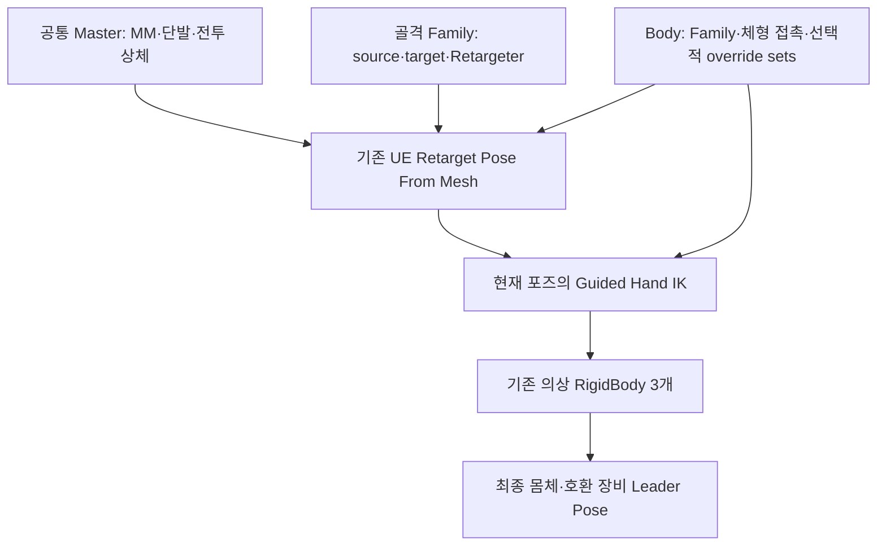

# 골격·몸체 프로필 기반 실시간 리타깃 — 2026-10-13

## 적용 범위

기준 코드는 `8485562c`의 MM 캐시 최적화를 포함한다. 공통 마네킹 Master에서 MM·단발·전투 상체·몽타주를 합성하고, 임포트 몸체에 한 번 리타깃하는 현재 구조를 유지한다. 개별 Animation Sequence를 변환하거나 PSS/PSD를 몸체별로 복제하지 않는다.

이번 구현은 **골격 연결과 몸체 접촉 설정의 공유·확장 경계**를 만든다. 기존 Retargeter·손 보정·물리 값을 사용하는 실제 Greatsword 몸체에도 연결했다. 추가 의상용 Copy Pose 그래프, 새 FBIK/전신 솔버, 의상 물리의 독립적인 평가 주기나 모든 캐릭터의 자동 변환을 구현한 것으로 해석하지 않는다. 기존 시각 그룹 예산은 계속 사용한다.

## 실행 흐름과 책임

2026-10-15 갱신 정책 소유권: retarget AnimInstance 초기화는 external tick-rate control이 없는 standalone mesh에만 기본 visibility tick 정책을 쓴다. coordinator나 다른 외부 allocator가 이미 제어 중이면 그 정책을 보존한다. coordinator 해제는 자신이 취득한 authored 값을 복원한다. [재초기화·해제·standalone 집중 회귀](../../Review/Audits/Project_J_PC_Structure_Cleanup_2026-10-15.md)를 확인한다.

`UProject_JRetargetFamilyProfile`은 SourceSkeleton·TargetSkeleton·기존 IK Retargeter를 가진다. 같은 실제 skeleton 쌍을 쓰는 몸체가 공유할 수 있다. 뼈 이름·계층이 비슷하다는 이유만으로 다른 USkeleton을 자동 호환 처리하지 않는다. 별도 골격에는 명시적인 Family와 리타깃 체인/포즈 검수가 필요하다.

`UProject_JRetargetBodyProfile`은 Family·기존 HandGripProfile과 선택적인 Retarget Override Set 이름을 가진다. 무기·직업의 동작 선택과 몸체 보정의 책임을 분리한다. 동일 Family의 체형 차이는 Body와 그 Retargeter 안에 작성한 override sets로 공급할 수 있다. 이 구현은 새로운 override 값을 임의로 생성하지 않는다.

공통 `UProject_JRetargetAnimInstance`가 프로필을 해석하므로 골격별 외형 ABP는 **리타깃→접촉→추가 뼈/물리**의 얇은 연결부로 유지할 수 있다. 다른 골격의 모든 ABP 에셋을 하나로 합친 것이 아니다. 해당 골격의 물리·추가 뼈·필요한 노드 연결은 여전히 작성해야 한다.

## 프로필 우선순위와 실제 저장 연결

Body 선택은 시각 ABP의 `RetargetBodyProfile` → 캐릭터 `CharacterAnimProfile.RetargetBodyProfile` → 기존 노드 설정 순이다. 선택한 Body의 TargetSkeleton이 실제 메시와 다르면 Body를 사용하지 않는다.

손 보정은 **기존 시각 ABP의 명시적 HandGripProfile → 유효 Body.HandGrip → 캐릭터 공유 HandGripProfile → 캐릭터 inline 보정 → 기존 기본값** 순이다. 기존 에셋의 명시적 override를 유지해 점진적으로 이행할 수 있다.

MCP로 생성·설정·저장한 에셋:

| 에셋 | 연결 |
| --- | --- |
| `/Game/DataAssetSets/Presentation/Retarget/DA_RetargetFamily_Mannequin_Bip01` | Source `/Game/Characters/Mannequins/Meshes/SK_Mannequin`, Target `/Game/Characters/GreatSword/GreatSword_Woman_Skeleton`, 기존 `RTG_Greatsword_UE5` |
| `/Game/DataAssetSets/Presentation/Retarget/DA_RetargetBody_Greatsword` | 위 Family와 기존 `DA_HGP_Greatsword`, override sets 비활성 |
| `/Game/Animation_Logic/ABPs/GreatSword/ABP_Greatsword_Woman_RunTIme` | 새 Body를 클래스 기본값에 할당하고 중복된 기존 직접 HandGripProfile 할당을 None으로 이행 |

Body ABP의 포즈 그래프를 다시 만들지 않았다. 기존 Retargeter와 HGP 내용, 물리 에셋·노드 값도 변경하지 않았다. `Master`, 전방 PSS/PSD, 기본 플레이어 프로필과 CMC/GAS/네트워크 payload는 이번 변경 대상이 아니다.

## GT·worker·설정 소유권

제작 검증은 Family 선언의 source/target skeleton을 Retargeter의 실제 preview mesh 쌍과 비교한다. 쌍이 다르면 Family와 이를 쓰는 Body를 invalid로 판정한다. preview가 없으면 검증 불가능 경고를 남긴다. 런타임 `Matches`의 매 프레임 비용·선택 계약은 바꾸지 않는다. 원본 validator가 뒤집힌 쌍을 승인한 재현과 생산 Family 정상 검증은 [전체 감사](../../Review/Audits/Project_J_Whole_Project_Audit_2026-10-13.md)에 남긴다.

`FProject_JRetargetAnimInstanceProxy::PreUpdate`는 **엔진 retarget node의 GT source pose 캡처보다 먼저** 프로필 설정을 적용한다. NativeUpdate 뒤에서 설정하면 캡처/초기화에 한 프레임 차이가 생길 수 있어 이 경계를 사용한다.

- generated 클래스별 표준 `FAnimNode_RetargetPoseFromMesh` 인덱스와 원래 asset/override 설정을 보관한다. 매 프레임 전체 graph를 다시 검색하지 않는다.
- 현재 source/target mesh의 skeleton 쌍이 Family와 일치할 때만 적용한다. Parent 모드는 실제 부착 계층을 확인하고, Custom Component 모드는 엔진이 캡처할 현재 source를 사용한다. `SourcePosePin` 모드는 이 profile bridge가 소유하지 않는다.
- 소유하지 않은 노드 설정은 건드리지 않는다. 프로필 해제·source 불일치 때 원래 설정을 복구한다. 같은 instance 재초기화 전에 적용했던 값을 복원해 override가 새 기본값으로 승격되지 않게 한다.
- 클래스 재초기화/재인스턴싱 시 인덱스를 초기화하며, 사용 시 인덱스·struct 타입을 검사한다. native node 포인터를 장기 보관하지 않는다.
- 저장해 둔 원래 Retargeter 참조는 `TObjectPtr`와 Proxy `AddReferencedObjects`로 GC가 추적한다. 초기 raw pointer 경고는 수정했다.
- 실제 Retargeter 데이터 에셋을 런타임에 수정하지 않는다. actor/world/프로필 선택과 노드 설정은 GT, 손 목표의 좌표 변환·알파 계산과 포즈 평가는 기존 엔진 경로다. 별도 task·tick·RPC를 추가하지 않는다.
- Body 재초기화에서는 이전 WeaponPresentation 등록을 해제한 뒤 새 소유자에 등록한다. dedicated-server early exit에도 이전 등록을 남기지 않는다.

프로필이 Retargeter/override sets의 설정 소유자일 때는 같은 값을 AnimGraph 입력 핀에서 별도로 바인딩하지 않는다. 새로운 골격별 ABP를 연결할 때 이 소유권과 source component/pose 모드를 확인한다. 원본 GT→시각 평가 의존 관계, 원본 ABA와 시각 Coordinator의 보호·보간·wake는 유지한다.

## 손 접촉과 추가 뼈

`GetBodyHandContact`를 통해 Native 손 목표와 Guided 노드가 같은 보정 규칙을 사용한다. 이미 읽은 calibration을 넘기는 경로에서는 같은 호출 안의 중복 프로필 복사를 피한다. Palm→손목 변환, 현재 bone scale, 주 손 공간의 보조 손 목표, 명시적인 0 커브, 손이 무기를 구동하는 경우의 자기 추적 방지와 기존 LegacyWristOrigin 호환은 유지한다. 움직이는 포즈나 무기 월드 좌표를 정적 캐시로 고정하지 않는다.

몸체가 가진 치마·머리카락 뼈는 기존 물리 경로에서 처리한다. 같은 몸체 포즈에 포함된 호환 의상은 Leader Pose로 공유한다. 의상에만 존재하는 독립 뼈에는 별도 Copy Pose+추가 뼈 물리 경로가 필요할 수 있다. 모든 장비에 리타깃 ABP를 붙이거나 의상별 MM을 실행하지 않는다.

손 접촉 메타데이터 캐시는 시도 후 **제거했다**. 실제 몸체의 고정된 primary anchor에 대해 기존 조회와 캐시를 25,000회씩 번갈아 4회 측정했다. 기존 1.681/1.649/1.654/1.649ms, 캐시 2.086/2.126/2.082/2.083ms였다. 뼈 조회 감소보다 소켓·메시·골격·변경 검사의 비용이 컸다. 임시 캐시·무효화 상태·전용 테스트·계측 루프를 최종 생산 코드에 남기지 않는다. 국소 반복 측정이며 전체 캐릭터 CPU 결과와 합산하지 않는다.

## MCP와 검증 경계

처음에는 에디터가 꺼져 있어 `127.0.0.1:8000/mcp`에 연결되지 않았다. 직접 UBT 이후 UE 5.8.3 Editor를 실행해 공식 MCP에 연결하고, 실제 source/target skeleton·Retargeter·HGP를 읽은 뒤 위 세 에셋만 저장했다. body BP compile을 경고까지 오류로 취급하는 옵션으로 통과하고 재조회했다.

MCP Blueprint DSL/FindNodes는 이 AnimGraph의 native 노드를 반환하지 않았고, `Nodes` property와 해당 asset image도 지원하지 않았다. 빈 결과를 노드 부재로 해석하지 않는다. 실제 generated runtime graph를 읽는 `ProjectJ.Retarget.ProductionRuntime`으로 보완했다. 한 retarget body, retarget node 1개, 기존 physics node 3개와 실제 bone evaluation을 확인한다. 프로필 교체·해제·재초기화·잘못된 source pair·원래 body 복구도 실제 엔진 프레임에서 검사한다.

초기 동기 테스트는 한 엔진 프레임 안에서 World를 여러 번 tick해 traversal counter가 진행하지 않았다. 테스트를 latent로 수정해 **엔진 프레임당 World tick 하나**와 실제 visual update counter를 확인한다. 제품 평가 주기나 보호 조건을 낮춰 통과시키지 않았다. 최초 실패 보고서와 테스트 빌드의 include/access/link 오류도 로컬에 보존한다.

임시 Python remote execution 활성화는 자동 승인 검토가 거절했고 실행하지 않았다. 그 경로를 사용하지 않고 로컬 WM_CLOSE 정상 종료 요청으로 에디터를 종료했다. 원격 실행 설정은 false인 상태에서 시작했으며 활성화 성공으로 보고하지 않는다.

원자료 루트는 `Saved/Validation/RuntimeRetarget_20261013/`다. `MCPVerification.json`, `MCPContracts.json`, `AssetBackup`, `BeforeSource`, `BeforeAssets.json`, 각 build/report와 `MetadataProbe/MetadataTiming.txt`를 보존한다. `Saved`는 로컬 ignore 자료이며 새로운 clone에는 없을 수 있다.

## 최종 검증과 200명 CPU 비교

직접 UBT로 Editor와 Game의 Win64 Development를 빌드했다. 일반 회귀 27개와 D3D12 기록 재생 6개는 모두 성공했다. 중복인 ProductionRuntime을 제외하면 기능 테스트 **32개**다. 일반 회귀의 기존 최소 fixture 두 개에서는 None 장비 소켓의 Draw/Sheathe 경고가 각각 1개 발생했다. 실패·테스트 오류는 0개이며 전체 로그의 경고가 0개라고 보고하지 않는다. 마지막 변경은 프로필 타이머 범위와 아래 네트워크 fixture만 좁게 검증한다.

- 실제 Body의 Family/HandGrip 해석, 잘못된 골격 쌍, legacy override 우선순위, 프로필 교체·해제·재초기화·원래 설정 복구를 검사했다.
- 원본 Master·전방 PSS/PSD·기본 플레이어 프로필의 SHA-256이 작업 전과 같다. 기존 Retargeter/HGP/물리 에셋도 변경하지 않았다.
- 기록된 Strafe 미세 회전·지속 곡선·A/D 측면 회전·Land 복귀와 시각 예산 수명 시험을 실행했다. D3D12 PNG 149개를 수집했으며 일부 프레임을 확인했다. 기존 Land 재생의 Frame/Unified/Chest/Torso/CurveReturn/RecordedSummary 행 3,816개는 이번 결과와 동일했다. 전체 동영상·모든 새 체형·발 접지 품질의 인증은 아니다.
- 실제 소켓의 서버+클라이언트 2개, native NPC 200개, Iris 병렬 설정, 지연 50ms·손실 3%에서 AOI/FastArray/애니메이션 시나리오와 정상 종료를 검사했다. NPC 200개의 외형을 전부 authored 리타깃 몸체로 구성한 네트워크 시험이나 200명 동시 접속 시험은 아니다.

첫 네트워크 실행은 assertions·종료 코드가 통과했지만, 기존 시험 플레이어의 cull distance 1,000,000cm가 Iris 상한 150,000cm를 넘어 handled ensure가 있었다. `bAlwaysRelevant`로 이행한 시도는 원격 캐릭터 참조가 준비되지 않아 stage 1에서 실패해 제거했다. 최종 `Project_JAuthoredAnimationFixture`의 **네트워크 시험 분기만** 기존 거리 필터를 유지하면서 100,000cm로 제한한다. 시험용 200m 간격의 관찰 공간을 덮고 기본 Iris 상한 안에 드는 값이다. NPC의 AOI와 생산 캐릭터의 관심 영역 설정은 유지한다. 최초/실패/최종 실행을 각각 보존하며, 엔진 Toolset의 Python 시작 오류도 fixture 성공과 전체 로그 청결을 구분해 기록한다.

최종 `RuntimeRetarget_20261013_Lag50Loss3_Parallel_BoundedFixture`는 전 stage·정상 연결 해제를 통과했다. 서버/클라이언트 종료 코드 모두 0, timeout 0, handled ensure·assertion·fatal 0이다. Toolset의 기존 Python 시작 오류는 남아 있으므로 전체 로그가 무오류라는 뜻은 아니다. 마지막 빌드 후 BodyContracts·ProductionRuntime·AnimationProxyPinsQueuedAssets도 성공했다.

비계측 CPU는 같은 v2 fixture, 실제 BP·장비·follower, NullRHI, Ryzen 7 9800X3D, 200명, 60Hz, ABA 2ms, 각 조건 준비 120틱+측정 120틱, 2회 반복이다. `8485562c`의 시작 바이너리와 프로필 연결 후 바이너리를 비교했다. 아래는 반복 평균 World tick이며 렌더 FPS나 GPU 비용은 포함하지 않는다.

| 조건 | ABA | 변경 전 ms | 변경 후 ms | 변화 |
| --- | --- | ---: | ---: | ---: |
| Near | off | 18.115 | 19.991 | +10.36% |
| Near | on | 12.183 | 12.686 | +4.13% |
| Far | off | 15.140 | 16.168 | +6.79% |
| Far | on | 11.100 | 11.480 | +3.43% |
| Hidden | off | 11.324 | 11.321 | -0.02% |
| Hidden | on | 6.221 | 6.523 | +4.85% |
| AttackBurst | off | 20.601 | 22.681 | +10.10% |
| AttackBurst | on | 20.102 | 22.736 | +13.10% |

**전체 성능 향상과 CPU 회귀 해소를 입증하지 않았다.** Near/AttackBurst의 실제 visual update 횟수는 전후 같고, Hidden에서는 양쪽 모두 0이다. 평가를 생략하거나 보호 품질을 낮춰 성능 숫자를 만든 것이 아니다. 시간대가 다른 2회 표본이며 실행 환경·노이즈·전체 엔진 비용과 변경의 인과를 분리하려면 번갈아 실행하는 추가 비교가 필요하다. 앞선 리팩토링의 +8.3% 문제와 이번 증가도 별개로 남긴다.

추가 1회 trace에서 최종 `ProjectJ_RetargetProfile_PreUpdate`는 **프로필 설정 처리만** 측정한다. 기존 `FAnimInstanceProxy::PreUpdate`의 source 캡처·물리 준비는 범위 밖이다. 틱당 누적 CPU는 Near off/on 0.135/0.074ms, Far off/on 0.044/0.043ms, AttackBurst off/on 0.129/0.131ms이고 Hidden 호출은 없다. 이는 계측 실행의 국소 비용이며 비계측 World tick 증가분을 전부 설명하지 않는다. 초기 넓은 범위의 1.372ms AttackBurst on 값을 새 설정의 추가 비용으로 해석하지 않는다. Snapshot/ContactMath 타이머도 기존 함수의 전체 실행 범위다.

CPU 원자료는 `Saved/Validation/AuthoredAnimation_20261005/RuntimeRetargetBefore_20261013`, `RuntimeRetargetAfter_20261013`, `RuntimeRetargetAfterTrace_20261013`, `RuntimeRetargetProfileScopeTrace_20261013`에 각각 보존한다. 비계측 비교 이후 변경한 trace 범위와 네트워크 fixture의 분기는 CPU의 Standalone 동작을 변경하지 않는다. 각 실행의 실제 바이너리·변경 소스 해시는 해당 manifest를 기준으로 확인한다. [공유용 검증 요약](Runtime_Retarget_Profiles_Validation_2026-10-13.json)에 반복별 수치·프로필 타이머·테스트·에셋 해시를 남긴다.

## 커밋 전 정리와 후속 검증

커밋 전 정리에서는 Body.HandGrip이 없어 캐릭터 공유 HandGrip으로 대체되는 경우 진단의 CalibrationSource를 잘못 Body로 표시하던 조건을 수정했다. 실제 보정·재생·예산 계산은 변경하지 않았다. 실패한 캐시와 임시 benchmark 루프가 최종 Source에 없고 접촉 헬퍼의 실제 사용을 확인했다. 정리 후 Editor/Game 직접 UBT 빌드와 BodyContracts/ProductionRuntime 2개가 성공했다. 이전 측정 해시·32개 기능 결과를 이 후속 검증과 구분해 공유용 JSON에 보존한다.

## 새 몸체를 추가하는 절차

1. 원본 메시와 추가 뼈를 보존해서 임포트하고, 실제 skeleton·축·root/단위/스케일을 확인한다.
2. 같은 skeleton 쌍이면 기존 Family를 공유한다. 다른 쌍이면 IK Rig/Retargeter의 체인과 기준 포즈를 확인한 Family를 만든다. Family의 source는 MM 마스터가 사용하는 실제 skeleton이다.
3. Body를 만들고 해당 Family와 체형 HandGripProfile을 연결한다. 필요할 때만 Retargeter에 작성한 override sets를 선택한다. 무기 설정은 WeaponPresentationProfile에 남긴다.
4. 해당 골격의 얇은 외형 ABP는 `UProject_JRetargetAnimInstance`를 기반으로 하고 Body를 할당한다. 직접 HandGripProfile override가 불필요하면 None으로 이행한다.
5. source 연결·리타깃·접촉·물리 순서, 무기 구동 공간, 추가 뼈와 Leader Pose/독립 물리 여부를 검수한다. 필요 없는 cloth/hand solver를 전부 복제하지 않는다.
6. 공격 중 손 놓기/재파지, OTM/Strafe·Run/Sprint·Start/Land, root motion·몽타주 중단, 30/60/120Hz, 원격·LOD·화면 복귀·아바타 교체를 확인한다. 뼈를 전부 임의로 같은 이름으로 바꾸거나 Compatible Skeleton 표시만으로 리타깃을 대체하지 않는다.

## 후속 성능·품질 범위

외형 ABP가 Body를 명시하면 해당 참조를 먼저 사용하고, 없을 때만 Pawn/archetype fallback을 조회한다. 새 캐시·무효화 상태를 추가하지 않으며 기존 Body/Family 우선순위와 skeleton 호환 검사를 유지한다. [전체 감사의 교대 측정](../../Review/Audits/Project_J_Whole_Project_Audit_2026-10-13.md)에서 일부 CPU 증가가 남았으므로 이 조회 생략을 전체 성능 회귀 해결로 해석하지 않는다.

이 구조는 설정 공유·소유권·호환을 개선한다. ABP 분리만으로 retarget op/IK/물리 비용이 사라지는 것은 아니다. 다음 선택적 비용 조정은 기존 200명 v2 fixture, 실제 RHI timer와 접촉/의상 품질을 함께 확인한다. 특히 retarget FK/IK, Guided solve, 물리 3개와 렌더 section/draw/skin 비용을 분리한다. 원본 판정 포즈·소켓·게임플레이 요구와 시각 몸체의 비용을 혼동하지 않는다.

참고: [UE runtime retarget](https://dev.epicgames.com/documentation/en-us/unreal-engine/runtime-ik-retargeting-in-unreal-engine), [ABP linking/templates](https://dev.epicgames.com/documentation/en-us/unreal-engine/animation-blueprint-linking-in-unreal-engine), [모듈러 캐릭터](https://dev.epicgames.com/documentation/en-us/unreal-engine/working-with-modular-characters-in-unreal-engine). 현재 로컬 엔진 소스의 node PreUpdate·UAnimInstance/Proxy 실행 순서·GC API도 확인했다. [이전 리타깃 문서](Runtime_Retarget_HandIK_Architecture.md), [메시 소유권](Visual_Presentation_Mesh_Ownership.md), [손 접촉](../Authoring/Weapon_Hand_Contact_System.md), [시각 예산](../Planning/Crowd_Visual_Presentation_Budget_2026-10-12.md), [최신 MM 최적화](../Planning/Animation_Runtime_Optimization_2026-10-13.md)를 함께 따른다.

## 2026-10-14 메시 역할 재점검

[RA08 재점검](../../Review/Audits/Project_J_Reaudit_2026-10-14.md)에서 AnimInstanceBase의 별도 follower 탐색/이름 heuristic/캐시를 기존 공통 resolver로 통합했다. 현재 source에 attached된 명시적 tag 또는 native retarget class가 역할을 결정한다. bone 소비자는 loaded mesh asset을 요구하고 quality 조회는 load 전 role도 확인할 수 있다. 분리됐지만 살아 있는 이전 component가 역할을 계속 소유하지 않는다.

MCP의 실제 source/body profile 연결, public subobject template, actual Blueprint construction을 별도 증거로 대조했다. CDO의 None 또는 template parent null은 runtime 부재를 뜻하지 않는다. 이 정리가 모든 체형/clip/LOD/cloth 품질이나 남은 CPU 증가 해결을 입증하지 않는다.
