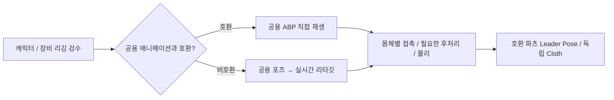

# 애니메이션 제작 가이드

캐릭터는 실제 골격·기준 포즈·스킨·IK를 검수한 뒤 재생 경로를 정한다. 아래는 제작 시 선택 흐름이며 런타임의 이름별 자동 분기가 아니다. 구체적인 승인 조건은 [리깅·UE5 후처리 가이드](Character_Rigging_And_UE5_Postprocess_Playbook.md)를 따른다.

머리카락·치마·망토의 추가 본과 물리는 몸체별로 검수한다. 제작 기여에는 [에셋 출처·제출 조건](../../../CONTRIBUTING.md#에셋-출처와-제출-조건)도 적용한다.

| 작업 | 문서 |
| --- | --- |
| 이동 모션·프로필·직업/탈것 문맥 확장 | [이동 콘텐츠 제작](DataDrivenLocomotionExtensionGuide.md) |
| 원본 보관·Manny 카탈로그·추가 수입 중복 검사 | [플레이어 애니메이션 라이브러리](Player_Animation_Library.md) |
| 캐릭터 임포트·스켈레톤 리타깃 설정 | [휴머노이드 리타깃 표준](HumanoidSkeletonRetargetingStandards.md) |
| Blender 리깅·실제 UE 마네킹 비교·후처리·실패 사례와 캐릭터별 검수 | [리깅·UE5 후처리 작업 가이드](Character_Rigging_And_UE5_Postprocess_Playbook.md) |
| 캐릭터·의상·장비의 기존 LOD 보존·공통 설정 생성/검증 | [메시 LOD 제작](Mesh_LOD_Authoring.md) |
| 플레이어 로코모션 클립·Chooser·native/ABP 책임 | [현재 로코모션 구조](../Architecture/Player_Locomotion_Architecture.md) |
| 몸체 보정·Idle 부착·오른팔·왼팔·공격 구간·복귀 | [무기 파지와 손 접촉 통합 가이드](Weapon_Hand_Contact_System.md) |

## 손 접촉을 설정할 때 읽는 순서

1. [몸체 보정 절](Weapon_Hand_Contact_System.md#body)의 몸체 프로필과 손바닥 소켓 설정.
2. [정상 부착 절](Weapon_Hand_Contact_System.md#mount)의 무기 DA와 Idle 목적지.
3. [보조 손 절](Weapon_Hand_Contact_System.md#secondary)의 왼팔 입력 및 기존 Two-Hand Grip IK 구간.
4. [진단](../Diagnostics/README.md)에서 무기·손·팔꿈치 측정 방법 확인.

몸체 프로필은 해부학·보정, 무기 프로필은 Grip·부착·접촉 기능, 몽타주 스테이트는 파지 구간을 담당한다. 개별 몸체·무기 조합의 도달 범위와 추가 물리는 별도로 검수한다.

## 근접 gameplay 궤적 제작

`Project_JAssetMigrationLibrary.BakeCanonicalMeleeTrajectory(Attack, SourceMesh, bExecute=false, bSave=false)`는 선택한 공격 정의의 `MeleeTrajectory`만 작성하는 편집기 C++ 도구다. 기본 호출은 JSON preflight와 후보 키만 반환한다. 실행은 clean·fully loaded persistent 공격 에셋을 요구하고, 저장은 명시한 해당 패키지에만 수행한다. 기존 능력 CDO나 원본 NPC/플레이어 그래프를 바꾸지 않는다. 저장 실패 후 디스크 rollback을 보장하지 않으므로 반환된 실행·저장·실패 필드를 각각 확인한다.

현재 지원 입력은 같은 skeleton의 clean mesh·montage·단일 non-additive RAW sequence, 한 slot/비반복 segment/0에서 시작하는 비반복 section, 순방향·비워프 실행, 선택된 근접 notify 하나다. 실제 sequence를 120Hz 절대 montage 시간 격자와 정확한 window 양 끝에서 평가해 2..64개 mesh 공간 키를 만든다. 더 긴/복잡한 공격을 자동 단순화하거나 여러 클립을 추측해 합치지 않는다. source metadata·raw motion·retarget/mesh/socket 입력과 출력 키를 함께 stamp하며 등록된 Data Validation이 변경을 거절한다. source 수정 후 다시 제작·검증한다.

런타임은 이 데이터를 명시한 gameplay geometry로 사용한다. 실제 GAS montage 간격의 두 관측 root를 translation lerp/shortest quaternion slerp로 매핑하고 동일한 mesh 상대 변환·양의 균일 scale을 요구한다. 기반이 있으면 같은 유효 component/bone의 게시 좌표계가 그대로인 구간만 지원한다. 이동하는 기반·warp·resimulation·async 물리 backend·점프/reverse·불연속은 현재 미지원이며 켜진 데이터가 무효일 때 기본 chord로 조용히 대체하지 않는다. 관측 사이 실제 물리 궤적 또는 화면의 blended/IK 무기 곡선과 일치한다는 뜻은 아니다.

NPC는 `NPCActivationDefinition.AttackDefinitionOverride`로 기존 NPCAttack ability에 데이터를 전달한다. null이면 기존 CDO 기본값을 사용한다. 부여된 능력의 약한 `SourceObject`를 보완하기 위해 activation이 선택 데이터를 정확한 grant 수명 동안 보유한다. 실행 중 정의를 편집해도 현재 grant의 데이터는 바뀌지 않으며 명시 Stop→Start로 새 선택을 사용한다. 플레이어 장비/능력의 기존 grant 소비와 NPC 비모션매칭 그래프는 유지한다.

새 참조 `DA_Attack_NPC_PrototypeCleave_Canonical`과 `DA_NPC_PrototypeCleaveCanonicalActivation`은 원본 PrototypeCleave 정의를 보존한 선택용 자산이다. 실제 호출 검증은 `Measure-RenderedCrowd.ps1 -NPCAuthoredPath`가 기존 NPC cohort에 이 정의를 지정하며, 기본 실행·피해·예산·정리 기준은 유지한다. 다른 골격·보스·무기·탈것의 호환성과 표현 품질은 해당 입력으로 검증해야 한다.

배포 전에는 선택 공격/activation과 실제 mesh·montage·sequence·skeleton 등 validator가 읽는 package를 [선택 에셋 검증과 Cook 계약](../../Maintenance/Change_Completion_Policy.md#선택-에셋-검증과-cook)에 선언한다. baked 키가 있다는 사실만으로 최신 source 검증을 통과한 것으로 판단하지 않는다.
