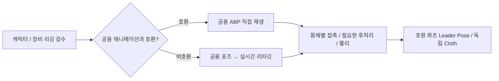

# 애니메이션 제작 가이드

캐릭터는 실제 골격·기준 포즈·스킨·IK를 검수한 뒤 재생 경로를 정한다. 아래는 제작 시 선택 흐름이며 런타임의 이름별 자동 분기가 아니다. 구체적인 승인 조건은 [리깅·UE5 후처리 가이드](Character_Rigging_And_UE5_Postprocess_Playbook.md)를 따른다.

머리카락·치마·망토의 추가 본과 물리는 몸체별로 검수한다. 제작 기여에는 [에셋 출처·제출 조건](../../../CONTRIBUTING.md#에셋-출처와-제출-조건)도 적용한다.

| 작업 | 문서 |
| --- | --- |
| 이동 모션·프로필·직업/탈것 문맥 확장 | [이동 콘텐츠 제작](DataDrivenLocomotionExtensionGuide.md) |
| 원본 보관·Manny 카탈로그·추가 수입 중복 검사 | [플레이어 애니메이션 라이브러리](Player_Animation_Library.md) |
| 캐릭터 임포트·스켈레톤 리타깃 설정 | [휴머노이드 리타깃 표준](HumanoidSkeletonRetargetingStandards.md) |
| Blender 리깅·실제 UE 마네킹 비교·후처리·실패 사례와 캐릭터별 검수 | [리깅·UE5 후처리 작업 가이드](Character_Rigging_And_UE5_Postprocess_Playbook.md) |
| 캐릭터·의상·장비의 기존 LOD 보존·공통 설정 생성/검증 | [메시 LOD 제작](Mesh_LOD_Authoring.md) |
| 플레이어 로코모션 클립·Chooser·native/ABP 책임 | [현재 로코모션 구조](../Architecture/Player_Locomotion_Architecture.md) |
| 몸체 보정·Idle 부착·오른팔·왼팔·공격 구간·복귀 | [무기 파지와 손 접촉 통합 가이드](Weapon_Hand_Contact_System.md) |

## 손 접촉을 설정할 때 읽는 순서

1. [몸체 보정 절](Weapon_Hand_Contact_System.md#body)의 몸체 프로필과 손바닥 소켓 설정.
2. [정상 부착 절](Weapon_Hand_Contact_System.md#mount)의 무기 DA와 Idle 목적지.
3. [보조 손 절](Weapon_Hand_Contact_System.md#secondary)의 왼팔 입력 및 기존 Two-Hand Grip IK 구간.
4. [진단](../Diagnostics/README.md)에서 무기·손·팔꿈치 측정 방법 확인.

몸체 프로필은 해부학·보정, 무기 프로필은 Grip·부착·접촉 기능, 몽타주 스테이트는 파지 구간을 담당한다. 개별 몸체·무기 조합의 도달 범위와 추가 물리는 별도로 검수한다.
