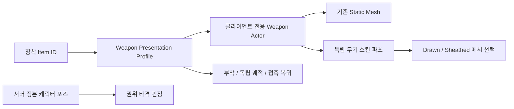

# Spellblade 이름·무기 이주

현재 캐릭터와 전용 제작 자원의 이름은 **Spellblade**로 통일한다. 기존 Basic 대검은 별도 장비로 보존한다. 파일 이름, 저장 데이터의 식별자, 게임플레이 태그는 서로 다른 계약이므로 일괄 문자열 치환 대상으로 취급하지 않는다.

## 이름과 보존 경계

| 대상 | 현재 이름·경로 | 보존하는 계약 |
| --- | --- | --- |
| 캐릭터 BP | `/Game/Character_BPs/Spellblade/BP_Spellblade` | 공통 Player Master 상속·Mover·GAS |
| 전용 몸체·Skeleton·ABP·Control/IK Rig·프로필 | `/Game/Spellblade/**` | UE5 코어 본, 추가 얼굴·머리·의상 본, 기존 후처리 역할 |
| 기존 몸체·의상 제작 자원 | `/Game/Characters/Spellblade/**` | 제작·실시간 리타깃 대체 경로 |
| 전투 애니메이션·전용 DA | Spellblade 폴더·에셋 이름 | 기존 공격 데이터·태그·노티파이의 역할 |
| native 호환 fixture | `AProject_JSpellbladeCharacter` | 이전 클래스는 CoreRedirect로 연결 |
| 캐릭터 제작 원본 | `SourceArt/Characters/Spellblade/UE5/Spellblade_UE5_Rig.blend` | `Armature` 318본, `CTRL_Spellblade` 제작 컨트롤 |
| 새 무기·장식 | `/Game/Weapons/Spellblade/**` | 원본 drawn/sheath 4종의 메시·스킨 |
| 새 장착 아이템 | `DA_Spellblade_Equip`, `Spellblade.Starter` | 기존 전투 스타일을 재사용하는 별도 장비 |
| 기존 Basic 대검 | `/Game/Weapons/Greatsword/Basic/**`, 기존 무기 BP·장착 DA·프레젠테이션 | `Greatsword.Starter`와 기존 인벤토리 의미 |
| 저장된 직업 ID | `GreatSword` | 기존 profile·진행도·정의 fingerprint 의미 |
| 기존 전투 태그 | `Combo/Attack/Command/CombatStyle.Greatsword.*` 등 | 저장·명령·전투 의미의 안정 식별자 |

225개 에셋의 실제 package 대응은 [AssetMappings.csv](Data/SpellbladeMigration_20261101/AssetMappings.csv)에 있다. `AssetTools.rename_assets`를 사용하고 참조를 저장한다. UObject 파일을 파일 탐색기로 옮기거나 바이너리 문자열을 수정하지 않는다. PrimaryAsset ID에는 명시적인 이전→현재 리다이렉트를 둔다. 과거 성능 보고서·원자료의 이름과 해시는 당시 실행의 근거이므로 유지한다.

새 이름은 구 클라이언트에 새 BP 경로를 자동 제공하지 않는다. 실시간 네트워크 프로토콜은 **8→9**로 올려 이전 배포물과 혼합 접속하지 않게 한다. 현재/호환 버전을 함께 갱신하고 이전 8의 엔진 checksum 거절을 시험한다. 저장 스키마 버전과 네트워크 버전은 별개다. 새 Cook·Shipping·구 Stage82와의 실제 소켓 시험은 별도 검증 대상이다.

## 무기 리그와 실행 경로

| 항목 | 설계 |
| --- | --- |
| 캐릭터 리그 | 기존 UE5 직접 ABP / 비호환 실시간 리타깃 두 경로 유지 |
| 독립 무기 리그 | `Bip_Weapon_R` 루트 + `_01..03` + `B_Add_b_00..03`, 총 8본 |
| 무기 루트 | 원본 drawn 또는 sheath 기준의 **bind 공간**으로 정규화. 캐릭터 전체 318본을 복제하지 않음 |
| 장식 가중치 | drawn aiguillette의 루트·4개 보조본, 나머지 3종의 루트 가중치 보존 |
| 변형 선택 | 같은 파츠 컴포넌트의 drawn/sheath 메시 교체. 장비 변경·파괴는 기존 Actor 수명 경로 사용 |
| 그립 기준 | 루트에 작성한 `WeaponGrip_R/L`. 고정 부착 계산은 reference pose만 읽고 움직이는 보조본/이전 world pose는 거절 |
| 타격 권위 | 기존 정본 캐릭터의 서버 추적. 장식 스킨·클라이언트 무기가 판정 권위를 갖지 않음 |
| 기존 BP 호환 | native `WeaponMesh`의 이름과 `UStaticMeshComponent` 타입 유지. 선택적인 skeletal 파츠를 추가 |
| 프레임 비용 | 무기별 캐릭터 ABP·모션매칭·실시간 리타깃 없음. reference pose의 단일 LOD는 반복 tick 없음. 다중 LOD는 엔진 LOD 갱신 tick 유지 |
| 2차 움직임 | 현재 파츠는 reference pose 모드. 본 보존이 자동 물리 시뮬레이션을 뜻하지 않음. 독립 흔들림이 필요하면 명시적인 실행·예산 정책과 별도 품질 검증이 필요 |

이 8본은 **이번 원본 무기의 제작 규칙**이다. 모든 미래 무기가 8본이어야 한다는 공통 규격은 아니다. 런타임은 메시·기준점·draw/sheath 선택을 데이터로 소비한다. 다른 무기는 필요한 본·VFX anchor·가중치와 무게 중심을 검수하고 자기 제작 리그에서 정규화한다. 몸체용 Leader Pose와 독립 무기 Actor의 변환을 동시에 적용해 이중 변환을 만들지 않는다.

기준점의 역할도 구분한다. 손에 고정하는 root reference grip, 독립 공격 궤적, 움직이는 장식 본과 VFX 기준은 서로 바꿔 쓰지 않는다. 파츠에 post-process ABP를 작성했는데 reference pose 모드가 이를 조용히 중지하는 구성은 제작 검증에서 오류로 처리한다.

## 실제로 발견한 제작 문제

**숨긴 컬렉션에서 FBX 메시가 누락됐다.** 기존 exporter는 객체의 `hide_set(False)`만 바꿨다. 무기 컬렉션의 `hide_viewport=True` 때문에 메시가 선택되지 않아, 네 FBX가 각각 303,148바이트의 뼈대만 포함한 파일로 생성됐다. 원본 무기 본·Armature modifier·스킨 가중치는 정상이라 재리깅으로 해결할 문제가 아니었다.

`ExportMeshes.py`는 대상의 collection/view layer 제외·숨김·선택 잠금을 임시 해제하고 **요청한 armature+mesh 집합과 실제 선택 집합이 일치하는지** 확인한다. 빈 geometry·무가중 메시를 거절하고 성공·실패 모두 기존 표시/선택 상태를 복원한다. Complete+18개 파츠의 제작 FBX는 기존 318본으로 내보낸다.

`ExportWeaponRig.py`는 원본을 바꾸지 않고 필요한 무기 가지와 스킨을 복제해 독립 8본 FBX 4개를 만든다. drawn/sheath의 서로 다른 bind mount를 각각 사용한다. Blender의 통상 `Armature` object 이름을 사용해 UE legacy importer가 불필요한 별도 아홉 번째 root를 삽입하지 않게 한다. [무기 내보내기 manifest](../../../SourceArt/Weapons/Spellblade/FBX/ExportManifest.json)에 source mount·정점 수·가중 그룹·변환을 기록한다.

수입 뒤에는 FBX 성공 여부만 보지 않는다. Unreal의 실제 reference skeleton, LOD0 정점·삼각형, section BoneMap을 통한 실제 가중 본, 잘못된 influence와 무가중 정점도 검사한다. Blender 정점과 Unreal 정점 수는 UV/normal seam 분할 때문에 다를 수 있으므로 단순 동일 개수만으로 스킨 보존을 판정하지 않는다.

| 실제 UE LOD0 | 정점 | 삼각형 | 가중 본 | 잘못된 influence / 무가중 정점 |
| --- | ---: | ---: | ---: | ---: |
| longblade | 3,669 | 3,568 | 1 | 0 / 0 |
| longblade_in | 3,664 | 3,567 | 1 | 0 / 0 |
| aiguillette | 1,394 | 1,808 | 5 | 0 / 0 |
| aiguillette_in | 1,386 | 1,804 | 1 | 0 / 0 |

**메시 저장과 Skeleton 저장도 구분한다.** 이번 자동 FBX 수입은 메시를 저장했지만 생성된 Skeleton은 메모리에만 남았다. 수입 직후 확인은 성공했으나 새 프로세스의 컴포넌트 초기화에서 `has no skeleton` 경고가 발생했다. 동일 reference pose·본 이름·부모를 검수한 4종에 공유 `SK_Spellblade_Weapon_Skeleton`을 만들고 Skeleton과 모든 메시를 명시적으로 저장했다. 제작 검증과 native 회귀가 영구 Skeleton의 존재와 8본 공유 계약을 확인하게 했다. 이 문제를 ABP 후처리나 경고 숨김으로 덮지 않는다.

재임포트 원본은 프로젝트의 실제 `SourceArt` 파일로 갱신한다. 과거 메타데이터의 상대 경로가 엔진 설치 폴더 기준으로 해석되는 경우를 발견했으므로, 이동 후 새 프로세스에서 경로의 실제 존재를 확인한다. 몸체를 이름만 옮길 때는 LOD·cloth 보존을 위해 불필요한 재임포트를 하지 않는다.

## 재질·품질·검증 경계

BaseColor와 Normal은 최대 2K·스트리밍·무기 TextureGroup을 사용한다. `_m`은 RGB 영역 마스크이며 ORM이라고 단정하지 않는다. `_sp`도 원본 채널 계약이 확인되지 않아 보존한다. 현재 UE 재질은 BaseColor/Normal과 조정 가능한 Metallic/Roughness 기본값을 사용한다. 원본 게임과 동일한 PBR 표현이나 최종 아트 승인을 의미하지 않는다.

에디터 빌드, 에셋 연결 재열기, 직접 ABP/retarget 경로, 고정 그립의 공간 불변성, 기존 Basic 수명, 새 스킨 파츠의 draw/sheath·재구성·해제를 집중 검증한다. 실제 전투 화면·모든 스킬·납도 간섭·장식 물리·200명 성능·Cook/Shipping은 수행한 실행과 미수행 범위를 구분해 기록한다. 이전 Basic 200명 수치를 새 외형의 실측으로 인용하지 않는다.

이번 환경의 AssetTools redirector fixup은 화면 없는 commandlet에서 Slate assertion, 전체 에디터의 unattended Python에서는 확인창 취소 후 `TOptional` assertion을 냈다. 에셋 이동·저장 실패와는 구분한다. 임시 wrapper는 제거했다. [Epic의 공식 정리 절차](https://dev.epicgames.com/documentation/en-us/unreal-engine/asset-redirectors-in-unreal-engine)는 참조 재저장 후 삭제하는 방식이며, 강제 파일 삭제를 대체 절차로 쓰지 않는다.

현재 옛 `Characters/GreatSword`의 몸체·의상 9개는 작은 `ObjectRedirector` 호환 별칭으로 보존한다. 새 메시를 복제한 것이 아니다. 제작 맵·컬렉션·외부 소비를 확인하고 명시적으로 재저장한 뒤 정리할 수 있다. 나머지 216개 이주 경로에는 옛 package가 남지 않았다. 이전 이름이 보인다는 이유만으로 실제 무기·안정 ID·검증 원자료나 별칭을 함께 지우지 않는다.

검증 중이며 최종 실행 결과는 마감 시 이 문서와 연결 근거에 갱신한다.
