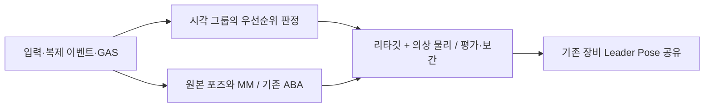

# 200명 시각 애니메이션 예산 관리

## 목적과 측정 기준

사용자가 지정한 200명을 기준으로, 통합 Locomotion과 최근 지속 곡선 이동 개선을 유지하면서 리타깃·의상 물리 평가 비용을 줄인다. 로컬 입력 감각, 단발→MM 연결, 전투 판정과 네트워크 이벤트의 소유권을 바꾸지 않는다.

비교는 실제 `BP_GreatSword`, 장비와 구성된 follower를 사용한다. 200명, follower 1,800개, 조건별 120틱 준비 + 120틱 측정, 두 번 반복한다. 근거리/원거리/숨김/200명 동시 공격을 각각 ABA off/on으로 실행한다. 원거리만 배치한 결과로 200명 기준을 대체하지 않는다.

NullRHI에서 측정한 World tick 경과 시간이며, 병렬 작업 완료까지 포함한다. 전체 렌더 FPS·GPU 비용·200개 소켓 접속 결과가 아니다. 거리와 렌더 시각은 통제한 CPU fixture 값이다. p95는 두 반복의 p95 평균, 최대치는 두 반복 중 최댓값이다.

## 실제 메시 구성

읽기 전용 런타임 감사로 캐릭터당 다음 구성을 확인했다.

- 숨겨진 `CharacterMesh0`: `ABP_Humanoid_Master`, 게임플레이 포즈와 MM의 원본.
- 보이는 `Greatsword`: `ABP_Greatsword_Woman_RunTIme`, 리타깃과 RigidBody 노드 3개가 같은 ABP 안에 있다.
- 나머지 8개 메시: `Greatsword`의 Leader Pose를 공유하며 자체 애니메이션 tick이 꺼져 있다.

따라서 9개 follower를 각각 리타깃하거나 의상 메시마다 독립 ABP가 실행되는 구조가 아니다. 이미 효율적인 장비 포즈 공유는 유지하고, 리타깃 몸체 ABP의 평가 횟수를 조절한다. 물리 노드를 일괄 삭제하거나 애니메이션·PSD·PSS·레벨을 저장하지 않았다.

## 구조

기존 `UProject_JAnimationUpdateCoordinatorComponent`를 캐릭터 시각 메시 그룹의 관리자로 확장했다. 원본 메시의 ABA 등록과 게임플레이 포즈 요구는 기존 서비스가 계속 담당한다. 시각 그룹은 엔진의 external update/evaluation/interpolation API를 사용한다. actor/CMC/GAS tick을 거리만으로 낮추지 않는다.

관리자의 판정은 worker proxy를 기다리지 않고 게임 스레드의 의미 스냅샷을 읽는다. 시각 메시의 실제 평가에는 원본 포즈 의존 관계를 유지한다. 원본의 모든 병렬 평가가 끝난 뒤에야 관리자의 판정을 시작하도록 묶는 불필요한 직렬 구간을 제거했다.

### 기존 병렬 아키텍처와의 관계

| 기존 실행부 | 이번 구현에서 사용하는 범위 |
| --- | --- |
| AnimInstanceProxy의 GT 게시·스냅샷 소비 | 기존 경로 활용. 후보·재생 소유권·Steering 입력을 같은 프레임의 값으로 전달 |
| 엔진 애니메이션 업데이트·평가 작업 | 기존 경로 활용. 실행 스레드는 엔진이 결정하며 thread-safe 콜백이 항상 worker에서 실행된다고 가정하지 않음 |
| NPC 타깃 점수의 `UE::Tasks`·`ParallelFor` | 이번 시각 예산에서 직접 호출하지 않음. 해당 서비스의 기존 경로 유지 |
| Mass 이동의 `ParallelForEachEntityChunk` | 별도 이동 계산 경로 유지. 이번 200명 authored 애니메이션 fixture를 Mass 병렬 측정으로 해석하지 않음 |

새 관리자는 GT에서 보호 조건·평가 주기·external control 설정을 결정한다. 실제 포즈 계산은 엔진이 관리하며 별도 캐릭터별 작업 스레드나 공통 작업 큐를 추가하지 않았다. 캐릭터 ID로 평가 프레임을 분산하는 것은 작업 시점 분산이며 병렬 작업 제출 자체가 아니다. 측정된 개선은 기존 병렬 실행 경계를 유지하면서 평가 작업량을 줄인 결과로 해석한다.

관련 소스는 `Project_JCharacterAnimInstanceProxy.cpp`, `Project_JCharacterAnimInstance.cpp`의 `NeedsFullRateVisualUpdate()`, `Project_JAnimationUpdateCoordinatorComponent.cpp`다. 관리자가 읽는 값은 GT 소유 스냅샷이며, worker proxy getter로 작업 완료를 기다리지 않는다.

| 상태 | 시각 평가 정책 |
| --- | --- |
| 로컬 플레이어 | 매 프레임 |
| 안정 근거리, 원본 ABA가 매 프레임 평가 | 매 프레임 |
| 안정 근거리, 원본 ABA가 평가를 줄이는 중 | 최대 30Hz 간격 + 매 프레임 보간 |
| 중거리 | 30Hz 간격 + 보간 |
| 원거리 | 15Hz 간격 + 보간 |
| 화면 밖, 보호 요구 없음 | 관리하는 시각 메시 tick 중지 |
| 공격·피격·게임플레이 포즈 요구·몽타주·루트 모션 | 매 프레임 |
| 단발·공중·급회전·Turn/Reface 후보 및 연속 재생 | 매 프레임, 복귀 여유 유지 |
| 화면 복귀 | 즉시 평가, 0.15초 원본/시각 보호 및 물리 이력 초기화 |

품질 상승은 즉시 적용하고 품질 하강은 0.2초 안정 구간 뒤 적용한다. 주기적 평가는 캐릭터 ID를 이용해 프레임에 분산한다. 보간은 새 포즈를 평가한 프레임부터 시작하고, 다음 평가 전까지 현재 포즈를 목표 포즈에 가깝게 옮기는 엔진 방식으로 진행한다.

몽타주 종료·숨김 복귀·복제 이벤트의 요구는 함께 유지된다. 짧은 요구가 긴 요구를 줄이지 않으며, 아바타 메시가 바뀌면 변경했던 정확한 메시의 요구를 해제한다. 숨김 상태에서도 게임플레이 포즈가 요구되면 원본 정책이 손/발/리타깃 보정을 꺼 둔 채 남지 않도록 우선순위를 조정했다.

## 소유권과 복구

2026-10-14 계속 작업에서는 source fallback의 정책 적용을 follower 대상 수명에 묶는다. 동일 policy라도 새 follower/새 animation 수명에는 다시 적용하고, 종료·대상 교체 때 대여 전 tick을 반환한다. coordinator는 이 대여를 먼저 반환한 뒤 authored tick을 캡처한다. 실제 외부 tick allocator가 소유하는 동안 source는 쓰지 않는다. 설정 활성만으로 메시 소유를 단정하거나 매 frame tick을 재설정하지 않는다. 새 구현과 검증 상태는 [현재 감사 기록](../../Review/Audits/Project_J_Continuation_Audit_2026-10-14.md)에 분리한다.

시각 메시를 약한 참조로 관리하고 구성 변경을 주기적으로 확인한다. 등록 시 URO·tick·visibility와 추가한 의존 관계를 기록한다. 비활성화·파괴·월드 종료 시 복구한다. 다른 external controller가 이미 관리하는 메시, modular 메시, Leader Pose 공유 메시, 자체 전체 루트 모션 메시는 새로 소유하지 않는다. 관리 도중 역할이 바뀌는 메시도 해제한다.

- 전역 비교/복구: `ProjectJ.VisualAnimationBudget.Enabled 0`.
- 캐릭터별 복구: Coordinator의 `bAllowVisualBudget=false`.
- 메시별 제외: `NoVisualBudget` 태그.
- dedicated server에서는 시각 그룹 tick을 실행하지 않는다. 기존 게임플레이 포즈 보호는 유지한다.

## 비교 기록

검증 루트는 `Saved/Validation/CrowdPresentation_20261012/`다. `Before`는 변경 전 원본 측정이며, `After`는 초기 구현 측정이다. 초기 구현에서는 관리자의 병렬 대기와 보간 경계를 검토해야 했으므로 최종 개선율 근거로 사용하지 않는다.

`ControlOff`와 `FinalOn`은 같은 바이너리에서 기능 off/on으로 비교했다. `ControlledComparison.json`에 각 조건의 평균·p95·최대·시각 그래프 업데이트 관찰값을 보존했다.

| 조건 | ABA | 평균 off→on, ms | p95 off→on, ms |
| --- | --- | --- | --- |
| Near | off | 18.31→18.18 | 19.31→19.15 |
| Near | on | 13.61→11.40 | 14.32→11.84 |
| Far | off | 18.14→14.59 | 19.59→16.03 |
| Far | on | 13.78→10.69 | 15.09→11.79 |
| Hidden | off | 11.81→10.93 | 13.11→11.82 |
| Hidden | on | 7.08→6.18 | 9.03→6.46 |
| AttackBurst | off | 21.54→19.68 | 27.57→21.87 |
| AttackBurst | on | 19.76→19.58 | 22.78→21.98 |

근거리 ABA on의 평균은 약 16%, 원거리 ABA on은 약 22% 감소했다. 같은 120틱 측정에서 몸체 그래프의 업데이트 관찰값은 23,800회에서 근거리 ABA on 11,900회, 원거리 약 5,925회로 감소했다. 첫 관찰은 비교할 이전 counter가 없어 제외된다. 엔진 timer의 실제 평가 횟수와 이 관찰값을 혼동하지 않는다.

숨김은 기존에도 몸체 그래프 업데이트 관찰값이 0이며, 두 실행의 시간 차이를 새로운 업데이트 절감으로 해석하지 않는다. 공격 ABA on의 차이는 약 1%로 작고 몸체 업데이트 횟수는 동일하다. 전투 품질을 낮춰 만든 개선이 아니다. 해당 조건의 최대 World tick도 28.85→28.71ms로 거의 같다. 200명 동시 공격을 60FPS로 처리했다고 표현하지 않는다.

## 기능·품질 검증

실제 캐릭터 몸체의 update counter와 component-space 뼈를 확인했다. 120틱 동안 Near 120회, Far 30회 업데이트를 실행했고, 평가를 생략한 나머지 90프레임에서 뼈가 계속 보간되는 것을 확인했다. 숨김 중 정지, 화면 복귀 즉시 평가, 숨김 게임플레이 요구의 손 IK 유지, 로컬 제어의 매 프레임 평가, 캐릭터별 opt-out과 기존 urgent/모듈러 격리 계약을 검사했다.

최종 구현의 검증은 다음과 같다. 수치 비교 이후 추가한 역할 변경 해제와 공중/Turn/Reface 보호는 별도 최종 검증으로 구분한다.

- `VerifiedEditorBuild.log`, `VerifiedGameBuild.log`: 직접 UBT Editor/Game Development 빌드 성공. 렌더링 fixture 추가는 Editor 테스트 코드이며 `RenderTestsBuild.log`로 별도 빌드했다.
- `Regression`: 58개 성공. 전투 연속성 5개는 fixture가 요구하는 `a.Budget.BudgetMs=0.1`을 설정하지 않아 시작 조건에서 실패했다. 조건을 바꾸어 후속 `Rendered`에서 5개 모두 성공했다. 두 실행을 합쳐 관련 검증 63개가 통과했으며, 첫 실행을 실패 0개로 덮어쓰지 않는다.
- `Rendered`: 실제 RHI에서 시각 그룹 lifecycle과 전투 완료·취소·파괴·해제·타격 전 해제, 총 6개 모두 성공. 각 leaf test의 상태로 확인했다. report 최상위 집계의 succeeded=1과 달리 tests 배열에는 성공 6개가 있어 최상위 숫자만으로 세지 않았다.
- `Rendered/Frames`: 근거리·원거리 연속 프레임, 화면 복귀·숨김 보호·로컬 제어를 포함한 17개 캡처. Near/Far/복귀 포즈를 직접 확인했다. 정지 이미지만으로 발 미끄러짐·의상 관통·모든 방향의 체감 품질을 인증하지 않는다.
- `Saved/Validation/GroupD_20260910/CrowdPresentation_20261012_Lag50Loss3/verification.json`: 서버 + 실제 클라이언트 2개 + NPC 200개, 지연 50ms·손실 3% 검증 성공. Start/Stop/착지·숨김 중 취소·이벤트 병합·AOI/FastArray·연결 종료 계약을 확인했다. exit code 0/0/0, timeout 0. authored player는 2개이며 200개 소켓 접속 테스트가 아니다. 기존 Toolset Python 시작 오류는 별도 기록했다.

이번 최적화에서 마스터 ABP를 다시 저장하지 않았다. 시작·종료 시 SHA256은 모두 `701E189BE5AAFF7D5D9C4D451CBC3F64BDFA2F8266E936B40936D5D9694CA91A`다. 이전 지속 곡선 개선과 함수 정리의 변경 파일을 보존했다.

`NamedTrace`는 최종 코드의 200명·조건별 한 번 계측 실행이며 성공했다. `-statnamedevents`와 CPU trace로 애니메이션 timer를 수집하고 Insights에서 8개 측정 region을 추출했다. 앞의 비계측 평균과 섞지 않는다. 리타깃은 근거리 ABA on에서 실제 12,000회, 원거리에서 6,000회, 공격에서 24,000회 실행됐다. 같은 근거리 region의 RigidBody 평가도 36,000회로, 이전 구조의 72,000회에 비해 절반이다. 공격은 계속 72,000회 평가한다.

근거리의 시각 관리자 CPU는 120틱 누적 0.036824초, 틱당 약 0.307ms다. 이는 관리 비용만의 수치이며 리타깃·물리 비용을 포함하지 않는다. 리타깃/물리 timer의 누적 CPU 시간은 병렬 worker 시간이므로 World tick 경과 시간과 다르고 inclusive 시간끼리 더하지 않는다. 원자료와 `NamedTrace/TimerSummary.json`을 보존했다.

## 남는 기준

사용자는 현재 밖에 있어 직접 체감 검증을 하지 않았다. 자동화·렌더 캡처의 성공을 사용자의 체감 승인으로 대신하지 않는다. 최소 사양·목표 FPS가 확정되지 않았으므로 이 PC의 CPU 비교를 최종 플랫폼 예산으로 고정하지 않는다.

다음 단계는 실제 렌더가 있는 200명 장면의 GPU·그림자·draw/skin 비용, 전투 동시성·중요 대상의 품질 기준, Cook/패키징 검증이다. 게임플레이 판정이 요구하는 원본 포즈와 선택적 시각 보정을 계속 분리해서 다룬다.
