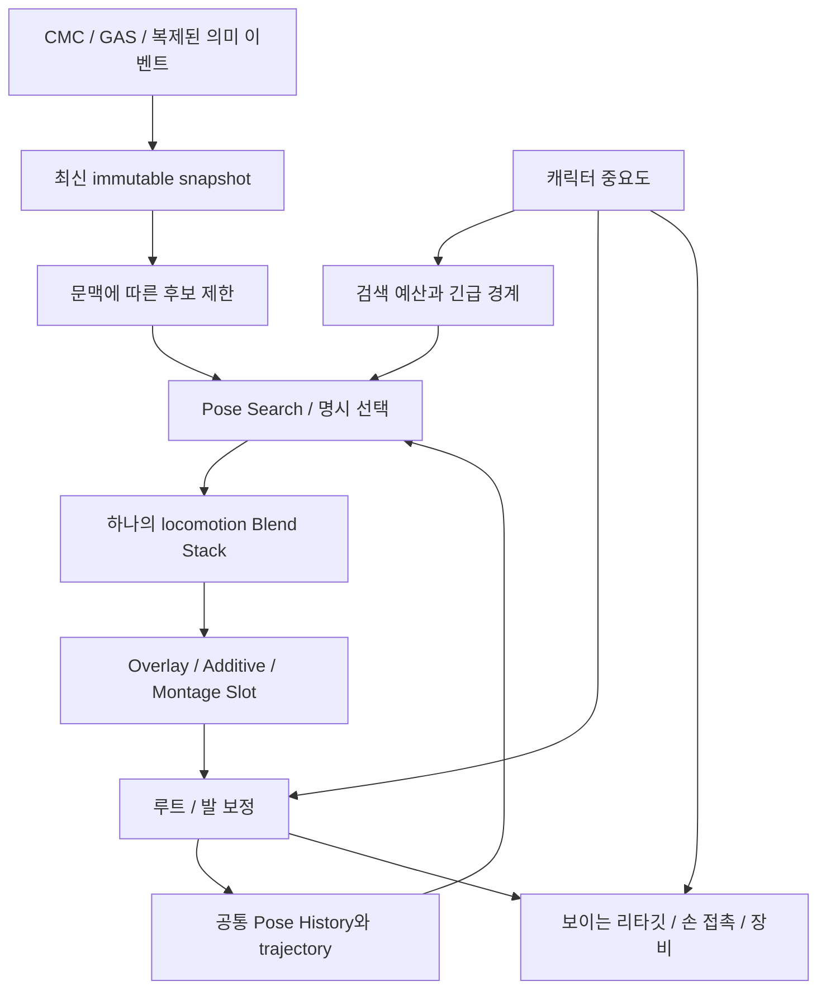

# 이동 애니메이션 재설계 조사 — 품질과 200명 예산

조사일: 2026-10-12. 기준 커밋: `65820e92cbd590742ea1cb5b204eece9434461e9`. 프로젝트 엔진: UE 5.8.

사용자는 큰 재설계를 허용했으며, 구현에 앞서 공식 자료와 사용자 구현을 조사하도록 요청했다. 성능 비교 인원은 **200명**으로 확정했다. 목표 최소 사양·최종 FPS·플레이어/NPC 구성은 아직 미정이다. 기존 60Hz fixture를 재현 기준으로 사용할 수 있지만 이를 제품의 확정 FPS 요구로 취급하지 않는다.

이번 산출물은 조사와 설계 후보다. 런타임 코드·ABP·에셋 변경, 신규 빌드, 재생·성능 측정은 수행하지 않았다. 아래의 기존 측정과 신규 설계의 예상 효과를 구분한다.

## 1. 결론과 비교할 후보

재설계의 중심은 **게임플레이 상태 결정과 애니메이션 선택은 분리하되, 하나의 캐릭터에서 연속 이동의 재생 시간·현재 포즈·전환은 한 곳이 관리하도록 만드는 것**이다. 여기에 캐릭터 중요도별 검색·보정·메시 비용 예산을 결합한다.

이것은 모든 동작을 무조건 MM에 넣거나, 모든 캐릭터가 같은 비싼 그래프를 실행해야 한다는 뜻이 아니다. 이동 재생기가 하나여도 액션 Montage/Slot·상체 레이어·시각 보정은 각각의 책임을 가진다. 기존 Start→Loop의 경계를 없애도 서로 다른 클립의 블렌드는 남으며, 발 위상·속도·데이터 범위가 맞지 않으면 연결감은 계속 발생한다.

우선 후보 A와 B를 같은 작은 장면에서 비교한다. **B는 설계상 유력한 실험 후보, A는 엔진 MM의 재검색·continuing 동작을 그대로 활용하는 비교 후보**다. B의 품질과 비용 우위는 아직 측정하지 않았다.

| 후보 | 이동 재생 소유자 | 장점 | 주요 비용·위험 |
| --- | --- | --- | --- |
| 현재 외부 단발 + MM | 외부 스택과 MM, Handoff가 연결 | 동작 구간 제어와 기존 회귀가 있음 | 두 시간축·선택 문맥의 연결 책임, 전환 중 두 경로 평가 |
| A. 자연 이동을 한 MM 노드에 통합 | MM 내부 Blend Stack | Start/Loop의 동일 재생·검색 문맥, 엔진 continuing/throttle 활용 | Start 생략·재진입 방지, 필수 구간 보존, 후보와 검색 비용 설계 |
| B. 문맥 선택 + Pose Search + 단일 Blend Stack | 하나의 Blend Stack | 명시 동작과 연속 이동이 같은 재생기 사용, 검색과 재생 예산을 구분 가능 | continuous reselect·동일 에셋 시간 점프·continuing·결과 무효화·검색 스케줄 검증 필요 |
| C. 독자 검색기·전환기 전면 개발 | 프로젝트 자체 구현 | 전체 제어 가능 | 유지보수·엔진 호환·데이터 도구 비용이 가장 큼; 현재 우선할 근거 부족 |

## 2. 현재 프로젝트에서 보존할 경계

- CMC의 이동·충돌·네트워크 예측 권위를 유지한다. 시각 루트/Steering 결과를 물리 속도나 서버 권위로 되돌려 쓰지 않는다.
- GAS의 공격·회피·피격·Root Motion 소유권과 Montage/Slot을 이동 검색과 분리한다.
- GT에서 준비한 최신 immutable snapshot을 worker가 소비하는 기존 구조를 유지한다. 검색 횟수를 줄이기 위해 gameplay snapshot 자체를 오래 붙잡지 않는다.
- 기존 `MoveStart/MoveStop/Land`의 event order, landing epoch, cancel revision, 서버 시각과 stale rejection을 보존한다. 각 클라이언트의 동일 pose index 선택을 요구하지 않는다.
- 의미 상태 전환, 재생 선택 revision, 실제 포즈 기여, 네트워크 이벤트 완료를 서로 같은 값으로 취급하지 않는다.
- 숨김·원거리의 검색을 강제로 매 프레임 깨우지 않는다. 업데이트가 생략되어도 미처리 경계 요청은 남고, 재관련 시 최신 상태로 소비해야 한다.
- NPC의 기본 경로는 현재처럼 저렴한 비-MM 경로를 유지한다. 보스·특수 NPC의 MM 사용은 별도 opt-in이다.
- 이미 성공한 Combat Strafe 후진 Reface/Cycle 후보·정규화 경계를 회귀 기준에 포함한다.

근거: [현재 MM 계약](../Architecture/MotionMatchingNextSteps.md), [원격 단발 복제](../Locomotion/RemoteOneShotReplication.md), [복귀와 군중 검색 예산](../Architecture/MotionMatching_Return_Crowd_2026-10-05.md), [Live Return](../Architecture/OneShot_Live_Return_2026-10-11.md).

## 3. 공식 자료와 적용 의미

### 3.1 UE 5.8 GASP의 Chooser + Pose Match + Blend Stack

[Epic 업데이트 원문](https://www.unrealengine.com/tech-blog/download-the-latest-game-animation-sample-project-now-updated-for-ue-5-8)은 **Mover Pawn**의 상태 머신 기반 Blend Stack과 Pose Match Column 결합을 설명한다. 의미 조건으로 후보를 제한하고, 그 안에서 포즈 검색으로 에셋을 고르는 방향은 후보 B의 직접적인 참고다. CMC 프로젝트인 Project J에 그대로 복사하거나, 애니메이션 재설계를 이유로 Mover까지 동시에 이전할 근거는 아니다.

설치 엔진 소스에서 별도로 확인한 내용:

- `FAnimNode_MotionMatching`과 `FAnimNode_ChooserPlayer`는 모두 `FAnimNode_BlendStack_Standalone`을 상속한다. 선택기와 공통 재생기가 분리되는 구조는 엔진에도 있다.
- `FAnimNode_ChooserPlayer`는 `EvaluationFrequency`와 `bStartFromMatchingPose`를 제공하고, 현재 재생 에셋·시간·미러·BlendSpace 파라미터를 선택 문맥에 전달한다.
- `FPoseSearchColumn`은 앞쪽 Chooser 필터를 통과한 에셋 인덱스만 검색 대상으로 전달하고, matching start time·mirror·force blend·cost를 출력한다.
- Pose Match Column은 로컬 5.8 헤더에 **Experimental**로 표시되어 있다. 이를 생산 핵심 정책 전체와 밀접하게 결합하기보다 교체 가능한 선택 어댑터로 제한한다.
- Chooser Player 헤더는 `Internal` 경로다. 다른 모듈에서 이를 직접 include/상속하는 구현은 의존·export·패키징을 확인해야 한다. 공개 Blend Stack/Pose Search 인터페이스를 이용하는 별도 얇은 어댑터와 비교한다.
- stock Chooser Player의 `OnUpdate`는 선택을 매 업데이트 실행하며, `OnLoop`는 클립 끝 조건이다. 전자는 Pose Match를 포함하면 자동 저비용이 아니고, 후자는 방향 변경 대응과 클립 끝 이전 출구를 해결하지 못한다. 후보 B에는 별도 검색 허용·긴급 경계·재생 완료 정책이 필요하다.
- 동일 에셋의 새로운 start time만 출력해도 항상 다시 재생되는 것은 아니다. stock 재생 조건의 force blend·mirror·curve override·playback rate 조건을 검사하고, 같은 에셋 내 시간 점프와 불필요한 매 프레임 재시작을 모두 검증한다.

확인한 파일:

- `C:/Program Files/Epic Games/UE_5.8/Engine/Plugins/Animation/PoseSearch/Source/Runtime/Public/PoseSearch/Chooser/PoseSearchChooserColumn.h`
- `C:/Program Files/Epic Games/UE_5.8/Engine/Plugins/Animation/PoseSearch/Source/Runtime/Private/Chooser/PoseSearchChooserColumn.cpp`
- `C:/Program Files/Epic Games/UE_5.8/Engine/Plugins/Chooser/Source/Chooser/Internal/AnimNode_ChooserPlayer.h`
- `C:/Program Files/Epic Games/UE_5.8/Engine/Plugins/Chooser/Source/Chooser/Private/AnimNode_ChooserPlayer.cpp`
- `C:/Program Files/Epic Games/UE_5.8/Engine/Plugins/Animation/BlendStack/Source/Runtime/Public/BlendStack/AnimNode_BlendStack.h`
- `C:/Program Files/Epic Games/UE_5.8/Engine/Plugins/Animation/PoseSearch/Source/Runtime/Public/PoseSearch/AnimNode_MotionMatching.h`
- `C:/Program Files/Epic Games/UE_5.8/Engine/Plugins/Animation/PoseSearch/Source/Runtime/Public/PoseSearch/PoseSearchLibrary.h`

웹 설명만으로 현재 ABP의 연결·실효값을 확인했다고 표현하지 않는다. 기존 로컬 GASP 조사는 주로 5.7 계열이며, 이번 5.8 Mover 방식과 동일한 구현으로 취급하지 않는다.

### 3.2 Motion Matching의 설정·데이터

[Epic Motion Matching](https://dev.epicgames.com/documentation/en-us/unreal-engine/motion-matching-in-unreal-engine)은 Schema, DB, 검색 간격, 재선택 억제, 내부 스택 설정의 기준 자료다. 자세가 비슷해도 속도나 미래 궤적이 일치하는 것은 아니다. 후보 A/B 모두 발·골반의 위치와 속도, 접촉, 루트, 속도 범위, 검색 가능한 시간 구간을 확인한다.

Search Throttle, Pose Jump Threshold, Pose Reselect History, Max Active Blends, stored pose를 따로 비교한다. 큰 DB로 합치면 자연스러워진다거나 스택 수를 줄여도 품질이 유지된다고 가정하지 않는다. Schema·정규화 변경은 기존 Reface와 방향별 Cycle의 검색 비용값도 바꿀 수 있다.

### 3.3 Inertialization과 일반 크로스페이드

[Epic Blend Nodes](https://dev.epicgames.com/documentation/en-us/unreal-engine/animation-blueprint-blend-nodes-in-unreal-engine)에 따르면 관성 블렌드가 시작되면 outgoing 포즈 평가가 중단된다. 일반 크로스페이드와 다른 비용 특성이지만, outgoing Notify도 더 이상 발생하지 않는다. 반복적인 전환 요청은 품질을 떨어뜨릴 수 있다.

같은 입력·출력에 대해 짧은 일반 블렌드와 관성 블렌드를 비교한다. 발 위상 불일치를 긴 블렌드로 감추는 운용은 피한다. Experimental인 Dead Blending이나 Stitch를 이번 설계의 필수 조건으로 삼지 않는다.

### 3.4 Thread Safe·Fast Path·진단

[Epic Animation Optimization](https://dev.epicgames.com/documentation/en-us/unreal-engine/animation-optimization-in-unreal-engine)은 Event Graph 처리 축소, Thread Safe·Property Access, Fast Path, Rewind·Insights의 참고 자료다. 현재 C++ snapshot·proxy를 버리고 Blueprint로 되돌릴 필요는 없다. C++ 전환이나 worker 실행만으로 총 CPU 작업량·리타깃·물리 비용이 사라진다고 판단하지 않는다.

### 3.5 Animation Budget Allocator

[Epic ABA](https://dev.epicgames.com/documentation/en-us/unreal-engine/animation-budget-allocator-in-unreal-engine)는 중요도에 따른 메시 업데이트 예산을 제공한다. 검색뿐 아니라 pose update/evaluate, 보간, 물리, 그리기를 구분해 관리한다. 업데이트·보간·검색에 각각 고정 타이머를 추가해 충돌시키기보다 기존 coordinator를 활용한다.

### 3.6 Animation Sharing

[Epic Animation Sharing](https://dev.epicgames.com/documentation/en-us/unreal-engine/animation-sharing-plugin-in-unreal-engine)은 상태별 묶음으로 포즈 평가를 공유한다. 원거리 NPC에는 검토할 만하지만, 각자 다른 MM 쿼리·장비·공격 시점·Foot IK를 가진 플레이어 200명의 평가를 그대로 공유할 수 있는 것은 아니다. 독립 포즈와 공유 포즈 사이의 복귀, 지원 스켈레톤, 개별 동작 수요를 확인한다.

### 3.7 모듈형 캐릭터의 전체 비용

[Epic Modular Characters](https://dev.epicgames.com/documentation/en-us/unreal-engine/working-with-modular-characters-in-unreal-engine)는 Leader Pose, Copy Pose, Mesh Merge의 비교 자료다. Leader Pose로 자식의 평가를 줄여도 draw call과 material section은 사라지지 않는다. 추가 뼈·물리·morph·장비 차이에 따라 사용할 수 있는 방식이 다르다. Project J의 숨겨진 source→보이는 리타깃 메시→장비 follower를 함께 측정한다.

## 4. 개발자 본인의 공개 구현·설명

| 자료 | 이번에 참고할 부분 | 적용 한계 |
| --- | --- | --- |
| [PolygonHive/GASPALS 저장소](https://github.com/PolygonHive/GASPALS)와 [animation pipeline](https://docs.polygonhive.com/gaspals/concepts/animation/) | full MM/hybrid 비교, Linked Layers, 루트·발·손 보정, thread-safe 순서 | runtime retarget와 Blueprint 구현. MMORPG 200명 성능 증거는 아님 |
| [GASPALS networking](https://docs.polygonhive.com/gaspals/concepts/networking/)과 [limitations](https://docs.polygonhive.com/gaspals/reference/limitations/) | owner/server/remote 역할, 기능 차이, 샘플의 제약 | 저자의 listen-server 설명이며 dedicated server·200명 접속 보장은 아님. 제시된 리타깃 단가는 Project J에 적용하지 않음 |
| [GASP Dynamic Additive Overlay 저자의 이전 설명](https://unreal-devop.gitbook.io/gasp-dynamicadditiveoverlay/basics/gasp-dao-1.52/getting-started/migrating-the-project) | overlay와 MM의 결합, 필요한 plugin 의존성 | 1.52판 이전 설명을 확인. 200명 비용·새 Chooser의 우위는 미확인 |
| [Daniel Holden: Code vs Data Driven Displacement](https://theorangeduck.com/page/code-vs-data-driven-displacement) | 물리 캡슐과 시각 루트의 속도·회전·가속도 적합성, 보정의 한계 | Unreal용 완성 framework가 아님. CMC를 무조건 변경할 근거로 삼지 않음 |
| [orangeduck/Motion-Matching](https://github.com/orangeduck/Motion-Matching)과 [controller.cpp](https://github.com/orangeduck/Motion-Matching/blob/main/controller.cpp) | 위치·속도와 회전·각속도의 관성 연결, 발 접촉 유지, 선택과 재생의 분리 | 독립 C++ 참고 구현. UE Notify·GC·network·Cook의 대체 구현이 아님 |
| [Scott Courtney: Mover + MM 5.5 gist](https://gist.github.com/sna-scourtney/15bed77a9e0973bf0d2ec8363c8a029c) | CMC용 trajectory 생성을 Mover로 옮길 때 predictor 의존성 | 2025년 저자의 진행 중 자료. 현행 5.8 샘플을 대신해 채택하지 않음 |

공개 저장소의 README·저자 문서·참고 코드를 읽은 단계다. 이 구현들을 로컬에서 빌드·실행해 비교한 것은 아니다. 실제 코드를 도입할 때 코드와 부속 애니메이션의 이용 조건·지원 엔진을 각각 확인한다. 제삼자의 속도 주장이나 홍보 영상을 성능 측정의 대체 근거로 사용하지 않는다.

## 5. 후보 B의 설계 계약

책임 관계를 나타낸 그림이며, 완성 AnimGraph의 정확한 배선 순서를 정의하지 않는다. Pose History의 수집 위치·좌표·Schema의 기준, 루트·IK 순서는 기존 그래프와 대조해 결정한다.

### 상태 계약

상태는 매 프레임 playback 명령을 다시 발행하지 않고 request/selection revision으로 의미 변경을 나타낸다. Start 등에는 검색 가능한 진입, 필수 표시 구간, 정상 출구, 즉시 중단 조건을 따로 둔다. 같은 Run의 Loop로 이어지는 출구와 Gait 변경용 EarlyTransition을 구분한다. Jump Start는 실제 공중 상태, Land는 접촉·충격과 epoch를 우선한다.

### 검색 계약

검색하지 않는 프레임에도 재생은 진행된다. 재검색 때 실제 playing asset/time/mirror/DB와 최신 history를 continuing의 근거로 사용한다. 후보에서 제외된 옛 결과를 continuing으로 남겨두지 않는다. 상태 변경, 무효 결과, 방향의 큰 불일치, teleport/relevance 변경 같은 긴급 조건과 일반 검색을 구분한다. 200명이 동시에 복귀할 때 필수 포즈 수요와 검색 집중 비용을 모두 측정한다.

### 재생·블렌드 계약

Asset/time/loop/mirror/rate/profile/curve/selection revision을 한 명령으로 다룬다. 선택 결과와 일반·관성 블렌드 요청의 책임을 명확히 하고 매 업데이트의 재시작을 막는다. 두 클립의 전환에 별도 외부 Handoff를 다시 겹치지 않는다. MaxActiveBlends와 stored pose에 따른 품질도 비교한다.

### 보정 계약

ResetRoot·Steering 같은 플레이어별 보정을 유지한다. 후단 OffsetRoot·FootPlacement와 같은 보정을 두 번 적용하지 않는다. 발 접촉의 고정·해제, Lean, 무기 overlay의 curve를 상태 enum만으로 즉시 바꾸지 않고 실제 포즈 기여와 맞춘다. 모든 보정을 같은 alpha에 연결하는 설계로 단순화하지 않는다.

### 구현 의존 범위

기존 snapshot·coordinator·asset set을 활용한다. 두 번째 manager·tick·복제 경로를 먼저 추가하지 않는다. stock Chooser Player의 Internal header를 다른 모듈에 노출하는 엔진 수정에 앞서, public API와 그래프 편집으로 가능한 범위를 확인한다. 부족한 부분만 얇은 native adapter로 구현하며 독자 MM 검색기로 전면 교체하지 않는다.

## 6. 200명의 품질·성능을 함께 만족할 조건

200명은 인원 기준이다. 전원이 근거리에서 전체 IK·물리·리타깃을 매 프레임 실행하는 조건과는 구분해야 한다. 혼합 거리의 일반 장면뿐 아니라 200명 전원 근거리, 동시 시작·착지·공격을 부하 시험으로 측정한다. 전부 원거리로 보내 성공했다고 판단하지 않는다.

| 대상 | 품질 방침 | 비용 방침 |
| --- | --- | --- |
| 내 캐릭터 | 입력·카메라 반응, 발·무기 접촉 우선 | 높은 업데이트 빈도, 필요한 재검색·보정 |
| 가까운 중요 플레이어 | 보이는 Start/Stop/Land·공격 보존 | MM·pose·리타깃을 따로 측정하고 필요한 동작 경계를 보호 |
| 중원거리 플레이어 | 방향·Gait·액션의 가독성 유지 | sparse 후보, 낮은 검색·업데이트 빈도, 보간, 보정·의상 LOD |
| 원거리·비표시 | 재관련 때 정상 복귀 | 숨김 생성 중단, 오래된 history 제거·재생성, 필요한 게임플레이 뼈의 별도 수요 |
| 일반 NPC | 역할에 맞는 이동·액션 | 기존 비-MM, 적합한 경우 공유 평가·간소화 재생 비교 |

단계 전환에는 중요도 hysteresis, history/reset revision, 전환 블렌드, 장비·무기 소켓 수요를 고려해야 한다. 거리만으로 공격 판정 뼈나 서버 게임플레이를 중단하지 않는다. ABA 목표는 전체 World·GPU·network 예산의 상한이 아니다.

### 기존 실측에서 확인된 다른 비용

[2026-10-05 CPU·소켓 측정](../Architecture/Authored_Animation_Crowd_Network_2026-10-05.md)은 Ryzen 7 9800X3D, NullRHI, 통제된 이동, 120 tick·2회 반복 조건이었다. 200명 평균 World tick은 Near 21.67→16.74ms, AttackBurst 25.00→24.60ms였다(ABA off→on). 일반 200명 경우에는 constructed follower 1,800개가 있었다.

별도의 Near/ABA on 120 tick trace에서 IK Retarget Processor와 RigidBody의 누적 CPU 시간이 컸다. PoseSearch PCA/KNN만이 주요 비용이라고 볼 수 없다. inclusive 시간을 합산하거나 누적 초를 한 프레임의 wall time으로 해석하지 않는다.

이는 현재 커밋의 신규 측정도, 200명 렌더링에서 60FPS를 입증한 결과도 아니다. 현재 baseline을 같은 조건으로 다시 측정한 뒤 실 RHI·장비·보이는 follower·GPU·draw를 포함해 비교한다. 검색 빈도만 줄여 전체 비용을 해결했다고 결론 내리지 않는다.

## 7. 재설계 전에 정할 품질 기준

1. 같은 방향 Start→Loop의 블렌드 중 보폭·골반 움직임이 약해지는 현상을 줄인다. 끝 포즈 정지와 움직이는 두 포즈의 혼합을 별개 증상으로 기록한다.
2. OTM/Strafe × Run/Sprint, 좌우 시작 발, 8방향, 시작 직후 입력 해제·재입력, 곡선 이동, 180도 회전을 비교한다.
3. CMC 위치 반응을 늦춰 보기만 좋아진 변경을 구분한다. 입력부터 물리 이동·시각 반응까지의 지연과 보정량을 기록한다.
4. 접지 중 발의 실제 world planar 속도·변위, 접촉 시간, 골반 속도, 시각 루트와 캡슐의 차이, 보정 전후를 측정한다. 발에 가까운 뼈의 속도 proxy만으로 발 미끄러짐 개선을 인정하지 않는다.
5. incoming 포즈·속도 차이, asset/time, 실제 player clock/weight, 재검색·재선택·블렌드 요청 수를 기록한다. 같은 에셋이 다시 선택됐다고 검색을 하지 않았다고 판단하지 않는다.
6. Land의 필수 충격 구간을 잘라 성공했다고 평가하지 않는다. Jump·Root Motion·액션 중단, Montage 복귀, 무기 손 접촉을 포함한다.
7. 30/60/120Hz, LOD 변경, 업데이트 생략, 재관련, 에셋 로딩의 cold/warm 조건을 비교한다. 촬영용 capture와 본 비용 측정은 분리한다.
8. 화면 영상·Rewind와 수치를 함께 평가한다. fixture 통과가 체감 자연스러움을 보장하지 않는다.

## 8. 구현·검증 순서

### 0단계: 조사 — 이번 작업

자료, 로컬 API, 기존 200명 증거, 보존 계약, 후보 비교를 기록했다. 새로운 방식의 품질·비용 우위나 최종 채택 방식은 확정하지 않았다.

### 1단계: 현행 baseline

기존 OneShot return fixture로 같은 방향 Run Start→Loop와 시작 직후 중단을 실 RHI에서 기록한다. 기존 CPU harness를 1/50/100/200명으로 다시 실행한다. snapshot·HEAD, 장비, CPU, RHI, 카메라, LOD, 콘솔 설정을 고정한다. 첫 비교에서 CMC·PSS 가중치도 함께 바꾸지 않는다.

### 2단계: A/B 제한 prototype

같은 OTM Run의 Start와 Cycle로 A(단일 MM)와 B(단일 Blend Stack)를 전환 비교한다. 공통 Schema·정규화와 같은 source sequence를 사용하고, 필수 표시 구간과 출구 조건을 양쪽에서 동등하게 만든다. 한쪽에서만 Foot IK나 재선택을 꺼 우위를 만들지 않는다. B의 stock Chooser Player·Pose Match와 public API adapter 의존성을 확인한다.

별도 profile·graph 또는 runtime switch로 현행과 비교 가능하게 만든다. GAS·CMC, 원격 event payload, 전체 모드를 한꺼번에 이전하지 않는다. 품질·CPU 비교 결과를 문서에 추가하고 그 근거로 재생기를 선택한다.

### 3단계: 동작 확대

선택한 재생기로 Stop→Idle, Strafe/Run/Sprint, Reface/Turn, Jump/Land를 순서대로 이전한다. 각 동작의 입구·필수 구간·출구·중단을 설계한다. 후단 루트·발·Lean·무기 보정의 소유권을 다시 확인한다.

### 4단계: 200명 전체 비용

검색, update/evaluate, completion, 리타깃, 손발 IK, RigidBody, 장비 follower, render/draw를 구분해 측정한다. 전원 근거리, 근원거리 혼합, 숨김 복귀, 동시 시작·착지·공격의 p50/p95/p99와 순간 지연을 비교한다. worker 누적 CPU와 프레임 완료까지의 실제 경과 시간을 구분한다. 원거리 리타깃·물리 LOD와 호환 메시의 공유를 별도로 평가한다.

### 5단계: network·packaged와 이전 경로 정리

실제 SimulatedProxy, dedicated server, 소수의 실제 클라이언트에서 200 actor 장면을 확인한다. 200 actor 렌더링과 200 socket 접속은 같은 시험으로 취급하지 않는다. 기존 50ms lag·3% loss를 비교 기준으로 지연·누락·순서·늦은 착지·재관련을 확인한다. Cook·packaged Development에서 Chooser/PSD/mirror/overlay 참조, Experimental 의존성, 처음 로드할 때의 비용을 확인한다.

새 경로의 품질·소유권·성능 조건이 통과한 뒤 옛 외부 Handoff와 불필요한 cache·reselect 분기를 제거한다. 기존 테스트는 같은 의미를 새 재생기에서 검증하도록 옮긴다. 시험용 switch나 일회성 에셋 생성 처리를 제품 코드에 남기지 않는다.

Unreal C++ 빌드는 직접 UnrealBuildTool.exe로 실행한다. Editor/Live Coding/UBT/dotnet/MSBuild/ShaderCompileWorker가 실행 중이면 별도 빌드를 시작하거나 중단하지 않는다. 기존 사용자 변경사항을 저장하지 않고 없애는 작업은 하지 않는다.

## 9. 채택 조건과 미확정 사항

### 조사 이후 적용한 구현

실제 변경은 [이동 재생 소유권 통합](Unified_Locomotion_Implementation_2026-10-12.md)에 기록한다. 기존 엔진 MM 노드가 이미 Standalone Blend Stack을 상속하는 점을 사용해, 명시적인 State Controller 클립과 MM 결과를 같은 플레이어 스택에서 재생하도록 확장했다. B의 단일 재생 소유권을 채택하면서 정규 검색은 기존 엔진 MM에 맡기는 구성이다. 모든 단발을 MM 데이터에 넣는 A나 별도 Pose Match 검색기를 구현하는 B 전체를 그대로 채택한 것은 아니다.

단발 보정과 일반 MM 보정은 같은 플레이어 그래프 안에서 0초 selector로 선택한다. 기존 외부 Blend Stack·Handoff·항상 MM을 출력하던 TwoWayBlend·포즈 StateController SM을 제거하고, 의미 상태·원격 계약·후단 IK는 유지한다. 실제 시간 기준 Start 출구와 고정 Hz·실 RHI·200명 CPU의 검증 결과, 성능 한계는 구현 문서를 기준으로 판단한다.

채택 조건은 Start→Loop의 체감 혼합감·접지·응답 개선, 액션·원격 경계의 회귀 방지, 200명의 전체 CPU·순간 지연이 정해진 예산 이내일 것, 리타깃·물리·렌더 비용을 포함할 것이다. 검색 단가·그래프 노드 수·통과 테스트 수만으로 결정하지 않는다.

B의 재생 통합이 좋더라도 매 프레임 Pose Match 비용이 크면 검색 스케줄과 후보 범위를 개선한다. A가 같은 품질에 의존성·유지보수 비용이 더 작으면 A를 선택한다. C는 A/B로 만족하지 못하는 구체적인 조건이 확인된 뒤 검토한다.

조사 시점에 미확정이었던 player·weight trace, 실제 RHI 단발 복귀와 200명 CPU 비교는 후속 구현 기록에 추가했다. 아직 남은 항목은 최소 사양과 최종 FPS, 200명의 실제 플레이어/NPC·장비 구성과 렌더 비용, 전체 authored exit·notify의 시각 품질 평가, packaged 실행, 5.8 GASP Mover 그래프를 Project J 조건에서 실행한 비교다. 후속 CPU fixture를 전체 렌더·Cook 검증으로 확대해서 표현하지 않는다.
