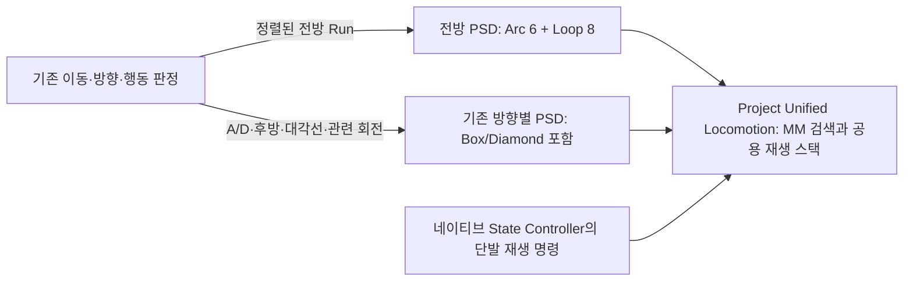

# Strafe 전방 곡선과 측면 이동의 후보 책임

## 문제와 적용 범위

남아 있던 `RecordedStrafeCurve`의 Box/Diamond 노출 기준 실패는 Strafe Run에서 W를 유지하고 마우스로 회전한 사용자 기록이다. A/D 이동의 자연스러운 옆걸음 선택과는 구분한다. 동일 최종 바이너리에서 이전 전방 PSD만 복원한 `Control120`에서는 2,596개 MM 관찰 프레임 중 Box/Diamond 28개(1.08%)였다. 전방 후보가 닫힌 상황은 아니었으며, 같은 ForwardCycle 안에서 선택이 바뀌었다. 중간 스키마·바이어스 실험의 35프레임 기록을 최종 비교 기준으로 합산하지 않는다.

Box/ Diamond의 초반 전방 구간은 경로 비용이 작아질 수 있지만, 이어지는 측면 전환까지 W 곡선의 동작 의도에 맞는 것은 아니다. 루트 트랙을 확인한 Box F→LR은 0.1/0.35/0.7초에서 전방 이동 후 측면 방향으로 바뀐다. 이처럼 일부 포즈의 검색 비용과 애니메이션의 동작 목적은 별도로 판단해야 한다.

## 최종 구조

기존 방향·경로·몸 방향 정렬 조건으로 선택하는 `PSD_Combat_Run_ForwardCycle`을 **전방 연속 이동용 데이터**로 정리한다. 기존 Cycle에서 Small/Wide/Tight 좌우 Arc 6개와 기존 SettledCycle의 Loop 8개를 유지한다. 클립의 원본, 미러 설정, 검색 구간 및 entry 메타데이터를 보존한다. 이 PSD 내부에서는 MM이 궤적·자세 비용으로 Arc/Loop와 시작 시점을 선택한다.

런타임 C++에 에셋 이름 검사, Box 차단 조건, 강제 Arc 선택이나 새 타이머를 추가하지 않는다. 동작 목적에 맞는 에셋 구성은 PSD가 소유하고, 방향/행동 조건은 기존 상태·후보 선택 정책이 소유한다. A/D, 후방, 대각선과 정렬되지 않은 이동은 기존 전체 Cycle/관련 후보를 사용한다. 기존 급회전·피벗·공격·몽타주·루트 모션의 우선권과 보호 조건도 유지한다.

전방에서도 경로가 잠시 직선에 가까워지는 반전 구간에는 Loop를 선택할 수 있다. 시간만으로 Arc를 붙잡지 않는다. 지속 곡선의 단발 종료 조건은 사용자 요청대로 **0.35초·100cm·3도·85%**를 유지한다. 물리 착지 상태와 재생 종료를 구분하는 [Land 후속 수정](Strafe_Land_Return_2026-10-13.md)도 유지한다.

전방 전용 PSS는 기존 35차원/8샘플과 가중치로 되돌렸다. 가까운 미래 샘플, 과거 회전 방향, 미래 몸 방향 기준 이동 방향, 지속 포즈 바이어스 변경 실험은 개선되지 않아 최종 변경에 포함하지 않는다. 미래 Facing 가중치만 키운 실험에서는 노출이 오히려 84프레임이었다. 실험 로그·결과·백업은 `Saved/Validation/StrafeShape_20261013`에 보존하고 임시 수정 스크립트는 제거한다. 일회성 에셋 저장용 테스트 코드도 제거하고 검증은 읽기 전용으로 남긴다.

## 공식 자료 및 공개 구현에서 참고한 점

| 자료 | 확인 내용과 적용 판단 |
| --- | --- |
| [Epic Game Animation Sample](https://dev.epicgames.com/documentation/ko-kr/unreal-engine/game-animation-sample-project-in-unreal-engine) | Chooser로 게임플레이 문맥에 맞는 데이터베이스를 제한해 결과와 검색 비용을 관리한다. 이번에는 기존 전방 선택 조건을 유지하고 해당 PSD의 동작 목적을 명확히 했다. |
| [Epic Motion Matching](https://dev.epicgames.com/documentation/ko-kr/unreal-engine/motion-matching-in-unreal-engine) | 채널 가중치는 자세 선택의 비용 균형을 바꾸며, 추가 샘플은 정확도와 비용을 함께 고려해야 한다. 샘플·가중치 실험을 동일 기록으로 비교한 뒤 효과 없는 추가 차원은 남기지 않았다. |
| [Epic Motion Matching Debugging](https://dev.epicgames.com/documentation/en-us/unreal-engine/motion-matching-debugging-in-unreal-engine) | Active/Continuing/Candidate의 선택과 비용을 비교하는 방식이다. 이번 원인 조사에는 선택 프레임과 재구성 비용 로그를 사용했다. 재구성 비용을 원본 검색 쿼리나 필터·바이어스 전체를 캡처한 값이라고 표현하지 않는다. |
| [Daniel Holden 공개 구현](https://github.com/orangeduck/Motion-Matching), [구현 설명](https://theorangeduck.com/page/code-vs-data-driven-displacement) | 제어 모델과 모션 데이터의 경로·속도·회전 특성이 맞는지 확인하는 접근을 참고했다. 해당 구현 코드를 복사하지 않았다. |
| [Polygon Hive GASPALS](https://github.com/PolygonHive/GASPALS) | GASP 이동 시스템 위에 별도 AnimGraph/Linked Layer로 Overlay를 결합한 공개 사례다. 후보 구성 문제 때문에 전투 상체·레이어 책임을 다시 섞을 필요는 없다고 판단했다. 이 저장소가 이번 Box 문제의 직접 해결책을 제공한다고 주장하지 않는다. |

## 검증

동일 사용자 CSV와 기본 프로필로 실제 BP/CMC/Master ABP를 재생한다. 곡선의 Arc 85% 이상·Box/Diamond 1% 이하, 미세 입력의 Loop 95% 이상·Box/Diamond 0이라는 기존 기준을 변경하지 않는다. 최초 120Hz 재생은 Arc 2,273/2,596(87.56%), Box/Diamond 0으로 통과했다. 반전과 직선 횡단 구간을 기록에서 지우지 않았다.

`StrafeLateralCamera`는 A/D 각각에 대해 좌우 21/90/240도/초 카메라 회전 12장면을 검사한다. 전방 PSD가 열리지 않는지, 기존 측면 PSD에 Box와 Diamond가 남아 있는지, 실제 측면 회전 선택이 가능한지 검사하고 선택 시점과 전체 로컬 포즈 CRC를 남긴다. 순수 측면 접선에서는 Box가 선택되고 Diamond가 선택되지 않을 수도 있으므로 두 종류의 강제 노출을 합격 조건으로 만들지 않는다.

최종 빌드·다중 프레임률·측면 비교·전체 관련 회귀 결과는 아래에 기록한다. 자동 재생은 실제 사용자의 전체 화면 체감 확인을 대체하지 않는다. 이번 변경으로 200명 렌더 FPS나 패키징을 새로 인증하지 않는다.

## 최종 확인 결과

| 실행 | MM 관찰 | Arc | Loop | Box/Diamond | 결과 |
| --- | ---: | ---: | ---: | ---: | --- |
| 이전 전방 PSD/120Hz 대조 | 2,596 | 2,385 | 182 | 28 | 기존 1% 기준 실패 |
| 곡선 120Hz | 2,596 | 2,273 (87.56%) | 322 | 0 | 통과 |
| 곡선 60Hz | 1,242 | 1,069 (86.07%) | 172 | 0 | 통과 |
| 곡선 30Hz | 620 | 532 (85.81%) | 87 | 0 | 통과 |
| 동일 인덱스 Brute/120Hz | 2,596 | 2,273 | 322 | 0 | 통과 |
| D3D12 RHI/120Hz | 2,596 | 2,273 | 322 | 0 | 통과 |
| 미세 입력 120Hz | 733 | 0 | 732 | 0 | 통과 |
| 미세 입력 60Hz | 367 | 0 | 366 | 0 | 통과 |
| 미세 입력 30Hz | 184 | 0 | 183 | 0 | 통과 |

관찰 시작의 캐시된 경계 포즈 때문에 Arc+Loop 합이 전체 관찰보다 1 작을 수 있다. 프레임률별 관찰 수의 차이를 성능 개선으로 해석하지 않는다.

관련 68개 leaf는 실패 없이 통과했다(63개 성공, 5개 경고 동반 성공). 경고는 기존 C++ 전투 fixture의 MissingPalm 호환 소켓 경고다. 새 `StrafeLateralCamera`와 분리 실행한 실제 사용자 미세·곡선 재현을 포함하면 성공을 확인한 고유 검사는 71개다. 모든 검사를 한 실행으로 합친 결과라고 표현하지 않는다. 측면 후보 검증을 목록 확인에서 실제 인덱스 포즈 확인으로 강화한 변경은 테스트 전용이며 이후 직접 UBT Editor 빌드도 성공했다.

A/D 비교는 동일 최종 바이너리·0.35초 기본 프로필에서 전방 PSD만 이전/최종 구성으로 바꾸어 수행했다. 12장면의 `LateralPose` 360행(전체 로컬 포즈 CRC·선택 에셋/시간), `Direction` 360행, `Prediction` 1,080행이 모두 동일했다. 기존 측면 인덱스의 Box 1,219포즈, Diamond 2,419포즈도 같았다. 이 순수 측면 접선 기록에서 실제 선택은 주로 Box 또는 측면 Loop였고 Diamond의 강제 선택은 요구하지 않았다. 최종 전방 PSD는 비교 직후 복원했다.

### 비용과 병렬 처리

전방 PSD만 78개 entry/5,896포즈에서 14개 entry/1,000포즈로 줄었다. 35차원 포즈 값 배열은 825,440바이트에서 140,000바이트로 약 83.0% 감소했다. 이는 공유 검색 인덱스의 해당 배열이며 전체 메모리·전체 검색 비용·캐릭터당 메모리 감소율이 아니다. 기존 정규화 참조와 다른 방향의 PSD는 보존하고, 새 채널이나 매 프레임 필터를 추가하지 않았다.

전방 판정은 기존 로컬 입력·상태 판정과 ThreadSafe snapshot 소비 경로를 사용한다. 이번 데이터 구성 변경으로 새 병렬 시스템을 만들거나 기존 군중 업데이트 정책을 대체하지 않는다. 원본 PSD/PSS 62개, Master ABP와 기본 프로필의 해시 보존을 확인했다.

근거: `Saved/Validation/StrafeShape_20261013/Regression`, `Control120`, `Verified120`, `Final120`, `Final60`, `Final30`, `FinalBrute120`, `FinalRendered120`, `Micro120`, `Micro60`, `Micro30`, `LateralControl`, `LateralAfter`, `LateralComparison.json`. `Control120`와 `Verified120`는 같은 최종 바이너리에서 PSD만 바꾼 대조이며 최종 결과는 표와 동일하다. 임시 작성·검색 실험은 `Saved`에만 보존하며 커밋에 포함하지 않는다. D3D12 검사는 RHI 경로의 같은 동작 조건 확인이며 발 접촉 영상이나 GPU 성능 측정이 아니다.

직접 UBT의 `VerifiedEditorBuild.log`와 `FinalGameBuild.log`는 Win64 Development 성공이다. 기존 기준의 실패가 재현되는 이전 전방 데이터 비교는 최종 데이터의 성공 수에 합산하지 않는다.
