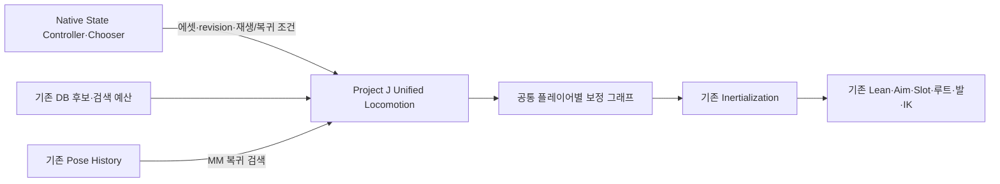

# 이동 재생 소유권 통합 — 2026-10-12

선행: [재설계 조사](Locomotion_Unified_Playback_Redesign_Research_2026-10-12.md).

후속: [지속 곡선·Master 함수 정리](Sustained_Curve_And_Master_Cleanup_2026-10-12.md)와 [200명 시각 예산 구현·검증](Crowd_Visual_Presentation_Budget_2026-10-12.md)을 함께 따른다. 아래 성능·해시·노드 수는 통합 재생을 적용한 당시 기록이며 후속 변경의 최종 값으로 대체하지 않는다.

## 범위와 목적

현재의 상태 제어·전투·이동·원격 이벤트·후단 보정은 보존하고, 외부 단발에서 MM으로 넘어가는 재생 경계를 줄인다. 블렌드 시간만 변경하거나 모든 동작을 무조건 검색 대상으로 넣는 작업이 아니다. 성능 비교 대상은 사용자 지정 **200명**이다.

`FAnimNode_ProjectJLocomotion`은 엔진의 `FAnimNode_MotionMatching`을 확장한다. 기존 MM 검색·continuing·미러·재선택·검색 예산을 활용하면서, State Controller의 명시적인 재생 명령도 같은 `FAnimNode_BlendStack_Standalone` 플레이어 배열로 처리한다. 이번 구현은 독자 MM 검색기나 Experimental Pose Match Column을 요구하지 않는다.

단발 중에는 재생 스택만 업데이트하며 MM 검색을 실행하지 않는다. 복귀 첫 업데이트는 Pose History를 사용해 검색하고, 현재 단발 플레이어에서 새 MM 플레이어로 한 스택 안에서 전환한다. 정규 MM 재생 중에는 엔진 MM 경로와 기존 Proxy 정책을 사용한다.

sample graph 안에서는 같은 현재 플레이어의 pose·asset·time·mirror를 읽어 단발용 OW·TIP·일반 보정 또는 MM용 일반 보정을 선택한다. 애니메이션 간 overlap은 Unified 노드의 한 스택에서만 관리한다.

## ABP 노드의 역할

| 기존 노드·연결 | 새 구조 | 근거 |
| --- | --- | --- |
| 외부 Blend Stack + 별도 MM + One Shot Handoff | Unified Locomotion 하나 | 플레이어 시간축·전환을 한 곳에서 관리 |
| StateController SM의 포즈 + TwoWayBlend Alpha 1 | 제거 | 의미 상태·Chooser는 기존 C++ runtime이 관리. TIP On Entry의 native 바인딩은 빈 stub임을 확인 |
| MM/외부 각각의 Blend Stack Graph | 공통 플레이어 그래프 하나, 플레이어별 보정 경로 선택 | 단발의 Orientation Warping·TIP 보정과 일반 MM의 기존 보정을 각각 보존 |
| 단발 Orientation Warping의 전역 gate | 실제 플레이어 식별 gate | outgoing 단발과 incoming MM에 같은 단발 보정을 적용하지 않음 |
| 뒤쪽 Inertialization | 유지 | MM→단발, 공중·TIP·Pivot·중단 경계에서 사용 |
| Lean·Aim·Slot·OffsetRoot·FootPlacement·LegIK·Pose History | 기존 연결 유지 | 전투·접지·공통 이력의 책임을 이번 변경과 분리 |

최종 보정 경로의 미리보기 감사에서 전체 그래프 노드 **246→131**, Blend Stack Result **2→1**을 확인했다. Input 2개는 같은 현재 플레이어를 읽고, 재생기나 시계가 두 개인 구조가 아니다. ResetRoot 2개·일반 Steering 2개는 서로 배타적인 보정 경로에 속하며 TIP Steering 1개는 단발 경로에만 있다. 노드 수는 비활성 그래프·함수도 포함하며 CPU 개선율과 같지 않다.

공통 sample graph의 `BlendListByBool`은 두 시간을 모두 **0**으로 고정한다. 실제 pose-link slot과 asset을 확인해 해당 플레이어의 단발 보정 또는 일반 MM 보정을 선택한다. 전환 애니메이션을 다시 섞는 Handoff가 아니다. 처음 시도한 모든 보정을 한 경로에 넣는 115노드 구성은 일반 MM에서도 단발 curve·OW·TIP 처리가 추가되어, 기존 MM 보정 경로를 선택하는 현재 구성으로 바꿨다.

## 실제 재생 시간과 Start 출구

이전 fallback은 클립 길이와 native hold 경과 시간으로 완료를 판단했고 기본 lead는 0이었다. 새 노드는 실제 player의 asset time·length·play rate를 관측한다.

Start→Cycle의 의미 조건이 이미 충족된 경우에만, 같은 에셋·selection revision·신선한 관측의 남은 시간으로 복귀 블렌드 구간을 확보한다. Pivot은 제외하며, Land의 충격·최소 유지와 Jump의 실제 공중 계약은 기존 판단을 유지한다. 다른 방향 입력·중단·몽타주를 늦춰 이 시간을 확보하지 않는다.

최종 60Hz 경로의 OTM Run Start 복귀는 frame **211→200**이었다. 약 0.183초 앞당겨졌고, 복귀 첫 프레임의 실제 outgoing Start가 끝 포즈에 도달하지 않았다는 검증이 통과했다. 기존 frame 211의 source는 time=length=2.6000이었지만 새 경로의 source는 복귀 overlap 중 계속 진행한다. 클립 재생의 마지막 포즈 정지와 움직이는 두 클립의 혼합감을 구분해야 하며, 이 수치만으로 모든 연결의 자연스러움이 입증되는 것은 아니다.

## 보존하는 실행 계약

- 현재 후보 DB·동반 Cycle·Normalization·Schema·Reface 에셋은 변경하지 않는다.
- CMC와 GAS의 권위, 원격 event order·landing epoch·cancel·relevance 복귀는 유지한다.
- 단발 명령은 selection revision으로 처리한다. 같은 명령을 매 프레임 다시 재생하지 않는다.
- 플레이어별 sample graph는 asset/time/mirror를 실제 현재 플레이어에서 읽는다.
- 단발 보정의 gate는 pose-link slot과 asset을 모두 확인한다. 같은 이름의 incoming 에셋에도 잘못 적용되지 않도록 한다.
- TIP·Pivot의 root-turn episode를 기억한다. 일반 지상 Start/Stop/Land만 기존 profile/CVar 조건으로 live overlap한다.
- 공격·회피·피격·전신 몽타주·공중·모드 변경이 진행 중인 overlap을 중단하면, 관성 연결을 요청하고 incoming 시계를 유지한 채 outgoing sample만 정리한다.
- GC가 추적하는 node의 reflected transient presentation이 에셋을 보관한다. scoped playback view와 slot index는 worker update/evaluate 안에서 복구한다.
- 엔진 MM relevance counter가 단발 재생 중 갱신되지 않았다는 이유로 복귀 때 공통 스택을 지우지 않도록, 복귀 업데이트에 한해 설정을 임시 적용하고 복원한다. 실제 그래프 재관련은 별도 traversal counter로 처리한다.
- 단발이 실제 출력일 때 cached MM 결과의 진단 weight를 0으로 기록한다. 오래된 검색 결과를 현재 MM 기여로 잘못 인정하지 않는다.

## 변경 파일

- `Source/Project_JCharacter/Public/Animation/AnimNode_ProjectJLocomotion.h`
- `Source/Project_JCharacter/Private/Animation/AnimNode_ProjectJLocomotion.cpp`
- `Source/Project_JAnimationNodes/Public/Animation/AnimGraphNode_ProjectJLocomotion.h`
- `Source/Project_JAnimationNodes/Private/Animation/AnimGraphNode_ProjectJLocomotion.cpp`
- 기존 AnimInstance·Proxy·snapshot accessor·continuity trace: 플레이어 관측과 scoped 보정 식별
- 기존 실제 재생 fixture: 공통 스택의 ownership·시계 진행·검색 중단·출구·8방향·렌더·고정 simulation Hz 검증
- 기존 production graph 감사: 같은 보정 계약을 통합 그래프에서 검사
- `Project_JUnifiedLocomotionGraphTests.cpp`: 최종 production graph의 읽기 전용 감사. 전환에 사용한 일회성 preview/apply·저장 코드는 커밋 전에 제거

이전 Handoff 타입은 비교와 기존 직렬화 호환을 위해 당분간 유지한다. 통합 Master에서는 실행하지 않는다. 기존 State Controller getter와 native runtime은 여러 의미 정책·그래프 연결에 쓰이므로 함께 삭제하지 않는다.

## 검증 기록

검증 루트: `Saved/Validation/UnifiedLocomotion_20261012/`.

| 실행 | 확인 범위 | 상태 |
| --- | --- | --- |
| Baseline | 현행 graph·단발 재생·200명 CPU, 원본 Master backup/hash | 3개 통과 |
| Preview | 메모리에서만 graph 전환·컴파일·실제 Start/Stop/Jump/Land | 3개 통과, 컴파일 경고 0 |
| RenderedBaseline | 최초 8방향 fixture | 일반 재생 통과, 방향 시험 실패. 아래 조건 수정 기록 참조 |
| RenderedBaseline2 | 실제 RHI, 같은 방향 OTM/Strafe 8방향, 단발 복귀 capture | 2개 통과 |
| RenderedPreview | 최초 공통 보정 구성, 실제 RHI 통합 재생·관련 회귀 | 29개 통과 |
| SelectiveRendered | 최종 보정 경로 선택, 실제 RHI·8방향·입력·Reface·관련 회귀 | 29개 통과, 실패·경고 0 |
| 초기 Hz30 / Hz120 | 같은 simulation 시간의 방향·복귀 | 각각 4개 통과 |
| CleanBaseline / CleanUnified | 게임 종료 후 같은 바이너리·200명·조건별 2회 CPU | 각각 1개 / 2개 통과, 아래 결과 참조 |
| BuildFinalEditor / BuildGame | 직접 UBT, Editor·Game Development | 성공, 5.29초 / 71.84초 |
| Apply | Master만 전환·컴파일·저장 | 1개 통과 |
| Reload | 저장된 production asset 재읽기·실제 재생·관련 회귀 | 29개 통과, 실패·경고 0, 131노드 확인 |
| 실제 소켓 Lag50Loss3 | dedicated-server 모드 + 실제 클라이언트 2개, NPC 200개 | 모든 단계 통과, exit code 0/0/0, timeout 0 |
| FinalHz30 / FinalHz120 | 최종 저장 에셋의 방향·복귀·ownership | 각각 4개 통과, 실패·경고 0 |
| CPUTrace / TraceExport | 최종 저장 에셋·200명·비용 분해 | 1개 통과, 측정 region 8개 추출 |

최초 방향 시험은 몸체를 전방으로 고정하고 OTM 입력을 90도 이상 바꿔, 현재 경로가 Start를 선택하지 않는 다섯 경우도 Start→Loop 시험으로 요구했다. 같은 방향 연결과 초기 회전 진입을 혼동한 fixture 조건이었다. OTM의 초기 몸체를 이동 방향에 맞춰 수정했고, 같은 Start 검증을 유지한 채 기존 경로의 16개 방향 사례가 통과했다. 회전 중 입력은 별도의 기존 input-response 시험으로 검증한다. 제품의 재생 정책을 바꿔 시험을 통과시키지 않았다.

실제 렌더 capture는 움직이는 캐릭터·바닥·조명을 사용한다. 같은 입력 조건에서 복귀 시점 기준의 capture와 실제 playback time을 함께 비교한다. 복귀가 앞당겨져 두 실행의 capture가 항상 같은 simulation 시각은 아니다. component-space FootStep 값을 world foot sliding 개선 수치로 취급하지 않는다. capture를 CPU 비용 측정에 섞지 않는다.

실제 소켓 검증은 `Saved/Validation/GroupD_20260910/UnifiedLocomotion_20261012_Lag50Loss3/`에 있다. `-game -server` 모드와 별도 클라이언트 2개, 지연 50ms·손실 3%, native NPC 200개로 기존 Iris AOI·owner-only inventory·equipment FastArray·종료 계약을 확인했다. authored player는 2개이며 실제 SimulatedProxy에서 Start·Stop·착지·숨김 중 취소·동일 update 내 이벤트 병합을 검사했다. CPU fixture의 실제 캐릭터 200명과 다른 시험이며 200명의 socket 접속 검증이 아니다. engine Toolset의 기존 Python 시작 오류는 verification에 따로 기록됐고, 로그 전체가 오류 없는 상태라고 표현하지 않는다.

## 성능 판정의 범위

200명 CPU fixture는 실제 BP·장비·구성된 follower를 사용하지만 NullRHI이며, 전체 렌더 FPS나 200 socket 접속 시험과 다르다. 동일 조건의 현행과 새 경로를 비교하고, 평균 외에 p95·최댓값·검색·리타깃·물리의 비용을 확인한다. 사용자 지정 200명 기준을 원거리만 배치한 시험으로 바꾸지 않는다.

기존 군중 최적화 경계와 장비·손·발 품질을 유지한다. 이번 작업에서 의상 물리나 리타깃을 임의로 제거하지 않는다. 공통 스택을 사용해도 이 비용은 별도로 남는다.

게임 종료 후 `CleanBaseline`과 `CleanUnified`를 같은 바이너리에서 차례로 실행했다. 원본 Master는 그대로 두고 후자만 메모리에서 전환했으며, 해당 시점 DLL·Master 해시는 `CleanCPUManifest.json`에 있다. 200명과 follower 1,800개, 조건별 120 tick warmup + 120 tick 측정, 2회 반복이다. 아래 p95는 **두 반복의 p95 평균**이며 합친 표본의 p95가 아니다.

| 조건 | ABA | 평균 World tick 기존→통합, ms | 변화 | 반복 p95 평균 기존→통합, ms |
| --- | --- | --- | --- | --- |
| Near | off | 19.99→21.37 | +6.9% | 23.13→23.72 |
| Near | on | 16.14→14.94 | −7.5% | 19.90→16.49 |
| Far | off | 20.19→20.24 | +0.2% | 23.69→21.75 |
| Far | on | 14.57→14.82 | +1.7% | 16.88→16.44 |
| Hidden | off | 12.05→12.40 | +2.9% | 14.53→15.13 |
| Hidden | on | 6.81→6.96 | +2.3% | 7.31→7.98 |
| AttackBurst | off | 22.27→22.58 | +1.4% | 24.36→25.61 |
| AttackBurst | on | 22.85→23.40 | +2.4% | 27.59→27.05 |

전체 CPU 개선을 입증한 결과는 아니다. ABA의 동적 update 배분·반복 간 변동이 있으며, 공격 ABA on의 최대 World tick은 34.25→40.51ms였다. 이 증가를 숨김·평균 결과로 가리지 않는다. 최소 사양·FPS·200명 장비 구성의 확정과 실제 RHI 군중 비용은 남아 있다. 200명 60FPS 달성이라고 표현하지 않는다. 원자료는 두 실행의 `CPU.json`과 `CleanCPUComparison.json`이다.

초기 비교 중 Overwatch가 약 두 코어 분량의 CPU와 7.3GB working set을 사용하고 있음을 확인했다. 사용자 종료 후 위 비교를 다시 수행했다. 게임이 켜진 `CPUFreshBaseline`·`SelectivePreview` 및 처음의 다른 빌드/실행 간 비교는 최종 개선율 근거로 쓰지 않는다.

### 최종 경로의 비용 분해

별도의 `CPUTrace` 실행은 최종 저장 에셋·200명·조건별 1회다. Insights에서 warmup 뒤 120 tick의 `Near_ABA1_R0` region을 추출했다. 아래는 timer의 **누적 CPU/120**이며 병렬 worker의 실제 프레임 경과 시간이 아니다. inclusive에는 하위 timer가 포함되므로 행을 더하지 않는다. trace 비용을 앞의 비계측 비교 수치에 섞지 않는다.

| Timer | 횟수 | inclusive CPU/tick, ms | exclusive CPU/tick, ms |
| --- | --- | --- | --- |
| ProjectJ_UnifiedLocomotion | 4,909 | 2.644 | 0.037 |
| PoseSearch UpdateAssetPlayer | 4,909 | 2.607 | 0.620 |
| PoseSearch PCA/KNN | 2,332 | 0.937 | 0.648 |
| BlendStack UpdateAssetPlayer | 4,909 | 0.776 | 0.390 |
| GetThreadSafePlaybackUsesAuthoredCorrections | 4,909 | 0.016 | 0.016 |
| IK Retarget Processor Run | 24,000 | 17.631 | 17.631 |
| RigidBody EvaluateSkeletalControl | 72,000 | 31.310 | 4.263 |

이 일반 MM 구간의 추출 timer에는 단발 Orientation Warping alpha getter가 없고 보정 선택 getter만 4,909회 있다. 기존 MM 경로를 선택해 단발 처리 비용을 피하는 의도와 일치한다. MM update 및 선택 그래프의 전체 비용은 남는다. 자체 wrapper의 exclusive 비용만으로 전체 CPU 차이나 성능 우위를 설명하지 않는다.

주요 추가 최적화 대상으로 리타깃·의상 물리·follower의 업데이트를 확인했다. source 메시의 예산 적용만으로 보이는 retarget/물리 200명의 평가가 함께 줄지는 않는다. 다음 변경은 공통 update cadence·LOD·전투 보호·숨김 복귀와 품질을 함께 평가해야 한다. 이번 재생 소유권 변경에서 해당 보정을 임의로 제거하지 않았다. 원본 trace·8개 조건의 timer CSV·요약 JSON을 검증 루트에 보존했다.

## 저장과 복구

production Master 한 개를 저장했다. 초기 원본의 SHA256은 `481BB52288AE1D159FD3E3FF297AA893D21602ABB916192633B216B942CB8921`이며 backup은 `Baseline/ABP_Humanoid_Master.uasset`에 있다.

초기 적용·검증 당시 Master SHA256은 `80FA6151FE76F63CD8CD3A3CC8510E8E4452408CAB236B43AFB10788F6801D8F`다. 재읽기 후 Unified 1개, 외부 Blend Stack 0개, Handoff 0개를 확인했다.

별도 에디터 프로세스에서 재읽기를 완료했다. PSD·원본 시퀀스·레벨은 이번 전환의 저장 대상이 아니다. 모든 빌드는 직접 UnrealBuildTool.exe로 실행했으며 Editor/UBT/dotnet/Live Coding/MSBuild/ShaderCompileWorker와 겹치지 않았다.

엔진 MM의 reflected 설정 네 개를 복귀 업데이트에 한해 읽고 복원하는 adapter이므로 UE 버전을 올릴 때 해당 필드·relevance·검색·블렌드 계약을 다시 검증해야 한다. Game Development 빌드와 `UnrealEditor-Cmd -game` 소켓 실행은 통과했지만 이번 기록은 Cook·packaged 실행의 통과 기록이 아니다.

## 커밋 전 정리와 사용자 확인

사용자가 실에디터에서 연결이 잘 된다고 확인한 뒤 커밋 전 정리를 수행했다. 전체 동작의 체감 품질을 검증했다고 확대해서 표현하지 않는다.

- 전환이 완료된 일회성 ABP preview/apply·저장 코드를 제거하고 읽기 전용 production graph 감사를 유지했다. 제거한 authoring 코드는 검증 루트의 `PreCommit/UnifiedLocomotionMigration.cpp`에 보존했다.
- Pivot/TIP episode의 같은 조건을 두 번 계산하던 분기를 하나로 정리했다. 재생 명령이 바뀌면 episode를 새로 시작하고, 같은 명령에서는 root-turn 이력을 유지하는 동작은 같다.
- 재생 fixture의 덮어써지는 초기 report 문자열과 출력 경로의 중복 파싱을 제거했다.
- 공통 보정 그래프를 두 번 감사하던 순회를 하나로 줄였다. 새 보정 selector는 comment 문자열 대신 노드 타입으로 식별한다.
- 기존 Handoff 타입·State Controller API는 직렬화 호환과 비교·의미 정책용으로 유지했다. 현재 Master의 활성 재생 경로에는 외부 Handoff가 없다.

커밋 대상은 최신 에디터 저장본이며 정리 작업에서 에셋을 덮어쓰지 않았다. 해당 Master SHA256은 `2973A1B510EE3888D4F36FABF10D6445733C88B4BE34DADD08BC2D10E29C789B`다. `PreCommit/BuildEditor.log`와 `BuildGame.log`의 직접 UBT 빌드가 성공했고, 최신 에셋으로 `PreCommit/Regression`의 관련 29개 검증이 통과했다. CPU 비교와 30/120Hz·실제 RHI·소켓 결과는 앞의 적용 당시 기록이며 정리 후 다시 측정한 수치로 바꾸지 않는다.
