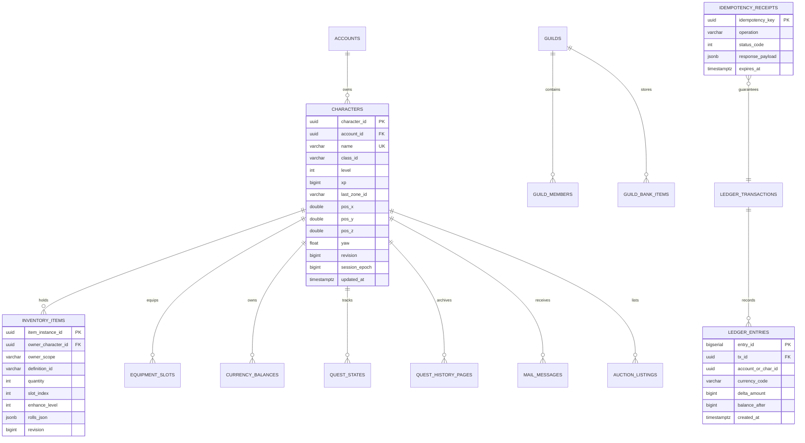
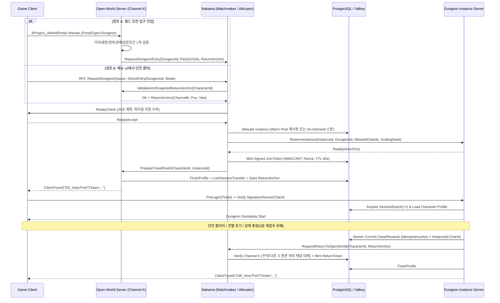

# BP01: 백엔드 · 영속성 · Dedicated Server 스트리핑 · 던전/필드 보스 · 경제/소셜

> 연계 모듈: `Project_JMMO`([Repository.h](../../../Source/Project_JMMO/Public/MMO/Repository.h), [ServicePort.h](../../../Source/Project_JMMO/Public/MMO/ServicePort.h)), `Project_J`([Project_JGatewaySubsystem.h](../../../Source/Project_J/Backend/Project_JGatewaySubsystem.h), [Project_JHandoverManager.h](../../../Source/Project_J/Backend/Project_JHandoverManager.h), [Project_JWorldEncounter.h](../../../Source/Project_J/World/Project_JWorldEncounter.h), [Project_JWorldPortal.h](../../../Source/Project_J/World/Project_JWorldPortal.h), [Project_JSocialSubsystem.h](../../../Source/Project_J/Social/Project_JSocialSubsystem.h)).

---

## 1. 핵심 설계 목표와 스택 확정

1. **초기 비용 0원 · 오픈소스 · 낮은 운영 난이도**:
   - 실시간 게임 시뮬레이션: **UE 5.8 Dedicated Server** (`Project_JServer` 타깃 신설)
   - 제어면(Control Plane) & 비실시간 MMO 서비스: **`Nakama` (Apache-2.0)** + **`PostgreSQL 16+`** + **`Redis / Valkey 8`**
   - 로컬 개발: 저장소 루트 `Infra/docker-compose.yml` 단일 명령으로 Nakama + PostgreSQL + Valkey 기동.
   - 운영 배포: 동일 Docker 이미지를 저비용 클라우드(Hetzner/Oracle/AWS EC2/GKE+Agones 등)로 이관 가능(벤더 종속성 0).
2. **역할의 명확한 분리 (UE 서버 부하 보호)**:
   - **UE Dedicated Server가 소유**: 30Hz 물리·Mover·GAS 전투·SSR·Iris 복제·AI(StateTree)·월드 이벤트/필드 보스·던전 인스턴스 전투.
   - **Nakama + PostgreSQL + Valkey가 소유**: 계정 인증/토큰, 캐릭터 슬롯/영속 저장, **친구/차단/길드/길드창고/채팅/온라인 Presence**, **거래소/우편/복식부기 재화 원장**, **채널 레지스트리 및 던전 인스턴스 매칭·할당**.
   - 장점: 채팅/친구/길드/거래소 트래픽이 UE 30Hz 게임 스레드와 네트워크 대역폭을 전혀 잠식하지 않는다.

---

## 2. Dedicated Server 독립 타깃 및 에셋 스트리핑 (`A08`)

현재 저장소에는 `Project_J.Target.cs`와 `Project_JEditor.Target.cs`만 존재하며, Dedicated Server 전용 타깃 및 클라이언트 전용 시각 리소스 제외 규칙이 미구축 상태다.

### 2.1 `Source/Project_JServer.Target.cs` 구성
- `Type = TargetType.Server;`
- `bUsesSteam = false;`, `bUseLoggingInShipping = true;`
- **제외 모듈**: `Project_JCharacterEditor`, Slate UI 렌더링 전용 의존성, 클라이언트 코스메틱 전용 플러그인.
- **포함 모듈**: `Project_JCore`, `Project_JMMO`, `Project_JGAS`, `Project_JMount`, `Project_JCharacter`, `Project_JAnimationNodes`, `Project_J`.

### 2.2 서버 런타임 스트리핑 전략 (목표 RSS ≤ 2.5GB / 200 CCU)
| 대상 | 서버 필요 여부 | 스트리핑·최적화 방식 |
|---|---|---|
| 텍스처 / 머티리얼 / 라이트맵 / RVT / Niagara FX / 오디오 | **불필요** | Server Cook 시 `DefaultServerEngine.ini` + AssetManager `CookRule = NeverCook`(ClientOnly 라벨), `UProject_JVisualAssetSubsystem`에서 `IsRunningDedicatedServer()` 시 로드 요청 즉시 No-Op 반환(단 `-NullRHI` 에디터 자동화 테스트는 예외 유지). |
| 플레이어 Chooser / PoseSearch DB | **불필요** | 서버는 `UProject_JMoverComponent` 물리 캡슐 + 몽타주 타임라인(히트 노티파이/루트모션)만 실행. `UProject_JPlayerAnimInstance`는 `IsRunningDedicatedServer()` 시 `VisibilityBasedAnimTickOption = OnlyTickMontagesWhenNotRendered` + PoseSearch 쿼리 스킵. |
| 스켈레탈 메시 | **최소(본/소켓만)** | 공격 궤적은 이미 오프라인 베이킹(`AttackDefinition` 64키)을 사용하므로 대부분의 전투는 스켈레탈 본 평가가 불필요. 필수 본/소켓이 필요한 경우에만 `OnlyTickMontagesWhenNotRendered` 유지, LOD 0 버텍스/스킨 버퍼는 서버 Cook에서 스트리핑(`bStripSkeletalMeshRenderData`). |
| World Partition 셀 | **물리/스폰/내비만** | 서버는 HLOD/Impostor/Foliage 시각 인스턴스를 로드하지 않고 `Grid_Main`/`Grid_Macro` 충돌·네비메시·`AProject_JWorldEncounter`·`AProject_JWorldPortal`만 활성화. |
| Iris Replication | **필수** | `Config/DefaultServerEngine.ini`에서 `NetServerMaxTickRate=30`, `MaxInternetClientRate=100000`, Iris Dynamic Prioritizer 및 Spatial Grid 활성화. |

---

## 3. 영속성 아키텍처: SQLite 64KiB → 정규화 PostgreSQL + 멱등 원장

### 3.1 기존 `Project_JMMO` 계약 100% 재사용
현재 `Project_JMMO`의 [Repository.h](../../../Source/Project_JMMO/Public/MMO/Repository.h)와 [ServicePort.h](../../../Source/Project_JMMO/Public/MMO/ServicePort.h)는 이미 **낙관적 잠금(`ExpectedRevision`), 멱등키(`IdempotencyKey`), 도메인 이벤트(`FDomainEvent`), `UnknownOutcome` 처리 계약**을 완벽히 정의하고 있다.
- **Standalone / 단위 테스트**: 기존 `FProject_JSQLiteRepository` (`Profiles.sqlite`) 유지.
- **Dedicated Server 운영/로컬 Docker**: `UProject_JGatewaySubsystem` → `FProject_JNakamaServicePort : ProjectJ::MMO::IServicePort` 어댑터 구현.
  - 게임 스레드를 절대 블로킹하지 않으며, 모든 요청은 Nakama 내부 RPC(`/v2/rpc/j_*`)를 통해 PostgreSQL 단일 ACID 트랜잭션으로 커밋된다.
  - 타임아웃 시 `EServiceStatus::UnknownOutcome` 반환 → 동일 `IdempotencyKey`로 안전 재시도(이중 지급/이중 차감 불가능).

### 3.2 정규화 PostgreSQL 스키마 (핵심 테이블)

### 3.3 스플릿 브레인(Split-Brain) 및 데이터 유실 방지 규칙
1. **Session Epoch (Fencing Token)**:
   - 캐릭터 로그인/존 이동 시 PostgreSQL이 `characters.session_epoch`를 원자적으로 `+1` 증가시키고, 해당 서버 인스턴스에 Lease를 발급한다.
   - 구(舊) 서버가 네트워크 지연 후 늦은 저장 요청을 보내면 `WHERE character_id = $1 AND session_epoch = $2` 조건에서 0행 갱신 → 즉시 거부(`Conflict`), 데이터 덮어쓰기 원천 차단.
2. **이원 저장 전략 (Write-Behind + Immediate Commit)**:
   - **주기적 체크포인트(Write-Behind, 60초 간격 + 로그아웃/존 이동)**: 위치, 현재 HP/MP, 일반 XP, 퀘스트 진행 카운트.
   - **즉시 ACID 커밋(Immediate Commit)**: 거래소 체결, 개인 거래, 우편 첨부 수령, 장비 강화/파괴, 희귀 이상 드롭, 던전 클리어 보상, 길드 창고 입출금.
3. **아이템 복제(Dupe) 원천 차단**:
   - 모든 비스택/고유 아이템은 글로벌 유니크 `item_instance_id (UUID PK)`를 가지며 `owner_scope` (`CHAR_INV`, `CHAR_EQUIP`, `AUCTION_ESCROW`, `MAIL_ESCROW`, `GUILD_BANK`, `DESTROYED`)가 정확히 하나뿐이다. 소유권 이전은 복사+삭제가 아닌 **단일 트랜잭션 내 `UPDATE owner_character_id, owner_scope`**로만 수행된다.
4. **Transactional Outbox**:
   - 우편 발송 알림, 거래소 판매 완료 알림, 길드 이벤트는 같은 DB 트랜잭션의 `outbox_events` 테이블에 기록 후 Nakama 워커가 실시간 Push(유실 0).

---

## 4. 오픈월드 분산: 채널 오픈월드(UTC 거대 필드 보스) + 온디맨드 던전 인스턴스

사용자 합의에 따라 **채널 기반 오픈월드 존 서버**와 **온디맨드 던전 인스턴스 서버(월드 입구 포탈 OR 메뉴 UI 클릭)**를 단일 티켓·복귀 아키텍처로 통합한다.

### 4.1 채널 오픈월드 & UTC 거대 필드 보스
- **채널 운영**:
  - 8×8km 오픈월드 1개 채널 = UE 5.8 Dedicated Server 1프로세스 (목표 150~300 CCU/채널).
  - 각 채널 서버는 5초마다 Valkey(Redis)에 `channel:{zone_id}:{channel_id}` 하트비트(`ccu`, `tick_ms`, `boss_phase`, `host:port`, `draining`)를 갱신.
  - 플레이어가 채널 이동 요청 시(전투 중/쿨다운 60초 불가) Valkey에서 여유 채널 조회 → 프로필 Flush → 새 채널 Join Ticket 발급 → `ClientTravel`.
- **거대 필드 보스 (`AProject_JWorldEncounter` 확장)**:
  - 기존 [AProject_JWorldEncounter](../../../Source/Project_J/World/Project_JWorldEncounter.h)의 `bUseSchedule`, `StartUtc`, `EndUtc`, `EProject_JEncounterPhase`를 그대로 확장한다.
  - **글로벌 스케줄 연동**: Nakama/Valkey가 UTC 스케줄(예: 매일 12:00 / 20:00 / 23:00 UTC) 및 10분·3분·1분 전 예고 브로드캐스트를 전 채널에 전파.
  - **대규모 참여자(50~150명) 부하 방어**:
    - 보스 액터는 `bAlwaysRelevant = false` 대신 **보스 전용 확장 Iris Relevancy 반경(200m)** + 최고 우선순위(`3.0x`) 부여.
    - 보스 주변 100m 내 플레이어가 40명 초과 시 **동적 타인 복제/이펙트 스로틀링** 자동 발동(파티원 우선, 비파티 타인은 10Hz 저주파 + 비핵심 스킬 VFX 컬링, 보스 텔레그래프 경고는 100% 유지).
  - **기여도 기반 개인 보상**:
    - 보스 처치 시 피해·힐·어그로 기여도가 최소 임계치(예: 총 HP의 0.1% 또는 15초 이상 유효 참여)를 넘긴 모든 생존/근접 참여자에게 **개인 루팅 테이블**을 서버가 롤링 → 인벤토리 공간 부족 시 PostgreSQL **우편(`MAIL_ESCROW`) 자동 발송**(보상 유실 0).

### 4.2 온디맨드 던전 인스턴스 (월드 입구 진입 + 메뉴 UI 클릭 통합 흐름)

두 진입 경로(**월드 내 던전 입구 `AProject_JWorldPortal` 상호작용**과 **어디서든 던전 메뉴 UI 클릭**)는 클라이언트 진입 트리거만 다르고, 백엔드 할당·보안·복귀 파이프라인은 **100% 동일**하다.

### 4.3 던전 인스턴스 핵심 예외·엣지 케이스 설계
1. **Warm Pool (콜드 스타트 제거)**:
   - 던전 입장 시마다 프로세스를 새로 띄우면 5~15초 대기가 발생한다. 로컬/운영 모두 **빈 대기(Warm) Dedicated Server 프로세스 2~N개**를 유지하고, Nakama가 `ReserveInstance` RPC로 맵(`ServerTravel` 또는 미리 열린 맵)을 즉시 배정한다.
2. **튕김/재접속 복구 (3분 유예)**:
   - 던전 진행 중 클라이언트 연결이 끊기면 `ReturnAnchor`로 바로 쫓아내지 않고 Valkey에 `active_instance:{char_id}`를 **180초간 유지**. 재로그인 시 Nakama가 즉시 던전 재진입 티켓을 발급한다.
3. **비정상 종료(인스턴스 크래시) 복구**:
   - 던전 서버 하트비트가 15초 이상 끊기면 Nakama가 해당 인스턴스를 `Dead` 처리하고, 플레이어 재접속 시 자동으로 `ReturnAnchor` 오픈월드 채널로 안전 복귀시킨다.
4. **입장권/일일 횟수 차감 시점**:
   - 입장 시 즉시 차감하면 크래시 시 억울한 손실이 발생한다. **첫 보스 교전 시작 또는 최종 클리어 시점** 중 던전 타입별 정책(`ConsumeOnClear` 권장)으로 PostgreSQL 멱등키(`dungeon_entry:{instance_id}:{char_id}`) 기반 차감.
5. **기존 `UProject_JHandoverManager`와의 관계**:
   - `UProject_JHandoverManager`의 `FProject_JHandoverEnvelope`은 향후 **심리스 존 경계 이동**이 필요해질 때 재사용할 수 있도록 보존하고, Phase 1~2의 채널↔던전 이동은 **PostgreSQL 권위 Flush + Signed JoinTicket** 방식으로 단순·무결하게 구현한다(이중 상태 동기화 복잡도 제거).

---

## 5. 경제(거래소 · 개인 거래 · 우편) & 소셜(길드 · 친구 · 차단 · 채팅)

### 5.1 복식부기 원장 기반 경제 시스템
모든 재화 이동은 **복식부기(`ledger_entries`)**로 기록되며, 모든 트랜잭션에서 `SUM(delta_amount) == 0` 불변식을 강제한다(시스템 발행/소각은 `SYSTEM_MINT` / `SYSTEM_SINK` 계정을 상대 계좌로 사용).

| 시스템 | 핵심 흐름 및 무결성 규칙 |
|---|---|
| **거래소 (Auction House)** | 1) 등록: UE 서버 검증 → Nakama RPC → 단일 PG 트랜잭션에서 `INVENTORY_ITEMS.owner_scope = 'AUCTION_ESCROW'` 전환 + 등록 수수료 `SYSTEM_SINK` 차감 + `AUCTION_LISTINGS` 생성. 2) 검색: PostgreSQL 복합 인덱스(`definition_id, enhance_level, buyout_price, expires_at`) + Valkey 인기 품목 3~5초 캐시. 3) 구매: `SELECT ... FOR UPDATE SKIP LOCKED`로 동시 구매 경합 직렬화 → 구매자 재화 차감 → 판매자 우편 정산(수수료 차감) → 구매자 우편 아이템 지급(모두 단일 트랜잭션 + `IdempotencyKey`). 4) 만료/취소: 백그라운드 워커가 만료 매물을 원 판매자 우편(`MAIL_ESCROW`)으로 반환. |
| **1:1 개인 거래** | 같은 채널/근접 거리(10m) 내 두 플레이어 간 **2단계 확정(Lock → Final Confirm)**: 1) 양측 아이템/재화 등록 시 수정하면 상대 Lock 자동 해제. 2) 양측 Confirm 완료 시 UE 서버가 `IdempotencyKey`로 Nakama `ExecuteDirectTrade` 호출 → 단일 PG 트랜잭션에서 양측 Revision 검증 + 소유권 교환 + 원장 기록 → 양측 UE 서버 인벤토리 즉시 반영. 3) 거래 중 이동/전투/접속종료 시 즉시 취소. |
| **우편 (Mail)** | 시스템 보상(필드 보스 기여도·거래소 정산·운영 보상) 및 유저 간 우편 지원. 첨부 아이템/재화는 `MAIL_ESCROW` 상태로 보관되며, **수령 시점에만** 인벤토리 공간/무게 검사 후 단일 트랜잭션으로 `CHAR_INV` 이전(만석 시 부분 실패 없이 원자 롤백). |

### 5.2 영속 소셜 시스템 (Nakama 네이티브 기능 최대 활용)
현재 [Project_JSocialSubsystem.h](../../../Source/Project_J/Social/Project_JSocialSubsystem.h)는 단일 UE 서버 메모리 내 파티/길드 상태만 관리한다.
- **역할 재분배**:
  - **Nakama가 글로벌 영속 소스**: 친구 요청/수락/삭제, 차단 목록(채팅·파티·거래·귓속말 전역 차단), 길드 생성/해산/직급(RBAC: 마스터/부마스터/정회원/수습)/공지/가입신청, 글로벌 채팅(월드/채널/파티/길드/귓속말), 온라인 Presence(현재 채널/지역/던전 표시).
  - **UE `UProject_JSocialSubsystem`이 실시간 프로젝션 캐시**: Nakama에서 받은 파티/길드 멤버십을 현재 채널의 `AProject_JPlayerState`(PartyId, GuildId, `FProject_JPartyRosterArray` HP/위치 실시간 요약)에 투영.
  - **길드 창고 (Guild Bank)**: PostgreSQL `guild_bank_items` + `guild_bank_logs` 테이블. 직급별 일일 출금 횟수·등급 제한 + 슬롯별 `revision` 낙관적 잠금으로 동시 출금 경합 방지.
- **채팅 보안 & 부하 방어**:
  - 모든 채팅은 Nakama WebSocket으로 송수신(UE Dedicated Server 무부하).
  - 채널/월드 채팅 레이트 리밋(예: 월드 10초 1회, 일반 1초 1회), 욕설/금칙어 필터, 차단 목록 서버 측 필터링, 링크/스팸 차단.

---

## 6. 검증 게이트 (BP01 완료 기준)
1. **Dedicated Server 빌드 & 메모리**: `Project_JServer Win64/Linux Development` 빌드 오류 0, 빈 오픈월드 부팅 RSS ≤ 2.5GB, 서버 Cook 출력에 클라이언트 전용 텍스처/오디오/VFX 미포함 확인.
2. **영속성 & 동시성**: 로컬 Docker(Nakama+PG+Valkey) 환경에서 (a) 동일 `IdempotencyKey` 10회 중복 전송 시 정확히 1회 커밋, (b) 동시 거래소 구매 20요청 중 정확히 1건 체결·19건 충돌 거절, (c) 구 `session_epoch` 쓰기 100% 거절 자동화 테스트 통과.
3. **던전 & 필드 보스 E2E**: 입구 포탈 진입 및 메뉴 UI 클릭 양쪽 경로로 던전 서버 `ClientTravel` → 보스 처치 → 개인 루팅/우편 폴백 → 원래 채널 `ReturnAnchor` 복귀까지 100% 자동 검증.
