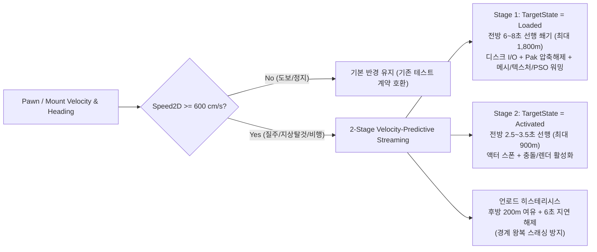
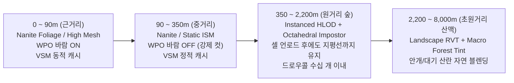

# BP02: 8×8km 고속 이동 팝인 방지 · 원거리 식생(나무/식물) · 렌더링/VSM/PSO/Substrate

> 연계 코드/설정: [Project_JWorldStreamingComponent.h](../../../Source/Project_J/World/Project_JWorldStreamingComponent.h), [Project_JWorldEnvironment.h](../../../Source/Project_J/World/Project_JWorldEnvironment.h), [DefaultEngine.ini](../../../Config/DefaultEngine.ini), [DefaultScalability.ini](../../../Config/DefaultScalability.ini).

---

## 1. 해결하려는 핵심 문제

1. **고속 이동(지상 질주 1,200~1,800 cm/s, 비행 탈것 2,000~3,500 cm/s) 시 에셋 팝인·바닥 추락·프레임 스파이크**:
   - 현재 `UProject_JWorldStreamingComponent`는 단일 `Activated` 반경(600m, 3초 예측)만 방출해 고속 이동 시 **디스크 로드와 액터 스폰/물리 등록이 동시에 한 프레임에 몰려** 팝인과 히치가 발생한다.
   - 기존 `Project_JWorldPreparationTests.cpp` 계약(`BuildPreparationShapes` 정지 시 호환성)을 깨지 않으면서 실전 고속 2단계 스트리밍으로 진화시켜야 한다.
2. **원거리 나무·식물(Foliage) 가시성 & 91GB Embree HLOD OOM 해소**:
   - 현재 8×8km 월드의 82,758그루 수목에 대해 HLOD 빌드가 91GB Embree OOM으로 실패한 이력이 있다.
   - 원거리에서 숲이 통째로 사라지지 않으면서도 빌드 메모리와 런타임 드로우콜/VRAM을 엄격히 통제하는 파이프라인이 필요하다.
3. **VSM · Lumen · RT · PSO · Substrate의 MMO 60fps 예산 정립**.

---

## 2. 8×8km World Partition 3-Tier 런타임 그리드 설계

단일 그리드에 대형 건물·지형 랜드마크와 작은 풀·소품을 함께 넣으면, 고속 이동 시 작은 소품까지 1km 밖에서 로드되어 메모리·스폰 부하가 폭발한다. 역할별로 **3개 런타임 그리드**를 엄격히 분리한다.

| 그리드 이름 | 셀 크기 | Loading Range | Priority | 배치 대상 에셋 | HLOD 레이어 |
|---|---|---|---|---|---|
| **`Grid_Macro`** | **512 m** | **2,000 m** | High (2) | 지형 랜드마크, 거대 암벽, 성/마을 외곽 골격, 주요 다리·도로, 필드 보스 아레나 기단 | `HLOD_Macro_Simplified` (Nanite Simplified Mesh, 2km~8km 가시) |
| **`Grid_Main`** | **256 m** | **800 m** | Normal (0) | 일반 건물, 던전 입구 포탈, 중형 구조물, NPC 스포너, 주요 수목 클러스터(PCG/Foliage) | `HLOD_Main_Instanced` (건물: Merged/Simplified, **수목: Instanced Impostor HLOD**) |
| **`Grid_Detail`** | **128 m** | **280 m** | Low (-2) | 소형 프롭, 채집 노드, 실내 소품, 근거리 데칼, 포인트 라이트, 작은 바위/덤불 | **HLOD 없음** (280m 밖에서는 자연 페이드아웃/컬링) |

> **Landscape 설정**: `Grid_Landscape` (256m 프록시 컴포넌트), `Landscape HLOD`는 2km~8km 지평선 실루엣을 유지하며, **Landscape RVT(Runtime Virtual Texture)**로 텍스처 블렌딩 비용을 일정하게 고정한다.

---

## 3. 고속 이동 팝인 방지: 2단계 예측 스트리밍 + `FastGeo`

### 3.1 `UProject_JWorldStreamingComponent` 2단계 소스 구조

- **구현 규칙**:
  1. `GetStreamingSource`에서 기존 `BuildPreparationShapes` 정적 함수 계약은 그대로 보존한다(기존 단위 테스트 100% 유지).
  2. 속도 기반 동적 프로파일(`FProject_JStreamingVelocityProfile`)을 추가해 이동 속도 대역별로 선행 시간/반경을 부드럽게 보간한다:
     - **도보/전투 (`0 ~ 600 cm/s`)**: 기본 `Activated` 소스만 활성(불필요한 대량 프리로드 방지).
     - **지상 탈것 질주 (`600 ~ 1,600 cm/s`)**: `Loaded` 선행 5초(최대 900m) + `Activated` 선행 2.5초(최대 450m).
     - **비행 탈것 고속 (`1,600 ~ 3,500 cm/s`)**: `Loaded` 선행 7초(최대 1,800m) + `Activated` 선행 3.5초(최대 1,000m), 고도 150m 이상 시 `Grid_Detail` 스트리밍 자동 억제(하늘에서 바닥 소품 스폰 금지!).
  3. **방향 전환 대응**: 급선회(각속도 > 60°/s) 시 좁은 직선 쐐기 대신 전방 ±45° 2-캡슐 부채꼴로 넓혀 측면 회전 팝인을 방지한다.
  4. **비상 물리 안전장치 (지형 추락 원천 방지)**:
     - 전방 `Activated` 셀이 디스크 병목(HDD/저사양 PC)으로 미도착 상태이면, 비행/질주 속도를 일시 감속(Soft Speed Clamp)해 미로드 지형 관통 및 추락을 방지한다.

### 3.2 프레임 스파이크(Hitch) 방지 CVar & UE 5.8 `FastGeo`
- **UE 5.8 `FastGeo` (Fast Geometry Streaming)**:
  - 정적 배경 프롭·바위·장식 구조물 등 게임플레이 로직이 없는 액터를 `FastGeo` 컨테이너로 전환해 액터 `UObject` 생성/GC/Tick 등록 오버헤드를 대폭 축소한다(게임플레이 상호작용이 필요한 포탈·채집물·NPC 스포너는 일반 Actor 유지).
- **시간 분할 스트리밍 예산 (`Config/DefaultEngine.ini` 튜닝 기준)**:
  - `s.AsyncLoadingTimeLimit=2.0` (ms/frame)
  - `s.LevelStreamingActorsUpdateTimeLimit=1.5` (ms/frame)
  - `s.LevelStreamingComponentsRegistrationGranularity=10`
  - `s.LevelStreamingComponentsUnregistrationGranularity=10`
  - `wp.Runtime.BlockOnSlowStreaming=0` (클라이언트 강제 프리즈 방지, 포탈 도착은 기존 `RequestPreparedArrival` 페이드 게이트 사용)
- **비동기 텍스처/메시 스트리밍**:
  - `r.Streaming.PoolSize`를 Scalability 티어별 VRAM에 맞춰 명시(`@0: 1500`, `@1: 2500`, `@2: 4000`, `@3: 6000` MB), `r.Streaming.Boost=1.0`, 고속 이동 중 전방 랜드마크 밉맵 강제 프리스트림.

---

## 4. 원거리 나무·식물(Foliage) 가시성 & 91GB Embree OOM 근본 해결

### 4.1 4-Tier 거리별 식생 파이프라인

### 4.2 91GB Embree OOM 해소 규칙 (필수 준수)
과거 82,758그루 수목에 일반 `MeshMerge`/`MeshSimplify` HLOD를 적용하면서 수억 개 알파 마스크 잎 폴리곤이 CPU 레이트레이싱(Embree) 가속 구조로 전개되어 91GB OOM이 발생했다.

1. **수목 전용 `HLODLayer_Foliage_Impostor` 분리**:
   - 일반 건물용 `HLOD_Main_Simplified`와 수목용 `HLODLayer_Foliage_Impostor`를 완전히 분리한다.
   - 수목 HLOD는 **절대 `MeshMerge`/`MeshSimplify`를 사용하지 않고 `Instanced HLOD` + 사전 베이킹된 `Octahedral Impostor` 메시(수종당 1개의 경량 1~2 쿼드/8면체 아틀라스 메시)**만 참조하도록 구성한다.
   - 결과: 수종이 15종이면 82,758그루 전체가 **HLOD 빌드 시 Embree 레이트레이싱을 거의 쓰지 않고(메모리 < 4GB)**, 런타임에는 GPU Instancing으로 2km 밖 숲을 초저비용 렌더링한다.
2. **Octahedral Impostor 제작 표준 (수종당 1회 오프라인 베이크)**:
   - 8×8 또는 12×12 상반구(Hemi-Octahedron) 아틀라스: BaseColor+OpacityMask, WorldNormal+Depth, Subsurface/Roughness 3장(1024~2048px, BC7/BC1).
   - 350m 전환 구간에서 **Dithered LOD Transition** 적용해 근거리 메시 ↔ 원거리 Impostor 전환 시 튐 현상 제거.
3. **WPO(바람 흔들림) 거리 강제 컷**:
   - 모든 나무/식물 머티리얼 및 인스턴스에 `WorldPositionOffsetDisableDistance = 8000` (80m, Medium 50m / Epic 100m) 설정 → 80m 밖 수목은 VSM **정적 그림자 페이지 캐시**를 100% 재사용!
4. **잔디 & 저목 (Ground Cover)**:
   - `Landscape Grass Type` 사용(Actor/WP 셀 부하 0), 가시 거리 `60~120m` + 거리 스케일 페이드아웃 + 지면 **Landscape RVT** 색상 일치로 잔디 사라짐 경계 은폐.
   - `bAffectDistanceFieldLighting = false`, `bCastDynamicShadow = false` (잔디/저목은 Contact Shadow 또는 AO만 사용).

---

## 5. 렌더링 · VSM · RT · PSO · Substrate 전략

### 5.1 VSM(Virtual Shadow Maps) 안정 운영
- **Phase 0 성과 유지**: `AProject_JWorldEnvironment::SunRotationStepDegrees = 0.25f` 스냅으로 매 0.1초 VSM 정적 캐시 전체 무효화 차단 완료.
- **추가 규칙**:
  - `r.Shadow.Virtual.Cache.StaticSeparate=1` (정적 지형/건물/WPO-OFF 수목 페이지와 동적 캐릭터 페이지 분리).
  - 중·원거리 식생 WPO 강제 OFF + 원거리 임포스터는 `bCastContactShadow` 또는 저해상도 캐스케이드/스카이 오클루전 활용.
  - 목표 VSM 페이지 풀: `r.Shadow.Virtual.MaxPhysicalPages` 티어별 조정(`@1: 1024`, `@2: 2048`, `@3: 4096`).

### 5.2 Ray Tracing & Lumen (MMO 군중 60fps 기준)
- **스켈레탈 RT 기본 OFF 유지**: Phase 0에서 `Config/DefaultScalability.ini`의 `@2/@3`에 적용한 `r.RayTracing.Geometry.SkeletalMeshes=0`, `r.MeshCardRepresentation.SkeletalMesh=0`을 영구 기본값으로 유지(200명 군중 시 BLAS 매 프레임 리빌드 차단).
- **Lumen GI/Reflection**:
  - `@0/@1` (Low/Med): Software Lumen 또는 SkyLight + SSAO/SSR 폴백.
  - `@2/@3` (High/Epic): Software Lumen(Signed Distance Field) 기본, Hardware RT Lumen은 옵션(최상위 GPU 전용, 스켈레탈 메시·원거리 식생은 RT 씬에서 제외).

### 5.3 Substrate 머티리얼 도입 의사결정 게이트
- 현재 프로젝트는 기존 UE 머티리얼/에셋과 1~2인 팀의 셰이더 컴파일·제작 속도를 고려해 **기본값을 Legacy Shading Model로 유지**하되, 아래 4개 게이트를 통과한 경우에만 `r.Substrate=1`로 전환한다:
  1. 프로젝트 핵심 마스터 머티리얼(캐릭터 피부/천/갑옷, 무기, 지형, 수목, 물)의 Substrate 변환 후 시각 회귀 0.
  2. 기준 GPU(RTX 3060 / 4060, 1080p High) 200인 군중 + 숲 씬에서 프레임 타임 증가 ≤ 0.5ms.
  3. 셰이더 순열(Permutation) 증가 ≤ 20% 및 패키징 PSO 컴파일 시간 목표 내.
  4. 원거리 Octahedral Impostor 및 Landscape RVT와의 호환성 확인.

### 5.4 PSO(Pipeline State Object) Precaching — 스터터 제로화
AAA급 액션 MMORPG에서 첫 스킬 시전·첫 비행·첫 지역 진입 시 100~300ms 끊김의 최대 원인은 런타임 셰이더/PSO 컴파일이다.
- **런타임 설정 (`DefaultEngine.ini`)**:
  - `r.PSOPrecaching=1`
  - `r.PSOPrecache.GlobalShaders=1`
  - `r.ShaderPipelineCache.Enabled=1`
  - `r.ShaderPipelineCache.StartupMode=3` (Fast precompile on login/loading screen)
- **Bundled PSO 파이프라인**:
  - Phase 2/3 자동화 봇이 주요 지역 비행 + 전 클래스 스킬 시전 + 보스전 회귀를 실행하며 `.rec.upipelinecache` 수집 → 패키징 시 `StablePC.spc` 번들 포함.
  - 로그인/캐릭터 선택 화면에서 백그라운드 PSO 컴파일 진행률 UI 표시 후 월드 진입.

---

## 6. 검증 게이트 (BP02 완료 기준)
1. **HLOD 빌드 안정성**: 82,758그루 수목 포함 8×8km 맵의 `WorldPartitionHLODsBuilder` 커맨드렛이 피크 메모리 ≤ 16GB로 완주(91GB Embree OOM 재발 0).
2. **고속 비행 팝인 벤치마크**: 3,000 cm/s 비행 탈것으로 8×8km 대각선 3분 주행 시 (a) 지형 추락/충돌 누락 0회, (b) `Loaded`→`Activated` 프레임 타임 p99 스파이크 ≤ 4ms, (c) 2km 거리 숲 Impostor 연속 가시 확인.
3. **VSM & PSO 실측**: 1080p High 기준 VSM 정적 캐시 적중률 ≥ 90%(태양 이동 없을 때), 첫 전투/비행 60초 주행 시 PSO 컴파일 히치(>33ms) 0건.
