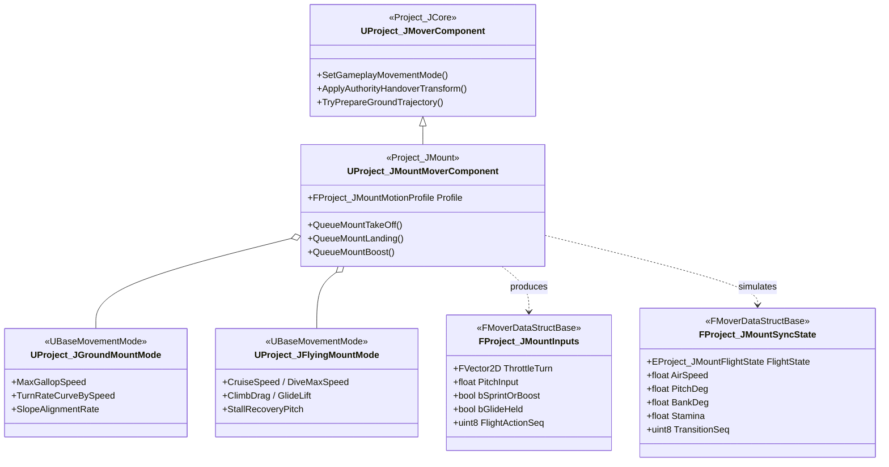
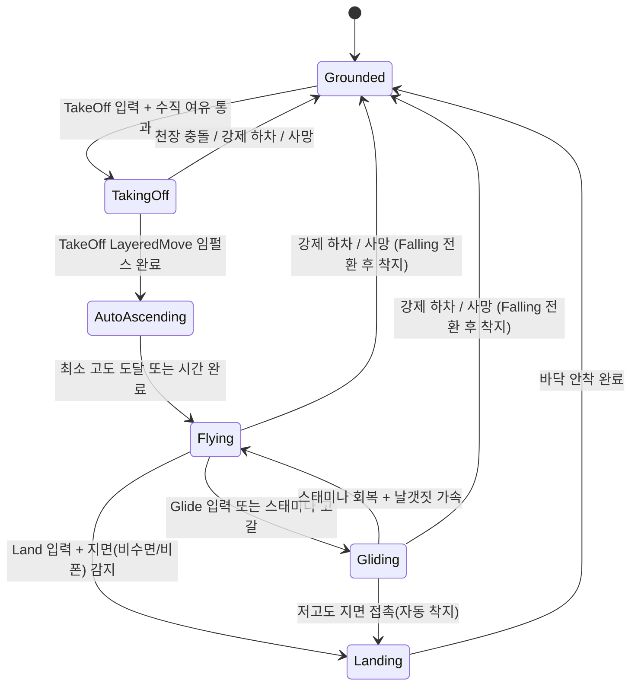

# BP03: 탈것(지상·비행) Mover 통합 아키텍처

> 연계 코드: [Project_JMoverComponent.h](../../../Source/Project_JCore/Public/Movement/Project_JMoverComponent.h), [Project_JMountCharacter.h](../../../Source/Project_JMount/Public/Mount/Project_JMountCharacter.h), [Project_JFlyingMountCharacter.h](../../../Source/Project_JMount/Public/Mount/Project_JFlyingMountCharacter.h), [Project_JMountComponent.h](../../../Source/Project_JMount/Public/Mount/Project_JMountComponent.h), [DefaultEngine.ini](../../../Config/DefaultEngine.ini).

---

## 1. 왜 탈것을 `Mover`로 통합하는가?

현재 플레이어(`AProject_JPlayerCharacter`)는 UE 5.8 **`UProject_JMoverComponent` + Network Prediction** 기반인 반면, 탈것(`AProject_JMountCharacter` / `AProject_JFlyingMountCharacter`)은 구형 **`ACharacter` + `UCharacterMovementComponent`(CMC)** 기반이다. 이 이원화는 MMO 규모에서 다음 구조적 한계를 낳는다.

1. **예측·롤백 불일치**: 플레이어가 지상에서 Mover 예측으로 움직이다 탈것에 탑승하는 순간 CMC 예측/복제로 전환되며, 이륙·착륙·활강 전환 시 100ms+ 지연에서 고무줄(Rubber-banding)이 발생한다.
2. **탑승/하차 핸드오버 복잡도**: 라이더는 `UProject_JAttachedMovementMode`로 전환되는데 탈것은 CMC `MovementMode`를 써서 두 시스템의 상태 전환 타이밍·지연 관련성(Late Relevancy)·Iris 우선순위 그룹이 이중화된다.
3. **고속 8×8km 비행의 3D 에너지 비행 확장성**: CMC의 `MOVE_Flying`은 단순 등속 이동 중심이며, 급강하 가속·상승 감속·활강 양력·부스트 스태미나를 롤백 안전 상태(`FMoverSyncState`)로 통합하기 어렵다.

**목표**: `Project_JMount`를 `APawn` + **`UProject_JMountMoverComponent : UProject_JMoverComponent`** 기반으로 일원화하여 플레이어·지상 탈것·비행 탈것이 **동일한 Network Prediction + Iris + Replay/Rollback 파이프라인**을 공유하게 한다.

---

## 2. 모듈 배치 및 클래스 계층 설계 (8-모듈 DAG 준수)

`Project_JMount`는 이미 `Project_JCore`와 `Project_JGAS`에 의존하므로 순환 의존 없이 `UProject_JMoverComponent`를 상속할 수 있다.

### 2.1 핵심 데이터 구조 (롤백·네트워크 안전)
- **`FProject_JMountInputs` (`FMoverDataStructBase`)**:
  - `NetSerialize` 시 `Throttle/Turn/Pitch`를 8~10비트 양자화(패킷 최소화).
  - `bTakeOffRequested`, `bLandRequested`, `bGlideHeld`, `bBoostHeld` — 별도 Reliable RPC 남발 대신 **매 시뮬레이션 틱 입력 스트림에 내장**되어 롤백/재시뮬레이션과 100% 정합! (Phase 0에서 추가한 `ServerSetGliding` 임시 RPC는 Mover 통합 완료 후 제거).
- **`FProject_JMountSyncState` (`FMoverDataStructBase`)**:
  - `FlightState` (`Grounded`, `TakingOff`, `AutoAscending`, `Flying`, `Gliding`, `Landing`), `AirSpeed`, `PitchDeg`, `BankDeg`, `Stamina`, `TakeOffTimerMs`.
  - 스태미나 소모·회복, 활강 전환, 이륙 타이머가 전부 Mover 시뮬레이션 틱 안에 있으므로 **클라이언트 예측과 서버 권위가 동일 프레임에서 일치**한다.

---

## 3. 지상·비행 모드 및 이착륙 레이어드 무브

### 3.1 `UProject_JGroundMountMode` (지상 탈것)
- **속도별 선회 반경(Turn Radius)**: 정지/보행 시 제자리 회전 허용, 질주(`1,200~1,600 cm/s`) 시 최소 선회 반경 적용 + 차체 뱅크각(`BankDeg`) 산출(AnimInstance 입력).
- **경사면 및 단차 추종**: `FFloorCheckResult` 기반 스텝업(`MaxStepHeight = 55cm`) 및 지면 법선 스무딩으로 고속 주행 시 걸림·튐 현상 방지.
- **절벽/낙하 전환**: 지면 상실 시 `Falling` 모드로 전환하되, 비행 가능 탈것은 공중에서 점프/활강 입력 시 즉시 `UProject_JFlyingMountMode(Gliding)`으로 전환.

### 3.2 `UProject_JFlyingMountMode` (3D 에너지 비행 — 8×8km 오픈월드 최적화)
단순 등속 비행이 아닌 **직관적 에너지 비행 모델**을 적용해 8×8km 대륙 횡단의 체감 속도와 조작 재미를 극대화한다.

- **에너지 비행 수식 (결정론적 고정 스텝)**:
  - 급강하(`Pitch < -10°`): 중력 가속 보너스로 최대 `3,200~3,500 cm/s`까지 가속 + 스태미나 소모 0.
  - 상승(`Pitch > +10°`): 스태미나 소모 + 속도 감쇠(최소 실속 속도 `500 cm/s` 클램프).
  - 활강(`Gliding`): 완만한 하강(`-120 ~ -250 cm/s` Z) + 높은 전진 속도 유지 + 스태미나 완만 회복.
- **Phase 0 충돌 계약 승계**:
  - 이륙 여유 검사(`HasVerticalClearance`)와 착륙 바닥 탐색(`FindLandingSurface`)은 `ECC_Visibility`가 아닌 **탈것 캡슐 충돌 채널(`ECC_Pawn` 무시, 물/유리 트리거 제외)**을 사용해 수면 위 착륙 오인을 원천 차단한다.
- **이착륙 `FLayeredMove`**:
  - `FProject_JMountTakeOffLayeredMove` / `FProject_JMountLandingLayeredMove`로 구현해 몽타주 재생과 물리 궤적이 롤백에도 완벽히 동기화된다.

---

## 4. 라이더 ↔ 탈것 소유권 · 하차 · Iris · 애니메이션 통합

### 4.1 탑승/하차 상태 머신 & 안전 복구
1. **탑승 (`TryMountRider`)**:
   - 서버 권위에서 `State_Dead` / 전투 제한 / 거리 / `CommandBudget` 검증.
   - 라이더 `UProject_JMoverComponent::SetGameplayMovementMode(MOVE_None)` → `UProject_JAttachedMovementMode` 진입 + 캡슐 `NoCollision` + 탈것 메시 `RiderSocket` 부착.
   - `AController::Possess(Mount)` 실행 + 라이더 `AProject_JPlayerState`는 컨트롤러에 유지되어 **장비/인벤토리/GAS/CommandBudget 단일 소유권 보존**.
2. **하차 (`DismountRider`) & 공중 강제 하차**:
   - 일반 하차: 지면 안전 위치(`FindDismountLocation`) 검증 → 탈것 정지/착지 → 라이더 분리·복원(`ApplyAuthorityHandoverTransform`) → `Possess(Rider)`.
   - **공중 사망·피격 낙마·연결 끊김 (`UnPossessed` / `HandleHealthDepleted`)**:
     - 탈것은 즉시 `FlightState = Grounded`, `QueueNextMode(DefaultModeNames::Falling)` 전환(공중 영구 부유 및 서버 틱 누수 0 — Phase 0 수정 계약 유지).
     - 라이더는 현재 공중 위치에서 `Falling` 모드로 복원되며, **글라이더/낙하 피해 면역 버프(옵션) 훅**을 호출할 수 있는 확장점을 둔다.
3. **Iris 복제 일원화**:
   - Phase 0에서 `DefaultEngine.ini`에 등록한 `ProjectJPlayerMover` 우선순위를 `AProject_JMountPawn`(또는 통합된 `AProject_JMountCharacter`)에 그대로 적용.
   - 라이더가 탑승 중인 동안 라이더 폰의 독립 이동 복제 빈도를 낮추고(탈것 소켓 부착 기준), 탈것 폰이 플레이어 이동 대표 액터로 복제된다.
   - `NetDormancy`: 미탑승 야생/소환 해제 대기 탈것은 `DORM_DormantAll`, 탑승 즉시 `DORM_Awake`.

### 4.2 애니메이션 정책 (비-모션매칭 유지)
- **탈것 자체**: 모션 매칭을 사용하지 않는다. `UProject_JGroundMountAnimInstance` / `UProject_JFlyingMountAnimInstance`가 `FProject_JMountSyncState`(`AirSpeed`, `PitchDeg`, `BankDeg`, `FlightState`)를 GT 스냅샷으로 읽어 BlendSpace + 경사면 4족 IK(지상) / 날갯짓 속도 보간(비행)을 워커 스레드에서 평가한다.
- **라이더**: 기존 `UProject_JRiderAnimationProfile` + `Reins_L`/`Reins_R` 고삐 Hand IK 경로를 유지하며, 탈것의 `PitchDeg`/`BankDeg`만 추가 전달해 급강하/선회 시 라이더 상체 기울기를 자연스럽게 연출한다.

---

## 5. 기존 코드 안전 마이그레이션 계획 (무중단 4단계)

기존 `Project_JMountTransitionTests` / `Project_JMountRefinementTests`를 깨지 않고 점진 전환한다.

1. **Step 1 (컴포넌트·모드 신설)**: `Project_JMount`에 `UProject_JMountMoverComponent`, `UProject_JGroundMountMode`, `UProject_JFlyingMountMode`, `FProject_JMountInputs`/`SyncState` 구현 및 단위 테스트(시뮬레이션 결정론·롤백·수면 착륙 거절·공중 사망 `Falling` 전환) 작성.
2. **Step 2 (공통 기반 폰 `AProject_JMountPawn` 추가)**: 기존 `AProject_JMountCharacter`의 GAS(`UProject_JMountAttributeSet`), 탑승/하차(`Rider`, `MountState`, `RiderTransitionRevision`), 소켓/고삐 IK, `IProject_JInteractable` 로직을 공통 헬퍼/컴포넌트(`UProject_JMountOccupancyComponent`)로 추출해 `AProject_JMountCharacter`(레거시)와 `AProject_JMountPawn`(Mover)이 공유.
3. **Step 3 (지상 탈것 → 비행 탈것 BP 순차 전환)**: 프로덕션 탈것 BP 1종씩 `AProject_JMountPawn`으로 리패런트, 100ms 지연 + 5% 패킷 손실 네트워크 테스트 통과 확인.
4. **Step 4 (레거시 CMC 경로 제거)**: 모든 BP 전환 및 회귀 검증 완료 후 레거시 CMC `AProject_JMountCharacter` / `ServerSetGliding` 임시 RPC 제거.

---

## 6. 검증 게이트 (BP03 완료 기준)
1. **네트워크 예측/롤백**: 전용 서버 + 2클라이언트(75±25ms 지연, 5% 손실)에서 지상 질주·급선회·이륙·급강하·활강·착륙 시 위치 오차 보정 스파이크 0, `ServerSetGliding` 별도 RPC 0.
2. **생명주기/안전성**: 공중 피격 사망·연결 끊김·지연 관련성 클라이언트 진입 후 하차 시 라이더 `MOVE_None` 고착 0, 탈것 공중 부유 0, 기존 `MountTransition`/`MountRefinement` 동등 계약 100% 통과.
3. **고속 스트리밍 연계**: 비행 탈것 `3,000 cm/s` 주행 시 `UProject_JWorldStreamingComponent`가 `UProject_JMountMoverComponent` 속도를 정상 수신해 BP02 2단계 예측 스트리밍과 완벽 연동.
