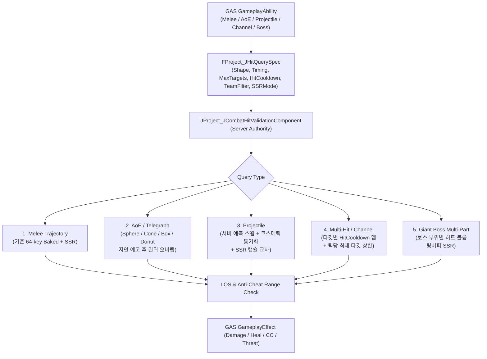
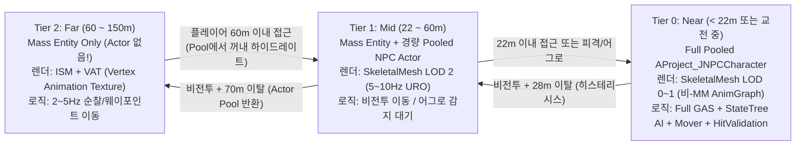

# BP04: 전투(A09) · 모션 매칭 전투 연계 · 군중 LOD & Mass(A03)

> 연계 코드: [Project_JCombatHitValidationComponent.h](../../../Source/Project_JCharacter/Public/Components/Project_JCombatHitValidationComponent.h), [Project_JServerSideRewindComponent.h](../../../Source/Project_JCharacter/Public/Combat/Project_JServerSideRewindComponent.h), [Project_JPlayerAnimInstance.Logic.cpp](../../../Source/Project_JCharacter/Private/Animation/Project_JPlayerAnimInstance.Logic.cpp), [Project_JMassRepresentationSubsystem.h](../../../Source/Project_JCharacter/Public/Mass/Project_JMassRepresentationSubsystem.h), [Project_JTargetScoringSubsystem.h](../../../Source/Project_JCore/Public/System/Project_JTargetScoringSubsystem.h).

---

## 1. AAA급 모션 매칭 + 전투 애니메이션 연계 아키텍처

Project J의 핵심 차별점은 **플레이어의 모션 매칭 로코모션과 전투 애니메이션이 끊김 없이 하나로 이어지는 손맛**이다. 이를 멀티플레이 MMO 환경(서버 권위 + 원격 군중)에서 프레임 저하 없이 달성하기 위한 구조는 다음과 같다.

### 1.1 로코모션 ↔ 전투 핸드오프 & Motion Warping
1. **진입(Attack Entry) & Motion Warping**:
   - 플레이어가 이동 중 공격을 누르면, 클라이언트와 서버가 공통 `FProject_JAttackWarpTarget`(타깃 액터 또는 입력 방향, **서버 권위 최대 워프 거리 상한 예: `250cm` 및 최대 회전각 클램프**)을 GAS `AbilityTargetData`로 동기화한다.
   - `UMotionWarpingComponent`가 공격 몽타주의 `WarpWindow` 구간 동안 루트 모션을 타깃 앞으로 보정하되, **실제 물리 이동은 `UProject_JMoverComponent`의 `FLayeredMove_AnimRootMotion`이 단일 소유**한다(이중 이동·벽뚫기 차단).
2. **복귀(Recovery Handoff → Motion Matching)**:
   - 기존 `UProject_JMontageLocomotionHandoff`의 `RecoveryStart` 메타데이터를 활용해 공격 후딜 구간에서 이동 입력이 들어오면, **현재 공격 포즈의 발 위치·속도 벡터를 그대로 PoseSearch 쿼리의 `HistoricalTrajectory` + 현재 포즈로 넘겨** 가장 자연스러운 발걸음의 이동 클립으로 0.15~0.25s 크로스페이드한다.
3. **상·하체 분리 이동 공격 (UpperBody Slot)**:
   - 경공격/캐스팅/활 조준 등 이동 가능 스킬은 `UpperBody` 슬롯으로 재생하고, 하체는 모션 매칭(Strafe 모드)이 계속 구동된다.
   - 워커 스레드 안전성: Phase 0에서 도입한 GT 스냅샷(`FProject_JAnimMontageThreadSafeData`)에 `UpperBodySlotWeight`를 추가해 워커 스레드에서 UObject 슬롯 직접 조회를 영구 차단한다.
4. **타격감(HitStop / Additive Hit React)**:
   - **HitStop(역경직)**: 서버 시뮬레이션은 절대 멈추지 않는다! 로컬 클라이언트에서만 공격자/피격자 메시 재생 속도(`GlobalAnimRateScale`)를 `0.05`로 40~70ms 감속 후 복원해 네트워크 어긋남 없는 묵직한 타격감을 구현한다.
   - **경직/피격 리액션**: 경미한 피격은 모션 매칭을 끊지 않는 **Additive Hit React(방향별 4방향)**로, 강경직/다운/에어본만 풀바디 CC 몽타주로 전환한다.

### 1.2 원격 플레이어 모션 매칭 거리별 LOD (군중 200인 CPU 방어)
로컬 플레이어 1명은 풀 PoseSearch DB + IK를 실행해도 여유롭지만, 원격 플레이어 150명이 모두 풀 PoseSearch 쿼리를 돌리면 워커 스레드와 L2/L3 캐시가 즉시 포화된다.

| 거리 티어 | 대상 | 로코모션 평가 방식 | 평가 주기 | IK / Cloth |
|---|---|---|---|---|
| **Local (0m)** | 내 캐릭터 | Full PoseSearch DB (200+ 클립) + Motion Warping + Full Foot/Hand IK | 매 프레임 (60+Hz) | Full Foot/Hand IK + Cloth ON |
| **Tier 0 (`< 20m`)** | 근거리 원격 플레이어 (파티/교전) | Compact PoseSearch DB (핵심 방향/속도 40~60 클립) + 전투 몽타주 | 30Hz (또는 Budget 할당) | Foot IK ON, Cloth 예산 내 |
| **Tier 1 (`20 ~ 50m`)** | 중거리 원격 플레이어 | **비-MM 2D Locomotion BlendSpace** + 전투 몽타주 | 15Hz (URO FrameSkip) | IK OFF, Cloth OFF |
| **Tier 2 (`50 ~ 100m`)** | 원거리 원격 플레이어 | 단순 1D 속도 블렌드 + 핵심 스킬 포즈 | 5~10Hz (URO) | Skeletal LOD 2~3, 악세서리 숨김 |
| **Tier 3 (`> 100m`)** | 초원거리 | 컬링 또는 경량 프록시 | Iris 관련성 밖 | 비렌더 |

- **원격 몽타주 ABA 보호**: Phase 0에서 `UProject_JReplicatedAnimEventComponent`에 wrap-safe 시퀀스를 적용한 데 이어, 원격 몽타주 재생 패킷에 `MontagePlaySeq (uint16)` + `ServerStartTime`을 포함해 지연/재접속 시 이미 끝난 과거 몽타주가 재시작되는 ABA 현상을 차단한다.

---

## 2. 범용 전투 판정 파이프라인 (`A09` 완성)

기존 `UProject_JCombatHitValidationComponent`는 근접 공격의 오프라인 64키 궤적 + SSR에 특화되어 있다. MMO 전체 클래스(근접·마법사·궁수·힐러·거대 보스)를 하나의 일관된 서버 권위 프레임워크로 수용하기 위해 **`FProject_JHitQuerySpec`** 추상화를 도입한다.

### 2.1 신규 판정 유형별 설계 규칙
1. **장판 / AoE + 텔레그래프 (Mandatory Warning 연계)**:
   - 시전 시 서버가 `FProject_JAoETelegraphSpec`(Shape: Circle/Cone/Rect/Donut, Origin, Yaw, Radius/Extent, DetonateServerTime)을 복제 → 클라이언트는 기존 153/154차 `MandatoryWarning` 경로로 **절대 컬링되지 않는 바닥 예고 표시**.
   - `DetonateServerTime` 도달 시 서버가 **단 1회 권위 공간 질의** 실행(지연 보정 불필요 — 바닥 예고 회피가 게임플레이 규칙이므로 서버 현재 위치 기준 판정).
2. **투사체 (Projectile)**:
   - **액터 스폰 금지(대규모 전투 GC 폭주 방지)**: 투사체는 `AActor`가 아니라 서버 `UProject_JProjectileManagerSubsystem`의 경량 구조체 배열(`FProject_JActiveProjectile`, 최대 2,048개)로 시뮬레이션하고, 클라이언트는 단일 풀링 Niagara/ISM으로 렌더링한다.
   - 고속 투사체는 매 서버 틱(33ms) 직전→현재 위치 스윕 + 플레이어 발사 투사체에 한해 `UProject_JServerSideRewindComponent` 선택 적용.
3. **거대 필드 보스 다부위(Multi-Part) 판정 & SSR**:
   - 거대 보스(길이 15~30m)는 단일 캡슐로 판정하면 꼬리/날개/앞발 공격이 모두 허공 판정이 된다.
   - 보스 전용 opt-in 컴포넌트 **`UProject_JMultiPartHitComponent`**: 데이터 애셋으로 정의된 최대 8개 부위(`Head`, `Body`, `LeftLeg`, `RightLeg`, `Tail` 등 — 각각 본 소켓 부착 구/캡슐 + 부위별 피해 배율 `WeakpointMultiplier`)의 월드 트랜스폼을 30Hz 링버퍼(최대 0.5초 = 15프레임)로 기록.
   - SSR 질의 시 단일 캡슐 대신 부위 볼륨을 순회해 정확한 부위 명중·약점 크리티컬·부위 파괴를 판정한다.
4. **타겟팅 & 소프트 락온 (하이브리드 액션 전투)**:
   - 기존 비동기 `UProject_JTargetScoringSubsystem`을 플레이어 타겟 선택기에도 재사용:
     - **논타겟 기본**: 화면 중앙(카메라 전방) + 이동 입력 방향 + 거리 + 시야각 가중치로 실시간 **소프트 락온(Soft Lock)** 후보 산출 → 근접 Motion Warping 및 스킬 방향 보정에 활용.
     - **하드 락온 / 탭 타겟 (옵션)**: 보스전·힐러 아군 타게팅 시 명시적 `LockedTarget` 고정(타깃 사망/은신/사거리 이탈 시 자동 해제).

### 2.2 CC(군중 제어) · 점감(DR) · 슈퍼아머 체계
- **GAS `GameplayTag` 계층**:
  - `State.CC.Stun`, `State.CC.Knockdown`, `State.CC.Airborne`, `State.CC.Root`, `State.CC.Silence`, `State.CC.Slow`
  - `State.Defense.SuperArmor` (경직/다운 면역, 피해는 적용), `State.Defense.Invulnerable` (회피 무적 프레임), `State.Defense.CCImmune` (보스 기본 또는 광폭화 상태)
- **CC 점감 (Diminishing Returns — PvP 및 정예 몹 무한 스턴 방지)**:
  - 동일 CC 카테고리 15초 내 재적용 시 지속시간 `100% → 50% → 25% → 면역(15초)`.
  - 거대 보스는 일반 CC 면역 대신 **무력화/그로기 게이지(Stagger Bar)** 누적 → 0 도달 시 5초 그로기 상태 전이(MMO 레이드 표준).

---

## 3. 군중 최적화 & Mass 연동 (`A03` 완성 — NPC 비-모션매칭 준수)

현재 [UProject_JMassRepresentationSubsystem](../../../Source/Project_JCharacter/Public/Mass/Project_JMassRepresentationSubsystem.h)은 이미 `AProject_JNPCCharacter`의 이동을 Mass로 위임하는 1단계 기반(`PromoteDistance=1500`, `DemoteDistance=2200`, `MaxAgents=2048`)을 갖추고 있다. 그러나 현재는 **원거리에서도 `AProject_JNPCCharacter` 액터 자체가 메모리에 남아 있어** UObject 수와 GC 스캔 비용이 줄지 않는다.

### 3.1 3-Tier NPC/군중 표현 아키텍처

- **핵심 최적화 포인트**:
  1. **NPC 액터 풀링 (`UProject_JNPCPoolSubsystem`)**: `Tier 2 → Tier 1` 승격 시 매번 `SpawnActor`/`DestroyActor`를 호출하지 않고 사전 워밍된 풀에서 꺼내 `ResetForPool` / `HydrateFromMassFragment`만 수행(GC 스파이크 0, `MaxTransitionsPerTick = 4` 예산 유지).
  2. **VAT (Vertex Animation Texture) / AnimToTexture**: 60~150m 원거리 필드 몬스터·마을 NPC는 스켈레탈 메시 대신 UE 내장 `AnimToTexture` 플러그인으로 베이킹한 **StaticMesh ISM + VAT 머티리얼(Idle/Walk/Run 3클립)**로 렌더링 → 수백 마리를 **단 1~3 드로우콜, 스키닝 CPU 0ms**로 표현!
  3. **전투 중 강등 금지**: 어그로 테이블이 비어 있지 않거나 보스/정예 태그인 NPC는 `CanDemote() == false`로 영구 보호(전투 도중 사라지거나 VAT로 변하는 버그 원천 차단).

### 3.2 군중 전투 이펙트(Niagara) 우선순위 예산
200명이 필드 보스를 동시에 타격할 때 GPU/CPU를 가장 먼저 터뜨리는 것은 타인의 스킬 이펙트다.

| 이펙트 소유자/등급 | 스폰 비율 | 최대 동시 인스턴스(로컬) | 컬링 규칙 |
|---|---|---|---|
| **보스/적 필수 경고 (MandatoryWarning)** | **100%** | 무제한(고정 저비용) | **절대 컬링 금지** (153/154차 계약) |
| **내 캐릭터 스킬 & 타격 FX** | **100%** | 32 | 최우선 |
| **내 파티원 핵심 스킬 FX** | **50~70%** | 24 | 거리 30m 이내 우선 |
| **비파티 타인 스킬 FX** | **10~20%** (옵션으로 OFF 가능) | 16 (보스전 시 4) | 20m 밖 자동 스킵, 2차 파편/리본 제거 |

---

## 4. 검증 게이트 (BP04 완료 기준)
1. **범용 판정 회귀**: Melee(기존 64키) + AoE 4형상 + 풀링 Projectile + 다단히트 + 거대 보스 5부위 Multi-Part SSR 자동화 테스트 오류 0.
2. **군중 200인 벤치마크**: 플레이어 100(Tier 0/1/2 혼합) + NPC 100(Tier 0/1/2 Mass+VAT 혼합) + 필드 보스 1마리 교전 씬에서 서버 30Hz 유지(평균 틱 < 20ms), 클라이언트 High 1080p ≥ 60fps, 스켈레탈 본 평가 시간 예산 ≤ 2.5ms.
3. **모션 매칭 연속성**: 공격 진입(Motion Warping) → 캔슬/후딜 복귀(PoseSearch Handoff) → 원격 100ms 지연 환경에서 발 미끄러짐·ABA 몽타주 재발 0건.
