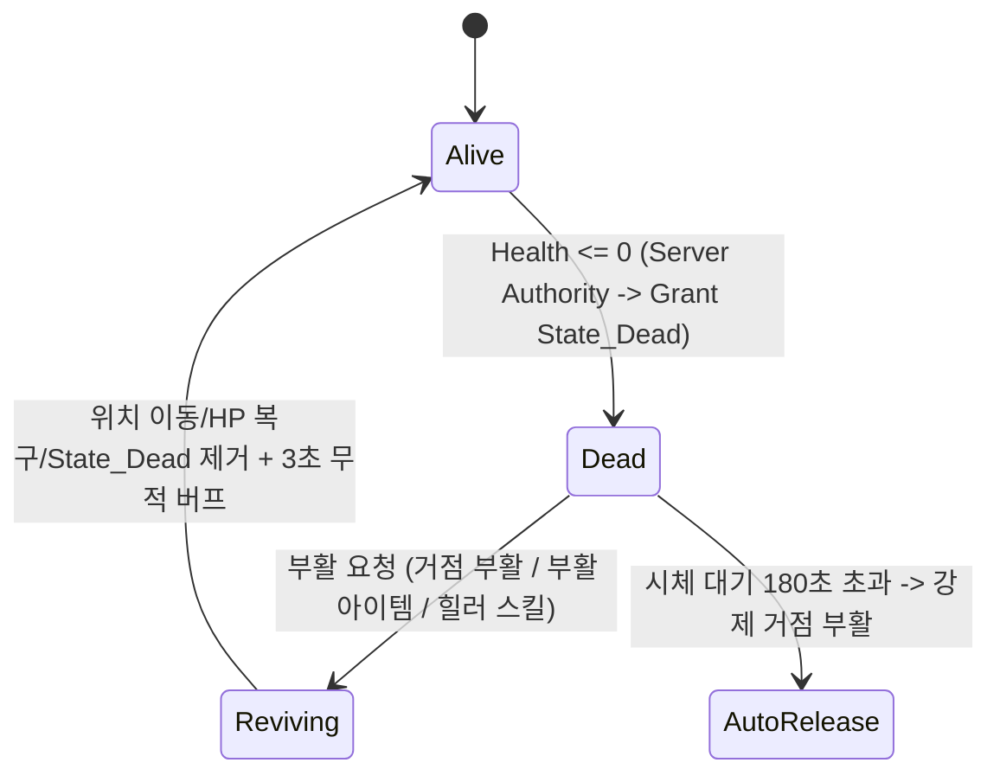

# BP05: PvE · AI(StateTree) · 어그로 · 루팅 · 사망/부활 · 성장 · 퀘스트 · 생활

> 연계 코드: [Project_JWorldEncounter.h](../../../Source/Project_J/World/Project_JWorldEncounter.h), [Project_JAttributeSet.cpp](../../../Source/Project_JGAS/Private/Project_JAttributeSet.cpp), [Project_JNPCPathSubsystem.h](../../../Source/Project_JCharacter/Public/System/Project_JNPCPathSubsystem.h), [Project_JQuestHistoryStorage.h](../../../Source/Project_J/Backend/Project_JQuestHistoryStorage.h).

---

## 1. 데이터 주도 AI 아키텍처 (`StateTree`, NPC 비-모션매칭)

MMO에서 Behavior Tree는 몬스터 수백 마리 기준 노드 메모리·틱 오버헤드가 크다. UE 5.8의 **`StateTree`**는 평탄한 메모리 레이아웃과 이벤트 기반 전이(Event-Driven Transition)를 지원해 대규모 NPC와 복잡한 다페이즈 보스를 모두 효율적으로 수용한다.

### 1.1 일반 몬스터 vs 거대 보스 StateTree 분리
- **`UProject_JNPCBrainDefinition` (PrimaryDataAsset)**:
  - `StateTreeAsset`, `SightRadius`, `HearingRadius`, `LeashRadius`(예: 일반 35m, 보스 80m), `MaxChaseZDelta`(예: 12m), `SkillEntries[]`(쿨다운, 사거리 최소/최대, 가중치, 페이즈 조건, 선행 텔레그래프).
- **일반 몬스터 StateTree**:
  - `Patrol/Idle` (비전투 2~5Hz) → `Alert/Engage` → `CombatLoop`(사거리 내 스킬 선택 / `UProject_JNPCPathSubsystem` 비동기 경로 추적) → `Evade/Leash`(원위치 복귀) → `Dead`.
- **거대 필드 보스 & 던전 보스 StateTree**:
  - **HP % 기반 페이즈 전이**: `Phase 1 (100~70%)` → `Phase 2 (70~35%, 패턴 해금 + 환경 기믹)` → `Phase 3 (35~0%, 광폭화/전멸기 텔레그래프)`.
  - **무력화(Stagger) 인터럽트 상태**: 무력화 게이지 0 도달 시 현재 패턴 즉시 취소 → 5초 그로기(받는 피해 +30%) → 기상 광역 넉백.
  - **보스 리셋 규칙**: 아레나 내 생존 어그로 대상 0명 또는 10초 이상 유효 타깃 부재 시 즉시 `Evade` → 무적 귀환, HP 100% 복구, 페이즈 1 초기화, 소환된 잡몹 일괄 제거.

### 1.2 리싱(Leashing) & 이베이드(Evade) — 악용(글리치 킬) 차단
- **이탈 판정 조건 (하나라도 충족 시 즉시 Evade)**:
  1. 스폰 앵커(`HomeLocation`)로부터 수평 거리 > `LeashRadius`
  2. 스폰 앵커 대비 수직 고도 차 > `MaxChaseZDelta` 또는 타깃이 NavMesh 외부 안전지대(바위 위/지붕)에서 5초 이상 공격(경로 탐색 실패 누적)
  3. 어그로 테이블 전원 사망/이탈/은신
- **Evade 상태 동작**: `State.Defense.Invulnerable` 부여 + 모든 디버프 해제 + 어그로 테이블 초기화 + 2배 속도로 `HomeLocation` 귀환(귀환 중 5초 이상 끼이면 안전 텔레포트) → 도착 시 HP 100% 회복 후 `Patrol/Idle` 복귀.

---

## 2. 실전 어그로 / 위협도(Threat) 시스템

기존 단순 테이블 및 128명 상한 문제를 해소하고, 필드 보스(150명+ 참여)와 5인 던전(탱커/딜러/힐러 역할 수행)을 모두 지원하는 **`UProject_JThreatComponent`**를 도입한다.

### 2.1 위협도 계산 및 히스테리시스 (어그로 핑퐁 방지)
- **위협도 생성 공식**:
  $$\text{Threat}_{\text{add}} = (\text{Damage} \times \text{SkillThreatMult} \times \text{StanceMult}) + (\text{EffectiveHeal} \times 0.45 / N_{\text{engaged\_mobs}})$$
- **도발 (Taunt)**:
  - 현재 1위 위협도 × `1.10`으로 즉시 끌어올림 + 3~5초간 `ForcedTarget` 고정(보스 도발 점감 적용).
- **어그로 전이 히스테리시스 (핵심!)**:
  - 현재 타깃(`CurrentTarget`)이 유지되는 상태에서 다른 플레이어가 타깃을 빼앗으려면:
    - **근접 범위 내**: 현재 타깃 위협도의 **110% 초과**
    - **원거리 범위**: 현재 타깃 위협도의 **130% 초과**
  - 이로써 근소한 딜 차이로 보스가 매 초 앞뒤로 회전하는 "어그로 핑퐁" 현상을 완전히 제거한다.
- **확장성 (필드 보스 200+ 참여자 대응)**:
  - `TMap<TWeakObjectPtr<AActor>, FProject_JThreatEntry>`로 동적 확장(하드 128명 컷 제거).
  - 매 프레임 전체 정렬 대신 **0.25초 주기 부분 스캔 + 상단 Top-1 타깃/히스테리시스 갱신**으로 O(N) 비용 최소화.
  - 이탈(사거리 외 15초)·사망(`State_Dead`)·은신 시 즉시 어그로 타깃에서 제외(단, **보스 기여도 기록 `ContributionMap`은 별도 보존**해 도중 사망 후 부활 복귀한 참여자의 기여도를 보호).

---

## 3. 사망 · 부활 · 시체 · 루팅/기여도 파이프라인

Phase 0에서 `UProject_JAttributeSet::PostAttributeChange`에 `State_Dead` 자동 부여/제거를 연결 완료했다. 이를 실제 게임플레이 루프로 확장한다.

### 3.1 사망 시 강제 규칙 (서버 권위)
- `State_Dead` 보유 중: 모든 활성 GAS 어빌리티 취소, 신규 어빌리티·이동·탈것 소환·포탈·거래·채집 RPC 서버 측 거절, 탑승 중이면 강제 하차.
- **부활 3경로**:
  1. **거점 부활**: 현재 존의 가장 가까운 안전 거점(`AProject_JWorldGraveyard` / `WorldDefinition` 스폰 포인트)으로 이동(필요 시 `RequestPreparedArrival` 스트리밍 선행), HP/MP 50~100% 복구.
  2. **힐러/파티원 부활**: 시전 완료 시 대상에게 부활 수락 팝업(30초 타임아웃) → 수락 시 현장 부활.
  3. **던전 부활 규칙**: 보스 전투 중 거점 부활 금지(던전 입구 체크포인트 부활, 전멸 시 보스 리셋 후 전원 체크포인트 복귀).

### 3.2 루팅 & 드롭 시스템 (일반 몹 · 파티 · 거대 필드 보스)
- **데이터 주도 드롭 테이블 (`UProject_JLootTableDefinition`)**:
  - `GuaranteedEntries[]`(확정 드롭: 퀘스트 아이템, 보스 증표) + `WeightedPool[]`(가중치 확률, 레벨/행운 보정) + `CurrencyRange(Min, Max)`.
  - 모든 난수 롤링은 **서버 권위 `FRandomStream`**, 클라이언트 확률 조작 불가능.
- **3가지 분배 모드**:
  1. **개인 루팅 (기본 / 거대 필드 보스 필수)**: 기여도 임계치를 넘긴 모든 적격 플레이어에게 독립 루트 롤링.
     - 일반 몬스터: 월드에 `AProject_JLootBag`(또는 소유자 전용 루트 상호작용 프롬프트, TTL 120초) 생성 → 줍기 RPC 시 인벤토리 원자 추가.
     - **거대 필드 보스**: 인벤토리 즉시 지급 시도 → **공간/무게 부족 시 PostgreSQL `MAIL_ESCROW` 우편 자동 발송**(BP01 원장 멱등키 `boss_reward:{encounter_id}:{spawn_rev}:{char_id}`).
  2. **파티 분배 (던전)**: 일반/고급 아이템은 개인 루팅 또는 순차 분배, 희귀 이상은 파티 주사위(`입찰/차비/포기`, 30초 타이머, 미응답 자동 포기).
  3. **퀘스트 아이템 드롭**: 해당 퀘스트 진행 중인 플레이어에게만 드롭(인벤토리 오염 방지).

---

## 4. 성장 · 장비 강화 · 퀘스트 · 생활 루프

### 4.1 캐릭터 성장 & 장비 스탯 스케일링
- **레벨업 곡선 (`UCurveTable`)**:
  - 직업별 `UProject_JCharacterClassDefinition`에 `XPToNextLevelCurve`와 스탯 성장 곡선(`BaseMaxHealth`, `AttackPower`, `Defense`, `CritRate`) 연결.
  - 레벨업 시 서버가 `GE_ClassBaseStats`를 새 `Level`로 재적용 → HP/MP 풀회복 + 스킬/특성 포인트 지급 + `AProject_JPlayerState::SetPublicCharacterSnapshot` 갱신 + PostgreSQL 즉시 커밋.
- **장비 `ItemLevel` & 강화/세트 효과**:
  - `UProject_JEquipmentRuntimeComponent`에서 장비 인스턴스의 `enhance_level`을 GAS `SetByCaller` 또는 `GameplayEffect Level`로 반영(Phase 0 이후 확정 확장).
  - 세트 효과: 장착 슬롯 집계(`TMap<FName, int32> SetCounts`) → 2세트/4세트 임계치 도달 시 `GE_SetBonus` 부여/해제.
  - 장비 강화: 서버 권위 + 안전 구간(예: +0~+7 100%) / 실패 페널티(하락·내구도·보호석) + 천장(Pity Counter) + PostgreSQL 단일 트랜잭션(재료/골드 차감 + `enhance_level` 갱신 + 복식부기 로그).

### 4.2 퀘스트 확장 (기존 Format4 활성 128 + 완료 이력 65,536 기반)
이미 163~165차에서 견고한 영속 퀘스트 저장·이력 페이지·원자 보상 지급 파이프라인이 완성되어 있다. 그 위에 콘텐츠 확장을 위한 **목표(Objective) & 스케줄 계층**을 얹는다.

| 목표 타입 | 서버 이벤트 구독원 | 비고 |
|---|---|---|
| `KillTarget` | `UProject_JCombatEventBus::OnActorKilled` | 파티 공유 반경 50m, 보스 태그 지원 |
| `CollectItem` | `UProject_JInventoryComponent::OnInventoryChanged` | 현재 보유 수량 동기화, 완료 시 원자 회수 옵션 |
| `TalkToNPC` / `Interact` | `IProject_JInteractable` 서버 완료 훅 | 대화 선택지 분기 지원 |
| `ReachLocation` | `AProject_JWorldRegionTrigger` 오버랩 | 탐험/스토리 연출 트리거 |
| `ClearDungeon` | 던전 인스턴스 클리어 이벤트 (BP01) | 난이도 조건 필터 |
| **체인 & 반복(일일/주간)** | `PrerequisiteQuestIds[]` + `ResetPolicy (None / DailyUtc00 / WeeklyMonUtc00)` | 반복 퀘스트는 완료 이력 페이지가 아닌 별도 `quest_reset_claims(char_id, quest_id, period_key)`로 멱등 관리 |

### 4.3 생활(채집 · 제작) 멀티플레이 확장
- **채집 (`AProject_JResourceNode`)**:
  - 데이터 애셋 `UProject_JResourceNodeDefinition`(필요 도구 등급, 채집 시간, 드롭 테이블, 리스폰 60~300초, **공유 개인 위상 vs 경쟁 노드** 선택).
  - **개인 위상 노드(권장 기본)**: 한 노드를 여러 플레이어가 동시에 채집해도 각자 1회씩 획득 가능(개인 쿨다운 관리) → 작업장/자리싸움 스트레스 완화. 희귀 자원만 경쟁 노드(동시 1인 선점 + 리스폰)로 운영.
  - 채집 중 피격/이동 시 즉시 취소, 서버 측 거리·도구·최소 채집 시간·안티매크로 쿨다운 검증.
- **제작 (`UProject_JCraftingJobsComponent` 확장)**:
  - 기존 에스크로/멱등 커밋 파이프라인에 **숙련도(Proficiency) 레벨·대성공(Great Success, 상위 등급/추가 수량)·제작대 근접 검증**을 데이터 테이블로 확장.

---

## 5. 검증 게이트 (BP05 완료 기준)
1. **AI & 어그로 회귀**: (a) 근접 110% / 원거리 130% 히스테리시스 전이 정확성, (b) `LeashRadius` 이탈·NavMesh 불가 지대 5초 체류 시 자동 `Evade` + HP 100% 복구, (c) 보스 페이즈 전이 및 전멸 리셋 자동화 테스트 통과.
2. **사망·부활·루팅**: 사망 중 모든 금지 RPC 거절, 필드 보스 20인 참여 시 기여도 기반 개인 루팅 + 인벤토리 만석 시 우편 폴백 원자 커밋(중복 수령 0) 확인.
3. **퀘스트 & 생활**: 킬/수집/던전 클리어 목표 갱신, 일일 UTC 리셋 퀘스트 동일 주기 재수령 차단, 채집 중 피격 취소 및 제작 숙련도/대성공 서버 권위 검증 통과.
