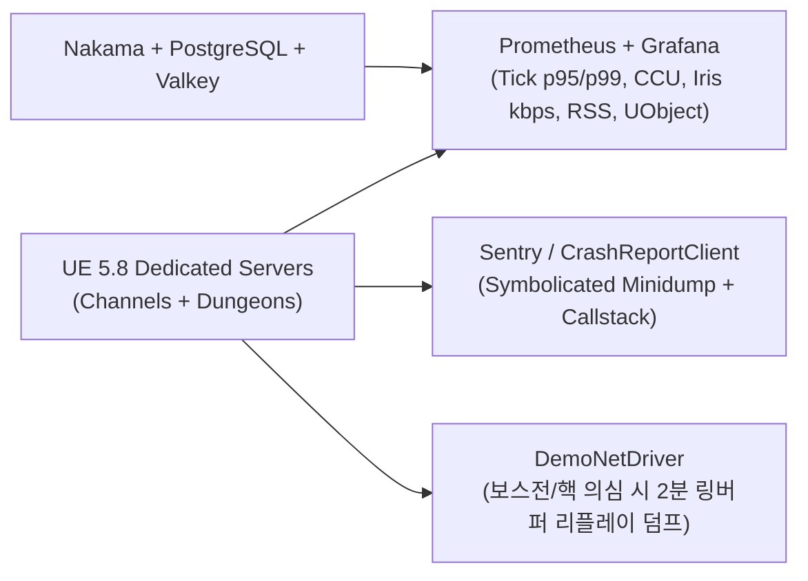

# BP06: 운영 · 관측성 · 안티치트 · 오디오 · 에디터/CI · 로컬라이제이션/접근성

> 이 문서는 핵심 게임플레이 구현 단계에서 놓치기 쉬우나 **라이브 MMORPG의 성패를 가르는 운영·보안·메모리·오디오·품질 사각지대**를 사전에 설계·고정한다.\
> **극초반 단계 적용 구분 (2026-11-23 반영)**: 운영까지는 긴 시간이 남아 있으므로, 이 문서의 항목을 **지금 바로 적용할 경량 가드레일(Stage A)**과 **출시/베타 직전까지 보류할 라이브 운영 인프라(Stage C)**로 명확히 분리한다.
> - **Stage A (지금 적용 — 비용 적고 나중에 고치기 비싼 항목)**: 3-Mode 개발 반복 체계, `UProject_JCheatManager` 디버그 명령, 서버 권위 기본 검증(이동/예산/SSR/원장 멱등키), `USoundConcurrency` 그룹 규약, `StringTable`/`LOCTEXT`, 경량 크로스-에셋 에디터 밸리데이터(NPC 비-MM·수목 HLOD·스켈레탈 RT 차단).
> - **Stage C (보류 — 라이브/베타 직전 구축)**: Prometheus/Grafana 알림 스택, Sentry 크래시 서버, `DemoNetDriver` 자동 리플레이 수집, 200봇 24시간 Soak, EAC 연동, 매크로/봇 행동 분석 파이프라인, 프로덕션 DDoS/오토스케일링.

---

## 1. 안티치트 & 서버 무결성 다층 방어

**원칙**: 클라이언트 보안 솔루션(EAC/BattlEye 등)은 "보조 억지력"일 뿐이며, **모든 게임플레이 규칙의 최종 방어선은 UE Dedicated Server와 PostgreSQL 원장**이다.

### 1.1 영역별 서버 권위 검증 규칙

| 위협 유형 | 공격 예시 | 서버 방어 설계 | 제재/대응 정책 |
|---|---|---|---|
| **스피드핵 / 텔레포트 / 비행핵** | 클라이언트 이동 속도 변조, 벽뚫기, 공중 고정 | `UProject_JMoverComponent`가 서버에서 입력을 직접 시뮬레이션하므로 임의 좌표 전송 자체가 불가. 추가 안전망으로 매 1초 윈도우에서 `실제 이동 거리 <= 허용 최대속도(버프/탈것/대시 포함) × 1.15` + 지형 아래 관통 검사(Z < KillZ) 수행. 포탈/대시/워프는 서버 화이트리스트 토큰 발급. | 1~2회(네트워크 스파이크 가능): 조용히 스냅백. 10초 내 5회 누적: 감사 로그 + 경고 플래그. 지속 위반: 자동 강제 퇴장 + 계정 리뷰 큐. |
| **공속핵 / 쿨다운 무시 / 사거리 핵** | 애니메이션 재생 속도 변조, 사거리 밖 타격 | Phase 0 `UProject_JCommandBudgetComponent`(80/s) + GAS 어빌리티별 `ServerMinCastInterval` & `Cooldown` 서버 시계 검증 + `UProject_JCombatHitValidationComponent`의 SSR/사거리/LOS 이중 검증. | 위반 요청 즉시 거절 + `CombatViolation` 카운터 누적(임계치 초과 시 킥). |
| **아이템/재화 복사 (Dupe)** | 거래/우편/거래소 동시 요청, 존 이동 중 강제종료 | BP01의 글로벌 유니크 `item_instance_uuid` + `IdempotencyKey` + `session_epoch` 펜싱 토큰 + 복식부기 `SUM(delta)==0` + `SELECT ... FOR UPDATE`. | DB 제약 위반 시 즉시 트랜잭션 롤백 + **Critical Security Alert** 발송(운영자 즉시 알림). |
| **패킷 플러딩 / DoS** | 대량 Reliable RPC 스팸, 거대 배열 페이로드 | `UProject_JCommandBudgetComponent` + `MaxRequestBytes` + UE NetDriver `Net.MaxRPCPerNetUpdate` 및 `DDoSDetection` 활성화(`DefaultServerEngine.ini`). | 임계치 초과 연결 즉시 차단(`CloseConnection`). |
| **자동 사냥 봇 / 매크로** | 24시간 동일 좌표/주기 반복 사냥·채집 | 서버 행동 텔레메트리(입력 간격 분산, 경로 엔트로피, 장시간 무휴 채집 패턴)를 Nakama 백그라운드 분석 잡으로 집계 → 의심 계정만 비침습적 검증/운영자 검토 큐에 등재. | 오탐 방지를 위해 자동 영구정지 금지, 단계적 제한 + 운영자 승인. |
| **클라이언트 메모리 변조 (후기)** | Aimbot / ESP / 패킷 암호화 우회 | Shipping 빌드 시 `DTLS` 패킷 암호화 활성화 + 출시 전 EAC(Easy Anti-Cheat, 무료 Epic Online Services 티어) 통합 경계 마련. | 클라이언트는 추상 인터페이스 `IProject_JAntiCheatBridge`로 분리해 개발 중 개발자 생산성 저해 0. |

---

## 2. 관측성(Observability) · 크래시 · 메모리 귀속(Batch 106) · 리플레이

### 2.1 Batch 106 미해결 메모리 귀속 해소 절차 (Phase 1 필수)
기존 문서에서 미해결로 남아 있는 **서버/클라이언트 메모리 귀속 불명확 문제**를 체계적으로 닫는다.
- **실행 절차**:
  1. `Project_JServer` 및 `Project_J` Development 빌드에 `-llm -llmcsv` 플래그를 붙여 30분/2시간 봇 주행.
  2. 매 10분마다 자동 `memreport -full` + `obj list -alphasort` 스냅샷을 `Saved/Profiling/MemoryCensus/<RunName>/`에 덤프.
  3. Python 비교 스크립트(`Scripts/Validation/Diff-MemoryCensus.py`)로 `T+10m` vs `T+60m` vs `T+120m` 간 증가하는 LLM 태그(`FMalloc`, `UObject`, `Physics`, `Navigation`, `Animation`, `Networking`)와 `UObject` 클래스를 자동 상위 20개 리포트.
  4. **합격 기준**: 정상 상태(200 CCU 고정) 도달 후 60분간 RSS 기울기 ≤ `0.5 MB/min`, `UObject` 수 단조 증가 0.

### 2.2 라이브 메트릭 & 크래시 & 리플레이 스택 (100% 오픈소스·무료)

- **핵심 경보(Alert) 임계치**:
  - UE 서버 틱 p99 > `33.3ms` (30Hz 미달) 30초 지속 → Warning / > `50ms` → Critical
  - 서버 RSS > `4.0 GB` (또는 컨테이너 한도의 80%) → Warning + 신규 입장 드레이닝(Draining) 자동 전환
  - PostgreSQL 커밋 p99 > `150ms` 또는 `IdempotencyConflict`/`LedgerMismatch` > 0 → Critical
  - 던전 Warm Pool 잔여 < 20% → 오토스케일 트리거
- **서버 전투 리플레이 (`DemoNetDriver`)**:
  - 치명적 전투 버그·보스 패턴 오류·안티치트 위반 발생 시 해당 플레이어/보스 주변 2분간의 네트워크 리플레이를 선택 녹화해 오프라인에서 정확히 1:1 재현 가능.

---

## 3. 헤드리스 부하 테스트 & 24시간 Soak 파이프라인

1~2인 팀이 수백 명 플레이어를 수동으로 테스트할 수 없으므로 **자동화 헤드리스 봇 인프라**가 필수다.

- **경량 봇 클라이언트 (`Project_JBot` 또는 `-NullRHI` 클라이언트 모드)**:
  - 시나리오 4종 혼합 비율:
    - `40%` 오픈월드 고속 이동·탐험(WP 스트리밍·Iris 공간 이동 부하)
    - `35%` 사냥/필드 보스 집결 전투(GAS·SSR·StateTree·어그로·루팅 부하)
    - `15%` 던전 입구/메뉴 진입 → 클리어 → 원래 채널 복귀 반복(티켓·Flush·Warm Pool 부하)
    - `10%` 인벤토리·장비·거래소·길드·채팅(PostgreSQL·Nakama 부하)
- **단계적 검증 게이트**:
  1. **Smoke (20봇 × 10분)**: PR/마일스톤 병합 시 실행.
  2. **Scale (200봇 × 1시간, 채널당)**: Phase 2/3 완료 게이트 — 30Hz 유지, 패킷 손실 0, DB 에러 0.
  3. **24시간 Soak (100봇 × 24시간)**: 마일스톤 릴리스 게이트 — 메모리 누수·소켓 핸들 누수·`int32` 카운터 오버플로·DB 커넥션 고갈·툼스톤 누수 0 확인.

---

## 4. 글로벌 오디오 (`MetaSounds`) & 동시성(Concurrency) 예산

200인 대규모 필드 보스전에서 사운드 동시성 제어가 없으면 오디오 스레드 폭주(프레임 드랍)와 귀를 찌르는 클리핑(Clipping)이 발생한다.

| 오디오 그룹 (`USoundConcurrency`) | 최대 동시 보이스 | Resolution Rule | 비고 |
|---|---|---|---|
| **UI / 시스템 / 보스 경고음** | 8 | `StopOldest` | 최우선, 거리 감쇠 없음 |
| **로컬 플레이어 (발소리/무기/스킬/피격)** | 12 | `StopLowestPriority` | 풀 퀄리티 스테레오/3D |
| **보스 음성 & 대형 패턴 SFX** | 8 | `StopQuietest` | 감쇠 반경 150m |
| **파티원 전투 SFX** | 8 | `StopFarthestThenOldest` | 볼륨 -3dB 덕킹 |
| **비파티 타인 전투 SFX** | **6** | `StopFarthestThenOldest` | 25m 밖 재생 차단, 볼륨 -9dB 덕킹 |
| **환경음 / 앰비언스 / 음악** | 6 | `StopOldest` | 지역·시간대(`AProject_JWorldState`) 연동 |
| **총합 하드 캡** | **48 보이스** | `MaxChannels=48` | 플랫폼 오디오 스레드 CPU ≤ 1.0ms 목표 |

- **MetaSounds 활용**: 무기 타격음·발소리(지면 물리 머티리얼별)·비행 풍절음(속도 연동 피치/로우패스)을 단일 MetaSound 패치로 파라메트릭 합성해 에셋 용량과 메모리 절감.

---

## 5. 에디터 크로스-에셋 CI 밸리데이터 · 로컬라이제이션 · 접근성

### 5.1 크로스-에셋 CI 밸리데이터 (`Project_JCharacterEditor` 확장)
기존 `UProject_JAbilityAuthoringAssetValidator`를 확장해 **콘텐츠 실수를 저장/CI 시점에 자동 차단**한다:
1. **참조 무결성**: 모든 `DataAsset`/`DataTable`의 깨진 `TSoftObjectPtr` / `TSoftClassPtr`, 미등록 `FGameplayTag`, 존재하지 않는 `ItemDefinitionId` / `QuestId` / `LootTableId` 탐지.
2. **성능 규율 강제**:
   - NPC 블루프린트에 PoseSearch/Chooser 모션 매칭 노드가 실수로 연결된 경우 **Error** (NPC 비-MM 원칙 강제).
   - 8×8km 오픈월드 배치 수목에 `HLODLayer_Foliage_Impostor` 미지정 또는 `WorldPositionOffsetDisableDistance == 0`인 경우 **Error** (91GB Embree OOM 및 VSM 캐시 파괴 재발 원천 차단).
   - `Config/DefaultScalability.ini`의 `@2/@3`에서 `r.RayTracing.Geometry.SkeletalMeshes=1` 재활성화 차단.
3. **네트워크 규율 강제**: 서버 전용 `DataAsset`과 클라이언트 코스메틱 에셋의 PrimaryAsset `CookRule` 분리 검증.

### 5.2 로컬라이제이션 & 접근성 (초기부터 내장 — 후기 리팩터링 비용 0)
- **로컬라이제이션**:
  - 모든 C++ UI 문자열은 `LOCTEXT` / `FText::Format` + `StringTable` 키만 사용(하드코딩 한글/영문 `FString` UI 노출 금지).
  - 아이템·퀘스트·스킬 이름은 `StringTable` 참조로 한국어(`ko`) / 영어(`en`) 동시 대응 가능 구조 확보.
  - 서버↔클라이언트 통신은 절대 번역된 문자열을 보내지 않고 **키 ID(`FName`/`int32`) + 파라미터**만 전송해 클라이언트 로컬 언어로 렌더링(대역폭 절감 + 다국어 서버 호환).
- **접근성 & 조작 편의**:
  - Enhanced Input 기반 **전 키 리바인딩** + 게임패드 지원(액션 전투 강점 극대화).
  - UI 스케일(80%~140%), 폰트 크기 배율, 색약 필터(보스 텔레그래프 색상을 적색 외 고대비 패턴/청황색 선택 가능), 타인 이펙트 투명도/끄기 슬라이더, 카메라 쉐이크·모션 블러 개별 토글.

---

## 6. 검증 게이트 (BP06 완료 기준)
1. **메모리 귀속**: 200봇 2시간 주행 후 `Diff-MemoryCensus.py` 기준 RSS 기울기 ≤ 0.5MB/min, 미귀속 메모리 항목 0.
2. **안티치트 회귀**: 의도적 스피드/공속/중복 요청/위조 멱등키 봇 테스트 100% 서버 거절 및 감사 로그 기록 확인.
3. **오디오 & CI**: 200인 전투 시 동시 보이스 ≤ 48 유지(클리핑/오디오 드롭아웃 0), 크로스-에셋 CI 밸리데이터 커맨드렛 오류 0.
