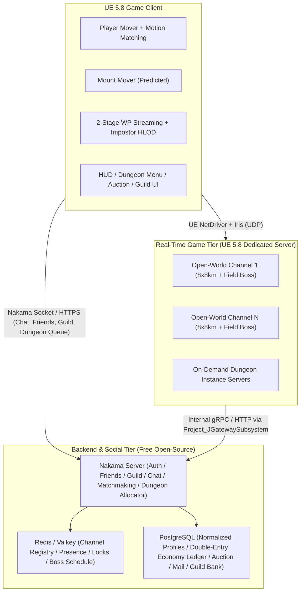
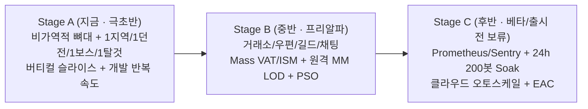

# Project J 핵심 시스템 상세 설계 청사진 (길 B 마스터 인덱스)

> 작성일: 2026-11-22 (최종 갱신: 2026-11-23 — **Phase 0~3 전체 시스템 구축 · 공통 부모 자동 결합 · 버그 8건 하드닝 · 스타터 에셋 7종 검증 완료**)\
> 전제: **길 A(Phase 0)** + **길 B(Phase 1~3 시스템 구축 · 공통 부모 자동 결합 · 엣지케이스 버그 8건 수정)** 완료 (`Project_JEditor` / `Project_J` 직접 UBT 오류 0, `WiringFinal_Run1` 101/101 + `BugHuntFinal_Run2` 62/62 전수 통과, `Validate-MMOArchitecture.py` 205개 기능 / 20도메인 / 8모듈 DAG 통과).\
> 대상: UE 5.8, AAA급 지향 MMORPG (1~2인 코어 팀 기준, **플레이어 모션 매칭+전투 / NPC 비-모션매칭 원칙** 유지).

이 디렉터리는 [2026-11-22 전면 감사 및 작업 계획](../Planning/Project_J_MMO_Hardening_And_Blueprint_2026-11-22.md)의 **길 B(Phase 1–3)** 상세 설계 청사진과 **실제 콘텐츠 제작·연결 실전 가이드** 모음이다. 모든 시스템은 현재 저장소의 **실제 8개 C++ 모듈 DAG와 기존 계약(`IRepository`, `IServicePort`, `UProject_JMoverComponent`, `UProject_JWorldStreamingComponent`, `AProject_JWorldEncounter`, `UProject_JMassRepresentationSubsystem` 등)**을 재사용·확장해 구현·배선되었다.

---

## 1. 문서 구성 (실전 가이드 + 청사진 6종)

| 문서 | 핵심 범위 | 해결하는 주요 과제 |
|---|---|---|
| **[★ 콘텐츠 제작 & 시스템 연결 실전 가이드](Content_Authoring_Integration_Guide.md)** | **실제 콘텐츠 제작 시 꽂는 방법 체크리스트** | 탈것·몬스터/거대 보스·던전·스킬·8×8km 월드/나무·UI/사운드 제작 시 정확한 부모 클래스·컴포넌트·소켓·DataAsset·주의사항 정리 |
| [BP01 — 백엔드 · 영속성 · Dedicated Server · 던전/필드 보스 · 경제/소셜](BP01_Backend_Persistence_Dungeon_FieldBoss.md) | `Project_JServer` 스트리핑(`A08`), `Nakama + PostgreSQL + Redis`, 채널 오픈월드(UTC 필드 보스) + 온디맨드 던전(입구/UI), 복식부기 경제·거래소·우편, 길드·친구·채팅 | 64KiB SQLite 한계 해소, 무료 오픈소스 확장 백엔드, 서버 메모리 절감, Dupe 차단, 던전 입·출구 왕복 및 필드 보스 기여도 루팅 |
| [BP02 — 8×8km 고속 이동 스트리밍 · 원거리 식생 · 렌더링/VSM/PSO/Substrate](BP02_OpenWorld_HighSpeedStreaming_Foliage_Rendering.md) | 3-Tier World Partition, 2단계(`Loaded`+`Activated`) 고속 예측 스트리밍, `FastGeo`, 82,758그루 **Instanced HLOD + Octahedral Impostor**, Landscape RVT, VSM·RT·PSO·Substrate | 고속 탈것/비행 시 팝인 제거, 원거리 나무/숲 가시성 확보, 91GB Embree HLOD OOM 근본 해결, 셰이더 스터터 제거 |
| [BP03 — 탈것(지상·비행) Mover 통합 아키텍처](BP03_Mount_Mover_Unification.md) | `UProject_JMountMoverComponent`, `GroundMountMode` / `FlyingMountMode`, 예측 이착륙 레이어드 무브, 라이더 부착·하차·Iris 일원화 | 플레이어(`Mover`) ↔ 탈것(`CMC`) 이원화 해소, 네트워크 고무줄·예측 오차·하차 상태 꼬임 근본 해결 |
| [BP04 — 전투(A09) · 모션 매칭 연계 · 군중 LOD & Mass(A03)](BP04_Combat_MotionMatching_CrowdLOD_A03_A09.md) | 모션 매칭+Motion Warping, 원격 PoseSearch DB/Graph LOD, 범용 판정(AoE/투사체/다단/보스 다부위 SSR), CC/DR, Mass↔Actor 3-Tier + VAT/ISM, 이펙트 군중 예산 | 대형 보스 다부위 판정, 원격 모션 매칭 CPU 방어, 200+ 군중 프레임 유지(NPC 비-MM 유지) |
| [BP05 — PvE · AI(StateTree) · 어그로 · 루팅 · 사망/부활 · 성장 · 퀘스트 · 생활](BP05_PvE_AI_Progression_Quest_LifeSkills.md) | `StateTree` 일반/보스 페이즈 AI, 리싱/이베이드, 히스테리시스 어그로, `State_Dead` 사망/부활, 개인·기여도 루팅, 레벨/장비 성장, 체인/반복 퀘스트, 채집/제작 | 실제 사냥·파밍·성장·보스 공략·생활의 완결된 MMORPG 코어 게임플레이 루프 구축 |
| [BP06 — 운영 · 관측성 · 안티치트 · 오디오 · 에디터/CI · 로컬라이제이션/접근성](BP06_Operations_Observability_AntiCheat_Audio_QA.md) | 이동/전투/경제 안티치트, Batch 106 메모리 귀속(`-llm`/Census), Prometheus/Sentry/`DemoNetDriver`, 100~300 봇 부하·24h Soak, MetaSounds 예산, CI 밸리데이터 | 라이브 운영 장애·핵·메모리 누수·오디오 폭주·에셋 회귀 등 사각지대 사전 차단 |

---

## 2. 전역 아키텍처 불변식 (모든 청사진 공통 규칙)

1. **8-모듈 DAG 엄수 (순환 의존 금지)**:
   - `Project_JCore`, `Project_JMMO` → 리프(외부 게임 모듈 의존 0, `Project_JMMO`는 UObject/JSON/HTTP 의존 0)
   - `Project_JGAS` → `Project_JCore`
   - `Project_JMount` → `Project_JCore`, `Project_JGAS`
   - `Project_JCharacter` → `Project_JCore`, `Project_JGAS`, `Project_JMount`
   - `Project_JAnimationNodes` → `Project_JCharacter`
   - `Project_J` → `Project_JCore`, `Project_JMMO`, `Project_JGAS`, `Project_JMount`, `Project_JCharacter`, `Project_JAnimationNodes`
   - `Project_JCharacterEditor` → Editor 전용 타깃에만 포함 (`Project_JServer` / `Project_J` 런타임 빌드 유입 금지)
2. **단일 권위(Single Authority) 및 클라이언트 불신**:
   - 모든 재화·아이템·경험치·퀘스트·피해·위치·던전 입장·루팅의 최종 진실은 Dedicated Server 또는 PostgreSQL/Nakama 백엔드에만 존재한다.
   - 클라이언트는 의도(Intent)와 예측(Prediction)만 전송하며, 모든 쓰기 요청은 `IdempotencyKey` + `ExpectedRevision`(낙관적 잠금) + `FServerSessionLease`(세션 펜스)를 통과해야 한다.
3. **NPC 비-모션매칭 정책 영구 유지**:
   - 플레이어 캐릭터만 Chooser/PoseSearch 모션 매칭 + 전투 연계를 사용한다.
   - NPC/몬스터/보스/탈것은 비-모션매칭 AnimGraph + 거리별 LOD + Mass/ISM/VAT 계층으로 최적화한다.
4. **1~2인 팀 운영 가능성 (Low Ops Overhead)**:
   - 모든 백엔드(Nakama, PostgreSQL, Redis)는 로컬 단일 `docker compose up`으로 기동 가능해야 하며, 동일 컨테이너 이미지로 클라우드 배포가 가능해야 한다.
   - 코드 하드코딩 대신 DataAsset / DataTable / StateTree / CurveTable 기반으로 콘텐츠를 확장한다.

---

## 3. 전체 아키텍처 토폴로지 개요

---

## 4. 극초반 개발 단계에 맞춘 재편 로드맵 (Early-Stage Re-Prioritized)

> **2026-11-23 계획 조정 원칙:** 현재 프로젝트는 **극초반 단계**이며 라이브 운영까지는 매우 긴 시간이 남아 있다. 따라서 라이브 운영 인프라(Prometheus/Grafana/Sentry, 24시간 200봇 Soak, EAC, 클라우드 오토스케일링 등)를 지금 당장 구축하는 **과잉 엔지니어링을 배제**하고, **"지금 잡아두지 않으면 콘텐츠가 쌓인 뒤 갈아엎어야 하는 비가역적 아키텍처"**와 **"1~2인 팀의 개발 반복 속도(Iteration Velocity)"**를 최우선으로 재배치한다.

### 4.1 3-구간 우선순위 분류 (지금 할 것 vs 나중 vs 운영 직전 보류)

| 구간 | 시점 | 목표 | 포함 범위 |
|---|---|---|---|
| **Stage A: 지금 반드시 잡아야 할 핵심 구조 + 플레이어블 버티컬 슬라이스** | **현재 (극초반)** | "나중에 고치면 10배 비싼 뼈대"를 먼저 고정하고, **오픈월드 1지역 + 거대 필드 보스 1종 + 던전 1개 + 탈것 1종 + 전투 1직업**이 멀티플레이로 돌아가는 실전 코어 완성 | 1) **3-Mode 개발 반복 체계 & GM/디버그 도구** (PIE 1초 반복 유지) 2) **`Project_JServer` 컴파일 위생 + 최소 스트리핑** (`BP01`) 3) **로컬 Docker `Nakama+PG+Valkey` 최소 스키마 & 자동 마이그레이션/시드** (`BP01`) 4) **8×8km 3-Tier WP + 2단계 고속 스트리밍 + 수목 Impostor HLOD 규율** (`BP02`) 5) **탈것 `Mover` 통합 — 지상→비행** (`BP03`) 6) **범용 전투 `A09`(AoE/풀링 투사체/보스 다부위 SSR) + Motion Warping + 동적 카메라** (`BP04`) 7) **최소 코어 PvE(`StateTree` AI·어그로·사망/부활·기여도 루팅) + 던전 입구/UI 왕복** (`BP01`/`BP05`) 8) **콘텐츠 제작 가드레일(경량 CI 밸리데이터, `StringTable`/`LOCTEXT`, `SoundConcurrency`, `CommonUI` 입력 스택, `CurveTable` 밸런스)** (`BP06`) |
| **Stage B: MMO 생태계 & 대규모 군중 확장** | **중반 (사내/지인 프리알파 플레이테스트)** | 코어 루프가 재미있고 안정화된 뒤 MMO 사회/경제/대규모 군중 기능을 확장 | 1) **복식부기 경제: 거래소 · 1:1 개인거래 · 우편** (`BP01`) 2) **영속 소셜: 길드 · 길드창고 · 친구 · 차단 · 채팅** (`BP01`) 3) **성장/장비 강화/세트 · 체인·반복 퀘스트 · 채집/제작 확장** (`BP05`) 4) **Mass 3-Tier(Actor 풀링 + VAT/ISM) + 원격 MM DB LOD + Bundled PSO** (`BP02`/`BP04`) |
| **Stage C: 라이브 운영 · 대규모 부하 · 프로덕션 보안 (명시적 보류)** | **후반 (클로즈 베타 / 출시 직전)** | 지금 만들면 유지보수 부담만 큰 운영 인프라를 출시 전 단계로 명확히 이관 | 1) **Prometheus/Grafana/Sentry 알림 + `DemoNetDriver` 자동 덤프** (`BP06`) 2) **200봇 24시간 Soak & 클라우드 Agones/오토스케일링** (`BP01`/`BP06`) 3) **EAC 통합 · DDoS/매크로 행동 분석 · 최종 Substrate GPU 튜닝** (`BP02`/`BP06`) |

### 4.2 극초반에 특히 놓치기 쉬운 6대 핵심 구조 보강 (Stage A 내장)

1. **3-Mode 개발 반복 속도 체계 (가장 중요)**:
   - 매번 Docker/Dedicated Server를 띄워야 전투나 애니메이션을 확인하는 구조가 되면 1~2인 개발 속도가 급락한다.
   - **Mode 0 (PIE Standalone + 인메모리/SQLite Mock)**: 전투·모션매칭·AI·탈것·카메라 1초 반복.
   - **Mode 1 (PIE Dedicated Server + 로컬 Docker Nakama/PG)**: 멀티플레이 SSR·던전 왕복·영속 저장 검증.
   - **Mode 2 (독립 `Project_JServer` + Docker Compose)**: 마일스톤 통합·메모리(`-llm`) 점검.
2. **GM / 개발자 디버그 콘솔 (`UProject_JCheatManager` + 경량 디버그 메뉴)**:
   - 개발 빌드 전용(`#if !UE_BUILD_SHIPPING`): 즉시 텔레포트, 비행 속도 배율, 필드 보스 즉시 스폰/페이즈 점프, 던전 직행, 아이템/골드/XP 지급, 무적/즉사, 인공 지연(100ms/5% 손실) 토글. 모든 기능 검증 시간을 1/10로 단축.
3. **동적 액션 카메라 시스템 (`UProject_JCameraPolicyComponent`)**:
   - 모션 매칭 액션 전투 + 거대 필드 보스 + 고속 비행 탈것 조합에서는 카메라가 체감 품질의 절반이다.
   - 상태별 카메라 프로파일(`OnFoot`, `CombatSoftLock`, `GiantBossZoomOut`, `GroundMount`, `FlyingMountDiveFOV`)을 DataAsset으로 분리해 SpringArm 길이·FOV·오프셋·충돌 보간을 부드럽게 전환.
4. **초기 DB 스키마 진화(Migration) & 초기화 자동화**:
   - 극초반에는 캐릭터/아이템/퀘스트 스키마가 매주 바뀐다. SQL 마이그레이션 번호 파일(`Infra/migrations/001_*.sql`) + 원클릭 `dev-reset` + 테스트 시드 스크립트를 처음부터 두어 스키마 수정 부담을 0으로 유지.
5. **최소 UI 프레임워크 & 데이터 밸런스 규율**:
   - 예쁜 아트 UI를 먼저 만들지 않되, **와이어프레임 단계부터 `CommonUI`(모달 스택·ESC 닫기·게임패드/마우스 자동 전환) + `LOCTEXT`/`StringTable` + `CurveTable`/`DataTable` 수치 외부화**를 고정해 추후 UI·밸런스 전면 재작업을 방지.
6. **월드/에셋 제작 규율 & OFPA/Git LFS 가드레일**:
   - 8×8km 월드에 에셋을 본격 배치하기 전에 3-Tier WP 그리드(`Grid_Macro/Main/Detail`), 수목 `HLODLayer_Foliage_Impostor` + WPO 거리 컷, NPC 비-MM 규칙, OFPA(One File Per Actor) 및 Git LFS 정책을 경량 에디터 밸리데이터로 자동 강제.

### 단계별 완료 게이트
- **Stage A 게이트 (극초반 완료선)**: `Project_JServer` 빌드 오류 0 + Mode 0/1 무마찰 전환, Docker Nakama+PG 1회 로그인/저장/재접속 성공, 3,000 cm/s Mover 탈것으로 8×8km 주행 시 팝인·추락 0 & 2km 숲 Impostor 가시, 오픈월드 입구/UI 양쪽 경로로 던전 1종 클리어→복귀 & 필드 보스 1종 처치→기여도 루팅 완료.
- **Stage B 게이트 (프리알파 완료선)**: 거래소/개인거래/우편 동시성 경합(Dupe) 0건, 영속 길드/친구/채팅 연동, 200인 혼합 씬 서버 30Hz 유지 & 클라이언트 60fps 목표선 확인.
- **Stage C 게이트 (출시 전 보류)**: 200봇 24시간 Soak 메모리 누수 0, 관측성/알림·EAC·클라우드 오토스케일링 검증.
