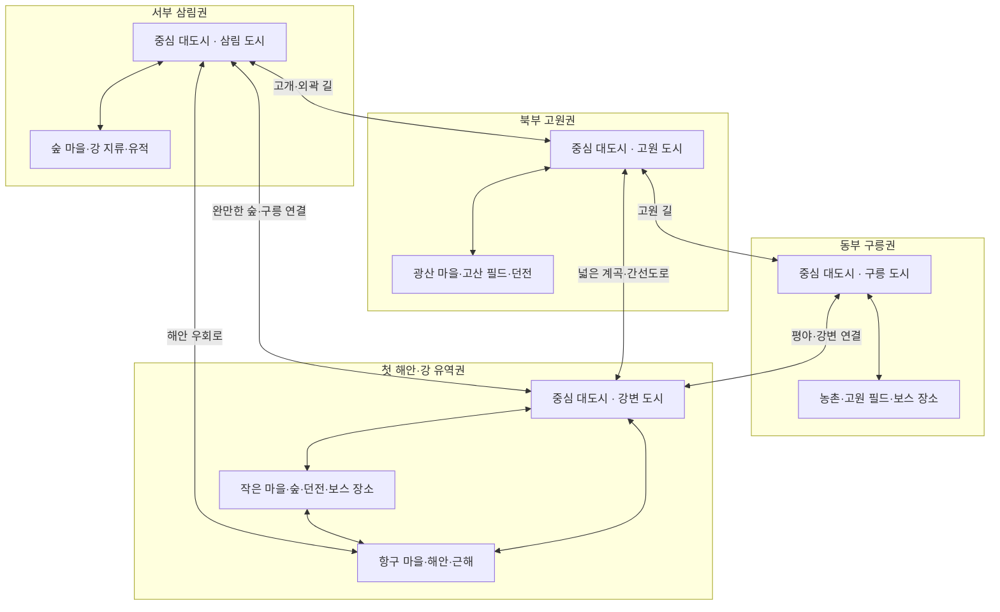
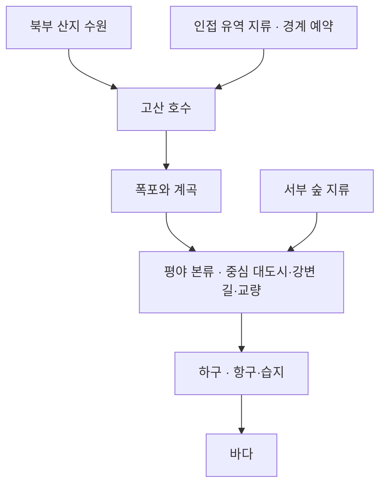
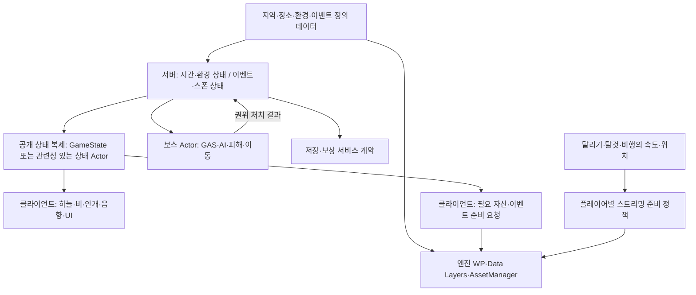

# 오픈 월드 레벨 설계와 확장 계획

> 2026-10-17 후속 요청: 기존 A 지역 결과물은 사용자가 폐기를 허용했으며, 새 제작은 [v3 시작 권역 제작](../../World/README.md)을 따른다. 아래의 A 배치·에셋·성능·성공/실패 기록은 이전 결과의 이력이다. 새 월드의 실제 생성·원경·아트·서버 검증 완료를 의미하지 않는다. 기존 공통 런타임 기반과 원본 공급자 자산은 선별 재사용한다.

기준일: 2026-10-16. 바다·강·마을·숲·길·산·던전·필드 보스가 이어지고 지상 탈것과 야외 자유 비행으로 탐험하는 MMORPG 월드를 계획한다. **A 지역은 중앙 대도시와 주변 작은 마을을 배치한다. 후속 지역의 도시·마을은 지형·문화·자원·이동에 맞춰 유기적으로 구성하며 중앙 대도시 배치를 강제하지 않는다.** 첫 제작 영역은 해안과 근해를 포함한 **약 8 × 8km**를 제안하며, 첫 해안권과 인접 권역을 연결하는 지리와 이동망을 함께 설계한다.

이 문서는 설계·검증 계획이다. 실제 월드 에셋 생성, 라이브 서버 연결, 성능 달성을 뜻하지 않는다. 엔진 설명과 개발 사례의 원문·적용 한계는 [조사 자료 모음](Open_World_Research_References.md)에 보관한다. 현재 런타임 계약은 [프로젝트 맥락](../../Overview/ProjectContext.md), [탈것 구조](../Architecture/MountSystemArchitecture.md), 성능 판단은 [기존 성능 문서](../../Performance/README.md)를 따른다.

## 1. 요구와 설계 제안

| 구분 | 기준 |
| --- | --- |
| 사용자 요구 | 넓은 연속 월드, A의 중앙 대도시와 여러 작은 마을·필드·던전, 후속 지역은 배경에 맞는 도시·마을의 유기적 배치, 다른 지역 탐험, 지상 탈것, 야외 상시 비행, 바다·강·숲·건물·길·산·필드 보스 |
| 표현 목표 | 고속 이동에서 눈에 띄는 식생 팝인 억제, 높은 곳에서 먼 지역 조망, 지상·계곡·지하의 높이 차이 |
| 첫 지역 제안 | 해안·근해 포함 약 8 × 8km의 초기 제작 영역. 강 유역의 중심 대도시·항구 마을·주변 산·숲·유적을 배치하고 도시 규모에 따라 권역 범위 재산정 |
| 제작 우선순위 | 전체 큰 지형·물길·대도시의 큰 배치·주요 연결을 먼저 잡고 항구–평야–강변의 약 2 × 3km 대표 구간부터 세부 콘텐츠 제작 |
| 선택형 제안 | SkyTown 부유섬을 활용한 공중 유적. 사용 여부·개수는 미확정 |
| 미확정 값 | 목표 PC·VRAM·해상도·FPS, 최고 이동속도·가속·선회, 비행 높이 정책, 보스 참여 인원, 수영·항해·수중 전투 범위 |

8 × 8km는 첫 제작 범위다. 최종 월드 경계, 단일 Landscape의 규격, 서버 담당 구역 크기로 고정하지 않는다. 초기 대화의 2 × 2km는 작은 검증 지역 제안이었고, 이후 사용자의 넓은 첫 지역·상시 비행 요구에 따라 위 가안으로 발전했다. 약 2 × 3km는 세부 제작 우선순위이며 나머지 지형을 이동 불가능하게 만드는 경계가 아니다.

검은사막은 연속된 생활·전투 공간, 붉은사막은 넓은 조망과 자연스러운 환경 표현의 경험 참고다. 공개된 기능 소개만으로 두 게임의 내부 구조나 Project J에서 같은 성능을 얻는다고 단정하지 않는다.

## 2. 다른 지역으로 확장하는 월드 구조

큰 대표 지역을 **권역**이라고 부른다. A는 중앙 대도시와 주변 항구·농촌·숲·광산 마을을 연결한다. B 이후에는 해안 가장자리의 항구도시, 강을 따라 이어진 여러 마을, 분산된 고원 거점처럼 배경에 맞는 정주 구조를 설계할 수 있다. 중앙 도시나 동일한 방사형 동선을 공통 규칙으로 두지 않는다. 권역과 도시의 이름·개수·면적은 미확정이며 아래 네 권역은 연결 관계를 설명했던 가안이다.

### 전체 월드와 A 지역 내부의 구분

현재 만드는 초반부 권역을 **A 지역**, 나중에 확장하는 다른 권역을 **B 지역**으로 부른다. A·B는 공간 위계를 설명하는 작업명이며 실제 지명이나 서버 구역 이름이 아니다.

| 공간 위계 | 구성 |
| --- | --- |
| 전체 월드 | A 지역·B 지역·추가 지역들이 육로·비행·수계·해안을 통해 이어지는 공간 |
| A 지역 내부 | 중앙 강변 평야의 대표 대도시, 주변의 항구·농촌·숲·광산 마을, 필드·던전·보스·산·강 |
| B 지역 내부 | B의 환경·문화·자원에 맞는 도시·여러 작은 마을, B 고유의 필드·던전·보스와 이동망. 도시 위치·개수·중앙성은 별도 설계 |

네 대도시가 함께 보이는 권역 배치도는 전체 월드 일부의 연결 개념이다. 이를 A 지역 하나의 상세 배치도로 사용하지 않는다. A 상세도에서는 중앙 대도시와 주변 작은 마을의 분포를 먼저 읽을 수 있게 해야 한다. B를 만들 때는 배경에 맞는 도시·마을의 역할과 지형 관계를 다시 설계하고 A의 배치를 그대로 복제하지 않는다.

첫 지역은 강 유역과 해안에 걸친 A 권역의 제작 시작점이다. A의 대표 대도시는 **지역 중앙부의 강변 평야·합류부 인근**에 두는 안을 우선 검토하고, 항구 마을은 하류의 별도 거점으로 유지한다. 중심 도시는 서비스·교류·정비의 목적지이며 모든 여행이 반드시 통과해야 하는 검문 지점으로 만들지 않는다. 새 도시·마을을 추가할 때 기존 거점을 떠날 이유와 돌아올 이유를 함께 정한다.

중앙부는 A 안에서 여러 방향의 이동과 접근성이 좋은 위치라는 뜻이며 지도 정중앙의 정확한 좌표를 강제하지 않는다. 전체 월드 중앙에 별도의 추가 대도시를 둘지는 다른 결정이다.

### 작은 마을의 분포와 역할

작은 마을은 각 지역에 여러 곳 둔다. A에서는 하류 항구·강변 농촌·숲 마을·산기슭 광산 마을을 역할 후보로 잡고, 필요하면 길목의 작은 취락·야영지를 더한다. 개수와 간격은 이동 시간·콘텐츠 밀도·실제 제작 범위를 보고 정한다.

- 각 마을은 주변 자원·생활·전투·이동 중 실제 이용 목적을 갖도록 설계한다.
- 중앙 대도시 주변의 주요 방향과 강변·해안·숲·산기슭에 나누어 두고 도로·우회로로 왕복할 수 있게 한다.
- 대도시의 서비스를 모두 복제하지 않고 역할을 나누되, 소규모 거점에서도 해당 여행에 필요한 기능을 검토한다.
- 마을 사이에는 농지·숲·계곡·사냥터·휴식 구간·발견 장소를 두어 공간이 계속 시가지로만 이어지지 않게 한다.

다음은 지명과 콘텐츠가 미정인 **도시 간 연결 관계**다. 실제 지리나 지역 구현 완료를 뜻하지 않는다. 도로·고개·항로는 이해하기 쉬운 대표 동선이며 야외 비행을 그 통로에 제한하지 않는다.

[위에서 본 권역·도시 배치도](Assets/World_Regions_Overview.html)와 아래 연결도는 산지를 일부 구간에 두고 평야·넓은 계곡·도로·강으로 거점을 연결했던 **이전 광역 가안**이다. 모든 후속 지역에 중앙 대도시를 배치하는 규칙으로 사용하지 않는다. 네 권역 전체가 8 × 8km라는 뜻은 아니며, 첫 해안권의 초기 제작 영역만 약 8 × 8km 가안이다. A의 현재 상세 제안은 4절을 따른다.




### 산과 도시 간 통과 지형

초기 배치도의 북쪽을 가득 채운 산 띠는 현재의 경계 설계로 채택하지 않는다. 산맥·높은 봉우리는 일부 구간의 랜드마크·탐험 장소·수원으로 두고, 주변 평야·구릉·넓은 계곡이 다른 권역까지 이어지도록 조정한다.

- 도시에서 다른 도시로 가는 지상 대표 경로는 넓은 계곡·완만한 구릉·강변 등에 둔다. 높은 고개·좁은 협곡만 남기지 않는다.
- 각 중심 대도시는 복수의 야외 접근 방향을 검토한다. 간선도로와 외곽 우회·보조 경로를 구분하고 한 성문·다리·고개가 모든 왕복을 독점하지 않도록 시험한다.
- 외곽의 길과 지형이 다음 지역까지 실제로 이어질 접속 폭·높이·공간을 남긴다. 그림에 화살표만 추가한 상태를 연결 완료로 보지 않는다.
- 권역 사이에는 식생·고도·건축 양식이 점진적으로 바뀌는 전이 지형을 설계한다. 모든 경계를 산벽으로 둘러싸지 않는다.
- 비행은 산·평야·계곡·도시를 자유롭게 연결한다. 지상 통행을 막아도 비행으로 갈 수 있다는 이유로 지상 연결을 생략하지 않는다.

이렇게 하면 산은 여행의 높이 차이와 방향감을 만들고, 권역은 여러 접근을 가진 큰 생활권으로 연결된다. 높은 곳에서 다음 권역의 도시·지형이 보일 때는 실제 접근 가능한 위치와 원경 표현의 관계를 함께 검증한다.

### 확장을 위해 먼저 정할 계약

| 경계 | 처음 남길 정보 | 다음 지역 추가 시 확인 |
| --- | --- | --- |
| 공간 기준 | 월드 좌표·해수면·방향, 지역의 대략적 범위와 고도, 지형 규격 | 기존 랜드마크·스폰·저장 위치를 임의로 옮기지 않고 접속 가능한가 |
| 육로 | 도시 간 연결 방향·높이·경사, 넓은 통과 지형, 길 폭과 교량 규격, 간선·우회 갈림길 | 다른 권역의 대도시까지 지상 탈것의 회전·교행·왕복이 가능하고 한 관문에 모든 경로가 몰리지 않는가 |
| 강 | 상류·하류·합류 관계, 접속 단면의 수면 높이·하상·폭·깊이·흐름 방향 | 경계의 수면·바닥·충돌·재질·흐름에 이음새가 없는가 |
| 해안 | 수면 기준, 해안 재질·수심 전이, 항구의 접근 방향 | 바다·강 하구·다음 해안 지역의 표현이 연결되는가 |
| 비행 | 외곽에서 보이는 실제 지형·원경, 접근·착륙 공간, 고속 진입 | 어느 방향에서 와도 지형·충돌이 준비되고 목적지를 식별할 수 있는가 |
| 콘텐츠 상태 | 장소·스폰·보상·퀘스트의 정체성과 상태 소유자 | 이름·배치 변경이나 셀 재로딩으로 처치·보상·진행이 중복되지 않는가 |
| 서버 경계 | 담당 서버·권한·재접속·탈것과 플레이어의 이동 관계 | 실제 서버 이양이 필요한 경우 기존 handover 계약과 복구가 작동하는가 |

지역 정체성을 부여할 때는 기존 MMO 식별자·저장 계약을 먼저 확인한다. 이 계획만을 근거로 새 Region manager나 중복 저장 시스템을 만들지 않는다.

### 제작 지역과 스트리밍과 서버의 역할

- **제작 지역:** 지형·마을·콘텐츠를 계획하고 편집하는 생활권이다.
- **World Partition 셀:** 엔진이 필요한 데이터를 로딩·언로딩하는 단위다. 제작 지역 하나에 여러 셀이 들어간다.
- **서버 담당 구역:** 게임플레이 상태의 권한과 부하를 담당하는 네트워크 경계다. 셀이나 마을 경계와 일치해야 할 이유는 없다.

인접한 야외 지역은 같은 UWorld의 연속 공간으로 저작하는 방향을 우선 검증한다. 파티별 던전·분리된 대륙 등을 별도 월드로 운영할지는 입장 경험과 서버 요구에 따라 정한다. Level Instance는 저작·재사용 기능이며 파티별 던전 격리나 서버 분산을 자동 제공하지 않는다.

World Partition을 사용해도 기존 Landscape를 임의의 방향으로 무제한 확대할 수 있는 것은 아니다. 지형의 정점 간격·컴포넌트·접속 높이·추가 지형 제작 방식을 먼저 검증하고 전체 대륙의 큰 지리 관계를 정한다. 미래 지역을 모두 고해상도로 미리 생성하지 않는다. [엔진 자료 T01·T02·T05](Open_World_Research_References.md#unreal-engine).

현재 Project J의 handover는 계약·상태 머신 등의 확장 기반이며 실제 server meshing 완료가 아니다. [기존 보류 범위](../../Architecture/Planning/DeferredMMORPGSystems.md)를 유지한다.

## 3. 레벨 디자인 지식을 적용하는 기준

아래 적용안은 연구 자료를 바탕으로 한 Project J 설계 제안이다. 다른 게임의 배치 간격·기술 데모 수치를 그대로 품질 기준으로 사용하지 않는다. 출처는 [설계 자료 D01–D10](Open_World_Research_References.md#레벨-디자인)에서 찾는다.

| 개념 | 자료에서 확인한 내용 | Project J 적용과 확인 |
| --- | --- | --- |
| 경험 목표 | 이동·행동·느낌과 핵심 메커니즘을 먼저 정한다. D01 | 항구에서 산 위 유적을 발견하고, 도보·탈것·비행 중 방법을 골라 도달하는 경험을 검증 |
| 배치와 동선 | 공간 간 이동 관계를 그리고 실제 이동 느낌을 시험한다. D02·D04 | 순환도로·지름길·갈림길·귀환을 연결하고 반대 방향에서도 플레이 |
| 플레이어 치수 | 실제 이동·충돌 수치와 제작용 권장 치수를 구분한다. D05 | 탑승 중 폭·회전·경사, 비행 착륙 면적, 공격·구르기 공간을 플레이어로 측정 |
| 길 찾기 | 플레이어가 위치와 목적지 관계를 이해할 수 있게 돕는다. D06 | 강·산봉우리·항구 등대·유적 실루엣을 지상과 상공에서 식별할 수 있게 배치 |
| 블록아웃 | 단순한 3D 형태로 구조를 시험한 뒤 세부 아트를 올린다. D03 | 높은 봉우리·교량·강 바닥·마을 덩어리·던전 단면부터 이동 검증 |
| 플레이테스트 | 설계 목표를 실제 플레이로 확인하고 수정한다. D07 | 길 찾기 실패·착륙 실패·빈 이동 구간·돌아오는 길의 지루함을 기록 |
| 이동 방식과 자연 지형 | Riders Republic 개발진은 지형과 이동 메커니즘을 함께 조정하고 여러 진입을 고려했다. D09 | 계곡 저공 비행·고개·강변 주행·고산 하강을 하나의 지형에서 비교 |
| 수작업 장소와 절차 배치 | Assassin's Creed Origins 개발 설명은 절차적 월드와 수작업 장소의 조합을 소개한다. D10 | 마을·보스 전장·주요 발견 장소는 직접 설계하고 반복 식생·장식에 절차 도구 활용 |

### 자유 비행에 맞춘 탐험과 장소

1. 길에서 보이는 정면만 꾸미지 않는다. 상공·뒤편·지붕·절벽 위 접근에서 공간의 의미와 경계를 확인한다.
2. 높은 곳에서는 큰 지형과 다음 목적지가 읽히고, 착륙 후에는 진입로·상점·동굴 입구처럼 작은 단서가 읽히게 한다.
3. 지상 동선은 강변 경관·채집·교량·상호작용 같은 여행 경험을 제공한다. 지상 이용을 강제하기 위한 임시 비행 금지는 이 계획에 포함하지 않는다.
4. 모든 장소를 균일한 간격으로 채우지 않는다. 이동·발견·전투·휴식의 밀도를 달리하고 가장 빠른 이동에서도 의미가 유지되는지 확인한다.
5. 공중에서 위험 지형을 우회하거나 보스에게 접근하는 행동을 정상 입력으로 시험한다. 보스의 공격 도달·추격·복귀·보상 참여 조건은 게임플레이 규칙으로 명시한다.
6. 야외 비행과 동굴의 물리적 공간을 구분한다. 실내 높이·입구 폭·탈것 크기를 시험하고 실내 탑승 정책은 별도로 결정한다.

가령 강을 건넌 뒤 보스 분지에 도착했다가 유적 지붕으로 비행하고 다른 강변 길로 귀환하는 활동을 작은 플레이테스트로 만든다. 지형 장식 수보다 목적지 선택·접근·귀환의 경험을 평가한다.

## 4. 첫 지역 배치와 높이

### 현재 A 지역 상세 가안


[A 지역 배치도 표시본](Assets/A_Region_Top_View.html) · [편집 원본](Assets/a-region-top-view.fragment.html)

A만 확대한 위에서 본 개념도다. 대도시는 중앙 강변의 넓은 평야·하안단구에 두고 북쪽 호숫가, 북동쪽 광산, 서쪽 숲, 남동쪽 농촌, 남서쪽 어촌, 남쪽 항구로 역할을 나눈다. 주요 길은 도시와 연결하고 외곽 우회로는 도시를 거치지 않는 마을 간 이동을 제공한다. 산은 북동부와 일부 능선에 두고 북·서·동쪽의 넓은 계곡·평야 접속을 남긴다. 야외 비행은 표시한 도로에 제한하지 않는다.

| 장소 | 해수면 기준 고도 가안 | 지형·동선 역할 |
| --- | --- | --- |
| 중앙 대도시 | +160m | 강변 평야의 주요 서비스·교류, 여러 방향 접근 |
| 호숫가 마을 | +440m | 상류 여행·호수·북쪽 계곡 |
| 광산 마을 / 광산 던전 | +680m / +720m | 산기슭 생활·채광·고산 접근 |
| 숲 마을 | +260m | 삼림 채집·서쪽 지역 연결 |
| 농촌 마을 | +90m | 하류 농지·강변 길·동쪽 평야 연결 |
| 어촌 / 항구 마을 | +20m / +15m | 해안 생활·항로·근해 탐험 |
| 고산 전망대 / 폭포 계곡 | +1,150m / +300m 전후 | 조망·고속 하강・상하 지형 변화 |
| 고대 유적 / 지하 던전 바닥 | +520m / +240m | 높은 유적 입구에서 내려가는 동굴, 폭포 쪽 두 번째 출구 |
| 필드 보스 | +120m | 마을 밖 전투 장소·지상 접근·공중 착륙 |

지명·고도·정확한 거리와 면적은 블록아웃에서 검증할 가정이다. 도로 경사·회전·교량과 수계의 연속성을 실제 탈것으로 확인한다. 후속 지역은 A의 중앙 도시·마을 배치를 복제하지 않는다.

### 초기 V1 보존 자료

[초기 배치도와 개념 단면](Assets/First_Region_Concept.html) 및 아래 그림·고도 표는 **초기 V1 보존 자료**다. 현재 기준은 위 A 상세 가안과 2절의 유기적 권역 연결이며, V1의 북쪽 산 띠와 항구 중심 배치를 그대로 구현하지 않는다. 그림은 실제 측량·지형 에셋·거리 비례 지도가 아니다.


A 지역의 중심 대도시를 중앙 강변 평야에 배치하고 주요 도로가 여러 방향의 작은 마을과 후속 지역으로 이어지도록 큰 배치를 다시 잡는다. 하류 항구 마을은 중심 대도시와 구분한다. 시작 지점은 항구나 작은 마을에 둘 수 있으며, 첫 도시의 정확한 위치·면적·고도와 시작 순서는 미확정이다.

| 현재 설계의 장소 위계 | 역할 |
| --- | --- |
| A의 중앙 대도시 한 곳 | 주요 서비스·상업·정비·교류와 도시 간 여행의 목적지 |
| 작은 마을 여러 곳 | 항구·농업·광산 등 주변 필드와 연결되는 지역 역할 |
| 전초기지·야영지 | 여행 중 휴식·재정비·주변 활동의 거점 |
| 필드·던전·보스 장소 | 도시 밖 전투·탐험·자원 활동의 목적지 |

다음 고도 표는 V1 수치이며 새 중심 대도시의 확정 배치표가 아니다.

| 장소 | 고도 가안 | 역할과 연결 |
| --- | --- | --- |
| 항구 마을 | 해수면 +25m | 귀환·정비·부두·넓은 착륙 공간. 다른 연안 항구로 확장 |
| 중앙 평야 | +120m | 지상 탈것 주 동선·첫 사냥터·강변 거점 |
| 서부 숲 | +240m | 숲길·채집·선택 탐험. 서부 마을로 연결 |
| 호수와 폭포 | +460m | 상류·하류를 잇는 시각 기준점·교량·야영지 |
| 북부 고산 | +1,150m | 전 지역 조망·고갯길·고속 하강. 북부 지역 연결 |
| 동부 유적 | +620m | 테라스·던전 입구·공중 접근. 동부 고원으로 연결 |
| 보스 분지 | +240m | 지상 진입·공중 착지·외곽 회복 거점 |
| 공중 유적 | +1,450m | 선택형 비행 탐험 장소 |
| 지하 던전 | -80m | 유적 아래 공간·지하 수로·별도 출구 |

고도는 해수면 0m 기준의 설계 가정이다. +2,000m는 초기 비행 검증 고도 제안이며 비행 제한 높이가 아니다. -80m 던전은 해수면 아래이므로 침수·물막이와 지하수 표현이 필요한지 검토하고, 호숫가 출구까지는 상승하는 통로를 설계한다. 단면 그림의 투영만으로 수문 구조가 성립했다고 보지 않는다.

지형은 Landscape와 절벽·동굴 메시를 조합하는 방향부터 검증한다. Landscape의 높이맵 제약과 Visibility Mask 연결은 [T02·T12](Open_World_Research_References.md#unreal-engine)를 참고한다. 엔진에는 3D 런타임 스트리밍 그리드가 있으므로 실제 맵의 Runtime Hash를 확인하고 상하 공간을 분리할 수 있는지 시험한다. 거대한 동굴·교량을 한 액터로 묶어 의도보다 많은 공간이 함께 로딩되는지도 확인한다.

## 5. 강과 지류와 하구

**강은 첫 제작 범위의 필수 구성요소다.** 북부 산지의 수원과 인접 지역에서 들어오는 지류가 호수에 모이고, 폭포·계곡을 거쳐 중앙 평야의 중심 대도시 주변과 하류 항구 하구로 흐르는 본류를 둔다. 도시는 강·교량과 연결하되 외곽 우회로도 검토한다. 위치와 길이는 지형 블록아웃에서 조정한다.



| 구간 | 레벨 역할 | 먼저 확인할 내용 |
| --- | --- | --- |
| 산지·지류 | 수원·작은 탐험 장소·지역 연결 | 높이·흐름 방향·합류 관계 |
| 호수·유출부 | 상공 랜드마크·강변 거점 | 호수 수위와 유출 지형의 연결 |
| 폭포·협곡 | Z축 경관·저공 통과·동굴 접근 | 낙하 충돌, 수면 전이, 물보라·소리 비용 |
| 평야 본류 | 마을·농지·교량·주행 | 둑의 경사·입출수, 탈것과 AI 통행, 강바닥 |
| 하구 | 바다와 마을의 관계·항구 | 하천 수면과 바다 수면·재질·파도 전이 |

기본 지리의 참고는 [USGS 자료 D11](Open_World_Research_References.md#레벨-디자인), 엔진 저작은 [Water System과 Water Body Actors T06·T07](Open_World_Research_References.md#unreal-engine), 실제 제작 도구 사례는 [Pegasus C05](Open_World_Research_References.md#개발-사례와-샘플)를 따른다.

수면·하상·강둑·교량·식생 제외 영역은 같은 강 경로를 기준으로 맞추는 방향을 우선한다. Water Body River와 보유 `master_river_spline`의 물 표현·충돌·지형 변형 책임을 비교한 뒤 해당 구간의 기준 경로를 정한다. 동일 구간에 두 시스템이 강바닥이나 물리 상태를 동시에 쓰는 구성을 피한다.

수영·잠수·항해·해저 탐험의 게임 규칙은 수면 렌더링과 별도로 정한다. 상호작용 물결·물보라 같은 국소 효과와 먼 거리의 강 실루엣·재질은 비용을 나눠 검증한다. 큰 강 전체의 유체 시뮬레이션은 기본 요구로 추가하지 않는다.

## 6. 월드 저작과 상태 소유권

| 구성 | 사용할 기반과 확인 사항 |
| --- | --- |
| 월드 | 새 야외 월드에 World Partition을 검증. 기존 Lvl_ThirdPerson은 테스트 용도로 보존 |
| 도시·권역 | A의 중앙 대도시와 각 권역의 도시·마을·전이 지형을 저작 관계로 구분. 중앙 도시를 공통 형태로 강제하지 않으며 도시 경계와 셀·서버 경계를 자동으로 일치시키지 않음 |
| 지형 | Landscape 규격·정점 간격·컴포넌트·높이 범위와 다음 지역 접속 방식 확인 |
| 반복 건물 | Level Instance·인스턴싱으로 저작. 원본 변경이 다른 배치에 미치는 영향 확인 |
| 작업 구분 | Editor Data Layers로 환경·게임플레이 작업 구분. Runtime Data Layers는 실제 사건·상태 전환에 사용 |
| 원경 | 숲·건물·절벽의 HLOD·임포스터 등을 구분해 원본과 표현을 비교 |
| 반복 자연물 | PCG·Foliage로 배치하고 길·수면·전장 제외 규칙을 공유 |
| AI | 셀 경계 추격·복귀, 교량·경사·던전 이동을 작은 범위에서 확인 |
| 게임플레이 상태 | 보스 출현·처치·보상·진행은 기존 서버 권위·저장 소유자가 담당 |

World Partition의 거리 기반 로딩과 HLOD는 월드 데이터·표현을 다룬다. 보스의 재출현 시각·보상 자격·처치 상태가 셀 액터의 BeginPlay/EndPlay만으로 초기화되지 않도록 기존 계약과 연결한다. 클라이언트 표현의 언로드와 서버 액터·시뮬레이션의 종료를 동일하게 취급하지 않는다.

퀘스트·지역 진행은 Level Blueprint 하나에 집중시키지 않는다. 기존 공용 상호작용·데이터 자산·저장 경로를 먼저 확인한다. Data Layers의 월드 상태 전환을 플레이어별 비공개 퀘스트 격리로 일반화하지 않는다.

One File Per Actor는 공동 저작 기반이다. 월드의 다른 액터에 대한 참조가 함께 로딩될 범위를 넓힐 수 있으므로 지역 간 강한 참조와 항상 로딩되는 배치를 실제 생성 결과로 확인한다. 모든 관리 객체를 항상 로딩하는 새 전역 시스템은 먼저 만들지 않는다.

## 7. 팝인 원인과 대응

목표는 **정한 최고 속도·목표 사양·이동 조건에서 눈에 띄는 팝인을 억제하는 것**이다. 가시 거리 수치 하나나 Nanite 활성화만으로 달성했다고 판단하지 않는다.

| 현상 | 분석할 경계 | 대응 후보 |
| --- | --- | --- |
| 빈 공간에 나무 무리가 등장 | 셀 준비·활성화, 식생 컬링 | 원거리 표현 유지·사전 준비·컬링 범위 확인 |
| 나무 형상·밀도가 변함 | LOD·HLOD·임포스터·Nanite 표현 | 화면 크기에 맞춘 전환, 실루엣·색·명암·잎 밀도 비교 |
| 표면이 뒤늦게 선명해짐 | 텍스처 밉·메모리 상주 | 스트리밍 데이터·메모리 예산·우선순위 확인 |
| 명암이 뒤늦게 변함 | 그림자·Lumen Scene 갱신 | 조명 경로별 갱신과 원거리 커버리지 분석 |
| 이동 중 긴 프레임 | 로딩·컴포넌트 등록·물리·렌더 준비 | Insights 추적으로 실제 병목을 확인하고 작업량을 분산 |
| 급회전 때 풍경이 비어 있음 | 시야 밖 데이터·준비 시간 | 주변 유지 여유·방향 전환·메모리 예산을 함께 검증 |

근거리에는 세부 형태·필요 충돌·상호작용을, 중거리에는 수관과 건물 형태를, 원거리에는 숲의 분포·도시와 산의 실루엣을 유지한다. 실제 표시는 사용하는 렌더링 경로에 따라 다르며 HLOD·임포스터·Nanite Foliage를 같은 대상에 무조건 중첩하지 않는다.

일반 Foliage의 `PerInstanceFadeAmount`·Start/End Cull Distance가 Nanite 메시에도 똑같이 작동한다고 가정하지 않는다. 공식 문서는 Nanite 메시의 해당 거리 컬링·인스턴스 페이드 제한을 설명한다. 나무 소실과 LOD 전환, 재질 페이드는 각각 확인한다. [T08](Open_World_Research_References.md#unreal-engine).

원거리 물체의 존재와 조명 범위도 다르다. Lumen 문서에는 빠른 카메라 이동의 갱신 지연과 HWRT Far Field의 조건이 설명되어 있다. Far Field는 HLOD1 빌드 등 선행 조건을 확인하고 적용하며, 문서의 기본 거리 1km를 월드 가시 거리 한계나 프로젝트의 확정 값으로 해석하지 않는다. [T11](Open_World_Research_References.md#unreal-engine).

### 고속 이동의 사전 준비

현재 World Partition의 기본 소스·우선순위 동작을 먼저 측정한다. 부족한 구간이 확인되면 기존 Streaming Source 위에서 속도·방향·고도를 반영하는 보완을 검토한다.

```text
이동 방향의 추가 준비 거리 >= 최고 이동속도 × 실측 준비시간 + 안전 여유
```

예시 가정으로 40m/s 이동과 2초 준비라면 80m에 안전 여유를 더한다. 이는 전체 로딩 반경의 정답이 아니라 이동 때문에 추가로 필요한 선행 거리 계산이다. 준비시간은 저장장치 읽기뿐 아니라 실제 표시·필요 충돌 준비까지 포함해 측정한다.

- 전방 준비와 급회전용 주변 여유를 함께 둔다.
- 상승할 때 새로 보이는 지형·원경, 하강할 때 도달할 지면·충돌을 확인한다.
- 방향이 바뀔 때 로딩·언로딩이 반복되지 않도록 유지 여유를 검토한다.
- 순간이동은 목적지 준비 완료를 확인한 뒤 이동하는 별도 경로로 검증한다.
- 성능이 부족할 때 시야 범위를 급변시켜 숲이 통째로 사라지지 않게 정책의 연속성을 평가한다.

## 8. 내장 최적화와 고도화 후보

| 영역 | 먼저 검증할 내장 기반 | 측정 후 검토할 고도화 |
| --- | --- | --- |
| 스트리밍 | World Partition·HLOD·Streaming Source | 속도·선회·고도에 따른 사전 준비와 메모리 유지 |
| 나무·풀 | Static Mesh Foliage·일반 LOD·Nanite 경로 | 식생 종류별 재질·바람·그림자·상호작용 비용 |
| 원경 | HLOD·Impostor Baker | 원본과 대체 표현의 실루엣·색·수관 밀도 전환 |
| 지형 | Landscape LOD·Nanite 지원의 실제 요구 | 컴포넌트·머티리얼·지형 접속과 먼 지형 표현 |
| 건물 | 인스턴싱·Level Instance | 외관·실내·소품과 충돌의 로딩 수명 |
| 물 | Water System 또는 보유 강 도구의 역할 확인 | 물보라·상호작용 효과의 국소 비용 관리 |
| AI·네트워크 | 기존 서버 권위·관련성·예산 계약 | 실제 원격 연결과 보스전이 겹치는 부하 대응 |
| 분석 | Unreal Insights·GPU 프로파일·시각화 | 같은 경로·입력·자산 조건의 반복 비교 |

식생은 폴리곤뿐 아니라 잎 마스킹·겹침, 바람, 그림자 갱신, 컴포넌트·충돌 준비를 나눠 본다. 먼 곳의 움직임·그림자 비용을 조정할 때 정지 그림자·명암 전환 같은 품질 손실도 함께 비교한다. 포트나이트의 선택은 해당 게임의 낮밤·플랫폼 조건에 따른 사례이며 설정을 일괄 복제하지 않는다. [C02·C03](Open_World_Research_References.md#개발-사례와-샘플).

### 실험 기능의 도입 조건

2026-10-16에 확인한 UE 5.8 공식 문서에서 **Nanite Foliage, FastGeo Streaming, World Partitioned Navigation Mesh는 Experimental**로 표시되어 있다. 초기 기본 경로와 분리된 비교 구역에서 검증하고 도입 여부를 결정한다. [T10·T13·T14](Open_World_Research_References.md#unreal-engine).

- Nanite Foliage는 Assemblies·Voxels·Skinning을 사용하는 제작 경로다. 기존 나무의 Nanite 옵션만 켠 결과와 구분한다.
- FastGeo는 파티션 월드의 지오메트리 스트리밍을 최적화하는 후보다. 게임플레이·복제 액터의 권위·상호작용까지 자동 이전된다고 가정하지 않는다.
- World Partitioned Navigation Mesh는 지원 방식·생성·메모리와 교량·지하 이동을 실제 프로젝트에서 확인한다.

PCG는 배치 제작 도구다. 런타임 생성이 필요한지부터 판단하고 고정 환경은 에디터 생성·베이크와 런타임 생성의 비용·저장·재현성을 비교한다. 재방문 때 식생 위치가 바뀌거나 원경과 원본의 배치가 달라지는지 확인한다. 아직 제작하지 않은 모든 자연물을 새 범용 런타임 생성기로 바꾸지 않는다.

## 9. 로컬 환경 에셋 확인 결과

사용자가 제공한 별도 `assets.uproject`는 EngineAssociation 5.8이다. 아래는 2026-10-16에 파일 경로·이름·예제 맵을 확인한 기록이며 실제 자산의 그래프·Nanite·충돌·LOD·품질·권리 검증은 아니다. 로컬 원본은 Project J로 이주하거나 수정하지 않았다.

| 콘텐츠 묶음 | 확인한 예시 | 활용 후보와 추가 확인 |
| --- | --- | --- |
| Brushify | `DistanceMeshes/Desert_Mountain_01/S_Desert_Mountain_01`, `Materials/Roads/M_Road_RVT`, `Materials/Water/Ocean/M_Ocean`, DesertMountains 맵 | 산·원경·지형·길. 원경 메시를 실제 탐험 지형으로 사용할 때 충돌·디테일·경계를 확인 |
| ProceduralNaturePack | `Meshes/trees_w_roots`, `Meshes/grass`, `Meshes/water/river-plane-a`, `Spline_BluePrints/master_river_spline`, `Demo_Scene` | 식생·강 저작. 기존 저비용 원거리 재질과 UE 5.8 호환 확인 |
| Nanite_Env_Bundle_1 | StunningNaturalPlace의 Cliff·Mountain·Pine 재질, VolcanicEnvironment, Overview 맵 | 산·바위·자연 지형. 폴더 이름만으로 모든 자산의 Nanite 활성화·최적화 판정 금지 |
| AncientTempleRuins | `L_Showcase_01`, Construction·Foliage·Rock, PCG 이름의 BP·PackedLevelActors | 유적·테라스·던전 입구. PCG 및 플러그인 실제 의존·실행·저장 연결 확인 |
| SkyTown | `SM_House01`, `SM_House02`, `SM_FlyingIsland01`, `SM_RockRoad01`, `SkyTown_DemoMap` | 마을·길·선택형 공중 장소. 크기·재질·아트 통일·비행 착륙 충돌 확인 |

캐릭터·스킬·동물 묶음은 환경 배치 조사에서 제외하고 보존했다. 에셋 이주는 필요한 자산의 의존성을 확인해 에디터의 지원 경로로 진행한다. 참조가 없다는 이유로 샘플·테스트 자산을 삭제하거나 바이너리 내부 경로를 치환하지 않는다. 새 Water·PCG·기타 플러그인의 필요·현재 활성 상태도 실제 프로젝트에서 확인한다.

## 10. 제작 단계와 검증 게이트

| 단계 | 작업 | 다음 단계로 넘어갈 근거 |
| --- | --- | --- |
| 1. 세계 연결 | A 중앙 도시와 후속 권역의 배경에 맞는 정주 구조, 거점 간 간선·보조 경로, 수계·큰 산맥·해수면·공간 기준 | 여러 방향의 지상·비행 연결, 접속 높이와 목적지가 설명되고 미래 지형 제작 방식에 모순이 없음 |
| 2. 이동 치수 | 플레이어·지상/비행 탈것·카메라·경사·착륙·교량 치수 | 실제 조작으로 통과·선회·교행·이착륙 가능 |
| 3. 큰 지형 | 첫 제작 영역의 단순 지형·중심 대도시 덩어리·본류·호수·도시 간 통과 지형·주요 길 | 첫 마을에서 중심 대도시와 다른 권역 방향을 이해하고 지상·상공으로 왕복 가능 |
| 4. 대표 구간 | 중심 대도시 진입부와 항구–평야–강변의 대표 구간·사냥터·상호작용 | 큰 도시 접근과 짧은 탐험·전투·정비 순환의 의미·품질 확인 |
| 5. 표현과 로딩 | 원경·식생·강·조명·셀 로딩과 고속 경로 | 목표 장비·속도에서 팝인·긴 프레임·메모리 문제가 기록·분석됨 |
| 6. 수직과 보스 | 고산 하강·동굴·교량·보스 진입·퇴장 | 충돌·AI·권위 상태·사망·재접속·셀 재진입 확인 |
| 7. 인접 지역 | 이웃 권역의 지형에 맞는 도시·마을 거점을 단순 배치해 왕복부터 검증하고 필드와 외곽·강 접속 확장 | 간선·보조 경로의 지상·비행 왕복·자산 준비·저장 상태·참조·원경이 유지됨 |

전체 지역을 고밀도 아트로 채운 뒤 최적화를 시작하지 않는다. 작은 대표 구간에서 조명·식생 비용을 검증하면서 전체 지형·후속 연결을 유지한다. 기존 캐릭터·탈것·상태 소유권을 재사용하며 월드 제작 요청으로 전투나 백엔드 전체를 다시 설계하지 않는다.

### 기능과 성능을 함께 볼 이동 경로

| 상황 | 관찰할 결과 |
| --- | --- |
| 넓은 평야·계곡을 통해 중심 대도시와 인접 권역 왕복 | 산벽·단일 관문에 연결이 종속되는지, 도시와 권역을 식별할 수 있는지 |
| 대도시에 여러 방향에서 고속 비행 진입 후 착륙·지상 이동 | 건물·실내·군중·그림자·충돌 준비와 프레임 비용, 도시 외곽의 우회 동선 |
| 지상 탈것으로 항구→숲→호수→평야→항구 | 교행·회전·다리·길 찾기·귀환·로딩 |
| 최고 속도로 같은 경로 왕복 | 원본·원경 전환, 전방 준비, CPU 순간 비용 |
| 고산 정상에서 360도 회전 | 먼 지역의 존재·실루엣·식생 분포·조명 |
| 고도 상승 후 최고 속도 하강·착륙 | 새 시야와 지면 충돌 준비·착륙 안전성 |
| 비행 중 급회전·방향 반전 | 로딩 요청 반복·주변 상주·원경 빈틈 |
| 강 하구→상류, 교량 위·아래와 입출수 | 수면·바닥·흐름·충돌·AI·물 효과 |
| 유적→던전→상승 통로→호숫가 출구 | 상하 로딩·연결·조명·상태 보존 |
| 보스전 도중 진입·이탈·사망·재접속 | 권위·리셋·보상 중복·착륙·군중 부하 |
| 새 마을↔첫 지역, 지상과 비행 | 지형·강·재질 접속, 원경·저장 위치·권위 |
| 첫 방문과 재방문·순간이동 | 준비 완료 판정, 최초 로딩 비용과 캐시 차이 |

측정에는 장비·해상도·스케일러·그래픽 품질·엔진/소스/에셋 상태·이동속도·카메라·인원·초기 캐시 조건을 붙인다. 평균 FPS와 함께 frame time의 P95/P99·최장 프레임, Game/Render/GPU 시간, RAM·VRAM과 스트리밍 준비 상태를 본다. 추적 도구 자체의 비용과 에디터/실행 빌드의 조건도 구분한다.

60FPS라면 전체 프레임 간격은 약 16.67ms지만, 이는 확정 성능 요구나 환경 단독 예산이 아니다. CPU와 GPU 작업은 겹칠 수 있으므로 모든 scope 시간을 단순 합산해 프레임 시간으로 만들지 않는다. 로컬 fixture 수와 실제 원격 접속 수를 구분하고 기존 200명 표시·로컬 품질 보호의 조건은 [기존 성능 결정](../../Performance/README.md)을 유지한다.

## 11. 자료 보관과 갱신

- [조사 자료 모음](Open_World_Research_References.md)은 대화에서 사용한 엔진 문서·개발사 자료·샘플·개인 구현과 이번 설계 자료의 기준 목록이다. 관련 없는 검색 결과·중복 언어판은 포함하지 않는다.
- [초기 배치도](Assets/First_Region_Concept.html)와 [그림](Assets/First_Region_Concept.png)은 첫 V1 가안을 보존한다. A 중앙 도시·후속 권역의 유기적 정주 구조·연결·수계·검증의 현재 기준은 이 문서가 담당한다.
- [이전 광역 배치도](Assets/World_Regions_Overview.html)와 [그림](Assets/World_Regions_Overview.png)은 도시·마을·산지·강·통과 지형·도로의 연결 예시로 보존한다. 모든 지역의 중앙 대도시를 강제하지 않는다. 편집 원본은 [배치도 소스](Assets/world-regions-overview.fragment.html)다.
- [현재 A 지역 상세도](Assets/A_Region_Top_View.html)와 [그림](Assets/A_Region_Top_View.png)은 A 내부의 중앙 대도시·작은 마을·수계·고저차·확장 접속 가안이다. [편집 원본](Assets/a-region-top-view.fragment.html)을 함께 보관한다.
- 실제 맵 제작 후에는 제안 값과 에디터 값을 구분해 갱신한다. 실제 생성 자산·사용 플러그인·레벨 연결·실행 결과만 완료로 기록한다.
- 새 근거가 생기면 관련 절과 자료 목록을 갱신한다. 과거 실패·비교 조건을 지우거나 서로 다른 성능 수치를 합치지 않는다.

이번 정리는 문서와 이전 개념도의 보관이다. 소스·Config·게임 에셋 변경, Unreal 빌드·Cook·성능 부하는 수행 범위에 포함하지 않는다. 다음 구현의 선행 선택은 목표 장비·FPS, 실제 탈것 이동 수치, 물 관련 플레이 범위, 동시 보스 참여 규모다.

## 12. 배치 전 C++ 기반과 월드 시스템 책임

2026-10-16의 사전 설계다. **대량 아트 배치 전에 최소 상태·식별·수명·로딩 계약을 세우고, 작은 대표 구간에서 실제로 연결한다.** 모든 미래 기능을 완성한 뒤 지형을 시작하는 순서는 피한다. 아래 제안에 대한 후속 실제 구현·검증 범위는 13절에서 구분한다. A의 중앙 도시 구조를 코드의 필수 지역 형태로 만들지 않는다.

### 현재 프로젝트에서 재사용할 것

| 확인한 코드·설정 | 확인된 범위와 한계 |
| --- | --- |
| [GameState](../../../Source/Project_J/Game/Project_JGameState.h) | 서버가 설정하는 WorldInstanceId·PublicEventId의 얇은 공개 복제 상태. 여러 보스의 진행·날씨·영속 저장이 완성된 상태는 아님 |
| [MMO 식별자](../../../Source/Project_JCore/Public/Project_JMMOTypes.h) | WorldId·ZoneId·InstanceId·ChannelId 및 request·idempotency·transaction 식별 기반. 권역 A와 서버 ZoneId를 자동으로 동일시하지 않음 |
| [확장 목록](../../../Source/Project_JMMO/Private/FeatureCatalog.inl) · [조합 진입점](../../../Source/Project_J/MMO/Project_JMMOFoundationSubsystem.h) | World.Weather·DayNight·Spawns·DynamicEvents 및 PvE.WorldBosses의 메타데이터. 의존성 해석은 실제 서비스 생성·운영을 뜻하지 않음 |
| [NPC 판단](../../../Source/Project_JCharacter/Public/System/Project_JNPCDecisionSubsystem.h) · [경로 요청](../../../Source/Project_JCharacter/Public/System/Project_JNPCPathSubsystem.h) | 서버 판단·액션 일정과 엔진 비동기 길 찾기의 요청·적용 예산이 코드에 존재. 새 월드 관리자가 중복 스케줄러를 만들지 않음. 이전 보류 문서의 미구현 서술만으로 현재 코드 존재를 부정하지 않음 |
| [VisualAssetSubsystem](../../../Source/Project_JCore/Public/System/Project_JVisualAssetSubsystem.h) · [AssetManager](../../../Source/Project_JCore/Public/System/Project_JAssetManager.h) | 자산 요청·lease 유지·제한된 적용과 기존 AssetManager 진입점. World Partition 셀·모든 환경·보스 스폰 전체를 관리하는 시스템으로 일반화하지 않음 |
| [표현 생성 예산](../../../Source/Project_JCharacter/Public/System/Project_JPresentationBudgetSubsystem.h) · [렌더 준비](../../../Source/Project_J/Rendering/Project_JRenderingWarmupSubsystem.cpp) | 전자는 원격 무기 표현 생성, 후자는 기본 LightFunction PSO 요청에 집중. 월드의 모든 생성·PSO를 준비했다고 해석하지 않음 |
| [네트워크 설정](../../../Config/DefaultEngine.ini) · [Character 모듈](../../../Source/Project_JCharacter/Project_JCharacter.Build.cs) | IrisNetDriverConfigs·UseIrisReplication·SetupIrisSupport가 존재. 새 월드에서 사용 중인 실제 NetDriver·custom filter/prioritizer의 등록·효과·원격 부하는 별도 검증 |

### 권장 소유권과 데이터 흐름



범용 WorldManager 하나에 모두 넣지 않는다. 실제 소비자가 필요해질 때 책임별로 분리하며, 위 상자는 반드시 새 클래스 하나씩을 만들라는 뜻이 아니다. 월드별 실행 서비스는 UWorldSubsystem 수명을 후보로 삼고, 공개 복제 상태는 기존 GameState 또는 적절한 관련성을 가진 복제 Actor/Component로 보낸다. Subsystem을 생성하는 것만으로 네트워크 복제가 생기지 않는다. GameInstance 서비스에는 맵의 Actor를 장기 보유하지 않으며 월드 종료·PIE 복수 월드·dedicated server를 구분한다. [T21·T22](Open_World_Research_References.md#unreal-engine).

GameState는 소량의 공통 상태에 사용한다. 모든 지역 NPC·보스·날씨 셀의 큰 목록을 모든 연결에 복제하지 않는다. 지역·POI의 정의는 읽기 전용 데이터, 플레이 중 상태는 런타임 소유자가 관리한다. 기존 ID와 AssetManager 계약을 재사용하고 새로운 지역·장소·이벤트 ID가 필요한 부분만 추가한다. 액터 이름·배열 순서·WP 셀 번호를 영속 콘텐츠 ID로 사용하지 않는다.

### 배치 전에 최소로 연결할 것

| 우선 작업 | 최소 결과 |
| --- | --- |
| 지역·장소 정의 | 지리적 범위·안정된 장소 ID·환경 프로필·이동 접속·스폰 기준. 실내·동굴·상공의 3D 중첩과 우선순위도 정의 |
| 월드 시간·환경 | 서버 기준 시간과 한 개 날씨 프로필을 클라이언트 표현에 연결. 맑음→비 전이와 늦은 접속을 작은 구간에서 확인 |
| 스폰·이벤트 수명 | 일반 NPC/자원 스폰과 보스 이벤트의 정체성·중복 생성 방지·재등장 기준·종료 경로. 우선 단일 서버 테스트 구현으로 확인 |
| 이동 중 준비 정책 | 엔진 Streaming Source를 기준으로 고속 이동·상승·하강·급선회 계측. 목적지 준비가 필요한 순간이동·부활 경로 분리 |
| 제작·성능 진입점 | HLOD·내비게이션·Cook 대상·Primary Asset 등록 검증과 반복 이동 경로. 초기 목표 장비·최고 속도·메모리 예산 기록 |

규모가 큰 날씨 시뮬레이션·전체 월드 이벤트 플랫폼·server meshing·Mass 전환·자체 스트리밍 엔진을 이 단계의 선행 조건으로 만들지 않는다. 실제 소비와 비용이 드러나면 기존 경로를 확장한다.

### 날씨와 낮밤

서버는 시간 기준·지역 날씨 유형·강도·시작 시각·전이 시간·revision을 권위 상태로 관리한다. 클라이언트는 이를 보간해 Sky Atmosphere·Directional Light·Sky Light·Volumetric Cloud·안개·Niagara·바람·젖음·음향에 적용한다. 빗방울과 구름의 매 프레임 결과를 네트워크로 전송하지 않는다. 비·눈 효과는 카메라 주변 위주로 만들고 전 지역을 파티클로 채우지 않는다. 내장 하늘·구름은 표현 기반이며 날씨 운영 규칙 전체가 아니다. [T22·T23](Open_World_Research_References.md#unreal-engine).

지역 경계는 날씨·음향·색감이 급변하지 않도록 전이 폭과 우선순위를 둔다. 동굴·실내의 강수 차단, 산 정상과 지상의 기후, 비행 중 구름 안팎도 시험한다. 젖음·적설·바람은 재질·VSM·반사·Lumen 비용을 함께 측정한다. 날씨가 시야·채집·피해 등 게임 규칙을 바꾸면 그 계산은 서버 상태를 소비한다.

GetServerWorldTimeSeconds는 연결된 월드에서 시간 동기화의 기반으로 사용할 수 있다. 프로세스 재시작이나 여러 서버 간 같은 보스 일정은 별도의 영속 시간·서비스 기준과 epoch가 필요하다. 로컬 Timer 남은 시간만 저장하거나 각 클라이언트 시계로 출현을 결정하지 않는다.

### 필드 보스는 월드 이벤트와 전투 Actor를 나눠 관리

| 책임 | 소유할 정보 |
| --- | --- |
| 서버 이벤트·스폰 운영 | 이벤트 인스턴스 ID·담당 권위·예고/출현/진행/완료/재등장·출현 위치·reset 규칙·참가 및 보상 판정 입력 |
| 보스 Actor·전투 컴포넌트 | GAS 체력·피해·능력·타깃·전투 단계·이동·leash·사망. 기존 NPC·GAS·AI 경로 재사용 |
| 복제 상태·클라이언트 표현 | 공지·UI·관련 플레이어에게 필요한 전투 상태·자산 사전 준비·원거리 시각 표현 |
| 저장·보상 경계 | 확정 처치·참가 자격·중복 지급 방지·재시도·재시작 복구. 기존 idempotency·transaction 계약 활용 |

초기 상태 흐름은 예고→출현 준비→활성→처치/실패→재등장 대기로 잡고, 취소·서버 종료·전원 이탈·비행 이탈·복귀·동시 처치 콜백의 규칙을 정한다. 구체 전투 단계는 보스 내부 책임이다. 한 개 PublicEventId 필드에 여러 보스의 체력·타이머·보상 상태를 몰아넣지 않는다.

클라이언트가 셀을 언로드하거나 멀어졌다고 서버의 보스가 다시 생성·회복·보상을 지급하면 안 된다. 서버에서 공간 언로드·비활성화를 지원할 때도 이벤트의 논리 상태와 Actor 존재를 별도로 다룬다. 전투 중 서버 시뮬레이션·충돌을 유지할 범위, 무인 상태 처리와 복구는 명시적으로 결정한다. WP 셀 로딩·네트워크 관련성·서버 시뮬레이션·영속 저장은 각기 다른 책임이다.

비행 가능한 월드의 보스는 공중 공격 허용·어그로 높이·도달 불가 타깃·안전지대·착륙 공간을 함께 설계한다. 지상 Navmesh만으로 공중 경로 탐색이 해결되지는 않는다. 카메라 밖이라는 이유로 서버 피해 판정에 필요한 애니메이션·소켓·충돌을 멈추지 않는다.

### 고속 이동에서 갑자기 나타나지 않게 하는 준비 단계

최신 사용자 목표는 **달리기·빠른 탈것·비행 중 식생·건물·NPC 등이 빈 공간에 갑자기 나타나는 현상을 억제하면서 큰 월드를 유지하는 것**이다. 보이는 범위 전체를 최대 디테일·완전한 AI·충돌로 상주시킨다는 뜻으로 구현하지 않는다. 원경의 존재, 근거리 표현 준비, 서버의 실제 게임 상태를 각각 보장한다.

| 대상 | 멀리서 유지할 표현 | 접근 전에 준비할 것 |
| --- | --- | --- |
| 숲·큰 나무 | 수관의 분포·실루엣을 유지하는 적절한 HLOD/임포스터/지원 Nanite 경로 | 실제 식생·밉·바람·그림자·필요 충돌. 원본과 대체 표현의 밀도·색·전환 |
| 도시·건물 | 거리·상공 시야에 맞는 건물군·랜드마크 원경 | 외관·입구·실내·소품·충돌·PSO. 큰 참조 묶음으로 일괄 활성화되는 비용 확인 |
| NPC·탈것·보스 | 실제 시야·중요도에 맞는 저비용 스켈레탈 LOD나 별도 표현 후보 | 서버 관련성·스폰 상태 수신·메시·애니메이션·장비·등장 시각. 정적 건물 HLOD로 살아 있는 상태를 대신하지 않음 |
| 전투·날씨 효과 | 중요한 예고·큰 환경 상태의 연속성 | 실제 효과 자산·PSO·오디오와 동시 적용 예산 |

NPC의 별도 원거리 표현은 서버가 제공할 수 있는 정체성·상태와 일치해야 한다. 가까운 실제 Actor와 교체할 때 중복·유령·순간 소멸이 없어야 하며 공격 대상의 판정은 서버 Actor가 소유한다. 실제 화면 크기·위험·전투 중요도에 맞게 준비 거리와 복제 우선순위를 정한다. 모든 NPC를 전 세계 모든 클라이언트에 전송하는 방식으로 해결하지 않는다. 현재 프로젝트의 복제 경로에 맞춰 Iris filter/prioritizer 등의 실제 연결을 검증하며 RepGraph와 무조건 중첩 도입하지 않는다. [T26·T27·T28](Open_World_Research_References.md#unreal-engine).

1. 먼 지형·숲·도시의 시각적 존재를 유지한다.
2. 속도·가속·선회·고도와 실측 준비시간으로 전방 및 주변의 자산·셀 준비를 요청한다.
3. 활성화 전에 필요한 게임 상태·자산·컴포넌트·필수 충돌과 렌더 준비를 구분해 확인한다.
4. 원거리와 근거리 표현이 같은 장소·형태·상태를 가리키며 자연스럽게 이어지게 한다.
5. 지나온 구간은 유지 여유와 메모리 예산에 따라 해제해 급회전 시 재등장을 줄인다.

엔진 Streaming Source의 완료 응답은 그 소스의 셀 스트리밍에 대한 것이다. NPC 상태 수신·사용자 자산·모든 PSO·게임에 필요한 내비게이션까지 준비됐다는 통합 보증으로 사용하지 않는다. 기존 로딩 핸들·완료 신호를 연결하고 소비자가 필요한 조건만 기다리도록 한다. 일반 달리기를 동기 로드로 멈추는 방식은 피하고, 순간이동·부활은 목적지 준비 후 진입하는 별도 경로로 다룬다. [T01·T24·T25](Open_World_Research_References.md#unreal-engine).

우선 엔진의 기본 동작을 측정한 뒤 부족한 부분에 예측 소스·제한된 사전 준비·메모리 유지 정책을 더한다. 과도한 선행 로딩은 메모리 초과·GC·추가 등록 비용을 유발할 수 있다. 프레임당 작업을 제한할 때는 큐의 지연도 측정해 실제 도착보다 준비가 늦어지지 않도록 한다. 자산 수명·플레이어별 취소·월드 종료·방향 급변으로 끝난 요청도 정리한다.

### 함께 결정할 추가 항목과 검증

| 항목 | 초기에 정할 내용 |
| --- | --- |
| 서버 운영 범위 | 지리 권역·WP 셀·서버 담당 구역을 구분. dedicated server의 실제 스트리밍·충돌·AI 유지 방식과 원격 연결을 검증 |
| 이동·수직 공간 | 최고 달리기·지상/비행 탈것 속도·가속·급선회·고산 하강, 동굴·교량·실내 진입, 지상/공중 AI·NavLink·착륙 |
| 수계·생활 | 수영·수중·부력·강류·항해 채택 범위, 채집/벌목·광물 재생. 장식 식생과 상호작용 상태를 구분 |
| 영속 상태 | 장소·자원·보스의 안정 ID와 저장 수명, 로그아웃·재접속·사망/부활·재시작·중복 보상 |
| 분위기·권역 판정 | 실내·동굴·상공의 3D 환경 우선순위, 음향·잔향·음악·노출·안개 전이, 퀘스트 위상과 공개 월드 충돌 |
| 제작 도구 | 지역/POI 데이터 검증, hard reference와 Soft Reference·Asset Bundle·Cook 등록, HLOD·내비게이션 재생성 대상과 일관성 |
| 최악 부하 | 비 오는 밤·젖은 지형·바람 부는 숲·도시 군중·보스전·고속 접근이 겹치는 장면 |

성능은 클라이언트 CPU·GPU·RAM/VRAM·I/O·PSO·GC와 서버 AI·물리·복제 CPU·연결별 대역폭을 나눠 계측한다. 최소/목표 사양, 해상도·FPS, 최고 속도와 표시 목표가 정해져야 준비 거리·밀도·예산을 수치로 확정할 수 있다.

첫 구현 검증은 도시 외곽–숲–다리–동굴 입구를 잇는 대표 구간에 작은 NPC 무리·보스 대역·맑음/비 전이를 두고 수행한다. 최고 속도 접근·180도 선회·고산 하강·새 접속·재접속·부활·여러 방향 동시 진입·셀 이탈/재진입을 시험한다. 고정 카메라 영상으로 최초 표시·형태/밀도/명암 전환을 비교하고 frame time P95/P99·최장 프레임·스트리밍 지연·메모리 피크·서버 tick·대역폭을 함께 기록한다. 아트로 전체 A를 채우기 전에 이 구간의 합격 조건을 먼저 수립한다.

## 13. A 지역 초기 구현과 제작 구조

2026-10-16 사용자 요청에 따라 C++ 기반과 실제 맵 제작을 시작했다. 이 절은 12절의 전체 구상을 모두 구현했다는 뜻이 아니다. 기존 ThirdPerson·Main_World·테스트 자산과 원본 환경 라이브러리는 보존한다. 기존 시작 맵을 교체하지 않고 새 `/Game/Map_Resource/ProjectJ_World/Maps/L_A_Region`에서 제작한다.

### 실제 C++ 책임

| 구현 | 책임과 현재 한계 |
| --- | --- |
| [WorldDefinition](../../../Source/Project_J/World/Project_JWorldDefinition.h) | 지역·장소의 안정 ID, 위치·반경·환경 분류와 하루 길이·선행 준비 튜닝의 읽기 전용 Primary Data Asset. 지역별 중앙 도시를 강제하지 않음 |
| [WorldState](../../../Source/Project_J/World/Project_JWorldState.cpp) | 항상 로딩되는 소량의 시간·강우 전이 공개 복제 상태. 서버만 변경하며 클라이언트는 서버 시간으로 전이를 재구성. 영속 백엔드·지역별 기후 시뮬레이션 아님 |
| [WorldEnvironment](../../../Source/Project_J/World/Project_JWorldEnvironment.cpp) | 전용 서버에서 틱하지 않는 표현 Actor. 태양 방향·밝기와 안개·선택형 MPC를 소비. 강수 파티클·젖음·적설의 완성된 아트는 아직 별도 |
| [WorldStreamingComponent](../../../Source/Project_J/World/Project_JWorldStreamingComponent.cpp) | 기존 PlayerController의 추가 로컬 Streaming Source. 기본 소스를 유지하고 Pawn 위치·3D 속도에 따라 주변/전방 활성화 구를 제공. 정의 데이터가 있는 맵에서 튜닝을 읽으며 dedicated server에는 소스를 제공하지 않음 |
| [WorldEventRegistry](../../../Source/Project_J/World/Project_JWorldEventRegistry.cpp) | 월드 수명 안에서 서버 이벤트 ID의 단일 소유 등록을 보장. 이벤트 상태·보상을 복제하거나 중복 저장하지 않음 |
| [WorldEncounter](../../../Source/Project_J/World/Project_JWorldEncounter.cpp) | 서버의 근접 관찰→비동기 클래스 준비→지면 충돌 확인→기존 NPC 생성→사망/파괴→재등장 대기. 종료 시 timer·handle·NPC·등록 해제. 보상 지급은 하지 않으며 완료 이벤트만 제공 |
| [에디터 지형 도구](../../../Source/Project_JCharacterEditor/Private/Project_JWorldAuthoringLibrary.cpp) | 에디터 전용 r16 검증·Landscape 생성·WP Landscape grid 분할. 런타임에는 높이맵 생성 코드가 실행되지 않음 |

Streaming Source의 초기값은 준비 반경 600m, 예측 3초, 예측 오프셋 최대 600m인 **미측정 시작값**이다. 하나의 소스에 주변과 속도 방향의 구를 함께 제공하며 기본 플레이어 소스는 유지한다. 유지 시간 기반 이력·급회전 히스테리시스·통합 자산/PSO/복제 준비 판정·NPC 원거리 표현까지 완성된 것은 아니다. 실제 목표 장비와 최고 속도에서 메모리와 활성화 지연을 측정해 조정한다.

보스 이벤트는 현재 프로세스의 월드 수명에 한정된다. 기존 NPC 테스트 BP를 대역으로 사용하며 최종 보스의 전투·비행 대응·전리품·영속 재등장 일정·재접속 복구·서버 이양을 완료했다고 해석하지 않는다. 여러 클라이언트의 실제 원격 복제 시험도 별도다.

### 에셋 보관과 생성 원본

```text
Content/Map_Resource/
  Brushify/                    기존 자산 보존
  SkyTown/                     필요한 건물·나무·교량과 의존 자산
  ProceduralNaturePack/        나무·바위·초지와 의존 자산
  AncientTempleRuins/          유적 건축·바위와 의존 자산
  ProjectJ_World/
    Maps/                      L_A_Region
    Data/                      DA_RegionA
    Materials/                 Project J에서 만든 프로토타입 재질
    PCG/                       공간 단위 생성 그래프
    Blueprints/                지역 제작용 확장 위치
    Source/Heightmaps/         HM_RegionA.r16
```

외부 팩은 내부 Meshes·Materials·Textures 등의 구조와 출처 이름을 유지한다. 원본 라이브러리에서 필요한 17개 메시를 선정하고 의존 패키지 186개를 확인했다. 별도 작업용 프로젝트에서 엔진 RenameAssets로 `/Game/Map_Resource/<Pack>`으로 정리한 뒤 MigratePackages로 이주했다. Rename 직후 registry 알림 지연으로 최초 자동 의존 수집에서 빠진 재질·텍스처는 확인된 전체 186개 패키지를 명시해 보완했다. 최종 이주 파일은 약 1.61GiB이며 에디터 재로딩에서 누락 패키지 오류가 없음을 확인했다. 파일 내부 문자열·패키지 경로를 직접 치환하지 않았다. 원본 라이브러리·캐릭터·스킬 자산은 변경하지 않았다. WP 외부 액터·외부 객체 패키지는 엔진의 `/Game/__ExternalActors__/Map_Resource/...`·`__ExternalObjects__` 경로를 유지한다.

[공간 원본](../../../Scripts/Editor/RegionA.layout.json)은 장소·길·수계·시드·지형 규격의 제작 입력이다. [높이맵 생성](../../../Scripts/Editor/Generate-RegionATerrain.py)은 오프라인에서 2017² 높이맵을 만들며 XY 400cm로 8,064m 폭을 구성한다. 해안 아래 약 -44m부터 +1,150m까지의 초기 지형이다. [레벨 제작](../../../Scripts/Editor/Build-RegionA.py)은 새 Open World 맵에서 지형·거점·길·물 표현을 배치하며 기존 맵이 있으면 덮어쓰지 않는다.

[PCG 제작](../../../Scripts/Editor/Build-RegionAPCG.py)은 고정 시드로 경사·수계·도로·마을 여유를 검사한 위치를 Create Points→Static Mesh Spawner 그래프에 제공하는 **오프라인 생성 경로**다. 실행 중 플레이어 주변에서 매번 숲을 다시 만드는 방식은 사용하지 않는다. 512m 공간 단위로 그래프·컴포넌트를 나누고 생성된 인스턴스를 저장한다. 현재 입력은 제작 JSON과 높이맵이므로 지형·길 편집 후 자동 추적 Surface Sampler가 있다고 가정하지 말고 원본과 생성 결과를 함께 갱신한다.

현재 저장 결과는 **8.064×8.064km 지형, 장소 11개, 건물 60개, 길 조각 572개, 강 수면 조각 27개와 호수·바다, PCG 116개 구역의 나무 인스턴스 1,870개**다. 도시는 건물 배치의 초안이며 완성된 대도시 규모·생활 콘텐츠가 아니다. World Partition은 `WorldPartitionRuntimeHashSet`으로 스트리밍을 활성화했다. `DA_RegionA`는 AssetManager PrimaryAsset으로 등록하고 새 맵은 Cook 대상에 추가했다. 배포 Cook는 아직 검증하지 않았다.

[실제 에디터 상공 캡처](Assets/A_Region_Editor_Overview.png)는 초기 지형·수계·거점의 배치 검토용이다. 단색 지형·거점 테라스·직선 수계와 절단면이 보이는 블록아웃이며 앞 절의 목표 이미지와 구분한다. 높은 시점의 작은 건물·나무 표시만으로 근거리 아트·팝인 품질을 판정하지 않는다.

2026-10-16 사용자 시각 검토에서 현재 지형은 지나치게 단순하고 기계적이라는 피드백을 받았다. 반복 파형, 원형 평탄화로 생긴 함몰/봉우리, 직선 수계와 단색 재질은 제작 지형으로 채택하지 않는다. 다음 지형 패스는 큰 유역·능선·계곡과 확장 통로부터 다시 잡고, 거점은 기존 지형에 맞는 비정형 대지와 접근 경사로 연결한다. Landscape Edit Layers로 편집을 분리하고 Landscape Splines로 도로 지면과 가장자리를 함께 조정한다. 강은 Water Body River/Lake 또는 검증된 spline 수계 경로로 전환하며 높이·폭·강변 단면·호수 유출부를 함께 제작한다. PCG는 실제 Landscape/레이어·Spline 입력을 소비하는 식생·암석·강변 규칙으로 확장한다. 현재의 고정 좌표 식생 그래프가 이 단계를 이미 수행했다고 해석하지 않는다. [Landscape Splines](https://dev.epicgames.com/documentation/en-us/unreal-engine/landscape-splines-in-unreal-engine), [Edit Layers](https://dev.epicgames.com/documentation/en-us/unreal-engine/landscape-edit-layers-in-unreal-engine), [Water Body Actors](https://dev.epicgames.com/documentation/en-us/unreal-engine/water-body-actors-in-unreal-engine), [PCG Overview](https://dev.epicgames.com/documentation/unreal-engine/procedural-content-generation-overview).

전체 A를 단순 복제해 채우기 전에 도시 외곽–굽은 강–교량–숲–고지대의 대표 구간에서 지상·상공 시야와 이동 경사를 먼저 검토한다. 고도·경사·수계에 맞는 지형 재질과 암벽 전환을 적용하고, 이 결과의 지형 변경에 맞춰 식생·충돌·HLOD를 재생성한다. 시스템 검증 통과와 지형 시각 품질의 완료는 별개의 기준이다.

큰 지형·마을 배치와 수면·길은 초기 블록아웃이다. 최종 Landscape 재질, 자연스러운 강바닥·폭포·도로 스플라인·교량 접속, 실내·지하 입구와 충돌·내비게이션을 후속 검증한다. 원경 HLOD는 설정·생성·실행 결과를 구분하며 단순한 레이어 지정만으로 팝인 해결을 선언하지 않는다.

사용 기능은 Landscape·World Partition·외부 액터·PCG Static Mesh Spawner/ISM·HLOD 레이어·AssetManager·비동기 클래스 로딩·서버 복제 시간/강우 상태다. Nanite·Water System·Runtime Virtual Texture·Data Layers·Mass·Niagara를 사용했다는 이유만으로 성능이 좋아진다고 가정하지 않는다. 현재 수면은 단순 프로토타입 메시이며 Water 플러그인의 강·부력·수영 기능을 연결한 상태가 아니다. 새 팩의 복잡한 건물 충돌에서 내비게이션 triangle 경고가 확인되어 단순 충돌 제작과 도시 내비게이션 비용 조정이 남아 있다.

### 검증 기록과 남은 범위

에디터 Content Browser에서 `Map_Resource/ProjectJ_World/Maps/L_A_Region`을 연다. 전체 배치 편집은 World Partition 창에서 필요한 구간만 Load한다. [제작 스크립트](../../../Scripts/Editor/Run-RegionAAuthoring.py)는 최초 생성용으로 기존 맵을 덮어쓰지 않으며, [재로딩 검증](../../../Scripts/Editor/Verify-RegionA.py)은 A 맵을 열어 인스턴스·장소 ID·스트리밍을 검사하고 저장한다. [보스/강우 smoke](../../../Scripts/Editor/Smoke-RegionA.py)는 플레이 검증 직전에 별도로 실행하고 보스 지점 `(204019.2, 199180.8, 15000)`cm 근처에서 PIE를 시작한다. 테스트가 완료되거나 실패하면 콜백은 해제된다. 처음부터 다시 만드는 경우 원본 JSON·높이맵·환경 팩 경로를 먼저 보존한다.

- 설치 UE 5.8의 direct UnrealBuildTool로 전체 `Project_JEditor Win64 Development` 빌드를 완료했다. 최초 컴파일의 forward declaration·복제 매크로 인자를 수정했다. 이후 에디터 제작 도구 연결과 PIE에서 확인한 Iris 거리 초과를 수정한 최종 `Build05`도 409개 작업·약 262초 후 성공했다. 이벤트/NPC의 네트워크 관련성 거리는 현재 Iris 상한인 1.5km 안으로 제한하며 이벤트 활성화 반경과 구분한다. 진행 중인 빌드를 중단하거나 캐시를 일괄 삭제하지 않았다.
- 실제 렌더링 에디터에서 `ProjectJ.World.EnvironmentTransition`, `ProjectJ.World.StreamingPrediction` 두 테스트가 성공했다. 최초 NullRHI 에디터 검증은 엔진 초기화 직후 TNotNull 오류로 종료돼 성공 근거에서 제외했다.
- 저장 후 재로딩에서 장소 ID 11개가 고유하며 WorldState 1개·보스 이벤트 1개·PCG 인스턴스 1,870개가 유지됨을 확인했다. World Partition 스트리밍 활성화와 RuntimeHashSet·HLOD 레이어 참조도 확인했다.
- PIE 권위 월드에서 기존 NPC 한 개 생성·revision 1·파괴 후 Cooldown·강우 전이 완료를 확인했다. 테스트의 비동기 전이 대기 시점을 수정한 뒤 통과했다. 중복 ID 등록 거부는 코드 검토 범위이며 실행 시험은 아직 하지 않았다. 여러 클라이언트 접속 자체를 복제 내용·성능 검증으로 계산하지 않는다.
- 공식 `WorldPartitionBuilderCommandlet / WorldPartitionHLODsBuilder`의 SetupHLODs·BuildHLODs를 실행해 **295개 HLOD Actor를 실제 생성**했다. 약 89초 후 exit 0, 오류 0·엔진 CVar 조회 비용 경고 1개로 완료됐다. 현재는 Instancing 레이어 기반 원경이며 고속 전환 영상·임포스터 품질·GPU 비용·전체 팝인 합격을 의미하지 않는다.
- 로컬 검증 원자료는 `Saved/Validation/WorldRegionA`에 둔다. 이는 Git 공유 문서가 아니며 새 PC의 필수 실행 경로도 아니다.
- Python 원격 실행 활성화는 자동 승인 검토에서 거절되어 변경하지 않았다. 이후 엔진의 로컬 시작 스크립트 기능으로 제작한다. 필요한 로컬 도구 사용을 위해 네트워크 실행 보안 설정을 우회하지 않는다.
- 런타임 재등장 타이머 만료·플레이 중 월드 종료·실제 원격 복제, 최고 속도 비행과 급회전의 팝인·CPU/GPU·메모리·대역폭 검증, Cook·최종 아트·성능 달성은 남은 범위다. 현재 성능 목표를 달성했다고 선언하지 않는다.

## 14. A 지역 환경 제작 2차 패스 (2026-10-16)

이 단계는 단색 블록아웃을 실제 환경 제작 경로로 바꾸는 첫 아트 패스다. AAA 완성·프레임 예산·팝인 합격을 의미하지 않는다. 13절의 60개 건물·1,870개 나무·295개 HLOD와 캡처는 **이전 V1 검증 기록**이며 현재 V2 결과와 구분한다. 원본 라이브러리와 기존 시작 맵은 보존한다.

### 실제 제작 경로와 책임

- `Map_Resource/Nanite_Env_Bundle_1/StunningNaturalPlace`에 소나무·덤불·풀·바위·암벽 12종과 의존 자산을 선별 이관했다. 64개 패키지 약 1.80GiB다. 전체 라이브러리를 복제하지 않았으며 캐릭터·스킬은 이번 이관 대상이 아니다.
- [높이 원본 생성](../../../Scripts/Editor/Generate-RegionATerrain.py)은 고정 시드의 비주기적 큰 지형, 연결 능선·유역·불규칙 해안, 곡선 수계·도로와 거점 지면을 만든다. `HM_RegionA.r16`, `T_A_SurfaceMasks.png`, `RegionA.surface.json`을 함께 유지한다. 물보다 낮은 주변 땅을 좁은 강둑만으로 끌어올리던 계산을 넓은 유역의 cut/fill 혼합으로 수정했다. 실제 침식 시뮬레이터를 구현한 것은 아니다.
- 기존 Landscape와 외부 프록시의 ID를 유지하며 기본 Edit Layer를 재임포트한다. 엔진의 `FHeightmapAccessor::SetData`로 컴포넌트 높이·충돌 갱신을 요청한다. 단순 텍스처 쓰기와 전역 갱신 요청만으로 끝내지 않는다. 다른 편집 레이어와 지형 페인트는 삭제하지 않는다.
- [표면 재질](../../../Scripts/Editor/Upgrade-RegionAMaterials.py)은 기존 Brushify 텍스처를 소비하는 별도 소유 재질이다. 경사·고도·숲/도로/물가/거시 변화와 거리별 표면 크기를 혼합한다. 원본 Brushify 마스터를 수정하지 않는다. 수면은 Single Layer Water 셰이딩·잔물결을 사용하며 Water Body 플러그인의 수영·부력·물리 유량은 연결하지 않았다.
- [환경 배치](../../../Scripts/Editor/Upgrade-RegionAEnvironment.py)는 저장 가능한 SplineComponent/SplineMeshComponent로 길·강을 약 250~400m 단위에 나누어 배치한다. 전용 Landscape Splines 도구를 사용했다고 해석하지 않는다. 경로 원본에서 지면을 먼저 grading하고 교량 접근 높이를 함께 계산한다. 도시·마을의 로컬 길을 포함해 스플라인 소유 액터 244개, 주택 216개를 배치한다. 실내·성벽·상점·군중이 완성된 도시가 아니다.
- 건물과 기존 식생 제작 스크립트의 `Rotator` 인자 순서 오류를 수정했다. Python 호출은 `pitch=`, `yaw=`, `roll=`을 명시한다. 원본 피벗 편차를 고려해 주택 중심과 바닥을 배치하고, 약 107m 원본 종탑은 도시 약 38m·마을 약 20m로 조정했다.
- [PCG 환경 제작](../../../Scripts/Editor/Upgrade-RegionAEcology.py)은 256m 구역별 Create Points → Landscape Data를 대상으로 하는 Projection → 가중 Static Mesh Spawner를 저장한다. [밀도/제외 원본](../../../Scripts/Editor/Generate-RegionAEcology.py)은 경사·고도·수계·도로·거점을 고려하고 저층 식생은 첫 도시–숲 접근 구간과 중앙 강변에 집중한다. 실행 중 전체 월드를 다시 생성하지 않는다. 손으로 경로 액터를 옮긴 뒤 제외 마스크까지 자동 추적하는 완성된 저작 시스템은 아니다.
- 도로·강의 HLOD는 변형된 스플라인을 병합하는 별도 Mesh Merge 레이어를 사용한다. 원본 world-space/물 재질을 유지하도록 재질 atlas baking을 끈다. 나무·건물의 기본 Instancing 레이어와 구분한다. PCG 저층 식생은 HLOD 대상에서 제외한다.

이전 V1 출력은 새 맵 안에서 교체하되 원본 팩과 이전 PCG 그래프는 제작 이력·비교용으로 남긴다. 재생성은 명시적인 [소유 출력 갱신](../../../Scripts/Editor/Refine-RegionAEnvironment.py)에서만 허용하며, 수동 편집을 시작한 뒤에는 해당 수정과 생성 경계를 먼저 검토한다. 최초 변경 전 백업은 로컬 `Saved/WorldRegionA/BeforeEnvironmentPass`에 있다.

### 검증 및 현재 제한

[재로딩 검증](../../../Scripts/Editor/Verify-RegionA.py)은 생성 원본에서 기대 식생 수를 읽고 HLOD를 제외한 PCG 인스턴스·장소 11개 고유 ID·WorldState/Encounter 단일 개체·저장된 스플라인·건물 회전을 검사한다. Landscape만 대상으로 충돌을 샘플링하여 새 높이 원본과의 오차도 검사한다. 검증 스크립트가 교량·내비게이션 액터를 추가하던 이전 동작은 제거했다. 최종 빌드·실행 결과는 아래에 기록한다.

식생의 강제 원거리 cull은 현재 0으로 두었다. 이것은 전 구간 상주나 팝인 해결을 뜻하지 않으며 WP 셀·HLOD·Nanite 스트리밍과 별개다. 원경 나무 부피, WPO·VSM·겹침 비용, 원본 건물의 복잡한 충돌과 내비게이션 경고를 측정·조정해야 한다. Experimental Nanite Foliage의 Assemblies/Voxels/Skinning을 적용한 상태도 아니다. [Epic 식생 제작 문서](https://dev.epicgames.com/documentation/en-us/unreal-engine/nanite-foliage), [Nanite 콘텐츠 비용](https://dev.epicgames.com/documentation/unreal-engine/working-with-naniteenabled-content).

출시 성능 검증은 최고 속도 직진·급회전·상승/하강·도시/숲/강 경계에서 프레임 시간과 메모리, 자산/PSO 준비와 실제 전환 영상을 함께 확인해야 한다. 수만 개 생성·빌드 성공·상공 정지 캡처를 그 결과로 대체하지 않는다. 지금 단계의 아트에도 도로 가장자리, 교량 끝단, 강변 퇴적·바위 전환, 주택 주변 생활 소품과 구획별 변주가 남아 있다.

V2에서 수행한 검증:

- direct UBT의 `Build03`가 409개 작업·444.19초 후 성공했다. 높이 데이터 변경 컴포넌트를 갱신하는 accessor 경로를 포함한 바이너리다. 실행 중 빌드나 에디터를 강제로 종료하지 않았다.
- 저장 후 재로딩에서 PCG **63,537개 / 747개 구역**, 주택 **216개**, 스플라인 액터 **244개**, 고유 장소 **11개**, WorldState/Encounter 각 **1개**를 확인했다. 식생 분류는 소나무 10,920·활엽수 2,820·덤불 10,926·풀 36,160·바위 2,711개다.
- Landscape 충돌만 대상으로 한 106개 표본에서 높이 원본 대비 최대 오차 **1.76cm**를 확인했다. 건물·식생 회전 검사도 통과했다. 전 맵 보행 가능·충돌 메시 품질을 보증하는 검사는 아니다.
- 도로/강 HLOD 레이어를 RuntimeHashSet의 기존 HLOD 파티션에 명시 등록했다. 이후 맵 검사는 오류 0·경고 0이었다. `EnvironmentTransition`, `StreamingPrediction` 두 자동화 테스트가 실제 렌더링 에디터에서 다시 성공했다.
- 새 지형의 보스 부근 약 `(204019.2, 199180.8, 2428.1)`cm에서 PIE를 시작해 NPC 한 개의 권위 생성·파괴 후 Cooldown·강우 전이를 재확인했다. 13절의 z=15000은 V1 지형용 좌표이며 V2 시작 위치로 사용하지 않는다. 최종 보스 전투·원격 복제·성능 검증은 포함하지 않는다.
- 원경 재생성 전 캡처에 이전 블록아웃 HLOD가 남아 있었으므로 공식 빌더의 DeleteHLODs 후 SetupHLODs/BuildHLODs로 교체한다. 최종 결과와 캡처는 다음 기록을 따른다.

원경 빌더 결과: `HLOD-Cleanup`은 이전 생성 HLOD 295개를 정리하고 exit 0, 오류·경고 0으로 종료했다. 이어 `HLOD-Build`의 SetupHLODs/BuildHLODs는 **304개 HLOD Actor**를 생성하고 exit 0, 오류 0·엔진 CVar 조회 비용 경고 1개로 완료됐다. 스플라인용 Mesh Merge 레이어도 실제 빌드 로그에 포함됐다. 이는 최고 속도 이동에서 전환 품질·프레임 예산을 달성했다는 뜻이 아니다.

## 15. 식생·지면 구성 후속 수정 (2026-10-16)

사용자가 지적한 문제는 부족한 지피층과 반복적인 수종·간격이었다. 나무가 각져 보이던 화면은 사용자가 로딩 중 표시였다고 정정했으므로, 이를 근거로 전역 Nanite 설정을 바꾸지 않았다. 로딩이 안정된 화면에서 아트를 판단하고, 순간 이동 직후의 캡처를 정상 최종 디테일로 사용하지 않는다.

추가 이관은 원본 라이브러리의 작업용 복사본에서 가문비 2종·활엽수 3종·풀 6종·덤불 3종과 의존 자산만 대상으로 했다. [선별 이관](../../../Scripts/Editor/Migrate-RegionABiomeVariants.py)은 기존 이관 자산을 보존하며 원본 라이브러리를 변경하지 않는다.

[식생 원본](../../../Scripts/Editor/Generate-RegionAEcology.py)의 V3는 격자별 한 나무 배치를 군집 중심·최소 이격·크기 차이·명시적 공터로 교체한다. 강변 활엽수 군집은 강의 곡선과 폭을 따라 배치한다. 낮은 풀은 길 가장자리까지 접근하지만 차도와 수로는 비워 둔다. 세부 지피층은 먼저 약 360×240m 숲 접근 구간과 약 800m 길이의 강 굽이에서 제작하며, 넓은 A 전체에 같은 밀도를 적용했다고 해석하지 않는다.

PCG는 구역 소유자를 유지하면서 메시별 생성 분기와 실제 메시 치수에 맞춘 크기 보정을 사용한다. 큰 나무 한 종류의 스케일을 작은 변형에 그대로 적용하지 않는다. 저층 풀·관목은 충돌·그림자·HLOD를 제외하고 저장된 인스턴스로 소비한다. 이 정책은 원경 나무의 HLOD와 별개이며 성능 합격 근거가 아니다.

[지면 마스크](../../../Scripts/Editor/Generate-RegionAGroundMasks.py)는 나무 군집과 연결된 숲 바닥을 만든다. [표면 색 혼합](../../../Scripts/Editor/RegionA_TerrainColor.hlsl)은 기존 Grass/Forest/Rock/Mud 텍스처를 소비하여 초지·마른 풀·숲 바닥·물가·경사면을 혼합한다. [부분 갱신](../../../Scripts/Editor/Polish-RegionABiomes.py)은 이 식생과 소유 재질만 갱신하며 지형·마을·도로를 다시 생성하지 않는다. 원경 빌드 후 확인한 이관 재질의 InstancedStaticMeshes 사용 플래그도 실제 부모 재질에 저장하여 에디터의 자동 수정에만 의존하지 않도록 한다.

V3 식생은 후속 강바닥·둑 단면 수정 때마다 지형·경사·도로/수로 제외 영역을 다시 반영했다. 중간 생성 수를 현재 결과와 혼용하지 않으며, 최종 수와 재로딩 검증은 아래 기록을 기준으로 한다.

[실제 숲 접근 구간 캡처](Assets/A_Region_Forest_BiomePass.png)는 추가 수종과 저층 식생·지면 혼합의 현재 결과다. 전체 A 지역의 아트 품질이나 목표 프레임·고속 전환 품질이 완성됐다는 의미는 아니다.

2026-10-17 수계 후속 수정: 여러 강의 유역을 순서대로 조정하면서 앞선 강바닥이 다시 메워지던 원인을 고쳤다. 모든 유역·호수·거점·길 grading 뒤에 수로와 넓은 범람원 단면을 최종 조정한다. 좁은 33m 전이만 절삭해 인공적인 운하 벽이 남던 후속 문제도 주변 365m 전이로 완화했다. [독립 수계 검사](../../../Scripts/Validation/Validate-RegionAWater.py)의 강 중심 299개 표본에서 최소 수심 **약 1.33m**, 상세 MainRiver 강변 228개 구간 표본에서 최대 경사 **약 13.8%**를 확인했다. 이는 전체 강의 모든 둑·실제 유체 흐름·수영 시험을 보증하지 않는다. 강폭 변주·퇴적층·자갈 전환과 교량 끝단의 세부 아트는 남아 있다.

둑 단면 수정 후 최종 식생은 **342,942개 / 672개 PCG 구역**이다. 나무 22,132개(소나무 9,179·가문비 4,061·활엽수 8,892), 덤불 14,029·낮은 풀 241,936·큰 풀 61,673·바위 3,172개다. 원경 Landscape는 source LOD 1과 같은 world-space 표면 재질을 사용하도록 적용했다. 이는 강둑 보존을 위한 미측정 초기 설정이며 최종 성능 값은 아니다. 수면의 해석적 잔물결은 월드 공간 normal을 반환하므로 `Tangent Space Normal`을 꺼서 스플라인 조각별 tangent 방향 차이를 제거했다. 반사·굴절과 먼 수면의 영상 품질은 별도 확인 대상이다.

최종 저장·재로딩에서 위 인스턴스 수와 주택 216개·스플라인 244개·고유 장소 11개·WorldState/Encounter 각 1개를 다시 확인했다. Landscape 충돌 100개 표본의 최대 오차는 **약 3.50cm**, 맵 검사는 오류·경고 0이었다. 건물의 복잡한 내비게이션 충돌 경고는 별도 미해결 항목이고, 맵 검사·HLOD 성공으로 해소됐다고 계산하지 않는다.

둑 단면 수정 후 공식 HLOD 빌더의 `HLOD-ShoreCleanup`으로 이전 생성 298개를 정리하고 `HLOD-ShoreBuild`로 **298개를 다시 생성**했다. 두 실행 모두 exit 0·오류 0·경고 0이며 최종 생성 실행 시간은 약 31.5초다. 이것은 고속 비행의 팝인이나 CPU/GPU·메모리 예산 합격을 의미하지 않는다. 앞선 V2의 두 월드 자동화 테스트와 보스/NPC·강우 PIE smoke는 성공했으며, 마지막 둑 단면 수정 후에는 저장·재로딩·지면/수계 검사와 HLOD 재생성을 수행했다.

[최종 강변 화면](Assets/A_Region_River_BiomePass.png)은 수정한 완만한 둑·강변 식생의 현재 결과다. 주변 언덕의 세부 지형·생활 소품·강폭 변화와 수면 반사/굴절의 픽셀 아티팩트는 후속 아트·렌더링 조정 대상으로 남겨 둔다. 상세 식생 영역의 끝을 전체 월드의 최종 밀도로 판단하지 않는다.

## 16. 지형·정착지·탐험 밀도와 숲 비용 수정 (2026-10-17)

사용자의 후속 검토에서 빈 평원, 반복적인 마을, 떠 있는 종탑, 수면 절단면과 숲 진입 시 렉이 확인됐다. 이 패스는 숲 밖의 생활·탐험 구성을 함께 갱신한다. 13~15절의 인스턴스 수와 캡처는 각 단계의 이력이며 현재 수치는 이 절을 따른다. 원본 에셋 라이브러리와 기존 시작 맵은 보존했다. 상점의 위치·외형·역할 표시는 제작했지만 상거래 게임플레이를 구현한 것은 아니다.

### 공간 구성과 재생성 계약

- 거시 지형의 별도 원본 `HM_RegionA_Base.r16` 위에 [중간 규모 지형](../../../Scripts/Editor/RegionA_Mesorelief.py)을 적용한다. 약 20~300m 파장의 불규칙한 굴곡을 만들고 길·수계·거점·농경지·보스 전투면은 보호한다. [표면 생성](../../../Scripts/Editor/Generate-RegionACompositionSurfaces.py)이 최종 `HM_RegionA.r16`의 단일 writer다. 반복 실행으로 굴곡을 계속 더하지 않는다. 실제 침식 시뮬레이션은 아니다.
- 지면은 숲 바닥·초지·습지·농지·고지대 마스크, 암석의 경사 투영, 거리별 색·법선 크기를 혼합한다. 흙의 색만 바꾸지 않고 지형 형태·표면·저층 식생을 함께 바꾼다. 도로 grading의 과도한 절삭을 줄이고 도로 메시를 4m 간격으로 지면에 맞춘다. 호수는 불규칙한 둑을 따르는 메시로 교체한다.
- [정착지 원본](../../../Scripts/Editor/Generate-RegionAComposition.py)은 중앙 도시의 순환로·시장·출입로·골목, 마을별 진입·작업 공간을 생성한다. 도시는 주택 135개, 호수 23개, 광산 36개, 숲 36개, 농업 33개, 어촌 36개, 항구 47개로 **정착지 주택 346개**다. 길 경계와 주택 간 여유를 검사하고 건물이 길을 바라보도록 배치한다. 6개 주택 변형과 마을별 작업장·뒷마당·울타리·우물·등·시장·선착장·어구를 사용한다. 완성된 실내·도시 NPC·경제 시스템은 별도 범위다.
- 도시와 마을 사이에는 **농지 25개·탐험 지점 12개**, 야영·폐허·채집과 작업 공간, 농촌/탐험 건물 8개를 배치한다. 상점 역할·가판대 앵커는 26개다. 필드 보스 중심 약 78m 반경의 전투 공간은 유지하고 바깥쪽에 폐허 기둥·벽·암반을 둔다. 근거리 디테일과 멀리서 읽히는 실루엣을 구분하며 전 지역을 같은 숲 밀도로 덮지 않는다.
- [정착지 배치](../../../Scripts/Editor/RegionA_Settlements.py)와 [지역 소품](../../../Scripts/Editor/RegionA_RegionalDetails.py)은 메시·256m 구역별 HISM 소유자를 사용한다. **소품 14,922개 / 소유자 270개**, 저장된 스플라인 경로 액터 270개다. 필요 자산 30종과 의존 패키지는 작업용 복사본에서 선별 이관했다. 원본 팩의 폴더·재질 연결을 유지한다.
- PCG는 숲·강변·초지 군집에 집중하고 바깥의 적합한 땅은 [Landscape Grass 인필](../../../Scripts/Editor/Upgrade-RegionAGrassInfill.py)로 연결한다. 마스크는 길·수면·정착지·농지·보스 영역과 PCG 상세 식생을 제외한다. 두 변형의 최대 밀도 합은 **100m²당 80개**이며 실제 수는 마스크·스케일러빌리티·스트리밍에 따라 달라진다. 엔진 `LandscapeGrass.cpp`의 면적 환산을 확인했다. 풀은 140~240m 페이드와 250m cull, 그림자·충돌 제외를 사용한다. 이 근거리 페이드는 나무나 건물의 원경 표시 정책과 별개다. [Epic Grass 제작](https://dev.epicgames.com/documentation/en-us/unreal-engine/grass-quick-start-in-unreal-engine), [Landscape 재질](https://dev.epicgames.com/documentation/en-us/unreal-engine/landscape-materials-in-unreal-engine).

재생성 순서는 `Generate-RegionATerrain`(Base) → `Generate-RegionAComposition` → `Generate-RegionACompositionSurfaces`(최종 높이) → `Generate-RegionAEcology` → `Generate-RegionAGroundMasks` → `Generate-RegionAInfillMask` → 명시적인 `Refine-RegionAEnvironment` → 검증·HLOD다. 기존 저장 지형을 다시 Base로 쓰지 않는다. 기본 재료·선별 이관 자산·이전 비교용 그래프는 보존한다. 수동 편집을 시작했다면 해당 수정과 생성 소유권부터 검토하고 전체 재생성을 실행한다. 이 패스 이전 백업은 로컬 `Saved/WorldRegionA/BeforeWorldCompositionPass`에 있다.

### 확인한 버그의 원인과 수정

- 떠 있는 랜드마크는 메모리의 transform만 갱신하고 외부 액터 패키지를 dirty로 표시하지 않아 이전 값이 디스크에 남던 문제였다. 소유 액터·컴포넌트를 `modify()`하고 메시 bounds의 바닥을 지형에 맞춰 저장한다. 종탑은 도시 약 31m·항구 약 15m, 나머지 마을은 우물로 바꿨다. 저장 후 다시 로드하여 실제 transform을 검사했다.
- 정착지 HISM은 Movable 루트에 Static 컴포넌트를 연결하면서 분리되어 인스턴스가 월드 원점 쪽으로 이동했다. 루트를 먼저 Static으로 만들고 명시적 부모 연결·identity 상대 transform을 저장한다. 270개 소유자의 연결과 월드 위치를 재로딩 검사에 추가했다.
- 기존 도로 메시를 Geometry Script로 갱신할 때 법선·접선 재계산을 끄던 경로를 고쳤다. 갱신·신규 생성의 빌드 정책을 맞추고 소유 표면 메시 246개를 재작성했다. 검게 보이던 도로를 실제 렌더링 화면에서 다시 확인했다.
- 파괴한 액터 wrapper를 계속 보관하던 재생성 순서를 고쳤다. 정착지 재생성 후에는 유효한 액터 목록을 다시 얻는다. 진단용 숨김·그림자 변경은 복구하고 저장 결과를 검증했다.

### 검증과 성능의 적용 범위

최종 저장·재로딩에서 PCG **149,706개 / 1,295개 구역**을 확인했다. 나무 9,801개(소나무 3,903·가문비 1,744·활엽수 4,154), 관목 5,583·낮은 풀 105,689·큰 풀 26,648·바위 1,985개다. 이 수에는 스트리밍되는 Landscape Grass 인필이 포함되지 않는다. 개수를 무조건 늘리는 대신 군집과 비움·지면 변화·생활 소품으로 밀도를 구성했다.

[재로딩 검증](../../../Scripts/Editor/Verify-RegionA.py)은 고유 장소 11개, WorldState/Encounter 각 1개, WP RuntimeHashSet 스트리밍, 주택·경로·소품의 저장 수와 실제 연결을 검사했다. Landscape 충돌 97개 표본의 최대 오차는 **4.86cm**, 주택·랜드마크 353개 바닥 표본은 **6cm**, 소품 264개 표본은 **3cm**다. 맵 검사는 오류·경고 0이었다. 실제 렌더링 에디터에서 `EnvironmentTransition`, `StreamingPrediction` 두 월드 자동화 테스트도 성공했다. 전 맵 보행·실내 내비게이션·모든 충돌면을 검증한 결과는 아니다.

같은 숲 카메라에서 변경 전·후 CSV를 수집하고 그림자/지피층을 일시적으로 끈 비교 구간 후 원상복구했다. 각 92초 기록은 12초 워밍업과 20초씩 네 구간이며 각 구간 첫 6초는 제외한다. [비교 스크립트](../../../Scripts/Validation/Compare-RegionAProfiles.py)와 로컬 `Saved/Validation/WorldRegionA/WorldCompositionPass/profile-comparison.json`에 계산 근거를 둔다.

| 에디터 숲 고정 시점 | 변경 전 중앙값 | 변경 후 중앙값 | 전/후 p95 |
|---|---:|---:|---:|
| 전체 프레임 | 18.44ms | 14.24ms | 20.67 / 19.31ms |
| GPU | 16.79ms | 12.20ms | 18.98 / 17.26ms |
| Game Thread | 3.81ms | 4.64ms | 4.73 / 5.44ms |

GPU 중앙값은 약 27% 줄었지만 게임 스레드 비용은 증가했다. 후속 RenderThread 카운터는 비정상적으로 0에 가까워 직접 비교에서 제외했다. 환경은 Ryzen 7 9800X3D·RX 9070 XT, 캡처 뷰포트 1781×994다. 후속 기록의 `r.ScreenPercentage=71`, ViewDistance/Shadow/GI/Foliage 품질 값은 1이며 이 작업에서 품질 프리셋을 변경하지 않았다. 이전 기록에는 전체 CVar 스냅샷이 없어 동일 설정을 완전히 입증하지 못한다. 이 수치를 풀 해상도·Epic 품질·패키지 빌드의 60FPS 보장으로 사용하지 않는다. 해당 숲은 PCG 상세 영역이므로 원거리 초원의 native grass 비용도 별도로 확인해야 한다. 그림자와 WPO는 실제 비용에 따라 조정하며 일괄 제거를 최적화 완료로 계산하지 않는다. [Epic VSM](https://dev.epicgames.com/documentation/en-us/unreal-engine/virtual-shadow-maps-in-unreal-engine), [Unreal Insights](https://dev.epicgames.com/documentation/unreal-engine/unreal-insights-in-unreal-engine?lang=en-US).

공식 HLOD 빌더는 이전 298개를 제거하고 **393개 HLOD Actor를 새로 생성**했다. 두 커맨드렛 모두 exit 0이다. 생성 실행은 약 47.4초·오류 0, 에셋 검색 `DiscoveryCacheFile` 쓰기 경고 1개였으며 생성 실패로 계산하지 않는다. 재시작 후 현재 지형·건물·소품 검사를 다시 통과했다. 이관된 재질의 ISM 사용 플래그도 명시적으로 저장했다.

[비행 fixture](../../../Scripts/Editor/Smoke-RegionAFastFlight.py)는 **Standalone 권위 PIE**에서 한 번 초기 위치를 지정한 뒤 10초 워밍업, CharacterMovement 입력으로 20초 직진·8초 방향 전환을 수행했다. 최고 속도 **120m/s**, 최종 위치 변화 **1,817.96m**를 확인했다. 55개 표본 모두 예측 소스가 활성화됐지만 2개 표본에서 `is_streaming_completed()`가 false였다. 이는 특정 예측 소스의 준비 대기이며 곧바로 화면 팝인을 뜻하지도, 무팝인 합격을 뜻하지도 않는다. 해당 CSV의 프레임 중앙값/p95/최대는 **8.33/9.73/29.21ms**, GPU는 **5.33/7.20/17.68ms**, Game Thread는 **5.75/8.83/20.89ms**다. 높은 비행 시점의 한 경로이며 위 숲 지상 정지 측정과 직접 비교하지 않는다. 초기 클라이언트 모드의 무이동 실행과 Python API 오류 실행은 성공 근거에서 제외했다. fixture 실행 전 독립 실행 모드를 선택하고 종료 후 사용자의 기존 클라이언트 모드를 복구한다. 최종 탈것 동작·상승/하강·전체 경로·원격 MMO 시험은 남아 있다.

실제 화면: [도시 골목·시장](Assets/A_Region_City_CompositionPass.png), [초원 지상](Assets/A_Region_Meadow_CompositionPass.png), [호수·유출부](Assets/A_Region_Lake_CompositionPass.png), [보스 전투 공간](Assets/A_Region_Boss_CompositionPass.png), [전체 상공](Assets/A_Region_Overview_CompositionPass.png). native grass는 `AcceptPrebuiltTree`로 사전 생성 버퍼를 렌더러에 넘기므로 일반 CPU transform 배열 수가 0으로 나와도 화면에 표시될 수 있다. [진단](../../../Scripts/Editor/Inspect-RegionAGrassInfill.py)은 CPU 배열 수와 Python에서 직접 읽을 수 없는 렌더 수를 구분하고 실제 화면을 별도로 확인한다. 거점 간 모든 지면이 균일하게 풍성해졌다고 해석하지 않는다.

**남은 제작·검증:** 마을은 반복 가능한 제작 구조를 갖췄지만 고유 건축·실내·간판·상인 NPC·퀘스트 연결은 미완료다. 고지대 침식 형태, 넓은 초지의 색·밀도 전환, 도로와 지형 가장자리, 호수 유입 수면의 겹침과 반복적인 수면 반사 패턴은 추가 아트가 필요하다. PIE 화면에서 텍스처 풀 초과와 레이 트레이싱 geometry 상주 예산 경고가 관측됐다. 경고 숨김이나 전역 예산 증액으로 해결했다고 처리하지 않았다. 자산별 텍스처 mip/상주·RT fallback 비용과 Cook된 빌드의 메모리·전환 영상을 후속 측정한다. 이번 결과는 AAA 최종 아트·전체 월드 최적화 완료·무팝인 보장이 아니다.

최종 종료 전 저장본을 다시 열어 위 개수·부모 연결·바닥 높이·맵 검사(오류/경고 0)를 재확인했다. 보스 근처의 Standalone PIE에서 NPC 한 개 생성·파괴 후 Cooldown·강우 전이 smoke도 성공했다. 테스트용 이동/강우는 PIE의 임시 상태이며 에디터 맵에 저장하지 않았다. 기존 `Play As Client`·플레이어 수 1을 복구하고 모두 저장한 뒤 에디터를 정상 종료했다. C++는 이 패스에서 변경하지 않아 네이티브 빌드를 추가로 실행하지 않았다. Python 제작/검증 스크립트 43개의 구문 검사와 `git diff --check`를 통과했다.

## 17. 지하와 상층 탐험 동선 (2026-10-17)

16절의 지형·정착지·식생 구성 위에 폐광 `OldMine`, 계단식 유적 `TerracedRuins`의 지하 순환 공간과 숲 마을 동쪽 `ForestSpur` 보행 전망 동선을 추가했다. 8.064km 권역을 다시 생성하지 않고 기존 도시·마을·수계·PCG·보스 위치를 유지하는 범위에서 작업했다. 이번 단계의 완료 기준은 실제 입구와 지하 공간, 걸어서 이동하는 상하 연결, 저장·재로딩과 충돌 검증이다. 완성된 던전 전투·보상·퀘스트를 의미하지 않는다.

### 참고한 실제 MMORPG 설계

[ArenaNet의 Maguuma 설명](https://www.guildwars2.com/en/news/gameplay-features-making-the-most-of-maguuma/)은 높이 층마다 다른 생태·활동과 연결 보행로를 소개한다. [Draconis Mons 제작진 이야기](https://www.guildwars2.com/en-gb/news/flashpoint-on-guild-chat-a-summary/)는 층별 탐험과 이동 방향의 가독성을 함께 다룬다. A에서는 하강 주 동선, 아래층 탐험 가지, 위층 관찰과 지상 복귀를 한 경로로 연결하는 판단에 적용했다.

[와우 Zaralek Cavern 공식 소개](https://news.blizzard.com/en-gb/article/23934660/updated-april-27-zone-preview-uncover-the-mysteries-of-zaralek-cavern)는 비행하는 넓은 지하와 거주·교역·발견 활동을 함께 제시한다. [Ringing Deeps 담당 아티스트의 제작 기록](https://kristytacular.artstation.com/projects/6LboRV)은 2D 지도, 3D 배치, 산업·자연 생태의 아트 데모를 구분한다. [검은사막 공식 Kamasylvia 가이드](https://www.sa.playblackdesert.com/es-Mx/Wiki?wikiNo=180)의 Gyfin Rhasia 지상·지하 역할 구분도 참고했다. A에 대한 아래의 배치·수치·제작 방법은 이 자료들을 해석한 프로젝트 설계이며 해당 게임들의 내부 스트리밍이나 전투 시스템을 복제한 결과가 아니다. 출처별 범위는 [조사 자료 D12–D17](Open_World_Research_References.md#2026-10-17-mmorpg-수직-탐험-추가-조사)에 보관했다.

### 실제 저작 구조

| 구역 | 공간과 연결 | 현재 활동 범위 |
| --- | --- | --- |
| 폐광 지하 | 지상 입구 → 하강로 → 큰 공동 → 위층 경사로 → 60m 다리 → 다른 지상 출구. 공동에서 더 깊은 저장실로 분기 | 보행·관찰·분기 탐험, 목재 지지 구조·저장 소품·색별 안내 조명 |
| 유적 지하 | 같은 동굴 제작 규칙을 다른 지형 방향·높이에 적용. 공동·아래층 방·상층 복귀 연결 | 보행·관찰·분기 탐험, 유적 기둥·저장 공간의 배경 차이. 고유 퍼즐·전투는 미구현 |
| 숲 전망대 | 숲 마을 동쪽 바위 주위로 약 1.25회 감아 오르는 5m 폭 보행로·휴식 데크 4개·지상 접근로 | 약 30m 상승하며 마을과 숲을 내려다보는 보행 탐험 |

두 지하 공간은 입구 기준 약 40m 내려간 공동과 약 58m 아래 탐험 가지, 공동 바닥보다 약 32m 높은 다리를 갖춘다. 이 값은 입구/제작 기준의 상대 높이며 모든 위치에서 지표와의 실제 암반 두께가 같다는 뜻은 아니다. 큰 공동의 설계 폭은 약 96×92m, 설계 높이는 52m다. 주 통로는 12–18m 폭으로 작성했다. 인간 캐릭터와 별도로 최종 비행 탈것의 날개·회전·카메라·안전 착지 치수 검증은 필요하다.

[오프라인 원본 생성](../../../Scripts/Editor/Generate-RegionAVertical.py)은 연결된 공기 공간을 하나의 장으로 합성하고 [동굴 메시 생성기](../../../Scripts/Editor/RegionA_CaveMesher.py)로 벽·천장·바닥을 만든다. 2m 저작 격자, 불규칙 벽 형상, 중복 정점 용접, Unreal의 면 방향을 적용했다. 높이맵으로 불가능한 겹치는 지하 공간은 별도 메시로 만들며 Landscape 구멍으로 지상과 연결한다. 위층 순환로는 실제 충돌을 갖는 보행 구조다. 방의 공기 공간이 겹칠 때 통로 중심선에 바닥이 자동 생성된다고 가정하지 않는다. 급한 모서리는 둥글게 다듬고 생성된 보행 좌표를 저작·검사·PIE 시험이 함께 소비한다.

최종 원본은 **57개 동굴 공간 청크·206,434개 삼각형**, 보행로·다리·전망대를 포함한 **73개 충돌 표면**, **2,055개 상세 HISM 인스턴스/18개 소유 액터**, **36개 점광원**이다. 그림자를 켠 점광원은 공동·아래층 방의 4개다. 상세 인스턴스 수에는 난간·지지대·안내 소품이 포함되며 고유 콘텐츠 개수로 계산하지 않는다. 내부 동굴은 대략 64m 공간 청크로 나누고 HLOD 자동 생성을 제외했다. 전망대의 바깥 보행 구조는 기존 경로 HLOD에 연결한다. 현 RuntimeHashSet 스트리밍을 유지하며 3D 런타임 셀 분할을 새로 도입했다고 기록하지 않는다.

### 소유권·저장·검사

원본은 `Content/Map_Resource/ProjectJ_World/Source/Exploration`, 메시와 재질은 `Geometry/Exploration`·`Materials/Exploration`, 액터는 `A_Region/Exploration`에 둔다. [저작 스크립트](../../../Scripts/Editor/Build-RegionAVertical.py)는 `A_Vertical_` 접두사와 `RegionA.ExplorationV1` 소유 태그가 함께 맞는 액터만 재생성한다. 지형은 이름이 고정된 `ProjectJ_ExplorationVisibility` 편집 레이어의 작은 마스크 영역만 수정한다. 이전 저장본은 로컬 `Saved/WorldRegionA/BeforeVerticalPass`에 보관했다. 원본 assets 프로젝트, 기존 높이맵·다른 편집 레이어·11개 거점 ID와 월드 상태/보스 계약은 유지한다.

[C++ 제작 함수](../../../Source/Project_JCharacterEditor/Private/Project_JWorldAuthoringLibrary.cpp)의 `ImportRegionVisibilityPatch`는 에디터 월드·크기·지형 경계·파일 길이를 검사하고, 엔진의 가중치 편집 경로로 마스크를 기록한 뒤 원본 읽기와 합성 결과를 확인한다. 레이어 합성·충돌 갱신과 뒤이은 저장을 거쳐 재로딩을 검사한다. 직접 UBT를 사용한 `BuildVertical01`·`BuildVertical02` 빌드는 모두 성공했다. 첫 함수는 반환 성공만으로 저장된 물리 결과를 판단하지 않도록 후속 빌드에서 읽기 검증을 보강했다.

[충돌 검사](../../../Scripts/Editor/Verify-RegionAVertical.py)는 바닥 높이와 반지름 42cm·반높이 90cm의 인간 캡슐 통과를 검사한다. 에디터의 `Visibility` 채널에는 구멍을 무시하는 Landscape 편집용 높이장도 포함되므로, 새 통과 검사는 `Camera` 채널과 단순 충돌 조회로 게임용 충돌면을 조사한다. 생성 보행 메시의 `Use Complex As Simple` 정책은 유지한다. `LandscapeCollision.cpp`의 편집용 shape 필터를 확인한 결과이며, 편집용 충돌의 검출을 게임 입구 폐쇄로 취급하지 않는다. 채널 응답과 실제 캐릭터 이동의 차이는 별도 [Standalone PIE 보행 fixture](../../../Scripts/Editor/Smoke-RegionAVerticalWalk.py)로 확인한다.

저장·재로딩 검사에서 소유 액터 **137개**, **13개 경로·1,089개 바닥/캡슐 표본**, **99개 Landscape 구멍 표본**을 확인했다. 누락 바닥·막힌 캡슐·닫힌 구멍 실패는 0이다. 입구 끝 5m 이내의 지형 접점은 높이맵 원본과 6cm 이내로 일치할 때 실제 지형 바닥으로 분류하며, 캡슐 통과 검사는 생략하지 않는다. 폐광 입구 한 표본은 통로 설계 바닥보다 **91.12cm** 높고 원본 지형과의 오차는 **0.39cm**였다. 이를 내부 바닥 오차나 숨긴 실패로 합산하지 않고 `surface_portal_contacts`에 별도로 기록했다. 다른 보행 표면의 설계 바닥 차이는 최대 약 43.17cm이며 전망대 데크/지형 접점을 포함한다. 이 검사는 경로 중심 표본이지 통로 전체 폭·모든 나무·모든 충돌면의 증명이 아니다.

실제 보행에서는 폐광·유적 순환로 각각 **377개 경유점**, 수정한 숲 전망대 **140개 경유점**을 입력 기반 CharacterMovement로 통과했다. 최대 기록 속도는 약 5m/s다. 각 사례 시작 때 한 번만 위치를 지정하며 이동 중 프레임별 teleport는 사용하지 않는다. 시작 지점에서 셀과 바닥이 준비될 때까지 이동을 고정한다. 완료 시간은 폐광 약 293.92초·유적 약 152.91초·전망대 약 66.88초이며 에디터 부하·시험 대기를 포함해 탐험 소요 시간이나 성능 벤치마크로 쓰지 않는다. 더 깊은 가지는 충돌 검사에 포함됐지만 이 순환 보행 시험에는 포함하지 않았다. 근거는 로컬 `Saved/Validation/WorldRegionA/VerticalPass`의 `collision.json`, `walk-summary.json`과 사례별 원본 JSON이다.

초기 전망대는 마을 동쪽 외곽 주택과 겹쳐 실제 캐릭터가 정체됐다. 주택을 보존하고 중심을 마을에서 동쪽 약 **274m**로 옮겼다. [부분 수정](../../../Scripts/Editor/Repair-RegionAForestSpur.py)은 숲 전망대 폴더의 소유 액터만 교체하고 두 지하망을 유지한다. 실패한 최초 배치와 준비 전 낙하 실행은 보관하되 통과 근거에서 제외했다. 화면 검토 후 중심 바위의 하부를 지면에 더 깊이 묻고, 동굴의 비그림자 안내 조명은 volumetric scattering을 끄고 강도를 낮췄다. 그림자 조명 4개는 유지한다. [부분 조정](../../../Scripts/Editor/Polish-RegionAVerticalLighting.py)과 전체 저작 스크립트에 같은 값을 반영했다. 저장된 지상 구성의 개수·바닥·WorldState/Encounter와 맵 검사도 다시 확인한다.

실제 에디터 화면: [상층 다리와 하층](Assets/A_Region_Cave_UpperPass.png), [공동 바닥에서 본 다리](Assets/A_Region_Cave_HallPass.png), [숲 전망 동선](Assets/A_Region_ForestSpur_VerticalPass.png). 이동 구조를 확인하기 위한 현재 화면이며 고유 암반·목재 세부 아트, 노출과 조명의 지역별 완성도를 최종 품질로 판단하지 않는다.

최종 원경 갱신은 저장·정상 종료 후 공식 `WorldPartitionHLODsBuilder`로 수행했다. 이전 **393개**를 정리한 실행과 **394개**를 생성한 실행 모두 exit 0·오류 0·경고 0이다. 생성 실행 시간은 약 **43.1초**였다. 로그는 로컬 `VerticalPass/HLOD-Cleanup.log`·`HLOD-Build.log`다. 내부 동굴 청크의 HLOD 제외 정책은 유지하며, HLOD 생성 성공은 고속 비행의 시각 전환이나 전체 프레임·메모리 예산 합격을 뜻하지 않는다.

HLOD 생성 후 다시 연 저장본에서 기존 PCG 149,706개·정착지 주택 346개·경로 270개·소품 14,922개와 연결·지면 검사를 통과했다. 바위 접지 보정 후 지하/전망대 충돌 검사도 다시 통과했고 맵 검사는 오류·경고 0이었다. C++ 빌드 2회, 관련 Python 14개 구문 검사와 `git diff --check`를 확인했다. 이 패스의 최종 재로딩에서는 기존 월드 자동화 테스트를 중복 실행하지 않았으며 16절의 실행 결과와 구분한다. `Play As Client`·플레이어 수 1을 복구하고 저장한 뒤, 최종 검증 에디터에 강제 옵션 없는 종료 요청을 보냈다. `FinalReview.log`의 `LogExit: Exiting`과 Unreal/빌드 프로세스가 남지 않은 것을 확인했다.

**남은 콘텐츠와 적용 한계:** 지하는 현재 반복 가능한 이동·공간 제작 단계다. 두 동굴의 토폴로지를 완전히 다른 던전으로 확장하는 고유 아트·채집/발견 보상·상호작용·적 배치·퀘스트·지역 음향, 지하용 환경 전이와 AI 내비게이션은 후속 작업이다. 16절의 전체 아트·메모리·텍스처 및 RT 상주 예산 한계도 계속 적용된다. 이번 지하 추가만으로 AAA 아트 완성·전체 월드 최적화 완료·무팝인을 보장하지 않는다.

## 18. 부분 산지와 도시 가로 재구성 (2026-10-17)

사용자가 제공한 검은사막 지도에서 참고한 것은 평야 사이 부분 산지·계곡·생활권의 관계다. 미니맵의 식생 아이콘 간격이나 전체 게임의 면적을 복제하지 않았다. 기존 A의 8.064×8.064km 크기, World Partition RuntimeHashSet, 11개 거점 ID, WorldState/Encounter의 권위는 유지한다. B/C 지역도 중앙 대도시를 반복하는 규칙으로 만들지 않는다. [추가 조사 D18–D22](Open_World_Research_References.md#2026-10-17-지형도시-가로-추가-조사)는 개발사 원문과 A에 대한 해석을 구분한다.

### 지형·수계·길의 공통 원본

[지형 구성](../../../Scripts/Editor/RegionA_Landforms.py)과 `RegionA.landforms.json`의 10개 능선·10개 비대칭 독립 구릉으로 큰 형상을 나눈다. 기존 북쪽으로 계속 높아지는 경사를 제거하고 지역별 산체와 낮은 연결 공간을 둔다. [중간 규모 지표](../../../Scripts/Editor/RegionA_Mesorelief.py)는 반복적인 넓은 사인 파형 대신 연속 값 노이즈를 쓴다. 이는 유역·수리 침식 시뮬레이션이나 최종 자연 지형 아트의 완성을 뜻하지 않는다. 가파른 사면의 암반 재질 혼합도 조정했다.

기존 두 동굴과 숲 전망대가 만나는 지표는 3개의 작은 높이 패치와 완충 영역으로 보존한다. 저장된 `A_*_TerrainAnchor.r16`이 제작 입력이므로 로컬 백업 폴더가 없어도 재생성할 수 있다. 광역 지형을 바꾸면서 검증된 입구·보행면을 함께 무너뜨리지 않기 위한 경계다. 이전 전체 저장본은 로컬 `Saved/WorldRegionA/BeforeLandformUrbanPass`에 보관한다.

[경로 계획](../../../Scripts/Editor/RegionA_RoutePlanner.py)은 지형 비용을 조회하고 호수 내부를 피해서 간선을 찾는다. 도시는 광역 도로의 시작점을 외곽 출입부로 옮겨 내부 블록을 관통하지 않게 했다. 길·강·건물 제외·지표 재질은 같은 최종 경로/필지를 소비한다. 강은 횡단면을 공유하는 연속 메시로 바꾸고 발원부 폭을 점차 넓혔다. 호숫가 마을 지반을 올린 뒤에는 강바닥을 다시 확보해 메워지는 구간을 방지한다. 길은 약 250m 저작 청크로 나눈다. 모든 산길의 경사·회전 반경과 최종 고속 탈것 통과가 합격했다는 뜻은 아니다.

### 도시 블록과 자산

[도시 필지 생성](../../../Scripts/Editor/RegionA_UrbanBlocks.py)은 실제 메시 바운드로 건물의 폭·깊이를 계산하고 회전 사각형 겹침으로 교차로·다른 건물과의 충돌을 피한다. 대도시에 15개 연결 가로를 두며 시장 간선 12m, 다른 혼합 가로 4.6–10m, 보행 골목 2.6–2.8m로 폭과 전면을 구분한다. 좁은 골목의 건물 전면을 먼저 배치하고 안뜰 접근을 연결했다. 시장·작업·주거의 소품과 전면 간격을 달리한다. 최종 외관은 여전히 같은 중세 키트 안의 변형이며 각 구역의 고유 건축과 모든 실내가 완성된 상태는 아니다.

원본 라이브러리에서 별도의 작업용 프로젝트로 선별 이관한 도시 키트는 43개 메시와 그 의존 자산이다. `Content/Map_Resource/SkyTown`의 기존 공급자 구조와 참조를 유지하고, 실제 크기는 `RegionA.building-metrics.json`으로 보관한다. 이번에 사용하지 않은 창·셔터·기초·소품 변형도 이후 제작용이므로 직접 참조가 없다는 이유로 삭제하지 않는다. 원본 assets 프로젝트는 수정하지 않았다.

대도시의 유효 주택 필지는 342개, 7개 정착지 전체는 502개다. 이전 패스의 대도시 135개·전체 346개에서 늘었다. 도로·수계 제외 후 배치한 수치이며 상점 수나 고유 콘텐츠 개수가 아니다. 넓은 마을 원형 전체를 풀 제외 영역으로 쓰던 규칙을 작은 광장·실제 건물·길 제외로 바꿨다. 주변 여섯 마을은 기존 배치 형식을 유지한 채 지면·제외 경계를 갱신했으며, 모두 새 도시 블록 방식으로 완성했다고 기록하지 않는다.

[보행 통과 구조](../../../Scripts/Editor/RegionA_UrbanPassages.py)는 4개 골목에 충돌을 갖는 낮은 목재 프레임을 둔다. 설계 여유 높이는 240cm, 최소 폭은 255cm다. `Route.Access.Foot` 태그는 저작 구분이며 자동 하차·탑승 금지 시스템이 아니다. 실제 탈것의 캡슐·기수·카메라를 적용하기 전에는 모든 탈것이 물리적으로 차단된다고 판단하지 않는다. 기존 상점 역할 앵커도 NPC·거래 기능과 아직 연결하지 않았다.

### 렌더와 검증 범위

PCG는 편집 시 생성·저장하며 런타임 대량 재생성을 추가하지 않는다. 기존 원거리 수관 유지, 근거리 풀/덤불 페이드, WPO 거리 제한과 HISM 정책을 유지했다. 지형 위 길·광장·수면의 얇은 오버레이는 개별 메시 거리장 해상도를 0으로 두고 기반 Landscape의 입체 표현을 사용한다. 나무·건물·바위 거리장을 전역으로 끄지 않는다. 이 설정만으로 메모리 절감량이나 목표 FPS 합격을 계산하지 않는다.

원본 검사에서 3개 보존 영역의 **22,357개 핵심 높이 표본**이 이전 값과 정확히 일치했고, 4개 강의 **299개 중심선 표본** 모두 수면 아래에 강바닥이 있었다. 도시 골목 한 곳의 외곽 진입부는 실제 캡슐 조회에서 가파른 지면 접점을 검출했다. 해당 접근부를 바깥 16m·안쪽 24m의 완만한 연결로 저작하고 지형과 길 메시를 갱신했다. [접근부 저작](../../../Scripts/Editor/RegionA_StreetApproaches.py)은 검사 예외를 추가하는 대신 실제 지면을 고치며, 같은 입력을 이후 생성에서도 적용한다. 영향 범위의 주택 5개와 소품 6개를 다시 접지했다.

저장본 검사에서 정착지 주택 **502개**, 경로 청크 **350개**, 배경 상세 **11,041개 HISM/275개 소유 액터**, PCG **142,002개/1,320개 공간 소유 액터**를 확인했다. PCG 수에는 나무 10,234개 외에 풀·관목·바위가 포함된다. 도시 가로의 **2,621개 바닥/인간 캡슐 표본**, 기존 지하·전망대 **13개 경로/1,089개 표본**, **99개 지형 구멍 표본**은 보정 후 실패 0이었다. 주택 바닥 오차는 최대 약 6cm, 지면 배치 상세 표본은 약 3cm였다. 상층 부착물·선박은 의도한 높이를 유지하고 지면용 소품과 같은 접지 기준으로 판정하지 않는다.

[Standalone PIE 보행](../../../Scripts/Editor/Arm-RegionACityWalk.py)은 실제 CharacterMovement 입력으로 `FootLane02` 210개 지점·약 97.6초, `CrossStreet02` 290개 지점·약 131.6초를 통과했다. 각 경로 첫 배치와 스트리밍 대기 이후에는 프레임별 위치 워프를 하지 않았다. 두 경로 모두 통과했고 추락·막힘 실패가 없었다. 시험 중 이동 속도는 게임 계약에 따라 약 5m/s였으며, 고속 탈것·비행·원격 멀티플레이 시험과 구분한다.

같은 보행의 CSV는 **26,265프레임**, FrameTime 중앙값 **8.3335ms**, p95 **8.3361ms**, 최대 **31.7686ms**였다. GPUTime 중앙값은 **3.3593ms**, p95 **7.7383ms**, 최대 **20.4213ms**였다. RX 9070 XT, 상속된 중간 품질 단계 1·ScreenPercentage 71%의 PIE 뷰포트이며 프레임 시간은 약 120Hz 상한에 가깝다. GPUTime만으로 전체 프레임 비용을 판단하지 않는다. 이전 숲 A/B와 조건이 달라 개선율을 계산하지 않으며, 최고 품질·최저 사양·전체 지역·고속 이동·메모리 예산의 합격 근거로 사용하지 않는다. 로컬 근거는 `Saved/Validation/WorldRegionA/LandformUrbanPass`의 검사 JSON과 `walk-render-context.json`·`walk-profile-summary.json`, `Saved/Profiling/CSV/Profile(20261017_104254).csv`다.

현재 화면은 [도시 골목](Assets/A_Region_CityAlley_LandformUrbanPass.png), [도시 블록](Assets/A_Region_CityBlocks_LandformUrbanPass.png), [부분 산지와 지역 연결](Assets/A_Region_Landforms_LandformUrbanPass.png)에 보관한다. 이 패스는 광역 지형과 도시 동선의 구조 개선이다. 주변 마을별 고유 블록·도시 실내·세부 아트, 지형의 침식/암반과 수변 표현, 남은 넓은 공간의 활동·보상·NPC 구성, 최종 탈것 접근 정책, 전체 월드의 최고 품질 스트리밍·메모리 측정은 계속 필요하다.

공식 `WorldPartitionHLODsBuilder`의 정리·생성 실행은 모두 exit 0이었다. 생성은 **421개 HLOD**, 약 **50.36초**, 오류·경고 0이다. 이는 최신 저작물의 원거리 프록시 생성 결과이며 고속 비행 시 전환 품질을 새로 합격 판정한 결과가 아니다. PCG와 소품의 인스턴스 재질 usage는 자동 활성화된 메모리 값만 믿지 않고 실제 부모 재질을 dirty 처리해 저장한다. 생성된 모든 표면이 같은 거리장·충돌 정책을 쓰도록 전역 렌더 옵션을 바꾸지 않는다.

전역 제작을 다시 실행할 때는 지형 원본 → 정착지 계획 → 최종 지면/수계/경로 → 생태 → 지표 마스크 → 풀 제외 마스크의 입력 순서를 따른다. 완료된 에디터 배치를 자동 시작 훅에서 재생성하지 않는다. [명시적 제작 진입점](../../../Scripts/Editor/Build-RegionALandformUrban.py)은 백업을 확인하고 비동기 PCG 완료·저장 이후 재로딩 검사를 수행한다. 이미 저장된 맵에 대한 중복 `save_current_level`의 false 반환 때문에 검사를 중단했던 실행은 저장본 검증으로 복구했으며, dirty 패키지 저장 경로로 수정했다. C++ 소스를 변경하지 않아 이번 패스에서는 새 C++ 빌드를 수행하지 않았다. 관련 Python 71개 구문 검사와 `git diff --check`를 통과했다.

HLOD 생성 후 마지막 저장본에서도 지면·배치·도시 및 수직 경로 검사를 통과했다. HLOD는 동기 맵 조회 직후의 상주 수와 저장된 descriptor 수를 구분하고, 에디터 틱 이후 **421개 저장 descriptor와 421개 로드된 프록시**를 확인했다. 각 시점에서 30초 대기하고 엔진의 로딩 완료 경로로 실제 화면 3개를 다시 저장했다. 상공에서 원경 건물의 거친 표현과 밝은 수면은 여전히 남아 있어 시각적 전환 품질까지 해결됐다고 판단하지 않는다. `Play As Client`·플레이어 1명을 복구하고 dirty 패키지를 저장한 뒤 엔진의 정상 종료를 호출했다. `FinalReview.log`의 `LogExit: Exiting`과 Unreal/빌드 프로세스가 남지 않은 것을 확인했다. 최종 로컬 결과는 `LandformUrbanPass/final.json`이다.


## 19. 주변 여섯 마을과 토지 이용 고도화 (2026-10-17)

이번 범위는 중앙 도시의 검증된 블록을 유지하면서 호숫가·광산·숲·농경·어촌·항구의 가로와 건축·지면을 각각 만드는 것이다. 두 건조 협곡과 농경 저지대도 추가했다. 기존 A의 크기, World Partition RuntimeHashSet, 11개 장소 ID와 WorldState/Encounter의 소유권은 유지한다. 원본 MedievalVillage와 assets 프로젝트는 보존하고 작업용 복사본에서 검사·조립·이관했다. 로컬 이전 저장본은 Saved/WorldRegionA/BeforeVillageDiversityPass다.

### 건축과 마을 구성

MedievalVillage 예제는 손상된 건축도 많이 포함하므로 예제 레벨을 그대로 붙이지 않았다. 정상 벽·지붕·기둥·문·창으로 Cottage, Townhouse, Inn, Storehouse, Workshop, Longhouse 6종을 조립하고 반복 배치용 메시로 병합했다. 새 키트의 25개 메시와 지면 텍스처·재질·함수 등 총 150개 패키지는 Content/Map_Resource/MedievalVillage의 공급자 구조 아래에 정리했다. 기존 assets 라이브러리에서 이미 이관한 SkyTown, Brushify, Nanite 환경과 ProceduralNaturePack의 뿌리 나무·풀도 함께 사용한다. 건물 종류 이름은 외관 저작이며 여관 이용·NPC 거래·모든 실내 기능을 구현했다는 의미가 아니다.

[마을 계획](../../../Scripts/Editor/RegionA_VillageBlocks.py)은 6개 마을에 서로 다른 연결 가로를 둔다. 농촌은 밭·헛간으로 갈라지는 길, 숲 마을은 목재 작업장 순환길, 광산은 광석 운반길, 호숫가는 해안 작업길, 어촌은 그물 작업 골목, 항구는 창고·상업 가로를 구분한다. 혼합 가로는 3.5–10m, 보행 골목은 2.5–2.8m다. 실제 메시 바운드와 회전 사각형으로 건물 간·교차로 겹침을 피하며 새 키트의 문 방향 보정도 필지에 명시한다. 시장에는 새 목재 가판과 천막을 사용하고 벤치·통·화분과 후면 풀·꽃을 HISM으로 묶는다. 기존 상점 역할 앵커는 유지한다. 탈것 자동 하차 정책은 추가하지 않았다.

### 지면과 지형

[토지 이용 원본](../../../Scripts/Editor/Generate-RegionASettlementGround.py)은 4096² RGBA에 다진 흙·포장석·자갈·젖은 흙을 기록한다. 큰 마을 원 하나를 칠하는 대신 실제 가로·건물 마당·작업장·광장을 그리고 약 3m 경계 완충과 세부 질감으로 혼합한다. 지형과 길·광장이 같은 월드 좌표 재질을 사용하므로 서로 다른 색의 평면이 길 끝에서 갑자기 끊기는 현상을 줄인다. 포장석은 새 키트의 색·노멀 텍스처를 사용한다. 이번 구현에 새 RVT 시스템이나 LandscapeLayerBlend를 설치했다고 기록하지 않는다. [직접 자료 D23](Open_World_Research_References.md#2026-10-17-지형도시-가로-추가-조사)는 표면 혼합의 참고다.

[마을 도로 지면](../../../Scripts/Editor/RegionA_VillageGrading.py)을 먼저 정리하고 실제 건물 발자국에 맞춰 기초를 다듬는다. 도로 중심의 완충을 보호해 주택 패드가 골목을 다시 깎지 않게 했다. 기존 전망대 보존의 넓은 완충이 새 숲 마을 길의 경사를 되돌리는 충돌도 발견했다. 광역 단계의 320m 보존 완충은 유지하고 마지막 세부 단계에서는 핵심 영역과 12m 경계만 재보호하도록 순서를 고쳤다. 원본은 RegionA.surface-base.json을 별도로 저장해 이전 출력 도로를 다음 실행의 입력으로 다시 읽던 반복 의존도 끊었다.

두 건조 협곡은 RegionA.landforms.json의 공유 경로·폭·깊이를 지형과 암반 배치가 함께 사용한다. 수리 침식 시뮬레이션이나 새로운 수계 구현은 아니다. 농촌 주변에는 완만한 장파장 굴곡과 농경 평지를 함께 두었다. 기존 동굴·전망대 핵심 높이 22,357개 표본은 이전 값과 같고, 4개 강 중심 299개 표본은 모두 수면 아래에 강바닥을 유지한다. 넓은 개활지는 모든 곳을 숲으로 채우지 않고 농경·초지·구릉·협곡의 대비를 유지한다.

### 검증과 남은 범위

저장본 재조회에서 유효 주택은 도시 342동, 호숫가 61동, 광산 86동, 숲 91동, 농촌 76동, 어촌 103동, 항구 121동으로 총 880동이다. 새 건축 사용 필지는 주변 마을에 총 321동이다. 수량은 고유 활동이나 NPC 수와 구분한다.

식생은 편집 시 생성·저장하며 런타임 대량 재생성을 추가하지 않는다. 새 건물 메시에는 Nanite와 단순 충돌을 사용하고, 프로젝트에서 꺼진 voxel 기능에 의존하던 새 식생 5종은 개별 자산을 PreserveArea로 맞췄다. 전역 렌더 설정을 바꾸지 않는다. 새 마을의 실제 보행·프레임·메모리와 고속 비행은 각각 검증 범위를 구분하며 AAA 완성·전체 무팝인·최종 MMO 서버 합격으로 간주하지 않는다.

거리만 비워 둔 골목 옆에 높은 절개가 남는 화면도 확인해 [마을 기반 지면](../../../Scripts/Editor/RegionA_VillageTownscape.py)을 추가했다. 주변 마을 중심부에는 완만한 기울기를 주고 넓은 경계에서 기존 구릉으로 연결한다. 강·호숫가와 동굴·전망대 핵심 영역은 별도로 보호한다. 도로를 가로지르던 밭 울타리·작물 269개도 공유 도로 예약 규칙으로 제거했으며, 이후 제작 시 같은 규칙을 사용한다. 지붕은 예제의 아래쪽 평면을 외부 지붕으로 사용한 조립 오류를 실제 상공 화면에서 발견해 여섯 원형의 바깥 면과 UV를 갖는 닫힌 지붕으로 바꾸었다. 이는 지붕 원형의 수정이며 건물 배치나 골목을 삭제해 가린 수정이 아니다.

첫 생성에서는 PCG 저장 중 Slate 콜백이 검증을 시작해 맵을 다시 읽으면서 저장 대상이 교체되는 오류가 발생했고 에디터가 비정상 종료했다. 인스턴스 수만으로 완료를 판단하던 경로를 고쳐 생태 저작자의 저장 반환 뒤에 발행된 새 완료 보고를 기다리게 했다. 복구는 생성 전체를 재실행하지 않고 저장본 재조회·지면 소비자 재접지·명시적 재투영으로 수행했다. 이 패스의 복구와 이후 저장 경로는 실제 확인했으며 수정된 전체 생성 진입점을 다시 처음부터 실행한 별도 시험과 구분한다. 이전 실패 로그는 로컬에 보존한다.

마을 기반 지면은 넓은 완충을 갖는 실제 높이 변경이다. 마을별 최대 절토·성토는 약 11–76m로 작지 않으며, 자연 지형 침식을 자동 해결했다고 해석하지 않는다. 지면 변경 뒤 주택·랜드마크 572개와 지면용 인스턴스 13,438개를 다시 접지하고 변경된 경로 청크 109개를 갱신했다. 최종 정착지 가로 **46개·바닥/캡슐 5,627개 표본**은 실패 0이다. 기존 동굴·전망대 **13개 경로·1,089개 표본**, Landscape 구멍 **99개 표본**도 통과했다. 골목 중심 표본 검사이며 모든 폭·모든 탈것의 충돌 검사를 대신하지 않는다.

농촌 `GardenCut` 52개·항구 `Sailmakers` 66개·숲 마을 `Main` 175개 경유점을 실제 CharacterMovement 입력으로 통과했다. 사례마다 최초 한 번만 배치하고 이후 이동은 위치 워프를 사용하지 않는다. 완료 시간은 각각 약 30.95·37.06·83.23초이며 준비 대기를 포함한다. 끝 지면 오차는 각각 약 14.47·3.53·5.22cm다. 일반 인간 캡슐과 약 5m/s 이동의 결과이며 탈것·비행·원격 멀티플레이 합격과 구분한다.

같은 실행의 CSV **16,780프레임**에서 FrameTime 중앙값 **8.3335ms**, p95 **8.3556ms**, 최대 **65.1558ms**였다. GameThread 중앙값/p95는 5.5247/7.0175ms, GPUTime은 4.1000/6.3647ms였다. RX 9070 XT, 상속된 중간 품질 단계 1·ScreenPercentage 71%의 PIE이며 약 120Hz 상한이 관찰된다. 사례 사이 스트리밍·준비도 포함하고 다른 패스와 개선율을 계산하지 않는다. RenderThreadTime 카운터의 거의 0인 값은 전체 렌더 스레드 비용으로 해석하지 않는다. 최고 품질·고속 이동·울창한 숲 전체·패키지 빌드·메모리 상주 예산의 측정은 남아 있다. 로컬 근거는 `VillageDiversityPass/walk.json`, `walk-render-context.json`, `walk-profile-summary.json`과 `Saved/Profiling/CSV/Profile(20261017_140521).csv`다.

추가 상공 검토에서 지붕의 원거리 표시가 계속 불완전했다. 저장된 여섯 메시를 직접 조회해 첫 수정 지붕의 20개 삼각형과 재질 슬롯을 확인하고, 예제의 parallax 재질 대신 기와 색·노멀과 고정 거칠기를 쓰는 전용 양면 opaque 재질 `M_A_VillageRoofTile`을 만들었다. 이 재질 1개는 이관 150개 패키지와 별도로 만든 로컬 파생물이다. 전체 공급자 재질을 교체하지 않고 여섯 원형의 지붕 슬롯만 바꿨다. 공유 지면 재질은 마당 HISM에서 필요한 InstancedStaticMeshes usage를 명시적으로 dirty 처리·저장했다. 자동 활성화된 메모리 상태에만 의존하지 않는다. CSV 보행 기록은 이 마지막 지붕 재질 변경 전이므로 최종 재질의 성능 합격 자료로 사용하지 않는다.

지붕 원본과 RenderData의 면 개수가 같고 LOD가 각각 1개인 것도 확인했다. HLOD를 일시적으로 숨긴 별도 화면에서도 일부 면 누락이 남아, 최종 형상은 얇은 이중 표면 대신 8개 삼각형의 닫힌 삼각기둥으로 변경했다. 여섯 원형의 Nanite와 단순 충돌은 유지하고 원거리 프록시를 다시 갱신했다. 진단 때 사용한 HLOD 숨김은 에디터의 일시 표시이며 런타임 가시성을 바꾸지 않았다.

삼각기둥 지붕의 근접 화면에서는 누락이 사라졌다. 이후 박공 보의 회전 부호가 반대라 지붕 밖으로 뻗던 저작 오류도 고쳤다. 현재 여섯 메시에서는 상부 보의 독립 조각만 교체하고, 이후 키트 조립의 회전 부호도 수정했다. 지붕·보의 수직 면에 평면 XY/XZ UV를 일괄 적용해 발생하던 퇴화 탄젠트는 면의 주축에 맞는 UV와 면 노멀로 정리했다. 이 수정 이후 메시 저장 commandlet은 오류·경고 0이고 퇴화 탄젠트·바이노멀 진단도 나오지 않았다. 전체 공급자 메시의 UV를 다시 생성하지 않는다.

최신 저장본 재조회는 주택 **880동**, 경로 청크 **358개**, 상세 HISM **19,759개/447개 소유 액터**, PCG **138,230개/1,311개 공간 소유 액터**를 확인했다. PCG 중 나무는 9,685개이며 나머지는 관목·풀·허브·바위다. 97개 지면 조회의 원본 높이 오차는 최대 약 35.09cm, 주택·랜드마크 887개 바닥 오차는 약 7.85cm, 지면 상세 384개 표본은 약 3cm였다. 기존 장소 ID 11개·WorldState 1개·Encounter 1개와 스트리밍 소유권도 유지한다. 지붕과 보의 외관 수정 뒤 같은 지면·가로·수직 경로 검사를 다시 통과했고 맵 검사는 오류·경고 0이었다.

마지막 HLOD 생성은 **428개·약 35.8초·exit 0·오류/경고 0**이다. 원본 라이브러리를 수정하지 않았고 C++ 소스 변경은 없어 새 C++ 빌드는 하지 않았다. 관련 Python 105개 구문 검사와 새 지붕의 닫힌 모서리·유효 UV 면적 검사, `git diff --check`도 통과했다. 최고 품질 패키지의 고속 비행·숲·스트리밍·메모리 예산 및 모든 원경 전환은 별도 검증 범위다. 새 키트의 고유 파사드·생활 소품·실내·NPC와 수변/조명의 아트 완성도도 추가 작업이 필요하다.

HLOD 생성 뒤 마지막 재로딩에서도 가로·지하 검사와 연결이 유지됐고 **428개 저장 descriptor와 428개 로드된 HLOD**를 확인했다. 실제 화면 12장을 남긴 후 dirty 패키지를 저장하고 엔진 정상 종료를 호출했다. `VillageDiversityPass/FinalReview.log`의 `LogExit: Exiting`과 Unreal/빌드 프로세스가 남지 않은 것을 확인했다. 결과는 로컬 `VillageDiversityPass/final.json`·`ecology-final.json`이다. 협곡 사진은 카메라 자신의 XY 지면 위에 높이를 확보하도록 한 장을 별도 재촬영하며 레벨 배치를 변경하지 않는다.

실제 화면: [농촌 골목](Assets/A_Region_FarmVillageAlley_VillageDiversityPass.png), [항구 골목](Assets/A_Region_HarborAlley_VillageDiversityPass.png), [숲 마을 골목](Assets/A_Region_ForestVillageAlley_VillageDiversityPass.png), [새 지붕 근접](Assets/A_Region_VillageRoofClose_VillageDiversityPass.png), [중앙 도시](Assets/A_Region_City_VillageDiversityPass.png), [호숫가](Assets/A_Region_LakeVillage_VillageDiversityPass.png), [광산](Assets/A_Region_MineVillage_VillageDiversityPass.png), [숲 마을](Assets/A_Region_ForestVillage_VillageDiversityPass.png), [농촌](Assets/A_Region_FarmVillage_VillageDiversityPass.png), [어촌](Assets/A_Region_FishingVillage_VillageDiversityPass.png), [항구](Assets/A_Region_Harbor_VillageDiversityPass.png), [건조 협곡](Assets/A_Region_DryRavine_VillageDiversityPass.png).

화면에서 남은 문제도 구분한다. 숲 전망대 주변 일부 경작 마스크는 급경사까지 이어져 부자연스럽다. 경작 가능한 경사·필지와 실제 작물/울타리를 함께 다시 정리할 대상이며 현재 해결됐다고 기록하지 않는다. 원경의 밝은 노출·단조로운 수면과 일부 마을 외곽의 빈 공간, 새 키트의 단순한 외벽도 후속 아트 작업 대상이다. 이번 패스는 여섯 마을의 동선·건축 변형·토지 이용과 지형 변화의 확대이며 최종 AAA 장면 완성으로 보고하지 않는다.
