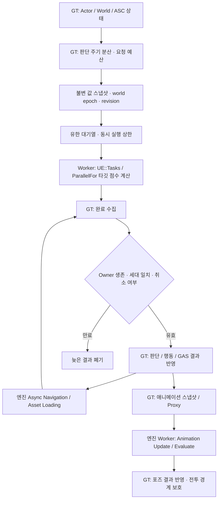

# Performance Optimization Foundation

## Purpose and scope

This document defines the performance foundations that exist before the project has
large-scale NPC combat, pooled gameplay actors, or a final rendering/content budget.
They are intentionally conservative: none of these foundations silently changes an
Actor's behaviour, starts gameplay work on a worker thread, or enables object reuse.

Project J is an UE 5.8 third-person action MMORPG prototype. Local players retain
the full locomotion path. Current test NPCs share the native player master and
its data-driven pose selection; the earlier blanket claim that all NPCs avoid
pose search is not a current runtime guarantee. Content may author a cheaper
blendspace/sequence path, independently of movement simulation quality.

## Measurement comes first

The source-level trace scopes added by Project J are annotations for **Unreal
Insights**. They are not a custom profiler and do not replace engine tooling.

Use the official Unreal workflow:

1. Capture a packaged Development build with Unreal Insights.
2. Use `stat unit` to classify Game, Draw, and GPU bottlenecks.
3. Use `stat game`, `stat anim`, and `stat gpu` to narrow the affected system.
4. Inspect the Project J CPU trace events, then compare the same scenario before
   and after a proposed change.
5. Record average frame time and hitch percentiles, not FPS alone.

Current Project J trace events:

- `Project_J_PlayerCharacterTick`
- `Project_J_AnimShouldSkipNativeUpdate`
- `Project_J_ServerSideRewindTick`

The server-side rewind history uses a fixed-capacity circular buffer. Recording or
expiring a transform does not move the rest of the history array or allocate memory;
historical hit lookup remains a binary search over logical oldest-to-newest indices.

`DumpMMOProfilingSnapshot` remains a lightweight context dump: it reports character
roles and animation budget tiers. It complements Insights but does not measure CPU
or GPU duration accurately enough to approve an optimization by itself.

### Initial repeatable baseline

For each target hardware tier, measure a fixed map and camera path with 10, 30, and
50 visible characters. Record:

- Game, Draw, and GPU frame time
- total and per-tier player/NPC counts
- AnimGraph, Motion Matching, and skeletal mesh cost
- network replication rate when running two-client PIE or dedicated server
- hitch count during initial equipment, skill, and VFX usage

Do not add parallel work, Mass representation, or pooling because an average FPS
number is low. Identify the limiting thread or GPU pass first.

## Existing runtime policy

### 2026-10-28 서버 병렬 평가와 headless 의상 생성

전용 서버의 성능 실행 프로필은 프로세스 시작 인수에 지원 옵션
`-useperfthreads`를 명시한다. 설치 UE5.8의 `FApp::ShouldUseThreadingForPerformance`
기본값은 dedicated에서 false이며, skeletal parallel evaluation도 이 값을
확인한다. AnimInstance의 multithread 설정만으로 worker 실행을 판정하지 않는다.
프로젝트가 실행 도중 캐시된 FApp 값을 덮어쓰거나 별도 pool을 만들지는 않는다.

기존 `Measure-Network.ps1 -ServerPerformanceThreads`는 dedicated 서버 인수에만
이 옵션을 추가하며 packaged Game/listen 모드와 구분한다. 실제 FApp 값은
`rendered-preparation.json`과 로그, 평가 task는 엔진 CSV로 확인한다.
같은 바이너리200캐릭터/2연결의 OFF/ON/ON 반복에서 서버 Frame 중앙값은
82.09→38.69/39.24ms, Animation GT는55.11→13.72/13.85ms이고 기존 strict
이동 품질은26건 반전 실패→ON 두 번 통과였다. client FPS 개선, 모든 포즈의
worker 실행이나 생산 수용량 보장은 아니다. 이 옵션은 엔진의 다른 성능용
스레딩 gate에도 영향을 주므로 새 플랫폼/실행 환경은 실제 소비 경로로 검증한다.

2026-11-02의 같은32-caster 실제 공격·피해·취소 조건에서도 이 프로필을 확인했다.
thread-safe update marker1436회가 실제 Foreground/Background worker4개에서,
91회가 GT에서 관측됐다. 별도의 ParallelEvaluation/Foreground branch도 thread ID와
구분해 기록한다. 공격·고유 접촉96·GE/Health64·취소32·정확한 정리를 유지했다.
이는 모든 pose/trajectory가 병렬화됐다는 뜻이 아니다. NativeUpdate의 trajectory 생성은
여전히 GT다. [118차 입력 동등성·원자료와 분석 보완](../../Architecture/Planning/Project_J_MMO_Architecture_Work_2026-10-26.md#118차-지원-서버-프로필에서의-실제-worker-실행)을 따른다.

지상 trajectory는120차부터 canonical native 모드에서 요청당 GT capture 뒤 소유 값으로
계산한다. 실제 이동과 동일한 입력 투영·gait/회전·spring 수학을 사용하고, 기존 cached/current
base 좌표 왕복과 최종 mode writer·predictive receipt 읽기 가시성을 보존한다. bone 없는
Box/Capsule/Sphere/StaticMesh 기반 입력/상태를 지원하며 custom/socket/미지원 base,
BP override·다른 native 모드·optional query는 기존 predictor를 사용한다.
`ProjectJ.Mover.PreparedGroundPrediction` 기본1,0은 기존 경로다. 이 switch는 품질/샘플 밀도를
낮추지 않으며 read-only `ProjectJ.Mover.PreparedGroundQueries`는 실제 수락만 센다(non-Shipping).
계산은 여전히 GT다. live mode·collection·view·base UObject를 worker로 넘기거나 작은 query마다
task를 생성하지 않는다. [실제 소비·동등성·CPU 관측과 한계](../../Architecture/Planning/Project_J_MMO_Architecture_Work_2026-10-26.md#120차-실제-지상-예측의-요청별-준비와-값-계산)를 따른다.

`UProject_JModularMeshComponent`는 기존 dedicated 정책과 함께 렌더링할 수
없는 Game/PIE 프로세스에서 `Super::OnRegister` 전에 cloth actor 생성을 막는다.
공식 `FApp::CanEverRender`를 사용하고 commandlet·제작 preview와 실제 RHI의
authoring 값을 유지한다. shared-pose의 primary tick도 public `GetAllowClothActors()`와
cloth metadata를 함께 확인한다. simulation instance 생성 전의 preview/RHI admission과
별도 CopyPose graph tick은 유지한다. 같은 packaged NullRHI listen+RHI200 검증에서
서버 simulation instances200→0에 이어 잔여 primary tick200→0, 실제 RHI 의상200·
로컬 축소0·기존 strict를 확인했다. 등록·재등록·mesh/parent 변경·Activate의 기존
refresh 경계를 사용한다. inherited setter 단독의 즉시 tick 갱신이나 자원 해제·
client FPS 개선을 보장하는 API로 해석하지 않는다.

`UProject_JCombatPresentationComponent`의 순수 Niagara payload 소비도 엔진과 같은
`FApp::CanEverRender`를 Preload/Ensure/PlayCueLocal에서 확인한다. headless의
불필요한 예열·load lease·pending loop를 만들지 않으며 권위 PlayCue의 loop 상태·
multicast·notify 소유권/종료는 유지한다. 공용 로더·게임플레이 pose·weapon class·
명시적인 제작 검증/Cook 로드는 이 gate의 대상이 아니다. Niagara는 원래도
headless 생성을 거절하므로 새 simulation 절감이나 정확한 memory bytes로 세지 않는다.

기존 자원 입장·복구 회귀는 실제 RHI를 요구한다. `Run-ContinuationTests.ps1 -UseRHI`는
기존 offscreen RHI 프로필을 사용하며 기본은 NullRHI다. `PresentationRecovery`의 기존
assert를 유지하고 공식 `NonNullRHI` 요구를 명시했다. headless notify/복구·자원 거절과
실제 RHI prewarm/취소/pool은 서로 다른 실행으로 확인한다.

무손실 NP word delta는 별도의 기본OFF 실험이다. 본문 비트 절감만으로
연결별 포화·baseline 메모리·전체 전송량이 개선됐다고 판정하지 않는다.
수신 endpoint의100ms 초과 hold와 client frame 비용도 남아 있다.
[현재 통합 근거와 미완료 범위](../../Architecture/Planning/Project_J_MMO_Architecture_Work_2026-10-26.md)를 따른다.

43차의 `GetManagedClothVertexCost`는 Bind 시 immutable asset별 최대 physics LOD
정점 합을 캐시하고 known 부분합과 unknown part 수를 함께 반환한다. overflow·교체·
해제를 구분하며 unknown을 무료 작업으로 admission하지 않는다. 같은 UObject의
제자리 geometry 편집은 release/rebind가 필요하다. 비용은 CPU ms가 아니다.

기본OFF `ProjectJ.ClothBudget.ObserveExecution`과 측정기의
`-RenderedClothExecutionObservation`은 같은 incarnation의 적격 native tick/end-tick
완료만 비차단 확인한다. 실제200명/2연결에서 phase3/4의76/82표본 전부
506,800vertices·unknown0·qualified200을 확인했다. 공개 handle의 부재·elapsed frame이나
legacy substep stat을 물리 완료로 사용하지 않는다. 43차 종료 시 실행 cap/fallback/warmup
정책과 CPU/frame 개선은 미완료였으며, 아래44차의 실행 구현·검증과 구분한다.

44차 실행 예산은 기존 등록부/Coordinator를 재사용한다. CVar
`ProjectJ.ClothBudget.ExecutionVertexCap=0`과 별도 garment permission false가 기본이며,
실제 제작 의상이 opt-in하지 않으면 중단하지 않는다. fade-out/drain/warmup의 예약은
native 완료까지 유지하고 post는 회계만 게시한다. 보호 승격·명시 handoff는 PrePhysics에서
원래 component blend/suspend를 복원한다. 동일값 외부 writer는 먼저 opt-out해야 한다.

같은 Editor119 binary/에셋/관측 조건의 실제200명 OFF/ON 한 쌍에서 phase3/4
FrameTime P50 64.47/65.44→39.15/38.79ms, qualified native parts200→24,
steady reserved60,816vertices·park176·unknown0을 확인했다.200명 표시·로컬 품질과
종료 복원은 유지됐다. worker scope 합은 겹치므로 frame 시간에 더하지 않는다.
Cloth wait 약17.5ms와 증가한 GT Cloth scope도 남는다. 기본 채택·다양한 의상의
시각 승인·반복 성능 보장으로 확대하지 않는다. Game30/새 Cook15/Stage22의 실제
listen+remote200 호환도 확인했으며 dedicated Server/Shipping 인증과 구분한다.

45차는 native Mover의 카메라 갱신 eligibility를 기존 PC/PCM 경로에 연결했다.
local client의 현재 pawn/camera 소유관계가 유효하고 legacy movement가 없을 때
공통 GT helper가 native flag만 준비한다. 기존 전송 간격·변경 감지·timeout/RPC는 유지한다.
실제200명/2연결에서 server replication-view 생산자 입력과 고정 client POV의 위치 차이
약45m→0cm를 확인했고 Game31/Cook15 재사용 Stage23에서도 검증했다. 이는 마지막
published Iris view 직접 관측·FOV 전송·NP freshness/전체 성능 개선의 근거가 아니다.
동적 카메라/production MainWorld·mount/spectator 통합과 공급 총량은 계속 검증한다.

46차는 Source/quantized RPC parameter 비교에 typed 이름·참조·pending token 전체를
포함한다. same-index body만으로 서로 다른 metadata를 같게 처리하지 않는다. Proxy
frame/현재 export/전송 형식·protocol8은 유지하고 신규 export reuse는 보류했다.

같은 binary/계측·고정NPC3개·예산의 production/ACK full/ACK word 세 실행에서
Word body68.745% 절감은 확인됐으나 decode P50은 여전히 약800ms이고 parent
Flush85,187→85,657B/s로 감소를 입증하지 못했다. serializer 성공 시도는 delivery 수가
아니다. baseline 메모리/장기 회수도 미검증이어서 encoder/class policy 기본OFF를 유지한다.
최종 Game32/Cook15 재사용 Stage24는 기본 정책의 실제 listen/remote 호환 근거다.

48차 queued goal 병합은 기존 NPC/동료의 같은 미dispatch 요청에서만 최신 목표를
받는다. 원래 age/deadline/FIFO/priority·물리 슬롯과 현재 따라가는 path는 유지하고,
엔진에 전달한 query는 바꾸지 않는다. completion의 위치/의도/NavData 검증도 유지한다.
직접 Editor125·실제 Recast/Mover 추적 및 압력/취소 회귀를 확인했지만 새로운 CPU/FPS
개선 비율이나 대규모 Navigation 수용량 측정은 아니다. Game/Shipping 배포는 후속이다.

50차 공유 송신 envelope100kB/s·normal cap3→300kB/s·16의같은binary/source
비교에서고정NPC3개의갱신간격P50 약730→218ms와같은parent Flush96.9→294.1KB/s를
확인했다. 양쪽협상/경계cap·우회0을확인했고CPUwrite/client비용은증가했다. packet허용량은
normal Full batch이며huge/OOB/다른traffic의절대상한이아니다. source/script/asset동등성과
원래품질gates를통과한한쌍의자원기여근거이며bytes단독인과·대규모수용량/전체기아·손실·
장기메모리/SLA증명은아니다. 운영기본과codec/ACK/cloth기본은유지한다. Game33/Cook15
재사용 Temp Stage25의기본네트워크패키지도실제listen/remote200에서확인했다.

51차 실제 두 owner MainWorld 준비 겹침에서 한 Pawn의 정상 퇴역/재생성과 다른 owner의
독립 native 도착·각 source 회수를 확인했다. 직접 Editor127/기존 World4와 실제 전용 서버+
client2의 exit0×3·source/runtime/보호에셋 불변이다. 이는 기존 production 수명 계약의 통합
근거이며 새 CPU/FPS 개선·동시 고속 이동/합산 스트리밍 예산·Nav/GPU/HLOD 준비나 수용량을
입증하지 않는다. 교체 직후 missing-object RPC 거절의 정확한 대상/함수는 미확정 관측으로
보존하며 log-clean 성공으로 세지 않는다. 기존 default single-owner·production 정책은 유지했다.

52차 NPC authored network tuple은 기존 metadata/finite/min 관계·float cull-square
표현 한계를 같은 runtime/editor predicate로 확인한다. invalid tuple 전체만 거절하고 현재
actor network writer와 독립 mesh 정책을 보존한다. valid 설정/10·2Hz 기본/거리0의 기존
의미를 유지한다. 직접 Editor128/기존 NPCDecision6에서 확인한 입력 보강이며 실제 불량
콘텐츠·송신 장애의 원인 수정이나 새로운 성능 개선률은 아니다.

54차 prepared-arrival GT polling/commit은 실제 world subsystem의 frame budget으로
이주했다. 개별 Tick 대신 logical256·visits64/Advance4·soft0.5ms·0.1초 due와 frame/lease
fence를 사용한다. 기존 native outcome/deadline/source 계약은 유지했다. Editor129/World5와
실제 두 owner의 교체·독립 도착을 확인했지만 I/O/source gathering/engine-task 전체 cap이나
새 FPS 이득·장기 공정성/하드 지연 보장으로 확대하지 않는다.

55차 현재 배포는 Game34/새5map Cook16/Temp Stage26이다. 실제 패키지 MainWorld에서
새 shared writer가 production Portal·native Mover·물리 도착과 정상 predictor 광고 복원을
소비했다.54차 Editor의 실제2owner 수명 근거와 별도의 standalone/NullRHI 배포 근거이며
GPU/Nav/HLOD/대규모 수용량·새 FPS 개선률로 세지 않는다. 소스/보호에셋과 실제 exe SHA를 확인했다.

56차 Gateway telemetry는 accepted GT queue가 있을 때만 GI one-shot을 예약한다.
idle/in-flight 반복을 없애고 종료 admission 철회·GI timer clear·기존 HTTP cancel을 묶었다.
native GI 경계와 실제 localhost HTTP를 확인했으나 제품 producer/HTTPS/auth·새 FPS 개선률은
아니다. 최초 검증 context 오류와 의도된 body-cap warning은 별도로 보존했다.

57차 영속 Gather는 기존 호환·비잠금 stack을 채워 행 증가를 줄인다. 명시 Add/identity형과
전체 Amount의 동일 commit quest/receipt를 보존한다. 실제 MaxStack99·재접속/partial/실패
원자성을 확인했지만 전체64KiB/수동Split/이력 용량·새 CPU/FPS 개선률은 별도다.

58차 Game35/Stage27은56/57을 통합했고 Cook16을 재사용했다. 실제 RHI 패키지의
채집2→제작1→퀘스트 HUD claim이 exit0·경고0·오류0으로 끝났다. 수량/commit 소비 검증이며
새 CPU/GPU/FPS·CCU 성능 수치나 이미지 품질 승인으로 해석하지 않는다.

59차 legacy quest Accept/HUD Tracking도 기존 worker commit 전에 live를 게시하지 않는다.
영속값 JSON은 worker에 유지하고 기존 receipt/owner fence를 재사용한다. native7개는
계약 회귀이며 자동 progress busy·전체 byte capacity·CPU/FPS 개선 측정과 구분한다.

60차 owner 상태 효과의 동일 표시 값은 HUD에 반복 게시하지 않는다. 실제 GAS의
countdown/stack/inhibition/expiry와 source 교체/GC 회귀2개를 확인했다. 기존 관찰 주기는
유지하고 inline12 지역 snapshot 복사 비용이 남는다. authored 범위·전체 CPU/FPS 이득은 미측정이다.

61차 자동 Event/Travel은 bounded native counter 목표로 합치고 원 명령 뒤 한 번의
소유 tail에서 저장한다. GT 설치/revision/원 완료를 분리하고 정상 shutdown drain을 확인했다.
현재 Game36/Cook16/Stage28 실제 소비를 마감한 뒤 사용자 요청으로 일시정지한다.
canonical capacity/포화·거절/전체 경로와 새 CPU/FPS·CCU 보증은 별도다.

62차는 producer의 공유 spatial 값 배열을 move/제자리 압축해 두 번째 배열 할당·복사를
제거했다.4096행의 실제 포인터/값 보존과2048 decision·callback 수명을 확인했으며 FPS 수치는
측정하지 않았다. 무효화된 수집의 후속 life/position 조회는 중단하지만 원 final spatial build도
이미 short-circuit로 방지됐다는 경계를 유지한다. 진척의 실제64KiB 초과/가방 병합 복구와
32 gate 포화·명시 거절/반환을 확인했고 기존 상태 표시에 세션 미수락 요청만 더했다.
긴 일반 Windows DB/저널 경로는 private VFS에서 보정했으나 실제 UNC/특수 namespace와
엔진의 중간 directory 제한은 별도다. Editor145/Game37 성공·native21 Success/경고0이며
새 Cook/패키지·전체 CPU/GPU/CCU 보증은 아니다. 목표는2026-10-30 재개로 활성 상태다.

63차 공유 시각 로더의 정상 입장은 요청path의 backoff만 조회한다. 새 실패가 bounded
cache 공간을 요구할 때 만료 항목을 회수해 callback 전에 기록하며, 기존 누락/재진입 원인도
보정했다. metadata256·활성 항목 no-eviction·2초 TTL·lease/물리 예약·품질은 유지한다.
실제 D3D12의 공유1024/churn/GC/VFX/무기 등8개가 Success·경고0이고 Editor146/Game38
직접 빌드가 성공했다. 전체 CPU/FPS·Niagara GPU 총량이나30초 실시간 물리 실패 시험은 아니다.

64차 실제 profile 입장은 GI의 검증된 registry를 Ensure로 재사용한다. 명시 refresh·실패
원자성·표준 Config reload 후 한 번 갱신과 optional crafting 독립성은 유지한다. 실제 입장/
재접속의 refresh0과 warm32회·reload/실패/회복을 확인했으며 CPU/FPS 비율은 측정하지 않았다.
소셜 GUID namespace+FName 번호는 현재 outline0 target의 per-group 문자열 intern 증가를
없애지만 tombstone map 퇴역 권위는 해결하지 않는다.11개 native와 실제 dedicated host1/
client2 파티 cohort·Editor147/Game39가 정상 종료했고 에셋/Cook/프로토콜 타입은 유지한다.

65–66차는 기본 OFF인 실제 Iris PS audience를 추가했다. owner allowance와 기존 PS
prioritizer/private 조건을 유지하며 Avatar cached bounds를 기존 grid에 공급한다. 일반
world pre-spawn/PS 할당 순서로 fresh 이력을 확인하고 unknown/retired/profile/coarse/config
전환은 관측 가능한 broad baseline을 유지한다. actual2client의 far PS/Pawn0→near1/최신
health/ASC→far0과 private0·기본 OFF 회귀를 확인했지만, bytes/CPU/FPS/CCU 개선률과
탑승·교체·loss·운영 cutover는 입증하지 않았다. 현재 Editor151/Game40, 패키지는61차다.

68차 Game/PIE WP source query는 전체 component path의 반복 FName 생성을 제거하고
기존 world owner가 발급한 등록 수명 ID를 재사용한다. 재등록/소진/취소와 실제 MainWorld
제공·소비·복원을 확인했다. outline0의 project path producer 수정이며 per-world namespace,
engine parent Actor name/label, 다른 world type과 전체 Name pool/합산 I/O는 별도다.
Editor154/Game41·native6개·actual MainWorld host1/client2가 통과했고 패키지는61차다.

69차는 headless standalone/listen의 무기 class/장비 mesh 표현 요청·생성·retry를
기존 admission에서 차단한다. gameplay grants/public state/source pose/notify는 유지한다.
Dedicated는 이미 차단돼 있었고 hard gameplay closure는 남는다. cold headless 소비와
실제 RHI10개/50·100·200 notify, 실제 RHI2client 장비·owner 명령을 구분해 검증했다.
기존 NullRHI와 RHI 타이밍을 비교하지 않으며 CPU/FPS/전체 memory 절감률은 미측정이다.
현재 Editor157/Game42, 실제 패키지는61차다.

70차는 장비 effect source의 per-provider path FName 생성을 기존 content/slot
comparison name+공개 UObject incarnation serial로 바꿨다. ASC lease/generation과
실제 stat 적용·공유·해제는 유지하며 정상 GC/rename/retained Avatar 등5개를 검증했다.
Editor158/Game43이고 새 global memory/FPS 개선률이나 패키지 완료 주장은 하지 않는다.

71차는 WP source 수집 시 기존 recipient 수명을 검사해 중앙 poll을 기다리던
무효 목적지 demand를 중단한다. 정상 source ID/geometry와 GT 중앙 writer를 유지한다.
Editor159/native4와 실제 MainWorld2연결 소비를 검증했다. 유효 요청256개의 합산
광고·engine I/O/resident/GPU/Nav budget이나 CPU/FPS 개선률을 해결한 것은 아니다.

72차는 client GAS recipient 게시 뒤의 settled tuple을 기존 Pawn 소비에 연결하고,
late old Pawn OnRep가 현재 State.Pawn을 덮어쓰지 않게 한다. 실제 PS-first dismount의
mount topology 완료는 기존 component의 native prerequisite 알림으로 다시 수렴한다.
추가 timer/강제 reset/ASC Init writer는 없다. Editor163의 집중15개와 실제 역순 등록
Mount3·정상 Avatar lifetime은 통과했지만50ms/2% lifetime은 phase29에서 실패했다.
실패의 원인은 아직 미확정이며 진단은 기존 strict 조건을 유지한다.

73차는 비동기 로드를 기다리던 nonlocal cosmetic loop의 ready apply를 기존 weapon과
공유하는 world PresentationBudget에 연결한다. world Tick당4 apply attempt/128 visit/
1ms soft 한도를 공유하며 기존 FIFO의 tail 재등록으로 consumer 간 진행을 유지한다.
포화 시 같은 incarnation의 ready desire를 거절·퇴역시키고 sync fallback은 만들지 않는다.
local view/기존 warm·one-shot·critical notify는 보존한다. 실제 RHI4개와 집중 native를
검증했으며 active emitter/GPU/global frame cap이나 CPU/FPS 개선률을 주장하지 않는다.
71–73차를 포함한 full Game44 direct UBT도 source 불변/exit0으로 완료했다.
실제 패키지는61차다. 세부 실패·근거·남은 경계는
[아키텍처 작업 기록](../../Architecture/Planning/Project_J_MMO_Architecture_Work_2026-10-26.md#7273차-재개-탑승-topology-수렴과-공유-표현-적용-예산)을 따른다.

74차는 현재 controlled Pawn을 정확한 owner connection에 inclusion하는 native group1개를
교체/탑승 동안 재사용한다. PS creation/default Spatial/nonowner 정책은 유지한다.
OwnerView2·50ms/2% LifetimeLoss2·parallel/loss·역순 Mount4와 ownership native15가
통과했고 Pawn264→286에서 동일 group token/생성1회를 확인했다. Cap7은 일반 검증의
false/timeout1을 보존한 별도 접속 거절·정확한 group 퇴역 증거이며 gameplay pass가 아니다.
당시 거절 Client1의 ThirdPerson 반환 CMC Error는76차의 정확한 NPC 배치 재저장으로
수정했고 반복 trigger에서 재검증했다. 원 cap1 오류와 일반 실패 결과는 유지한다.

75차는 serializer worker의 GT-only CSV query를 native CSV gate/TLS 기록으로 바꾸고
codec/wire/CVar를 유지한다. 실제 worker 포함 NP native5와 WorkerCSV2가 통과했으며
최종 CSV의 AllWorkers/DeltaEncodeCPU 양수4프레임과 attempt/bit 기록을 확인했다.
CSV 파싱 전 native 종료 기록을 보존하고 첫 crash/guard 차단을 남겼다. worker 기록은
성능 이득·고유 전송량·CCU 보장이 아니며 capture 경계와 재시도를 구분한다.
Editor169/Game45까지 검증했으나 패키지는61차다. 임의 Pawn/Mount registration-last,
retained rider·실제 travel/특수 phase·remote history·합산 자원/미정 서비스는 남는다.
[74–75차 근거](../../Architecture/Planning/Project_J_MMO_Architecture_Work_2026-10-26.md#74차-detached-camera와-현재-소유-pawn-복제-범위)를 따른다.

76차는 오래된 NPC ExternalActor1개만 지원 save_packages로 재직렬화하고 정상 탈것 CMC를
유지했다. standalone 반복과 Capacity2 반환 맵에서 오류 제거·정상 native 퇴역을 확인했다.
77차는 원격 arrival의 RPC/목적지 광고 시작을 기존4 Advance/frame에 포함하고,
시작 전 광고/ACK를 막는다. local/client 즉시·원 deadline·WP/Mover 소비는 유지한다.
native4와 실제 two-owner overlap은 통과했지만 실제 waiting 관측은 모두 false다.
6-provider native start 한도 근거와 한 owner 도착/다른 owner 교체 취소 근거를 구분한다.
Editor170/Game46이며61차 패키지에는 새 ExternalActor/77 Source 반영을 검증하지 않았다.
신규 start는 기존 readiness/commit poll과4 credits를 공유하므로 과부하시 시작 대기가
늘고 원30초 deadline에서 차감된다. calibrated active-count 정책은 미정이다.
신규 authority start 제한은 활성 source/physical I/O·memory/GPU/Nav cap이나 성능/CCU
보장이 아니다. [77차 범위와 근거](../../Architecture/Planning/Project_J_MMO_Architecture_Work_2026-10-26.md#77차-원격-arrival-준비-시작을-기존-world-예산에-연결)를 따른다.

79–82차는 누적 변경을 fresh5-map Cook79와 최신 Game48 Development Stage82로 묶었다.
보호9asset/반영 layout을 유지한4 fixture·CSV 도구 차이만 있어79의 실제 RHI 채집/제작/
quest·전투3회와 cooked NPC1/CMC오류0 근거를 재사용했다. 전투 PNG는 capsule/VFX
범위이며 캐릭터 품질 인증은 아니다. 원79/81 listen 실패는 보존하고 explicit host marker와
공개 binding identity로 cohort/global 통계를 분리했으며 모든 privacy/retired 조건을 유지했다.
Dedicated/packaged listen strict0×3·timeout0와 Closure82의37 checks가 통과했다.
Shipping82는 컴파일 성공만 확인했으며 runtime은 미검증이다.78 soft/guard 기존 소비와
hard gameplay montage 유지,80 render-fence/GPU-ready·duration/cancel 검토는 새 기능
완료로 세지 않는다. physical 합산 자원/CCU/성능 이득·travel/history·서비스는 여전히 남는다.
[79–82차 실제 근거와 범위](../../Architecture/Planning/Project_J_MMO_Architecture_Work_2026-10-26.md#7982차-공유-development-배포와-listen-cohort-검증)를 따른다.

83차는 같은 Stage82/Game48의 packaged standalone D3D12/native0으로 Portal/Mover
실제 도착·source 복원과 선택 HLOD27part/502instance의 CPU handover6표본을 확인했다.
실제 PNG2개가 있으나 selected-proxy 픽셀·연속 무공백·GPU residency/PSO-ready 증거가
아니며 renderedVisualVerified=false를 유지한다. coarse/actual-Level flag를 픽셀 gap으로
해석하지 않는다. 새 Source/Cook/Stage나 합산 자원 cap·성능 이득은 추가하지 않았다.
[83차 관측 범위](../../Architecture/Planning/Project_J_MMO_Architecture_Work_2026-10-26.md#83차-같은-stage82의-실제-rhi와-선택-hlod-handover-관측)를 따른다.

### 2026-10-22 Mover consumption boundaries

The primary mesh AnimInstance publishes source quality on the game thread;
linked layers do not become additional follower tick owners. Trajectory turn
urgency compares samples in the same visual-root space, and Strafe velocity
reversal remains protected. Local PlayerController ownership includes the rider
whose controller has transferred to a mount. ABA, source policy and the visual
coordinator use that same ownership decision.

The conditional remote prediction-density experiment changes only internal
trajectory prediction sampling during settled, grounded Mid/Far presentation.
Local, acceleration, turning, airborne and combat presentation retain 60Hz.
Movement simulation, network prediction and output trajectory spacing retain
their existing contracts. Adoption and the actual 200-body RHI comparison are
recorded in the [Mover report](../Reports/ProjectJ_Mover_200_2026-10-22.md).

### 2026-10-12 시각 애니메이션 예산

원본 메시의 ABA·필수 포즈 요구는 기존 서비스가 담당하고, `UProject_JAnimationUpdateCoordinatorComponent`가 리타깃 몸체의 평가와 의상 물리를 같은 주기로 관리한다. 안정 근거리는 원본 ABA 상태에 따라 매 프레임 또는 30Hz, 중거리 30Hz, 원거리 15Hz 평가와 사이 프레임 보간을 사용한다. Leader Pose 장비는 기존 포즈 공유를 유지한다.

로컬·전투·게임플레이 포즈 요구·몽타주·루트 모션·단발·공중·Turn/Reface는 매 프레임 평가를 보호한다. 화면 복귀는 즉시 평가와 이력 초기화를 수행한다. GT 정책 판정이 worker proxy 완료를 기다리지 않도록 하고, 실제 리타깃 평가의 원본 포즈 의존은 유지한다. 전역 복구는 `ProjectJ.VisualAnimationBudget.Enabled 0`이며 캐릭터·메시별 제외도 지원한다.

현재 비교 기준은 사용자가 지정한 200명이다. [구현·동일 바이너리 비교·보호와 복구·검증 한계](../../Animation/Planning/Crowd_Visual_Presentation_Budget_2026-10-12.md)를 따른다. 앞의 10/30/50명 기준선은 초기 수집 제안이며, 최근 200명 CPU 측정이 실제 렌더 FPS·GPU·Cook 검증을 대신하지 않는다.

### Player characters

Player characters use Motion Matching. Remote visual locomotion already has
Near/Mid/Far/Hidden tiers, a reduced update cadence, and far-only chooser rows.
The local player must preserve full input responsiveness and is not globally
throttled by Significance.

### NPCs, bosses, and monsters

`AProject_JNPCCharacter` intentionally has no actor tick by default and applies:

- low network update frequency and net cull distance
- skeletal mesh Update Rate Optimization
- `OnlyTickPoseWhenRendered`
- a non-Motion-Matching animation expectation

`FProject_JNPCUpdateBudgetSettings` provides Near/Mid/Far/Hidden intervals.
The current `Project_JNPCDecisionSubsystem` consumes the recommended tier interval
for registered NPC decisions and schedules registered `NPCActionComponent` work.
This is an opt-in runtime path, not a global Actor tick throttle. Registration and
each consumer's policy determine which work is reduced. Never reduce server hit
validation simply because an NPC is distant.

For current UI demand, mesh update-request composition and locomotion cadence
contracts, see [Character component ownership](../../Architecture/Runtime/Reports/Character_Component_Ownership_2026-09-20.md).
Other future-looking sections below describe the original foundation; consult
the current system documents before treating an item as unimplemented.

## Future pooling contract

`UProject_JObjectPoolRegistrySubsystem` stores `FProject_JObjectPoolDefinition`
records only. It does not acquire, release, prewarm, spawn, or destroy any object.
This provides a stable vocabulary before actual needs exist:

- pool id
- actor, Niagara component, or widget kind
- future prewarm and retained-count limit
- whether authority owns the eventual pool

Before connecting a monster to a real pool, define all of the following:

1. Reset contract: gameplay tags, ASC state, movement, collision, attachments,
   timers, delegates, damage state, and replicated properties must be reset.
2. Network contract: the server owns acquire/release; clients never revive a stale
   replicated actor locally.
3. Lifetime contract: stale async loads and callbacks must carry a generation id.
4. Visibility contract: release must disable collision, rendering, ticking, and
   replication as appropriate before reuse.
5. Profiling proof: demonstrate Spawn/Destroy, GC, or hitch cost before enabling
   pooling for a class.

## Gameplay async contract

`FProject_JGameplayAsyncWorkContract`는 값 계산과 GT 상태 변경의 경계를 정의한다. 현재 타깃 점수 서비스는 `UE::Tasks`·`ParallelFor`, Mass 이동은 별도 청크 병렬 계산을 사용한다. 이 타입 자체가 모든 작업을 받는 공통 실행기는 아니다. [시각 예산과 기존 병렬 구조의 관계](../../Animation/Planning/Crowd_Visual_Presentation_Budget_2026-10-12.md#기존-병렬-아키텍처와의-관계)를 함께 읽는다.

GT가 Actor·World·GAS 상태를 소유하고 직접 제출하는 작업에는 값 스냅샷을 전달한다. Navigation·로딩·애니메이션의 비동기 실행은 각각의 엔진 서비스가 관리하며 위 대기열을 공용 실행기로 사용하지 않는다. Mass는 GT snapshot/grid → chunk 계산 → join → GT 적용을 사용한다. 애니메이션은 기존 Proxy와 엔진 병렬 평가, 원본 포즈의 의존 순서를 유지한다.

- Worker input must be copied, plain data only.
- A worker must never access `UObject`, `Actor`, `Component`, `UWorld`, or GAS state.
- The result is applied on the Game Thread only.
- Results need a request token/generation so obsolete results can be discarded.
- A concrete user must prove that dispatch overhead is smaller than the saved
  Game Thread cost before using `UE::Tasks`, `ParallelFor`, or a thread pool.

Good future candidates: large candidate filtering, crowd steering preparation,
path-request preprocessing, and bulk data conversion. Poor candidates: a small
per-NPC branch, direct Actor mutation, and server-authoritative state changes.

## Rendering and content policy

GPU-driven rendering, HISM, HLOD, Nanite, impostors, material simplification, and
Niagara scalability are mostly content and renderer decisions rather than generic
gameplay C++ features. Do not create a custom renderer abstraction yet.

Before using a representation technique, profile the target scene:

- Render Thread bound: inspect draw calls, component count, material state changes,
  and repeated meshes. Consider ISM/HISM or merging static environment content.
- GPU bound: inspect GPU Visualizer/Insights for shadows, translucency, Lumen,
  material cost, and post process cost.
- Skeletal crowd bound: first use animation URO, leader pose, visibility ticking,
  and NPC simulation LOD. Move to Mass representation/impostors only after a
  measured crowd target requires it.

The current renderer settings enable Lumen, Virtual Shadow Maps, ray tracing, and
Substrate. They are feature choices, not free optimizations; define scalability
tiers only after measuring target hardware.

## Deferred work checklist

- Actual Actor/Niagara/Widget pool implementation and monster integration
- AI cadence consumer, time-slicing scheduler, and spatial query service
- Worker-thread gameplay jobs
- Mass processors, representation LOD, and Actor/Mass handoff
- Iris/Replication Graph runtime adapter work
- HISM/HLOD/Nanite/impostor content audit
- automated performance regression capture/CI thresholds

Each item needs a measured bottleneck, a concrete owner, and a before/after
Unreal Insights capture before it is promoted from foundation to runtime behaviour.

### 85차 공용 공간 snapshot의 셀별 할당 제거

2026-11-01 NPCDecisionSubsystem의 GT target 수집과 WorldEventRegistry의 observer 조회가 공유하는 `FTargetSpatialSnapshot`의 셀별 인덱스 배열을 snapshot-local 단일 배열로 교체했다. 최대4096개·셀 내 삽입 순서·stable ID 결과·early exit·극단 좌표 fallback과 worker 값 복사 계약은 유지한다. 추가 worker/manager/품질 제한은 없다. 구조적 할당 개선이며 전체 CPU 병목 해소나 FPS/CCU 보장은 아니다.

동일 영구 benchmark의2048/4096개·3배치·fresh/reuse12조합에서 원본/변경의 결과·방문 수가 일치했다. fresh 분산 build p50은 로컬 순차 두 프로세스에서225.198→120.398µs,464.898→252.802µs였다. 입력 수집/복사·실제 mixed worker 경쟁과 allocator peak bytes는 측정하지 않았다. Editor175/Game49 full UBT, 관련13개·월드 이벤트3개·같은 셀 압축1개 native 검증은 경고/실패0·actual0이다. 과거 Cook79/Stage82를 새85차 패키지 근거로 바꾸지 않는다. 자세한 입력·검증·한계는 [85차 작업 기록](../../Architecture/Planning/Project_J_MMO_Architecture_Work_2026-10-26.md#85차-공용-공간-snapshot의-할당-구조-개선--2026-11-01)에 남겼다.

### 86차 상태 효과 UI의 유휴 polling 제거

Owner status model은 GAS add/remove와 UI effect별 stack/time/inhibition 통지로 갱신한다. 억제 효과는 구독을 유지하되 무한/억제/internal-only 상태에는 UI timer를 두지 않는다. 표시 중 finite countdown만 관측 UI handle을0.25초 간격으로 읽는다. native per-handle 검색의 선형 비용은 남고 server-time 보정을 위해 별도 end-time cache를 만들지 않는다. weak/source/revision 구독·Unbind·mutable metadata의 명시 Refresh·동일 view 알림 억제는 유지한다. 새 manager·품질 cap은 없다.

Editor177/Game50 full UBT와 실제 stack/time/inhibition·latent world timer·nested rebind/GC 집중3개(동작이 같은 Editor176)는 경고/실패0·native0이다. 새 FPS/원격/packaged 근거는 아니며 해당 배포물은 여전히 Stage82다. [86차 작업 기록](../../Architecture/Planning/Project_J_MMO_Architecture_Work_2026-10-26.md#86차-상태-효과-ui의-이벤트-기반-갱신--2026-11-01)에 실제 소비·검증·한계를 남겼다.

### 87–88차 제작의 순수 계획과 이관 callback admission

제작의 재료 순회·정렬·소비·출력 stack/GUID 계획을 기존 profile worker로 옮겼다. GT baseline/정의/quest 검증, 같은 CAS의 아이템/quest 진행, 완료 시 현재 정의 검증은 유지한다. receipt를 먼저 조회해 확정된 제작 재요청의 계획/출력 GUID와 Proposed Encode를 생략한다. 새 thread/queue/manager는 없다. GT 전체 수집이나 운영 저장 병목을 제거한 것은 아니며 FPS/지연 개선량은 아직 측정하지 않았다.

이관 callback은 원래 ID/attempt에 한정하고 matching 응답/dispatch failure의 attempt별 atomic 선점 뒤에만 GT로 전달한다. 잘못된 응답에 의한 다른 레코드 완료를 막고 중복 worker의 GT enqueue를 제한한다. 실제 분산 authority 인계 완료와는 별도다.

Editor178/Game51 full direct UBT와 관련28 native가 경고/실패0·native0이다. 수락 후 live recipe 교체·known receipt 계획 생략·원자 quest/아이템·실패/퇴역과 기존 장기 저장 경계를 확인했다. 같은 장기 회귀를 변경 근거 없이 반복하지 않는다. [87–88차 작업 기록](../../Architecture/Planning/Project_J_MMO_Architecture_Work_2026-10-26.md#8788차-제작-worker와-이관-응답의-실행-경계--2026-11-01)에 소스·수명·측정 한계를 남겼다. 배포물은 여전히 Stage82이며 새 packaged/Shipping/대규모 성능 근거는 아니다.
### 89–92차 실제 소비와 검증 경계

91차는 이미 이동을 제출하지 않은 authority Preparing의 deadline 이후 목적지 수요를 즉시 철회하고, queued/native outcome/client 수명은 유지한다. actual source의 목적지 geometry도 확인한다. 기존 world 실행 예산·상태 writer를 재사용하며 실제 I/O/메모리/GPU cap으로 설명하지 않는다. 공통 EditorBuild4와 집중2 native Success·경고0·실제0을 확인했다. 90차 실제 Editor9/보존8 peer의 Login/Join 전 거절13 checks·native0×2와 source/runtime 불변은 호환성 근거다.

89/92차는 melee Kismet wrapper의 임시 배열과 NPC GT target 등록부의 전체 복사를 제거하는 기존4 cpp 최소 변경을 Source에 적용했지만, 열린 검수 에디터 때문에 새 빌드/native는 아직이다. 기존 strong pin/revision·순서/metadata·worker 값 소유권을 보존하는 집중 회귀도 보강했다. 새 thread/pool/manager/임의 품질 제한을 추가하지 않았다. CPU/FPS/CCU 개선량이나 전체 A06/A09 완료를 주장하지 않으며, 이주 전후 패키지와 현재 미빌드 Source도 구분한다. [89–92차 실제 근거·현재 대기 조건](../../Architecture/Planning/Project_J_MMO_Architecture_Work_2026-10-26.md#8992차-실행-비용과-호환성-검증)을 따른다.
89/92차 최종 통합은 Editor183/Game53 full direct UBT와 집중9 native Success/경고·실패0·native0이다. 처음 transient material을 solver 생성 뒤 만들어 발생한 양쪽 동일 null의 fixture 실패는 보존했고, 공유 material의 공개 handle을 solver 생성 전에 준비해 실제 nonnull/동등성 조건을 유지했다. query 생성자의 OwnerTag 부수효과도 원wrapper와 일치시켰다. Game의 Editor-only 테스트 가드 누락1건은 해당5번째 cpp에서 고쳤다. 새 thread/manager·private flush·지연 timer·판정 완화는 없다. 기존 NPC worker 값 소유권과 callback pin/revision도 보존한다. 구조적 비용 감소의 검증이며 frame 성능 개선 수치는 아니다. 자세한 원실패·현 지문·미검증 범위는 위89–92 작업 기록을 따른다.

### 93차 등록 수명과 이벤트 기반 복구

Mount Iris start/stop을 기존 rider prerequisite signal과 authority owner-scope writer에 연결했다. 매 프레임 polling을 추가하지 않고, 같은 actor가 새 primary handle을 얻어도 현재 full-handle/group을 다시 확인한다. 생산 변경 전 실제 원격 실험의 stale member116을 재현했고 수정 후 같은 group에서 current/member128·ready1로 복구했다. Editor187/Game54 full UBT·집중9 native와 기존 정상/지연·손실 socket cohort는 통과했다.

선택 RemovedFromWorld 등록 재시작 실험 전체는 외부 component의 이전 Mount 참조 때문에 실패로 남는다. native membership 복구와 전체 원격 관계 복구는 구분하며, 원래 실패를 지우거나 reset/새 wire 상태로 가리지 않는다. 거리 필터 효과·old ACK/retirement·travel·CPU/FPS/CCU 개선을 인증하지 않는다. [93차 실제 변경·검증·잔여 경계](../../Architecture/Planning/Project_J_MMO_Architecture_Work_2026-10-26.md#93차-탑승-actor-등록-수명과-소유자-복제-그룹)를 따른다.

123차는 실제 native Grid 거리 이탈에서 foreign mounted rider/mount의 실제 Destroyed/bridge 매핑 해제와 같은 서버 handle의 새 client incarnation·공개 참조·owner-only 상태 복원을 정상 및 lag/loss/역순 접속으로 확인했다. 기존 fixture 선택 모드이며 native camera CDO 라우팅과 production 공통 Mover camera 전송 요청을 같은 단계에서 사용한다. 기본18행을 유지하고 별도12행을 검사하며, raw stored camera cache는 private consumed-view getter가 아니다.93 strict live RemovedFromWorld 재등록과 실제 travel/remote ACK 전체·대규모 수신 비용은 별도 미완료다. [123차](../../Architecture/Planning/Project_J_MMO_Architecture_Work_2026-10-26.md#123차-실제-거리-aoi의-원격-퇴역과-재진입)에 실제 호출자 보완과 첫 실패들을 보존했다.

### 94차 NPC ready 결과 저장 비용

실제 scheduler FIFO를64개 inline 값 저장의 UE TDeque로 바꿔 결과별 공유 record 할당과 앞쪽 배열 이동을 제거했다. 공유 Agent·현재 delivery 로컬 값·callback 전 퇴역 순서는 유지하며 world당 고정 record 공간과 교환한다. Editor188과 실제 worker-ready2/clear/GC를 포함한18개 집중 native가 성공했다. FPS·혼합 부하 개선량이나 전체 NPC 병렬화 완료로 세지 않는다. [94차 변경·검증 경계](../../Architecture/Planning/Project_J_MMO_Architecture_Work_2026-10-26.md#94차-npc-결과-fifo의-값-소유권)에 현재 입력과 Game55 full UBT 실제0의 통합 결과를 남겼다.

### 95차 동시 목적지 준비 허가

프레임당 arrival 처리 예산과 별도로, 기존 world Entry가 authority 목적지 준비 permit를 소유하도록 했다. WorldDefinition의1..256 authoring 정책(default256 호환)을 local/remote 시작과 source·ACK·native effect에 연결한다. 포화 대기·기존 deadline, Queued 결과와 client AwaitingLocal 수명을 유지하며 exact terminal/퇴역에서만 논리 허가를 반환한다. read-only source 조회는 허가를 생성하지 않는다.

Editor190/Game57 및 같은 입력의 Game58과 world 집중8 native는 실제0이다. stale Game 생성 헤더를 만든 후보 복사 시각 문제는 원실패를 보존하고 적용 절차를 수정해 재검증했다. 물리 I/O/메모리·총 client source·엄격한 FIFO·FPS/CCU 보장은 아니며 새 MainWorld 원격 부하 근거도 아니다. [95차 구현·실행·한계](../../Architecture/Planning/Project_J_MMO_Architecture_Work_2026-10-26.md#95차-월드-목적지-준비의-동시-admission)를 따른다.

122차는 이 permit가 유효한 실제 Mover 적용 직전에 기록된 고정 목적지의 지면·walkability·캡슐 충돌을 다시 확인한다. 현재 기하가 무효하면 이동/Output 변경 없이 native 실패 event를 기존 receipt에 연결하고 중앙 writer가 Failed와 논리 허가 반환을 처리한다. 정상 이동과 도착 후 실제 위치 확인은 유지하며 물리 I/O 취소·Nav/GPU readiness 보장으로 설명하지 않는다. 원 구현의 실제 재현과 월드9 native·MainWorld 정상 Portal 검증은 [122차](../../Architecture/Planning/Project_J_MMO_Architecture_Work_2026-10-26.md#122차-준비된-이동의-실제-적용-직전-검증)에 있다.

### 96차 실제 포털 이동의 permit 관측

현재 Editor191 소스/MainWorld standalone에서 normal Portal→WP 준비→native Mover 도착과 source 복원을 실제 실행했다. Preparing/Queued permit1→Arrived0, peak/admissions1·deferrals0과 같은 provider identity의 실제 readiness를 확인했다. native0·전후 Source/runtime 및 보호9개 asset 불변이며 Game59 full도 실제0이다. 비동기 I/O·GPU/Nav·원격 입력·대규모 동시성/성능 인증은 아니다. [96차 실제 실행·입력·한계](../../Architecture/Planning/Project_J_MMO_Architecture_Work_2026-10-26.md#96차-현재-소스의-실제-mainworld-permit-수명)를 따른다.

### 97차 실제 원격 포화·퇴역·인계

현재 같은 입력의 dedicated NullRHI+RHI client2개에서 기존 strictdefault와 별도 cap1이 native0×3/전체 성공했다. cap1은 actual grant된slot1의 public lifecycle 퇴역→waiting slot2의 실제 native 도착으로 이어졌으며 peak1·총허가2·deferral1·최종active/pending0이다. source/runtime·보호9asset 불변, Editor192/Game60 full도 실제0이다. scope가 다른 입력 RPC는 default가, trusted server entry 이후의 포화는 cap1이 담당한다.

최종 readiness/receipt·provider·정책 필드의 reader 연결 누락은 원실행을 보존하고 같은 raw의 강화 재검증으로 고쳤다. retired cap1 client의 미관측 Preparing을 성공 관측으로 세지 않는다. [97차 실제6점·수신자 수명·판독 보강·한계](../../Architecture/Planning/Project_J_MMO_Architecture_Work_2026-10-26.md#97차-실제-두-owner의-포화와-permit-인계)를 따른다. 물리 I/O·총 client source·엄격한 FIFO·대규모 FPS/CCU 보장은 아니다.

### 98차 warm cosmetic의 생성 집중 제한

기존 world FIFO의4 apply/128 visits를 실제 engine frame에 묶고, 로드된 원격 loop와 one-shot도 같은 생성 시도 예산을 공유한다. local/viewed와 authored timing 예외는 즉시 재생한다. one-shot은 포화된 instant를 생략하고 늦게 재생하지 않으며 loop는 기존 취소/attack generation을 유지한다. 새 manager/worker·asset 변경은 없다. load budget·queued soft1ms·active Niagara/GPU 비용은 서로 다른 한도다.

Editor193/Game61 full 및 Null/RHI 집중10 native가 실제0·자동화 경고0이다. 실제 warm mixed3+1/shared4·local·중복 방지·saved profile default와 natural-frame300 장비/4096 포화·취소를 확인했다. [98차 변경·실제 입력·검증·남은 active 비용](../../Architecture/Planning/Project_J_MMO_Architecture_Work_2026-10-26.md#98차-원격-warm-이펙트의-프레임-생성-예산) 및 [VFX 제작/실행 계약](../../Combat/Architecture/CombatVFXArchitecture.md)을 따른다. 새 FPS/CCU·GPU cap·시각 품질·socket/패키지 인증은 아니다.

### 99차 지속형 전투 FX의 native 중요도 정책

실제 Trail은 project NS/EffectType의 distance significance·High(관측0.25초)·ImmediateResume·local 보호·초기 authored128에 연결했다. vendor·기존 distance/bounds/다른 cue를 보존하며 추가 runtime manager/Actor tick은 없다.98 생성 admission과 active 정책은 서로 다른 예산이다. finite one-shot과 필수 경고를 resume 정책에 섞지 않는다.

실제 saved getter/queue와 project payload의 transient2 수명 회귀가 fresh D3D12/native0·자동화 경고0이었다. 최종 Editor198/Game65와 일반화된 Editor receipt 경로의 무변경 dry-run도0이다. [99차 입력별 근거·원실패·제작/소비·남은 한계](../../Architecture/Planning/Project_J_MMO_Architecture_Work_2026-10-26.md#99차-프로젝트-소유-지속형-fx의-native-활성-정책)를 따른다.128 압력·GPU/메모리 hard cap·픽셀/FPS/CCU·새 Cook/Stage/Shipping 인증은 아니다.

### 100–101차 NPC query 저장과 유휴 경로

한 Tick의 query index 용량만 재사용하고 완료 record를 move해 반복 할당·추가 결과 복사를 줄였다. worker snapshot·const task result·권위/취소/age·수량 상한은 유지한다. Editor199/Game66 full0과 기존 집중13 native Success·경고0/native0이며 Source/runtime·보호7asset 불변이다. [100차 소유권·검증·남은 비용](../../Architecture/Planning/Project_J_MMO_Architecture_Work_2026-10-26.md#100차-npc-수집의-tick-local-저장-재사용)을 따른다. 전체 수집/worker 경쟁·혼합 부하 개선량은 미측정이다.

101차는 도착 유지 때 반복되던 무효 path token0의 큐 검색만 제거했다. 유효 취소의 물리 예약·콜백/Stop·Mover/ASC heartbeat는 유지한다. Editor200/Game67 full0과 기존 행동/경로5 native Success·경고0/native0이다. [101차 실제 소비·유지·A08 보류](../../Architecture/Planning/Project_J_MMO_Architecture_Work_2026-10-26.md#101차-도착-유지의-무효-경로-취소)를 따르며 Mover 시뮬레이션 빈도/수용량 개선으로 계산하지 않는다.

### 102차 NPC snapshot의 전체 나이

기존0.5초 결과 만료를 GT 값 수집 전부터 Ready와 최종 component 게시 직전까지 연결했다. 이미 만료된 준비는 Core admission 전에 정확한 현재 context만 정리하며, target life/최종 threat ASC getter가 지연한 결과도 게시하지 않는다. Core0.25초·submit 지연 계측·실제 worker/논리 예약·cadence는 그대로다. OldestReady는 수집 기준 Tick 시작 표본, Discarded는 prepared 만료도 포함, Applied는 기존 subsystem acceptance 의미다.

Editor201/Game68 full0과 새 실제 callback/Ready 지연2개를 포함한12 native Success·경고0/native0을 확인했다. 지연 후 fresh 결과도 정상 회복한다. [102차 입력·실제 지연·수명 검토·미검증](../../Architecture/Planning/Project_J_MMO_Architecture_Work_2026-10-26.md#102차-npc-결과의-수집부터-게시까지-만료)을 따른다. 불필요한 stale admission/게시를 막는 정확성 보강이며 GT callback 시간 제한이나 FPS/CCU·혼합 부하 인증은 아니다.

### 103–104차 혼합 관측과 결과 적용 후보

기존 authored Mover/animation/cloth의 실제 RHI와같은NPC64/target128을함께실행하고opt-in별도CSV/실제완료누적값을연결했다. Count1→32에서batch계산평균은약30us로유지됐지만Core전달은프레임간격에따라늘었고, High의실제처리율은16/frame상한에묶였다. [103차 지문·동일frame관측·계측범위](../../Architecture/Planning/Project_J_MMO_Architecture_Work_2026-10-26.md#103차-실제-렌더-군중과-npc의-혼합-관측)를따른다.

104는기존1ms/64/worker2/cadence를유지해count를dispatch32에맞춘header1줄후보다. Editor203/Game70·관련9native와같은High두RHI는actual0/계약검증성공이고captureAge P95감소가반복됐다. 그러나공격phase5 frameP95는기존19.99ms대비25.32/23.46ms로높아 **전체성능판정OPEN·현재WIP**다. FPS최적화/수용량완료로세지않으며다음은같은raw와기존도구를재사용한combined critical path관측이다. [104차 지연·유용한처리량·자원비용·HEAD메타연결과열린판정](../../Architecture/Planning/Project_J_MMO_Architecture_Work_2026-10-26.md#104차-결과-적용-상한-후보와-열린-프레임-비용)을따른다.

### 105차 대기 경로와 후보 미채택

독립observer CPU scope/actual인원표시만보강하고같은계측의32/16을대조했다.실제CSV↔observer↔GameFrame검증으로공격260/289frame을확정했다.현재큰GT대기는명시ClothEnd→WaitUntilTasksComplete(32 trace평균8.716ms/P95 10.513ms)이며실제clothworker와99.9%겹쳤다.NPC collect/apply평균.372ms/observer.195ms와구별하며worker중첩합을frameCPU로부르지않는다.

계측frameP95는32 23.499/16 21.198ms,ageP95는45.895/84.450ms였다.기존비계측2회도frame tail이높아져 **32globaldefault미채택·현재16유지**로104WIP를판정했다.할당·복사/수집나이보강은유지하고새manager/worker/품질튜닝은없다.[105차 Source/원자료·최종판정·정상adaptive iterations·미검증](../../Architecture/Planning/Project_J_MMO_Architecture_Work_2026-10-26.md#105차-실제-cpu-대기와-결과-상한-채택-판정)을따른다.이는candidate선별/실행관측이며전체MMO FPS·수용량최적화완료가아니다.

124차는 canonical native 지상 예측이 계산 마지막의5개 forecast 튜닝을 live mode에 반영하던 조회 간 결합을 제거했다. 같은 physical frame의 반복 조회와 원 Samples 수학/해당 native 입장 시5값을 보존하며 실제 물리 admission/solver와 unsupported BP fallback은 유지한다. 정상 physical 결과는 baseline부터 query 횟수와 독립이었다. 관련 RHI58·Editor245/Game85가 성공했으며, worker 이전/새 성능 개선률로 계산하지 않는다. [124차 실제 재현·writer 계약·남은 worker 경계](../../Architecture/Planning/Project_J_MMO_Architecture_Work_2026-10-26.md#124차-native-예측-조회와-실제-이동-튜닝의-격리)를 따른다. 앞120차의 최종5writer 보존은 당시 역사이고 현재 canonical native의 writer 계약은 이124차가 우선한다.

### 125차 기존 animation task의 같은 프레임 forecast

GT가 실제 native Mover 상태·history/current와 소유 값 packet을 준비하고 prediction BB/중력 범위를 닫는다. 같은 publication을 소비한 Player NativeTS가 공유 지상 커널/resample과 derived future를 끝내 graph가 현재 프레임 값을 읽는다. GT PostUpdate는 source generation/revision이 유효한 완료만 다음 history·품질 mirror에 복사한다. source 교체/초기화/종료는 pending/active/completion을 폐기한다. GT BP update·custom mode/predictor·warped montage 등은 기존 동기 경로이며 새 per-actor task/manager·한 프레임 지연·sampling/quality 축소는 없다.

Editor247/248·Game86 full UBT0, 관련 RHI58개 Success·경고/실패0/native0이다. 실제 authority32/두 client native0×3와 접촉96/GE·Health64·cancel32 zero/cleanup1을 유지하고, 불변 CPU trace에서 forecast worker1416회/GT87회를 정확 timer/thread identity로 확인했다. ThreadPool 값 계산·실제 source GC 후 동일성과 수동 NativeTS 두 프레임 동등성/완료 mirror/퇴역도 별도로 검증했다. [125차 실제 구현·비용·잔여](../../Architecture/Planning/Project_J_MMO_Architecture_Work_2026-10-26.md#125차-같은-프레임의-애니메이션-worker-지상-예측)를 따른다. presentation forecast 이전 근거이며 authoritative simulationLOD/Mass·혼합 부하/GT wait·전체 FPS/CCU 보장으로 계산하지 않는다.

### 127차 shared NPC capture의 cooperative budget

기존 한 pass 공유 target snapshot을 그대로 사용하며 실제1ms soft 예산을 row callback 사이에 확인한다. 값/weak actor·원래 registry/order/cursor·최초 CapturedAt을 가진 optional 하나만 이어가고, 불완전한 prefix에는 query/worker 예약을 만들지 않는다. 완성 Build가 예산을 쓰면 원age의 built state를 보관한 뒤 Tick-local 소유권으로 한 번 이관한다. registry 변경·마지막 source/Stop·0.5초 만료는 data-only 폐기 통계로 구분하며 기존 ready/action/ring/dispatch/Core 상한과40열 CSV를 유지한다. 현재 수집 상태는 기존 NPCDecision.Control status에서 읽는다.

원 실행은 actual2ms callback 뒤 suffix2/position3/build1/Core1을 진행해2test/13단언/native255였고, 수정 후 prefix1/suffix0/build0/Core0에서 yield 후 중복 읽기 없는 완료·실제 worker·GC/취소/만료 회복을 통과했다. Editor252/Game88 full0, 관련29 native Success·경고/실패0/native0이다. [127차 실제 근거와 한계](../../Architecture/Planning/Project_J_MMO_Architecture_Work_2026-10-26.md#127차-공유-npc-대상-수집의-예산별-재개)를 따른다. 단일 callback/Build의 hard1ms, 동시순간 좌표, 지속 churn liveness와 전체 FPS/CCU는 보장하지 않는다. 2048 fixture의 실제 처리2047은 의도된 퇴역1개를 제외한 기능 검증이다.
