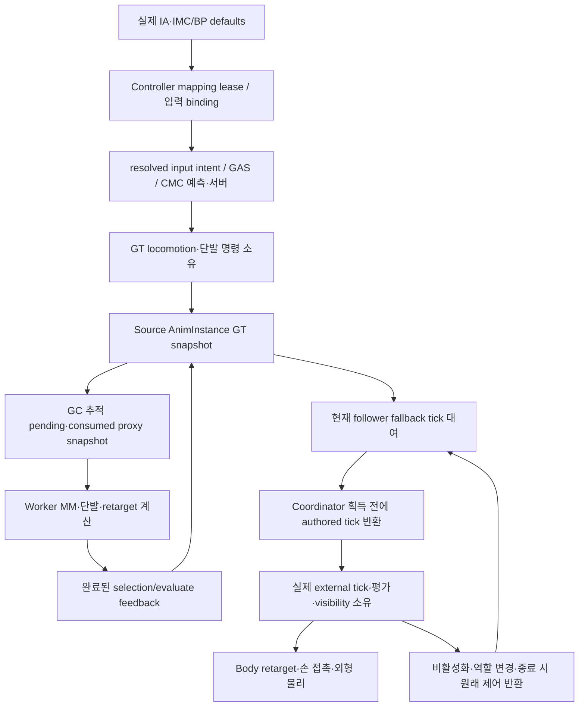

# Project_J 계속 감사 — 실행·소유권·제작 경계 지도

[현재 변경/검증](Project_J_Continuation_Audit_2026-10-14.md) · [함수·호출·실패 범위 장부](ContinuationEvidence_2026-10-14/CoverageLedger.json) · [계승한 전체 지도](Project_J_Deep_Structure_Map_2026-10-13.md)

이 지도는 현재 소스·descriptor 및 앞선 근거를 이어서 설명한다. 명시한 새 검토 외의 모든 함수·BP/CDO/인스턴스·에셋 제작/품질을 새로 완료했다는 뜻이 아니다.

## 모듈과 배포

| 모듈 | descriptor·실제 의존 경계 | 상태 |
| --- | --- | --- |
| Project_JCore | Runtime/PreDefault. CoreUObject·Engine·GameplayTags, 값/asset/task/message 기반 | 기존 RA 계약 계승. CA06 Message payload/dispatcher의 현재 dispatch 보유 수정. 전체 callback/worker 검토 아님 |
| Project_JMMO | Runtime/PreDefault. Core만 사용 | CR01 명시 범위 검토 후 유지. service/지속 저장 설치 증거 없음 |
| Project_JGAS | Runtime/Default. Core 기반의 ASC·attribute·입력 태그/GAS | 기존 입력·권위·예측/반환 계약 계승. 전 함수/시험 분기 미완료 |
| Project_JMount | Runtime/Default. Core·GAS·EnhancedInput·NetCore | 기존 mount revision·possession 반환 계승. 에셋/원격/모든 탈것 품질 미완료 |
| Project_JCharacter | Runtime/Default. Core·GAS·Mount·MM/Chooser/Retarget/ABA/Mass/MVVM, SetupIrisSupport | CA01–05/07/08/11 tick·numeric·장비/input·shared notify GC 개선. Worker snapshot/task join 유지. CR11 NPC 지정 범위 대조. 전수 완료 아님 |
| Project_J | Runtime/Default. composition/game/입력/UI/backend, Character·Core·MMO·GAS | CA06/10/12/13 input lease·handover lifetime/packet/timing·Quest rollback. AnimationBlueprintLibrary 등 fixture 의존은 Target.bBuildEditor 조건이며 실제 Game 빌드 확인 |
| Project_JAnimationNodes | UncookedOnly/Default. AnimGraph·BlueprintGraph·BlendStackEditor·UnrealEd | CA09 전체 chain preflight·owned edge/node rollback·one compile. actual Master transient clone의 실패/성공/idempotence 검증. 임의 compiler/plugin side effect는 미검증 |
| Project_JCharacterEditor | Editor/Default. Character·AnimationNodes와 제작 모듈 | 새 DataValidation 의존과 native 부모 animation asset validator. runtime Game/Server module로 승격하지 않음 |

Game/Editor/Server target은 UE5.8 IncludeOrder/V7을 사용한다. 설치 엔진의 native Server target 미지원은 기존 실행 증거를 계승하고 엔진 제한을 우회하지 않는다. 별도 ProjectJExperiments의 disabled/opt-in 역할과 샘플/개발자 Content는 미사용 삭제 근거가 아니다.

## 실행과 새로운 tick 대여

IA/IMC/BP 실제 연결은 아직 해당 asset별 상세 대조가 남아 있다. source의 명령 hold/소비, physical-turn 준비, completed selection feedback, proxy pending/consumed와 node별 applied DB는 서로 다른 시점의 권위다. 이름이 비슷하다고 통합하지 않는다.

CA01의 약한 대상은 tick 제어를 대여한 메시만 기억한다. saved tick은 대여 전 값이고 applied bool은 실제로 쓴 값이다. coordinator가 설정상 활성이라는 사실과 외부 allocator의 실제 소유를 구분한다. fallback은 같은 대상/정책을 매 frame 다시 쓰지 않고, 대상 교체·animation initialize/uninitialize·정책 변화·allocator 반환 경계에서 적용한다. 해제할 때 외부 controller의 제어를 덮지 않는다.

## 무기 숫자·제작과 실행

| 경계 | 입력과 실제 게시·검증 | 한계 |
| --- | --- | --- |
| Montage notify | per-mesh/instance → component notify token, 실제 montage position. CA11 dead mesh 정리는 native weak PostGC delegate/BeginDestroy 반환 | 실제 GC2→1/live token 보존/notify unroot 확인. 누락 End·Blueprint Super callback·모든 clip 품질은 별도 미완료 |
| 공통 numeric admission | key time finite·0–1·strict order, transform finite/정규 quaternion, alpha0–1, duration/blend finite nonnegative | empty key/duration0 유지. 모든 profile·attack·contact-recovery 숫자를 닫은 것으로 승격하지 않음 |
| Runtime Begin/Refresh/Position | 전체 tuple 승인 뒤 active 상태 게시. invalid refresh는 기존 tuple, invalid time은 last finite 시간 유지 | 실제 native 실패/정상 시험과 전체 장비 품질은 다른 증거 |
| Persona preview/drag | runtime과 같은 key contract; finite 편집 후보를 전체 대입 | preview 정상과 cooked runtime 검증은 다른 경계 |
| notify IsDataValid | notify object 자체의 제작 계약 | 부모 animation asset의 검증 호출이 자동으로 연결된다고 가정하지 않음 |
| 새 Editor asset validator | animation asset에 실제 포함된 WeaponMotion notify를 공통 계약으로 검증. native validator는 Editor startup에 수집되는 공식 확장점 | 새 fixture는 부모 경계를 직접 검증. 모든 실제 montage/sequence 검사와 Cook/package는 별도 실행 필요 |

## callback·worker·backend

기존 Mass/TargetScoring/VisualAsset/NPCPath/NPCDecision/PresentationBudget GT 참가자 보유와 worker 값 snapshot·취소 요청/실제 완료·module join을 계승한다. 이번 tick/숫자 수정은 worker UObject 조회 또는 task ownership을 추가하지 않는다.

새 CR02/03 조사에서는 EnhancedInput의 동기 Add/Remove callback 이후 현재 lease/owner 판정, Message의 delegate snapshot과 payload GC 보유, Handover의 serialize/TryApply/state callback 이후 manager/actor 수명을 분리한다. map 안전성을 이미 수정했다는 사실이 GC 보유나 모든 late completion을 증명하지 않는다.

CA06에서 실제로 재현한 mapping/message 경계는 현재 호출 동안 dispatcher/owner/context/input/payload를 보유하며 callback 뒤 현재 lease를 재조회한다. 저장은 여전히 weak이고 작업 종료 뒤 GC할 수 있다. listener membership snapshot과 payload 값의 deep immutable snapshot을 구분한다. 실제 reentry/GC fixture를 통과했지만 모든 Blueprint callback, 장치/focus, Handover/ASC 참가자 GC의 완료로 확대하지 않는다.

Gateway tracker는 at-most-once delivery/old-session 억제를, Repository는 원자적 revision/receipt를, AggregateGate는 실제 완료까지 reservation을 소유한다. Handover의 transfer/attempt/receipt와 actor checked apply도 별도 권위다. native port/catalog/loopback은 live HTTPS·지속 저장·분산 권위·WAN·200socket의 설치/검증 증거가 아니다.

## 장비 능력치와 영구 base

Manager의 authoritative equipment slot/instance가 runtime의 장착 transaction을 시작한다. AbilitySet은 keyed source generation 또는 unkeyed 개별 핸들을 소유하며, EffectLevel은 제작/runtime 공통 finite·>=1 검사 뒤 원값으로 GAS에 적용한다.

StatModifiers의 보너스는 새 `FProject_JEquipmentStatValues` 공통 tuple → stable native `UProject_JGameplayEffect_EquipmentStats`의 SetByCaller spec → 원래 ASC active handle로 이어진다. 여러 장비의 spec은 독립적이다. 해제는 적용 당시 핸들을 제거하고 live DA의 값이나 현재 avatar ASC로 대체하지 않는다. `bAppliedStatModifierFallback`과 permanent base 역가산 경로는 제거했다. 기존 authored GE 우선순위와 source-generation 반환은 유지한다. runtime local transaction이 callback 중 폐기되면 아직 게시되지 않은 GE도 원래 ASC에서 반환한다.

CA07 Equipment AbilitySet key는 slot과 definition full path를 사용한다. 같은 basename의 다른 정의가 겹친 avatar provider에서 충돌하던 실제 오류를 재현했다. 같은 정의는 기존 source generation/공유 lease 하나를 유지하고, 다른 정의는 각자 grant를 소유한다. ItemId·basename·object path는 서로 다른 의미이며 이 변경은 Inventory의 ItemId 도메인을 통합하거나 새 client key 예외를 만들지 않는다.

GAS의 permanent base는 레벨/진행·기본값 권위이고 장비 보너스는 aggregator current에 반영된다. 최대치 감소는 current resource를 clamp하고 증가는 무료 회복하지 않는다. UI는 같은 tuple의 authored additive만 비교하며 최종 능력치/조건부 GE 결과를 예측하지 않는다. native class/tag의 Cook 및 원격 복제 증거는 별도 후속이며 callback 강제GC와 모든 예측 epoch도 아직 완료하지 않았다.

## 전체 범위 누락 점검의 현재 상태

소스607 계승 목록과 새 fixture·validator·native GE를 포함한 현재624개는 작업 대상 수다. 함수·헤더·inline·조건부 분기·실제 호출의 모든 검토 완료 수가 아니다. package2738 중 registry2735의 type/dependency·source literal 대응도 상세 내용/현재 도달성의 증명으로 승격하지 않는다. 등록되지 않은 `(1)` 파일3개는 원본과 내용 해시가 달라 보존했다. 제작자 입력, template/CDO와 runtime override, cook closure·quality·운영 실패 경계를 각 장부 행에서 별도로 닫아야 한다.

## CA08–11의 operation·제작 경계

EnhancedInput → active handler는 원래 pawn과 binding revision을 operation 동안 보유한다. GAS release/tag callback 후 현재 연결이 바뀌면 old Move를 새 pawn에 게시하지 않는다. Cancel은 old pawn에 남은 release를 반환하고 같은 pawn의 새 press가 소유한 tag를 유지한다. queued device origin·모든 executor/ASC epoch·BP callback은 미완료다.

Handover Build는 serialize 전에 candidate의 class/node를 복사하고 callback 뒤 manager lifetime/authority actor 생존을 확인해 output을 원자적으로 게시한다. Apply는 검증한 bounded packet의 value snapshot을 actual TryApply에 전달한다. worker reply는 GT에서 원래 session revision/attempt를 확인한다. 실제 Player v1 snapshot은 pose/rotation/level이며 inventory/GAS cooldown 전체 이동을 구현한 것이 아니다. trajectory/SSR 보상은 teleport 경계의 필요 계약으로 유지한다.

공유 notify Begin은 현재 mesh 내부의 stale token만 확인한다. 전체 weak mesh retirement는 GC 후 한 번 수행하고 종료하는 notify는 delegate를 반환한다. normal matching End는 live token을 반환한다. 실제 default GM→Controller→Greatsword CDO 및 IA/IMC/Sprint tag, public API parent montage15의 Motion8/9 state를 읽었다. 그 subset의 Ground0을 전체 Ground 미사용으로 승격하지 않는다.

Quest → Progression → PS public level projection → owner HUD는 보상·진행·추적 상태의 서로 다른 권위를 가진다. actual overflow reward rejection의 tracking rollback과 transport/config timing은 CA12/13으로 묶어 실제 재현·수정·집중/통합 검증했다. future ObjectPoolRegistry는 UObject 없는 value policy만 저장한다. 실제 spawn/reuse·네트워크/GC pool 구현으로 승격하지 않고 현재 계약을 유지한다.

CA12/13은 그 세 실제 native 재현 실패를 수정했고 통합38/전체373·Game636 source match·configured Cook1361/package 동일 exe SHA를 통과했다. 전수 소스/에셋·품질·실서비스 검토 완료와 구분한다. NPC의 새 CR11은 GT snapshot→Core 값 worker→GT epoch/token/team/life/range apply→engine async path→owned MoveId/GAS attack→hit commit으로 이어진다. cancel/delivery tombstone과 engine 완료 슬롯은 다른 권위다. activation의 spec/action/scoring lease, Mass suspension revision과 아직 취소 불가한 GAS phase를 합치지 않는다. BP IsDead/target multicast 및 CancelAbility callback 뒤 weak ASC 수명은 미재현 후보로 남는다.

CR12의 Level 경계는 class StartingLevel·owner MaximumLevel·Progression initialize/set/capture/restore와 Player pose/level handover apply로 이어진다. 실제 level 권위가 initialized Progression일 때 void Base setter의 거절을 Player apply가 전달받지 못할 수 있어 atomic pose/level/receipt 계약의 native 재현이 남는다. 이 후보는 아직 runtime 수정/검증 완료가 아니다. [23시 재개 기준점](../../Handoffs/WholeProjectAudit_2026-10-14/Project_J_Continuation_Checkpoint_2026-10-14_2300.md)의 version/process/SHA부터 다시 확인한다.

2026-10-15 CA14 후속: 위 CR12 후보의 effective-level 상한·restore retirement·pose-only true와 Style의0.5 승인/runtime skip을 실제 재현해 수정했다. Progression ResolveLevel→CanSetLevel을 공통 승인으로 사용하고 Base void adapter→checked virtual setter→Player exact preflight/current-owner completion으로 연결한다. Style은 AbilitySet HasValidLevel을 재사용한다. mutation strong pin은 operation 범위이고 persistent ASC ownership은 weak다. 전체 Editor255.69초·집중28 clean은 [새 결과](Project_J_Continuation_Audit_2026-10-15.md)에 기록한다. 위 문단은 최초 후보 상태이며 모든 DA/BP cap·uninitialized owner·실서비스 snapshot 확장·전체/Game/Cook 검증 완료를 뜻하지 않는다. Quest Claim의 false rollback 때문에 이미 게시된 XP는 지급 완료 결과로 유지한다.

2026-10-15 CA14–16 통합: Progression의 effective level 승인/checked setter→exact Player handover, 등록 revision→NPCDecision entry→action/scoring lease, owned skeletal set 단일 순회→GT demand→worker value snapshot을 명시 범위에서 대조했다. registration/query/action revision은 다른 계약이며 합치지 않는다. private resolver4함수/header와 네 caller의 지정 경로 완료를 큰 AnimInstance/Trajectory 전체 완료로 확대하지 않는다. public Blueprint getter와 protected legacy wrapper, engine 최근 렌더의 hitch/tolerance, 취소 불가 GAS phase 및 물리적 완료 슬롯은 유지 이유가 있는 계약이다. 최신 기준점 R15_CA14_16_Integrated1의 통합381·Game/runtime638·configured Cook/package·combat3·actual socket2/NPC200은 새 기록에 대응한다. 전체 함수/에셋/운영·200 sockets·close-up 품질 및 원래 CPU/렌더 차이는 미완료다. CA17의 IsDead/target commit·GAS grant/해제·결과 전달은 신규 후속 검토이며 이 통합 결과에 포함하지 않는다.

CA17: life interface event·GAS grant/end·engine move·advisory multicast가 외부 callback 경계다. Action/intent/registration/context 각각의 현재 receipt를 콜백 뒤 대조하고 old completion이 newer intent/registry를 삭제하지 않게 했다. batch producer는 collection 중 다른 agent의 콜백으로 앞서 준비한 query가 supersede되면 dispatch 전에 제거한다. temporary self/owner/ASC/target/controller/scoring pins는 memory lifetime이며 semantic validity는 별도 생존/권위/revision 검사다. actual 원본2fail 및 집중36(기존warning3)·2048 decision/path 부하는 지정 범위 증거이며 resume/timer·모든 AI/Mass/공격 함수·BP dead graph·환경/전수 감사 완료가 아니다.

CA18: Player SetupPlayerInputComponent→owned binding handles→실제 EnhancedPlayerInput Clone/Execute→원래 pawn/device/receiver/action/revision 검사→semantic ordered held set(최대4)→cosmetic intent다. 기존 raw CMC 이동/복제·GT snapshot→worker 값 처리·MM revision과 별개다. RemoveBinding은 이미 복제된 delegate를 취소하지 않으므로 실행 origin을 확인한다. 기존 held bool4/누적 sequence5는 하나의 bounded held order로 합쳤고 latest-opposed priority·release fallback·duplicate/cancel idempotence를 유지한다. operation pin은 callback 동안만, 영구 ownership은 weak/owned handle이다. .35초/100cm/3도/85% 및 OTM/Strafe/Run-Sprint/단발/MM/Land·측면 후보는 유지한다.

최신 CA17–18 통합은 전체389·runtime642/Editor9/보존13 mismatch0·Game/Cook/package·실제 cooked combat3·socket2/NPC200/lag40/loss2다. [최신 감사 기록](Project_J_Continuation_Audit_2026-10-15.md)과 immutable R15_CA17_18_Verification1에 연결한다. 전수 상세 감사 및 CPU 전체 증가/render 차이는 미완료다. 후속 MountComponent/Character의 attach→movement callback→rider notification/possession, GAS tag→mount-change multicast와 flight phase callback은 별도 조사 범위이며 기존 통합 시험으로 새 후보의 실제 실패나 수정을 주장하지 않는다.

### 2026-10-15 CA19 탑승 전환과 복제 복원

`TryMountRider`는 mount/rider/controller를 pin하고 전환 revision·실제 rider·Mounting 상태를 callback마다 대조한다. Attach/DisableMovement callback이 하차하면 이전 Notify(true)를 게시하지 않는다. Possess 전 controller가 여전히 원래 rider를 소유하는지도 확인하고, 교체되었으면 해당 시도만 정리한다. `OnRep_Rider`의 coalesced A→B는 A의 restore state를 소비한 뒤 B를 따로 캡처한다. Flight phase는 enum/revision/현재 ASC/lifecycle가 같을 때만 각 GAS tag를 갱신하여 중첩 EndFlight의 Landing을 이전 AutoAscending이 덮지 않는다. 관련24개 집중 결과는 최신 감사의 CA19에 연결하며 실제 asset graph/원격/중첩 restore 전체 완료가 아니다.

### 최신 소스 정리: UI/변경 상태의 실제 소유자

Controller UI press receipt(index→원래 tag/pawn)는 입력 의도이며 PS ASC의 ability/prediction 상태와 다르다. Release는 이전 receipt를 먼저 분리한 뒤 기존 Player→SkillInputExecution→ASC façade로 원래 tag를 반환한다. callback의 새 receipt는 새 map/pawn에 남고, EndPlay는 첫 callback 전에 기존 종료 admission을 닫는다. ViewModel은 서버 pending/결과와 local 안내를 발행하고 HUD는 표시·선택만 담당한다. HUD model 교체는 이전 split subscription을 반환한다.

Inventory Count 소비는 별도 lookup/감소 구현 대신 기존 Add→Set의 authority/lock/int64/dirty/snapshot notification을 사용한다. Retarget header가 native 기본값을 소유하고 재초기화는 기존 lifecycle 함수가 소유한다. 논리 취소/physical completion, PS 권위/avatar projection, phase/CMC/cue, serialized BP mirrors는 중복이 아닌 서로 다른 계약으로 유지한다. [전체 시스템 구조 대조·실제 정리·집중 검증](Project_J_Source_Architecture_Cleanup_2026-10-15.md)을 현재 기준으로 사용한다.
