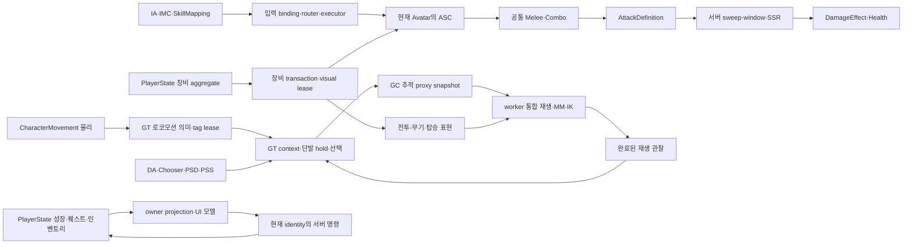

# Project_J 구조·소유권·심화 검토 지도

후속 RA 변경의 [소유권 지도](Project_J_Reaudit_Map_2026-10-14.md)·[재점검 상태](Project_J_Reaudit_2026-10-14.md)를 함께 확인한다. 아래 DS 지도와 실행 근거를 현재 모든 소스/에셋의 완료로 확대하지 않는다.

이 지도는 Source·Config·uproject/Build.cs의 목록과 실제 호출 경계, MCP 에셋 필드 및 native 내부 행 대조를 묶는다. 파일 목록 수집과 특정 실행 계약의 검토를 구분한다. 모든 함수의 수동 검토·모든 BP 이벤트·클립 품질을 뜻하지 않는다. 실제 변경 단위와 검증 상태는 [심화 감사](Project_J_Deep_Structure_Audit_2026-10-13.md)에 있다.

## 모듈 경계

`Project_JCore`는 태그·인터페이스·메시지·값 계산/공유 자산 자원을, `Project_JGAS`는 ASC·속성·grant registry를 소유한다. `Project_JMount`는 탑승/비행과 자체 ASC를, `Project_JCharacter`는 공통 캐릭터·장비·전투·로코모션·worker anim node를 소유한다. `Project_J`는 플레이어 aggregate·controller/HUD·backend·진단/통합 fixture를 연결한다. `Project_JMMO`는 UObject와 무관한 저장·조정·확장 port를 제공한다. CharacterEditor와 AnimationNodes는 제작/그래프 wrapper 경계다. disabled-by-default Editor용 ProjectJExperiments는 실험 fixture이며 shipping 게임 시스템으로 계산하지 않는다.

## 시스템별 검토와 유지/변경

| 시스템 | 실제 소유권·호출 경계 | 이번 검토/변경 | 확장·미검증 경계 |
| --- | --- | --- | --- |
| 초기화·설정·asset manager | uproject 8개 모듈, Build.cs 방향, Config의 maps/Iris/AlwaysCook | 목록/의존성과 실제 default game mode·캐릭터 CDO 대조. 구조 유지 | AlwaysCook 밖 미사용 sample 전체 Cook은 별도 |
| Core 메시지 | GT listener registry, callback 전 snapshot, 약한 수신자 | callback·해제 경계 검토, 기존 계약 유지 | 모든 BP 수신자의 내부 동작은 미검증 |
| 공유 visual assets | GT lease/generation, streamable 완료, callback 범위 asset 보유 | 기존 queue·취소·완료/세대 검토, 기존 시스템 재사용 | 외부 content hot reload 전체 조합 미검증 |
| target scoring/spatial | GT가 값만 capture, worker 점수, world epoch/revision 확인 | immutable data·task 취소·모듈 unload 완료 경계 검토 | score는 target eligibility/권위의 대체가 아님 |
| NPC decision/path/action | 서버 scheduler, bounded async navigation 예약, 완료는 GT | 기존 batching/snapshot/예약 tombstone·ability 종료 검토 | 실제 대형 production map nav workload 확대 필요 |
| Mass | GT capture → parallel 값 계산 → join → GT 반영 | UObject worker 접근과 join/representation 경계 검토, 기존 구조 유지 | 표시 캐릭터 200과 Mass entity/접속 수는 별도 |
| ASC·속성·grant | PlayerState 또는 NPC ASC, provider generation lease | DS10: actual handle registry 단일 소유, stale 완료/반환·장비 공통 Take | instant effect의 이미 적용된 결과를 취소로 되돌린다고 주장하지 않음 |
| 입력·명령·콤보 | device handle, router의 physical chord, executor dispatch, ASC ordered channel | DS12: 각각 자기 입력/binding/timer 종료, late initialize 차단. DS15: 실제 callback 재바인딩의 최신 device 소유권 보존. 기존 quick tap 보존 | 모든 사용자 장치·UI focus 조합의 수동 검증 미완료 |
| 전투·SSR·피해 | 서버 active definition/weapon revision/sweep/window/sequence | hit/retired weapon 계약 검토. DS11: 실제 10개 피해 GE 오연결 수정·제작 검증 | AttackPower/Defense·knockback/launch 공식은 아직 구현된 피해 계약 아님 |
| 장비 aggregate/runtime | inventory identity·slot commit, ASC/visual 자원은 runtime | DS04/10: 동기 callback 후 commit, 실제 ASC rollback, 공통 grant 반환. DS16/17: aggregate 종료 권한과 소비자 provider 종료 연결 | 일부 복잡한 inventory/manager 외부 BP callback 조합은 미검증 |
| 로코모션 의미 | CMC 물리와 GT GroundMotionMode, 실제 ASC tag 기여분 | DS01/02: enum 단일 게시, 소유 ASC lease·재연결. DS18: 점프 확인 적용 순서의 단일 소유자 | BP 표시 alias는 소비 호환용으로 유지 |
| MM·단발·proxy | GT context/hold/cache, worker playback, 다음 GT 관찰 | DS03: 동일 loop/input 기준 게시 공통화. 실제 native+generated root의 목적·GC 참조·nested traversal 검토 | hold/playback·물리 착지/표현 완료는 다른 상태. 임의 병합하지 않음 |
| 리타깃·손 접촉·모듈 외형 | GT에서 source/body/weapon contact capture, worker 순수 math | 실제 Body/Family·ABP binding과 source/follower 역할 대조. Body ABP hash 보존 | 모든 체형·의상·클립의 근접/연속 품질 미검증 |
| 예산·렌더·오디오 | GT significance/ABA demand, engine render/PSO lifetime, bounded Foley | ABA 소유권·취소·반환과 source/follower notify 구분 검토 | NullRHI는 GPU/FPS나 청각 품질 증거가 아님 |
| 탑승·비행 | mount ASC·movement, possession/rider 상태, animation layer lease | 실제 Wyvern/rider profile 대조, native 수명/막힌 하차 검토 | 탑승 모든 클립·원격 차량/late join 조합 미검증 |
| 성장·퀘스트 | PlayerState owner-only 상태, trusted reward, 실제 ASC grant | DS08/09/13: XP 규칙 공통화, 여행 측정 공통 계약, 종료 후 보상/변경/grant 차단 | 성장 state와 외부 저장 schema는 유지 |
| 소셜 | GameInstance의 group/membership map, PlayerState 표시 snapshot | 실제 SetSocialState가 외부 delegate를 방송하지 않음을 확인. 기존 그룹/revision 구조 유지 | live social service·대규모 group mutation 부하는 미검증 |
| backend/handover/MMO ports | bounded tracker·request ID·GT completion, receipt/digest·repository locks | timeout/cancel/replay와 callback 후 map 재조회 경계 검토 | loopback/mock 검증과 live backend/DB는 별도 |
| UI | gameplay 값을 복제 보유하지 않고 owner model projection | DS05/14: callback 중 GC·더 최신 재연결 보존. 기존 HUD 분리 구조 유지 | screenshot/자동화는 모든 hover·drag·접근성 품질 보증 아님 |
| 제작·진단·실험 | Editor 전용 validators/wrappers, disabled experiment plugin | actual graph pins·asset fields·native 내부 행을 대조하는 도구 추가 | C++ lexical 발생 횟수는 compiler call graph 또는 BP 무참조 증거가 아님 |

## 에셋 대조의 깊이

51개 루트의 직접 dependency와 reflected 필드, 추가 44개 루트(기존 IMC 2개 중복), PSD 53개와 PSS 6개 필드를 MCP로 읽었다. 입력 value type/trigger·modifier·mapping, class/style/ability/attack/combo 연결, weapon/body/family와 UI 데이터의 실제 값이 원자료다. Master AnimGraph 노드 45개의 pin 연결도 기록했다.

MCP/Python이 공개하지 않는 Chooser result와 PSD authored entry는 public C++ 제작 API로 보완했다. 최종 읽기 전용 export는 Chooser 20개·327개 result 행, PSD 53개·486개 entry, PSS 6개를 담는다. enabled entry의 skeleton/mirror 호환 실패는 0개다. 미러 DT는 실제 87개 행을 읽었다. 이 단계는 compiled search index 검사나 클립 시각 품질 검사로 확대하지 않는다.

## 정밀 검토 완료로 계산하지 않는 것

전수 lexical 목록은 generated Intermediate/Binaries를 제외한 Source/Plugins 605개 파일과 2478개 패턴상 함수 정의다. 숫자는 전체 수동 code review 비율이 아니다. 긴 파일의 핵심 경로만 읽은 경우 파일 전체 완료로 계산하지 않는다. 반영 API, virtual override, BP callback, 제작/진단 extension은 이름/참조 횟수만으로 삭제하지 않는다.

숨은 결함이 없는 전체 무결성, 모든 legacy/plugin asset 내부 이벤트, 모든 imported clip·음향·체형 품질, native Server target/live backend·DB/200개 실접속, 모든 원격 SSR·late join은 별도 미검증이다. CPU200 반복 비교 128행·16개 region 단계 trace를 수행했지만 일부 소폭 증가의 원인은 확정하지 못했다. packaged RHI trace의 777003 종료 실패도 남아 있다.

`SourceReviewLedger.json`의 각 파일은 `named_contract_scope_review` 또는 `inventory_only`와 기준점 이후 변경 여부를 가진다. 헤더/테스트의 목록 포함만으로 모든 함수 검토를 주장하지 않는다. ObjectPoolRegistry는 현재 등록·조회 소비자가 없는 미래 정책 저장소이며 실제 pool 최적화 구현이 아니다. GameDataReady도 subsystem 초기화 표식이다. 기존 문서에서 의도한 확장 scaffold를 증거 없이 삭제하거나 구현 완료로 승격하지 않는다.
