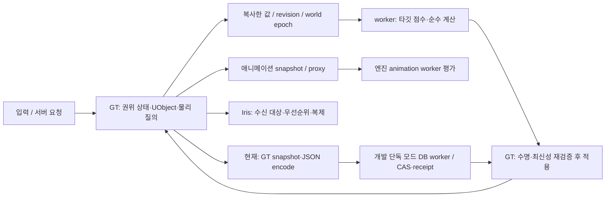

# Project J MMORPG 실행 구조·확장 기반 감사 — 2026-10-26

감사 이후 승인받아 진행한 실제 수정·추가와 최신 검증은 [MMORPG 아키텍처 구현 작업](../../Architecture/Planning/Project_J_MMO_Architecture_Work_2026-10-26.md)을 따른다. 아래의 미수정·발견 상태와 실패 결과는 감사 기준점의 기록이다.

기준 소스는 `main`, `8de7b7a44bb15db1968ec0e8038967d37f535881`, 설치 엔진은 UE **5.8.4 / 58902052**다. 사용자 요청에 따라 애니메이션 측정에서 범위를 넓혀 현재 소스·설정·문서와 선택한 실제 에셋의 권위, 실행, 수명, 자원, 복제, 저장, 제작·운영 경계를 검토했다. **이번 작업은 감사다. 생산 코드·Config·에셋은 수정하지 않았다.**

## 판단

현재 프로젝트에는 재사용할 가치가 큰 기반이 있다. PS/ASC와 Avatar의 수명 분리, 게임 스레드에서 값 스냅샷을 만든 뒤 worker에서 계산하는 구조, 요청의 revision/epoch/취소, 비동기 로드의 실제 작업량 제한, 저장의 CAS·receipt·복구 경계가 존재한다. 이 기반을 유지하면서 실제 콘텐츠의 경로를 연결하는 편이 전면 재작성보다 타당하다.

그러나 **대규모 오픈월드 MMORPG를 지탱하는 실행 기반이 검증됐다고 판단할 단계는 아니다.** 현재 Mover NPC와 Mass 간 전환이 연결되지 않았고, 영속 변경의 전체 상태 재설치·직렬화가 남아 있으며, 관계 기반 복제 정책과 운영 서버·인증·이관은 구현 계약과 실제 서비스 연결 사이에 간격이 있다. 이번 native 회귀 묶음에서는 Mover GC 정리 스택의 크래시도 두 번 관측했다.

목표는 모든 기능에 스레드를 추가하는 것이 아니다. **누가 상태를 소유하는지, 어떤 값만 병렬 계산하는지, 결과를 언제 승인하는지, 자원이 부족할 때 무엇을 늦추거나 거절하는지**를 정하고 실제 제한과 계측으로 연결해야 한다. 병렬 실행은 총 작업량·복사·동기화 비용을 없애지 않는다. 애니메이션도 game thread와 worker 양쪽 비용을 관리해야 한다. [Epic의 애니메이션 최적화 설명](https://dev.epicgames.com/documentation/en-us/unreal-engine/animation-optimization-in-unreal-engine)을 이 판단의 엔진 기준으로 참고했다.

## 범위와 증거 읽는 법

- 구조 지도와 핵심 실행 경로를 직접 읽었다. 소스·설정·플러그인 목록은 각각 652·9·257개 파일이며, **파일 목록이나 검색 결과를 전 함수 의미 검토 완료율로 쓰지 않는다.** 외부 플러그인 전체를 재감사한 것도 아니다.
- [프로젝트 맥락](../../Overview/ProjectContext.md), [현재 MMO 잔여 상태](../Architecture/Project_J_MMO_Remaining_2026-10-19.md), [콘텐츠 카탈로그](../../Architecture/Extensions/MMO_Content_Catalog.md), 현재 이동·전투·성능 계약을 소스와 대조했다. 과거 인계 요청은 실행하지 않았다.
- `확인`은 현재 코드/설정/선택 에셋에서 도달 경로나 동작을 확인했다는 뜻이다. `재현`은 이번 실행 결과다. `위험 후보`는 비용 구조를 확인했으나 현재 병목의 크기는 새로 측정하지 않았다는 뜻이다. `미구현`은 제품 범위가 남았다는 뜻이며 기존 코드 결함과 다르다.
- [검증 요약·실행 인수·테스트 명단·첫 크래시 스택](Evidence/Architecture_2026-10-26/ValidationSummary.json)과 [실제 에셋 조회](Evidence/Architecture_2026-10-26/SelectedAssets.json)를 보존했다. 전체 로컬 로그는 `Saved/Validation/ArchitectureAudit_20261026`에 있다. 보존 요약은 로그가 정리돼도 판단 근거를 읽을 수 있게 한다.
- 이번에는 새 RHI 부하, 다수 원격 연결, Cook/Shipping, dedicated server, 8×8km 전 구역의 HLOD·Nav·collision·미술 품질을 검증하지 않았다. 따라서 팝업 없음, 목표 FPS, 특정 CCU, 운영 무결성을 보증하지 않는다.

## 현재 실행 구조

8개 모듈 중 runtime은 Core·GAS·Mount·Character·MMO·Project_J이고, AnimationNodes는 UncookedOnly, CharacterEditor는 Editor다. 기본 의존 방향은 Core → GAS → Mount, Character는 Core/GAS/Mount를 소비하고 Project_J가 게임을 조립한다. MMO는 값 중심 서비스·저장·기능 계약을 제공한다. 이번 DAG 검사는 통과했다.

게임플레이 상태는 현재 대부분 GT가 소유한다. `thread-safe` 표기나 thread-safe 참조 카운트는 임의의 UObject·Actor·컨테이너를 동시 변경해도 된다는 의미가 아니다. 기존 값 복사 경계를 확장하되 mutation writer는 유지해야 한다. 한 서버 프로세스의 World Partition, 한 프로세스 안의 worker, 여러 권위 서버 간 분산은 각각 다른 문제다.

### 기능과 실행 경계 대조

아래는 구현한 기능의 범위와 미구현 기능의 계약을 함께 보는 지도다. 카탈로그의 **20개 domain·205개 항목은 확장 계약 목록이며 구현 완료 수가 아니다.**

| 영역 | 현재 확인한 소유·실행 | 확장할 때 필요한 경계 |
| --- | --- | --- |
| 캐릭터·계정·접속 | PlayerState가 ASC/속성/성장/인벤토리/장비/퀘스트를 소유하고 Pawn은 Avatar다. NPC는 자체 ASC를 갖는다. | 인증 ID, 접속 세대, 재접속/중복 로그인, 서버 간 소유권 fencing. 개발 GUID와 자격 증명을 구분. |
| 입력·카메라·이동 | 입력 lease/receipt, Mover + NetworkPrediction, authoritative command 승인. | 예측·재시뮬레이션·지연·teleport·탑승을 동일한 이동 소유권 계약으로 검증. CPU 총량과 서버 tick 지연을 함께 측정. |
| 전투·스킬·피격 | GAS 예측, montage/notify hit window, 서버 검증·rewind, GT sweep, GE 적용. | 광역 판정 후보 수, 조회/피격/중복 배제 한도, 결과 적용량, 공정성·지연 허용. 피해 수식을 worker로 옮겨도 월드 질의·GE mutation은 별도 승인. |
| 애니메이션·리깅·Cloth | GT snapshot → native/proxy → 엔진 worker. 직접 ABP와 명시적 retarget fallback, gameplay pose 보호. | 군중 공격 시 보호 대상 폭증, 궤적·접촉 GT 비용, pose·외형 품질별 예산과 인계. 기존 전투 정확도 유지. |
| AI·인지·NPC 행동 | 중앙 decision/action scheduler, 값 기반 scoring, 비동기 path admission·결과 재검증. | GT 준비량, 밀집 observer/target 질의, 공정성·최대 지연, Mover의 실제 원거리 simulation 전환. |
| 탈것·비행·펫/동료 | 탈것은 CMC 기반 Character, 탑승자는 Mover. possession·부착·하차/비행 상태 복구가 있다. | 요청 admission, 두 이동 backend 인계, 펫의 명령·AI·summon 수명/owner. 펫/동료 전체는 아직 제품 구현이 아니다. |
| 아이템·장비·소비 | owner-only FastArray, 별도 공개 장비, stable item instance, 명령 budget, 영속 edit port. | 일괄 재설치 제거, 거래·이동의 정확한 item 소유권과 중복 실행 방지. 공개 외형과 비공개 가방의 분리 유지. |
| 성장·직업·전직 | int64 XP, 정의/전직 그래프 검증, ASC grant source 관리, 저장된 진행 상태. | 대량 정의 로드, 규칙 버전/환불·리셋 migration, 점수·특성 등 실제 소비자. |
| 퀘스트·업적·수집 | 단일 목표 퀘스트와 이동 표본 timer, claim의 저장 경계. | EventId/ObjectiveId, 중복·순서·offline, 이벤트 역색인, 복합 목표·계정 업적. 수집 카탈로그가 실행기를 뜻하지 않는다. |
| 월드·환경·필드 이벤트 | WorldDefinition과 WorldState 분리, local 환경 표현, encounter registry·timer·async class 준비. | player/event 공간 구독, 활성 구역 예산, unload/drain, 재시작 복원, 보상 권리. 배치·전투 보스는 별도 검증. |
| 맵 이동·스트리밍·원경 | local controller에 현재 위치/속도 예측 source 두 개. 실제 DA는 3초·반경600m·최대 offset600m. | 순간이동/급회전/빠른 비행 readiness, HLOD 대리 표현, IO·해제·VRAM·Nav 준비, 실패 시 입장 정책. |
| 이펙트·오디오 | 전투 Niagara pooling, 원격 비전투 무기 생성 예산, Foley 중앙 큐·채택/폐기. | 동시에 살아 있는 VFX/voice·overdraw·재질 비용과 중요 텔레그래프 우선권. pooling과 총량 제한은 다르다. |
| UI·접근성·로컬 설정 | local UI 소비자/모델, delegate 갱신, 리스트 재사용, 입력/뷰 수명. | 복합 상태 갱신 병합, UI invalidation 비용, 동기 설정 저장, 다국어·접근성·컨트롤러 실제 검수. |
| 파티·길드·커뮤니티 | trusted memory membership·snapshot/tombstone·PS binding. | 운영 영속성·권한, 초대/역할/창고, 채팅/차단/신고·presence TTL. 현재 없는 기능의 고급 구현으로 세지 않음. |
| 경제·거래·제작·생활 | MMO repository/command/coordinator 계약과 개발 단독 영속 consumer가 있다. | 재화·아이템 원장, 원자적 거래/실패 보상, 예약/만료, 중복 receipt, 제작·채집·시장/우편 실제 consumer. |
| PvE·레이드·PvP | 기존 전투와 NPC 경로를 재사용할 수 있다. 전용 대규모 전투 전체가 구현된 것은 아니다. | 참가자/기여/전리품 권위, 어그로, 광역/투사체 예산, instance lifecycle, PvP 공정성·관전자·부활. |
| 하우징·건설·영지 | 기능 카탈로그/소유 계약 수준. | 저장 단위·권한/임대, 배치 충돌, 수정 delta, 구역 load, 대량 오브젝트 representation. 실제 기능 도입 시 설계. |
| 네트워크·서비스·이관 | Iris 활성, player Mover sphere prioritizer 등록, gateway HTTP 경계, handover envelope/loopback. | 실제 관계 필터, 연결별 대역폭, 인증·목적지 예약·authority 이전, late packet·disconnect·unknown outcome. |
| 제작·빌드·플랫폼 | DA/AssetManager, editor validation, Python/native 테스트, 모듈 분리. | headless 콘텐츠 검증·server/cook/배포 gate, hard reference·chunk, 패치 호환·엔진 override 검증. |
| 운영·LiveOps·보안 | trace/counter·진단 명령·일부 제한/복구 계약. | 인증된 운영 명령·변경 감사, 데이터 보존/개인정보, abuse 통계, SLO/경보·롤백·백업 복원·장기 soak. |

이 지도에서 공통으로 필요한 것은 권위, stable ID, 시간·버전, 취소·종료, 자원 상한, 복제·저장 단위, 관측 가능한 실패다. 모든 domain을 동일한 framework나 동일한 업데이트 빈도로 처리할 이유는 없다.

## 우선 발견 사항

P1은 기능 확장 전에 조사/복구할 신뢰성·핵심 실행 공백, P2는 실제 소비자/규모 확대 전에 설계·측정할 경계, P3는 비용이 확인될 때 국소 개선할 후보다. 우선순위는 현재 FPS 기여 순위가 아니다.

### A01 · P1 · Mover GC 정리 스택의 묶음 실행 크래시 — 재현, 원인 확정 전

기존 122개 회귀 묶음은 35개 성공 뒤 `NPCRegistrationCallbackGC`에서 exit3으로 종료됐다. 해당 테스트만 새 프로세스에서 실행하면 1개 성공했다. 이를 제외한 121개 묶음은 38개 성공 뒤 `NPCResultBroadcastGC`에서 같은 `EXCEPTION_ACCESS_VIOLATION writing 0x40`으로 종료됐다. **두 묶음은 실패/미완료이며 통과 수를 합산할 수 없다.**

공통 첫 스택은 `UImmediateMovementModeTransition::Clear` → `UKinematicActorSimulation::Uninit` → `BeginDestroy`다. [Simulation 정리](../../../Plugins/Mover/Source/Mover/Private/KinematicActorSimulation.cpp), [FSM 정리](../../../Plugins/Mover/Source/Mover/Private/MovementModeStateMachine.cpp), [transition Clear](../../../Plugins/Mover/Source/Mover/Private/MovementModeTransition.cpp)를 대조했다. FSM의 `BeginDestroy`는 `QueuedModeTransition`을 null로 만들고, Simulation의 `Uninit`은 `ClearAllMovementModes` → `ConstructDefaultModes` → `ClearQueuedMode`를 호출한다. **먼저 정리된 FSM을 뒤에서 다시 초기화하는 파괴 순서가 코드상 가능한 원인 후보**다. 실제 포인터/파괴 순서를 디버거로 확정하지 않았으므로 단정하지 않는다.

세 관련 파일은 설치 UE5.8.4 원본과 SHA256이 같다. 프로젝트 scoring의 등록 재진입 오류라고 바로 결론 내리거나 엔진 파일을 임의 수정하지 않는다. 기존 forced-GC fixture의 월드 해제 순서를 포함해 최소 순서 재현을 만들고, production teardown/PIE 종료/travel에서도 발생하는지 분리한다. 통과 조건은 두 원래 묶음과 실제 수명 경계 재검증이다. 감사 중 우회·GC 비활성화·테스트 삭제는 하지 않았다.

### A02 · P2 · 탈것 client RPC에 공통 admission이 빠져 있다 — 확인

[탑승 요청](../../../Source/Project_JMount/Private/Mount/Project_JMountComponent.cpp), [하차 요청](../../../Source/Project_JMount/Private/Mount/Project_JMountCharacter.cpp), [비행 요청](../../../Source/Project_JMount/Private/Mount/Project_JFlyingMountCharacter.cpp)은 상태 검증 뒤 직접 실행한다. inventory/equipment 등에 있는 [PS 세션 command budget](../../../Source/Project_JCore/Private/Components/Project_JCommandBudgetComponent.cpp)을 소비하지 않는다. 막힌 하차는 mounted 상태를 유지하므로 반복 요청마다 최대 네 후보의 바닥 trace와 overlap을 다시 수행할 수 있다. 막힌 이륙도 sweep을 반복한다.

이는 owning client의 반복 Reliable RPC가 GT collision 비용을 유발하는 경계다. 임의의 다른 플레이어 탈것 RPC를 소유권 없이 호출할 수 있다는 주장은 아니다. 입력 단위 debounce에만 의존하지 말고 서버 RPC 입구에서 현재 탑승 Controller/PS의 budget과 상태별 요청 한도를 적용하는 개선이 적절하다. 서버 강제 하차·종료 복구는 client throttle과 분리한다. **회귀 기준:** 막힌 하차/이륙 연속 요청의 실제 질의 수 제한, 정상 재탑승·controller 교체·강제 cleanup 보존. 이번에는 spam 실측을 하지 않았다.

### A03 · P1 · 현재 Mover NPC의 원거리 실행 전환이 없다 — 확인된 통합 공백

[Mass representation](../../../Source/Project_JCharacter/Private/Mass/Project_JMassRepresentationSubsystem.cpp)의 `CanDemote`와 `Demote`는 `FindMover(NPC)`이면 거절한다. 남은 adapter는 CMC suspend/restore에 의존한다. 현재 NPC는 BaseCharacter → MoverPawn 경로다. 따라서 **Mass 값 계산/processor의 존재나 과거 CMC 시험은 현재 NPC의 원거리 실행 절감 근거가 아니다.** 생산 코드에서 자동 `RegisterNPC/SetRoute` 연결도 확인하지 못했다.

가드는 이중 simulation을 막는 올바른 보호이므로 제거하면 안 된다. 첫 실제 야외 비전투 NPC를 기준으로 Mover ↔ 저빈도/값 simulation 인계, authoritative 위치·path·충돌·속성·취소·재활성화를 설계하고 통신까지 검증한다. 또는 측정 결과 현 Mover 저빈도 정책으로 충분하면 Mass 연결을 미룬다. Actor/ASC를 계속 유지하는 현재 hybrid는 actor/GC 메모리까지 제거하는 구조가 아니다. 플레이어를 무조건 Mass로 옮기는 결론도 아니다.

### A04 · P2 · 영속 edit가 작은 변경에도 FastArray 전체를 다시 설치한다 — 확인

[CompleteEdit](../../../Source/Project_J/Backend/Project_JLocalProfileSubsystem.cpp)는 커밋 상태의 성장·퀘스트·가방·장비를 모두 설치한 뒤 publish한다. [inventory](../../../Source/Project_JCharacter/Private/Components/Project_JInventoryComponent.cpp)는 `Reset` → 모든 항목 `AddDefaulted`/`MarkItemDirty` → `MarkArrayDirty`, [equipment](../../../Source/Project_JCharacter/Private/Components/Project_JEquipmentManagerComponent.cpp)도 private/public 배열을 전부 다시 만든다. 기존 항목의 FastArray identity를 유지하는 갱신이 아니다. inventory publish에는 Before/After의 반복 선형 탐색도 있어 항목 수에 따라 O(N²) 비교가 발생한다.

커밋 상태를 먼저 모두 설치하고 알리는 원자적 관측 계약은 유지해야 한다. 개선은 commit 계획의 변경 domain/instance를 식별하고, 같은 instance/slot 항목을 보존해 변경·추가·제거분만 dirty 처리하는 것이다. publish 비교에는 ID 색인을 쓸 수 있다. **회귀 기준:** 아이템 1개 변경/퀘스트만 변경 때 bag/public equipment의 불필요한 dirty와 알림이 없고, 실패·재시도·재접속에서도 중복 지급/중간 상태가 없다. 이번에는 패킷 bytes와 GT ms 증가량을 측정하지 않았다.

### A05 · P2 · 저장 worker 앞의 전체 snapshot·JSON 작업은 GT에 남는다 — 확인 + 비용 후보

[RequestCheckpoint](../../../Source/Project_J/Backend/Project_JLocalProfileSubsystem.cpp)는 정의 해석·fingerprint·가방 수집·[Encode](../../../Source/Project_J/Backend/Project_JLocalProfileSnapshot.cpp)를 수행한 뒤 최신1 mailbox와 중복 비교로 들어간다. Encode 안에는 Decode 검증도 있다. DB IO는 worker지만, 요청이 합쳐지기 **전**의 GT 전체 직렬화 비용은 합쳐지지 않는다. 퀘스트/성장 OnChanged가 checkpoint 소비자로 연결된다.

현재 payload 상한은 64KiB, item count 검증은4096, quest128, history256이다. 이 숫자를 동시에 모두 수용한다는 용량 보증으로 해석하면 안 된다. 4096개 이전에 실제 직렬화 바이트 상한을 넘을 수 있다. 현재 시스템은 incompatible payload를 거절하며 조용히 저장 성공으로 처리하지 않는 점은 유지한다.

우선 dirty revision/domain을 합쳐 불변 snapshot을 한 번 만들고, UObject 해석을 마친 값의 직렬화를 worker로 옮길 수 있는지 검토한다. durable 경제 명령의 즉시 커밋과 복구 가능한 진행 checkpoint의 주기는 분리한다. 무조건 모든 변경을 늦게 저장해서는 안 된다. **검증:** 실제 N별 capture/encode/commit 지연·bytes, 포화·64KiB 경계·종료 drain·receipt 재조회. 이 local profile은 개발 단독 지원 경로이며 현재 다중 서버의 생산 저장소로 활성화되지 않는다.

### A06 · P2 · 병렬 타깃 scoring 전후의 GT 준비량과 공유 worker 간섭 — 위험 후보

[NPCDecision](../../../Source/Project_JCharacter/Private/System/Project_JNPCDecisionSubsystem.cpp)은 lazy shared target snapshot을 tick당 한 번 구축하지만 그 한 번이 전체 등록 target을 읽고 공간 구조를 만든다. agent별 중요도는 observer를 순회하고 spatial query·후보 배열 구성·snapshot 준비도 GT에 남는다. 1ms는 단위 작업 사이에서 확인하는 soft budget이다. 한 snapshot/query가 그 예산보다 오래 걸릴 수 있다. action의 별도0.75ms와 다른 시스템 예산도 합쳐서 봐야 한다.

[Core scoring](../../../Source/Project_JCore/Private/System/Project_JTargetScoringSubsystem.cpp)은 전역 root task2·world pending8·tick completion2로 제한한다. 이는 좋은 입구 제한이지만 내부 `ParallelFor` task 수나 애니메이션/physics/IO를 포함한 전체 worker CPU 예약은 아니다. 작은 batch도 병렬 dispatch하면 scheduling·복사·join이 이득을 상쇄할 수 있다.

우선 기존 counter/trace로 capture·query·compute·delivery·age를 분리하고, observer 공간 색인·변경분 snapshot·batch 최소 크기를 실제 밀집 분포로 비교한다. chunk는 취소·공정성·최대 지연을 함께 보장해야 한다. 새 범용 task pool/스케줄러를 추가하기보다 기존 엔진 scheduler와 현재 도메인 큐를 활용한다. **계측 조건:** 낮은 코어 수, animation/cloth 동시 부하, target2048/observer512 한계와 admission 실패. 등록 한도를 늘리는 것만으로 확장했다고 판단하지 않는다.

### A07 · P2 · 복제 정책 helper와 실제 Iris 적용을 구분해야 한다 — 확인

[거리 정책 helper](../../../Source/Project_JCharacter/Public/Network/Project_JNetObjectFilter_Distance.h)는 UObject이며 `UNetObjectFilter` glue는 주석/향후 경계다. combat priority helper도 정책 계산과 실적용을 구분한다. 반면 [DefaultEngine](../../../Config/DefaultEngine.ini)의 player Mover sphere prioritizer는 실제 등록돼 있다. 그러므로 custom party/guild/combat AOI가 이미 모든 연결에 적용된 것으로 간주하면 안 된다.

첫 관계 요약/레이드 소비자에 대해 owner/connection/group 필터와 기존 spatial 필터를 먼저 조합하고, 실제 필요할 때 custom dynamic hook을 도입한다. 엔진에도 dynamic filter 등록과 기반 클래스 계약이 있다. [Epic Iris filtering](https://dev.epicgames.com/documentation/en-us/unreal-engine/iris-filtering-in-unreal-engine), [prioritization](https://dev.epicgames.com/documentation/en-us/unreal-engine/iris-prioritization-in-unreal-engine)을 확인했다. Replication Graph를 병행 도입해야 한다는 결론은 아니다.

검증 단위는 연결별 bytes/sec, object 수, 상태 age·movement correction, relevancy 진입/퇴장 비용, private 데이터 누출, packet loss다. 같은 화면의 로컬 actor200과 실제 연결200은 서로 다른 부하다. 기존 소수 socket 회귀와 현재 200명 렌더 시험을 합쳐 CCU 근거로 쓰지 않는다.

### A08 · P2 · 정의의 eager load가 표현 데이터까지 이어진다 — 소스·에셋 확인

[CharacterDataSubsystem](../../../Source/Project_JCharacter/Private/CharacterClass/Project_JCharacterDataSubsystem.cpp)은 initialize 중 class/advancement/item primary asset을 동기 로드한다. [ClassDefinition](../../../Source/Project_JCharacter/Public/CharacterClass/Project_JCharacterClassDefinition.h)은 ability set·combat style을 hard reference한다. 실제 `DA_Class_Greatsword`에서 combat style → weapon profile → equip/unequip montage 및 presentation set으로 이어지는 hard dependency를 읽었다. 선택 depth5 탐색은58 packages이며 pending0이다. 이것이 게임 전체 의존성 전수나 실제 resident 크기를 뜻하지는 않는다.

콘텐츠가 늘면 로그인/월드 초기화의 IO·메모리와 서버의 불필요한 cosmetic 참조를 확인해야 한다. ID/버전/검증 metadata와 실행·클라이언트 표현 payload를 asset bundle/soft reference로 분리할 후보가 있다. 다만 서버도 melee pose/notify 등 gameplay asset을 필요로 하므로 모든 montage를 서버에서 제거하는 변경은 부적절하다. **검증:** startup/first-use IO, server/client hard closure·resident bytes, 누락 bundle 실패, Cook root/patch 호환. AlwaysCook은 패키징 정책이며 로드 비용 자체를 해결하지 않는다.

### A09 · P2 · 전원 전투 때 gameplay pose 보호가 비용 하한이 된다 — 확인 + 규모 미검증

애니메이션은 이미 병렬 평가·품질 정책·Cloth 예산을 갖는다. [품질 정책](../../../Source/Project_JCharacter/Private/Animation/Project_JCharacterAnimInstance.Budget.cpp), montage 수명과 [melee notify](../../../Source/Project_JCharacter/Private/Animation/Project_JAnimNotifyState_MeleeHit.cpp), [hit 검증](../../../Source/Project_JCharacter/Private/Components/Project_JCombatHitValidationComponent.cpp)을 함께 읽었다. 전투 pose와 root motion·notify·sweep가 연결돼 있으므로 공격 중 source를 무조건 낮추면 정확도 계약을 깨뜨릴 수 있다. 궤적 예측·일부 접촉 query 역시 GT 준비다.

후속 설계는 필요한 gameplay pose와 보여 줄 외형·Cloth·장식·VFX를 구분하고, 보호된 actor 수/실제 보호 시간·bone/trace 비용을 계측해야 한다. source를 생략하려면 별도 권위 궤적/판정 데이터와 예측·서버 정합성 계약이 먼저다. [기존 Cloth200 결과](../../Performance/Reports/ProjectJ_Cloth_Budget_200_2026-10-25.md)의 개선은 유효한 이전 근거지만, 남은 60FPS 미달과 GPU/초기 생성 지연을 해결한 것은 아니다. 이번에는 그 수치를 새로 재현하지 않았다.

### A10 · P2 · 선행 streaming source만으로 빠른 이동·원경 연속성을 보장할 수 없다 — 확인 + 검증 공백

[WorldStreamingComponent](../../../Source/Project_J/World/Project_JWorldStreamingComponent.cpp)는 실제 월드 정의의 3초/600m 값을 사용해 현재 위치와 속도 예측 위치에 Activated sphere를 만든다. 정의가 없거나 dedicated server이면 이 source를 제공하지 않는다. 급회전·teleport 목적지의 사전 준비·IO 완료 시간 피드백·도착 gate는 이 컴포넌트의 현재 계약에 없다.

개선 방향은 이동 방식별 목적지 준비와 readiness를 연결하고, 느린 디스크/메모리 압박에서 필요한 IO·decompression·component 등록·collision/Nav 준비를 포함해 측정하는 것이다. 멀리 있는 지형을 계속 보여 주는 요구는 가까운 고정밀 cell을 전부 상주시키는 방법보다 HLOD/원경 표현의 연결로 검증한다. [Epic WP HLOD 설명](https://dev.epicgames.com/documentation/unreal-engine/world-partition---hierarchical-level-of-detail-in-unreal-engine)을 참고했다. **현재 전체 HLOD 생성/누락·VRAM·최대속도 경로를 검사하지 않았으므로 설치 여부와 품질은 미확정**이다. local streaming 정책을 서버 분산/authority migration으로 설명하지 않는다.

### A11 · P2 · 반복 콘텐츠의 이벤트·활성화 비용이 누적된다 — 위험 후보

[QuestComponent](../../../Source/Project_J/Game/Project_JQuestComponent.cpp)는 활성 목표가 있을 때 PS별0.5초 travel sampling을 하고, objective 처리에서 states를 순회하며 definition을 다시 찾는다. owner-only state 배열은 FastArray 형태가 아니다. publish가 checkpoint로 연결되므로 A05와 함께 봐야 한다. 현재 작은 목표에 적합한 구현을 대규모 복합 퀘스트 실행기로 해석하면 안 된다.

[WorldEncounter](../../../Source/Project_J/World/Project_JWorldEncounter.cpp)는 encounter별1초 timer에서 player controller를 순회한다. 클래스 비설정이면 Disabled이며, 정의된 장소/아레나의 존재는 실제 보스 전투 구현과 다르다. 현재 레벨의 B01/B02 인스턴스 연결은 이번에 다시 읽지 않았다.

첫 다수 objective/field 이벤트 도입 때 EventId·대상별 역색인, 권위 이동 이벤트/표본의 속도 정책, player/event 공간 구독과 활성 구역 budget을 설계한다. 비활성 event가 전체 플레이어를 계속 검색하지 않도록 할 수 있다. 단일 목표에 대규모 분산 event bus를 먼저 설치할 이유는 없다. **검증:** N플레이어×Q목표×E이벤트 증가, timer 편중·최대 지연·중복 보상·warp/탑승 샘플 처리.

### A12 · P2/P3 · 생성 예산 외에 동시 표현 총량과 잔여 GT 비용을 확인해야 한다 — 후보

[CombatPresentation](../../../Source/Project_JCharacter/Private/Components/Project_JCombatPresentationComponent.cpp)의 Niagara pooling, [무기 생성 예산](../../../Source/Project_JCharacter/Private/System/Project_JPresentationBudgetSubsystem.cpp), [Foley](../../../Source/Project_JCharacter/Private/System/Project_JFoleySubsystem.cpp)의 bounded/fair admission은 유지한다. 그러나 원격 비전투 무기 생성 FIFO는 전투 VFX·텔레그래프·overdraw 전체 예산이 아니다. Niagara asset별 scalability/culling 전수와 레이드 동시 실행 총량은 이번에 확인하지 않았다. visibility만으로 중요한 적 공격 경고를 버려서도 안 된다.

[PlayerUI](../../../Source/Project_J/UI/Project_JPlayerUIComponent.cpp)는 local 소비자 중심으로 잘 분리됐지만 quickslot 갱신의 ability 검색/CanActivate 반복이 후보로 남는다. [UILayoutSettings](../../../Source/Project_J/UI/Project_JUILayoutSettings.cpp)의 지연 저장도 실제 호출은 동기 SaveGameToSlot이다. VisualAsset subsystem의 resident group tick 순회 역시 계측 후보다. 현재 병목으로 확정하지 않는다. 첫 실제 비용 trace가 나왔을 때 dirty 캐시·구독·비동기 저장을 국소 적용하고, 새 전역 manager를 일괄 추가하지 않는다.

## 유지할 기반과 잘못된 최적화 방지

| 유지할 계약 | 유지 이유 / 확인한 경계 |
| --- | --- |
| PS/ASC·Avatar와 grant source lease | 재소환/장비 교체/전직·재진입에서 다른 source의 grant를 제거하지 않고 현재 actor info를 검증한다. BaseCharacter에 별도 default ASC를 추가할 이유가 없다. |
| 값 snapshot·revision·world epoch | worker는 Actor 선택/GE mutation 대신 값만 계산한다. 늦은 결과는 현재 수명·문맥에서 다시 승인한다. thread-safe shared pointer만으로 객체 상태를 공유하지 않는다. |
| path의 실제 inflight 보존 | 취소됐다고 engine의 실제 nav 작업 슬롯을 즉시 재사용하면 물리적 작업량이 한도를 넘는다. 현 구조는 완료까지 예약을 보존한다. |
| 비동기 asset group·weak lease·negative cache | 중복 로드·없는 자산 재시도를 줄이고 owner 퇴장과 실제 로드 완료의 수명을 분리한다. 새 동기 fallback을 만들기 전에 재사용한다. |
| grant/입력/장비/notify의 재진입 보호 | delegate·Blueprint·GC를 포함하는 호출 경계에서 현재 writer와 실행 ID를 다시 확인한다. 단순 코드 삭제/함수 분할로 대체하지 않는다. |
| owner inventory와 public equipment 분리 | 개인정보/대역폭과 외형 관찰의 역할이 다르다. 같은 데이터를 두 번 가진다는 이유로 통합하지 않는다. |
| DB CAS·receipt·unknown outcome·복구 | timeout을 실패 확정으로 바꿔 재지급하면 중복 경제 상태가 생길 수 있다. 일상 combat damage를 모두 DB transaction으로 만들 필요도 없다. |
| 직접 ABP와 retarget fallback | 실제 skeleton 호환/비호환의 제작 계약이 다르다. fallback을 무조건 삭제하거나 모든 캐릭터에 고비용 경로를 강제하지 않는다. |

엔진이 관리하는 anim instance/proxy/asset의 합법적인 worker 읽기를 일괄 unsafe로 분류하지 않았다. lifecycle를 보장하는 엔진 계약과 프로젝트의 임의 mutable UObject 접근을 구분해야 한다. 큰 파일·stub 이름·직접 참조0은 그 자체로 결함/삭제 근거가 아니다.

## 이후 설계에서 추가로 결정할 것

아직 소비자가 없는 기능을 완성한 것으로 세지 않되, 다음 불변식은 기능 구현 전에 정해야 한다.

| 결정 | 최소 결과물과 검증 |
| --- | --- |
| 목표 규모와 품질 | 최소/권장 CPU·RAM·VRAM·디스크, 해상도/FPS, server tick, 동시 연결·한 화면·동시 전투 수를 별도로 정의. P50/P95/P99와 최대 상태 age·queue depth·drop/reject·memory 고수위. 숫자는 이번 감사에서 임의 확정하지 않음. |
| 중요한 작업과 지연 가능한 작업 | 명령/피격/보상 승인, 로컬 반응·적 경고는 보호. 장식·원거리 갱신·analytics는 비용별 지연/축약. backlog 한도·최대 age·starvation·recover 정책을 각 큐에 정의. |
| 전투 계산 데이터 | spatial broad phase → 값 후보 batch → 결과 승인 흐름. projectile/AoE, 어그로·힐·상태이상·부활·loot의 stable 실행 ID와 중복 처리. 물리 API를 단순 worker 호출로 옮기지 않음. |
| 시간과 수명 | simulation time/real time/persistence time 구분, rollback/서버 hitch/일시정지/이관 후 만료, generation, travel·logout·crash 중 cancel/drain. |
| 메모리와 IO | actor/component·ASC·pose·Cloth·texture·Niagara·audio·UI·snapshot의 상주/peak 예산, allocator/복사·GC·등록 스파이크. streaming 유입과 해제 양쪽을 측정. |
| 원격 복제 | transform·예측 입력/보정·공개 전투 상태·비공개 계정 상태·일회성 cosmetic event를 구분. 관계 요약은 필요한 최소 필드와 age를 설계. reliable event 무한 적재 금지. |
| 다중 프로세스/서버 | world authority, zone/instance owner, directory·destination reservation·입장 ticket·fencing·timeout 후 조회·재접속. 부하가 커졌다고 한 Actor의 writer를 여러 프로세스로 늘리지 않음. |
| 지속 데이터와 경제 | 명령 ID/receipt, item instance·재화 원장, atomic owner transfer, 시장·우편·거래·길드 창고, 보상 claim, backup/restore·schema/rules migration. 부수효과는 커밋 결과와 재조회 가능하게 연결. |
| 콘텐츠 생산 | ID/version·hard/soft dependency·bundle/chunk·Cook·schema validation, 효과/몽타주/notify 계약, 대량 생성·중복/원본 보존. 데이터 오류가 runtime 비용과 권위 오류로 번지지 않도록 gate. |
| 서비스·보안·운영 | 실제 인증·권한·접속 소유권과 gateway DTO/endpoints. 운영 membership·경제 저장, rate/abuse 관측, 관리자 감사·비밀/개인정보 처리, rollback·복원·배포 호환. |
| 엔진/플러그인과 배포 | NetworkPrediction patch 문서의 출처는5.8.3이고 설치 엔진은5.8.4. 즉시 불일치 결함으로 단정하지 않되 override diff와 지원 버전을 관리. Server target 존재와 실행 가능한 운영 Server 산출물은 구분. |

## 개선 순서 제안

1. **신뢰성 기준점 복구:** A01의 최소 순서 재현과 production teardown을 구분하고 수명 문제를 해결한다. A02의 기존 budget 누락도 작게 보완한다. 큰 아키텍처 변경 전에 정상 회귀 기준을 확보한다.
2. **목표 예산과 반복 가능한 혼합 시험:** idle/move/공격뿐 아니라 접속 burst·장비 변경·퀘스트/저장·NPC/보스·탈것·고속 streaming이 겹치는 시험을 만든다. 기존 trace/counter를 재사용한다. 빈 월드·순수 수학·NullRHI·실RHI·실제 원격 결과는 따로 비교한다.
3. **데이터/커밋 비용 축소:** A04/A05의 변화 단위와 저장 cadence를 설계하고 도입한다. first-use hard load/GT query가 큰지 같은 조건에서 확인한다. 성능 변경은 동등한 동작·소스·에셋·바이너리 조건으로 비교한다.
4. **첫 실제 콘텐츠 세로 구현:** 야외 NPC 하나, 전투/보상/퀘스트, 탈것 접근, unload/reload까지 end-to-end로 연결한다. 그 소비자에서 A03/A06/A07/A10/A11을 검증한다. 기능별 가짜 대규모 framework를 먼저 만들지 않는다.
5. **원격·운영 경계 확장:** 소수 실제 clients부터 단계적으로 연결 수/밀집도를 올린다. 인증·durable service·목적지 server와 이관을 연결한 뒤 soak·fault injection·패키지/서버 환경 검증을 수행한다. gateway·handover interface만으로 운영 완료를 표시하지 않는다.

기능별 설계는 **상태 owner → 명령 admission → 값 snapshot/batch → 결과 승인 → 복제/저장 → 실패·종료 → 계측/회귀**의 짧은 계약으로 시작하면 된다. 이 공통 질문을 전투·이동·제작·경제 등에 적용하되 한 거대 abstraction으로 강제하지 않는다. 새 프로세스·새 pool·lock-free·전면 ECS는 측정이나 권위 경계가 필요성을 보여 줄 때 선택한다.

## 이번 검증과 남은 검증

| 검증 | 이번 결과 / 의미 |
| --- | --- |
| direct UBT Editor Development | 성공, exit0, 535 actions, 387.90초. 실행 중 빌드를 중단하거나 겹치지 않았다. UBA 결과 보관 경고가 있었지만 빌드 결과는 Succeeded. Game/Server/Shipping 성공을 뜻하지 않음. |
| `Validate-MMOArchitecture.py` | 통과. module DAG와205개/20domain 카탈로그 정합성. 기능205개 구현 검증이 아님. |
| Python 기존 테스트 | 48개 통과, 3.153초. native·서버·에셋 실행 전체를 대체하지 않음. |
| native 묶음122 | 35개 Success 후 A01 크래시·exit3. 최종 report 없음. 전체 미완료. |
| native GC 단독1 | 1개 통과·경고0·누락0·exit0. 원래 묶음의 실패를 상쇄하지 않음. |
| native 나머지121 | 38개 Success 후 다른 forced-GC 테스트에서 동일 Mover 정리 크래시·exit3. 최종 report 없음. 전체 미완료. |
| 실제 선택 에셋 | global GameMode·PS/Pawn class, 두 Pawn mesh/ABP, WorldDefinition, class hard dependency58 packages 조회. 오류0·save0·선택 파일 해시 보존·exit0. CDO는 runtime override 증명이 아님. |
| MCP | 세션에 Unreal 도구 미노출, 로컬8000 연결 거부. 보안 설정을 바꾸지 않고 기존 에디터 공개 Python API로 조회. |
| 성능/멀티/배포 | 이번 새 부하·RHI·Cook·Server·Shipping·다수 원격은 미수행. 기존 보고의 조건/시점을 보존해 참고했다. |

이번 산출물은 이 감사 보고서·최소 증거 요약·문서 탐색 링크다. **실제 수정된 기능은 없으며, A01은 발견 상태로 남아 있다.** 이후 구현 계획은 이 결과와 목표 규모를 기준으로 구체화해야 한다.
