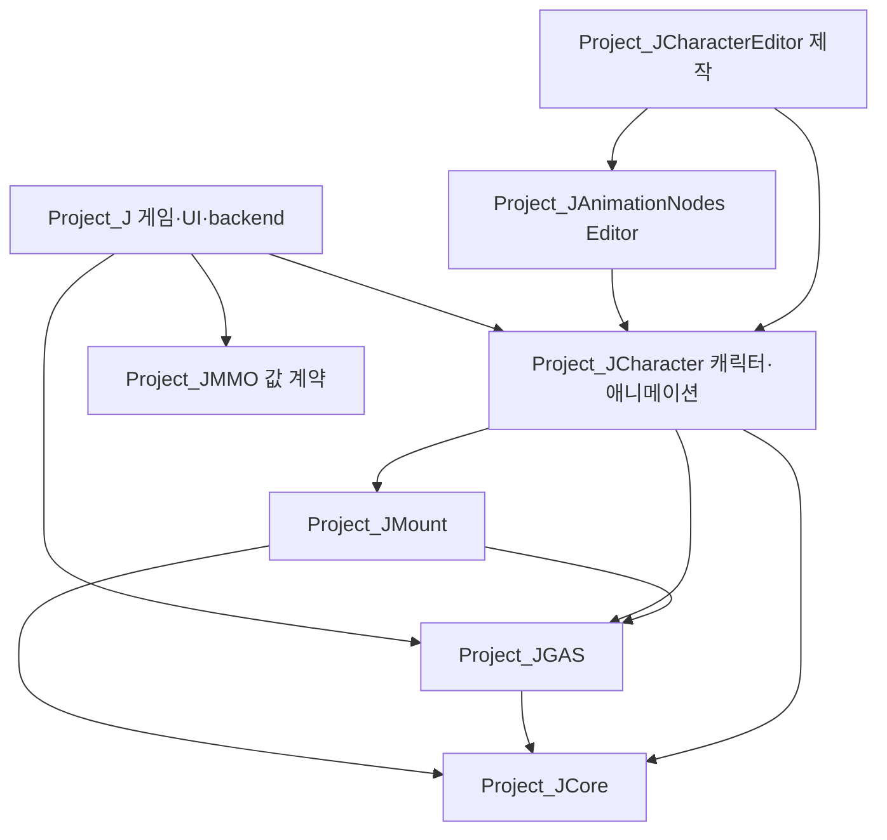

# Project_J 재점검 소유권 지도

[이전 모듈/시스템 지도](Project_J_Deep_Structure_Map_2026-10-13.md)와 [이번 발견·변경·검증](Project_J_Reaudit_2026-10-14.md)을 함께 읽는다. 이 지도는 새 변경의 경계를 설명하며 모든 함수/에셋/배포 환경을 검증했다는 뜻이 아니다.

## 실제 변경의 상태 소유권

| 경계 | 유일한 상태/자원 소유자 | 실제 호출과 게시/반환 계약 | 이번 처리 |
| --- | --- | --- | --- |
| 물리 이동 출력 | Player movement policy가 CMC의 선택한 5개 값을 게시 | 입력/예측 SavedMove와 서버/replay가 공통 publisher 사용. 잘못된 tuple이면 어떤 값도 부분 적용하지 않음 | RA04 공통 제작 진단과 finite publication |
| UI 체력/마나 | CharacterUIBinding의 actual ASC·4 delegate handles·binding revision | 전체 lease 등록→MVVM FieldNotify 게시. callback이 다시 bind/release/GC하면 이전 revision은 중단 | RA01 delegate 누락·old ASC 오게시 수정 |
| 전투 시각 | CombatPresentation의 attack instance·cue lease·Niagara map | 이전 map을 분리/pin→stop callback. 새 instance는 이전 stop/end가 지우지 않음. EndPlay/Destroy 반환, 새 BeginPlay에서 admission만 재개 | RA02/10 공통 종료·재진입·play 재사용 |
| 탑승 관계 | rider component의 mount pointer/revision/actual ASC tag, mount actor의 possession·captured rider controls | 태그 callback 뒤 component revision 검사. actor의 늦은 possession/이동 복원은 현재 mount 관계를 다시 검사 | RA05/10 tag 누적·새 세션 덮어쓰기 수정 |
| 인벤토리 표시 | model SourceRevision과 그 세대의 entry | 명령/비교/tooltip이 같은 IsCurrentEntry 경계 사용 | RA06 오래된 행과 새 source 혼합 차단 |
| 로컬 UI 저장 | LocalPlayer settings의 save/dirty fields/ticker/storage | public admission 종료→private final flush→자원 반환. notification 후 이전 Read/Write가 계속하지 않음 | RA07 late persistence·recovery 재진입 수정 |
| 미니맵 | widget의 현재 definition/world/texture, UIIconRequest의 async generation | NativeConstruct 재구성 전 common release. sampling timer는 실제 등록 world에서 반환 | RA03 잔류 texture·중복 streamable 구현 정리 |
| 리타깃 메시 역할 | 현재 source에 attached된 명시적 follower role | 공통 resolver의 tag/native retarget class 선택. bone 소비자는 loaded mesh, quality 조회는 load 전 role 허용 | RA08 기준 클래스의 별도 탐색/이름 예외/캐시 제거 |
| 지면 접촉 | weapon profile의 contact settings, weapon presentation의 계산된 correction | 공통 숫자 계약을 통과한 enabled 설정만 physics trace. endpoint 비정상 값은 query 전 거절 | RA11 제작/실행 계약 일치 |
| Mass 이동 대여/종료 | GT bridge의 admission·captured Character controls·private entity/processor/archetype, joined worker의 복사 route/math | 실제 월드 종료가 Tick/Unregister의 외부 callback에서 들어와도 active step 완료 뒤 common Stop이 control/entity/storage 반환 | RA14 조기 저장소 해제 4 mismatch 재현·13 focused clean. 기존 200명 authored CPU fixture는 이 opt-in Mass 경로를 사용하지 않음 |
| 새 play 수명 | 각 actor/component의 요청 gate, 이미 반환한 old handles/tags/tasks/revisions | EndPlay(RemovedFromWorld)와 Destroy를 구분. 새 BeginPlay admission은 Super 전에 재개하되 old generation/token을 복원하지 않음 | RA15/16/17/19 10 owner의 실제 공개 동작13 mismatch→focused19 clean/전체351 실행. NPC·device/GAS/modifier·같은 montage·mount actor·UI/Quest를 각각 대조 |

## 검토 후 유지한 경계

### MM·로코모션 중복 판단 기준과 실제 정리

`StateControllerRuntime`의 hold/소비한 Start·Stop·Land·Pivot 명령은 GT의 단발 수명을 소유한다. `MovingTurnPolicy`는 실제 주행 원점·물리적 교정 준비·완료를, `GeneralTurnPolicy`는 후보 창과 완료된 MM 선택 feedback을 소유한다. `OneShotCurvePolicy`는 별도 증거를 재구현하지 않고 `ContinuousCurvePolicy`를 사용한다. 네 정책의 inline 본문과 실제 presentation/continuity 호출을 추가로 읽었다. 이름이 유사한 state를 같은 권위의 이중 상태로 계산하지 않는다.

AnimInstance의 GT chooser cache, proxy의 PendingGameThreadData와 소비된 ThreadSafeData, generated/native node별 applied database는 생산·게시·실제 적용 시점이 다르다. 실제 proxy AddReferencedObjects가 두 snapshot과 native nodes, 현재/applied/generated database 참조를 GC에 등록한다. ExternalPlaybackOverride는 update/evaluate traversal 범위의 빌린 포인터이며 GT에 게시하지 않는다. 이 경계와 기존 GC 회귀를 유지한다.

추가로 확인한 동일 로직은 StateControllerRuntime::IsTransitionState와 presentation helper의 다섯 상태 lambda다. 실제 GT 호출 세 곳을 기존 State Controller 함수로 통합해 helper 복사본을 삭제했다(RA13). 입력·Landing·Loop·단발 override/Strafe warping 조건과 임계값은 유지한다. 이 작은 중복 제거가 전체 MM 상태의 완전한 단순화나 CPU 개선을 입증하지는 않는다.

GT에서 actor/profile/input/asset을 읽어 proxy 값과 GC 추적 asset references를 게시한다. animation worker는 그 snapshot과 math를 사용하고, 완료된 playback 관찰이 GT의 다음 선택에 반영된다. Source의 단발/MM history generation·history·postprocess frame gate와 input/return ownership을 유지했다. 0.35초·100cm·3도·85% 기준을 바꾸지 않았다.

TargetScoring의 copied data와 cancellation·module unload join, NPC decision의 registry/world epoch와 GT apply, Mass의 authority·captured controls·copied route·chunk join, presentation budget의 admission token/FIFO cancellation을 검토했다. task cancel 요청과 실제 완료를 같은 것으로 취급하지 않는다. 새 UI/탑승/시각 변경은 worker에 UObject 조회를 추가하지 않는다.

Core→GAS→Mount→Character→Project_J의 책임과 값 전용 MMO port를 대조했다. Catalog·ServicePort·PoolDefinition은 확장 계약이고 실행 중인 backend/분산 lock/실제 object pool이 아니다. active engine Niagara pool, streamable resource owner, async task registry와 구분해 기록한다. Native network policy helper가 존재한다고 active Iris 필터 등록이나 200 실접속을 입증하지 않는다.

## 장부와 미검증

Saved/Validation/Reaudit_20261014/SourceReviewLedger.json은 기존 605개와 새 회귀 소스 2개의 현재 해시, 이전 review 수준, 추가 implementation body 읽기 141개 및 명명된 추가 계약을 기록한다. 읽은 cpp와 관련 헤더/inline/caller를 같은 완료 단위로 합치지 않는다. 전체 458 production/tooling·149 test/fixture의 전수 수동 완료를 주장하지 않는다.

실제 source/body MCP 연결 및 public subobject templates와 actual Blueprint construction 회귀는 서로 다른 증거다. template parent null이나 MCP가 못 읽은 값은 runtime 부재로 해석하지 않는다. 이 조회가 모든 BP 이벤트·의상·body family·클립·음향·UI 접근성의 품질 검증은 아니다. 남은 header/inline·제작/확장 경계와 native/패키지/실제 RHI/통합 검증을 [진행 기록](Project_J_Reaudit_2026-10-14.md)에 유지한다.

## 추가 경계 RA20–25

Mass active step과 NPC ownership callback, TargetScoring/VisualAsset/NPCPath의 GT 완료, NPCDecision action/result/stop, PresentationBudget apply 범위는 참가자 UObject를 동기 범위에만 보유한다. worker의 값 snapshot과 module shutdown join·cancel 완료·epoch/token/FIFO admission은 그대로다. native GC 테스트는 실제 engine world cleanup을 사용하며 일반 Editor/MCP와 game/server host의 plugin 구성을 구분한다.

MM 조기 전이는 현재 held clip·gait·snapshot revision이 단일 권한 소유자다. 호출이 없는 depth 경로와 세 cadence getter를 제거했다. Blueprint snapshot getter, queued/consumed proxy, per-node applied DB/companion GC 보유, post-selection acknowledgement는 서로 다른 경계로 유지한다. GAS 입력은 실제 pressed/released 소유권을 통과하며 미사용 직접 activation loop는 제거했다. [세부 결과와 미검증](Project_J_Reaudit_Remaining_2026-10-14.md)을 함께 읽는다.

## 현재 모듈 의존성 대조

아래 화살표는 의존하는 모듈에서 제공 모듈을 향한다. 현재 project-module Build.cs 간 순환은 확인하지 않았다. Mount는 ACharacter와 Core/GAS 계약을 사용하며 Character 모듈을 역으로 의존하지 않는다. MMO는 Core만 사용하는 값 계약 모듈이다. Editor 그래프/제작 모듈은 별도 editor target 경계에 있다. disabled ProjectJExperiments는 현재 전체 native/Cook 검증에 포함됐다고 표시하지 않는다.

공유 ComboWindow/MeleeHit/WeaponMotion/WeaponGroundContact/CombatPresentationCue notify는 per-mesh·per-instance token을 소유해 동시 실행을 분리한다. Begin 시 다른 mesh의 weak state 표를 순회하는 공통 패턴도 확인했다. 동시200 공격 시작 시 방문량 후보이며 단계별 trace에 notify/ability/weapon spawning 비용을 추가해 원인을 구분해야 한다. 실제 프레임 증가 원인·정리 누락·메모리 누수로 확정하지 않았고 이번에는 수명 계약을 변경하지 않았다.
