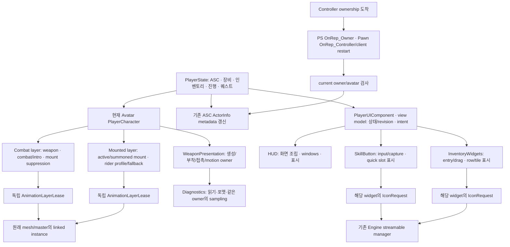

# Project_J 구조 개선 — 2026-10-13

이 기록은 [앞선 결함 감사](Project_J_Whole_Project_Audit_2026-10-13.md) 이후 **실제로 중복 절차·책임·파일 규모·미사용 private 코드를 정리한 변경**을 다룬다. 검토만 한 시스템을 수정했다고 표기하지 않는다. 소스 전체의 중복·미사용·확장 문제를 모두 제거했다는 의미가 아니다.

후속 DS01–18의 이중 상태·GAS 세대·입력/aggregate 종료·실제 피해 에셋 교정과 최종 332개 회귀·Game/Cook·성능 결과는 [심화 감사](Project_J_Deep_Structure_Audit_2026-10-13.md)에 있다. 아래 SI 단계의 보존/검증 범위를 후속 변경과 혼동하지 않는다.

## 새 기준선과 보존

기준은 `codex/runtime-retarget-profiles`, HEAD `f1bbd48a` 위의 앞선 미커밋 결함 수정·회귀·문서다. `Saved/Validation/StructuralAudit_20261013/Baseline`에 Source/Config/Scripts/Docs/uproject/AGENTS 953파일, 각 SHA256, 당시 Git status와 tracked patch를 보존했다. 앞선 인계 문서의 사용자 변경도 유지한다. Content 수정·commit·push·merge·컴퓨터 종료는 수행하지 않는다.

OTM/Strafe·Run/Sprint·단발/MM 복귀·Land·측면 후보·전투·장비·리타깃과 **0.35초·100cm·3도·85%** 기본값을 유지한다. 새 공통 코드는 GT 자원 수명과 생성 기본값을 다룬다. 기존 animation worker/proxy, NPC task·Mass·경로 예약, server authority/prediction scheduler를 대체하지 않는다.

## 실제 개선한 단위

| ID | 실제 조사 근거 | 변경과 상태 소유권 | 보존한 차이·검증 |
| --- | --- | --- | --- |
| SI-01 | Combat/MountedAnimationLayer의 load generation·failure cache·handle cancel·원래 mesh/master unlink 구현 중복 | `FProject_JAnimationLayerLease` 한곳에 preload·complete·cancel·link·unlink와 class GC pin을 모음. 각 컴포넌트가 독립된 transient/DuplicateTransient 값을 소유 | 전투 준비/활성/탑승 억제, 원격 inactive preload 제한, rider profile/fallback·summoned warm cache는 각 컴포넌트 유지 |
| SI-02 | native AnimInstance와 LocomotionProfile 생성자의 발 배치 기본값17개 의미 줄 동일 | `InitializeFootPlacementDefaults`를 두 생성자가 호출. 값을 그대로 유지하고 DA의 authored override·snapshot 경계 보존 | 설정 UPROPERTY 이름/형식과 지속 곡선 값 변경 없음. Ctor 한곳 변경 시 native fallback과 DA 기본값의 불일치 방지 |
| SI-03 | HUD cpp에 화면 조립과 skill input/drag/capture, inventory row/tile/recycling 구현 혼재 | `PlayerHUDWidget.cpp`는 화면 조립/표시, `SkillButton.cpp`는 quick-slot widget, `InventoryWidgets.cpp`는 행/타일·entry 수명 담당 | UCLASS 이름·상속·BindWidgetOptional·BP 연계·public API 유지. PlayerUIComponent/model이 gameplay intent와 상태의 원천 |
| SI-04 | skill/item icon마다 stream handle/path/cancel/weak owner completion 반복 | `FProject_JUIIconRequest`에 한 widget의 request path/generation/handle만 소유. 동일 경로 A→empty→A도 세대 검사, callback 중 texture pin, NativeDestruct/BeginDestroy 정리 | row/quick-slot 상태·레이블·브러시는 각 widget 소유. visibility callback 뒤 세대 재확인. 실제 로드/취소/owner GC 검사 추가 |
| SI-05 | inventory Render 때 slot FText10개와 TArray를 매번 구성; HUD keyboard와 list double-click의 같은 activation helper | slot enum→label switch와 ActivateItem을 공통 UI 표시 helper로 제공 | localized namespace/key/text와 None/invalid slot fallback 유지. ViewModel의 revision/command validation은 그대로 사용. FPS 향상률 주장 없음 |
| SI-06 | WeaponPresentation cpp의 진단 CVar/문자열/샘플링이 생성·부착·접촉·공격 motion과 혼재 | Diagnostics.cpp로 진단 구현 분리. 같은 rigid authored-space resolver·로그 category와 작은 debug query를 내부 헤더로 공유 | 샘플링 상태는 원래 컴포넌트 소유. CVar 이름/기본값·로그 형식·sampling/tick 조건 유지. 파일 분리를 최적화로 해석하지 않음 |
| SI-07 | private `ClearPendingAnimationExitRequests`, `ShouldShowWeapon`: Source/Config/Scripts/Plugins/Docs 조사에서 선언·정의만 존재, 비반영·비virtual | 선언과 정의 제거 | 로코모션의 실제 landing completion/state owner 전이와 무기 프로필의 실제 호출 경로는 보존. public/UFUNCTION·fallback 타입·asset 계약을 grep만으로 삭제하지 않음 |
| SI-08 | 손실20% 원격: Pawn/ASC Avatar 일치·CanActivate 통과 후 GAS가 `LocalPredicted … when not local`로 거절. PlayerState owner보다 먼저 초기화된 ActorInfo의 controller cache 갱신 경로 누락 | GAS에 current owner/avatar만 호출 가능한 metadata refresh를 모으고 PlayerState OnRep_Owner·Pawn OnRep_Controller/client restart에서 호출 | RefreshAbilityActorInfo만 사용, OnAvatarSet/grant/active ability/input state reset 없음. 늦은 ownership·퇴역 Pawn 회귀·전체317개·같은 원격 조건·최종 패키지 검증 통과 |

SI-01은 모양이 비슷한 component를 하나로 합치는 변경이 아니다. “선택/활성 조건”과 “선택된 리소스의 수명”을 나눴다. 새로운 layer consumer가 필요하면 같은 lease 계약을 사용할 수 있지만, 다른 owner의 pending request나 linked master를 공유하지 않는다. unlink/cancel은 소유 상태를 먼저 분리한 후 엔진 API를 호출한다.

SI-03은 단순 줄 수 분할과 SI-04/05의 실제 중복 제거를 구분한다. 재사용 widget의 구현이 화면 조립과 독립돼 변경 범위가 줄었으며, 상태/model 권한을 UI widget으로 옮기지 않았다. 아이콘 요청은 기존 streamable manager를 사용한다. NPC/VFX 작업 큐나 새 timer/cache 시스템을 만들지 않았다.

HUD 주 cpp는1,641→1,152줄이고 새 SkillButton228줄·InventoryWidgets309줄로 역할을 분리했다. WeaponPresentation 주 cpp는1,857→1,440줄이며 Diagnostics453줄로 진단을 분리했다. 이동한 코드가 사라진 것이 아니므로 이 수치를 전체 코드 감소나 CPU 향상으로 계산하지 않는다. 추가 helper와 실패 경로 검증도 각각 남긴다.

두 자원 값은 해당 UObject의 안정된 멤버 주소와 수명에 묶인다. pending request가 있는 값을 다른 owner로 복사·이동해 사용하는 확장 방식은 이번 구현의 계약에 포함하지 않는다. UI callback은 weak owner 유효성을 먼저 확인하고 나서 embedded request를 읽으며, 레이어 class의 GC 참조는 원래 component의 UPROPERTY를 통해 유지한다. 다른 owner가 같은 pending handle을 빌리는 manager로 확장하지 않는다.

## 호출 관계와 소유권 지도

PlayerCharacter의 Begin/장비 profile 변화·combat 상태 변경이 Combat layer preload/refresh를 부르고, MountChanged 및 summoned mount 변화가 Mounted layer preload/refresh를 부른다. 레이어는 rendering client에서만 요청·연결한다. UI의 동일 item activation 경로는 keyboard와 list/tile double-click이 ViewModel로 전달하며, authority mutation은 서버 게임 상태에서 검증한다.

## 검토만 했거나 유지한 영역

| 영역·실제 owner | 검토한 계약 | 실제 변경 여부와 이유 |
| --- | --- | --- |
| LocomotionAnimStateComponent·turn/remote/landing 정책 | authoritative intent와 remote visual request, latched landing·입력 redirect·pivot·presentation release | 상태 머신 재작성 없음. 큰 파일이라는 이유로 보호된 수명/원천/파생 상태를 분산시키지 않음. 미호출 private helper1개만 제거 |
| AnimInstance/Proxy/MM/retarget | GT snapshot·GC asset refs·worker 읽기, primary pose와 visual body의 구분 | snapshot/검색/retarget 알고리즘 유지. 생성 기본값 중복만 제거 |
| Combat/GAS/장비/SSR | persistent ASC/avatar, predicted input와 server intent, montage/notify/hit/weapon revision | 앞선 결함 수정 보존. 판정·damage authority를 UI/공통 resource lease로 옮기지 않음 |
| NPC TargetScoring·decision·path | 값 snapshot·world epoch/revision, task cancel/complete·예약 상한 | 병렬 queue 통합 없음. scoring task와 nav in-flight의 취소/완료 수명이 다름 |
| Mass | grid capture·chunk 계산/join·GT Actor 적용 | actor ownership과 fragment 계산 경계 유지. 애니메이션 task를 여기에 제출하지 않음 |
| Message subsystem | listener snapshot·재진입·GT owner | 기존 snapshot broadcast 유지. transport callback/worker dispatch와 공통 event bus로 무리하게 통합하지 않음 |
| VisualAsset·Foley·presentation budget | async lease/FIFO/backpressure·listener-side trace·effect/audio 수명 | UI icon의 단일 request와 VFX/NPC bounded workload 정책이 달라 manager를 합치지 않음. 실제 오디오 출력은 미검증 |
| Gateway·Handover·MMO repository | HTTP GT completion/tracker, attempt/replay receipt, memory CAS/idempotency | tracker·aggregate gate·handover receipt를 같은 “상태 관리”로 합치지 않음. 각각 completion/keys/attempt 소유 계약이 다름. live backend 구현 완료 아님 |
| Inventory/Quest/Progression/PlayerState | aggregate/revision/instance·서버 mutation·owner-only replication·observer | UI와 server snapshot을 공통 mutable state로 합치지 않음. 서비스/서버 권한 경계 유지 |
| Mount/flight/health | possession·rider 관계·flight request/landing attempt·서버 health | rider resource lifecycle만 공유. Mount gameplay state는 별도 module/owner 유지 |
| Editor/AnimationNodes·에셋·Cook | native graph wrapper·반영 API·soft ref/primary asset·CDO | UCLASS/BP API 삭제나 blanket asset 정리 없음. legacy getter·native fallback·MirrorDataTable을 C++ grep만으로 미사용 판정하지 않음 |
| ProjectJExperiments plugin | disabled-by-default·Editor/Win64 전용·fixture | shipping gameplay dependency가 아닌 opt-in 실험 경계 확인. 미구현 feature catalog를 구현 완료로 재분류하지 않음 |

이 표는 해당 영역을 상세 수정했다는 표가 아니다. Source 의존·대표 호출·상태 소유/완료 경계를 검토한 범위다. 모든 함수·모든 BP/Chooser/DT 행·전체 게임 맵을 실행했다고 주장하지 않는다.

## 자동 조사와 미사용 판단의 한계

기준선 production C++/header/inl430파일을 조사했고, 새 helper/분리 파일을 포함한 현재는440파일이다. 주석/공백/단독 brace를 제외한12개 연속 의미 줄·최소300문자의 정확 일치 후보는 기준2쌍이며 두 쌍을 실제로 공통화했다. 현재 해당 방식의 후보0은 의미가 같은 모든 로직이나 짧은 중복까지 사라졌다는 증거가 아니다. semantic 중복은 별도로 호출/소유권을 대조했다.

private native 함수 후보는 Source 전체의 symbol 사용 수, header 접근 수준, UFUNCTION/virtual 여부를 확인하고 Plugins/Scripts/Config/Docs도 대조했다. 삭제한2개에는 asset-callable/serialized 함수 계약이 없다. public extension·반영 getter·soft-loaded 콘텐츠의 미사용은 AssetRegistry/compiled graph/Cook와 별도로 판단해야 하며 이번에 일괄 삭제하지 않는다.

## MCP·컴퓨터 사용과 검증

MCP로 실제 `BP_GreatSword`의 두 component subobject와 fallback `ABP_Player_Mount`, 대검 `ABP_GreatSword_Layers`, Dragon rider `ABP_Rider_Dragon`, UI row(false)/tile(true) BP CDO를 확인했다. 이번 공통 `Layer` private value property는 ObjectTools에서 읽을 수 없었다. 이는 지원/노출 범위 한계로 기록하며 네이티브 검사·실제 실행을 대신 전체 MCP 검증이라고 부르지 않는다. 처음 두 잘못된 속성명 조회도 원본 JSON에 남겼다.

컴퓨터 사용으로 에디터 실제 창·모두 저장됨 상태를 확인하고 정상 close를 요청했다. 에셋 편집/저장은 없으며 Editor/LiveCoding 등의 종료를 확인한 후 다음 검증을 시작했다.

| 검증 | 결과·범위 |
| --- | --- |
| 직접 UBT non-unity Editor1 | 정상 실패199.85초. include 순서2개, generated edit의 로그 macro 표기2개, 분리 후 HUD ActivateItem 선언 오류. 빌드 중단/캐시·보안 변경 없음 |
| 직접 UBT non-unity Editor2 | 전체358 action 성공202.19초. 위 구현 오류 수정 및 공통 UI activation 정리 후 모든 cpp 별도 compile |
| Focused1 | 공통 레이어·실제 UI icon cancel/GC·UI BP asset 계약·실제 R 연계4개 성공, 경고/실패/미실행0 |
| Whole1 | SI-01~07 전체316: 성공296+경고 포함 성공20, 실패/미실행/inProcess0,666.038초. 이후 SI-08로 소급하지 않음 |
| WholeFinal | SI-01~08 전체317: 성공297+경고 포함 성공20, 실패/미실행/inProcess0,666.403초. 전체 검사 이름과 경고 예시를 원자료로 보존 |
| SI-08 Editor | 최초 test access 오류 C2248은 protected callback을 reflection으로 호출하도록 수정. 다음 빌드의 다른 테스트 obj C1083 Permission denied는 정상 실패197.89초·ACL Allow·관련 Application error 없음. 같은 소스 재빌드358 action198.01초 성공. 빌드 중단·캐시/보안 변경 없음 |
| ActorInfoFocused | 소유권7개·레이어1개·UI 수명1개,9개 성공·경고/실패/미실행0. 실제 테스트 이름으로 집계하며 입력한 filter의 미일치 항목을 실행했다고 계산하지 않음 |
| Game/Cook/package1 | SI-01~07 직접 Game non-unity305 action148.90초 성공; Windows1361 Cooked+7 platform skipped·0error/1warning; 새 UAT stage/package 성공 |
| 동적 UI A1/B1/A2/B2 | 같은1280×720·1000행/24buff/4windows/10slots·5Hz50delta/10replacement/50filter/5toggle, 모두 success/cooked1·exit0·log error0. 기존/새 빌드 방식·시점 차이로 순수 인과 개선율 미확정 |
| UI1920·실제 BP200·combat | 새 패키지 UI1920×1080 성공, actual BP/body200·동시 R·cooked1, native authored-visual combat/unequip3회 성공 |
| Structural_Lag50Loss20 | 실패: 한 client가 ActorInfo local-control 없이 준비됐다고 판단. owner/remote의 다른 actor R/Q2/end는 관찰했지만 자기 actor 입력 활성화0. 로그와 모든 process exit0 보존; 제품 상태 cache 누락 SI-08 추가 |
| Structural_ActorInfo_Lag50Loss20 | 동일2client·200nativeNPC·50ms·20%loss·parallel net·animation·combat input 조건 통과,3process exit0. owner/remote 입력·서버 연계/종료와 AOI/FastArray·graceful disconnect 검사. 실제200remote connection 시험은 아님 |
| 최종 Game/Cook/package2 | 직접 non-unity Game305 action154.12초 성공. Windows1361 cooked+7 platform skipped·0error/1GameplayCue search-path warning. stage/package37.71초 성공. 실행 파일 SHA256 `482e6691b7bd031b0bff8cfdae7f1ff25361f1d5b5da42221a2f067c31b0d896` |
| 최종 패키지 기능 | UI1280×720/1920×1080 heavy dynamic 각각600표본·success/cooked1·exit0·log error0. 실제 BP/body200·동시 R·rendered 최솟값200. native authored-visual input/GAS/montage/notify/unequip3회 성공 |
| CPU 단독/교대 | 최종 단독16행 및 구조 변경 전후 같은 non-unity8모듈 A1/B1/A2/B2의64행 완료. warm120/measured120·200명·각2회. 전체 최종8모듈/modules를 복원하고 해시 일치 확인. mixed 결과와 큰 일부 표본을 제외하지 않음 |

검증 원자료는 [휴대 가능한 근거 목록](StructuralEvidence_2026-10-13/README.md), 로컬 `Saved/Validation/StructuralAudit_20261013`와 각 실행 manifest/SHA256에 보존한다. Engine startup의 UnifiedError self-test 출력·Toolset Python 오류와 ProjectJ index 판정을 구분한다. 새로 만든 테스트는 실제 texture loader의 지연 완료·A→empty→A·widget GC를 사용하며, 제품 코드에 문제를 숨길 timer/reset을 추가하지 않는다.

최종20개 경고 포함 성공에는 native fixture의 socket/palm 누락·호환 부착, 일부 임시 world의 context/기본 nav data와 미할당 animation profile 경고가 있다. 이를 깨끗한317개 성공으로 바꾸어 표기하지 않는다. 해당 native fixture의 통과는 모든 authored mesh·소켓·맵 품질이 검증됐다는 의미가 아니며, 실제 BP/body와 Cook 결과는 별도 실행으로 대조한다.

원격 fixture의 준비 조건도 current ActorInfo PlayerController==해당 local controller 및 IsLocallyControlled까지 확인한다. CanActivateAbility는 network execution locality를 모두 보장하지 않는다. 이 준비 검사를 제품 캐시 갱신 대신 사용하지 않으며 입력을 반복 재전송하지 않는다. 최초 failing client의 `Can't activate ... when not local` 원문과 기존 owner/Avatar·equipment 상태를 보존한다.

## 구조 변경의 비용과 측정 한계

UI 교대 A1/B1/A2/B2는 GT 평균1.699/1.655/1.681/1.592ms, FrameTime 평균16.692ms 부근이다. cap60·10초 창이며 A는 이전 mixed-unity 패키지, B는 SI-01~07 non-unity 패키지이므로 작은 차이를 소스 개선의 인과 효과로 주장하지 않는다. SI-08 최종 패키지 GT 평균은1280×720 1.709ms,1920×1080 1.700ms다. 장비 슬롯 label 구성 제거의 근거는 매 render의 FText/TArray 구성 호출이 제거됐다는 소스 변화이며 FPS 향상률은 미확정이다.

CPU의 A는 구조 개선 전953파일 기준선에 대응하는 앞선 최종 Editor8모듈, B는 SI-01~08 최종 Editor8모듈이다. 양쪽 모두 같은 toolchain의 전체 non-unity, 같은 현재 에셋,200명·ABA2ms·warm120/measured120·60Hz·각2회다. 바이너리와 modules를 한 세트로 교대하고 매번 normal exit 후 다음 세트를 설치했다. baseline 실행에서 자동 기록된 working-tree SourceSnapshot은 baseline compiled source가 아니므로 `comparison-provenance.json`에 실제 기준선·해시와 이 차이를 명시했다.

| 조건 | A 전체 평균(ms) | B 전체 평균(ms) | 변화 |
| --- | --- | --- | --- |
| Near ABA off | 19.952 | 19.654 | -1.49% |
| Near ABA on | 13.152 | 12.939 | -1.62% |
| Far ABA off | 16.095 | 16.282 | +1.16% |
| Far ABA on | 12.159 | 12.017 | -1.17% |
| Hidden ABA off | 11.865 | 12.534 | +5.64% |
| Hidden ABA on | 6.878 | 6.884 | +0.09% |
| AttackBurst ABA off | 22.789 | 22.972 | +0.80% |
| AttackBurst ABA on | 22.587 | 23.079 | +2.18% |

Hidden off의 B1 반복은11.600/11.992ms이고 B2는14.741/11.805ms다. B2 R0의 p95는23.523ms, observer 평균0.312ms로 함께 높으며, 해당 행을 제외하지 않았다. 단독 현재 실행의 AttackBurst off23.731–24.038ms보다 교대 실행의 값은 낮아 측정 시점 편차도 확인된다. 작은 증가의 원인은 확정하지 못했고, 이전 전체 CPU 증가가 해결됐다는 결론을 내리지 않는다. [64행 및 tick 배열 원자료](StructuralEvidence_2026-10-13/README.md)와 [이전 단계 trace·동일 컴파일 비교](Project_J_Whole_Project_Audit_2026-10-13.md#단계-trace-해석)를 구분해 보존한다. 이번 SI-01~08에 대한 새 단계 trace 추출은 하지 않았으므로 이전 trace로 최종 helper별 비용을 확정하지 않는다.

최종 실제 BP/body200의 렌더는 idle500표본 mean/p50/p95/max15.987/15.953/16.884/69.376ms, 동시 R387표본20.626/16.684/27.642/78.285ms다. GPU mean/p95는 각각10.223/10.377ms와10.529/11.297ms다. 두 PNG를 직접 확인했고 rendered 최솟값200·R montage 최댓값200이다. 간단한 Entry·광원·카메라의 offscreen D3D12 장면, cap0/VSync0·원격0이다. 캡처 요청 행 제외 후에도 후속 비용·지연 GPU counter 한계가 남는다. NullRHI world tick이나200개 원격 접속 성능과 합치지 않는다.

## 결함·잠재 위험·제안의 구분

| 분류 | 근거·현재 처리 |
| --- | --- |
| 확인된 결함 | 늦은 PlayerState owner/Controller로 GAS ActorInfo locality cache가 비는 경로: 실제 원격 실패·늦은 소유권 회귀로 확인, SI-08 수정 및 동일 원격 조건 통과. 앞선 실제 R 도중 tap 누락과 Avatar/수요/UI 실패 수명 결함은 기존 변경을 보존 |
| 확인된 구조 문제 | 두 layer의 동일 자원 수명,17개 기본값 중복,HUD/무기 진단 책임 혼재, 반복 label/activation 구현,미호출 private2함수: SI-01~07 실제 정리 |
| 잠재 위험·미확정 | CPU 작은 증가와 특정 반복 편차, resource value를 향후 다른 owner로 복사하는 확장, public/legacy 자산의 실제 사용·장기 float timestamp·grant admission. 재현되지 않은 항목을 수정 완료 버그로 표기하지 않음 |
| 제안 | 새 consumer도 독립 owner/안정된 member 수명과 GT 완료 계약을 유지하고 실패/취소/재진입 검사를 추가. CPU는 장기 교대·새 단계 trace 및 workload/품질 기준과 함께 조사. 배포 환경의 native Server·실 backend·실 접속/피해/품질 증거를 확장 |

## 남은 영역

마지막 확인에서 Source/Config/uproject593파일은 최종 빌드·검증 뒤 변경0이며 Game 실행 파일과 시험한 package2의 SHA256이 일치한다. 최종 Editor8모듈을 모두 복원해 해시를 확인했다. 모듈/콘텐츠 DAG205항목·20영역 검사와 Git diff check가 통과했고, 문서208개(root README 포함)의 local link1500개는 broken0·기존 로컬 archive 부재12개다. 인계 문서의 사용자 변경과 BodyABP 해시를 보존했고 Content 변경은0이다.

CPU200의 일부 증가, native Server distribution 미지원, live backend/DB·200실접속, remote hit/SSR 피해·late join, 근접 손/발·연속 영상·오디오 품질과 모든 plugin/legacy asset 내부 행은 앞선 미검증/미해결 범위다. 이번 구조 변경의 효과를 파일 크기나 단일 측정 평균으로 성능 개선이라고 확정하지 않는다. 향후 콘텐츠/기능 추가 시 이 계약과 실제 workload·실패 경로를 함께 확장한다.
