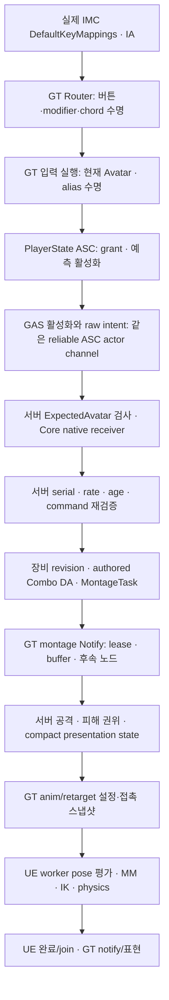

# Project_J 전체 구조·동작·병렬·네트워크·성능 감사 — 2026-10-13

전체 시스템의 상태 원천, 데이터·실제 에셋, 소유권·수명, 취소·재진입, GT/worker 경계, 서버 권위·예측, 제작·확장·검증을 조사했다. R 도중 우클릭 연계 불가는 실제 데이터로 재현한 대표 사례다. 다른 공통 결함도 수정하고 새 실패 경로를 검증에 추가했다. 개별 자동화 통과를 프로젝트 전체 무결성으로 해석하지 않는다. 200명 CPU 증가와 아래 미검증 영역은 남아 있다.

최종 서버 재진입 보완까지 전체315 회귀·직접 UBT Editor/Game·Windows Cook/stage·패키지 UI가 통과했다. 같은 패키지의 실제 BP200 렌더·전투3회와 최종 소스의 실제 소켓 손실20% 연계3회도 통과했다. **commit·push·merge·컴퓨터 종료는 수행하지 않는다.**

이후 중복·책임 정리는 [SI01–08](Project_J_Structural_Improvement_2026-10-13.md), 이중 상태·공통 수명·실제 피해 에셋 등 추가 변경과 최종 검증은 [DS01–18 심화 감사](Project_J_Deep_Structure_Audit_2026-10-13.md)에 기록했다. 후속 전체 회귀는 332개이며, CPU 일부 증가와 packaged CPU trace 종료 실패가 남아 있다. 아래는 앞선 WA 단계의 시점별 근거다.

## 기준선과 보존

- 브랜치 `codex/runtime-retarget-profiles`, 시작 HEAD `f1bbd48a`(실시간 리타깃 프로필 구조와 전체 감사 인계 정리).
- 인계 당시 미커밋 리타깃은 현재 HEAD에 포함돼 있다. 시작 시 사용자 미커밋은 인계 문서 13절 요청문 삭제뿐이며 수정하지 않는다.
- `Saved/Validation/WholeProjectAudit_20261013/Baseline.json`, `BaselineUserChanges.patch`, `BaselineHandoff.md`, `BaselineBinaries`에 소스·설정 SHA256, 원래 변경과 재현 기준 DLL을 보존한다. Saved는 로컬 원자료다.
- 모든 C++ 빌드는 직접 UBT 완료 후 다음 실행으로 넘어간다. Editor/UBT/dotnet/Live Coding/MSBuild/ShaderCompileWorker가 남으면 시작하지 않는다. 빌드 중단·commit·push·merge·종료는 수행하지 않는다.
- OTM/Strafe, Run/Sprint, 단발/MM 복귀·Land·측면 후보·전투·장비·리타깃 및 지속 곡선 기본값 **0.35초·100cm·3도·85%**는 보존한다.

## 구조 지도

`.uproject`는 Runtime 6개, Editor 1개, UncookedOnly 1개다. Build.cs 의존성 검사는 순환/역방향 없이 통과한다. `Project_J`의 Editor 조건부 AnimNodes 의존성과 Runtime 의존성을 구분한다.

| 모듈 | 책임·실제 의존 |
| --- | --- |
| Core | Tag, 공용 인터페이스·값 계약, Asset/GameData/Message/VisualAsset/TargetScoring/ObjectPool 정의. 다른 프로젝트 모듈 의존 없음 |
| GAS | Core 위의 ASC·AttributeSet·grant lease. 입력 spec·GAS Tick은 여기서 소유; AbilitySet DA는 Character에 존재 |
| Mount | Core/GAS 위의 탑승·비행·ASC/Attribute·애니메이션. Character 역참조 없음 |
| Character | Core/GAS/Mount 위의 Pawn·이동·입력·전투·SSR·애니메이션·AbilitySet DA·장비 표현·NPC/Mass·제작 계약 |
| MMO | Core 엔진 모듈만 사용한 값/조정·메모리 repository. 205개 확장 카탈로그는 구현 완료 목록이 아님 |
| Project_J | Core/MMO/GAS/Character 위의 GameMode/State/Controller, PlayerState 영속 상태, UI, Quest, Gateway/Handover·검증 fixture |
| CharacterEditor | Character/GAS/AnimNodes 위의 제작·검증·미리보기. Editor만 로드 |
| AnimationNodes | Character 위의 native graph wrapper. UncookedOnly, runtime 노드는 Character에 존재 |

| 실행 영역 | 상태 원천·소유자 | 실행·의존·경계 |
| --- | --- | --- |
| 시작·소유권 | GameMode/Controller, PlayerState, Pawn | PlayerState ASC·Inventory·Equipment·Progression·Quest가 영속 상태; Pawn은 Avatar. NPC는 로컬 ASC |
| 입력 | Enhanced Input binding, Router, Execution | 실제 IA/IMC → 버튼·modifier/chord → 의미 tag → command history → ASC spec activation/gameplay event; UI focus·컨텍스트 lease 포함 |
| 전투·장비 | ASC ability activation, Equipment weapon revision | Combo DA·Attack DA·몽타주·Notify lease, presentation/hit validation. prediction key·server sweep history로 권한 검사 |
| 이동·애니메이션 | Movement/Locomotion component·State Controller | GT 상태/Chooser → proxy 불변 값·asset 참조 → engine worker 평가 → GT 결과/notify. MM/단발 실행 identity·복귀 lifetime |
| 리타깃·시각 예산 | Master source pose, Family/Body, mesh demand | GT retarget 설정·접촉 스냅샷 → worker IK/물리. ABA·URO·외형 external rate·보간·hidden 복귀·공격 보호 합성 |
| NPC decision | server world scheduler | GT 공간 snapshot/observer → bounded scoring batches → worker 값 계산 → GT owner/revision/world epoch 검증 후 적용 |
| NPC path | server nav request reservation | GT admission → engine async navigation → GT completion. 취소된 in-flight는 완료까지 예약을 유지; expiry·controller 변경 검사 |
| Mass | fragment movement owner | 값 crowd grid를 먼저 캡처, chunk 병렬 계산·join. Actor/Character 적용은 GT; dense overflow는 Character traversal 요구 |
| 비주얼·VFX | VisualAsset lease, presentation request revision | async load·bounded FIFO·GT apply, callback 전 상태 분리·asset pin, cancel churn 예약 유지 |
| Foley | listener-side world subsystem | 의미 이벤트·거리·age·동시성/토큰 제한 → GT 접촉 trace → audio. dedicated 제외; 실제 오디오 출력은 별도 검증 |
| UI | Controller·PlayerState source revision | resource/status/inventory/quest 구독, async icon, cursor/focus, stale row·timeout·avatar 교체. 화면 생성 실패도 수명 경계 |
| Inventory/Quest/Progression | 서버 PlayerState aggregate | owner-only 복제, instance ID·revision·receipt·rate limit, mutation 후 observer·GAS 이벤트, snapshot validation |
| 네트워크 | Iris NetDriver·GAS/Movement 예측 | owner-only FastArray, raw intent RPC, replicated one-shot sequence, root motion SavedMove, server SSR. 정책 계산과 실제 driver 적용 구분 |
| backend/MMO | request tracker, handover ID/attempt, CAS repository | HTTP 완료는 GT, close/cancel 전 tracker 분리; transport completion은 GT marshal. loopback/메모리 기반과 실서비스 구분 |
| 제작·Cook | Editor tooling·DataValidation·AssetManager | soft ref/primary asset 등록·BP/ABP/Chooser/DA/DT·skeleton/section·cook strip·runtime module loading |
| 측정·검증 | 개별 fixture 조건·build/asset hash | direct-input 시험/실제 마우스/원격/NullRHI/렌더/GPU/Cook은 서로 다른 증거 |

전체 경로 및 소유권·작업/RPC/구독 패턴 목록은 `SourceInventoryPaths.txt`, `OwnershipAndExecutionInventory.txt`, `UnfinishedAndDiagnosticInventory.txt`에 남긴다. 이는 모든 함수·모든 에셋 전수 실행 증명이 아니다. 상세 검토·실행과 목록/패턴 검색을 구분한다.

## 실제 데이터와 R 도중 우클릭 재현

Unreal MCP의 object/blueprint/editor 도구로 관련 연결을 조회하고 C++ fixture에서 동일 데이터를 실행했다. BP 기본 객체의 시작 무기 `DA_Greatsword_Equip`, 클래스 `DA_Class_Greatsword`, 입력 `DA_Greatsword_Mapping_Data`, AS_Greatsword_Base/AS_Humanoid_Core, CombatStyle/Combo DA를 대조했다.

- `Combo.Greatsword.R.1` + RMB → `Combo.Greatsword.Q.2`가 실제 authored 전이다.
- R Attack DA → `AM_Greatsword_R`: 길이4.533333초, PlayRate1, section=None, RootMotionMontage/Flying. native 검사에서 ComboWindow는2.4966초부터2.0368초다.
- 정상 Router 초기화 후 원본 Character DLL로 의미 tag 대조군은 성공했으나 빠른 실제 RMB press/release는 R의15/240/255프레임과 자연 종료 후 새 combo에서 실패했다. release 전에 held 조건이 사라져 grace 안의 단일 tap을 해석하지 못했다.
- 수정은 R·클립 예외가 아니라 공통 마우스 press/release 계약이다. chord 우선순위·0.08초 grace는 유지하고, release 직전 해석 결과를 상태 해제 후 전달하며 동기 재진입 revision을 검사한다.
- 수정 후 실제 R 진행 중 early/late tap·자연 종료·버퍼 중 unequip/re-equip·30/120Hz 시간 재생을 확인했다. 원격에서는 서버/소유자/관찰자 모두 R→Q2→종료를 확인했다.

### MCP로 대조한 연결과 지원 한계

- 기본 GameMode CDO는 Pawn=`BP_GreatSword`, Controller=`BP_ThirdPersonPlayerController`, State=`Project_JPlayerState`, GameState=`Project_JGameState`다. 기존 문맥 문서의 “빈 wrapper/Default Pawn도 C++ 설정” 설명을 실제 override로 정정했다.
- Controller의 DefaultMappingContexts=`IMC_Default`, MobileExcluded=`IMC_MouseLook`. UE5.8의 `Mappings`는 비어 있으나 현재 `DefaultKeyMappings.mappings`에는 실제 R/Q/T·LMB/RMB와 W/A/S/D 방향 입력이 있다. legacy 속성의 빈 배열을 입력 누락으로 해석하지 않았다. R IA는 Boolean, trigger/modifier 없음, consume=true다.
- Greatsword AnimProfile→DA_Player_Profile/DA_Player_Combat/DA_Mannequin_Foley. 공유 Body/HandGrip은 None이며 실제 시각 ABP의 Body override가 DA_RetargetBody_Greatsword를 공급한다. 시각 ABP 의존에는 원래 Retargeter·3개 physics·Family를 가진 Body가 있다.
- Master의 native Locomotion/AnimationBlendStackGraph·CombatUpperBody·MountedLocomotion 그래프 존재 및 모듈/asset 의존을 확인했다. MCP native AnimGraph DSL은 빈 문자열이며 Chooser 속성/내부 행·PoseSearchSchema skeleton은 해당 도구의 읽기 스키마에 없었다. 네이티브 generated graph/data 시험으로 보완하지만 MCP 전수 검사로 주장하지 않는다.
- StateController Chooser 저장 의존은 InAir/Land/OTM_Ground/Strafe_InAir/Strafe_Land/GroundPresentation이다. Source의 현재 데이터 선언을 비교했다. `MDT_UEFN_Mannequin`의 실제 클래스는 MirrorDataTable이며 AssetRegistry referencer 조회는 0이었다. 일반 아이템 DT라고 추정하지 않았다. project C++의 UDataTable 소비는 검색에서 확인되지 않았으며 DA 중심 구조다. 모든 plugin/engine table의 내부 행까지 검증한 것은 아니다.
- 후속 MCP 조회 시 PIE=false. 생산 에셋을 편집/저장하지 않았다. 잘못된 속성명 조회·지원되지 않은 조회도 JSON 원본을 보존한다.

## 발견 목록과 최종 변경 이유

| ID | 분류·영향 | 원인과 최종 계약 | 근거·상태 |
| --- | --- | --- | --- |
| WA-01 | 확인된 결함/P1, 빠른 마우스 단일 입력 누락 | held 상태에서 tap tag를 먼저 해석하고 released 상태 게시 후 dispatch. press/cancel revision으로 이전 completion의 새 press 해제 방지 | 올바른 실제 fixture에서 원본 실패→수정 성공 |
| WA-02 | 확인된 결함/P2, 사라진 수요 owner의 full-rate 보호 유지 | 기존 animation budget world pass에서 파괴/만료 requester 정리. 살아 있는 다른 요청과 원래 URO/visibility 복구 계약 유지 | 만료/복수 owner 회귀 성공. 새 timer/tick 없음 |
| WA-03 | 확인된 검증 공백, 마우스를 우회한 combo 시험 | 실제 mapping/Router press/release와 의미 입력 대조군 추가 | authored·chord·cancel·재진입·주기별 회귀 추가 |
| WA-04 | 확인된 결함/P1, 손실 네트워크에서 전투 의도 누락·다른 시작 공격 | raw intent를 reliable ASC actor channel로 옮겨 GAS activation과 순서 유지. ExpectedAvatar와 서버 tag/rate/age/serial 검증. uint32 wrap 지원 | lag50/loss20 원본의 R intent 누락과 RMB.1 시작 확인; 수정 후 loss3/20 각3회 통과 |
| WA-05 | 확인된 구현 경계, Iris 정책과 실제 adapter 혼동 | Party/Guild filter·combat prioritizer UObject는 정책 계산/진단 소비. 실제 Iris adapter 등록과 구분 | 코드·NetDriver/설정 대조 및 문서 정정; adapter 구현 완료로 표기하지 않음 |
| WA-06 | 확인된 결함/P2, 뒤집힌 리타깃 skeleton 쌍 제작 승인 | available Retargeter preview skeleton과 Family 선언 대조, Body로 invalid 전파. preview 없으면 warning | 실제 생산 Family 정상, 바꾼 source/target 원본 실패→수정 성공 |
| WA-07 | 미해결 성능, 200명 일부 CPU 증가 | 동일 조건 반복·교대·단계 trace·같은 non-unity 구성 비교. 명시 Body일 때 불필요한 Pawn/archetype lookup 제거 | 최신 비교의 일부 +0.15~3.70%, 변동 범위 겹침. 전체 회귀 해결·작은 lookup의 인과 효과 미확정 |
| WA-08 | 확인된 결함/P1, retired Pawn이 shared ASC 새 Avatar 상태 조작 | binding·활성화/취소/조회·입력 press/release·queued RPC에 current Avatar identity 적용 | 원본 활성화/태그/상태3실패→수정 성공. unpossessed이지만 Avatar인 NPC는 보존 |
| WA-09 | 확인된 결함/P2, UI 화면 생성 실패 재시도의 구독·입력 자원 누적 | CreateWidget 성공 후 모델·input processor·delegate 게시 | 원본9수명 assert 실패→수정 성공 |
| WA-10 | 확인된 검증 결함, 제거된 external BlendStack 관측 | unified/MM이 공유하는 BlendStack_Standalone 기반으로 관측 | 실제 weight>0.9/30frame 기준 유지, AirLoop 후속 성공 |
| WA-11 | 확인된 소스 결함/P1, 동기 callback 뒤 해제된 Pawn 참조·alias의 다른 Avatar 전달 | activation/event 전 Avatar/ASC weak snapshot을 다음 전달 전에 재확인. local/authority 모두 입력을 시작한 receiver 유지 | retirement/rebind 실행 회귀 추가. 원본 crash를 의도적으로 실행한 증거는 없음 |
| WA-12 | 확인된 빌드 결함/P2, unity 이웃 include 의존 | LocomotionContinuityTests가 직접 CharacterAnimInstance/GeneralTurnPolicy include | 별도 과거 기준 non-unity에서 undeclared 재현, 현재/기준 테스트 헤더 보정 후 성공 |
| WA-13 | 잠재 제작·성능 위험, GameplayCue 검색 범위 기본값 | Cook이 GameplayCueNotifyPaths 미설정으로 /Game 전체 검색 경고. 실제 cue 범위·추가 콘텐츠 정책 확인 후 좁혀야 함 | 최종 Cook 경고 근거. 현재 콘텐츠를 누락시킬 임의 경로 제한은 적용하지 않음 |
| WA-14 | 잠재 제작 정책 누락, DefaultMass staging allow/deny 미명시 | UAT가 현재 파일을 포함하되 명시 규칙이 없다고 경고. runtime 필요성·배포 정책을 확정해 Staging 규칙을 명시할 수 있음 | UAT 포함 처리 로그 확인; 기능 결함/기밀 유출로 판정하지 않음 |

### 기능별 리뷰 단위

| 변경 단위 | 주요 소스 | 목적·검증 |
| --- | --- | --- |
| 마우스 수명 | Character SkillInputRouter | quick tap/chord/hold/cancel/동기 새 press; 실제 authored R |
| Avatar·입력 callback 수명 | CombatState, SkillInputExecution, PlayerCharacter | 퇴역 Avatar·pending destruction·activation 중 retirement·authority alias rebind |
| 원격 전투 의도 | Core CombatInterface, GAS ASC, SkillInputExecution | 하위 GAS가 Character를 역참조하지 않는 native 값 계약; reliable 순서·ExpectedAvatar·serial·rate/age |
| 애니메이션 수요 만료 | BudgetedSkeletalMesh, CharacterAnimationBudgetSubsystem | 기존 policy pass에서 dead owner 제거, 다른 수요 보존·URO 복구 |
| 제작 리타깃 검사 | RetargetBodyProfile | 실제 Family/Body skeleton 관계 validation, 생산 데이터 보존 |
| UI 실패 수명 | PlayerUIComponent | 실패 재시도에 모델/input/delegate가 남지 않음 |
| 불필요 작업 제거 | RetargetAnimInstance, SkillInputExecution | Body 명시 hot path의 Pawn lookup 생략, ASC 이동 후 비복제 executor. 새 cache/worker/타이머 없음; CPU 향상률 주장 없음 |
| 검사·측정 | Tests, Testing fixtures, Measure-Network/RenderedCrowd | 새 실패 경로, 실제 socket/RHI/Cooked, 관측기·직접 include 보정 |

### 실행 영역에서 확인한 공통 계약

TargetScoring/NPC decision의 worker는 값 snapshot과 취소 신호를 사용하며 GT 적용 시 owner/revision/world epoch를 확인한다. async navigation 예약은 취소 요청만으로 해제하지 않고 완료까지 유지한다. Mass는 grid capture 후 chunk 병렬 계산/join하고 Actor 적용은 GT다. 기존 엔진 AnimInstanceProxy 평가·GC asset 참조와 retarget GT 설정/접촉 snapshot을 유지했다. 이 작업에서 별도 애니메이션 task scheduler를 추가하지 않았다.

VisualAsset의 bounded FIFO/async lease, callback 이전 상태 분리와 asset pin, Message observer snapshot, UI cursor/focus/context lease, Inventory·Quest·Progression의 서버 aggregate/instance/revision/receipt, Gateway tracker close/cancel 및 GT completion, handover attempt/CAS repository를 검토했다. 전체 함수 전수 실행과 live backend 부하 인증은 아니다. 목록·패턴 검색과 상세 검토·실행 증거를 구분한다.

탑승 관계·Controller·충돌·입력 binding의 복원 및 world teardown, FlyingMount의 authority/pending request tick와 landing attempt 수명을 대조했다. Mount eligibility는 combat을 거부하고 combat toggle은 mounted 상태를 거부한다. 이 관계를 무시한 가상 충돌을 결함으로 수정하지 않았다. 모든 탑승 BP·비행 맵·오디오 출력은 검증하지 않았다.

ObjectPoolRegistry는 정책 정의이며 공용 pool 실행체가 아니다. 실제 Niagara는 엔진 pool을 사용한다. GameFeatureReceiver와 GameData 준비 bool은 live 기능 등록·모든 데이터 적재 완료 인증이 아니다. AbilitySet scan의 Character 모듈 class 경로는 실제 DA 선언과 일치한다. 리타깃 Body/Family는 ABP hard reference closure이며 독립 soft-only 콘텐츠 등록 책임과 구분한다.

## 전투·병렬 실행의 현재 연결

애니메이션 작업은 기존 engine proxy/병렬 평가에 남긴다. NPC decision/target/path/Mass의 값 snapshot·예약·취소/완료·world epoch 검증도 유지한다. 새 worker·공용 dispatcher task·강제 reset·추가 생산 timer를 만들지 않았다. 서버 입력의 Core native receiver는 하위 GAS 모듈이 Character를 역참조하지 않도록 값 계약만 전달한다.

## 검증 결과와 실패 기록

| 실행 | 범위 | 확인한 결과 |
| --- | --- | --- |
| Validate-MMOArchitecture | 8모듈 DAG·205 feature/20 domain catalog | 통과; 실서비스205기능 구현 증명 아님 |
| ValidMouseBaseline → ValidFixRegression | 실제 BP·DA·R montage·Router 및 demand/combo 수명 | 제품 실패 대조→수정4성공, 경고/미실행0 |
| AvatarFamilyFixRegression | current Avatar·Family/Body 제작·입력 | 4성공+1경고 포함 성공, 실패0 |
| UIFixRegression | screen 생성 실패3재시도 | 1성공, 실패/경고0 |
| Skill30Hz / Skill120Hz | 실제 R 연계·장비 교체·serial/Avatar | 각3성공, 실패0 |
| WholeRegression1 | 전체 ProjectJ, NullRHI·a.Budget.BudgetMs0.1 | 291성공+19경고 성공+1관측기 실패, 664.709초; WA-10 보정 |
| WholeRegressionFinal | 당시 전체315 | 295성공+20경고 성공, 실패/미실행0,664.473초; 이후 보완을 소급 포함하지 않음 |
| ReceiverRetirementRegression / LatestContracts | callback retirement / 최신 Body·input·continuity | 각4/9성공(첫 실행1경고), 실패0 |
| WholeRegressionLatest | Body lookup·executor 비복제까지 전체315 | 295성공+20경고 성공, 실패/미실행/inProcess0,664.435초 |
| WholeRegressionDelivery | authority alias rebind까지 전체315 | 295성공+20경고 성공, 실패/미실행/inProcess0,665.525초 |
| 직접 UBT Editor/Game | Development, 이전/최신 모두 직접 UBT | 최신 Editor33.02초·전달 Game17.81초 성공 |
| native Server target | installed UE5.8 | exit6: Server targets are not currently supported from this engine distribution. 미검증 |
| CookFinal | Windows 기본 맵+Entry+configured primary/always-cook closure | exit0,1361 Cooked+7 platform skipped,0error/1GameplayCue path warning |
| CookDelivery·PackagedDelivery | 마지막 서버 guard 포함 | Cook exit0·stage/package exit0, UAT37.44초 |
| Cooked UI | fresh staged Development executable | 1280×720·1920×1080 모두 cooked=1·success=1, exit0·log error0 |
| Cooked 실제 BP/crowd·combat | 같은 executable·fresh UserDir | 실제 BP/body200·동시 R(cooked=1), 전투/unequip3회(cooked=1)·exit0, log error0 |

전체 회귀의 경고 포함 성공은 fixture의 profile/socket/nav/context 진단을 포함한다. warning-free 전체 프로젝트라고 주장하지 않는다. 로컬 engine Toolset Python 시작 오류, NullRHI Niagara spawn null 경고와 기능 assertion 결과도 구분한다. [자동화 집계](Evidence_2026-10-13/AutomationResults.json)는 실패·무효 실행을 포함하며 성공 수를 합산하지 않는다.

초기 BaselineReproduction의 abstract UObject 생성, MouseBaseline/FirstFixRegression의 Router 초기화 누락, 첫 PIE의 다중 플레이 spawn 충돌은 잘못된 fixture다. UIFailure 최초 기대 오류 문구 불일치도 보존했다. 원격 초기2실행은 기존 prescribed movement fixture가 CMC를 꺼 authority root-motion Notify를 막았으며 제품 결함 근거로 쓰지 않았다. CMC 전투 진행을 유지한 유효 fixture에서 WA-04를 발견했다. 첫 reliable 수정 실행의 한 client 미활성화는 전달 성공 증거로 쓰지 않고, 실제 grant/CanActivate 준비가 확인된 실행으로 재검증했다.

전체 non-unity Editor352 action 성공 후 executor 비복제 재빌드에서 일부 .obj C1083 Permission denied가 정상 실패했다. 해당 폴더 ACL·새 txt/obj 쓰기·물리 파일·잔여 compiler/process·Application/Defender 이벤트를 확인했으나 원인을 확정하지 못했다. 보안/권한/캐시 변경 없이 같은 소스/명령 재시도352 action은203.63초 성공했다. 마지막 작은 authority guard는 별도 직접 compile/link로 확인한다.

첫 UAT stage는 새 빈 Windows 디렉터리 삭제 단계에서 exit102 Access denied였다. 실패 로그를 보존하고 다른 새 출력 경로에 엔진의 `-NoCleanStage`를 사용한다. C++는 직접 UBT, Cook은 별도 commandlet이며 UAT는 skipbuild/skipcook/nocompile stage/package만 수행한다. 이전 사용자 package를 덮어쓰지 않는다.

## 실제 원격 검증

`WholeAudit_Final_Lag50Loss20`와 `WholeAudit_Final_Lag50Loss3`는 각3회 authority/owner/remote R→Q2→종료, 기존5개 AOI/FastArray/animation stages와 graceful disconnect를 통과했다. 실제 socket 접속은2개, 별도 native NPC200개이며 Parallel Iris 설정이다. 200개 원격 플레이어·200개 리타깃 NPC의 동일 장면·remote damage/SSR 피해 결과·late join·live backend 성공을 뜻하지 않는다. Native server target 미지원과 Editor dedicated `-server` 소켓 검증도 구분한다.

[원격 결과](Evidence_2026-10-13/NetworkResults.json)에는 무효 fixture·실제 unreliable 제품 실패·최종 성공 및 원본 체크섬이 있다. byte에는 fixture control RPC가 포함되므로 순수 게임 트래픽 개선율로 쓰지 않는다. 마지막 authority guard 이후 `WholeAudit_Delivery_Lag50Loss20`도 combat3회·5단계·disconnect·3프로세스 exit0·timeout0을 통과했다. 별도 engine Toolset Python 시작 오류45행은 그대로 기록했다.

## 200명 CPU·렌더·GPU 측정

CPU는 NullRHI world tick wall 시간으로 task join을 포함하고 outer engine frame/render/GPU는 제외한다. authored BP와 follower body200개,60Hz simulation이며 실제 socket 접속200명이 아니다. CPU AttackBurst는 첫 measured tick의 LMB1회이고 창을 늘려도 공격을 반복하지 않는다. rendered fixture는 동시 R로 workload가 다르다.

첫 f1→audit A/B 교대는 warmup120/measured360,각2회다. 이전 measured120 AttackBurst와 직접 비교하지 않는다. [첫 CPU 집계](Evidence_2026-10-13/CPUComparison.csv)의 trace=true 행은 비계측 평균에 섞지 않는다. 두 번째 pre-retarget A/B120 비교는 [64행](Evidence_2026-10-13/PreRetargetCPUComparison.csv)에 보존했으나 A의 전체개별 cpp와 B의 mixed unity 차이가 있었다. 아래 최종 비교는 양쪽을 전체개별 cpp로 맞췄다.

### 같은 컴파일 조건의 교대 비교

A=8485562c+이전 Body, C=Body 조회 단순화·ASC 전송·입력 실행기 비복제·수신기 수명까지의 최종 코드+현재 Body다. 양쪽 모두 cpp 개별 컴파일, 같은 toolchain/Development, A1/C1/A2/C2,200명·ABA2ms·warmup120/measured120·60Hz·각2회다. [평균/p50/p95/max 전체64행](Evidence_2026-10-13/MatchedNonUnityCPU.csv)을 보존한다.

| 조건 | A 반복 평균 범위 | C 반복 평균 범위 | A→C 전체 평균(ms) | 변화 |
| --- | --- | --- | --- | --- |
| Near ABA off | 18.383–20.301 | 18.831–21.103 | 19.388→19.593 | +1.06% |
| Near ABA on | 12.143–13.522 | 12.403–13.801 | 12.876→12.895 | +0.15% |
| Far ABA off | 15.308–15.526 | 15.573–16.808 | 15.420→15.946 | +3.41% |
| Far ABA on | 11.129–11.848 | 11.070–12.109 | 11.463→11.644 | +1.58% |
| Hidden ABA off | 11.141–12.082 | 11.402–11.726 | 11.522→11.602 | +0.70% |
| Hidden ABA on | 6.266–6.543 | 6.356–6.490 | 6.364→6.438 | +1.17% |
| AttackBurst ABA off | 20.513–22.310 | 21.313–22.655 | 20.999→21.776 | +3.70% |
| AttackBurst ABA on | 20.386–21.329 | 20.499–21.615 | 20.900→21.170 | +1.29% |

A1과 A2 사이 편차가 커서 이 전체 평균만으로 작은 Body 조회 개선의 인과 효과를 확정할 수 없다. 직접 cache·품질 축소를 추가하지 않았으며 전체 CPU 회귀가 해결됐다는 결론을 내리지 않는다. 이전 비계측/trace 실행들과 각각의 원자료를 보존하고 미해결 증가·반복 편차를 남긴다.

### 단계 trace 해석

같은 measured120 조건의 PreProfile_ATrace/BTrace를 별도로 수집하고 Insights region별 CSV를 내보냈다. [단계별 원자료](Evidence_2026-10-13/StageTimers.csv)는 각 timer의 count/inclusive/exclusive를 world tick당으로 정규화한다. trace overhead가 있으므로 비계측 평균 표에 섞지 않는다.

Near off R0에서 wall WorldTick은 A20.330/B21.765ms. B의 새 profile bridge GT scope는0.161ms/tick, CharacterABA policy는 A0.0069/B0.0097ms다. B RetargetBody Snapshot0.549ms는 기존 NativeUpdate 전체를 포함한 범위이며 전부 새 profile 비용이 아니다. RigidBody simulation은 worker 누적 A30.145/B27.902ms로 wall frame20~22ms보다 크다. 병렬 누적 timer를 wall frame에 더하거나 nested timer를 중복 합산하지 않는다. 큰 실행 비용은 기존 3개 의상 물리 평가/engine animation 경로에 남아 있으며 profile 설정0.161ms만으로 모든 증가를 설명하지 못한다.

### 실제 viewport와 품질 범위

`RenderedCrowd200_1`은 D3D12 offscreen1280×720, t.MaxFPS0/VSync0, warmup8초·idle8초·R8초, 실제 BP construction/retarget body200개다. rendered actor 최솟값200, montage 최댓값200이며 두 PNG를 직접 확인했다. 실제 원격 연결은0개다.

| 상태 | 표본 | frame mean/p50/p95/max(ms) | 평균 frame 역수 | GPU mean/p95(ms) |
| --- | --- | --- | --- | --- |
| idle | 486 | 16.431/15.163/17.632/398.547 | 60.86FPS | 10.894/11.125 |
| 동시 R | 364 | 21.915/15.895/33.413/76.687 | 45.63FPS | 11.461/12.554 |
빈 Entry·단일 광원·고정 카메라·기본 view pawn의 단순 장면이다. GPU counter는 지연 표본이며 캡처 요청 행을 제외해도 후속 캡처 비용·PSO/outer frame 영향이 남는다. 변경 전후 렌더 개선율로 쓰지 않는다. 발 접지/근접 손 파지/연속 전이 영상/풍부한 게임 맵의 품질을 인증하지 않는다. 같은 최종 Cook/package의 `CookedRenderedCrowd200`도 cooked=1·success=1·actors200, rendered 최솟값200·동시 R montage 최댓값200을 통과했다. 캡처를 직접 확인했다. 독립 Game Development 실행 파일 SHA256은 `90b88ea62a97373ab966d4e7beabb5ffc7e5bdd2c407f4631b4be9d12f2c7c5d`다.

| 상태 | 표본 | frame mean/p50/p95/max(ms) | 평균 frame 역수 | GPU mean/p95(ms) |
| --- | --- | --- | --- | --- |
| idle | 505 | 15.838/15.793/16.786/68.475 | 63.14FPS | 10.208/10.377 |
| 동시 R | 390 | 20.466/16.349/27.909/77.535 | 48.86FPS | 10.378/10.816 |

이는 Editor 초기 실행과 빌드/runtime/cache가 달라 전후 개선율이 아니다. p50/p95는 캡처 요청 행을 제외한 배열의 선형 보간 분위수로 재계산했다. [전체 표본](Evidence_2026-10-13/CookedRenderedCrowdFrames.csv)·[통계](Evidence_2026-10-13/RenderedCrowdStatistics.json)·[idle 캡처](Evidence_2026-10-13/CookedCrowd_phase2.png)·[R 캡처](Evidence_2026-10-13/CookedCrowd_phase3.png)를 함께 본다.

Cooked 전투의3회 input/GAS/montage/notify/unequip 시험은 **native Character에 authored 시각·클래스 설정을 복사한 fixture**다. BP construction/body follower 검증은 별도의 실제 BP200 fixture가 담당한다. 새 UI는 두 해상도 모두 cooked=1·success=1·exit0·log error0이며 [실행 결과](Evidence_2026-10-13/CookedUIResults.json)에 실행 파일 해시·정확한 arguments·시간을 남겼다.

## 남은 문제와 후속 제안

이후 실제 중복·책임·규모·private 미사용 정리와 늦은 Controller의 GAS metadata 누락 보완은 [구조 개선 후속 기록](Project_J_Structural_Improvement_2026-10-13.md)에 별도 기준선·변경·검증으로 이어진다. 아래 성능 비교와 원자료는 당시 코드의 결과로 보존한다.

| 우선 | 분류·남은 영역 | 다음 검증 조건 |
| --- | --- | --- |
| P1 | 미해결 CPU 증가·실행 순서 편차 | 동일 binary/asset/toolchain 교대 장기 창·여러 세션, cloth/rigid-body·GT/worker 단계 trace. 품질 기준 없이 물리/포즈 빈도 축소 금지 |
| P1 | 미검증 native server 배포·실서비스 backend·200실접속 | Server 지원 source distribution/배포 환경, 실제 service/DB·트래픽·원격 workload 필요 |
| P1 | 미검증 remote hit/SSR·late join·맵/오디오/근접 품질 | 새 scene/지연/손실/장비 교체·관찰자 가입·실제 피해 및 연속 영상/오디오 결과 |
| P2 | 잠재 float client timestamp 장기 정밀도·grant 교체 admission | 장기 uptime·급속 장비 교체·grant pending remove와 입력 정책의 독립 재현 |
| P2 | 제안 Iris adapter와 카탈로그/placeholder 구현 경계 | 실제 driver adapter 등록·filter/prioritizer 동작·live feature별 구현 및 배포 증거 |
| P2 | 잠재 GameplayCue /Game 전체 검색 | 실제 cue registry·제작 경로 확정 후 누락 없는 scan 범위·Cook 회귀 |
| P2 | 제작 정책 DefaultMass staging 규칙 미명시 | 실제 runtime 필요성과 배포 정책을 확정해 명시적 Allow/Disallow 설정, package 회귀 |
| P2 | 미확정 산출물 I/O Access denied 원인 | 재발 시 최초 UBT/UAT error·Application/보안/파일 owner 증거. 캐시 삭제·경로 변경을 원인으로 가정하지 않음 |
| P2 | 미검증 모든 plugin/legacy 자산·chooser/table 내부 행 | 관련 generated/native 검증과 추가 에셋을 구분한 표적 조사 |

최종 교대 CPU의 tick 순서 JSON4개·arguments/manifest와 원격 client 관찰 CSV, 패키지 PNG·frame CSV는 근거 폴더에도 복사했다. 큰 로그·DLL·trace와 나머지 원자료는 로컬 Saved 아래다. Saved는 Git ignore이므로 새 clone에 자동 전달되지 않는다. [근거 목록](Evidence_2026-10-13/README.md)의 집계·SHA256·실행 조건을 원본과 함께 사용한다. 기준 문서·README·문서 카탈로그에는 실제 모듈/기본 BP override·입력/리타깃 계약과 이번 결과 링크를 반영했다.
