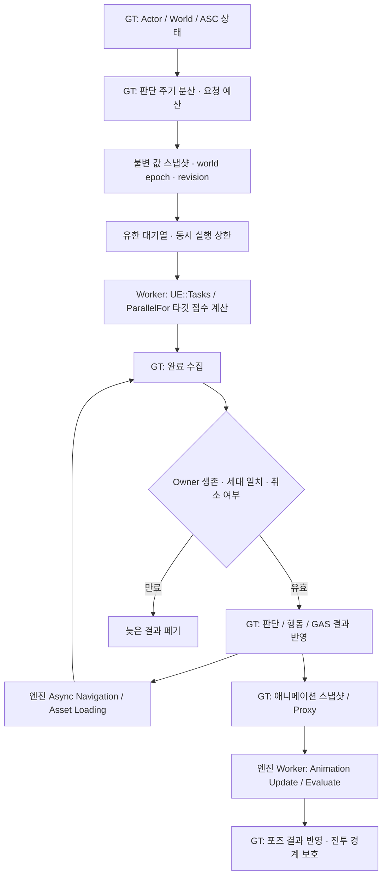
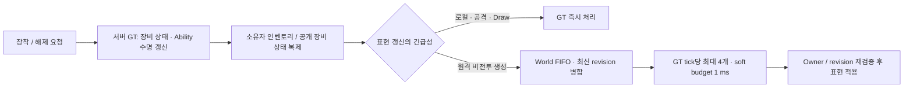

# Project J

**PC 잔여 BP·DA 검토 마감:** [Door·현재 데이터 연결과 유지 이유](Docs/Review/Audits/Project_J_PC_Asset_Review_Closure_2026-10-15.md). Door의 패널 수명·불필요 Sequence와 identity의 파생 표시 경계를 정리했습니다. 93개 회귀와 마지막 BP 변경 후3개 재확인·Windows Cook을 통과했고 테스트/제작 자산을 보존했습니다. 성능 조사는 계속 보류합니다.

**최신 PC 구조 정리:** [소스·BP·DA의 실제 정리와 유지 계약](Docs/Review/Audits/Project_J_PC_Structure_Cleanup_2026-10-15.md). 입력 receipt·상호작용/identity 퇴장·애니메이션 정책 소유권·편집 취소를 정리하고 Class/Style의 실제 중복 스킬 부여를 제거했습니다. 집중90개+실제 BP1개 통과. 성능 조사는 보류하며 전수 에셋 감사 완료와 구분합니다.

**현재 우선 작업:** [전체 시스템의 소스·아키텍처 정리](Docs/Review/Audits/Project_J_Source_Architecture_Cleanup_2026-10-15.md). 실제 호출/상태 소유권으로 중복·무동작 코드·책임 혼재를 정리하고 영향 기능을 집중 회귀합니다. 성능·운영·품질 문제의 전수 해결은 최신 요청에 따라 보류합니다.

### Unreal Engine 5.8 · C++ · Third-person Action MMORPG Prototype

**BP·DA 후속 정리:** [실제 에셋의 호출·소유권·테스트/제작 역할](Docs/Review/Audits/Project_J_Asset_Architecture_Cleanup_2026-10-15.md)을 대조했습니다. 미참조 에셋을 일괄 삭제하지 않고, BP의 상수 상태 override와 MM 중복 writer를 기존 native 계약으로 귀속했습니다. 전체 에셋/환경 정밀 검증과 구분합니다.

남은 전체 감사·개선과 누락 점검은 [2026-10-14 계속 작업 인계](Docs/Handoffs/WholeProjectAudit_2026-10-14/Project_J_Complete_Audit_Continuation_2026-10-14.md)에서 이어갑니다. 최신 커밋 기준점·전체 파일 목록·반복 방지·검토/수정/미검증 구분과 완료 기준을 포함합니다.

**계속 작업 기준점:** 소스·에셋 정리 커밋은 `f8ebd8a5`이며, 앞선 `855a1c8e`의 RA27와 인계도 보존합니다. [종전 시스템별 변경·검토·원자료](Docs/Review/Audits/Project_J_Continuation_Audit_2026-10-14.md)와 위 PC 후속 변경을 구분합니다. 전체 상세 감사와 원래 CPU·렌더 차이 조사는 미완료입니다.

**2026-10-15 계속 작업:** [진행·인계·NPC 콜백 소유권·표시 수요·입력 상태 검토](Docs/Review/Audits/Project_J_Continuation_Audit_2026-10-15.md)의 CA14–18은 통합389·Game/Cook/패키지·실제 전투·socket2/NPC200 회귀를 통과했습니다. 전체 상세 감사와 CPU 전체 증가·렌더 차이는 미완료이며, 후속 수정은 이 통합 기준점과 분리합니다.

**전수 범위 재점검 — 2026-10-14:** RA01–27의 실제64개 텍스트 변경과 빈 중복 장비 DA2개 정리를 기능별로 기록했습니다. 최신 native352개(332 clean·20 warning, 실패/미실행0), 실제 index 새 프로세스3회, 원격2접속·NPC200 반복3회, production Game/Cook/패키지·피해·전투·UI·실제 표시200 검증을 확인했습니다. 기존 사용자 리타깃/Body/RTG·공격 DA 교정과 지속 곡선 기본값을 보존했습니다. **모든 함수·에셋 전수 정밀 완료나 CPU 증가 해결 완료는 아닙니다.** [현재 검증 결과](Docs/Review/Audits/Project_J_Reaudit_Verification_2026-10-14.md)·[상태 지도](Docs/Review/Audits/Project_J_Reaudit_Map_2026-10-14.md)·[상세 결과와 남은 문제](Docs/Review/Audits/Project_J_Reaudit_Remaining_2026-10-14.md)에 실제 수정/검토/미검증을 구분합니다. 아래 DS01–18 결과는 당시 변경본의 기록입니다.

**전체 구조 심화 감사 — 2026-10-14 검증:** MM 지상 상태·단발 게시와 중복 분기, 실제 ASC 태그/GAS 세대 소유권, 장비 commit·aggregate 종료, 입력 재바인딩, UI callback GC, 퀘스트·성장 수명, 원격 점프 순서를 DS01–18로 개선했습니다. 실제 공격 정의 10개의 무피해/CombatMode 오연결도 교정했습니다. 전체 회귀 332개·Game/Cook·기록한 통합/원격 검증은 통과했습니다. [실제 변경·검토·원자료·남은 범위](Docs/Review/Audits/Project_J_Deep_Structure_Audit_2026-10-13.md)를 확인하세요. 일부 CPU 증가와 packaged RHI trace 종료 실패는 남아 있으며, 모든 함수·에셋의 무결성을 보증하지 않습니다.

서버 권위형 전투·장비 시스템과 Motion Matching을 기반으로, **다수 캐릭터의 판단·이동·애니메이션·이펙트 비용을 제어하는 개인 개발 프로젝트**입니다.

멀티스레딩의 설계 기준은 **Game Thread의 상태 소유권, Worker의 값 계산, 완료 결과의 유효성 검증**입니다. 작업량이 커졌을 때의 처리 시간뿐 아니라 취소·재입장·캐릭터 파괴·월드 종료까지 구현과 검증 범위에 포함합니다.

**구조 개선 — 2026-10-13:** 전투·탑승 레이어와 UI 아이콘의 자원 수명을 공통화하고, HUD 조립·재사용 widget·무기 진단의 책임을 분리했습니다. 실제 호출이 없는 private 함수와 중복 기본값을 정리하고, 늦게 도착한 Controller의 GAS metadata 갱신 누락도 보완했습니다. [실제 변경·검토 후 유지한 영역·검증 근거](Docs/Review/Audits/Project_J_Structural_Improvement_2026-10-13.md)를 구분해 기록합니다. 기존 200명 CPU 증가를 해결 완료로 보고하지 않습니다.

[아티스트·디자이너 협업](#아티스트디자이너를-위한-협업-안내) · [MMORPG 확장 기반](Docs/Architecture/Extensions/MMO_Foundation_2026-09-12.md) · [콘텐츠 확장 목록](Docs/Architecture/Extensions/MMO_Content_Catalog.md) · [멀티스레드 구조](#멀티스레드-구조) · [검증 현황](#검증-현황) · [측정 결과](Docs/Benchmarks/SystemsModernization.md) · [검증 데이터](Docs/Benchmarks/Data) · [직업 제작 도구](Docs/Gameplay/Authoring/Content_Authoring_System.md#tool) · [문서 목록](Docs/README.md)

**MMORPG 확장 기반:** 20개 영역의 콘텐츠·운영·기반 계약 205개를 카탈로그로 정리했습니다. `Project_JMMO`는 Unreal Core만 참조하며, 의존성 검증·소유 단위 조정·요청 수명·버전/중복 요청을 검사하는 저장 계약을 제공합니다. 기존 Gateway에도 요청 상한과 종료 처리를 연결했습니다. 목록은 콘텐츠 구현 완료 수가 아니며, 저장 구현은 개발용 메모리 adapter입니다. [설계·실제 구현 범위](Docs/Architecture/Extensions/MMO_Foundation_2026-09-12.md)

**직업·전직 확장:** 지속 진행 상태와 능력 소유권을 PlayerState에 모으고, 직업·전직·장비의 전투/애니메이션 구성을 영역별로 선택합니다. 스타일 내부에 능력을 직접 작성하거나 콤보에서 공격 목록을 생성할 수 있어 중복 DA 연결을 줄입니다. [구현 범위·작성법·검증](Docs/Architecture/Extensions/Extension_Foundation_2026-09-19.md)

## 측정으로 확인한 변화

**실시간 리타깃 프로필 — 2026-10-13:** 공통 Master의 최종 포즈와 기존 리타깃·손 IK·의상 물리를 유지하면서, 골격 쌍의 Family와 몸체별 접촉 Body를 분리했습니다. MCP로 실제 Greatsword 외형 ABP에도 연결하고, 프로필 해제·재초기화·source 불일치의 복구를 검증했습니다. 200명 CPU 비교에서는 일부 구간의 증가가 관찰되어 전체 성능 개선으로 보고하지 않습니다. [적용 구조·검증·측정 한계](Docs/Animation/Architecture/Runtime_Retarget_Profiles_2026-10-13.md)

**애니메이션 후속 구현 — 2026-10-12:** Start/Land 등 단발과 Motion Matching을 `Project Unified Locomotion`의 한 재생 스택으로 통합했습니다. 네이티브 State Controller·Chooser는 의미 상태와 단발 선택을 계속 담당합니다. 지속 회전은 실제 이동·누적 방향 변화로 판정하고, 미세한 Strafe 입력은 안정 Loop 후보군을 유지합니다. [통합 구조](Docs/Animation/Planning/Unified_Locomotion_Implementation_2026-10-12.md) · [지속 곡선과 Master 함수 정리](Docs/Animation/Planning/Sustained_Curve_And_Master_Cleanup_2026-10-12.md)

**Strafe 사용자 로그 후속:** 단발을 끝내는 엄격한 증거와 이미 확인된 곡선의 후보군 유지 조건을 구분해, 좌우 반전 중 Loop 전용 PSD로 강제 복귀하는 현상을 수정했습니다. 적합한 기존 PSD 후보는 유지하고, 정렬된 전방 이동의 입력 묶음 예측만 제한적으로 안정화합니다. 매우 느린 회전과 급회전의 기존 대응은 보호합니다. [구현 범위·비교·검증](Docs/Animation/Planning/Sustained_Curve_And_Master_Cleanup_2026-10-12.md#사용자-로그-후속-곡선-반전과-전방-예측-안정화)

**Strafe Run W 미세 회전 후속:** MCP에서 기존 Cycle에 Loop 참조가 없음을 확인해, 정렬된 전방 입력용 `ForwardCycle`에 Loop와 기존 곡선 후보를 함께 구성했습니다. 사용자 재현에서 최초 8/12도 회전율 제한이 후보를 다시 닫는 문제를 확인하여 제거했습니다. 안정·곡선 상태에서 같은 PSD를 유지하고 곡률은 궤적 검색으로 판단하며 측면·후방·대각선과 급회전의 기존 경로를 보호합니다. Arc→Box 재현 후 전방 전용 PSS의 미래 위치·방향 가중치를 보정했고, 공통 PSS와 기존 방향·급회전 PSD/시퀀스는 유지합니다. [적용 조건·비용 진단·검증](Docs/Animation/Planning/Sustained_Curve_And_Master_Cleanup_2026-10-12.md#전방-strafe-run-미세-회전-후속-구현)

**200명 시각 예산 비교:** 같은 바이너리의 기능 off/on, 실제 BP·장비·follower 구성, NullRHI, 조건별 120틱 준비 + 120틱 측정, 2회 반복에서 ABA on 평균 World tick은 근거리 **13.61→11.40ms**, 원거리 **13.78→10.69ms**였습니다. 리타깃 몸체와 의상 물리의 평가 횟수를 줄이고 사이 프레임을 보간하며, 로컬·전투·단발·급회전은 매 프레임 평가를 보호합니다. 동시 공격 ABA on은 **19.76→19.58ms**로 거의 같았습니다. 전체 렌더 FPS·GPU 개선이나 200명 동시 접속 결과로 해석하지 않습니다. [조건·원자료 위치·복구 설정](Docs/Animation/Planning/Crowd_Visual_Presentation_Budget_2026-10-12.md)

**구조 검증 이력 — 2026-09-19:** 직업·전직 기반, 내부 갱신·수명 정리와 에디터 제작 도구를 통합해 Editor/Game Win64 Development 빌드 및 자동화 **81개 통과, 테스트 오류·경고 0개**를 확인했습니다. GAS는 필요한 작업에 따라 갱신하고, 서버 피격 기록은 정해진 주기로 수집하며, 탈것 체력은 GAS로 일원화했습니다. [변경 범위](Docs/Architecture/Runtime/Reports/Internal_Polish_2026-09-19.md) · [검증 기록](Docs/Architecture/Runtime/Reports/Internal_Polish_Validation_2026-09-19.json)

아래 성능 수치는 앞선 A–E 실험의 측정 결과입니다. 이후 구조 변경의 성능 향상률이나 실제 동시 접속 처리량을 의미하지 않습니다. 최근 빌드·자동화·실제 소켓 연결 결과는 [검증 현황](#검증-현황)에서 실행 조건과 함께 구분합니다.

| 영역 | 비교 조건 | Before → After | 결과 |
|---|---|---|---|
| **Mass 이동·간격 계산** | 2,048 moving agents, 직렬 / 병렬 | CPU 구간 p95 **0.6342 → 0.2409 ms** | **62.0% 감소** |
| **Niagara 생성** | 100개 동시 생성, 풀 미사용 / 사용 | 생성 CPU p95 **4.5739 → 3.3451 ms** | **26.9% 감소** |
| **네트워크 관심 영역** | NPC 100개 + client 2개, AllRelevant / Spatial | aggregate **18,786 → 13,223 B/s** | **29.6% 감소** |
| **Trail PSO coverage** | 같은 packaged binary, 보완 OFF / ON | Full PSO miss **1 → 0** | 누락된 render target 구성 보완 |
| **조명 PSO coverage** | 같은 main packaged binary, 기본 LightFunction 사전 요청 OFF / ON | Full PSO miss **1 → 0** | PSO 39개 추가 요청 비용까지 기록 |

**측정 범위:** UE 5.8 / Windows 11 / Ryzen 7 9800X3D. GPU 실험은 Radeon RX 9070 XT, D3D12를 사용했습니다. 각각 독립된 workload이며, 전체 게임 FPS 개선율이나 2,048명 동시 접속 성능을 의미하지 않습니다. 표본 수·실행 조건·실패 기록은 [벤치마크 문서](Docs/Benchmarks/SystemsModernization.md), 재계산 가능한 CSV/JSON은 [Data](Docs/Benchmarks/Data)에 공개합니다.

## 아티스트·디자이너를 위한 협업 안내

Project J는 **캐릭터·애니메이션·무기·의상·이펙트를 실제 플레이 안에서 연결하고 다듬는 협업**을 지향합니다. 새로운 직업의 전투 스타일, 무기별 액션, 서로 다른 분위기의 스킨과 마법 연출처럼 시도해 보고 싶은 콘텐츠를 함께 구체화할 수 있습니다.

### 함께 만들 수 있는 콘텐츠

| 분야 | 프로젝트에 연결하는 방식 | 함께 확인할 부분 |
|---|---|---|
| **캐릭터·몬스터 모델** | Skeletal Mesh와 캐릭터 프로필, AnimBP에 연결 | skeleton·비율·리타게팅, 발 접지와 손 IK |
| **의상·방어구·무기** | 장비 정의와 표현 프로필로 메시·부착 위치 구성, 호환되는 파츠는 Leader Pose 사용 | 본 구조, 소켓·그립, 클리핑과 LOD |
| **이동·전투 애니메이션** | Motion Matching/Chooser용 이동 데이터와 무기별 프로필, 공격 몽타주 조합 | 이동·회전 전환, root motion, 공격·복귀 타이밍 |
| **Niagara 이펙트** | 공격 태그별 presentation profile과 몽타주 Notify 구간에 연결 | Trail 시작·끝, 무기 소켓, 잔상·중단 시 정리와 가독성 |
| **캐릭터 사운드** | 이벤트·접촉 위치·Physical Surface별 오디오 프로필에 음원 연결 | 움직임과의 타이밍, 기본음 대체, 가까운 원격 캐릭터 청취와 군중 비용 |
| **직업·스킬·콤보 기획** | 입력 태그, AbilitySet, 콤보 그래프와 AttackDefinition 조합 | 입력 분기, 연계 구간, 판정·이동·연출의 일치 |

캐릭터 호환성은 특정한 “표준 규격” 하나로 보장하지 않습니다. 사용할 skeleton과 애니메이션을 먼저 맞추고 리타게팅·소켓·IK를 검증합니다. 기존 구조로 표현할 수 있는 콘텐츠는 데이터와 프로필로 연결하고, 새로운 동작 규칙이 필요하면 C++ 기능을 함께 확장합니다.

### 콘텐츠를 게임 안에 연결하는 흐름

1. **의도와 기준 공유:** 콘셉트, 레퍼런스, 사용할 캐릭터·무기, 원하는 동작과 효과를 정합니다. 제작 초기에 skeleton·크기·축·소켓 기준을 맞춥니다.
2. **에셋과 데이터 연결:** 아티스트가 메시·애니메이션·Niagara를 제작하고, 디자이너와 프로그래머가 장비·전투·표현 프로필에 연결합니다. 기존 작성 가이드를 기준으로 변경 범위를 나눕니다.
3. **플레이 피드백:** 이동·공격·장착·해제에서 동작을 확인하고, 전환 속도·공격 타이밍·Trail 길이·잔상·클리핑을 조정합니다.
4. **다인원·네트워크 확인:** 로컬과 원격 캐릭터에서 표현을 비교하고, 공격 취소·무기 교체·캐릭터 파괴 때 정리되는지와 동시 표시 비용을 확인합니다.

**역할의 경계:** Data Asset은 콘텐츠 선택과 튜닝, Blueprint/AnimBP는 에셋 조합과 시각 표현, C++는 서버 권한·상태 전이·입력·복제·작업 수명을 담당합니다. 이펙트의 모양을 바꿀 때 피해 판정까지 복제해서 수정할 필요가 없도록 전투 정의와 표현 정의를 분리했습니다.

### 바로 활용할 수 있는 기반

- **직업·전직 제작 도구:** 에디터 Tools 메뉴에서 기존 직업을 참고해 새 루트·전투 스타일·콤보를 검증하고 연결해 생성합니다. 공격·애니메이션은 공유하고, 저장·게임 등록은 명시적으로 진행합니다. [사용법](Docs/Gameplay/Authoring/Content_Authoring_System.md#tool)
- **입력 조합과 콤보:** 좌·우클릭, 동시 입력, Shift/Ctrl/Alt 같은 modifier를 입력 태그로 해석하고, 콤보 그래프에서 공격 정의를 선택합니다. 조합별 실제 동작은 데이터로 구성합니다.
- **무기별 액션과 외형:** 장착한 장비의 메시·표현 프로필과 전투 스타일을 연결해 무기 외형, 대기·공격 애니메이션 구성을 바꿀 수 있습니다.
- **같은 공격의 다른 연출:** 기본 전투 스타일의 VFX를 전직 또는 스킨별 cue로 덮어쓸 수 있습니다. 동일한 공격 정의에 서로 다른 Trail·방출 효과를 붙이는 방식입니다.
- **데이터 기반 이동 확장:** 이동 문맥과 콘텐츠 프로필을 나누고, Motion Matching·Chooser·Linked Anim Layer를 통해 애니메이션을 구성합니다. 실제 품질은 사용할 애니메이션과 리타게팅·프로필 튜닝을 함께 확인합니다.

작성 가이드: [콘텐츠 확장](Docs/Gameplay/Authoring/Content_Authoring_System.md#expansion) · [장비·직업 데이터 빠른 참조](Docs/Gameplay/Authoring/Content_Authoring_System.md#data) · [공격·콤보 작성](Docs/Combat/Authoring/GreatswordCombatAuthoringGuide.md) · [전투 VFX 연결](Docs/Combat/Architecture/CombatVFXArchitecture.md#authoring) · [이동 프로필 확장](Docs/Animation/Authoring/DataDrivenLocomotionExtensionGuide.md)

## 멀티스레드 구조

Game Thread(GT)가 Actor·World·GAS 상태를 읽고 변경합니다. 직접 제출하는 작업에는 값 스냅샷을 전달하고, 엔진이 제공하는 Navigation·로딩·애니메이션 비동기 경로는 해당 엔진 서비스가 실행을 관리합니다.



이 흐름은 NPC 판단·행동의 책임 경계를 나타냅니다. Mass는 별도의 **GT snapshot/grid → 직렬 또는 병렬 chunk 계산 → join → GT 적용** 경로를 사용합니다. 모든 비동기 서비스가 하나의 공통 작업 큐를 공유하는 구조는 아닙니다.

2026-10-12의 시각 애니메이션 예산은 기존 **AnimInstanceProxy 스냅샷과 엔진 병렬 업데이트·평가**를 활용합니다. GT 관리자는 평가 주기·보호 요구만 결정하고, worker proxy의 완료를 기다리지 않습니다. 리타깃 몸체의 실제 평가에는 원본 포즈 의존 순서를 유지합니다. NPC scoring의 `UE::Tasks`나 Mass 청크 작업에 애니메이션을 새로 제출하지 않으며, 캐릭터별 평가 시점 분산을 새 병렬 실행기로 표현하지 않습니다. [스레드별 책임](Docs/Animation/Planning/Crowd_Visual_Presentation_Budget_2026-10-12.md#기존-병렬-아키텍처와의-관계)

### 장비 권한과 시각 표현의 처리 순서



장비 상태와 GAS 변경에는 GT 실행 순서를 유지합니다. 원격 비전투 캐릭터의 시각 오브젝트 **생성**을 프레임에 분산하며, 기존 표현 해제는 즉시 처리합니다. 해제 비용까지 모두 분산된 것으로 해석하지 않습니다.

## A–E 구현 범위

| 단계 | 구현한 내용 | 확인한 규모·동작 |
|---|---|---|
| **A · 비동기 기반** | 배치 타깃 scoring, 공유 공간 스냅샷, owner lease 기반 로딩 공유, 요청 상한과 취소 수명 | 256 owners / 1,024 공유 요청에서 실제 load 1회, 취소64 / 완료960 |
| **B · 애니메이션 예산** | C++ snapshot/AnimInstance proxy, 엔진 병렬 평가, Animation Budget Allocator, 필수 전투 포즈 보호 | 공격 완료·취소·해제·파괴와 예산 등록/복귀 회귀 |
| **C · NPC 판단·Navigation** | observer 기반 갱신, 후보 예산, Async Navigation admission/retry, stale InRange 해제 | 판단 대상2,048 / observers512, Nav burst512 전달·timeout0 |
| **D · 군중·복제·표현** | Mass 값 이동과 Character 인계, 공간 관련성, 원격 표현 생성 FIFO | Mass2,048 값 일치, 서버+실제 socket clients4 / NPC512 기능 검증 |
| **E · VFX·PSO·애니메이션 보완** | Niagara pool 수명, 선택 갱신 위상 분산, cooked 초기화 보호, Trail PSO 보완, 거리 컬링 실험 | 최종 packaged 스킬3회 × 신규/재사용 cache, 렌더링 회귀24개 |

A–E의 현재 구현은 `main`에 통합되어 있습니다. **E의 운영 에셋별 최적화·품질 검증은 진행 중**이며, 단계별 실험 통과와 모든 기능의 운영 적용을 구분합니다.

## 설계에서 중요하게 다룬 경계

### 작업량에 맞춘 병렬 실행

Mass의 간격 계산을 포함한 CPU 구간은 스냅샷 생성과 join 비용까지 측정합니다. 기본 `ProjectJ.Mass.Parallel=-1`은 **실제 이동 중인 agent가 1,024개 이상이고 간격 계산이 켜진 경우** 병렬 chunk를 선택합니다. 작은 단순 이동 작업에서는 직렬이 더 저렴했던 결과도 판단에 반영했습니다.

이 Mass 경로는 **선택적으로 등록한 NPC의 Character·ASC·장비를 유지하는 프로토타입**입니다. 전투·몽타주·root motion 등을 보호하고, 과밀하거나 막힌 경로는 Character 이동으로 복귀합니다. Actor 메모리 절감이나 원거리 ISM 표현까지 구현된 상태는 아닙니다.

→ [Mass 인계와 실행 선택](Source/Project_JCharacter/Private/Mass/Project_JMassRepresentationSubsystem.cpp) · [값 계산 Processor](Source/Project_JCharacter/Private/Mass/Project_JMassMovementProcessor.cpp)

### 과부하와 늦은 완료를 함께 제어

요청을 무제한으로 쌓는 대신 대기열·실행 중 작업·프레임별 적용에 상한을 둡니다. 배치 후보 예산에 도달하면 미처리 NPC부터 다음 tick에 재개하고, Navigation 입장이 거절되면 분산 재시도로 넘깁니다. 취소는 결과 적용 권한을 제거하며 실제 작업 완료와는 구분합니다.

완료 시점에 weak owner, world epoch, revision을 확인해 이전 장비·이전 월드의 결과가 현재 상태에 적용되는 것을 막습니다. 공유 참조의 수명 안전성과 Worker가 읽는 데이터의 안전성을 별도 계약으로 다룹니다.

→ [Scoring 수명](Source/Project_JCore/Private/System/Project_JTargetScoringSubsystem.cpp) · [Navigation 압력 제어](Source/Project_JCharacter/Private/System/Project_JNPCPathSubsystem.cpp) · [표현 FIFO](Source/Project_JCharacter/Private/System/Project_JPresentationBudgetSubsystem.cpp)

### 실행 방식보다 실제 측정 결과를 우선

| 관측 | 반영한 판단 |
|---|---|
| 병렬 Net Tick에서 실제 worker overlap 확인, CPU 개선은 일관되지 않음 | 기본 Net Tick 병렬화를 활성화하지 않음 |
| Niagara 생성 p95 감소, 종료 비용은 큰 차이 없음 | 풀의 생성 비용·반환 수명을 구분해서 관리 |
| 거리 컬링 이후 simulation 감소, 보이는 ribbon 렌더 비용은 거의 동일 | GPU 렌더링 전체 개선으로 확대 해석하지 않음 |
| 신규 application cache와 재사용 비교에서 preload 이득 불명확 | driver cold 또는 hitch 제거로 주장하지 않음 |

### Editor와 packaged 실행의 차이를 회귀로 포착

- **Cooked 애니메이션 초기화:** authored AnimBP가 설치되기 전 native Motion Matching 노드가 folded NodeData 없이 실행되는 crash를 수정했습니다. 임시 구간은 엔진 reference pose를 사용하고, AnimBP 연결 후 generated graph를 사용합니다. native-only MM fallback은 cooked에서 지원하지 않습니다.
- **UE 5.8 Trail PSO:** 기존 Distortion collector의 shader/state를 재사용하면서 rough-refraction의 누락된 RT 구성을 보완했습니다. validation 옵션에 의존하지 않는 검색과 **monolithic 게임에 한정한 등록**으로 적용 범위를 제한합니다. 엔진 소스와 화질 설정은 변경하지 않았습니다.

→ [Animation Proxy](Source/Project_JCharacter/Private/Animation/Project_JCharacterAnimInstanceProxy.cpp) · [PSO 보완](Source/Project_J/Rendering/Project_JDistortionPSOPrecache.cpp)

## 검증 현황

### 애니메이션 후속 검증 — 2026-10-12

200명 시각 예산 후속 시점의 기록입니다. 직접 UBT Editor/Game Development 빌드가 성공했습니다. 시각 예산 회귀는 첫 실행 58개 성공·5개 설정 조건 실패 후, 요구 예산을 설정한 실제 RHI 실행에서 해당 5개와 시각 lifecycle 1개가 모두 성공했습니다. 두 실행에서 성공을 확인한 고유 관련 검증은 63개입니다. 전체 ProjectJ 자동화의 새 전수 실행 수치로 사용하지 않습니다.

실제 소켓은 서버1 + 클라이언트2 + NPC200, 지연50ms·손실3% 조건에서 검증과 정상 종료를 확인했습니다. 렌더 캡처 17개와 보간 중 실제 뼈 변위를 확인했으며, 이번 최적화 이후 사용자의 체감 확인과 200명 실제 렌더 장면의 GPU·Cook/패키징 검증은 남아 있습니다. [검증 결과와 한계](Docs/Animation/Planning/Crowd_Visual_Presentation_Budget_2026-10-12.md#기능품질-검증)

Strafe 사용자 로그의 후속 변경은 최종 Editor/Game 직접 UBT 빌드와 고유 관련 검증 **65개**가 성공했습니다. 급회전 57장면, 완만한 회전·반전·미세 입력의 비교 및 실제 RHI 실행을 구분해 기록했습니다. 기존 후보 판정 경로에서도 실패하던 특정 클립 강제 검사와 실제 평가 자세 기준으로 수정한 이유도 남겼습니다. 이 후속 실행에서 200명 CPU/GPU나 소켓 검증을 다시 수행한 것으로 표현하지 않습니다. [후속 검증 기록](Docs/Animation/Planning/Sustained_Curve_And_Master_Cleanup_2026-10-12.md#후속-검증과-해석)

**커밋 정리 시점 — 2026-10-13:** 단발 곡선 복귀 조건을 사용자 요청대로 0.35초·100cm·3도·85%로 복원했습니다. 임시 전방 가중치 실험과 에셋 작성용 테스트 경로를 제거했습니다. 이 상태의 집중 검증은 **21개 성공·1개 실패**이며, 미세 입력은 Loop 732/733 및 Box/Diamond 0입니다. 실패한 곡선 기록을 단독 재생한 결과 Box/Diamond 28/2,596프레임으로 1% 이하 기준을 초과했습니다. 새로 보고된 Strafe 착지 후 튐도 원인 확정과 실제 재현이 남아 있습니다. [현재 제한과 조사 기록](Docs/Animation/Planning/Sustained_Curve_And_Master_Cleanup_2026-10-12.md#2026-10-13-커밋-전-코드-정리와-착지-튐-조사)

**착지 복귀 후속 — 2026-10-13:** Land의 재생이 MM으로 복귀했는데 전방 후보는 아직 Landing으로 처리되던 상태 불일치를 보완했습니다. 회복 중 이탈은 기존 관성 보간으로 포즈와 속도를 이어 주며, 정상 tail·Start/Stop 및 0.35초 조건은 유지합니다. 직접 UBT Editor/Game 빌드와 관련 고유 69개 검증, 약한 착지 회전의 D3D12 재생을 확인했습니다. 기존 곡선 기록의 Box/Diamond 기준 실패 하나와 사용자 화면의 체감 확인은 남아 있습니다. [수정 범위·검증·한계](Docs/Animation/Planning/Strafe_Land_Return_2026-10-13.md)

**전방 후보 구성 후속 — 2026-10-13:** W 곡선 재현에서 전방 PSD의 동작 목적을 Arc 6종과 기존 Loop 8종으로 정리했습니다. 전방 전용 PSS의 추가 실험은 되돌리고, A/D·후방·대각선과 급회전은 기존 후보를 유지합니다. 동일 곡선·미세 입력 기록은 30/60/120Hz에서 모두 통과했고, 곡선의 Box/Diamond 노출은 0입니다. A/D 12장면의 전체 로컬 포즈 360개와 궤적 예측 1,080개는 이전 데이터와 동일했습니다. 관련 고유 71개 검사와 Editor/Game 직접 UBT 빌드를 통과했습니다. [자료 조사·최종 검증·범위](Docs/Animation/Planning/Strafe_Forward_Intent_2026-10-13.md)

**느린 착지 회전 후속 — 2026-10-13 09:26 로그:** Strafe W 착지 복귀 때 숙인 가슴의 수평 방향을 큰 yaw 오차로 읽어 상체 보정이 개입하는 경로를 수정했습니다. 회전의 수직축 twist를 읽고 실제 upright 정도에 따라 보정 강도를 줄입니다. 동일한 왼발 착지 재현의 첫 프레임 3D 회전량은 3.98→1.70도로 줄었으며, MM 후보·PSS/PSD·0.35초 종료 조건은 유지합니다. 전체 회복 구간의 최고 변위와 사용자 체감은 초기 변위 개선과 구분합니다. [비교 결과와 적용 범위](Docs/Animation/Planning/Strafe_Land_Return_2026-10-13.md#0926-느린-착지-회전-후속)

**착지 후 Arc/Loop 전환 후속 — 2026-10-13 10:02 로그:** Land의 관성 보간 중 MM 재선택이 일반 스택 블렌드로 진입하는 중첩을 보완했습니다. 기존 복귀 보간 시간 안의 재선택도 관성 방식으로 이어 주며, 검색과 후보 선택은 유지합니다. 기록 입력의 착지 11회에서 일부 후보 전환 순간의 가슴 변위는 줄었지만 전체 회복 최대값과 발 접촉 품질은 별도 확인이 필요합니다. [보간 구조·기록 재현·검증 한계](Docs/Animation/Planning/Strafe_Land_Return_2026-10-13.md#1002-착지-이후-arcloop-전환-후속)

**애니메이션 파이프라인 리팩토링 — 2026-10-13:** 스냅샷·표시 수명·검색 게시·엔진 MM 연결·복귀 보간·품질 예산을 역할별로 정리했습니다. 기존 reflected 이름과 GT→Proxy 순서를 유지하고, 공통 캐시 초기화 및 CVar 등록 의존성을 정리했습니다. [구조·네트워크/병렬 계약·전후 검증](Docs/Animation/Architecture/Animation_Pipeline_Refactor_2026-10-13.md)

### 이전 기능·수명 검증 — 2026-10-08

8개 모듈의 소스 위험 패턴과 핵심 런타임 경계를 검토하고 **실제 엔진에서 재현한 결함 5개**를 수정했습니다. 영속 ASC의 Avatar 교체, Destroy와 GC 사이의 탈것 참조, 네이티브 애니메이션 프록시의 GC 추적, 겹치는 무기 노티파이, 화면 밖 몽타주의 종료 처리를 다룹니다. 모든 파일의 모든 실행 경로를 전수 실행한 범위는 아닙니다. [런타임 감사와 재현 근거](Docs/Review/Audits/Project_J_Runtime_Ownership_Audit_2026-10-08.md) · [검증 요약](Docs/Review/Audits/Project_J_Runtime_Ownership_Validation_2026-10-08.json)

| 검증 | 결과 | 실행 조건 |
|---|---|---|
| 직접 UBT Editor / Game 빌드 | 모두 성공 | UE 5.8, Win64 Development |
| ProjectJ 전체 자동화 | **244개 통과 / 실패0 / 미실행0** | NullRHI, 225개 성공·19개 경고 포함 성공, `a.Budget.BudgetMs 0.1` |
| 장비 장착·공격·해제 반복 | **100캐릭터 × 3회 = 300 actor-cycle 완료 / failures=0** | 위 자동화와 같은 실행, 네트워크 클라이언트 수와 구분 |
| 실제 소켓 연결·복제·애니메이션 | 전용 서버1 + clients2, NPC100, 모두 정상 종료 | Iris AOI·FastArray·애니메이션 관측, `PktLag=80`·`PktLoss=2` 설정 |

이 결과는 커밋 `8a897335`에 반영된 소스·콘텐츠의 기능 검증입니다. 로그의 경고와 기존 에셋 참조 누락도 감사 보고서에 남겼습니다. 이번 실행의 packaged/cook·RHI 품질이나 MMO 대규모 처리량을 입증하는 수치로 사용하지 않습니다.

### 보존된 packaged·RHI·부하 검증 — 2026-09-10

| 검증 | 결과 | 해석 범위 |
|---|---|---|
| main 직접 UBT Editor / Game 빌드 | 모두 성공 | Win64 Development |
| main 다인원·수명 회귀 | **56개 통과 / 오류0 / 경고10** | NullRHI, 기존 경고 포함 |
| main 실제 RHI 전투·애니메이션·장비 회귀 | **24개 통과 / 오류0 / 경고0** | 56개 집합과 중복 있음 |
| 별도 socket 다중 접속 | 서버1 + clients4, NPC512 검증·정상 종료 | AOI 재입장, owner-only inventory, 공개 장비, 삭제·접속 종료 |
| packaged 스킬 통합 | 신규/재사용 application cache 각각3회 성공 | 장착 → GAS → 몽타주 → hit window → Trail → 해제/정리 |

수치는 **2026-09-10의 보존된 실행 결과**입니다. main 회귀는 코드 `f2c31fb`, 전투 에셋 `89f94b4` 기준이며, 이후 변경된 소스·콘텐츠 전체의 packaged/RHI 재검증 결과를 의미하지 않습니다. [검증 근거와 재현 조건](Docs/Benchmarks/SystemsModernization.md)을 함께 확인할 수 있습니다.

## 게임플레이와 콘텐츠 확장 기반

멀티스레드 작업과 함께, 콘텐츠가 늘어날 때 상태·표현·복제의 책임이 섞이지 않도록 아래 기반을 유지합니다.

| 기반 | 구현한 책임과 확장 방향 |
|---|---|
| **PlayerState / Character 분리** | 플레이어의 ASC·인벤토리·장비 상태와 Avatar의 이동·표현 수명을 분리. NPC는 character-local 소유 경로 사용 |
| **모듈러 장비 표현** | 호환되는 파츠를 메인 메시의 Leader Pose에 연결하고, 장착 상태와 시각 오브젝트의 수명을 별도로 관리 |
| **FastArray 기반 복제** | 인벤토리·장비 변경분을 전달하고 owner-only 데이터와 공개 표현을 구분 |
| **원격 이동 궤적 보정** | 복제된 이동과 visual smoothing을 사용해 원격 캐릭터의 Motion Matching 입력 방향 보정 |
| **데이터 유효성 검사** | 장비·프로필의 필수 참조와 설정을 `IsDataValid` 등으로 검사. 실제 애니메이션·연출 품질은 플레이 검증과 병행 |
| **클라이언트 캐릭터 오디오** | 가까운 플레이어·NPC 접촉음을 로컬에서 구성. 이벤트별 음원·Physical Surface 매핑, 비동기 준비와 후보·voice 예산 지원. 현재 마네킹 기본음 연결, 실제 눈·물·진흙 환경은 후속 제작 범위 |
| **서버 간 상태 전달 준비** | Handover envelope, 검증·취소·실패 상태와 transport 경계를 마련. 운영 분산 서버와 영속 저장 완성을 의미하지 않음 |

→ [모듈러 메시](Source/Project_JCharacter/Private/Components/Project_JModularMeshComponent.cpp) · [원격 궤적](Source/Project_JCharacter/Public/Animation/Project_JMotionMatchingTrajectoryComponent.h) · [장비 데이터 검사](Source/Project_JCharacter/Private/Equipment/Project_JEquipmentItemDefinition.cpp) · [캐릭터 오디오](Docs/Animation/Architecture/Foley_Audio_System.md) · [Handover](Source/Project_J/Backend/Project_JHandoverManager.h)

## 프로젝트 구성

| 모듈 | 주요 책임 |
|---|---|
| [Project_JCore](Source/Project_JCore) | 값 타입, 비동기 scoring, 공간 스냅샷, 공유 시각 에셋 서비스 |
| [Project_JGAS](Source/Project_JGAS) | Ability System Component와 Attribute 기반 |
| [Project_JMMO](Source/Project_JMMO) | Core-only 확장 계약, 조정·요청 수명과 저장 계약 |
| [Project_JCharacter](Source/Project_JCharacter) | 캐릭터·장비·전투·애니메이션·오디오·NPC 판단/이동·Mass 인계 |
| [Project_J](Source/Project_J) | PlayerState/Controller, 게임 연결, 통합 진단 fixture |
| [Project_JCharacterEditor](Source/Project_JCharacterEditor) | 콘텐츠 제작·검증·이관 도구, Editor 전용 Navigation 통합·부하 시험 |
| [Project_JAnimationNodes](Source/Project_JAnimationNodes) | Guided Hand IK AnimGraph 제작 노드·컴파일 검사, UncookedOnly |
| [Project_JMount](Source/Project_JMount) | 탈것과 탑승 캐릭터 연결 |

플레이어의 ASC·인벤토리·장비 소유권은 PlayerState에 두고 Character의 표현 수명과 분리합니다. GAS 전투 정의, 장비별 animation/presentation profile, Motion Matching/Chooser, Niagara 에셋을 조합하는 방식으로 기능을 확장합니다. 일반 NPC는 플레이어와 다른 소유 경로를 사용합니다.

## 빌드와 실행

Unreal Engine **5.8**, Win64 C++ 도구 체인과 **Git LFS**가 필요합니다. 에셋은 LFS 파일까지 받은 후 `Project_J.uproject`를 사용합니다. 저장소 루트의 PowerShell에서:

```powershell
git lfs pull
$engineRoot = 'C:/Program Files/Epic Games/UE_5.8'
$projectFile = (Resolve-Path './Project_J.uproject').Path
& "$engineRoot/Engine/Binaries/DotNET/UnrealBuildTool/UnrealBuildTool.exe" `
    Project_JEditor Win64 Development "-Project=$projectFile" -WaitMutex
```

빌드 전에 Unreal Editor·Live Coding·기존 컴파일 프로세스가 종료됐는지 확인하고, 실행한 빌드는 완료까지 기다립니다. 검증 스크립트는 [Scripts/Validation](Scripts/Validation)에 있으며, [벤치마크 재현 안내](Docs/Benchmarks/SystemsModernization.md#재현)를 따릅니다.

## 실행 경계 실험과 다음 작업

- **콘텐츠·런타임 후속:** 최근 수명 회귀를 유지하면서 packaged/RHI·더 많은 접속 조건으로 검증을 확장합니다. 실제 콘텐츠의 전환·접촉 타이밍, 지형 연결과 군중 표현 비용, 남아 있는 에셋 의존성을 점검합니다. [최근 감사의 잔여 항목과 검증 범위](Docs/Review/Audits/Project_J_Runtime_Ownership_Audit_2026-10-08.md)
- **E 후속:** 기본 LightFunction PSO 누락을 해결했습니다. 승인 후 운영 ABP의 snapshot getter 5개 변환과 Trail 거리 컬링·고정 bounds를 저장했습니다. VFX instance 예산과 driver cold 검증은 남아 있습니다.
- **F 구현·실험:** Tasks/TaskGraph/ThreadPool, Tick 의존성, 전용 consumer 경합, Chaos snapshot, RDG readback, Audio·PCG의 8개 fixture를 기본 비활성 Editor 플러그인으로 구현했습니다. [실측·구조·적용 판단](Docs/Benchmarks/ExecutionExperiments_2026-09-12/README.md)에서 병렬화의 이득과 순서/수명 비용을 함께 공개합니다.
- **MMORPG 확장 기반:** Core-only 모듈, 205개 확장 계약, 통신 요청 수명·상한, 소유 단위 조정과 저장 계약을 추가했습니다. 신규 테스트 8개와 기존 회귀 16개를 검증했으며, Handover 정리 경고는 후속 3개 검사에서 오류·경고 0으로 해결했습니다. 실제 콘텐츠·운영 DB 연결, 전투 서버 tick과 더 많은 접속·패킷 조건, 운영 Mass 표현 전환 검증은 후속 범위입니다.

[벤치마크와 데이터](Docs/Benchmarks/SystemsModernization.md) · [설계·검증 이력](Docs/Performance/Reports/ProjectJ_Systems_Modernization_Refactor_2026-09-08.md) · [초기 프로파일링 기준선](Docs/Performance/Reports/ProjectJ_Profiling_Consolidated_Summary_2026-09-06.md) · [전체 문서](Docs/README.md)
