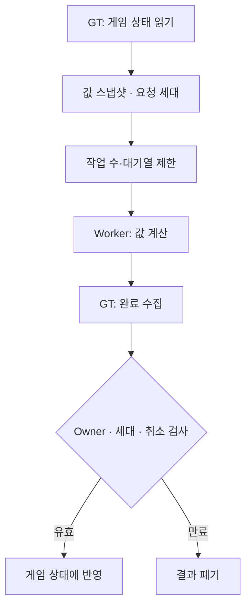

# Project J

**Unreal Engine 5.8 · C++ · 개인 개발 3인칭 액션 MMORPG 프로토타입**

Project J는 온라인 액션 게임의 이동·전투·네트워크 시스템을 C++로 개발하는 개인 프로젝트입니다. GAS를 이용한 서버 권위형 전투, Mover 이동, Motion Matching 기반 포즈 검색, Mass와 비동기 처리를 실제 캐릭터 플레이에 연결하고 있습니다.

현재는 대검 캐릭터의 이동·전투와 장비 시스템을 중심으로 개발하며, MMORPG에 필요한 저장·월드·서버 간 상태 전달 구조를 확장하고 있습니다. 개인 학습·기술 연구·포트폴리오가 목적이며 현재 수익화 계획은 없습니다. 운영 인증·분산 서버·대규모 동시 접속은 후속 개발 범위입니다.

[게임플레이](#게임플레이-영상) · [핵심 구현](#핵심-구현) · [성능 자료](#성능) · [빌드](#빌드와-실행) · [에셋·라이선스](#저작권과-라이선스) · [문서 목차](Docs/README.md)

## 게임플레이 영상

[](https://youtu.be/lvEs-VPWUss)

[▶ 전체 영상 보기 · YouTube](https://youtu.be/lvEs-VPWUss)

개발 중 촬영한 영상으로 현재 코드·에셋과 차이가 있을 수 있습니다. 촬영일과 커밋은 별도로 확인되지 않았습니다.

## 핵심 구현

| 영역 | 엔진 기반 | 프로젝트에서 구현·확장한 부분 |
| --- | --- | --- |
| 전투·스킬 | GAS, Gameplay Tags, Montage | InputTag 입력, 공격 정의·콤보, 서버 권위 판정과 능력 부여·해제. [전투 구조](Docs/Combat/Architecture/Combat_Animation_System.md) |
| 장비·인벤토리 | PlayerState, Actor, FastArray | PlayerState의 ASC·인벤토리·장비 소유, Character 표현 분리, 소유자 전용 데이터와 공개 장비 상태 복제. [런타임 구조](Docs/Architecture/Runtime/README.md) |
| 이동·애니메이션 | Mover/NetworkPrediction, PoseSearch, Chooser, BlendStack | C++ 이동 상태·포즈 후보 계산, 공용 ABP 재생, 몸체별 직접 재생/리타깃, 손 접촉 IK와 원격 표현. [로코모션 구조](Docs/Animation/Architecture/Player_Locomotion_Architecture.md) |
| NPC·병렬 처리 | UE::Tasks, ParallelFor, Mass, 비동기 Navigation | 판단 주기 분산, 값 스냅샷과 작업 상한, 늦은 결과의 취소·세대 검사, Mass 이동 인계와 Character 복귀. [설계·측정](Docs/Benchmarks/SystemsModernization.md) |
| 표현 비용 관리 | Animation Budget, Chaos Cloth, Niagara, LOD, PSO precache | 원격 표현 생성 분산, 전투 포즈 보호, 원격 Cloth 예산, 이펙트 생성 풀과 PSO 구성 보완. [성능 자료](Docs/Performance/README.md) |
| MMORPG 확장 | SQLiteCore, AssetManager, 네트워크 복제 | 요청 ID·handover 계약, 개발 단독 실행의 성장·퀘스트·소유물 저장, 커밋·복구·구버전 이관. [현재 범위](Docs/Review/Architecture/Project_J_MMO_Remaining_2026-10-19.md) |

## 기술 스택과 구조

게임플레이의 권한·상태·복제·작업 수명은 C++에서 관리하고, Blueprint·AnimBP·Data Asset으로 에셋 조합과 표현·튜닝을 구성합니다. 이동은 Mover, 포즈 선택은 C++ 상태와 PoseSearch/Chooser, 전투 재생은 GAS·Montage로 역할을 나눕니다. 네트워크에는 Iris/FastArray를 사용합니다.



직접 제출하는 작업은 위 흐름을 따릅니다. Navigation·에셋 로딩·애니메이션은 엔진의 비동기 실행 경로를 사용하며, Mass는 스냅샷과 grid를 만든 뒤 chunk 계산·join·GT 적용으로 처리합니다. 현재 Mass 연동은 Character·ASC·장비를 유지하는 구조입니다.

[모듈·소유권](Docs/Overview/ProjectContext.md) · [비동기 처리 상세](Docs/Performance/Architecture/PerformanceOptimizationFoundation.md#gameplay-async-contract) · [애니메이션](Docs/Animation/README.md) · [네트워크](Docs/Networking/README.md)

## 성능

기존 보고서에서 대표 결과를 골랐습니다. 각 행은 별도 실험이며 측정 조건·지표가 다른 결과를 합산하지 않습니다.

| 실험 | 같은 실험 안의 Before → After | 조건·상세 자료 |
| --- | --- | --- |
| Cloth 예산 · 2026-10-26 | 이동 평균 Frame **1,827.67 → 63.09 ms**, 동시 공격 **2,123.51 → 79.75 ms** | 200개 캐릭터, 동일 바이너리 교대 4회. 망토 200개 시뮬레이션·로컬 품질 유지. [보고서](Docs/Performance/Reports/ProjectJ_Cloth_Budget_200_2026-10-25.md) |
| Mover 정책 복구 · 2026-10-22 | 이동·반전 평균 Frame **21.05 → 19.42 ms** | 200개 몸체, 같은 바이너리 ABBA. 동시 공격 30.10 → 30.08 ms는 개선 미확정. [보고서](Docs/Performance/Reports/ProjectJ_Mover_200_2026-10-22.md) |
| Mass 이동·간격 계산 · 2026-09-10 | CPU 구간 p95 **0.6342 → 0.2409 ms** | 2,048 moving agents의 직렬/병렬 계산 비교. [환경·원자료](Docs/Benchmarks/SystemsModernization.md#1-mass-이동과-간격-계산) |
| 네트워크 관심 영역 · 2026-09-10 | aggregate **18,786 → 13,223 B/s** | NPC 100개 + client 2개, AllRelevant/Spatial 비교. [벤치마크](Docs/Benchmarks/SystemsModernization.md) |

Cloth 실험은 D3D12 1280×720 Epic, producer 200개·표시 파츠 2,000개·Nanite 1,400개 조건이며 **실제 원격 연결은 0개**입니다. 원격 표현 199개에만 예산을 적용했고, 60FPS를 달성한 결과는 아닙니다. GPU 시간은 이동 6.40 → 9.97 ms·공격 9.61 → 10.16 ms로 증가했으며 초기 일괄 생성 지연도 남았습니다. 이후 별도 스모크의 이동 61.78/62.51 ms·공격 96.51/80.11 ms는 교대 평균에 포함하지 않았습니다.

**200개 캐릭터 시험은 200명 동시 접속 검증이 아닙니다.** Frame 경과시간·CPU 구간·worker 누적 시간·GPU 시간·FPS를 구분하며, Mover 전환 자체의 성능 증감도 별도 미측정입니다. LOD·Niagara·PSO와 검증 조건은 [성능 목차](Docs/Performance/README.md), [벤치마크·CSV/JSON](Docs/Benchmarks/SystemsModernization.md), [원자료 보관소](Archives/Validation/README.md)에 있습니다.

## 개발 상태

| 상태 | 내용 |
| --- | --- |
| 구현된 기반 | 이동·근접 전투, 장비/인벤토리 복제, 애니메이션·표현 예산, 개발 단독 실행의 성장·퀘스트·소유물 저장과 복구 |
| 개선 중 | 콘텐츠별 이동·전투 품질, 원격 표현과 군중 비용, VFX/PSO, 외부 에셋의 출처·배포 조건 확인 |
| 월드 제작 보류 | 시작 권역 8×8km 공간 블록아웃. 시각 품질과 실제 게임플레이 연결은 [월드 인수인계](Docs/World/WORLD_HANDOFF_2026-10-18.md)·[상태표](Docs/WorldGen/03_IMPLEMENTATION_STATUS.md) 참고 |
| 후속 목표 | 운영 인증/Gateway, 실제 존·채널 이전, 지속적인 사회·경제 서비스, 실제 연결 수·장시간 부하 검증 |

구체적인 구현·보류 범위는 [프로젝트 맥락](Docs/Overview/ProjectContext.md)과 [MMORPG 잔여 작업](Docs/Review/Architecture/Project_J_MMO_Remaining_2026-10-19.md)을 따릅니다.

## 빌드와 실행

Unreal Engine **5.8**, Win64 C++ 도구 체인과 Windows SDK, **Git LFS**가 필요합니다. [.vsconfig](.vsconfig)와 [Project_J.uproject](Project_J.uproject)에 도구·플러그인 구성이 있습니다. 프로젝트에서 사용하는 엔진 플러그인 수정은 [Mover](Plugins/Mover/PROJECT_J_PATCH.md)·[NetworkPrediction](Plugins/NetworkPrediction/PROJECT_J_PATCH.md)에 설명했습니다.

저장소 루트 PowerShell에서 실행합니다. 엔진 경로는 설치 위치에 맞추고, 에디터와 기존 빌드가 종료된 상태에서 진행합니다.

```powershell
git lfs pull
$engineRoot = 'C:/Program Files/Epic Games/UE_5.8'
$projectFile = (Resolve-Path './Project_J.uproject').Path
& "$engineRoot/Engine/Binaries/DotNET/UnrealBuildTool/UnrealBuildTool.exe" `
    Project_JEditor Win64 Development "-Project=$projectFile" -WaitMutex
```

기본 시작 맵은 `Lvl_ThirdPerson`입니다. 외부 콘텐츠와 제작 원본을 포함한 새 PC의 전체 복원·실행은 미검증이며, 의존성과 이용 조건은 [에셋 문서](THIRD_PARTY_ASSETS.md)를 확인하세요. [빌드 작업 규칙](AGENTS.md) · [측정 재현 안내](Docs/Benchmarks/SystemsModernization.md#재현).

## 저작권과 라이선스

프로젝트 작성자가 권리를 보유한 자체 소스코드는 기존 [MIT LICENSE](LICENSE)를 따릅니다. 외부 모델·애니메이션·텍스처·음향·엔진 코드 등의 권리는 해당 권리자에게 있으며, 사용·수정·재배포는 각 콘텐츠의 유효한 라이선스에 따릅니다. 저장소 공개가 모든 파일의 재사용 허가를 뜻하지 않습니다.

Spellblade 캐릭터·의상·연관 무기의 원 게임은 **Black Desert**, 원 권리자는 **Pearl Abyss**, 추출·업로드 출처는 **P3DM `:Dim0s`**입니다. [원 게임](https://www.kr.playblackdesert.com/) · [취득 출처](https://p3dm.ru/files/characters/human/19623-dark-knight.html). Project J는 Pearl Abyss의 공식·승인·후원 프로젝트가 아니며, 원본 아트와 프로젝트의 리깅·통합 작업을 구분합니다. **이 캐릭터의 공개 Git/LFS 재배포 허락은 미확인입니다.**

일부 외부 콘텐츠는 학습·기술 검증용 임시 리소스입니다. 향후 공모전 출품·게임 배포·상업적 활용을 추진할 때는 해당 용도의 권리를 검토하고, 필요한 콘텐츠를 자체 제작하거나 적절한 이용권을 확보한 에셋으로 교체할 계획입니다. 출처 표기·비상업적 목적·교체 계획이 현재 재배포 권한을 대신하지는 않습니다. [출처·권리 현황](THIRD_PARTY_ASSETS.md) · [교체 계획](THIRD_PARTY_ASSETS.md#replacement).

## 문서와 기여

[문서 목차](Docs/README.md) · [기여·콘텐츠 제작 안내](CONTRIBUTING.md) · [작업 규칙](AGENTS.md)

C++ 시스템 개선, 캐릭터·애니메이션·장비·이펙트의 통합과 제작 가이드는 기여 안내에서 확인할 수 있습니다.
