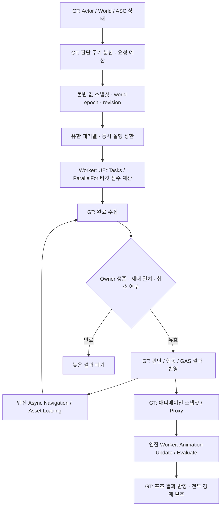
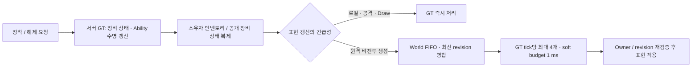

# Project J

### Unreal Engine 5.8 · C++ · Third-person Action MMORPG Prototype

서버 권위형 전투·장비와 Mover 기반 이동 애니메이션을 구현하며, **다수 캐릭터의 판단·이동·애니메이션·이펙트 비용을 제어하는 개인 개발 프로젝트**입니다.

멀티스레딩의 설계 기준은 Game Thread의 상태 소유권, Worker의 값 계산, 완료 결과의 유효성 검증입니다. 취소·재입장·캐릭터 파괴·월드 종료까지 구현과 검증 범위에 포함합니다.

## 현재 기준과 읽는 순서

| 확인할 내용 | 문서 |
| --- | --- |
| 프로젝트 구조와 작업 시작 | [문서 시작점](Docs/README.md) → [프로젝트 맥락](Docs/Overview/ProjectContext.md) |
| 변경 후 정리와 테스트·기존 자산 보존 | [공통 작업 규칙](AGENTS.md) → [변경 마감 기준](Docs/Maintenance/Change_Completion_Policy.md) |
| 이전 main 통합 기록 | [2026-10-15 통합 기록](Docs/Review/Audits/Project_J_Main_Integration_2026-10-15.md). 리타깃·구조 정리·R19/R20과 문서 결정은 `6d6713f4`까지 반영했습니다. |
| 현재 이동·리타깃·손 접촉 | [애니메이션](Docs/Animation/README.md). native 상태 계산·포즈 재생·몸체별 보정을 구분합니다. |
| 플레이어 이동·포즈 재생·공용 모션 | [플레이어 로코모션 아키텍처](Docs/Animation/Architecture/Player_Locomotion_Architecture.md) |
| 이전 Mirror Data 결정 | [도입 보류](Docs/Animation/Planning/Mirror_Data_Adoption_Decision_2026-10-15.md). 특정 동작 연결이 어색해졌을 때만 해당 구간을 다시 검토합니다. |
| 감사 단계별 변경·검증·남은 경계 | [검토 목차](Docs/Review/README.md). 전체 함수·에셋 정밀 감사 완료와 명시 범위의 구조 정리 마감을 구분합니다. |
| 200명 최적화와 현재 LOD 결정 | [계획·단계별 결과](Docs/Performance/Planning/ProjectJ_200_Player_Optimization_Plan_2026-10-15.md). `7b2ee72e`에 반영했으며 현재 몸체 LOD0–2 채택·LOD3–4 추가 보류입니다. |
| CPU·렌더 차이와 측정 조건 | [성능](Docs/Performance/README.md). 확인된 GPU 감소와 미확정인 전체 CPU·프레임 효과를 구분합니다. |

[아티스트·디자이너 협업](#아티스트디자이너를-위한-협업-안내) · [MMORPG 확장 기반](Docs/Architecture/Extensions/MMO_Foundation_2026-09-12.md) · [콘텐츠 확장 목록](Docs/Architecture/Extensions/MMO_Content_Catalog.md) · [멀티스레드 구조](#멀티스레드-구조) · [검증 현황](#검증-현황) · [측정 결과](Docs/Benchmarks/SystemsModernization.md) · [검증 데이터](Docs/Benchmarks/Data) · [직업 제작 도구](Docs/Gameplay/Authoring/Content_Authoring_System.md#tool)

누적된 감사 안내는 검토 목차로 모았습니다. 아래 측정·구현·검증 내용은 각각 명시한 시점의 기록이며, 통합 전 안내의 고유 수치와 문장은 [원문 보관소](Docs/Archive/README.md)에도 유지합니다.

## 측정으로 확인한 변화

최적화의 흐름은 **① 기존 예산·몸체 LOD 최적화 → ② Mover·Manny/native 전환 → ③ 이번 정책 복구·추가 최적화**입니다. 기존 최적화 기반을 이어받았으며, 이번 수치는 그 위에서 얻은 추가 효과입니다. ①→②의 동일 조건 성능 증감은 미측정입니다. 과거 GPU 유휴 **10.526→6.188ms**와 이번 frame 유휴 **18.19→16.12ms**는 각각의 독립 비교로 읽습니다. [단계별 구조·수치의 관계](Docs/Performance/Reports/ProjectJ_Mover_200_2026-10-22.md#이전-최적화--mover-전환--이번-최적화)에 비교 가능한 범위를 정리했습니다.

**동시 공격은 기존 품질을 유지합니다.** 이번 저빈도 시각 갱신·IK 생략 대상에서 보호하고 기존 매 프레임 평가·제작 LOD·물리 계약을 유지합니다. 공격 수치는 회귀 관찰용이며 개선율의 채택 근거로 삼지 않습니다.

측정 요약과 작은 CSV는 문서에서 바로 읽을 수 있으며, 상세 로그·캡처·대표 trace는 [검증 자료 압축 보관소](Archives/Validation/README.md)에 Git LFS로 함께 보관합니다. 실패·미채택 후보도 포함하고 원본 경로별 해시·복원 방법·정리 범위를 제공합니다.

**현재 Mover 구조의 200명 재검증 — 2026-10-22:** 지속 속성·입력 승인·착지·애니메이션 이력과 품질 정책의 소비 경로를 수정했습니다. 같은 바이너리의 A/B/B/A 실제 RHI 비교에서 평균 frame은 유휴 **18.19→16.12ms**, 이동·반전 **21.05→19.42ms**였습니다. 동시 공격은 **30.10→30.08ms**였으며 모든 구간의 평균·tail 개선이나 실제 200명 접속 성능을 주장하지 않습니다. 로컬 품질·전원 표시·실제 이동/공격과 표본·해시는 [현재 → 결과 보고서](Docs/Performance/Reports/ProjectJ_Mover_200_2026-10-22.md)에 구분했습니다.

**200명 표시·몸체 LOD 최적화 — 2026-10-15 측정 / 10월 16일 채택:** 기존 예산의 거리 관측·중복 조회를 정리하고 원격 몸체의 화면 크기 LOD를 적용했습니다. 현재 GreatSword_Woman의 LOD0–2를 채택했으며 로컬LOD0·200명 전원 표시·원본 물리와 서버 판정을 유지합니다. [측정 조건·해시·한계](Docs/Performance/Reports/ProjectJ_200_Player_Optimization_2026-10-15.json) · [다른 캐릭터·의상·장비의 공통 LOD 제작과 예외 검수](Docs/Animation/Authoring/Mesh_LOD_Authoring.md)

**실시간 리타깃 프로필 — 2026-10-13:** 공통 Master의 최종 포즈와 기존 리타깃·손 IK·의상 물리를 유지하면서, 골격 쌍의 Family와 몸체별 접촉 Body를 분리했습니다. MCP로 실제 Greatsword 외형 ABP에도 연결하고, 프로필 해제·재초기화·source 불일치의 복구를 검증했습니다. 200명 CPU 비교에서는 일부 구간의 증가가 관찰되어 전체 성능 개선으로 보고하지 않습니다. [적용 구조·검증·측정 한계](Docs/Animation/Architecture/Runtime_Retarget_Profiles_2026-10-13.md)

**플레이어 로코모션:** Mover 입력 승인과 이동 시뮬레이션, C++ 상태·전환·Chooser·노드 핀 계산, `ABP_Player_Master`의 포즈 연결을 분리했습니다. OTM/Strafe·공중 방향 재선택·재생 시각 연속성을 유지하며, Manny 공용 모션과 몸체별 리타깃/손 보정으로 캐릭터를 확장합니다. [현재 구조와 외부 기반·프로젝트 구현의 경계](Docs/Animation/Architecture/Player_Locomotion_Architecture.md)

**이전 구조의 200명 시각 예산 비교 — 2026-10-12:** 같은 바이너리의 기능 off/on, 실제 BP·장비·follower 구성, NullRHI, 조건별 120틱 준비 + 120틱 측정, 2회 반복에서 ABA on 평균 World tick은 근거리 **13.61→11.40ms**, 원거리 **13.78→10.69ms**였습니다. 리타깃 몸체와 의상 물리의 평가 횟수를 줄이고 사이 프레임을 보간하며, 로컬·전투·단발·급회전은 매 프레임 평가를 보호합니다. 동시 공격 ABA on은 **19.76→19.58ms**로 거의 같았습니다. 전체 렌더 FPS·GPU 개선이나 200명 동시 접속 결과로 해석하지 않습니다. [조건·원자료 위치·복구 설정](Docs/Animation/Planning/Crowd_Visual_Presentation_Budget_2026-10-12.md)

**구조 검증 이력 — 2026-09-19:** 직업·전직 기반, 내부 갱신·수명 정리와 에디터 제작 도구를 통합해 Editor/Game Win64 Development 빌드 및 자동화 **81개 통과, 테스트 오류·경고 0개**를 확인했습니다. GAS는 필요한 작업에 따라 갱신하고, 서버 피격 기록은 정해진 주기로 수집하며, 탈것 체력은 GAS로 일원화했습니다. [변경 범위](Docs/Architecture/Runtime/Reports/Internal_Polish_2026-09-19.md) · [검증 기록](Docs/Architecture/Runtime/Reports/Internal_Polish_Validation_2026-09-19.json)

아래 표는 몸체 LOD 교대 비교와 앞선 A–E 실험의 독립된 결과입니다. 서로 합산하거나 전체 게임 개선율·실제 동시 접속 처리량으로 해석하지 않습니다. 최근 빌드·자동화·실제 소켓 연결 결과는 [검증 현황](#검증-현황)에서 실행 조건과 함께 구분합니다.

| 영역 | 비교 조건 | Before → After | 결과 |
|---|---|---|---|
| **몸체 LOD · 유휴** | 같은 바이너리, 200개 authored 몸체, LOD 적용 전 / 후 | GPU 시간 **10.526 → 6.188 ms** | **41.2% 감소** |
| **몸체 LOD · 공격** | 같은 바이너리, 200개 authored 몸체의 동시 montage 공격 구간, LOD 적용 전 / 후 | GPU 시간 **11.922 → 7.421 ms** | **37.8% 감소** |
| **Mass 이동·간격 계산** | 2,048 moving agents, 직렬 / 병렬 | CPU 구간 p95 **0.6342 → 0.2409 ms** | **62.0% 감소** |
| **Niagara 생성** | 100개 동시 생성, 풀 미사용 / 사용 | 생성 CPU p95 **4.5739 → 3.3451 ms** | **26.9% 감소** |
| **네트워크 관심 영역** | NPC 100개 + client 2개, AllRelevant / Spatial | aggregate **18,786 → 13,223 B/s** | **29.6% 감소** |
| **Trail PSO coverage** | 같은 packaged binary, 보완 OFF / ON | Full PSO miss **1 → 0** | 누락된 render target 구성 보완 |
| **조명 PSO coverage** | 같은 main packaged binary, 기본 LightFunction 사전 요청 OFF / ON | Full PSO miss **1 → 0** | PSO 39개 추가 요청 비용까지 기록 |

**측정 범위:** UE 5.8 / Windows 11 / Ryzen 7 9800X3D. GPU 실험은 Radeon RX 9070 XT, D3D12를 사용했습니다. 각각 독립된 workload이며, 전체 게임 FPS 개선율이나 2,048명 동시 접속 성능을 의미하지 않습니다. 몸체 LOD의 전체 frame/CPU 이득은 미확정이며 망토 물리 연산량은 유지했습니다. A–E의 표본 수·실행 조건·실패 기록은 [벤치마크 문서](Docs/Benchmarks/SystemsModernization.md), 재계산 가능한 CSV/JSON은 [Data](Docs/Benchmarks/Data)에 공개합니다.

## 아티스트·디자이너를 위한 협업 안내

Project J는 **캐릭터·애니메이션·무기·의상·이펙트를 실제 플레이 안에서 연결하고 다듬는 협업**을 지향합니다. 새로운 직업의 전투 스타일, 무기별 액션, 서로 다른 분위기의 스킨과 마법 연출처럼 시도해 보고 싶은 콘텐츠를 함께 구체화할 수 있습니다.

### 함께 만들 수 있는 콘텐츠

| 분야 | 프로젝트에 연결하는 방식 | 함께 확인할 부분 |
|---|---|---|
| **캐릭터·몬스터 모델** | Skeletal Mesh와 캐릭터 프로필, AnimBP에 연결 | skeleton·비율·리타게팅, 발 접지와 손 IK |
| **의상·방어구·무기** | 장비 정의와 표현 프로필로 메시·부착 위치 구성, 호환되는 파츠는 Leader Pose 사용 | 본 구조, 소켓·그립, 클리핑과 LOD |
| **이동·전투 애니메이션** | Pose Match/Chooser용 이동 데이터와 무기별 프로필, 공격 몽타주 조합 | 이동·회전 전환, root motion, 공격·복귀 타이밍 |
| **Niagara 이펙트** | 공격 태그별 presentation profile과 몽타주 Notify 구간에 연결 | Trail 시작·끝, 무기 소켓, 잔상·중단 시 정리와 가독성 |
| **캐릭터 사운드** | 이벤트·접촉 위치·Physical Surface별 오디오 프로필에 음원 연결 | 움직임과의 타이밍, 기본음 대체, 가까운 원격 캐릭터 청취와 군중 비용 |
| **직업·스킬·콤보 기획** | 입력 태그, AbilitySet, 콤보 그래프와 AttackDefinition 조합 | 입력 분기, 연계 구간, 판정·이동·연출의 일치 |

캐릭터 호환성은 특정한 “표준 규격” 하나로 보장하지 않습니다. 사용할 skeleton과 애니메이션을 먼저 맞추고 리타게팅·소켓·IK를 검증합니다. 기존 구조로 표현할 수 있는 콘텐츠는 데이터와 프로필로 연결하고, 새로운 동작 규칙이 필요하면 C++ 기능을 함께 확장합니다.

### 콘텐츠를 게임 안에 연결하는 흐름

1. **의도와 기준 공유:** 콘셉트, 레퍼런스, 사용할 캐릭터·무기, 원하는 동작과 효과를 정합니다. 제작 초기에 skeleton·크기·축·소켓 기준을 맞춥니다.
2. **에셋과 데이터 연결:** 아티스트가 메시·애니메이션·Niagara를 제작하고, 디자이너와 프로그래머가 장비·전투·표현 프로필에 연결합니다. 기존 작성 가이드를 기준으로 변경 범위를 나눕니다.
3. **플레이 피드백:** 이동·공격·장착·해제에서 동작을 확인하고, 전환 속도·공격 타이밍·Trail 길이·잔상·클리핑을 조정합니다.
4. **다인원·네트워크 확인:** 로컬과 원격 캐릭터에서 표현을 비교하고, 공격 취소·무기 교체·캐릭터 파괴 때 정리되는지와 동시 표시 비용을 확인합니다.

**역할의 경계:** Data Asset은 콘텐츠 선택과 튜닝, Blueprint/AnimBP는 에셋 조합과 시각 표현, C++는 서버 권한·상태 전이·입력·복제·작업 수명을 담당합니다. 이펙트의 모양을 바꿀 때 피해 판정까지 복제해서 수정할 필요가 없도록 전투 정의와 표현 정의를 분리했습니다.

### 바로 활용할 수 있는 기반

- **직업·전직 제작 도구:** 에디터 Tools 메뉴에서 기존 직업을 참고해 새 루트·전투 스타일·콤보를 검증하고 연결해 생성합니다. 공격·애니메이션은 공유하고, 저장·게임 등록은 명시적으로 진행합니다. [사용법](Docs/Gameplay/Authoring/Content_Authoring_System.md#tool)
- **입력 조합과 콤보:** 좌·우클릭, 동시 입력, Shift/Ctrl/Alt 같은 modifier를 입력 태그로 해석하고, 콤보 그래프에서 공격 정의를 선택합니다. 조합별 실제 동작은 데이터로 구성합니다.
- **무기별 액션과 외형:** 장착한 장비의 메시·표현 프로필과 전투 스타일을 연결해 무기 외형, 대기·공격 애니메이션 구성을 바꿀 수 있습니다.
- **같은 공격의 다른 연출:** 기본 전투 스타일의 VFX를 전직 또는 스킨별 cue로 덮어쓸 수 있습니다. 동일한 공격 정의에 서로 다른 Trail·방출 효과를 붙이는 방식입니다.
- **데이터 기반 이동 확장:** 이동 문맥과 콘텐츠 프로필을 나누고, 상태 선택·Pose Match·Chooser·Linked Anim Layer를 통해 애니메이션을 구성합니다. 실제 품질은 사용할 애니메이션과 리타게팅·프로필 튜닝을 함께 확인합니다.

작성 가이드: [콘텐츠 확장](Docs/Gameplay/Authoring/Content_Authoring_System.md#expansion) · [장비·직업 데이터 빠른 참조](Docs/Gameplay/Authoring/Content_Authoring_System.md#data) · [공격·콤보 작성](Docs/Combat/Authoring/GreatswordCombatAuthoringGuide.md) · [전투 VFX 연결](Docs/Combat/Architecture/CombatVFXArchitecture.md#authoring) · [이동 프로필 확장](Docs/Animation/Authoring/DataDrivenLocomotionExtensionGuide.md)

## 멀티스레드 구조

Game Thread(GT)가 Actor·World·GAS 상태를 읽고 변경합니다. 직접 제출하는 작업에는 값 스냅샷을 전달하고, 엔진이 제공하는 Navigation·로딩·애니메이션 비동기 경로는 해당 엔진 서비스가 실행을 관리합니다.



이 흐름은 NPC 판단·행동의 책임 경계를 나타냅니다. Mass는 별도의 **GT snapshot/grid → 직렬 또는 병렬 chunk 계산 → join → GT 적용** 경로를 사용합니다. 모든 비동기 서비스가 하나의 공통 작업 큐를 공유하는 구조는 아닙니다.

2026-10-12의 시각 애니메이션 예산은 기존 **AnimInstanceProxy 스냅샷과 엔진 병렬 업데이트·평가**를 활용합니다. GT 관리자는 평가 주기·보호 요구만 결정하고, worker proxy의 완료를 기다리지 않습니다. 리타깃 몸체의 실제 평가에는 원본 포즈 의존 순서를 유지합니다. NPC scoring의 `UE::Tasks`나 Mass 청크 작업에 애니메이션을 새로 제출하지 않으며, 캐릭터별 평가 시점 분산을 새 병렬 실행기로 표현하지 않습니다. [스레드별 책임](Docs/Animation/Planning/Crowd_Visual_Presentation_Budget_2026-10-12.md#기존-병렬-아키텍처와의-관계)

### 장비 권한과 시각 표현의 처리 순서



장비 상태와 GAS 변경에는 GT 실행 순서를 유지합니다. 원격 비전투 캐릭터의 시각 오브젝트 **생성**을 프레임에 분산하며, 기존 표현 해제는 즉시 처리합니다. 해제 비용까지 모두 분산된 것으로 해석하지 않습니다.

## A–E 구현 범위

| 단계 | 구현한 내용 | 확인한 규모·동작 |
|---|---|---|
| **A · 비동기 기반** | 배치 타깃 scoring, 공유 공간 스냅샷, owner lease 기반 로딩 공유, 요청 상한과 취소 수명 | 256 owners / 1,024 공유 요청에서 실제 load 1회, 취소64 / 완료960 |
| **B · 애니메이션 예산** | C++ snapshot/AnimInstance proxy, 엔진 병렬 평가, Animation Budget Allocator, 필수 전투 포즈 보호 | 공격 완료·취소·해제·파괴와 예산 등록/복귀 회귀 |
| **C · NPC 판단·Navigation** | observer 기반 갱신, 후보 예산, Async Navigation admission/retry, stale InRange 해제 | 판단 대상2,048 / observers512, Nav burst512 전달·timeout0 |
| **D · 군중·복제·표현** | Mass 값 이동과 Character 인계, 공간 관련성, 원격 표현 생성 FIFO | Mass2,048 값 일치, 서버+실제 socket clients4 / NPC512 기능 검증 |
| **E · VFX·PSO·애니메이션 보완** | Niagara pool 수명, 선택 갱신 위상 분산, cooked 초기화 보호, Trail PSO 보완, 거리 컬링 실험 | 최종 packaged 스킬3회 × 신규/재사용 cache, 렌더링 회귀24개 |

A–E의 현재 구현은 `main`에 통합되어 있습니다. **E의 운영 에셋별 최적화·품질 검증은 진행 중**이며, 단계별 실험 통과와 모든 기능의 운영 적용을 구분합니다.

## 설계에서 중요하게 다룬 경계

### 작업량에 맞춘 병렬 실행

Mass의 간격 계산을 포함한 CPU 구간은 스냅샷 생성과 join 비용까지 측정합니다. 기본 `ProjectJ.Mass.Parallel=-1`은 **실제 이동 중인 agent가 1,024개 이상이고 간격 계산이 켜진 경우** 병렬 chunk를 선택합니다. 작은 단순 이동 작업에서는 직렬이 더 저렴했던 결과도 판단에 반영했습니다.

이 Mass 경로는 **선택적으로 등록한 NPC의 Character·ASC·장비를 유지하는 프로토타입**입니다. 전투·몽타주·root motion 등을 보호하고, 과밀하거나 막힌 경로는 Character 이동으로 복귀합니다. Actor 메모리 절감이나 원거리 ISM 표현까지 구현된 상태는 아닙니다.

→ [Mass 인계와 실행 선택](Source/Project_JCharacter/Private/Mass/Project_JMassRepresentationSubsystem.cpp) · [값 계산 Processor](Source/Project_JCharacter/Private/Mass/Project_JMassMovementProcessor.cpp)

### 과부하와 늦은 완료를 함께 제어

요청을 무제한으로 쌓는 대신 대기열·실행 중 작업·프레임별 적용에 상한을 둡니다. 배치 후보 예산에 도달하면 미처리 NPC부터 다음 tick에 재개하고, Navigation 입장이 거절되면 분산 재시도로 넘깁니다. 취소는 결과 적용 권한을 제거하며 실제 작업 완료와는 구분합니다.

완료 시점에 weak owner, world epoch, revision을 확인해 이전 장비·이전 월드의 결과가 현재 상태에 적용되는 것을 막습니다. 공유 참조의 수명 안전성과 Worker가 읽는 데이터의 안전성을 별도 계약으로 다룹니다.

→ [Scoring 수명](Source/Project_JCore/Private/System/Project_JTargetScoringSubsystem.cpp) · [Navigation 압력 제어](Source/Project_JCharacter/Private/System/Project_JNPCPathSubsystem.cpp) · [표현 FIFO](Source/Project_JCharacter/Private/System/Project_JPresentationBudgetSubsystem.cpp)

### 실행 방식보다 실제 측정 결과를 우선

| 관측 | 반영한 판단 |
|---|---|
| 병렬 Net Tick에서 실제 worker overlap 확인, CPU 개선은 일관되지 않음 | 기본 Net Tick 병렬화를 활성화하지 않음 |
| Niagara 생성 p95 감소, 종료 비용은 큰 차이 없음 | 풀의 생성 비용·반환 수명을 구분해서 관리 |
| 거리 컬링 이후 simulation 감소, 보이는 ribbon 렌더 비용은 거의 동일 | GPU 렌더링 전체 개선으로 확대 해석하지 않음 |
| 신규 application cache와 재사용 비교에서 preload 이득 불명확 | driver cold 또는 hitch 제거로 주장하지 않음 |

### Editor와 packaged 실행의 차이를 회귀로 포착

- **Cooked 애니메이션 초기화:** authored AnimBP가 설치되기 전 native Motion Matching 노드가 folded NodeData 없이 실행되는 crash를 수정했습니다. 임시 구간은 엔진 reference pose를 사용하고, AnimBP 연결 후 generated graph를 사용합니다. native-only MM fallback은 cooked에서 지원하지 않습니다.
- **UE 5.8 Trail PSO:** 기존 Distortion collector의 shader/state를 재사용하면서 rough-refraction의 누락된 RT 구성을 보완했습니다. validation 옵션에 의존하지 않는 검색과 **monolithic 게임에 한정한 등록**으로 적용 범위를 제한합니다. 엔진 소스와 화질 설정은 변경하지 않았습니다.

→ [Animation Proxy](Source/Project_JCharacter/Private/Animation/Project_JCharacterAnimInstanceProxy.cpp) · [PSO 보완](Source/Project_J/Rendering/Project_JDistortionPSOPrecache.cpp)

## 검증 현황

### 현재 로코모션 검증 — 2026-10-21

Manny 공용 라이브러리·Chooser/PSD/BlendSpace 연결과 비표준 Bip01 몸체의 실제 IK를 점검했습니다. direct UBT Editor 빌드와 집중 native 회귀 **61개 통과**, 변환 시퀀스 **448개·2,240개 키프레임 표본**, 실제 OTM/Strafe 이동·Sprint 급회전·공중/착지·전신 몽타주 검증을 확인했습니다. 골격 호환·선택·실제 포즈·화면 품질의 근거를 구분하고, 재임포트 대신 원인이 확인된 리타깃 기준·Goal/시작 본·실행 연결을 수정했습니다. [조건·실패·복구·최종 결과](Docs/Animation/Architecture/Player_Locomotion_Migration_2026-10-19.md)

이후 원본 모션 뱅크는 별도 압축 보관하고 참조 없는 2,192개 패키지를 퇴역했습니다. Manny 기준 native 회귀 **62개**와 원본 없는 로드를 확인했으며, 추가 수입의 ID·실제 모션·가산 기준·변환 recipe를 비교하는 사전 검사를 마련했습니다. [보관·검증 범위](Docs/Maintenance/Animation_Source_Archive_2026-10-21.md) · [수입 제작 기준](Docs/Animation/Authoring/Player_Animation_Library.md)

이 결과는 모든 애니메이션 프레임의 외형 승인이나 현재 Mover 구조의 200명 CPU/GPU·새 네트워크 부하·Cook/Shipping 검증을 의미하지 않습니다. 10월 12–15일의 CMC/MM·성능 실험은 [이전 구현 기록](Docs/Animation/Planning/README.md)으로 보존하며 현재 수치와 합산하지 않습니다.

### 이전 기능·수명 검증 — 2026-10-08

8개 모듈의 소스 위험 패턴과 핵심 런타임 경계를 검토하고 **실제 엔진에서 재현한 결함 5개**를 수정했습니다. 영속 ASC의 Avatar 교체, Destroy와 GC 사이의 탈것 참조, 네이티브 애니메이션 프록시의 GC 추적, 겹치는 무기 노티파이, 화면 밖 몽타주의 종료 처리를 다룹니다. 모든 파일의 모든 실행 경로를 전수 실행한 범위는 아닙니다. [런타임 감사와 재현 근거](Docs/Review/Audits/Project_J_Runtime_Ownership_Audit_2026-10-08.md) · [검증 요약](Docs/Review/Audits/Project_J_Runtime_Ownership_Validation_2026-10-08.json)

| 검증 | 결과 | 실행 조건 |
|---|---|---|
| 직접 UBT Editor / Game 빌드 | 모두 성공 | UE 5.8, Win64 Development |
| ProjectJ 전체 자동화 | **244개 통과 / 실패0 / 미실행0** | NullRHI, 225개 성공·19개 경고 포함 성공, `a.Budget.BudgetMs 0.1` |
| 장비 장착·공격·해제 반복 | **100캐릭터 × 3회 = 300 actor-cycle 완료 / failures=0** | 위 자동화와 같은 실행, 네트워크 클라이언트 수와 구분 |
| 실제 소켓 연결·복제·애니메이션 | 전용 서버1 + clients2, NPC100, 모두 정상 종료 | Iris AOI·FastArray·애니메이션 관측, `PktLag=80`·`PktLoss=2` 설정 |

이 결과는 커밋 `8a897335`에 반영된 소스·콘텐츠의 기능 검증입니다. 로그의 경고와 기존 에셋 참조 누락도 감사 보고서에 남겼습니다. 이번 실행의 packaged/cook·RHI 품질이나 MMO 대규모 처리량을 입증하는 수치로 사용하지 않습니다.

### 보존된 packaged·RHI·부하 검증 — 2026-09-10

| 검증 | 결과 | 해석 범위 |
|---|---|---|
| main 직접 UBT Editor / Game 빌드 | 모두 성공 | Win64 Development |
| main 다인원·수명 회귀 | **56개 통과 / 오류0 / 경고10** | NullRHI, 기존 경고 포함 |
| main 실제 RHI 전투·애니메이션·장비 회귀 | **24개 통과 / 오류0 / 경고0** | 56개 집합과 중복 있음 |
| 별도 socket 다중 접속 | 서버1 + clients4, NPC512 검증·정상 종료 | AOI 재입장, owner-only inventory, 공개 장비, 삭제·접속 종료 |
| packaged 스킬 통합 | 신규/재사용 application cache 각각3회 성공 | 장착 → GAS → 몽타주 → hit window → Trail → 해제/정리 |

수치는 **2026-09-10의 보존된 실행 결과**입니다. main 회귀는 코드 `f2c31fb`, 전투 에셋 `89f94b4` 기준이며, 이후 변경된 소스·콘텐츠 전체의 packaged/RHI 재검증 결과를 의미하지 않습니다. [검증 근거와 재현 조건](Docs/Benchmarks/SystemsModernization.md)을 함께 확인할 수 있습니다.

## 게임플레이와 콘텐츠 확장 기반

멀티스레드 작업과 함께, 콘텐츠가 늘어날 때 상태·표현·복제의 책임이 섞이지 않도록 아래 기반을 유지합니다.

| 기반 | 구현한 책임과 확장 방향 |
|---|---|
| **PlayerState / Character 분리** | 플레이어의 ASC·인벤토리·장비 상태와 Avatar의 이동·표현 수명을 분리. NPC는 character-local 소유 경로 사용 |
| **모듈러 장비 표현** | 호환되는 파츠를 메인 메시의 Leader Pose에 연결하고, 장착 상태와 시각 오브젝트의 수명을 별도로 관리 |
| **FastArray 기반 복제** | 인벤토리·장비 변경분을 전달하고 owner-only 데이터와 공개 표현을 구분 |
| **원격 이동 궤적 보정** | Mover의 승인 입력·보간된 이동 상태와 source pose를 사용해 원격 표현 구성 |
| **데이터 유효성 검사** | 장비·프로필의 필수 참조와 설정을 `IsDataValid` 등으로 검사. 실제 애니메이션·연출 품질은 플레이 검증과 병행 |
| **클라이언트 캐릭터 오디오** | 가까운 플레이어·NPC 접촉음을 로컬에서 구성. 이벤트별 음원·Physical Surface 매핑, 비동기 준비와 후보·voice 예산 지원. 현재 마네킹 기본음 연결, 실제 눈·물·진흙 환경은 후속 제작 범위 |
| **서버 간 상태 전달 준비** | Handover envelope, 검증·취소·실패 상태와 transport 경계를 마련. 운영 분산 서버와 영속 저장 완성을 의미하지 않음 |

→ [모듈러 메시](Source/Project_JCharacter/Private/Components/Project_JModularMeshComponent.cpp) · [이동·포즈 스냅샷](Source/Project_JCharacter/Private/Animation/Project_JCharacterAnimInstanceProxy.PlayerLocomotion.cpp) · [장비 데이터 검사](Source/Project_JCharacter/Private/Equipment/Project_JEquipmentItemDefinition.cpp) · [캐릭터 오디오](Docs/Animation/Architecture/Foley_Audio_System.md) · [Handover](Source/Project_J/Backend/Project_JHandoverManager.h)

## 프로젝트 구성

| 모듈 | 주요 책임 |
|---|---|
| [Project_JCore](Source/Project_JCore) | 값 타입, 비동기 scoring, 공간 스냅샷, 공유 시각 에셋 서비스 |
| [Project_JGAS](Source/Project_JGAS) | Ability System Component와 Attribute 기반 |
| [Project_JMMO](Source/Project_JMMO) | Core-only 확장 계약, 조정·요청 수명과 저장 계약 |
| [Project_JCharacter](Source/Project_JCharacter) | 캐릭터·장비·전투·애니메이션·오디오·NPC 판단/이동·Mass 인계 |
| [Project_J](Source/Project_J) | PlayerState/Controller, 게임 연결, 통합 진단 fixture |
| [Project_JCharacterEditor](Source/Project_JCharacterEditor) | 콘텐츠 제작·검증·이관 도구, Editor 전용 Navigation 통합·부하 시험 |
| [Project_JAnimationNodes](Source/Project_JAnimationNodes) | Guided Hand IK AnimGraph 제작 노드·컴파일 검사, UncookedOnly |
| [Project_JMount](Source/Project_JMount) | 탈것과 탑승 캐릭터 연결 |

플레이어의 ASC·인벤토리·장비 소유권은 PlayerState에 두고 Character의 표현 수명과 분리합니다. GAS 전투 정의, 장비별 animation/presentation profile, 포즈 검색/Chooser, Niagara 에셋을 조합하는 방식으로 기능을 확장합니다. 일반 NPC는 플레이어와 다른 소유 경로를 사용합니다.

## 빌드와 실행

Unreal Engine **5.8**, Win64 C++ 도구 체인과 **Git LFS**가 필요합니다. 에셋은 LFS 파일까지 받은 후 `Project_J.uproject`를 사용합니다. 저장소 루트의 PowerShell에서:

```powershell
git lfs pull
$engineRoot = 'C:/Program Files/Epic Games/UE_5.8'
$projectFile = (Resolve-Path './Project_J.uproject').Path
& "$engineRoot/Engine/Binaries/DotNET/UnrealBuildTool/UnrealBuildTool.exe" `
    Project_JEditor Win64 Development "-Project=$projectFile" -WaitMutex
```

빌드 전에 Unreal Editor·Live Coding·기존 컴파일 프로세스가 종료됐는지 확인하고, 실행한 빌드는 완료까지 기다립니다. 검증 스크립트는 [Scripts/Validation](Scripts/Validation)에 있으며, [벤치마크 재현 안내](Docs/Benchmarks/SystemsModernization.md#재현)를 따릅니다.

## 실행 경계 실험과 다음 작업

- **콘텐츠·런타임 후속:** 최근 수명 회귀를 유지하면서 packaged/RHI·더 많은 접속 조건으로 검증을 확장합니다. 실제 콘텐츠의 전환·접촉 타이밍, 지형 연결과 군중 표현 비용, 남아 있는 에셋 의존성을 점검합니다. [최근 감사의 잔여 항목과 검증 범위](Docs/Review/Audits/Project_J_Runtime_Ownership_Audit_2026-10-08.md)
- **E 후속:** 기본 LightFunction PSO 누락을 해결했습니다. 승인 후 운영 ABP의 snapshot getter 5개 변환과 Trail 거리 컬링·고정 bounds를 저장했습니다. VFX instance 예산과 driver cold 검증은 남아 있습니다.
- **F 구현·실험:** Tasks/TaskGraph/ThreadPool, Tick 의존성, 전용 consumer 경합, Chaos snapshot, RDG readback, Audio·PCG의 8개 fixture를 기본 비활성 Editor 플러그인으로 구현했습니다. [실측·구조·적용 판단](Docs/Benchmarks/ExecutionExperiments_2026-09-12/README.md)에서 병렬화의 이득과 순서/수명 비용을 함께 공개합니다.
- **MMORPG 확장 기반:** Core-only 모듈, 205개 확장 계약, 통신 요청 수명·상한, 소유 단위 조정과 저장 계약을 추가했습니다. 신규 테스트 8개와 기존 회귀 16개를 검증했으며, Handover 정리 경고는 후속 3개 검사에서 오류·경고 0으로 해결했습니다. 실제 콘텐츠·운영 DB 연결, 전투 서버 tick과 더 많은 접속·패킷 조건, 운영 Mass 표현 전환 검증은 후속 범위입니다.

[벤치마크와 데이터](Docs/Benchmarks/SystemsModernization.md) · [설계·검증 이력](Docs/Performance/Reports/ProjectJ_Systems_Modernization_Refactor_2026-09-08.md) · [초기 프로파일링 기준선](Docs/Performance/Reports/ProjectJ_Profiling_Consolidated_Summary_2026-09-06.md) · [전체 문서](Docs/README.md)
