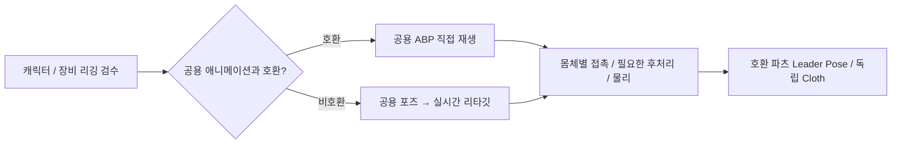
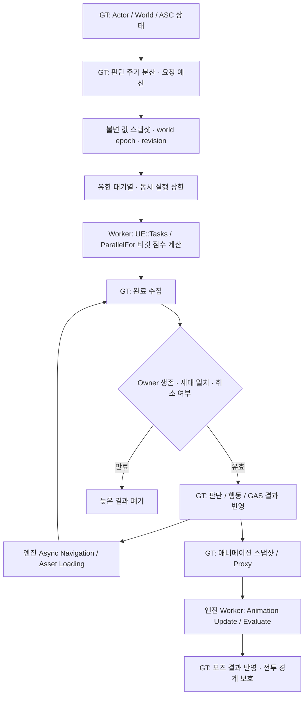
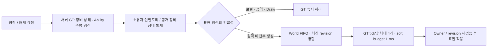

# Project J

### Unreal Engine 5.8 · C++ · Third-person Action MMORPG Prototype

서버 권위형 전투·장비와 Mover 기반 이동 애니메이션을 구현하며, **다수 캐릭터의 판단·이동·애니메이션·이펙트 비용을 제어하는 개인 개발 프로젝트**입니다.

멀티스레딩의 설계 기준은 Game Thread의 상태 소유권, Worker의 값 계산, 완료 결과의 유효성 검증입니다. 취소·재입장·캐릭터 파괴·월드 종료까지 구현과 검증 범위에 포함합니다.

## 현재 기준과 읽는 순서

| 목적 | 시작점 |
| --- | --- |
| 구조·작업 기준 | [문서 목차](Docs/README.md) · [프로젝트 맥락](Docs/Overview/ProjectContext.md) · [작업 규칙](AGENTS.md) · [변경 마감](Docs/Maintenance/Change_Completion_Policy.md) |
| 이동·애니메이션 | [로코모션 구조](Docs/Animation/Architecture/Player_Locomotion_Architecture.md) · [애니메이션 목차](Docs/Animation/README.md) |
| 새 캐릭터·장비 제작 | [리깅·UE5 후처리 가이드](Docs/Animation/Authoring/Character_Rigging_And_UE5_Postprocess_Playbook.md) · [모듈러 장비](Docs/Gameplay/Authoring/ModularCharacterEquipmentGuide.md) · [LOD 제작](Docs/Animation/Authoring/Mesh_LOD_Authoring.md) |
| 성능·검증 근거 | [성능 목차](Docs/Performance/README.md) · [벤치마크](Docs/Benchmarks/SystemsModernization.md) · [검토 기록](Docs/Review/README.md) · [압축 원자료](Archives/Validation/README.md) |
| 직업·MMORPG 확장 | [직업 제작 도구](Docs/Gameplay/Authoring/Content_Authoring_System.md#tool) · [확장 기반](Docs/Architecture/Extensions/MMO_Foundation_2026-09-12.md) · [콘텐츠 목록](Docs/Architecture/Extensions/MMO_Content_Catalog.md) |

캐릭터는 실제 골격·기준 포즈·스킨·IK 계약을 검증한 뒤 두 경로로 연결합니다. 머리카락·치마·망토의 추가 본과 물리는 몸체별로 구성합니다.



현재 GreatSword는 **직접 ABP 경로**입니다. 로컬은 원본 LOD0·Cloth 품질을 유지하고, 원격은 피부 body LOD0–2와 Cloth 인스턴스 예산을 사용합니다. 머리·헤어 카드는 전용 LOD 제작 전까지 원본을 보존합니다. 기본 대검은 Basic을 유지합니다.

## 측정으로 확인한 변화

측정 시점·지표·부하가 다른 결과는 독립 비교입니다. CPU worker 누적 시간, Game Thread, GPU, 전체 프레임을 더하거나 개선율을 합산하지 않습니다.

### 현재 직접 ABP · 200명 Cloth 예산 — 2026-10-26

| 같은 바이너리·에셋 | 정지 Frame (ms) | 이동 Frame (ms) | 동시 공격 Frame (ms) |
| --- | ---: | ---: | ---: |
| 원격 Cloth 예산 OFF | 1,851.44 | 1,827.67 | 2,123.51 |
| 원격 Cloth 예산 ON | **63.12** | **63.09** | **79.75** |
| 평균 프레임 감소 | 96.59% | 96.55% | 96.24% |

ON/OFF/OFF/ON 4회에서 **망토 200개를 계속 시뮬레이션하고 로컬 축소 0개**를 확인했습니다. 원격 199개에만 예산을 적용했습니다. Cloth 대기가 지배적이어서 리타깃 제거만으로 비슷했던 프레임이 크게 줄었습니다. **60FPS 달성 결과는 아닙니다.** GPU는 이동 6.40→9.97ms·공격 9.61→10.16ms로 증가했고 초기 200명 일괄 생성 지연도 남았습니다.

이후 검수 도구 수정 후 최종 빌드 스모크 2회의 이동은 61.78/62.51ms, 공격은 96.51/80.11ms였습니다. 공격의 실행 간 편차도 보존하며 위 교대 평균에 합치지 않습니다.

직접 producer 200개·표시 파츠 2,000개·Nanite 1,400개, D3D12 1280×720 Epic의 실제 이동·점프·전원 공격 fixture입니다. 실제 원격 연결은 0개입니다. [원인·반복별 p95·품질 경계·남은 비용](Docs/Performance/Reports/ProjectJ_Cloth_Budget_200_2026-10-25.md) · [전환 직후 리타깃과 직접 ABP 비교](Docs/Performance/Reports/ProjectJ_DirectRig_200_2026-10-25.md). 과거 리타깃 worker CPU와 현재 frame을 빼서 순수 리깅 절감률로 해석하지 않습니다.

### 보존된 비교 결과

| 영역 | 비교 조건 | Before → After | 결과 |
|---|---|---|---|
| **Mover · 10/22 · 유휴** | 같은 바이너리, 실제 Mover 몸체 200명, 정책 복구 OFF / ON | 평균 프레임 **18.19 → 16.12 ms** | **11.4% 감소** |
| **Mover · 10/22 · 이동·반전** | 같은 200명, 실제 이동·방향 반전, 정책 복구 OFF / ON | 평균 프레임 **21.05 → 19.42 ms** | **7.7% 감소** |
| **Mover · 10/22 · 점프·착지** | 같은 200명, 점프·착지 phase, 정책 복구 OFF / ON | 평균 프레임 **21.06 → 19.50 ms** | **7.4% 감소** |
| **Mover · 10/22 · 동시 공격** | 같은 200명 전원 montage 재생 행, 양쪽 모두 기존 공격 품질 유지 | 평균 프레임 **30.10 → 30.08 ms** | **차이 미확정 · 품질 유지** |
| **Mover · 10/22 · 공격 복귀** | 같은 200명, 공격 종료·복귀 phase, 정책 복구 OFF / ON | 평균 프레임 **18.31 → 18.33 ms** | **차이 미확정** |
| **기존 LOD · 유휴** | 같은 바이너리, 200개 authored 몸체, LOD 적용 전 / 후 | GPU 시간 **10.526 → 6.188 ms** | **41.2% 감소** |
| **기존 LOD · 공격** | 같은 바이너리, 200개 authored 몸체의 동시 montage 공격 구간, 제작 LOD 적용 전 / 후 | GPU 시간 **11.922 → 7.421 ms** | **37.8% 감소** |
| **Mass 이동·간격 계산** | 2,048 moving agents, 직렬 / 병렬 | CPU 구간 p95 **0.6342 → 0.2409 ms** | **62.0% 감소** |
| **Niagara 생성** | 100개 동시 생성, 풀 미사용 / 사용 | 생성 CPU p95 **4.5739 → 3.3451 ms** | **26.9% 감소** |
| **네트워크 관심 영역** | NPC 100개 + client 2개, AllRelevant / Spatial | aggregate **18,786 → 13,223 B/s** | **29.6% 감소** |
| **Trail PSO coverage** | 같은 packaged binary, 보완 OFF / ON | Full PSO miss **1 → 0** | 누락된 render target 구성 보완 |
| **조명 PSO coverage** | 같은 main packaged binary, 기본 LightFunction 사전 요청 OFF / ON | Full PSO miss **1 → 0** | PSO 39개 추가 요청 비용까지 기록 |

| 측정 묶음 | 실행 조건·해석 | 상세 근거 |
| --- | --- | --- |
| Mover · 2026-10-22 | 동일 바이너리 ABBA, 200명, D3D12 offscreen 1280×720, scalability 3. 정책 복구 OFF/ON. 동시 공격·복귀 개선은 미확정 | [반복 편차·p95/p99·품질 보호](Docs/Performance/Reports/ProjectJ_Mover_200_2026-10-22.md) |
| 기존 몸체 LOD · 2026-10-15 | 교대 비교. 로컬 LOD0·원격 LOD0–2, 물리·공격 품질 유지. 전체 frame/CPU 이득은 미확정 | [수치·에셋 지문](Docs/Performance/Reports/ProjectJ_200_Player_Optimization_2026-10-15.json) |
| 이전 시각 예산 · 2026-10-12 | 200명, NullRHI, 준비/측정 각120틱×2회. ABA on 평균 World tick: 근거리13.61→11.40ms, 원거리13.78→10.69ms, 공격19.76→19.58ms | [조건·복구 설정](Docs/Animation/Planning/Crowd_Visual_Presentation_Budget_2026-10-12.md) |
| 리타깃 프로필 · 2026-10-13 | Family/Body 분리·복구 검증. 일부 CPU 구간 증가가 있어 전체 성능 개선으로 판정하지 않음 | [원자료·CPU 범위](Docs/Animation/Architecture/Runtime_Retarget_Profiles_2026-10-13.md) |
| A–E 시스템별 실험 | Windows 11 / Ryzen 7 9800X3D / RX 9070 XT. 각기 다른 부하·지표이며 실제 동시 접속 처리량과 구분 | [벤치마크·조건](Docs/Benchmarks/SystemsModernization.md) · [CSV/JSON](Docs/Benchmarks/Data) |

Mover 전환 자체의 동일 조건 성능 증감은 미측정입니다. 기존 예산·LOD 기반을 계승한 뒤 정책 소비를 복구한 결과가 위 Mover 비교이며, [개발 단계별 관계](Docs/Performance/Reports/ProjectJ_Mover_200_2026-10-22.md#이전-최적화--mover-전환--이번-최적화)에 근거를 남겼습니다.

## 아티스트·디자이너를 위한 협업 안내

Project J는 **캐릭터·애니메이션·무기·의상·이펙트를 실제 플레이 안에서 연결하고 다듬는 협업**을 지향합니다. 새로운 직업의 전투 스타일, 무기별 액션, 서로 다른 분위기의 스킨과 마법 연출처럼 시도해 보고 싶은 콘텐츠를 함께 구체화할 수 있습니다.

### 함께 만들 수 있는 콘텐츠

| 분야 | 프로젝트에 연결하는 방식 | 함께 확인할 부분 |
|---|---|---|
| **캐릭터·몬스터 모델** | Skeletal Mesh와 캐릭터 프로필, AnimBP에 연결 | skeleton·비율·리타게팅, 발 접지와 손 IK |
| **의상·방어구·무기** | 장비 정의와 표현 프로필로 메시·부착 위치 구성, 호환되는 파츠는 Leader Pose 사용 | 본 구조, 소켓·그립, 클리핑과 LOD |
| **이동·전투 애니메이션** | Pose Match/Chooser용 이동 데이터와 무기별 프로필, 공격 몽타주 조합 | 이동·회전 전환, root motion, 공격·복귀 타이밍 |
| **Niagara 이펙트** | 공격 태그별 presentation profile과 몽타주 Notify 구간에 연결 | Trail 시작·끝, 무기 소켓, 잔상·중단 시 정리와 가독성 |
| **캐릭터 사운드** | 이벤트·접촉 위치·Physical Surface별 오디오 프로필에 음원 연결 | 움직임과의 타이밍, 기본음 대체, 가까운 원격 캐릭터 청취와 군중 비용 |
| **직업·스킬·콤보 기획** | 입력 태그, AbilitySet, 콤보 그래프와 AttackDefinition 조합 | 입력 분기, 연계 구간, 판정·이동·연출의 일치 |

캐릭터 호환성은 특정한 “표준 규격” 하나로 보장하지 않습니다. 사용할 skeleton과 애니메이션을 먼저 맞추고 리타게팅·소켓·IK를 검증합니다. 기존 구조로 표현할 수 있는 콘텐츠는 데이터와 프로필로 연결하고, 새로운 동작 규칙이 필요하면 C++ 기능을 함께 확장합니다.

### 콘텐츠를 게임 안에 연결하는 흐름


| 담당 | 소유하는 내용 |
| --- | --- |
| Data Asset | 콘텐츠 선택·튜닝 |
| Blueprint / AnimBP | 에셋 조합·시각 표현·포즈 연결 |
| C++ | 서버 권한·상태 전이·입력·복제·작업 수명 |

### 바로 활용할 수 있는 기반

| 기능 | 작성 가이드 |
| --- | --- |
| 직업·전직 생성, 전투 스타일·콤보 검증 | [직업 도구](Docs/Gameplay/Authoring/Content_Authoring_System.md#tool) |
| 입력 태그·modifier·콤보 그래프 | [공격·콤보](Docs/Combat/Authoring/GreatswordCombatAuthoringGuide.md) |
| 무기별 메시·액션·표현 프로필 | [장비·직업 데이터](Docs/Gameplay/Authoring/Content_Authoring_System.md#data) |
| 같은 공격의 전직·스킨별 Trail/VFX | [전투 VFX](Docs/Combat/Architecture/CombatVFXArchitecture.md#authoring) |
| Pose Match·Chooser·Linked Anim Layer | [이동 프로필 확장](Docs/Animation/Authoring/DataDrivenLocomotionExtensionGuide.md) |

## 멀티스레드 구조

Game Thread(GT)가 Actor·World·GAS 상태를 읽고 변경합니다. 직접 제출하는 작업에는 값 스냅샷을 전달하고, 엔진이 제공하는 Navigation·로딩·애니메이션 비동기 경로는 해당 엔진 서비스가 실행을 관리합니다.



NPC 판단의 값 작업과 엔진 비동기 서비스는 실행 주체를 구분합니다. Mass는 GT snapshot/grid → chunk 계산 → join → GT 적용을 사용합니다. 애니메이션은 기존 Proxy와 엔진 병렬 평가를 이용하고 원본 포즈 의존 순서를 유지합니다. [스레드별 책임](Docs/Animation/Planning/Crowd_Visual_Presentation_Budget_2026-10-12.md#기존-병렬-아키텍처와의-관계)

### 장비 권한과 시각 표현의 처리 순서



장비 상태와 GAS 변경에는 GT 실행 순서를 유지합니다. 원격 비전투 캐릭터의 시각 오브젝트 **생성**을 프레임에 분산하며, 기존 표현 해제는 즉시 처리합니다. 해제 비용까지 모두 분산된 것으로 해석하지 않습니다.

## A–E 구현 범위

| 단계 | 구현한 내용 | 확인한 규모·동작 |
|---|---|---|
| **A · 비동기 기반** | 배치 타깃 scoring, 공유 공간 스냅샷, owner lease 기반 로딩 공유, 요청 상한과 취소 수명 | 256 owners / 1,024 공유 요청에서 실제 load 1회, 취소64 / 완료960 |
| **B · 애니메이션 예산** | C++ snapshot/AnimInstance proxy, 엔진 병렬 평가, Animation Budget Allocator, 필수 전투 포즈 보호 | 공격 완료·취소·해제·파괴와 예산 등록/복귀 회귀 |
| **C · NPC 판단·Navigation** | observer 기반 갱신, 후보 예산, Async Navigation admission/retry, stale InRange 해제 | 판단 대상2,048 / observers512, Nav burst512 전달·timeout0 |
| **D · 군중·복제·표현** | Mass 값 이동과 Character 인계, 공간 관련성, 원격 표현 생성 FIFO | Mass2,048 값 일치, 서버+실제 socket clients4 / NPC512 기능 검증 |
| **E · VFX·PSO·애니메이션 보완** | Niagara pool 수명, 선택 갱신 위상 분산, cooked 초기화 보호, Trail PSO 보완, 거리 컬링 실험 | 최종 packaged 스킬3회 × 신규/재사용 cache, 렌더링 회귀24개 |

A–E의 현재 구현은 `main`에 통합되어 있습니다. **E의 운영 에셋별 최적화·품질 검증은 진행 중**이며, 단계별 실험 통과와 모든 기능의 운영 적용을 구분합니다.

## 설계에서 중요하게 다룬 경계

| 경계 | 적용한 판단·제한 | 근거 |
| --- | --- | --- |
| 작업 크기와 병렬화 | Mass auto는 이동 agent≥1,024·간격 계산 활성 시 선택. snapshot/join까지 측정 | [Processor](Source/Project_JCharacter/Private/Mass/Project_JMassMovementProcessor.cpp) |
| Mass와 Character | 선택 등록 NPC의 Character·ASC·장비 유지. 전투·root motion 보호, 막히면 Character 복귀. ISM·Actor 메모리 절감은 후속 | [인계](Source/Project_JCharacter/Private/Mass/Project_JMassRepresentationSubsystem.cpp) |
| 과부하·늦은 완료 | 큐/동시 작업/적용량 제한, weak owner·world epoch·revision 검증. 취소와 실제 작업 완료 구분 | [Scoring](Source/Project_JCore/Private/System/Project_JTargetScoringSubsystem.cpp) · [Navigation](Source/Project_JCharacter/Private/System/Project_JNPCPathSubsystem.cpp) |
| 장비 권한과 표현 | GAS·장착 상태는 GT 순서 유지. 원격 비전투의 시각 생성만 FIFO 분산, 기존 표현 해제는 즉시 | [표현 예산](Source/Project_JCharacter/Private/System/Project_JPresentationBudgetSubsystem.cpp) |
| 측정에 따른 채택 | Net Tick worker overlap만으로 기본 병렬화하지 않음. Niagara 생성/종료, 컬링의 simulation/render 효과를 구분 | [벤치마크](Docs/Benchmarks/SystemsModernization.md) |
| cooked 초기화 | authored AnimBP 준비 전 reference pose 사용, 이후 generated graph. native-only MM fallback은 cooked 미지원 | [Proxy](Source/Project_JCharacter/Private/Animation/Project_JCharacterAnimInstanceProxy.cpp) |
| Trail PSO | UE5.8 rough-refraction RT 구성 보완은 monolithic 게임 한정. 엔진 소스·화질 유지 | [PSO 보완](Source/Project_J/Rendering/Project_JDistortionPSOPrecache.cpp) |

## 검증 현황

| 시점·대상 | 확인 결과 | 근거·범위 |
| --- | --- | --- |
| 현재 Cloth 예산 · 2026-10-26 | direct UBT Editor/Game 성공, RHI 회귀73개·NullRHI 정책/기능 필터 확인, 200명 교대4회·최종 스모크2회 | [품질 경계·수치·편차·미검증](Docs/Performance/Reports/ProjectJ_Cloth_Budget_200_2026-10-25.md). Cook/Shipping·원격 접속 성능과 구분 |
| 직접 전환 · 2026-10-25 | direct UBT Editor 성공, 집중 native 회귀68개 통과. 실제 입력/손 접촉·발 접지 표본 검수 | [리깅 가이드와 사례](Docs/Animation/Authoring/Character_Rigging_And_UE5_Postprocess_Playbook.md). 모든 체형·클립 품질 인증과 구분 |
| 로코모션 · 2026-10-21 | 집중61개, 변환448시퀀스·2,240키 표본, 실제 이동/급회전/공중/몽타주 검증 | [이관 기록](Docs/Animation/Architecture/Player_Locomotion_Migration_2026-10-19.md) |
| 모션 원본 보관 · 2026-10-21 | 미참조2,192패키지 퇴역, 원본 없는 로드·native62개 통과 | [원본 압축·복원](Docs/Maintenance/Animation_Source_Archive_2026-10-21.md) · [추가 수입 기준](Docs/Animation/Authoring/Player_Animation_Library.md) |
| 런타임 수명 · 2026-10-08 | 전체 자동화244개 통과(19개 경고 포함 성공), 장착/공격/해제300 actor-cycle, 실제 clients2+NPC100 정상 종료 | [감사·재현 결함5개](Docs/Review/Audits/Project_J_Runtime_Ownership_Audit_2026-10-08.md) · [결과 JSON](Docs/Review/Audits/Project_J_Runtime_Ownership_Validation_2026-10-08.json) |
| 구조 통합 · 2026-09-19 | Editor/Game 빌드, 자동화81개 통과·테스트 오류/경고0 | [변경·검증 기록](Docs/Architecture/Runtime/Reports/Internal_Polish_2026-09-19.md) |
| packaged·RHI · 2026-09-10 | native56개·RHI24개(중복 있음), 서버1+clients4+NPC512, packaged 스킬 신규/재사용 cache 각3회 | [조건·경고·당시 커밋](Docs/Benchmarks/SystemsModernization.md) |

각 행은 해당 시점의 검증입니다. 테스트 수를 더하거나 과거 packaged·네트워크 결과를 현재 변경본 전체의 검증으로 간주하지 않습니다.

## 게임플레이와 콘텐츠 확장 기반

멀티스레드 작업과 함께, 콘텐츠가 늘어날 때 상태·표현·복제의 책임이 섞이지 않도록 아래 기반을 유지합니다.

| 기반 | 구현한 책임과 확장 방향 |
|---|---|
| **PlayerState / Character 분리** | 플레이어의 ASC·인벤토리·장비 상태와 Avatar의 이동·표현 수명을 분리. NPC는 character-local 소유 경로 사용 |
| **모듈러 장비 표현** | 호환되는 파츠를 메인 메시의 Leader Pose에 연결하고, 장착 상태와 시각 오브젝트의 수명을 별도로 관리 |
| **FastArray 기반 복제** | 인벤토리·장비 변경분을 전달하고 owner-only 데이터와 공개 표현을 구분 |
| **원격 이동 궤적 보정** | Mover의 승인 입력·보간된 이동 상태와 source pose를 사용해 원격 표현 구성 |
| **데이터 유효성 검사** | 장비·프로필의 필수 참조와 설정을 `IsDataValid` 등으로 검사. 실제 애니메이션·연출 품질은 플레이 검증과 병행 |
| **클라이언트 캐릭터 오디오** | 가까운 플레이어·NPC 접촉음을 로컬에서 구성. 이벤트별 음원·Physical Surface 매핑, 비동기 준비와 후보·voice 예산 지원. 현재 마네킹 기본음 연결, 실제 눈·물·진흙 환경은 후속 제작 범위 |
| **서버 간 상태 전달 준비** | Handover envelope, 검증·취소·실패 상태와 transport 경계를 마련. 운영 분산 서버와 영속 저장 완성을 의미하지 않음 |

→ [모듈러 메시](Source/Project_JCharacter/Private/Components/Project_JModularMeshComponent.cpp) · [이동·포즈 스냅샷](Source/Project_JCharacter/Private/Animation/Project_JCharacterAnimInstanceProxy.PlayerLocomotion.cpp) · [장비 데이터 검사](Source/Project_JCharacter/Private/Equipment/Project_JEquipmentItemDefinition.cpp) · [캐릭터 오디오](Docs/Animation/Architecture/Foley_Audio_System.md) · [Handover](Source/Project_J/Backend/Project_JHandoverManager.h)

## 프로젝트 구성

| 모듈 | 주요 책임 |
|---|---|
| [Project_JCore](Source/Project_JCore) | 값 타입, 비동기 scoring, 공간 스냅샷, 공유 시각 에셋 서비스 |
| [Project_JGAS](Source/Project_JGAS) | Ability System Component와 Attribute 기반 |
| [Project_JMMO](Source/Project_JMMO) | Core-only 확장 계약, 조정·요청 수명과 저장 계약 |
| [Project_JCharacter](Source/Project_JCharacter) | 캐릭터·장비·전투·애니메이션·오디오·NPC 판단/이동·Mass 인계 |
| [Project_J](Source/Project_J) | PlayerState/Controller, 게임 연결, 통합 진단 fixture |
| [Project_JCharacterEditor](Source/Project_JCharacterEditor) | 콘텐츠 제작·검증·이관 도구, Editor 전용 Navigation 통합·부하 시험 |
| [Project_JAnimationNodes](Source/Project_JAnimationNodes) | Guided Hand IK AnimGraph 제작 노드·컴파일 검사, UncookedOnly |
| [Project_JMount](Source/Project_JMount) | 탈것과 탑승 캐릭터 연결 |

플레이어의 ASC·인벤토리·장비 소유권은 PlayerState에 두고 Character의 표현 수명과 분리합니다. GAS 전투 정의, 장비별 animation/presentation profile, 포즈 검색/Chooser, Niagara 에셋을 조합하는 방식으로 기능을 확장합니다. 일반 NPC는 플레이어와 다른 소유 경로를 사용합니다.

## 빌드와 실행

Unreal Engine **5.8**, Win64 C++ 도구 체인과 **Git LFS**가 필요합니다. 에셋은 LFS 파일까지 받은 후 `Project_J.uproject`를 사용합니다. 저장소 루트의 PowerShell에서:

```powershell
git lfs pull
$engineRoot = 'C:/Program Files/Epic Games/UE_5.8'
$projectFile = (Resolve-Path './Project_J.uproject').Path
& "$engineRoot/Engine/Binaries/DotNET/UnrealBuildTool/UnrealBuildTool.exe" `
    Project_JEditor Win64 Development "-Project=$projectFile" -WaitMutex
```

빌드 전에 Unreal Editor·Live Coding·기존 컴파일 프로세스가 종료됐는지 확인하고, 실행한 빌드는 완료까지 기다립니다. 검증 스크립트는 [Scripts/Validation](Scripts/Validation)에 있으며, [벤치마크 재현 안내](Docs/Benchmarks/SystemsModernization.md#재현)를 따릅니다.

## 실행 경계 실험과 다음 작업

| 후속 범위 | 내용·근거 |
| --- | --- |
| 콘텐츠·런타임 | 실제 전환·접촉·지형·군중 비용과 packaged/RHI·추가 접속 조건 검증. [잔여 항목](Docs/Review/Audits/Project_J_Runtime_Ownership_Audit_2026-10-08.md) |
| VFX·PSO | LightFunction PSO·snapshot getter·Trail 거리 컬링/bounds 반영. VFX instance 예산·driver cold 검증 후속 |
| F 실행 실험 | Tasks/TaskGraph/ThreadPool·Tick·Chaos·RDG·Audio/PCG 등8개 fixture, 기본 비활성 Editor 플러그인. [측정·채택 판단](Docs/Benchmarks/ExecutionExperiments_2026-09-12/README.md) |
| MMORPG 확장 | Core-only205개 계약·요청 수명/상한·저장 계약 기반. 운영 DB·서버 tick·더 많은 접속/패킷 조건·운영 Mass는 후속. [확장 기반](Docs/Architecture/Extensions/MMO_Foundation_2026-09-12.md) |

[벤치마크·데이터](Docs/Benchmarks/SystemsModernization.md) · [설계·검증 이력](Docs/Performance/Reports/ProjectJ_Systems_Modernization_Refactor_2026-09-08.md) · [전체 문서](Docs/README.md)
